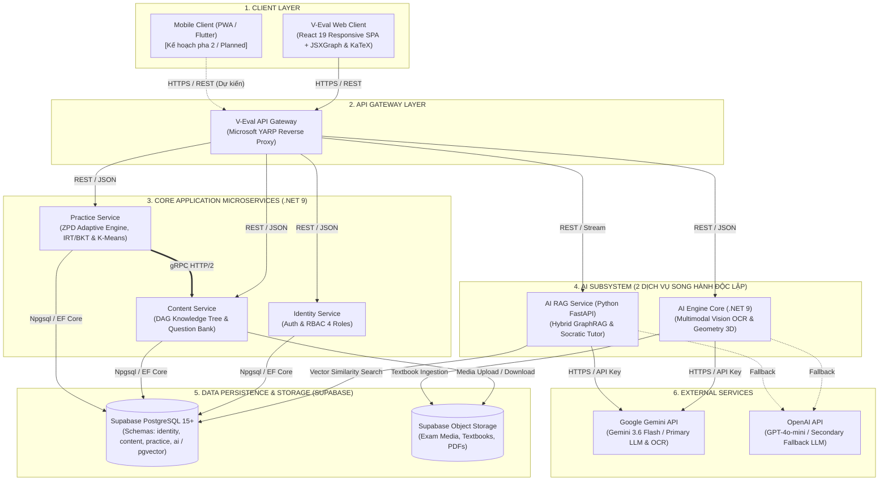

# V-EVAL: HỆ THỐNG CÁ NHÂN HÓA LỘ TRÌNH HỌC & LUYỆN THI ĐÁNH GIÁ NĂNG LỰC TÍCH HỢP AI (V-ACT 2026)

> **Dự án CapStone 2026** - Nền tảng khảo thí thích ứng và quy hoạch lộ trình học tập cá nhân hóa luyện thi Đánh Giá Năng Lực ĐHQG-HCM, vận hành theo kiến trúc Microservices phân tầng trên nền tảng .NET 9 Clean Architecture, YARP API Gateway, Supabase PostgreSQL (pgvector), gRPC Server-to-Server, JSXGraph Native Engine & Socratic AI Tutor.

---

## 📌 GIỚI THIỆU HỆ THỐNG (SYSTEM AT A GLANCE - 148 TỪ)

> V-Eval giải quyết bài toán ôn thi Đánh Giá Năng Lực (V-ACT) ĐHQG-HCM dàn trải và thiếu cá nhân hóa cho học sinh THPT, đồng thời hỗ trợ giáo viên quản lý lớp học phân hóa. Hệ thống áp dụng mô hình tâm trắc học IRT 2PL và Bayesian Knowledge Tracing để định lượng chính xác lỗ hổng kiến thức, tự động quy hoạch lộ trình học tập trên đồ thị DAG và phân cụm vi mô K-Means nhóm 3–5 học sinh có cùng điểm yếu. V-Eval tích hợp gia sư Socratic AI định hướng tư duy từng bước cùng thư viện JSXGraph dựng hình học 2D/3D tương tác. Nền tảng xây dựng theo kiến trúc Microservices phân tầng .NET 9 Clean Architecture, điều phối bởi API Gateway YARP, giao tiếp liên dịch vụ qua gRPC HTTP/2 và cô lập dữ liệu theo từng schema trên Supabase PostgreSQL.

---

## 🏛️ KIẾN TRÚC TỔNG QUAN HỆ THỐNG (SYSTEM OVERVIEW ARCHITECTURE)

Sơ đồ thể hiện toàn bộ các tầng thành phần (Clients, Gateway, Core Microservices, AI Subsystem, Database & Storage, External Cloud) và các luồng dữ liệu chính giữa chúng:



---

## 📁 CẤU TRÚC QUẢN TRỊ MÃ NGUỒN (SYSTEM REPOSITORY LAYOUT)

Dự án được tổ chức theo mô hình **System Repository (Monorepo Orchestration)** quản lý tập trung toàn bộ các dịch vụ và tài liệu:

```text
CapStone/
├── All Services/                           # Mã nguồn các dịch vụ độc lập
│   ├── V-Eval-Gateway/                     # API Gateway (Microsoft YARP Reverse Proxy)
│   ├── V-Eval-Identity_Service/            # Dịch vụ Định danh & RBAC 4 Roles
│   ├── V-Eval-Content_Service/             # Cây tri thức DAG & Ngân hàng đề (REST + gRPC :5250)
│   ├── V-Eval-Practice_Service/            # Động cơ thích ứng ZPD & IRT/BKT
│   ├── V-Eval-Ai_Engine/                   # AI OCR Vision (.NET) & Python FastAPI RAG
│   └── V-Eval-Web_Client/                  # Giao diện Web SPA (React 19, TailwindCSS v4)
├── Scripts/                                # Bộ script tự động hóa Windows Batch
│   ├── run_docker/                         # Script chạy toàn bộ hệ thống bằng Docker
│   ├── run_local/                          # Script chạy từng service môi trường Local
│   └── setup/                              # Script cấu hình môi trường ban đầu
├── docs/                                   # Hệ thống tài liệu đặc tả kiến trúc & nghiệp vụ
│   ├── diagrams/                           # Trọn bộ sơ đồ kiến trúc & Activity Diagrams chuẩn 6 Core Flows
│   ├── SQL/                                # Thiết kế CSDL & file DDL SQL (Supabase PostgreSQL 15+)
│   └── docs_noi_bo/                        # Kho lưu trữ tài liệu đặc tả nghiệp vụ & kế hoạch nội bộ
├── grpc/                                   # Hợp đồng giao tiếp Protocol Buffers liên dịch vụ
│   ├── content.proto                       # Hợp đồng gRPC Content Service (:5250)
│   └── ai.proto                            # Hợp đồng gRPC AI Streaming Service
├── docker-compose.yml                      # Điều phối container toàn bộ hệ sinh thái
└── UPDATE.md                               # Nhật ký tiến độ hệ thống (System Update Log)
```

---

## 🛠️ CÔNG NGHỆ CHỦ ĐẠO (CORE TECHNOLOGY STACK)

- **Backend Framework**: ASP.NET Core .NET 9 Clean Architecture, CQRS (MediatR), FluentValidation, Result Pattern.
- **API Gateway & Routing**: Microsoft YARP (Yet Another Reverse Proxy v2.3.0), Anti-Header Spoofing, Rate Limiting.
- **Inter-Service Communication**: gRPC HTTP/2 nhị phân (Server-to-Server) qua cổng `:5250`.
- **Frontend Client**: React 19 Responsive SPA (tối ưu hóa hiển thị desktop & mobile; Mobile App PWA/Flutter nằm trong lộ trình pha 2), Vite 8, TailwindCSS v4, Framer Motion.
- **Interactive Math Engines**: JSXGraph Native Vector Engine (render đồ thị 2D & hình học không gian 3D), KaTeX Live Math.
- **AI & RAG Subsystem**: Google Gemini API (`gemini-3.6-flash`, `gemini-embedding-001`) & OpenAI API (`gpt-4o-mini` Fallback), Python FastAPI, Supabase pgvector (3072-dim Embeddings).
- **Database & Storage**: Supabase PostgreSQL 15+ (Schema-based Multi-tenancy: `v_eval_identity`, `v_eval_content`, `v_eval_practice`, `v_eval_ai`), Supabase Object Storage (S3-compatible).

---

## 🚀 KHỞI CHẠY HỆ THỐNG (QUICK START)

### 1. Khởi chạy toàn bộ hệ sinh thái (Docker Compose):
Nhấp đúp chuột vào file script hoặc chạy từ Terminal:
```cmd
Scripts\run_docker\run_docker.bat
```
Hoặc bằng lệnh CLI:
```bash
docker compose up --build -d
```

### 2. Điểm truy cập hệ thống (Access Endpoints):
- **Web Client (Giao diện người dùng)**: `http://localhost:5173`
- **API Gateway (Single Entry Point)**: `http://localhost:5212`
- **Gateway Health Check**: `http://localhost:5212/healthz`

---

## 📑 MỤC LỤC TÀI LIỆU TRỌNG YẾU (KEY SPECIFICATIONS)

- 📘 **Bản Đặc Tả Kiến Trúc Tổng Thể (Report 4 SDD)**: [`docs/docs_noi_bo/V-Eval_Architecture_Plan.md`](./docs/docs_noi_bo/V-Eval_Architecture_Plan.md)
- 📊 **Trọn Bộ Sơ Đồ Mermaid Kiến Trúc & Hoạt Động (Activity Diagrams)**:
  - [Sơ đồ Kiến trúc tổng quan hệ thống](./docs/diagrams/architecture.mmd)
  - [Core Flow 1: Khảo thí chẩn đoán & Phân tầng](./docs/diagrams/core1_activity.mmd)
  - [Core Flow 2: Quy hoạch lộ trình DAG & Gom cụm vi mô](./docs/diagrams/core2_activity.mmd)
  - [Core Flow 3: Luyện tập thích ứng P-L-A-R & Thi thử](./docs/diagrams/core3_activity.mmd)
  - [Core Flow 4: Socratic AI Tutor & Giám sát tri thức](./docs/diagrams/core4_activity.mmd)
  - [Core Flow 5: Dashboard phân tích & Ma trận Heatmap](./docs/diagrams/core5_activity.mmd)
  - [Core Flow 6: Sổ tay lỗi sai & Ôn tập ngắt quãng SM-2](./docs/diagrams/core6_activity.mmd)
- 🗄️ **Thiết Kế CSDL & SQL DDL**: [`docs/SQL/SQL.sql`](./docs/SQL/SQL.sql)
- 📁 **Kho Tài Liệu Đặc Tả Nội Bộ**: [`docs/docs_noi_bo/`](./docs/docs_noi_bo/)
- 🟢 **Nhật Ký Tiến Độ Hệ Thống**: [`UPDATE.md`](./UPDATE.md)