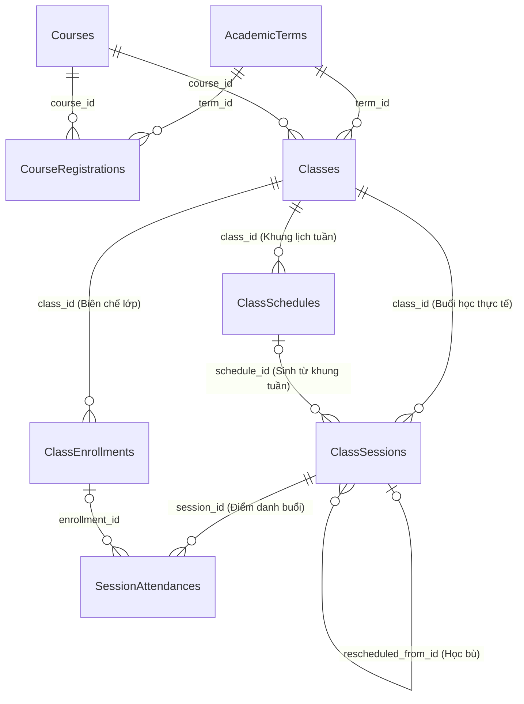

# ĐẶC TẢ KIẾN TRÚC 3 TẦNG DỮ LIỆU: CONCEPTUAL, LOGICAL & PHYSICAL ERD
# HỆ THỐNG ĐÁNH GIÁ NĂNG LỰC & HỌC TẬP THÍCH ỨNG V-EVAL

> **Tài liệu chuẩn hóa**: Đối chiếu xuyên suốt giữa **Conceptual ERD (22 Thực thể)** → **Logical ERD (5 Bounded Contexts)** → **Physical Schema (54 Bảng Vật lý)**  
> **Cập nhật trọng tâm**: Chuẩn hóa phân hệ **Học kỳ (`Term`), Khóa đào tạo (`Course`), Lớp học (`Class`), Khung lịch tuần (`ClassSchedules`), Buổi học thực tế (`ClassSessions`) và Điểm danh chuyên cần (`SessionAttendances`)** phục vụ truy vấn Lịch học Sinh viên & Lịch lên lớp Giảng viên theo Kỳ – theo Khóa chuẩn doanh nghiệp, 0% hardcode ở tầng Application.

---

## 🏛️ PHẦN 1: TẦNG KHÁI NIỆM — CONCEPTUAL ERD (22 THỰC THỂ CỐT LÕI)

Tầng **Conceptual ERD** biểu diễn **bản chất nghiệp vụ cốt lõi (Domain Concepts)** của toàn hệ thống V-Eval. So với bản sơ khai 21 thực thể, hệ thống chính thức bổ sung **thực thể thứ 22 là `Term` (Học kỳ / Đợt đào tạo)** và hoàn thiện **3 mối quan hệ ngữ nghĩa cho thực thể `Session`** (`User }o--o{ Session`, `Skill |o--o{ Session`, `Session |o--o{ Session`).

### 1.1 Sơ Đồ Conceptual ERD Chuẩn Hóa (22 Thực Thể)

```mermaid
erDiagram
    Campus ||--o{ Term : "mở học kỳ / đợt đào tạo"
    Campus ||--o{ Course : "mở khóa đào tạo"
    Campus ||--o{ Class : "tổ chức lớp học"
    Campus ||--o{ User : "quản lý nhân sự & học sinh"

    Term ||--o{ Registration : "ghi danh theo học kỳ"
    Term ||--o{ Class : "mở lớp theo học kỳ"

    Course ||--o{ Registration : "ghi danh theo khóa học"
    Course ||--o{ Class : "triển khai các lớp học"

    Registration |o--o{ Registration : "học lại (retake attempt)"
    Registration ||--o{ Payment : "thanh toán học phí"
    Registration ||--o{ ReadinessAssessment : "đánh giá chuẩn đầu ra"
    Registration ||--o{ Roadmap : "khởi tạo lộ trình kỳ học"

    User |o--o{ User : "giám hộ (Parent - Student)"
    User ||--o{ Registration : "đăng ký khóa học"
    User ||--o{ Payment : "thực hiện giao dịch"
    User }o--o{ Class : "phụ trách lớp (Teacher) / biên chế lớp (Student)"
    User }o--o{ Session : "đứng lớp & dạy thay (Teacher) / điểm danh buổi học (Student)"
    User }o--o{ MicroGroup : "tham gia nhóm vi mô"
    User ||--o{ DailyActivity : "ghi nhận tự học hằng ngày"
    User ||--o{ Alert : "nhận cảnh báo học vụ"
    User }o--o{ Skill : "tích lũy hồ sơ năng lực & sổ tay lỗi sai"
    User ||--o{ ExamSubmission : "nộp bài khảo thí"
    User ||--o{ QuizAttempt : "làm bài luyện tập thích ứng"
    User ||--o{ Aspiration : "đăng ký nguyện vọng đại học"
    User ||--o{ RealExamResult : "ghi nhận điểm thi ĐGNL thật"
    User }o--o{ Subject : "chuyên môn giảng dạy"

    Subject ||--o{ Class : "phân môn lớp học"
    Subject ||--o{ Skill : "chứa cây kỹ năng"

    Class ||--o{ Session : "quản lý khung lịch tuần & các buổi học"
    Class ||--o{ MicroGroup : "phân cụm nhóm vi mô 3-5 học sinh"
    Class }o--o{ Skill : "kỹ năng trọng tâm của lớp"

    Session |o--o{ Session : "dời lịch / học bù (rescheduled_from)"
    Skill |o--o{ Session : "kỹ năng giảng dạy trong buổi"

    MicroGroup }o--o{ Skill : "kỹ năng yếu cần bù đắp"

    Skill |o--o{ Skill : "phân cấp cha-con & điều kiện tiên quyết (DAG)"
    Skill ||--o{ RoadmapNode : "định nghĩa chặng học"
    Skill ||--o{ Question : "đo lường qua câu hỏi"
    Skill ||--o{ Alert : "cảnh báo lỗ hổng kiến thức"

    Roadmap ||--|{ RoadmapNode : "cấu thành từ các chặng"
    RoadmapNode ||--o{ QuizAttempt : "thực thi chu trình P-L-A-R"

    Question }o--o{ Exam : "cấu trúc ma trận đề thi"
    Question ||--o{ QuizAttempt : "trả lời câu hỏi thích ứng"

    Exam ||--o{ ExamSubmission : "tổ chức phiên thi"

    Aspiration ||--o{ RealExamResult : "đối sánh kết quả trúng tuyển"
```

### 1.2 Danh Mục 22 Thực Thể Conceptual & Vai Trò Ngữ Nghĩa

| STT | Thực Thể Conceptual | Ý Nghĩa Bản Chất Trong Nghiệp Vụ Giáo Dục V-Eval |
| :--- | :--- | :--- |
| **01** | **`Campus`** | Cơ sở đào tạo vật lý nơi tổ chức lớp học trực tiếp và thi thử tập trung. |
| **02** | **`Term`** *(Mới)* | **Học kỳ / Đợt đào tạo chính thức** (VD: `Học kỳ 1 (2026-2027)`, `Học kỳ 2 (2026-2027)`, `Kỳ Hè 2027`), định nghĩa mốc thời gian `start_date` – `end_date` chuẩn cho mọi lớp học và lượt đăng ký. |
| **03** | **`Course`** | Khóa đào tạo chuẩn do cơ sở mở (quy định gói tiêu chuẩn, thời lượng số tuần `duration_weeks`, học phí, chính sách học lại, sĩ số tối đa 20 học sinh). |
| **04** | **`Registration`** | Sự kiện học sinh ghi danh vào một `Course` trong một `Term` cụ thể. Quan hệ tự thân lưu vết các lần đăng ký học lại (`attempt_no`). |
| **05** | **`Payment`** | Giao dịch thanh toán học phí của phụ huynh/học sinh cho đợt đăng ký khóa học. |
| **06** | **`User`** | Con người tương tác với hệ thống (Học sinh, Phụ huynh, Giảng viên, Quản lý học vụ, Giám đốc học thuật, Admin). |
| **07** | **`Subject`** | Môn học / Miền năng lực cốt lõi trong kỳ thi ĐGNL (Ngôn ngữ, Toán học – Tư duy logic, Giải quyết vấn đề). |
| **08** | **`Class`** | Lớp học Cohort trực tiếp (tối đa 20 học sinh) mở theo `Term` và `Course`, gắn với 1 `Subject` và 1 Giảng viên chủ nhiệm tại `Campus`. |
| **09** | **`Session`** | **Lịch học & Buổi lên lớp của Lớp học**. Nối với `Class` (thuộc lớp nào), `Skill` (dạy bài gì), `User` (ai đứng lớp/dạy thay & học sinh nào điểm danh), và tự nối `Session` (buổi học bù cho buổi nghỉ nào). |
| **10** | **`MicroGroup`** | Nhóm học tập vi mô (3–5 học sinh) bên trong một lớp học, được gom cụm theo vùng trũng kỹ năng chung. |
| **11** | **`Skill`** | Đơn vị tri thức/kỹ năng vi mô. Quan hệ tự thân biểu diễn cây phân cấp chuyên đề và đồ thị tiên quyết có hướng (DAG). |
| **12** | **`Question`** | Câu hỏi trắc nghiệm khách quan chuẩn hóa kèm ngữ liệu đọc hiểu dùng để đo lường kỹ năng. |
| **13** | **`Exam`** | Đề thi chuẩn hóa (Đề chẩn đoán đầu vào 30 câu, Đề thi thử 120 câu, Đề kiểm tra định kỳ). |
| **14** | **`ExamSubmission`** | Lượt làm bài và nộp bài thi của học sinh kèm giám sát liêm chính và điểm năng lực khởi điểm `theta_0`. |
| **15** | **`Roadmap`** | Lộ trình học tập cá nhân hóa của học sinh gắn liền với kỳ đăng ký khóa học (`Registration`). |
| **16** | **`RoadmapNode`** | Từng chặng kỹ năng trên lộ trình cá nhân hóa và tiến trình rèn luyện 4 bước P-L-A-R. |
| **17** | **`QuizAttempt`** | Lượt trả lời từng câu hỏi luyện tập thích ứng của học sinh trong chặng học để cập nhật BKT `P(L_t)`. |
| **18** | **`DailyActivity`** | Nhật ký tự học trên hệ thống, thời lượng rèn luyện và chuỗi ngày hoạt động liên tục (Streak) mỗi ngày của học sinh. |
| **19** | **`ReadinessAssessment`** | Đánh giá mức độ sẵn sàng đầu ra của học sinh so với tiêu chuẩn cam kết của khóa học. |
| **20** | **`Alert`** | Cảnh báo học vụ sớm khi học sinh tụt hậu, vắng học hoặc gặp điểm nghẽn kỹ năng. |
| **21** | **`Aspiration`** | Nguyện vọng trường Đại học và ngành xét tuyển mục tiêu kèm điểm chuẩn đối sánh của học sinh. |
| **22** | **`RealExamResult`** | Kết quả điểm thi ĐGNL thực tế, kết quả đậu/rớt nguyện vọng và thống kê chất lượng toàn khóa. |

---

## 🧩 PHẦN 2: TẦNG LOGIC & PHYSICAL — MA TRẬN ÁNH XẠ 22 THỰC THỂ CONCEPTUAL → 54 BẢNG VẬT LÝ

| STT | Thực Thể Conceptual | Schema (Bounded Context) | Các Bảng Vật Lý (Tổng: 54 Bảng) | Giải Thích Quy Tắc Phân Rã Logical → Physical |
| :--- | :--- | :--- | :--- | :--- |
| **01** | **`Campus`** | `v_eval_identity` | 1. `Campuses` | Ánh xạ 1–1 trực tiếp. |
| **02** | **`User`** | `v_eval_identity` | 2. `Users`<br/>3. `Roles`<br/>4. `UserRoles`<br/>5. `Students`<br/>6. `Parents`<br/>7. `ParentStudentRelations`<br/>8. `Teachers`<br/>9. `AcademicManagers`<br/>10. `AcademicDirectors`<br/>11. `Administrators` | Phân rã RBAC (`Users` – `Roles` – `UserRoles`), tách hồ sơ chuyên biệt theo từng Actor (Subtyping) và bảng nối giám hộ `ParentStudentRelations`. |
| **03** | **`Subject`** | `v_eval_content`<br/>`v_eval_identity` | 12. `TeacherSubjects`<br/>13. `CompetencyDomains` | Thực thể gốc là `CompetencyDomains`; quan hệ `M:N` giữa `Teacher` và `Subject` phân rã thành `TeacherSubjects`. |
| **04** | **`Skill`** | `v_eval_content`<br/>`v_eval_practice` | 14. `Skills`<br/>15. `SkillPrerequisites`<br/>16. `Materials`<br/>38. `LearningProfiles`<br/>43. `MistakeNotebooks` | Tách đồ thị tiên quyết DAG (`SkillPrerequisites`), học liệu (`Materials`), năng lực BKT (`LearningProfiles`) và sổ tay SM-2 (`MistakeNotebooks`). |
| **05** | **`Question`** | `v_eval_content` | 17. `Passages`<br/>18. `Questions` | Tách ngữ liệu đọc hiểu dùng chung thành `Passages` liên kết `1:N` với `Questions`. |
| **06** | **`Exam`** | `v_eval_content` | 19. `MockExams`<br/>20. `ExamQuestions` | Quan hệ `M:N` giữa `Exam` và `Question` phân rã thành ma trận đề thi `ExamQuestions`. |
| **07** | **`Term`** *(Mới)* | `v_eval_enrollment` | **21. `AcademicTerms`** | **Bảng danh mục Học kỳ / Đợt đào tạo chuẩn** (`term_id`, `campus_id`, `code`, `name`, `academic_year`, `term_order`, `start_date`, `end_date`, `status`). |
| **08** | **`Course`** | `v_eval_enrollment` | 22. `Courses`<br/>23. `ReadinessStandards` | Khóa đào tạo (`Courses`) và tiêu chuẩn cam kết đầu ra (`ReadinessStandards`). |
| **09** | **`Registration`** | `v_eval_enrollment` | 24. `CourseRegistrations` | Gắn kết `student_id` + `course_id` + **`term_id`** + `attempt_no` (theo dõi đăng ký theo đúng Học kỳ & Khóa học). |
| **10** | **`Payment`** | `v_eval_enrollment` | 25. `Payments`<br/>26. `PaymentTransactions` | Thanh toán học phí (`Payments`) và nhật ký đối soát Webhook PayOS (`PaymentTransactions`). |
| **11** | **`Class`** | `v_eval_practice` | 27. `Classes`<br/>28. `ClassSkills`<br/>29. `ClassEnrollments` | `Classes` gắn trực tiếp **`term_id`** + **`course_id`** + `domain_id` + `teacher_id`; học sinh biên chế vào lớp qua `ClassEnrollments`; kỹ năng lớp qua `ClassSkills`. |
| **12** | **`Session`** *(Nâng cấp)* | `v_eval_practice` | **30. `ClassSchedules`** *(Mới)*<br/>**31. `ClassSessions`** *(Nâng cấp)*<br/>**32. `SessionAttendances`** *(Mới)* | • **`ClassSchedules`**: Lưu khung lịch tuần cố định (`day_of_week`, `slot_number`, `start_time`, `end_time`, `room`) để rải lịch tự động.<br/>• **`ClassSessions`**: Lưu từng buổi học cụ thể, có `teacher_id` (hỗ trợ dạy thay), `rescheduled_from_id` (hỗ trợ học bù), `skill_id`, `topic_title`.<br/>• **`SessionAttendances`**: Phân rã từ `User }o--o{ Session`, lưu điểm danh từng học sinh theo từng buổi (`PRESENT`, `ABSENT`, `LATE`, `EXCUSED`). |
| **13** | **`ExamSubmission`** | `v_eval_practice` | 33. `ExamSubmissions`<br/>34. `SubmissionAnswers`<br/>35. `ProctoringSnapshots` | Phiên làm bài thi, chi tiết câu trả lời và ảnh chụp giám sát liêm chính. |
| **14** | **`MicroGroup`** | `v_eval_practice` | 36. `ClassGroups`<br/>37. `ClassGroupSkills`<br/>38. `ClassGroupMembers` | Nhóm học tập vi mô 3–5 học sinh trong lớp, kỹ năng yếu của nhóm và danh sách thành viên. |
| **15** | **`Roadmap`** | `v_eval_practice` | 40. `LearningRoadmaps` | Lộ trình học tập cá nhân hóa của học sinh. |
| **16** | **`RoadmapNode`** | `v_eval_practice` | 41. `RoadmapNodes`<br/>42. `StageProgress` | Chặng học trên lộ trình và tiến trình thực thi 4 bước P-L-A-R. |
| **17** | **`QuizAttempt`** | `v_eval_practice` | 43. `AdaptiveQuizAttempts` | Lượt trả lời câu hỏi thích ứng. |
| **18** | **`DailyActivity`** | `v_eval_practice` | 45. `StudentDailyActivities` | Nhật ký hoạt động tự học hằng ngày trên hệ thống. |
| **19** | **`ReadinessAssessment`** | `v_eval_practice` | 46. `ReadinessAssessments` | Kết quả đánh giá mức độ sẵn sàng thi cử. |
| **20** | **`Alert`** | `v_eval_practice` | 47. `SystemAlerts` | Cảnh báo học vụ sớm. |
| **21** | **`Aspiration`** | `v_eval_outcome` | 48. `Universities`<br/>49. `AdmissionPrograms`<br/>50. `AdmissionBenchmarks`<br/>51. `StudentAspirations` | Danh mục Trường ĐH, Ngành xét tuyển, Điểm chuẩn hàng năm và Nguyện vọng của học sinh. |
| **22** | **`RealExamResult`** | `v_eval_outcome` | 52. `RealExamResults`<br/>53. `AdmissionResults`<br/>54. `CohortOutcomeSummaries` | Điểm thi thật, kết quả trúng tuyển và thống kê tổng hợp chất lượng đầu ra theo khóa. |

---

## 📅 PHẦN 3: THIẾT KẾ VẬT LÝ CHI TIẾT (DDL) CHO PHÂN HỆ HỌC KỲ, LỊCH HỌC & ĐIỂM DANH



### 3.1 Cấu Trúc Bảng Vật Lý Chuẩn

1. **`v_eval_enrollment."AcademicTerms"` (Kỳ học / Đợt đào tạo)**:
   - `term_id` (`uuid` PK)
   - `campus_id` (`uuid` NOT NULL)
   - `code` (`varchar(50)` UNIQUE NOT NULL — VD: `'TERM_2026_HK1'`, `'TERM_2026_HK2'`, `'TERM_2027_SUMMER'`)
   - `name` (`varchar(255)` NOT NULL — VD: `'Học kỳ 1 - Niên khóa 2026-2027'`)
   - `academic_year` (`varchar(20)` NOT NULL — VD: `'2026-2027'`)
   - `term_order` (`integer` NOT NULL DEFAULT 1)
   - `start_date` (`date` NOT NULL)
   - `end_date` (`date` NOT NULL)
   - `status` (`varchar(30)` NOT NULL DEFAULT `'ONGOING'` — `'UPCOMING' | 'ONGOING' | 'COMPLETED'`)
   - `is_active` (`boolean` NOT NULL DEFAULT true)
   - `created_at` (`timestamptz` NOT NULL DEFAULT now())

2. **`v_eval_practice."ClassSchedules"` (Khung lịch định kỳ hàng tuần của Lớp)**:
   - `schedule_id` (`uuid` PK)
   - `class_id` (`uuid` NOT NULL FK → `Classes(class_id)` ON DELETE CASCADE)
   - `day_of_week` (`integer` NOT NULL — `2 = Thứ Hai ... 8 = Chủ Nhật`)
   - `slot_number` (`integer` NOT NULL DEFAULT 1 — `Ca 1 .. Ca 6`)
   - `start_time` (`time` NOT NULL)
   - `end_time` (`time` NOT NULL)
   - `room` (`varchar(100)`)
   - `is_active` (`boolean` NOT NULL DEFAULT true)
   - `created_at` (`timestamptz` NOT NULL DEFAULT now())
   - Ràng buộc: `UNIQUE ("class_id", "day_of_week", "start_time")`, `CHECK (end_time > start_time)`.

3. **`v_eval_practice."ClassSessions"` (Buổi học / Ca lên lớp cụ thể từng ngày)**:
   - `session_id` (`uuid` PK)
   - `class_id` (`uuid` NOT NULL FK → `Classes(class_id)` ON DELETE CASCADE)
   - `schedule_id` (`uuid` NULL FK → `ClassSchedules(schedule_id)` ON DELETE SET NULL)
   - `session_no` (`integer` NOT NULL DEFAULT 1 — Thứ tự buổi 1, 2, 3... trong khóa)
   - `skill_id` (`uuid` NULL — Kỹ năng trọng tâm từ `v_eval_content."Skills"`)
   - `topic_title` (`varchar(255)` NULL — Tiêu đề bài học cụ thể của buổi)
   - `teacher_id` (`uuid` NULL — Giảng viên đứng lớp thực tế hoặc dạy thay buổi này)
   - `session_date` (`date` NOT NULL)
   - `start_time` (`time` NOT NULL)
   - `end_time` (`time` NOT NULL)
   - `room` (`varchar(100)`)
   - `status` (`varchar(30)` NOT NULL DEFAULT `'SCHEDULED'` — `'SCHEDULED' | 'ONGOING' | 'COMPLETED' | 'CANCELLED' | 'RESCHEDULED'`)
   - `rescheduled_from_id` (`uuid` NULL FK → `ClassSessions(session_id)` ON DELETE SET NULL)
   - `notes` (`text` NULL — Ghi chú dặn dò của giảng viên hoặc lý do báo nghỉ/học bù)
   - `created_at` (`timestamptz` NOT NULL DEFAULT now())
   - `updated_at` (`timestamptz` NOT NULL DEFAULT now())
   - Ràng buộc: `UNIQUE ("class_id", "session_date", "start_time")`, `CHECK (end_time > start_time)`.

4. **`v_eval_practice."SessionAttendances"` (Điểm danh học sinh theo từng buổi học)**:
   - `attendance_id` (`uuid` PK)
   - `session_id` (`uuid` NOT NULL FK → `ClassSessions(session_id)` ON DELETE CASCADE)
   - `student_id` (`uuid` NOT NULL)
   - `enrollment_id` (`uuid` NULL FK → `ClassEnrollments(enrollment_id)` ON DELETE SET NULL)
   - `status` (`varchar(30)` NOT NULL DEFAULT `'PRESENT'` — `'PRESENT' | 'ABSENT' | 'LATE' | 'EXCUSED'`)
   - `check_in_at` (`timestamptz` NULL)
   - `recorded_by` (`uuid` NULL — `teacher_id` người thực hiện điểm danh)
   - `note` (`text` NULL)
   - `created_at` (`timestamptz` NOT NULL DEFAULT now())
   - `updated_at` (`timestamptz` NOT NULL DEFAULT now())
   - Ràng buộc: `UNIQUE ("session_id", "student_id")`.
