# BẢN ĐẶC TẢ THIẾT KẾ MÔ HÌNH DỮ LIỆU KHÁI NIỆM TOÀN DIỆN (COMPREHENSIVE CONCEPTUAL ERD SPECIFICATION)
# HỆ THỐNG ĐÁNH GIÁ & HỌC TẬP THÍCH ỨNG V-EVAL (V-ACT ĐHQG-HCM)

> **Tài liệu**: Bản đặc tả kiến trúc dữ liệu mức khái niệm (Conceptual Data Model / Conceptual ERD)  
> **Phiên bản Schema**: Đồng bộ 100% với mã nguồn triển khai và [SQL.sql](./SQL.sql)  
> **Ngày ban hành**: 16/10/2026 — Phiên bản 3.0 Hoàn Thiện  
> **Mục tiêu tài liệu**: Cung cấp ngữ cảnh đầy đủ, chi tiết từng thuộc tính và mối quan hệ để bất kỳ AI Modeling Assistant nào cũng có thể đọc hiểu và dựng lại sơ đồ ERD hoàn chỉnh không sai sót.  
> **Tương thích Markdown**: Chuẩn hóa 100% cho MD Editor Plus (Relative links, Backtick LaTeX, Mermaid 11.15.0+).

---

## 📌 PHẦN 1: TỔNG QUAN KIẾN TRÚC & NGUYÊN TẮC THIẾT KẾ ERD KHÁI NIỆM

### 1.1 Khác Biệt Giữa ERD Khái Niệm (Conceptual) và ERD Vật Lý (Physical)
- **ERD Vật lý (Physical ERD)**: Tập trung vào chi tiết cài đặt của CSDL (PostgreSQL / Supabase), bao gồm kiểu dữ liệu vật lý (`uuid`, `varchar(255)`, `timestamp with time zone`), cơ chế sinh khóa (`gen_random_uuid()`), chỉ mục (`B-Tree`, `HNSW Vector Index`), và cú pháp DDL.
- **ERD Khái niệm (Conceptual ERD / CDM)**: Tập trung vào **Ý nghĩa thực tế của đối tượng nghiệp vụ (Business Concepts)**, **Thuộc tính mang giá trị thông tin (Informational Attributes)**, và **Bản chất mối liên kết sư phạm/vận hành (Semantic Relationships & Cardinality: 1:1, 1:N, N:N)**. Mô hình này giúp các kiến trúc sư, chuyên gia sư phạm và AI nắm bắt trọn vẹn bức tranh tổng thể của hệ thống luyện thi thích ứng ĐGNL ĐHQG-HCM.

### 1.2 Phân Vùng 10 Miền Nghiệp Vụ (Bounded Contexts)
Hệ thống được cấu trúc thành 10 miền dữ liệu gắn kết cao (High Cohesion) và lỏng lẻo (Loose Coupling):
1. **Miền 1: Định danh, Phân quyền & Bảo mật (IAM Context)**: Quản lý người dùng, phân quyền RBAC, cơ sở đào tạo, token phiên và mã xác minh.
2. **Miền 2: Hồ sơ Chủ thể & Quan hệ Gia đình (Actor Profiles Context)**: Kế thừa 1:1 từ người dùng với các vai trò Học sinh, Phụ huynh, Giáo viên, Quản trị viên.
3. **Miền 3: Khung Năng Lực & Đồ Thị Tri Thức DAG (Competency & Curriculum Graph)**: Cấu trúc 3 phần thi ĐGNL, cây kỹ năng vi mô và đồ thị phụ thuộc tiên quyết (DAG).
4. **Miền 4: Ngân Hàng Câu Hỏi & Đề Thi Chuẩn Hóa (Assessment Items Context)**: Ngữ liệu đọc hiểu, câu hỏi chuẩn hóa IRT/Bloom, cấu trúc đề thi.
5. **Miền 5: Lớp Học Trực Tiếp & Phân Nhóm Vi Mô (Classroom & Micro-Cohort Context)**: Lớp học trực tiếp tại cơ sở phân tầng K-Means, nhóm vi mô 3–5 bạn cùng lỗ hổng kiến thức.
6. **Miền 6: Lộ Trình Thích Ứng & Chu Trình P-L-A-R (Adaptive Roadmap Context)**: Lộ trình cá nhân hóa cắt tỉa tự động, chặng học tích hợp Video + Quiz, tiến trình FSM 4 bước P-L-A-R.
7. **Miền 7: Động Cơ Thích Ứng & Sổ Tay Lỗi Sai (Adaptive Engine & Remediation)**: Log trả lời BKT/IRT ZPD, hồ sơ thành thạo `P(L_t)`, sổ tay lỗi sai và thuật toán lặp lại ngắt quãng SM-2.
8. **Miền 8: Thi Cử & Giám Sát Liêm Chính (Exam Integrity Context)**: Phiên làm bài thi thử 120 câu 150 phút, chấm điểm, đếm rời tab và ảnh chụp webcam proctoring.
9. **Miền 9: Dự Báo Điểm & Cảnh Báo Sớm BR-04 (Core Flow 6 Context)**: Dải điểm kỳ vọng SEM 95%, bảng cân đối thâm hụt, toa thuốc bù điểm Knapsack ROI, cảnh báo sớm 3 cấp độ.
10. **Miền 10: Trợ Giảng AI Socratic & Tri Thức Vector RAG (AI Tutor Context)**: Nguồn tri thức SGK, Vector Chunks 768 chiều (`pgvector`), phiên hỏi đáp Socratic gợi mở tư duy.

---

## 📊 PHẦN 2: SƠ ĐỒ THỰC THỂ QUAN HỆ KHÁI NIỆM MERMAID (FULL ATTRIBUTES)

Sơ đồ Mermaid dưới đây biểu diễn toàn bộ **49 thực thể** kèm các thuộc tính định danh, thuộc tính trạng thái cốt lõi và các đường liên kết quan hệ bản số (đồng bộ 100% với [SQL.sql](./SQL.sql) và sơ đồ 2 trang tại [Capstone.drawio](./Capstone.drawio)):

```mermaid
erDiagram
    %% ==========================================
    %% 1. MIỀN ĐỊNH DANH, BẢO MẬT & ACTORS
    %% ==========================================
    Users {
        uuid user_id PK
        string email
        string password_hash
        string full_name
        string phone
        string avatar_url
        boolean is_active
    }
    Roles {
        uuid role_id PK
        string role_name
    }
    UserRoles {
        uuid user_id PK,FK
        uuid role_id PK,FK
    }
    RefreshTokens {
        uuid refresh_token_id PK
        uuid user_id FK
        string token
        timestamp expires_at
        boolean is_revoked
    }
    OtpVerifications {
        uuid id PK
        string email
        string otp_code
        string type
        timestamp expires_at
        boolean is_used
    }
    Campuses {
        uuid campus_id PK
        string name
        string address
        string phone
        boolean is_active
    }

    Students {
        uuid student_id PK,FK
        uuid campus_id FK
        int target_score
        date exam_date
        float study_hours_day
        string school_name
    }
    Parents {
        uuid parent_id PK,FK
        string phone_work
    }
    ParentStudentRelations {
        uuid relation_id PK
        uuid parent_id FK
        uuid student_id FK
    }
    Teachers {
        uuid teacher_id PK,FK
        uuid campus_id FK
        string specialty
        string bio
    }
    AcademicManagers {
        uuid manager_id PK,FK
        uuid campus_id FK
    }
    AcademicDirectors {
        uuid director_id PK,FK
    }
    Administrators {
        uuid admin_id PK,FK
    }

    Users ||--o{ UserRoles : "has"
    Roles ||--o{ UserRoles : "assigned_to"
    Users ||--o{ RefreshTokens : "owns"
    Users ||--o{ OtpVerifications : "verifies_email"
    Campuses ||--o{ Users : "belongs_to"

    Users ||--|| Students : "is_a (1:1)"
    Users ||--|| Teachers : "is_a (1:1)"
    Users ||--|| Parents : "is_a (1:1)"
    Users ||--|| AcademicManagers : "is_a (1:1)"
    Users ||--|| AcademicDirectors : "is_a (1:1)"
    Users ||--|| Administrators : "is_a (1:1)"

    Campuses ||--o{ Students : "manages_student"
    Campuses ||--o{ Teachers : "employs_teacher"
    Campuses ||--o{ AcademicManagers : "employs_manager"

    Parents ||--o{ ParentStudentRelations : "cares"
    Students ||--o{ ParentStudentRelations : "child_of"

    %% ==========================================
    %% 2. KHUNG NĂNG LỰC & HỌC LIỆU
    %% ==========================================
    CompetencyDomains {
        uuid domain_id PK
        string name
        string description
        boolean is_approved
        uuid approved_by FK
    }
    Skills {
        uuid skill_id PK
        uuid domain_id FK
        string name
        uuid parent_id FK
        float weight
        boolean is_approved
    }
    SkillPrerequisites {
        uuid skill_id PK,FK
        uuid prerequisite_id PK,FK
    }
    Materials {
        uuid material_id PK
        uuid skill_id FK
        string title
        string content
        string video_url
        int duration_seconds
    }

    CompetencyDomains ||--o{ Skills : "contains"
    Skills ||--o{ Skills : "sub_skill_of"
    Skills ||--o{ SkillPrerequisites : "dependent_skill"
    Skills ||--o{ SkillPrerequisites : "prerequisite_skill"
    Skills ||--o{ Materials : "has_materials"
    AcademicDirectors ||--o{ CompetencyDomains : "approves_domain"
    AcademicDirectors ||--o{ Skills : "approves_skill"

    %% ==========================================
    %% 3. NGÂN HÀNG CÂU HỎI & ĐỀ THI
    %% ==========================================
    Passages {
        uuid passage_id PK
        string title
        string content
        string image_url
    }
    Questions {
        uuid question_id PK
        uuid skill_id FK
        uuid passage_id FK
        int difficulty_level
        string content_latex
        string option_a
        string option_b
        string option_c
        string option_d
        string correct_option
        string explanation
        string moderation_status
    }
    MockExams {
        uuid exam_id PK
        uuid campus_id FK
        string title
        string exam_category
        string subject_code
        int difficulty_level
        int duration_minutes
        int total_questions
        boolean is_published
    }
    ExamQuestions {
        uuid exam_id PK,FK
        uuid question_id PK,FK
        int question_order
    }

    Skills ||--o{ Questions : "evaluates"
    Passages ||--o{ Questions : "context_for"
    MockExams ||--o{ ExamQuestions : "comprises"
    Questions ||--o{ ExamQuestions : "included_in"
    Campuses ||--o{ MockExams : "organizes_exam"

    %% ==========================================
    %% 4. LỚP HỌC TRỰC TIẾP & NHÓM VI MÔ
    %% ==========================================
    Classes {
        uuid class_id PK
        uuid campus_id FK
        uuid teacher_id FK
        string name
        string status
        int class_type
        uuid domain_id FK
        string domain_code
        int cluster_index
    }
    ClassEnrollments {
        uuid enrollment_id PK
        uuid class_id FK
        uuid student_id FK
        uuid diagnostic_submission_id FK
        string status
    }
    ClassGroups {
        uuid group_id PK
        uuid class_id FK
        string group_name
        string focus_area
        string common_weak_skill_ids
        string assigned_worksheet_title
    }
    ClassGroupMembers {
        uuid group_member_id PK
        uuid group_id FK
        uuid student_id FK
    }
    TeacherFeedback {
        uuid feedback_id PK
        uuid teacher_id FK
        uuid student_id FK
        uuid class_id FK
        string content
    }

    Campuses ||--o{ Classes : "hosts_class"
    Teachers ||--o{ Classes : "teaches_class"
    Classes ||--o{ ClassEnrollments : "enrolls"
    Students ||--o{ ClassEnrollments : "participates_in"
    Classes ||--o{ ClassGroups : "micro_partition"
    ClassGroups ||--o{ ClassGroupMembers : "consists_of"
    Students ||--o{ ClassGroupMembers : "grouped_in"
    Teachers ||--o{ TeacherFeedback : "provides_feedback"
    Students ||--o{ TeacherFeedback : "receives_feedback"
    Classes ||--o{ TeacherFeedback : "feedback_context"

    %% ==========================================
    %% 5. LỘ TRÌNH THÍCH ỨNG & TIẾN TRÌNH P-L-A-R
    %% ==========================================
    LearningRoadmaps {
        uuid roadmap_id PK
        uuid student_id FK
        uuid diagnostic_submission_id FK
        int target_score
        int total_milestones
        int completed_milestones
        boolean is_pruned
        string status
    }
    RoadmapNodes {
        uuid node_id PK
        uuid roadmap_id FK
        uuid skill_id FK
        int step_order
        uuid material_id FK
        uuid quiz_exam_id FK
        string status
        boolean is_pruned
        float quiz_score
        boolean is_quiz_passed
    }
    StageProgress {
        uuid id PK
        uuid student_id FK
        uuid roadmap_node_id FK
        string current_step
        float video_watch_percentage
        float bkt_mastery_plt
        int consecutive_advanced_correct
        int consecutive_incorrect
        string status
    }

    Students ||--o{ LearningRoadmaps : "follows_roadmap"
    LearningRoadmaps ||--o{ RoadmapNodes : "composed_of_nodes"
    Skills ||--o{ RoadmapNodes : "targets_skill"
    Materials ||--o| RoadmapNodes : "embeds_material"
    MockExams ||--o| RoadmapNodes : "embeds_quiz"
    Students ||--o{ StageProgress : "advances_stage"
    RoadmapNodes ||--o{ StageProgress : "progress_tracked_in"

    %% ==========================================
    %% 6. ĐỘNG CƠ BKT, IRT & SỔ TAY LỖI SAI SM-2
    %% ==========================================
    AdaptiveQuizAttempts {
        uuid id PK
        uuid stage_progress_id FK
        uuid student_id FK
        uuid question_id FK
        string pattern_id
        string selected_option
        boolean is_correct
        int time_spent_seconds
        float item_difficulty_b
        float prior_plt
        float posterior_plt
    }
    LearningProfiles {
        uuid profile_id PK
        uuid student_id FK
        uuid skill_id FK
        float mastery_score
    }
    MistakeNotebooks {
        uuid id PK
        uuid student_id FK
        uuid question_id FK
        uuid skill_id FK
        string pattern_id
        string cognitive_error_tag
        string student_notes
        date next_review_date
        int review_count
        int interval_days
        float ease_factor
        boolean is_mastered
    }

    StageProgress ||--o{ AdaptiveQuizAttempts : "executes_attempt"
    Questions ||--o{ AdaptiveQuizAttempts : "attempted_question"
    Students ||--o{ AdaptiveQuizAttempts : "answers_attempt"
    Students ||--o{ LearningProfiles : "possesses_profile"
    Skills ||--o{ LearningProfiles : "evaluates_skill"
    Students ||--o{ MistakeNotebooks : "maintains_notebook"
    Questions ||--o{ MistakeNotebooks : "failed_question"
    Skills ||--o{ MistakeNotebooks : "failed_skill"

    %% ==========================================
    %% 7. THI CỬ, NỘP BÀI & PROCTORING
    %% ==========================================
    ExamSubmissions {
        uuid submission_id PK
        uuid student_id FK
        uuid exam_id FK
        string exam_type
        int total_score
        int total_correct
        int total_questions
        string status
        float theta_0
        string placement_class
        int tab_departure_count
        string integrity_status
        string mentor_verdict
    }
    SubmissionAnswers {
        uuid answer_id PK
        uuid submission_id FK
        uuid question_id FK
        string selected_option
        boolean is_correct
        int time_spent_seconds
    }
    ProctoringSnapshots {
        uuid id PK
        uuid submission_id FK
        string snapshot_url
        timestamp captured_at
        boolean face_detected
    }
    AttemptLogs {
        uuid attempt_id PK
        uuid student_id FK
        uuid question_id FK
        string selected_option
        boolean is_correct
        int time_spent
    }

    Students ||--o{ ExamSubmissions : "submits_exam"
    MockExams ||--o{ ExamSubmissions : "instance_of_exam"
    ExamSubmissions ||--o{ SubmissionAnswers : "contains_answers"
    Questions ||--o{ SubmissionAnswers : "answers_for_question"
    ExamSubmissions ||--o{ ProctoringSnapshots : "monitored_by_snapshots"
    ExamSubmissions ||--o| ClassEnrollments : "diagnosed_for_enrollment"
    ExamSubmissions ||--o| LearningRoadmaps : "initializes_roadmap"
    Students ||--o{ AttemptLogs : "logs_freestyle_attempt"
    Questions ||--o{ AttemptLogs : "logged_item"

    %% ==========================================
    %% 8. DỰ BÁO ĐIỂM & CẢNH BÁO SỚM (CORE FLOW 6)
    %% ==========================================
    ScorePredictions {
        uuid prediction_id PK
        uuid student_id FK
        int predicted_score
        int predicted_score_min
        int predicted_score_max
        float confidence_rate
        int target_score
        int deficit_score
        float sem_score
        jsonb prescription_items
        string calculation_source
    }
    SystemAlerts {
        uuid alert_id PK
        uuid student_id FK
        string alert_type
        string message
        boolean is_read
        uuid handled_by FK
        string resolution_notes
        timestamp resolved_at
    }

    Students ||--o{ ScorePredictions : "has_score_predictions"
    Students ||--o{ SystemAlerts : "receives_system_alerts"
    Users ||--o{ SystemAlerts : "mentor_handles_alert"

    %% ==========================================
    %% 9. AI TUTOR, TRI THỨC VECTOR RAG & CLUSTERING
    %% ==========================================
    KnowledgeSources {
        uuid source_id PK
        string title
        string document_type
        int total_chunks
        string vector_status
        uuid uploaded_by FK
    }
    KnowledgeVectorChunks {
        uuid chunk_id PK
        uuid source_id FK
        int chunk_index
        string content_snippet
        vector embedding
        jsonb metadata
    }
    AITutorSessions {
        uuid session_id PK
        uuid student_id FK
        uuid question_id FK
    }
    AITutorMessages {
        uuid message_id PK
        uuid session_id FK
        string role
        string content
    }
    TokenUsageLogs {
        uuid log_id PK
        string service_name
        uuid related_session_id FK
        int tokens_used
        float cost_usd
    }

    KnowledgeSources ||--o{ KnowledgeVectorChunks : "chunked_into_vectors"
    Users ||--o{ KnowledgeSources : "curates_knowledge"
    Students ||--o{ AITutorSessions : "interacts_with_tutor"
    Questions ||--o| AITutorSessions : "discusses_question"
    AITutorSessions ||--o{ AITutorMessages : "message_history"
    AITutorSessions ||--o{ TokenUsageLogs : "tracks_token_cost"

    %% ==========================================
    %% 10. GOM NHÓM NĂNG LỰC & CẤU HÌNH
    %% ==========================================
    AbilityGroups {
        uuid group_id PK
        uuid domain_id FK
        uuid skill_id FK
        string group_label
        string description
    }
    StudentGroupMemberships {
        uuid membership_id PK
        uuid student_id FK
        uuid group_id FK
        boolean is_current
    }
    SystemConfigs {
        uuid config_id PK
        string config_key
        string config_value
        uuid updated_by FK
    }

    CompetencyDomains ||--o{ AbilityGroups : "groups_within_domain"
    Skills ||--o{ AbilityGroups : "specializes_skill"
    Students ||--o{ StudentGroupMemberships : "member_of_ability_group"
    AbilityGroups ||--o{ StudentGroupMemberships : "contains_student_members"
    Users ||--o{ SystemConfigs : "maintains_system_config"
```



---

## 📖 PHẦN 3: TỪ ĐIỂN THỰC THỂ KHÁI NIỆM ĐẦY ĐỦ 46 ENTITIES

Dưới đây là đặc tả chi tiết 100% tất cả các thuộc tính khái niệm, khóa và vai trò sư phạm của từng thực thể:

### 3.1 Nhóm 1: Định Danh, Phân Quyền & Bảo Mật (IAM)
1. **`Users` (Tài Khoản Người Dùng)**:
   - *Khóa chính*: `user_id` (UUID duy nhất toàn hệ thống).
   - *Thuộc tính cốt lõi*: `email` (duy nhất, dùng đăng nhập), `password_hash` (mã hóa BCrypt), `full_name` (họ và tên), `phone` (số điện thoại 10 số duy nhất), `avatar_url` (đường dẫn ảnh đại diện), `is_active` (trạng thái kích hoạt tài khoản sau khi xác thực OTP).
   - *Ý nghĩa*: Là thực thể gốc (Parent Entity) cho mọi chủ thể con người trong hệ thống.
2. **`Roles` (Vai Trò Hệ Thống)**:
   - *Khóa chính*: `role_id`.
   - *Thuộc tính cốt lõi*: `role_name` (`STUDENT`, `TEACHER`, `PARENT`, `ACADEMIC_MANAGER`, `ACADEMIC_DIRECTOR`, `ADMINISTRATOR`).
3. **`UserRoles` (Phân Quyền Người Dùng - N:N)**:
   - *Khóa chính tổng hợp*: `(user_id, role_id)`.
   - *Ý nghĩa*: Cho phép một người dùng linh hoạt đảm nhận nhiều vai trò (ví dụ: vừa là Giáo viên vừa là Phụ huynh).
4. **`RefreshTokens` (Phiên Đăng Nhập Kéo Dài)**:
   - *Khóa chính*: `refresh_token_id`.
   - *Thuộc tính cốt lõi*: `user_id` (FK), `token` (chuỗi ngẫu nhiên bảo mật), `expires_at` (hạn dùng 7 ngày), `is_revoked` (cờ thu hồi khi người dùng Logout hoặc bị khóa tài khoản).
5. **`OtpVerifications` (Mã Xác Thực Một Lần)**:
   - *Khóa chính*: `id`.
   - *Thuộc tính cốt lõi*: `email` (email nhận mã), `otp_code` (mã 6 chữ số), `type` (`REGISTER_VERIFY`, `RESET_PASSWORD`), `expires_at` (hạn 10 phút), `is_used` (chống replay attack).
6. **`Campuses` (Cơ Sở Đào Tạo Offline)**:
   - *Khóa chính*: `campus_id`.
   - *Thuộc tính cốt lõi*: `name` (Cơ sở Thủ Đức, Cơ sở Quận 10...), `address`, `phone`, `is_active`.
   - *Ý nghĩa*: Điểm học tập tập trung trực tiếp của học sinh và địa bàn giảng dạy của giáo viên.

---

### 3.2 Nhóm 2: Hồ Sơ Chủ Thể (Actor Profiles 1:1 Kế Thừa Từ Users)
7. **`Students` (Hồ Sơ Học Sinh)**:
   - *Khóa chính / Khóa ngoại*: `student_id` (FK 1:1 -> `Users.user_id`).
   - *Thuộc tính cốt lõi*: `campus_id` (FK -> `Campuses`), `target_score` (điểm mục tiêu ĐGNL: ví dụ 850/1200), `exam_date` (ngày thi chính thức), `study_hours_day` (quỹ thời gian học tự cam kết mỗi ngày: 2.0h/ngày), `school_name` (trường THPT đang học).
8. **`Parents` (Hồ Sơ Phụ Huynh)**:
   - *Khóa chính / Khóa ngoại*: `parent_id` (FK 1:1 -> `Users.user_id`).
   - *Thuộc tính cốt lõi*: `phone_work` (số điện thoại cơ quan).
9. **`ParentStudentRelations` (Liên Kết Giám Hộ Phụ Huynh - Học Sinh)**:
   - *Khóa chính*: `relation_id`.
   - *Thuộc tính cốt lõi*: `parent_id` (FK), `student_id` (FK).
   - *Ý nghĩa*: Cho phép phụ huynh theo dõi chuyên cần, nhận email báo cáo khi học sinh rơi vào Mức Đỏ (`CRITICAL_ALERT`).
10. **`Teachers` (Hồ Sơ Giáo Viên / Lead Mentor)**:
    - *Khóa chính / Khóa ngoại*: `teacher_id` (FK 1:1 -> `Users.user_id`).
    - *Thuộc tính cốt lõi*: `campus_id` (FK), `specialty` (chuyên môn: Toán Logic, Hóa học, Ngôn ngữ...), `bio`.
11. **`AcademicManagers` (Hồ Sơ Quản Lý Cơ Sở)**:
    - *Khóa chính / Khóa ngoại*: `manager_id` (FK 1:1 -> `Users.user_id`).
    - *Thuộc tính cốt lõi*: `campus_id` (FK). Quản lý việc xếp lớp, phân công giáo viên và điều phối buổi tư vấn 3 bên.
12. **`AcademicDirectors` (Hồ Sơ Giám Đốc Học Thuật)**:
    - *Khóa chính / Khóa ngoại*: `director_id` (FK 1:1 -> `Users.user_id`).
    - *Ý nghĩa*: Chịu trách nhiệm thẩm định và duyệt toàn bộ Khung năng lực, Kỹ năng và Ngân hàng câu hỏi chuẩn hóa.
13. **`Administrators` (Hồ Sơ Quản Trị Hệ Thống)**:
    - *Khóa chính / Khóa ngoại*: `admin_id` (FK 1:1 -> `Users.user_id`). Vận hành hạ tầng và cấu hình hệ thống.

---

### 3.3 Nhóm 3: Khung Năng Lực & Đồ Thị Tri Thức DAG (Competency Framework)
14. **`CompetencyDomains` (Miền Năng Lực Chuẩn)**:
    - *Khóa chính*: `domain_id`.
    - *Thuộc tính cốt lõi*: `name` (1. Sử dụng ngôn ngữ; 2. Toán học, logic, số liệu; 3. Giải quyết vấn đề), `description`, `is_approved`, `approved_by` (FK -> `AcademicDirectors`).
15. **`Skills` (Kỹ Năng Vi Mô - Micro-Skills)**:
    - *Khóa chính*: `skill_id`.
    - *Thuộc tính cốt lõi*: `domain_id` (FK), `name`, `parent_id` (FK đệ quy tự trỏ -> `Skills` cho cấu trúc cây phân cấp môn học/chương/bài), `weight` (trọng số điểm trong bài thi chuẩn hóa).
16. **`SkillPrerequisites` (Đồ Thị Tiên Quyết DAG - Directed Acyclic Graph)**:
    - *Khóa chính tổng hợp*: `(skill_id, prerequisite_id)`.
    - *Ý nghĩa*: Kỹ năng `skill_id` chỉ có thể được mở khóa sau khi học sinh đã làm chủ kỹ năng tiên quyết `prerequisite_id`. Đảm bảo hệ thống phát hiện và ngăn chặn triệt để vòng lặp bế tắc bằng thuật toán Tarjan.
17. **`Materials` (Học Liệu Lý Thuyết Chuẩn)**:
    - *Khóa chính*: `material_id`.
    - *Thuộc tính cốt lõi*: `skill_id` (FK), `title`, `content` (cẩm nang tóm tắt lý thuyết, công thức), `video_url` (video bài giảng tóm lược 5–7 phút), `file_url`, `duration_seconds` (thời lượng video để tính phần trăm hoàn thành).

---

### 3.4 Nhóm 4: Ngân Hàng Câu Hỏi & Đề Thi Chuẩn Hóa
18. **`Passages` (Ngữ Liệu Đọc Hiểu / Ngữ Cảnh Dữ Liệu)**:
    - *Khóa chính*: `passage_id`.
    - *Thuộc tính cốt lõi*: `title`, `content` (đoạn văn, bài báo khoa học, biểu đồ dữ liệu), `image_url`. Dùng chung cho chùm 3–5 câu hỏi suy luận.
19. **`Questions` (Câu Hỏi Trắc Nghiệm Chuẩn Hóa)**:
    - *Khóa chính*: `question_id`.
    - *Thuộc tính cốt lõi*: `skill_id` (FK), `passage_id` (FK tùy chọn), `difficulty_level` (1 đến 6 theo Bloom: Nhận biết -> Sáng tạo), `content_latex` (nội dung câu hỏi định dạng LaTeX), `option_a`, `option_b`, `option_c`, `option_d`, `correct_option` (A/B/C/D), `explanation` (lời giải chi tiết), `moderation_status` (`APPROVED`, `PENDING`).
20. **`MockExams` (Đề Thi Chuẩn Hóa & Đề Khảo Sát)**:
    - *Khóa chính*: `exam_id`.
    - *Thuộc tính cốt lõi*: `campus_id` (FK tùy chọn), `title`, `exam_category` (`DIAGNOSTIC` 30 câu, `FULL_MOCK` 120 câu 150 phút, `MINI_TEST` 10 câu), `subject_code`, `difficulty_level`, `duration_minutes`, `total_questions`, `is_published`.
21. **`ExamQuestions` (Bảng Ma Trận Đề - Câu Hỏi)**:
    - *Khóa chính tổng hợp*: `(exam_id, question_id)`.
    - *Thuộc tính cốt lõi*: `question_order` (thứ tự câu từ 1 đến 120 trong đề thi).

---

### 3.5 Nhóm 5: Lớp Học Trực Tiếp & Phân Nhóm Vi Mô
22. **`Classes` (Lớp Học Trực Tiếp Tại Cơ Sở)**:
    - *Khóa chính*: `class_id`.
    - *Thuộc tính cốt lõi*: `campus_id` (FK), `teacher_id` (FK Mentor phụ trách), `name`, `status` (`ACTIVE`, `COMPLETED`), `class_type` (0: Lớp tiêu chuẩn, 1: Phân tầng theo cụm K-Means `Thematic Cohort`), `domain_id` (FK), `domain_code` (`TOAN_LOGIC`, `NGON_NGU`...), `cluster_index`.
23. **`ClassEnrollments` (Ghi Danh Lớp Học)**:
    - *Khóa chính*: `enrollment_id`.
    - *Thuộc tính cốt lõi*: `class_id` (FK), `student_id` (FK), `diagnostic_submission_id` (FK liên kết với bài thi chẩn đoán ban đầu), `status` (`ENROLLED`, `DROPPED`). Sĩ số tối đa giới hạn nghiêm ngặt 20 học sinh/lớp.
24. **`ClassGroups` (Nhóm Học Tập Vi Mô 3–5 Học Sinh)**:
    - *Khóa chính*: `group_id`.
    - *Thuộc tính cốt lõi*: `class_id` (FK), `group_name`, `focus_area` (dạng bài cần giải cứu), `common_weak_skill_ids`, `assigned_worksheet_title` (phiếu bài tập phát tại lớp cho nhóm).
25. **`ClassGroupMembers` (Thành Viên Nhóm Vi Mô)**:
    - *Khóa chính*: `group_member_id`.
    - *Thuộc tính cốt lõi*: `group_id` (FK), `student_id` (FK).
26. **`TeacherFeedback` (Nhận Xét Định Tính Của Giáo Viên)**:
    - *Khóa chính*: `feedback_id`.
    - *Thuộc tính cốt lõi*: `teacher_id` (FK), `student_id` (FK), `class_id` (FK), `content` (lời khuyên, ghi chú quan sát thái độ và tư duy của học sinh).

---

### 3.6 Nhóm 6: Lộ Trình Thích Ứng & Chu Trình P-L-A-R
27. **`LearningRoadmaps` (Lộ Trình Học Tập Cá Nhân Hóa)**:
    - *Khóa chính*: `roadmap_id`.
    - *Thuộc tính cốt lõi*: `student_id` (FK), `diagnostic_submission_id` (FK), `target_score`, `total_milestones`, `completed_milestones`, `is_pruned` (cờ cắt tỉa nhánh kiến thức đã thành thạo), `status` (`ACTIVE`, `COMPLETED`).
28. **`RoadmapNodes` (Chặng Học 2 Thành Phần)**:
    - *Khóa chính*: `node_id`.
    - *Thuộc tính cốt lõi*: `roadmap_id` (FK), `skill_id` (FK), `step_order` (thứ tự sau khi sắp xếp Topological Sort), `material_id` (FK học liệu video), `quiz_exam_id` (FK bài kiểm tra chặng), `status` (`LOCKED`, `UNLOCKED`, `COMPLETED`), `video_watched_seconds`, `quiz_score`, `is_quiz_passed`. *(Đã lược bỏ `live_session_id`)*.
29. **`StageProgress` (Tiến Trình Chặng Học Chu Trình P-L-A-R)**:
    - *Khóa chính*: `id`.
    - *Thuộc tính cốt lõi*: `student_id` (FK), `roadmap_node_id` (FK), `current_step` (`PREVIEW` 3 câu khởi động, `LEARN` xem video >=80%, `APPLY` luyện tập ZPD thích ứng, `REFLECT` phản tư độ tự tin), `video_watch_percentage`, `bkt_mastery_plt` (xác suất thành thạo BKT hiện tại), `consecutive_advanced_correct`, `consecutive_incorrect`, `status` (`IN_PROGRESS`, `COMPLETED`, `REMEDIAL_NEEDED`).

---

### 3.7 Nhóm 7: Động Cơ Thích Ứng & Sổ Tay Lỗi Sai SM-2
30. **`AdaptiveQuizAttempts` (Log Trả Lời Thích Ứng BKT & IRT ZPD)**:
    - *Khóa chính*: `id`.
    - *Thuộc tính cốt lõi*: `stage_progress_id` (FK), `student_id` (FK), `question_id` (FK), `pattern_id` (mã dạng bài), `selected_option`, `is_correct`, `time_spent_seconds` (thời gian làm bài từng giây), `item_difficulty_b` (độ khó câu hỏi IRT), `prior_plt` (tiên nghiệm BKT), `posterior_plt` (hậu nghiệm BKT), `is_lucky_guess` (cờ phạt khi trả lời đúng quá nhanh bất thường).
31. **`LearningProfiles` (Hồ Sơ Năng Lực BKT)**:
    - *Khóa chính*: `profile_id`.
    - *Thuộc tính cốt lõi*: `student_id` (FK), `skill_id` (FK), `mastery_score` (xác suất thành thạo `P(L_t) \in [0.0, 1.0]`).
32. **`MistakeNotebooks` (Sổ Tay Lỗi Sai & Lặp Lại Ngắt Quãng SM-2)**:
    - *Khóa chính*: `id`.
    - *Thuộc tính cốt lõi*: `student_id` (FK), `question_id` (FK), `skill_id` (FK), `pattern_id`, `cognitive_error_tag` (nhãn nhận thức: `CARELESS`, `MISREAD_QUESTION`, `MISSING_CONCEPT`, `TIME_PRESSURE`), `student_notes`, `next_review_date` (ngày ôn tập tiếp theo), `review_count`, `consecutive_correct_reviews`, `interval_days` (khoảng cách ngày theo thuật toán SuperMemo-2), `ease_factor` (độ dễ: mặc định 2.5), `is_mastered` (bật `true` khi đúng liên tiếp 3 lần).

---

### 3.8 Nhóm 8: Thi Cử, Nộp Bài & Giám Sát Liêm Chính (Proctoring)
33. **`ExamSubmissions` (Phiên Làm Bài Thi)**:
    - *Khóa chính*: `submission_id`.
    - *Thuộc tính cốt lõi*: `student_id` (FK), `exam_id` (FK), `exam_type` (`DIAGNOSTIC`, `FULL_MOCK`), `total_score`, `total_correct`, `total_questions`, `status` (`DOING`, `SUBMITTED`, `EXPIRED`), `theta_0` (chỉ số năng lực tiềm ẩn IRT 2PL ban đầu), `placement_class` (`FOUNDATION`, `ACCELERATION`, `BREAKTHROUGH`), `tab_departure_count` (số lần chuyển tab ra ngoài màn hình thi), `integrity_status` (`CLEAN`, `FLAGGED`), `mentor_verdict` (`PENDING`, `APPROVED`, `DISQUALIFIED`).
34. **`SubmissionAnswers` (Chi Tiết Câu Trả Lời Thi)**:
    - *Khóa chính*: `answer_id`.
    - *Thuộc tính cốt lõi*: `submission_id` (FK), `question_id` (FK), `selected_option`, `is_correct`, `time_spent_seconds`.
35. **`ProctoringSnapshots` (Ảnh Chụp Webcam Giám Sát Thi Thử)**:
    - *Khóa chính*: `id`.
    - *Thuộc tính cốt lõi*: `submission_id` (FK), `snapshot_url` (đường dẫn lưu trữ ảnh), `captured_at` (thời điểm chụp ngẫu nhiên), `face_detected` (kết quả nhận diện có mặt thí sinh).
36. **`AttemptLogs` (Log Làm Bài Tự Luyện Tự Do)**:
    - *Khóa chính*: `attempt_id`.
    - *Thuộc tính cốt lõi*: `student_id` (FK), `question_id` (FK), `selected_option`, `is_correct`, `time_spent`.

---

### 3.9 Nhóm 9: Dự Báo Khoảng Điểm & Cảnh Báo Sớm BR-04 (Core Flow 6)
37. **`ScorePredictions` (Dự Báo Dải Điểm & Toa Thuốc Bù Điểm Knapsack ROI)**:
    - *Khóa chính*: `prediction_id`.
    - *Thuộc tính cốt lõi*: `student_id` (FK), `predicted_score` (điểm kỳ vọng trung tâm), `predicted_score_min` (cận dưới khoảng tin cậy 95%), `predicted_score_max` (cận trên khoảng tin cậy 95%), `confidence_rate`, `target_score` (mục tiêu học sinh), `deficit_score` (số điểm còn thiếu: `max(0, target - predicted)`), `sem_score` (sai số chuẩn đo lường `SEM_1200`), `prescription_items` (cột `JSONB` lưu Toa thuốc bù điểm tuần này: Top 2–3 dạng bài có điểm nhặt lại trên mỗi giờ học ROI cao nhất), `calculation_source` (`MOCK_EXAM`, `STAGE_COMPLETION`).
38. **`SystemAlerts` (Hệ Thống Cảnh Báo Sớm 3 Cấp & Can Thiệp Sư Phạm)**:
    - *Khóa chính*: `alert_id`.
    - *Thuộc tính cốt lõi*: `student_id` (FK), `alert_type` (`GREEN` đúng hạn, `YELLOW` trễ 1 tuần, `RED` vắng 3 ngày/thiếu giờ học, `UNREALISTIC_GOAL` mục tiêu không tưởng cần tư vấn 3 bên), `message` (nội dung lý do kích hoạt cảnh báo), `is_read` (cờ đánh dấu tắt chuông thông báo), `handled_by` (FK -> `Users.user_id` Mentor trực tiếp hỗ trợ tại lớp), `resolution_notes` (ghi chú can thiệp sư phạm), `resolved_at` (thời điểm giải quyết xong).

---

### 3.10 Nhóm 10: Trợ Giảng AI Socratic, Tri Thức Vector & Vận Hành
39. **`KnowledgeSources` (Nguồn Tri Thức Sách Giáo Khoa)**:
    - *Khóa chính*: `source_id`.
    - *Thuộc tính cốt lõi*: `title`, `document_type` (`TEXTBOOK`, `CURRICULUM`), `total_chunks`, `vector_status` (`COMPLETED`), `uploaded_by` (FK -> `AcademicDirectors`).
40. **`KnowledgeVectorChunks` (Phân Đoạn Vector Chunks 768 Chiều)**:
    - *Khóa chính*: `chunk_id`.
    - *Thuộc tính cốt lõi*: `source_id` (FK), `chunk_index`, `content_snippet` (đoạn văn bản trích dẫn), `embedding` (vector 768 chiều Gemini text-embedding-004), `metadata` (JSONB tiêu đề chương, bài).
41. **`AITutorSessions` (Phiên Hỏi Đáp Trợ Giảng AI Socratic)**:
    - *Khóa chính*: `session_id`.
    - *Thuộc tính cốt lõi*: `student_id` (FK), `question_id` (FK tùy chọn khi hỏi về 1 câu hỏi cụ thể).
42. **`AITutorMessages` (Lịch Sử Tin Nhắn Socratic)**:
    - *Khóa chính*: `message_id`.
    - *Thuộc tính cốt lõi*: `session_id` (FK), `role` (`USER`, `ASSISTANT`), `content`. Trợ giảng AI tuân thủ nguyên tắc Socratic: tuyệt đối không giải hộ, chỉ đặt câu hỏi gợi mở từng bước.
43. **`TokenUsageLogs` (Kiểm Soát Chi Phí API AI)**:
    - *Khóa chính*: `log_id`.
    - *Thuộc tính cốt lõi*: `service_name`, `related_session_id` (FK), `tokens_used`, `cost_usd`.
44. **`AbilityGroups` (Gom Cụm Năng Lực Cluster-then-Classify)**:
    - *Khóa chính*: `group_id`.
    - *Thuộc tính cốt lõi*: `domain_id` (FK), `skill_id` (FK tùy chọn), `group_label` (nhãn cụm K-Means), `description`.
45. **`StudentGroupMemberships` (Thành Viên Cụm Năng Lực)**:
    - *Khóa chính*: `membership_id`.
    - *Thuộc tính cốt lõi*: `student_id` (FK), `group_id` (FK), `is_current` (trạng thái cụm hiện tại).
46. **`SystemConfigs` (Tham Số Cấu Hình Toàn Hệ Thống)**:
    - *Khóa chính*: `config_id`.
    - *Thuộc tính cốt lõi*: `config_key` (duy nhất: ngưỡng BKT, trọng số Knapsack...), `config_value`, `updated_by` (FK).

---

## 🔗 PHẦN 4: MA TRẬN BẢN SỐ & QUY TẮC RÀNG BUỘC NGHIỆP VỤ (CARDINALITY MATRIX)

| Bảng Gốc | Bản Số | Bảng Đích | Ràng Buộc Khóa Ngoại & Hành Vi Xóa (On Delete) | Ý Nghĩa Sư Phạm / Nghiệp Vụ Cốt Lõi |
| :--- | :---: | :--- | :--- | :--- |
| `Users` | 1 ── 1 | `Students` | `ON DELETE CASCADE` | Mỗi học sinh là một người dùng duy nhất; xóa người dùng thì hồ sơ học tập bị xóa theo. |
| `Users` | 1 ── 1 | `Teachers` | `ON DELETE CASCADE` | Mỗi giáo viên là một người dùng duy nhất với chuyên môn giảng dạy riêng. |
| `Parents` | 1 ── N | `ParentStudentRelations` | `ON DELETE CASCADE` | Phụ huynh có thể giám hộ nhiều con em (học sinh) học tại trung tâm. |
| `Campuses` | 1 ── N | `Classes` | `ON DELETE RESTRICT` | Cơ sở không thể bị xóa nếu đang có các lớp học đang hoạt động tại đó. |
| `Classes` | 1 ── N | `ClassEnrollments` | `ON DELETE RESTRICT` | Sĩ số một lớp tối đa 20 em. Học sinh được xếp lớp theo năng lực bài chẩn đoán. |
| `Classes` | 1 ── N | `ClassGroups` | `ON DELETE CASCADE` | Giáo viên chia lớp thành các nhóm vi mô 3–5 bạn cùng hổng một dạng bài để kèm tại chỗ. |
| `Skills` | N ── N | `SkillPrerequisites` | `ON DELETE CASCADE` | Đồ thị DAG: Kỹ năng tiên quyết. Không được phép xuất hiện chu trình lặp (Cyclic Graph). |
| `MockExams` | N ── N | `Questions` | `ON DELETE CASCADE` | Đề thi chuẩn hóa ghép từ 120 câu hỏi có thứ tự xác định theo cấu trúc đề thi chính thức. |
| `Students` | 1 ── 1 | `LearningRoadmaps` | `ON DELETE CASCADE` | Mỗi học sinh tại 1 thời điểm chỉ vận hành theo 1 lộ trình học tập cá nhân hóa duy nhất. |
| `LearningRoadmaps`| 1 ── N | `RoadmapNodes` | `ON DELETE CASCADE` | Lộ trình gồm chuỗi các chặng học được sắp xếp theo giải thuật Topological Sort. |
| `RoadmapNodes` | 1 ── N | `StageProgress` | `ON DELETE CASCADE` | Mỗi chặng học lưu tiến trình FSM 4 bước P-L-A-R (Preview -> Learn -> Apply -> Reflect). |
| `StageProgress` | 1 ── N | `AdaptiveQuizAttempts` | `ON DELETE CASCADE` | Mỗi câu trả lời thích ứng trong pha APPLY ghi nhận log để BKT cập nhật độ thành thạo `P(L_t)`. |
| `Students` | 1 ── N | `MistakeNotebooks` | `ON DELETE CASCADE` | Làm sai ở pha APPLY tự động ghi vào sổ tay để ôn tập lặp lại ngắt quãng SM-2. |
| `ExamSubmissions`| 1 ── N | `ProctoringSnapshots` | `ON DELETE CASCADE` | Ảnh chụp webcam ngẫu nhiên định kỳ trong bài thi thử để hậu kiểm liêm chính học thuật. |
| `Students` | 1 ── N | `ScorePredictions` | `ON DELETE CASCADE` | Lưu lịch sử dải điểm dự báo SEM 95% và Toa thuốc bù điểm Knapsack ROI (Core Flow 6). |
| `Students` | 1 ── N | `SystemAlerts` | `ON DELETE CASCADE` | Cảnh báo sớm 3 cấp độ (Xanh/Vàng/Đỏ) được đẩy cho học sinh và phân bổ cho Mentor xử lý. |
| `KnowledgeSources`| 1 ── N | `KnowledgeVectorChunks` | `ON DELETE CASCADE` | Tri thức SGK phân tách thành các đoạn văn bản kèm nhúng vector 768 chiều phục vụ RAG. |

---

## 🎯 PHẦN 5: BỘ PROMPT CHUẨN ĐỂ YÊU CẦU CÁC CÔNG CỤ AI VẼ ERD

Khi cần gửi yêu cầu cho AI (ChatGPT, Claude, Gemini, DeepSeek) hoặc các công cụ trực quan hóa (PlantUML, DrawDB, dbdiagram.io, Eraser.io), hãy sử dụng đoạn Prompt mẫu chuẩn hóa sau:

```text
Bạn là chuyên gia kiến trúc dữ liệu (Data Architect). Hãy dựa vào file đặc tả [Mo_Ta_Thiet_Ke_ERD_Concept.md](./Mo_Ta_Thiet_Ke_ERD_Concept.md) và file DDL [SQL.sql](./SQL.sql) của nền tảng V-Eval để vẽ sơ đồ Conceptual ERD hoàn chỉnh:

1. Thể hiện đầy đủ 49 thực thể thuộc 9 Bounded Contexts (IAM, Actors 1:1, Khung năng lực DAG, Ngân hàng đề thi, Lớp học & Nhóm vi mô, Lộ trình thích ứng P-L-A-R, AI Tutor Knowledge Graph RAG & Archetype Patterns, Phân tích học tập Analytics, Dự báo điểm & Cảnh báo BR-04) tương ứng với sơ đồ [Capstone.drawio](./Capstone.drawio).
2. Liệt kê rõ các thuộc tính định danh (PK), thuộc tính tham chiếu (FK) và các trường nghiệp vụ quan trọng trong từng khối thực thể (không vẽ hộp rỗng).
3. Biểu diễn chính xác bản số quan hệ (1:1, 1:N, N:N) bằng ký hiệu chuẩn Crow's Foot.
```
