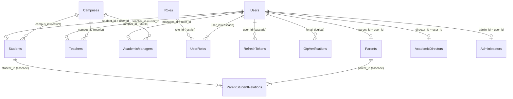
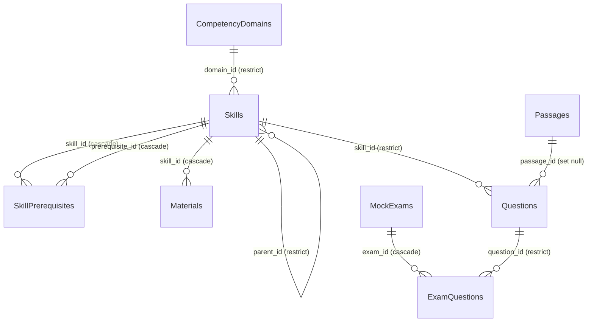
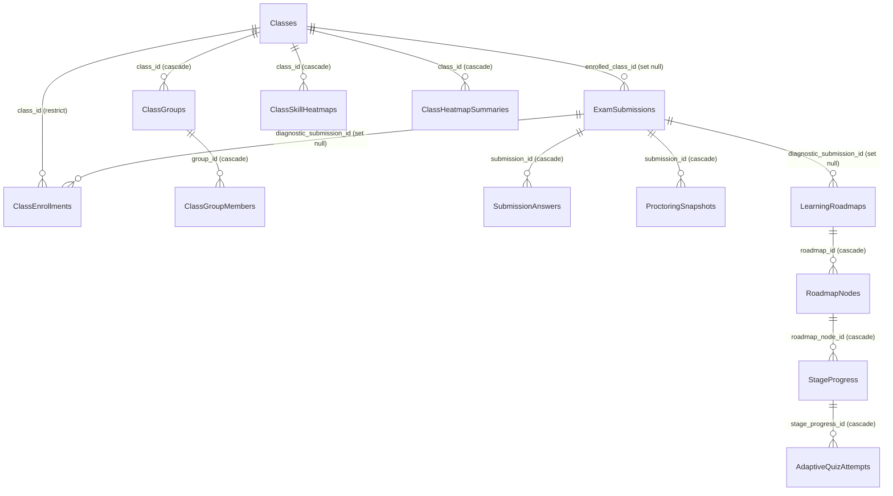
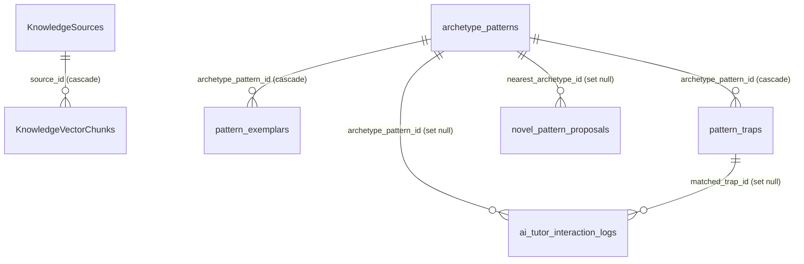

# TỔNG QUAN CHI TIẾT MỐI QUAN HỆ GIỮA CÁC THỰC THỂ (ENTITIES) — HỆ THỐNG V-EVAL

> [!IMPORTANT]
> **Tài liệu Kiểm duyệt Hệ thống CSDL V-Eval (Master Entity-Relationship Audit Report)**
> - **Phiên bản Schema**: Master Schema V4.1 (Đồng bộ 100% CSDL PostgreSQL/Supabase, Bounded Contexts Microservices & ERD [Capstone.drawio](./Capstone.drawio)).
> - **Mục đích**: Tài liệu hóa chi tiết toàn bộ **74 mối quan hệ** giữa 47 thực thể dữ liệu trong hệ thống, cung cấp ma trận kiểm duyệt độc lập (Audit Checklist), bản số chuẩn Information Engineering (Crow's Foot), mối tương quan hai chiều (chiều xuôi & chiều ngược), cùng lý do tồn tại & ý nghĩa nghiệp vụ/sư phạm chuyên sâu.
> - **Tài liệu liên quan**:
>   - Kịch bản CSDL đồng bộ: [SQL.sql](./SQL.sql)
>   - Sơ đồ trực quan 3 trang: [Capstone.drawio](./Capstone.drawio)
>   - Mô tả thiết kế kiến trúc: [Mo_Ta_Thiet_Ke_ERD_Concept.md](./Mo_Ta_Thiet_Ke_ERD_Concept.md)
>   - Phân tích phân cụm nhóm vi mô: [Phan_Tich_Gom_Nhom_AbilityGroups.md](./Phan_Tich_Gom_Nhom_AbilityGroups.md)

---

## MỤC LỤC TỔNG QUAN

1. [QUY ƯỚC KÝ HIỆU & PHƯƠNG ÁN THIẾT KẾ HYBRID](#1-quy-ước-ký-hiệu--phương-án-thiết-kế-hybrid)
2. [BẢNG MA TRẬN KIỂM DUYỆT 74 MỐI QUAN HỆ (MASTER AUDIT CHECKLIST)](#2-bảng-ma-trận-kiểm-duyệt-74-mối-quan-hệ-master-audit-checklist)
3. [CỤM 1: PHÂN HỆ ĐỊNH DANH, BẢO MẬT & HỒ SƠ CHỦ THỂ (V_EVAL_IDENTITY)](#3-cụm-1-phân-hệ-định-danh-bảo-mật--hồ-sơ-chủ-thể-v_eval_identity)
   - 3.1 Bảng `Users` (Tài khoản người dùng tập trung)
   - 3.2 Bảng `Roles` & `UserRoles` (Hệ thống phân quyền vai trò RBAC & Lý do tồn tại của UserRoles)
   - 3.3 Bảng `RefreshTokens` & `OtpVerifications` (Bảo mật phiên đăng nhập & OTP)
   - 3.4 Bảng `Campuses` (Cơ sở đào tạo vệ tinh & Ràng buộc bắt buộc cho Học sinh, Giáo viên, Quản lý học vụ)
   - 3.5 Bảng `Students`, `Parents` & `ParentStudentRelations` (Bản chất quan hệ giám hộ & Bản số bắt buộc 1..N)
   - 3.6 Bảng `Teachers`, `AcademicManagers`, `AcademicDirectors`, `Administrators` (Hồ sơ nhân sự chuyên môn & Vị trí toàn hệ thống của Giám đốc Đào tạo)
4. [CỤM 2: PHÂN HỆ KHUNG NĂNG LỰC, HỌC LIỆU SƯ PHẠM & ĐỀ THI (V_EVAL_CONTENT)](#4-cụm-2-phân-hệ-khung-năng-lực-học-liệu-sư-phạm--đề-thi-v_eval_content)
   - 4.1 Bảng `CompetencyDomains`, `Skills` & `SkillPrerequisites` (Cấu trúc tri thức & Đồ thị DAG tiên quyết)
   - 4.2 Bảng `Materials` & `Passages` (Học liệu bài giảng & Ngữ liệu trích dẫn)
   - 4.3 Bảng `Questions`, `MockExams` & `ExamQuestions` (Ngân hàng câu hỏi & Đề thi chuẩn hóa)
5. [CỤM 3: PHÂN HỆ LỚP HỌC OFFLINE, LỘ TRÌNH THÍCH ỨNG & PHÂN TÍCH (V_EVAL_PRACTICE)](#5-cụm-3-phân-hệ-lớp-học-offline-lộ-trình-thích-ứng--phân-tích-v_eval_practice)
   - 5.1 Bảng `Classes`, `ClassEnrollments`, `ClassGroups`, `ClassGroupMembers` (Mô hình lớp Cohort 20 HS & Nhóm vi mô 3–5 HS)
   - 5.2 Bảng `ExamSubmissions`, `SubmissionAnswers`, `ProctoringSnapshots` (Phiên thi thử & Giám sát liêm chính)
   - 5.3 Bảng `LearningRoadmaps`, `RoadmapNodes`, `StageProgress` (Lộ trình thích ứng cá nhân hóa P-L-A-R)
   - 5.4 Bảng `LearningProfiles`, `AdaptiveQuizAttempts`, `MistakeNotebooks` (Mô hình năng lực BKT & Lặp lại ngắt quãng SM-2)
   - 5.5 Bảng `ScorePredictions`, `SystemAlerts`, `ClassSkillHeatmaps`, `ClassHeatmapSummaries`, `StudentDailyActivities`, `StudentReadinessMetrics` (Phân tích học tập & Cảnh báo sớm)
6. [CỤM 4: PHÂN HỆ TRỢ GIẢNG AI SOCRATIC & TRI THỨC DẠNG BÀI (V_EVAL_AI)](#6-cụm-4-phân-hệ-trợ-giảng-ai-socratic--tri-thức-dạng-bài-v_eval_ai)
   - 6.1 Bảng `KnowledgeSources` & `KnowledgeVectorChunks` (RAG tri thức SGK nhúng Vector 768 chiều)
   - 6.2 Bảng `archetype_patterns`, `pattern_exemplars`, `pattern_traps`, `novel_pattern_proposals` (Knowledge Graph dạng bài & Bẫy tư duy)
   - 6.3 Bảng `ai_tutor_interaction_logs` (Nhật ký gợi mở Socratic & Hậu kiểm sư phạm)
7. [NGUYÊN TẮC TOÀN VẸN DỮ LIỆU & BẢO ĐẢM GIAO THƯƠNG MICROSERVICES](#7-nguyên-tắc-toàn-vẹn-dữ-liệu--bảo-đảm-giao-thương-microservices)

---

## 1. QUY ƯỚC KÝ HIỆU & PHƯƠNG ÁN THIẾT KẾ HYBRID

### 1.1 Ký hiệu Bản số (Cardinality - Crow's Foot)
Toàn bộ sơ đồ ERD và tài liệu sử dụng chuẩn **Information Engineering (Crow's Foot Notation)**:
- `1` (`||` - Mandatory One): Đúng duy nhất một thực thể bắt buộc.
- `0..1` (`|o` hoặc `o|` - Optional One): Tối đa một thực thể, có thể rỗng (nullable).
- `0..N` (`o{` hoặc `}o` - Zero to Many): Không hoặc nhiều thực thể.
- `1..N` (`|{` hoặc `}|` - One to Many): Bắt buộc ít nhất một thực thể trở lên.

### 1.2 Phương án C (Hybrid Best-Practice) cho Microservices
Hệ thống V-Eval phân tách độc lập 4 Microservices tương ứng với 4 Schemas:
1. **Khóa ngoại vật lý nội bộ Service (Physical FK - Đường nét liền Solid Line)**:
   - Các bảng nằm chung một Service/Schema có quan hệ ràng buộc bằng khóa ngoại vật lý cứng (`REFERENCES ... ON DELETE CASCADE / RESTRICT / SET NULL`) do engine CSDL PostgreSQL kiểm soát 100%.
   - **Số lượng**: 42 mối quan hệ.
2. **Tham chiếu logic liên Service (Logical Reference - Đường nét đứt Dashed Line)**:
   - Cột dữ liệu lưu giữ `uuid` của bảng thuộc Service khác (ví dụ: `v_eval_practice."Classes"` lưu `campus_id` từ `v_eval_identity."Campuses"`).
   - Không đặt ràng buộc khóa ngoại cứng ở tầng CSDL để tránh dính chặt liên dịch vụ (Cross-Service Tight Coupling).
   - Tính toàn vẹn nghiệp vụ do tầng ứng dụng bảo đảm thông qua **gRPC Client (HTTP/2)**, Outbox Pattern và Event-Driven. Cột `uuid` luôn được đánh chỉ mục B-tree (`CREATE INDEX idx_...`) để tối ưu hiệu năng Join logic.
   - **Số lượng**: 32 mối quan hệ.

---

## 2. BẢNG MA TRẬN KIỂM DUYỆT 74 MỐI QUAN HỆ (MASTER AUDIT CHECKLIST)

Bảng ma trận dưới đây đánh số thứ tự từ 1 đến 74, cho phép bạn tick chọn `[ ]` để trực tiếp kiểm tra độc lập từng mối quan hệ:

| STT | Bảng Nguồn (Cha) | Bảng Đích (Con) | Cột Liên Kết (FK / Ref) | Kiểu Liên Kết | Bản Số | Ý Nghĩa Nghiệp Vụ Cốt Lõi | Kiểm Duyệt |
|:---:|:---|:---|:---|:---:|:---:|:---|:---:|
| **1** | `Users` | `UserRoles` | `user_id` | Vật lý (Solid) | `1` — `1..N` | Một tài khoản bắt buộc có ít nhất 1 vai trò RBAC | [ ] |
| **2** | `Roles` | `UserRoles` | `role_id` | Vật lý (Solid) | `1` — `0..N` | Danh mục vai trò hệ thống gán cho các tài khoản | [ ] |
| **3** | `Users` | `RefreshTokens` | `user_id` | Vật lý (Solid) | `1` — `0..N` | Phiên đăng nhập dài hạn duy trì đăng nhập đa thiết bị | [ ] |
| **4** | `Users` | `OtpVerifications` | `email` | Logic (Dashed) | `1` — `0..N` | Mã OTP gửi qua email xác thực tài khoản / đặt lại mật khẩu | [ ] |
| **5** | `Users` | `Students` | `student_id = user_id` | Vật lý (Solid) | `1` — `0..1` | Hồ sơ mở rộng người học (Target score, giờ học) | [ ] |
| **6** | `Users` | `Parents` | `parent_id = user_id` | Vật lý (Solid) | `1` — `0..1` | Hồ sơ mở rộng phụ huynh giám hộ học sinh | [ ] |
| **7** | `Users` | `Teachers` | `teacher_id = user_id` | Vật lý (Solid) | `1` — `0..1` | Hồ sơ giáo viên bộ môn / Lead Mentor cơ sở | [ ] |
| **8** | `Users` | `AcademicManagers` | `manager_id = user_id` | Vật lý (Solid) | `1` — `0..1` | Hồ sơ quản lý học vụ cơ sở phụ trách xếp lớp | [ ] |
| **9** | `Users` | `AcademicDirectors` | `director_id = user_id` | Vật lý (Solid) | `1` — `0..1` | Hồ sơ Giám đốc đào tạo cấp cao toàn hệ thống | [ ] |
| **10** | `Users` | `Administrators` | `admin_id = user_id` | Vật lý (Solid) | `1` — `0..1` | Hồ sơ quản trị viên hệ thống hạ tầng | [ ] |
| **11** | `Campuses` | `Students` | `campus_id` (NOT NULL) | Vật lý (Solid) | `1` — `0..N` | Học sinh bắt buộc ghi danh tại một cơ sở đào tạo cụ thể | [ ] |
| **12** | `Campuses` | `Teachers` | `campus_id` (NOT NULL) | Vật lý (Solid) | `1` — `0..N` | Cơ sở biên chế chính thức của giáo viên giảng dạy | [ ] |
| **13** | `Campuses` | `AcademicManagers` | `campus_id` (NOT NULL) | Vật lý (Solid) | `1` — `0..N` | Cơ sở quản lý học vụ chịu trách nhiệm điều phối lớp học | [ ] |
| **14** | `Parents` | `ParentStudentRelations` | `parent_id` (NOT NULL) | Vật lý (Solid) | `1` — `1..N` | Phụ huynh bắt buộc phải liên kết ít nhất 1 con em học sinh | [ ] |
| **15** | `Students` | `ParentStudentRelations` | `student_id` (NOT NULL) | Vật lý (Solid) | `1` — `0..N` | Học sinh có thể có bố mẹ/người giám hộ theo dõi | [ ] |
| **16** | `CompetencyDomains` | `Skills` | `domain_id` | Vật lý (Solid) | `1` — `0..N` | Miền năng lực cấp 1 chứa các cây kỹ năng vi mô cấp 2 | [ ] |
| **17** | `Skills` (Cha) | `Skills` (Con) | `parent_id` (Nullable) | Vật lý (Solid) | `0..1` — `0..N` | Cấu trúc phân cấp hình cây (Kỹ năng cha - con) | [ ] |
| **18** | `Skills` | `SkillPrerequisites` | `skill_id` | Vật lý (Solid) | `1` — `0..N` | Kỹ năng mục tiêu trong đồ thị có hướng DAG | [ ] |
| **19** | `Skills` | `SkillPrerequisites` | `prerequisite_id` | Vật lý (Solid) | `1` — `0..N` | Kỹ năng điều kiện tiên quyết bắt buộc học trước | [ ] |
| **20** | `Skills` | `Materials` | `skill_id` | Vật lý (Solid) | `1` — `0..N` | Học liệu bài giảng, video vi mô đính kèm kỹ năng | [ ] |
| **21** | `Skills` | `Questions` | `skill_id` | Vật lý (Solid) | `1` — `0..N` | Câu hỏi đo lường năng lực của một kỹ năng cụ thể | [ ] |
| **22** | `Passages` | `Questions` | `passage_id` (Nullable) | Vật lý (Solid) | `0..1` — `0..N` | Đoạn văn/dữ liệu khoa học dùng chung cho chùm câu hỏi | [ ] |
| **23** | `MockExams` | `ExamQuestions` | `exam_id` | Vật lý (Solid) | `1` — `0..N` | Đề thi chuẩn hóa tập hợp các câu hỏi theo ma trận | [ ] |
| **24** | `Questions` | `ExamQuestions` | `question_id` | Vật lý (Solid) | `1` — `0..N` | Câu hỏi xuất hiện trong một hoặc nhiều đề thi chuẩn | [ ] |
| **25** | `Classes` | `ExamSubmissions` | `enrolled_class_id` (Null) | Vật lý (Solid) | `0..1` — `0..N` | Bài thi được làm trong khuôn khổ lớp học cụ thể | [ ] |
| **26** | `ExamSubmissions` | `SubmissionAnswers` | `submission_id` | Vật lý (Solid) | `1` — `0..N` | Bản ghi chi tiết đáp án từng câu trong lượt thi | [ ] |
| **27** | `ExamSubmissions` | `ProctoringSnapshots` | `submission_id` | Vật lý (Solid) | `1` — `0..N` | Ảnh chụp webcam định kỳ kiểm soát gian lận | [ ] |
| **28** | `Classes` | `ClassEnrollments` | `class_id` | Vật lý (Solid) | `1` — `0..N` | Danh sách học sinh ghi danh trong lớp học offline | [ ] |
| **29** | `ExamSubmissions` | `ClassEnrollments` | `diagnostic_submission_id` | Vật lý (Solid) | `0..1` — `0..N` | Bài thi chẩn đoán đầu vào căn cứ phân lớp K-Means | [ ] |
| **30** | `Classes` | `ClassGroups` | `class_id` | Vật lý (Solid) | `1` — `0..N` | Lớp học phân rã thành các nhóm vi mô 3–5 bạn | [ ] |
| **31** | `ClassGroups` | `ClassGroupMembers` | `group_id` | Vật lý (Solid) | `1` — `0..N` | Danh sách thành viên cùng điểm yếu trong nhóm vi mô | [ ] |
| **32** | `ExamSubmissions` | `LearningRoadmaps` | `diagnostic_submission_id` | Vật lý (Solid) | `0..1` — `0..N` | Bài thi đầu vào căn cứ khởi tạo lộ trình cá nhân hóa | [ ] |
| **33** | `LearningRoadmaps` | `RoadmapNodes` | `roadmap_id` | Vật lý (Solid) | `1` — `0..N` | Các chặng học kỹ năng được cắt tỉa theo lộ trình | [ ] |
| **34** | `RoadmapNodes` | `StageProgress` | `roadmap_node_id` | Vật lý (Solid) | `1` — `0..N` | Tiến trình vượt 4 bước P-L-A-R của chặng học | [ ] |
| **35** | `StageProgress` | `AdaptiveQuizAttempts` | `stage_progress_id` | Vật lý (Solid) | `1` — `0..N` | Lịch sử giải quiz thích ứng bước Apply chu trình PLAR | [ ] |
| **36** | `Classes` | `ClassSkillHeatmaps` | `class_id` | Vật lý (Solid) | `1` — `0..N` | Điểm nhiệt kỹ năng của từng học sinh trong lớp | [ ] |
| **37** | `Classes` | `ClassHeatmapSummaries` | `class_id` | Vật lý (Solid) | `1` — `0..N` | Thống kê phân cực & báo động kỹ năng toàn lớp | [ ] |
| **38** | `KnowledgeSources` | `KnowledgeVectorChunks` | `source_id` | Vật lý (Solid) | `1` — `0..N` | Nguồn SGK được chia nhỏ thành các đoạn văn vector | [ ] |
| **39** | `archetype_patterns` | `pattern_exemplars` | `archetype_pattern_id` | Vật lý (Solid) | `1` — `0..N` | Dạng bài mẫu mực gắn kèm lời giải mẫu chuẩn vàng | [ ] |
| **40** | `archetype_patterns` | `pattern_traps` | `archetype_pattern_id` | Vật lý (Solid) | `1` — `0..N` | Bẫy tư duy & quan niệm sai lầm gắn với dạng bài | [ ] |
| **41** | `archetype_patterns` | `novel_pattern_proposals` | `nearest_archetype_id` | Vật lý (Solid) | `0..1` — `0..N` | Dạng bài tương đồng gần nhất của câu hỏi mới lạ | [ ] |
| **42** | `archetype_patterns` | `ai_tutor_interaction_logs`| `archetype_pattern_id` | Vật lý (Solid) | `0..1` — `0..N` | Dạng bài mẫu mực được kích hoạt trong phiên AI Tutor | [ ] |
| **43** | `pattern_traps` | `ai_tutor_interaction_logs` | `matched_trap_id` | Vật lý (Solid) | `0..1` — `0..N` | Bẫy nhận thức cụ thể mà học sinh đã mắc phải | [ ] |
| **44** | `Campuses` | `Classes` | `campus_id` | Logic (Dashed) | `1` — `0..N` | Lớp học offline được tổ chức tại một cơ sở nhất định | [ ] |
| **45** | `Teachers` | `Classes` | `teacher_id` (Nullable) | Logic (Dashed) | `0..1` — `0..N` | Giáo viên Lead Mentor phụ trách điều hành lớp học | [ ] |
| **46** | `AcademicManagers` | `Classes` | `assigned_by` (Nullable) | Logic (Dashed) | `0..1` — `0..N` | Quản lý học vụ trực tiếp tạo hoặc duyệt phân bổ lớp | [ ] |
| **47** | `Students` | `ClassEnrollments` | `student_id` | Logic (Dashed) | `1` — `0..N` | Học sinh ghi danh tham gia một hoặc nhiều lớp học | [ ] |
| **48** | `Students` | `ClassGroupMembers` | `student_id` | Logic (Dashed) | `1` — `0..N` | Học sinh được điều phối vào nhóm vi mô cùng năng lực | [ ] |
| **49** | `Students` | `ExamSubmissions` | `student_id` | Logic (Dashed) | `1` — `0..N` | Học sinh thực hiện các phiên thi thử hoặc thi chẩn đoán | [ ] |
| **50** | `MockExams` | `ExamSubmissions` | `exam_id` | Logic (Dashed) | `1` — `0..N` | Đề thi chuẩn hóa được học sinh chọn làm bài | [ ] |
| **51** | `Questions` | `SubmissionAnswers` | `question_id` | Logic (Dashed) | `1` — `0..N` | Câu hỏi gốc được trả lời trong phiên thi | [ ] |
| **52** | `Students` | `LearningRoadmaps` | `student_id` | Logic (Dashed) | `1` — `0..N` | Học sinh sở hữu lộ trình học tập thích ứng cá nhân hóa | [ ] |
| **53** | `Skills` | `RoadmapNodes` | `skill_id` | Logic (Dashed) | `1` — `0..N` | Kỹ năng mục tiêu cần chinh phục tại từng chặng học | [ ] |
| **54** | `Materials` | `RoadmapNodes` | `material_id` (Nullable) | Logic (Dashed) | `0..1` — `0..N` | Học liệu được chỉ định học tại chặng lộ trình | [ ] |
| **55** | `MockExams` | `RoadmapNodes` | `quiz_exam_id` (Null) | Logic (Dashed) | `0..1` — `0..N` | Bài kiểm tra vượt chặng đánh giá hoàn thành kỹ năng | [ ] |
| **56** | `Students` | `StageProgress` | `student_id` | Logic (Dashed) | `1` — `0..N` | Học sinh đang trực tiếp thực hiện tiến trình chặng học | [ ] |
| **57** | `Students` | `LearningProfiles` | `student_id` | Logic (Dashed) | `1` — `0..N` | Hồ sơ xác suất làm chủ năng lực P(L0) của học sinh | [ ] |
| **58** | `Skills` | `LearningProfiles` | `skill_id` | Logic (Dashed) | `1` — `0..N` | Kỹ năng được theo dõi xác suất thành thạo BKT | [ ] |
| **59** | `Students` | `AdaptiveQuizAttempts` | `student_id` | Logic (Dashed) | `1` — `0..N` | Học sinh thực hiện lượt làm quiz thích ứng | [ ] |
| **60** | `Questions` | `AdaptiveQuizAttempts` | `question_id` | Logic (Dashed) | `1` — `0..N` | Câu hỏi trích xuất từ ngân hàng để kiểm tra thích ứng | [ ] |
| **61** | `Students` | `MistakeNotebooks` | `student_id` | Logic (Dashed) | `1` — `0..N` | Sổ tay ghi chép lỗi sai cá nhân của học sinh | [ ] |
| **62** | `Questions` | `MistakeNotebooks` | `question_id` | Logic (Dashed) | `1` — `0..N` | Câu hỏi mà học sinh trả lời sai cần ôn tập lại | [ ] |
| **63** | `Skills` | `MistakeNotebooks` | `skill_id` | Logic (Dashed) | `1` — `0..N` | Kỹ năng bị hổng tương ứng với câu hỏi làm sai | [ ] |
| **64** | `Students` | `ScorePredictions` | `student_id` | Logic (Dashed) | `1` — `0..N` | Dự báo điểm số thực tế kèm sai số chuẩn SEM | [ ] |
| **65** | `Students` | `SystemAlerts` | `student_id` | Logic (Dashed) | `1` — `0..N` | Cảnh báo học tập (Đỏ, Vàng, Xanh) phát sinh cho học sinh | [ ] |
| **66** | `Users` | `SystemAlerts` | `handled_by` (Nullable) | Logic (Dashed) | `0..1` — `0..N` | Giáo viên / Quản lý học vụ tiếp nhận xử lý cảnh báo | [ ] |
| **67** | `Students` | `ClassSkillHeatmaps` | `student_id` | Logic (Dashed) | `1` — `0..N` | Học sinh đóng góp chỉ số năng lực vào ma trận nhiệt lớp | [ ] |
| **68** | `Skills` | `ClassSkillHeatmaps` | `skill_id` | Logic (Dashed) | `1` — `0..N` | Cột kỹ năng được đo đạc trên ma trận nhiệt của lớp | [ ] |
| **69** | `Skills` | `ClassHeatmapSummaries` | `skill_id` | Logic (Dashed) | `1` — `0..N` | Kỹ năng được tính toán tỷ lệ nguy cơ toàn lớp học | [ ] |
| **70** | `Students` | `StudentDailyActivities`| `student_id` | Logic (Dashed) | `1` — `0..N` | Nhật ký học tập hằng ngày và chuỗi Streak của học sinh | [ ] |
| **71** | `Students` | `StudentReadinessMetrics`| `student_id` (UNIQUE) | Logic (Dashed) | `1` — `0..1` | Chỉ số sẵn sàng thi tổng hợp duy nhất của mỗi học sinh | [ ] |
| **72** | `Skills` | `archetype_patterns` | `skill_id` | Logic (Dashed) | `1` — `0..N` | Dạng bài mẫu mực là mức đào sâu chi tiết của kỹ năng | [ ] |
| **73** | `Students` | `ai_tutor_interaction_logs`| `student_id` | Logic (Dashed) | `1` — `0..N` | Học sinh tương tác hỏi đáp với Trợ giảng AI Socratic | [ ] |
| **74** | `Questions` | `ai_tutor_interaction_logs`| `question_id` | Logic (Dashed) | `1` — `0..N` | Câu hỏi làm sai là ngữ cảnh để AI dẫn dắt gợi mở | [ ] |

---

## 3. CỤM 1: PHÂN HỆ ĐỊNH DANH, BẢO MẬT & HỒ SƠ CHỦ THỂ (V_EVAL_IDENTITY)

Phân hệ quản trị tài khoản tập trung, cơ chế xác thực JWT kép, bảo mật OTP và mở rộng 6 hồ sơ nghiệp vụ tương ứng với 6 vai trò người dùng trong hệ sinh thái luyện thi ĐGNL.

---

### 3.1 Bảng `Users` (Tài khoản người dùng tập trung)
- **Ý nghĩa & Vai trò**: Là thực thể cốt lõi lưu trữ định danh bảo mật (Email, Password Hash bằng BCrypt, Họ tên, Trạng thái kích hoạt `is_active`). Tất cả 6 nhóm tác nhân trong hệ thống đều xuất phát từ `Users`.

#### Các mối quan hệ xuất phát từ `Users`:
1. **Quan hệ #1: `Users` $\rightarrow$ `UserRoles`**
   - **Cột liên kết**: `UserRoles.user_id` $\rightarrow$ `Users.user_id`
   - **Loại liên kết**: Khóa ngoại vật lý (`REFERENCES v_eval_identity."Users"("user_id") ON DELETE CASCADE`).
   - **Bản số**: `1` — `1..N` (`Users ||--|{ UserRoles`).
   - **Mối tương quan hai chiều**:
     - *Chiều xuôi (`Users` $\rightarrow$ `UserRoles`)*: Mỗi tài khoản khi kích hoạt thành công **bắt buộc phải có ít nhất 1 vai trò** (`STUDENT`, `TEACHER`, `PARENT`...). Một tài khoản có thể có nhiều vai trò (ví dụ: vừa là Phụ huynh vừa là Giáo viên).
     - *Chiều ngược (`UserRoles` $\rightarrow$ `Users`)*: Mỗi bản ghi phân quyền bắt buộc phải thuộc về đúng 1 người dùng tồn tại hợp lệ. Khi tài khoản bị xóa vĩnh viễn, toàn bộ quyền của họ bị xóa theo (`ON DELETE CASCADE`).
   - **Lý do tồn tại & Ý nghĩa nghiệp vụ**: Phục vụ mô hình bảo mật RBAC (Role-Based Access Control). Việc tách bảng trung gian `UserRoles` giúp hệ thống phân quyền linh hoạt mà không cần sửa bảng `Users`.

2. **Quan hệ #3: `Users` $\rightarrow$ `RefreshTokens`**
   - **Cột liên kết**: `RefreshTokens.user_id` $\rightarrow$ `Users.user_id`
   - **Loại liên kết**: Khóa ngoại vật lý (`ON DELETE CASCADE`).
   - **Bản số**: `1` — `0..N` (`Users ||--o{ RefreshTokens`).
   - **Mối tương quan hai chiều**:
     - *Chiều xuôi*: Một tài khoản có thể có 0 phiên đăng nhập (chưa từng đăng nhập) hoặc nhiều phiên đăng nhập đồng thời trên nhiều thiết bị (Điện thoại, Laptop, Tablet).
     - *Chiều ngược*: Một Refresh Token bắt buộc thuộc về đúng 1 tài khoản xác định. Khi người dùng đổi mật khẩu hoặc xóa tài khoản, tất cả phiên bị vô hiệu hóa ngay lập tức.
   - **Lý do tồn tại & Ý nghĩa nghiệp vụ**: Cơ chế xác thực an toàn bằng JWT kép (Access Token sống ngắn 15 phút, Refresh Token sống dài 7 ngày) giúp tăng cường bảo mật và hỗ trợ tính năng đăng xuất từ xa trên mọi thiết bị.

3. **Quan hệ #4: `Users` $\rightarrow$ `OtpVerifications`**
   - **Cột liên kết**: Logic qua trường `email`.
   - **Loại liên kết**: Tham chiếu logic (Không đặt FK vật lý vì OTP có thể sinh ra trước khi tạo tài khoản `Users`).
   - **Bản số**: `1` — `0..N` (`Users ||--o{ OtpVerifications`).
   - **Mối tương quan hai chiều**:
     - *Chiều xuôi*: Một người dùng có thể yêu cầu gửi 0 hoặc nhiều lần mã OTP (đăng ký, quên mật khẩu, kích hoạt tài khoản).
     - *Chiều ngược*: Mỗi mã OTP được gắn chặt với 1 địa chỉ email nhận mã, có thời hạn sống 5–10 phút và cờ `is_used`.
   - **Lý do tồn tại & Ý nghĩa nghiệp vụ**: Đảm bảo tính xác thực của hộp thư điện tử, chống tấn công Spam đăng ký ảo và phục vụ luồng Reset Password tự phục vụ.

4. **Quan hệ #5 đến #10: `Users` $\rightarrow$ 6 Bảng Hồ sơ Tác nhân (`Students`, `Parents`, `Teachers`, `AcademicManagers`, `AcademicDirectors`, `Administrators`)**
   - **Cột liên kết**: Khóa chính của bảng hồ sơ đồng thời là khóa ngoại trỏ về `user_id` (PK = FK).
   - **Loại liên kết**: Khóa ngoại vật lý (`ON DELETE CASCADE`).
   - **Bản số**: `1` — `0..1` (`Users ||--o| Actors`).
   - **Mối tương quan hai chiều**:
     - *Chiều xuôi*: Một User có thể có tối đa 1 hồ sơ cho mỗi loại vai trò (ví dụ: User X có tối đa 1 hồ sơ `Students`). Có thể là 0 nếu tài khoản đó không mang vai trò tương ứng (ví dụ: User là Thầy giáo thì hồ sơ `Students` là 0).
     - *Chiều ngược*: Bất kỳ hồ sơ nghiệp vụ nào bắt buộc phải gắn với đúng 1 User gốc. Không thể tồn tại một hồ sơ học sinh hay giáo viên vô danh không có tài khoản.
   - **Lý do tồn tại & Ý nghĩa nghiệp vụ**: Mô hình kế thừa bảng (Table Inheritance Pattern / Profile Extension Pattern). Giúp bảng `Users` nhẹ nhàng, tinh gọn, trong khi các thuộc tính chuyên biệt của từng nhóm (Target score của Học sinh, Specialty của Giáo viên, Cơ sở của Quản lý) được lưu trữ riêng, bảo đảm chuẩn hóa 3NF.

---

### 3.2 Bảng `Roles` & `UserRoles` (Giải trình bản chất RBAC)
- **`Roles` (Bảng Danh mục vai trò)**: Là **từ điển danh mục cố định** định nghĩa các chức danh trong hệ thống (`STUDENT`, `TEACHER`, `PARENT`, `ACADEMIC_MANAGER`, `ACADEMIC_DIRECTOR`, `ADMIN`).
- **`UserRoles` (Bảng Phân quyền - Cầu nối Many-to-Many)**: Là **sổ phân công chức danh**, giải quyết bài toán:
  - Một tài khoản người dùng có thể kiêm nhiệm nhiều vai trò (ví dụ: Thầy giáo vừa dạy học vừa có con ôn thi ĐGNL nên có cả role `TEACHER` và `PARENT`).
  - Một vai trò có hàng ngàn người nắm giữ.
  - Theo chuẩn hóa CSDL (1NF), không được lưu mảng vai trò vào một ô thuộc tính của `Users`. Do đó bắt buộc có bảng trung gian `UserRoles` gồm cặp khóa `(user_id, role_id)`.

---

### 3.3 Bảng `Campuses` (Cơ sở đào tạo vệ tinh)
- **Ý nghĩa & Vai trò**: Đại diện cho các trung tâm đào tạo offline thực tế của hệ sinh thái V-Eval (Hà Nội, TP.HCM, Đà Nẵng...), nơi diễn ra các lớp học trực tiếp 20 học sinh và các buổi luyện đề offline.

#### Các mối quan hệ xuất phát từ `Campuses`:
1. **Quan hệ #11: `Campuses` $\rightarrow$ `Students`**
   - **Cột liên kết**: `Students.campus_id` $\rightarrow$ `Campuses.campus_id` (`NOT NULL`).
   - **Loại liên kết**: Khóa ngoại vật lý nội bộ Identity (`ON DELETE RESTRICT`).
   - **Bản số**: `1` — `0..N` (`Campuses ||--o{ Students`).
   - **Mối tương quan hai chiều**:
     - *Chiều xuôi (`Campuses` $\rightarrow$ `Students`)*: Một cơ sở đào tạo có thể tiếp nhận từ 0 đến hàng ngàn học sinh offline (`0..N`).
     - *Chiều ngược (`Students` $\rightarrow$ `Campuses`)*: **Mỗi học sinh bắt buộc phải ghi danh tại đúng 1 cơ sở đào tạo cụ thể** (`NOT NULL`). Hệ thống cấm xóa cơ sở đào tạo nếu đang có học sinh theo học (`ON DELETE RESTRICT`).
   - **Lý do tồn tại & Ý nghĩa nghiệp vụ**: Mô hình trung tâm offline kết hợp luyện đề yêu cầu mọi học sinh phải gắn với cơ sở gần nhất để phân lớp Cohort 20 học sinh, tổ chức thi thử trực tiếp và đối soát học phí.

2. **Quan hệ #12 & #13: `Campuses` $\rightarrow$ `Teachers` & `AcademicManagers`**
   - **Cột liên kết**: `Teachers.campus_id`, `AcademicManagers.campus_id` $\rightarrow$ `Campuses.campus_id` (`NOT NULL`).
   - **Loại liên kết**: Khóa ngoại vật lý (`ON DELETE RESTRICT`).
   - **Bản số**: `1` — `0..N` (`Campuses ||--o{ Staff`).
   - **Mối tương quan hai chiều**:
     - *Chiều xuôi*: Một cơ sở có đội ngũ giáo viên và cán bộ học vụ phục trách cơ sở đó.
     - *Chiều ngược*: Giáo viên và Quản lý học vụ **bắt buộc phải thuộc biên chế của một cơ sở cụ thể** (`NOT NULL`). Hệ thống cấm xóa cơ sở đào tạo nếu vẫn còn nhân sự đang hoạt động (`ON DELETE RESTRICT`).
   - **Lý do tồn tại & Ý nghĩa nghiệp vụ**: Phân định ranh giới quản trị học vụ và phân công giảng dạy theo từng địa bàn cơ sở.

> [!NOTE]
> **Vị trí của Giám đốc Đào tạo (`AcademicDirectors`) trong hệ thống**:
> Khác với Quản lý học vụ cơ sở (`AcademicManagers`) và Giáo viên (`Teachers`) gắn chặt với từng chi nhánh địa phương, **Giám đốc Đào tạo (`AcademicDirectors`)** là chức danh học thuật cấp cao toàn hệ thống (Head of Academics / Trụ sở chính HQ). Vai trò này chịu trách nhiệm:
> 1. Phê duyệt và ban hành Khung năng lực chuẩn ĐGNL (`CompetencyDomains`, `Skills`) áp dụng đồng bộ toàn quốc.
> 2. Thẩm định Bộ đề thi chuẩn hóa (`MockExams`).
> 3. Kiểm duyệt các Dạng bài mới do AI đề xuất (`novel_pattern_proposals`).
> Do đó, hồ sơ `AcademicDirectors` không bị ràng buộc cục bộ vào một `campus_id` riêng lẻ nào.

---

### 3.4 Bảng `ParentStudentRelations` (Bản chất quan hệ giám hộ & Bản số bắt buộc 1..N)
- **Ý nghĩa & Vai trò**: Bảng trung gian giải quyết bài toán quan hệ **Nhiều - Nhiều (Many-to-Many)** giữa Phụ huynh (`Parents`) và Con em (`Students`):
  - Một phụ huynh có thể giám hộ nhiều con (anh/chị/em cùng ôn luyện ĐGNL).
  - Một học sinh có thể có cả bố và mẹ cùng nhận báo cáo học tập.

#### Các mối quan hệ liên quan:
1. **Quan hệ #14: `Parents` $\rightarrow$ `ParentStudentRelations`**
   - **Cột liên kết**: `parent_id` (`NOT NULL`).
   - **Bản số**: **`1` — `1..N`** (`Parents ||--|{ ParentStudentRelations`).
   - **Mối tương quan hai chiều & Lý do bản số 1..N**:
     - Về mặt nghiệp vụ: Một người dùng đăng ký tài khoản với vai trò Phụ huynh thì mục đích duy nhất và điều kiện tiên quyết là để theo dõi, giám hộ con em mình.
     - **Không thể có một "Phụ huynh" lơ lửng trong hệ thống mà lại có 0 con em liên kết**. Khi tạo hồ sơ Phụ huynh, quy trình nghiệp vụ bắt buộc phải gắn mã định danh của ít nhất 1 học sinh. Do đó, bản số nghiệp vụ bắt buộc phải là **`1..N` (Bắt buộc có ít nhất một con)**.
     - Khi tài khoản phụ huynh bị xóa, các dòng quan hệ giám hộ trong bảng này tự động xóa theo (`ON DELETE CASCADE`), nhưng hồ sơ học sinh của con em vẫn được bảo toàn nguyên vẹn.

2. **Quan hệ #15: `Students` $\rightarrow$ `ParentStudentRelations`**
   - **Cột liên kết**: `student_id` (`NOT NULL`).
   - **Bản số**: `1` — `0..N` (`Students ||--o{ ParentStudentRelations`).
   - **Mối tương quan hai chiều**:
     - Một học sinh khi mới đăng ký tự do có thể chưa có phụ huynh nào liên kết (`0`). Khi phụ huynh nhập mã liên kết, em đó có thể có 1 hoặc nhiều người giám hộ (`N` - Bố, Mẹ).
     - Ràng buộc duy nhất: `UNIQUE(parent_id, student_id)` ngăn trùng lặp quan hệ giữa cùng một cặp bố mẹ - con cái.

---

## 4. CỤM 2: PHÂN HỆ KHUNG NĂNG LỰC, HỌC LIỆU SƯ PHẠM & ĐỀ THI (V_EVAL_CONTENT)

Phân hệ tri thức chuẩn mực của kỳ thi ĐGNL ĐHQG (HSA / V-ACT). Toàn bộ ngân hàng câu hỏi, bài giảng và đề thi được cấu trúc chặt chẽ theo đồ thị có hướng không chu trình (DAG).

---

### 4.1 Bảng `CompetencyDomains`, `Skills` & `SkillPrerequisites`
- **Ý nghĩa & Vai trò**: Xương sống tri thức của hệ thống. Phân cấp 3 tầng: Miền năng lực lớn (Toán học, Văn học, Khoa học tự nhiên...) $\rightarrow$ Kỹ năng thành phần $\rightarrow$ Mối liên hệ tiên quyết giữa các kỹ năng.

#### Các mối quan hệ cốt lõi:
1. **Quan hệ #16: `CompetencyDomains` $\rightarrow$ `Skills`**
   - **Cột liên kết**: `Skills.domain_id` $\rightarrow$ `CompetencyDomains.domain_id` (NOT NULL).
   - **Loại liên kết**: Khóa ngoại vật lý (`ON DELETE RESTRICT`).
   - **Bản số**: `1` — `0..N` (`CompetencyDomains ||--o{ Skills`).
   - **Tương quan**: 1 Miền chứa nhiều Kỹ năng vi mô; 1 Kỹ năng bắt buộc thuộc 1 Miền duy nhất. Không thể xóa Miền nếu còn kỹ năng con.
   - **Lý do tồn tại**: Giúp phân loại báo cáo điểm số ĐGNL theo đúng cấu trúc đề thi chính thức của ĐHQG.

2. **Quan hệ #17: `Skills` (Cha) $\rightarrow$ `Skills` (Con) (Self-referencing)**
   - **Cột liên kết**: `Skills.parent_id` $\rightarrow$ `Skills.skill_id` (Nullable).
   - **Loại liên kết**: Khóa ngoại vật lý đệ quy nội bộ bảng (`ON DELETE RESTRICT`).
   - **Bản số**: `0..1` — `0..N` (`Skills |o--o{ Skills`).
   - **Tương quan**: Kỹ năng gốc (Root Skill) có `parent_id = NULL`. Kỹ năng lá (Leaf Skill) trỏ về kỹ năng cha.
   - **Lý do tồn tại**: Cho phép mở rộng cây tri thức theo nhiều cấp độ linh hoạt mà không cần thay đổi cấu trúc bảng.

3. **Quan hệ #18 & #19: `Skills` $\rightarrow$ `SkillPrerequisites` (Đồ thị DAG Tiên Quyết)**
   - **Cột liên kết**: Cặp khóa chính phức hợp `(skill_id, prerequisite_id)` trỏ về `Skills.skill_id`.
   - **Loại liên kết**: Khóa ngoại vật lý (`ON DELETE CASCADE`).
   - **Bản số**: Cả 2 phía đều là `1` — `0..N` (`Skills ||--o{ SkillPrerequisites`).
   - **Mối tương quan hai chiều**:
     - Một kỹ năng A có thể yêu cầu nhiều kỹ năng tiên quyết B, C cần học trước.
     - Một kỹ năng nền tảng B có thể là điều kiện tiên quyết cho nhiều kỹ năng nâng cao A, D.
   - **Lý do tồn tại & Ý nghĩa sư phạm**: Đây là cơ sở toán học để thuật toán Topological Sort và Knapsack ROI tự động sắp xếp thứ tự chặng học trong lộ trình thích ứng cá nhân hóa (Personalized Learning Roadmap). Ngăn ngừa tình trạng học sinh nhảy cóc vào bài tập nâng cao khi chưa thành thạo kiến thức nền.

---

### 4.2 Bảng `Materials`, `Passages` & `Questions`
- **Ý nghĩa & Vai trò**: Lưu trữ dữ liệu sư phạm thực thi: bài giảng đa phương tiện (Video, PDF lý thuyết), văn bản ngữ liệu dùng chung và các câu hỏi trắc nghiệm LaTeX chuẩn.

#### Các mối quan hệ:
1. **Quan hệ #20: `Skills` $\rightarrow$ `Materials`**
   - **Cột liên kết**: `Materials.skill_id` (NOT NULL). Bản số: `1` — `0..N`.
   - **Lý do tồn tại**: Mỗi kỹ năng có các bài giảng vi mô tương ứng để phục vụ bước L (Learn) trong chu trình 4 bước P-L-A-R.

2. **Quan hệ #21: `Skills` $\rightarrow$ `Questions`**
   - **Cột liên kết**: `Questions.skill_id` (NOT NULL). Bản số: `1` — `0..N`.
   - **Lý do tồn tại**: Bắt buộc mỗi câu hỏi trong ngân hàng phải gắn với một kỹ năng cụ thể. Nếu một câu hỏi không biết đo lường kỹ năng nào thì không thể tính toán tham số BKT và IRT.

3. **Quan hệ #22: `Passages` $\rightarrow$ `Questions`**
   - **Cột liên kết**: `Questions.passage_id` (Nullable). Bản số: `0..1` — `0..N`.
   - **Lý do tồn tại**: Đặc thù của bài thi ĐGNL là các câu hỏi Đọc hiểu Ngôn ngữ hoặc Phân tích Số liệu thường dùng chung một bài viết/bảng số liệu dài 1000 từ. Quan hệ này tránh việc nhân bản đoạn văn bản gây lãng phí dung lượng CSDL.

---

### 4.3 Bảng `MockExams` & `ExamQuestions`
- **Ý nghĩa & Vai trò**: Đóng gói các bộ đề thi thử hoàn chỉnh (120 câu / 150 phút) hoặc các đề thi khảo sát chẩn đoán đầu khóa học.

#### Các mối quan hệ:
1. **Quan hệ #23 & #24: `MockExams` $\rightarrow$ `ExamQuestions` $\leftarrow$ `Questions`**
   - **Cột liên kết**: `(exam_id, question_id)` làm khóa chính kép của `ExamQuestions`. Kèm thứ tự câu `question_order`.
   - **Bản số**: `MockExams ||--o{ ExamQuestions` và `Questions ||--o{ ExamQuestions`.
   - **Lý do tồn tại**: Mô hình hóa đề thi chuẩn. Cho phép một câu hỏi được tái sử dụng trong nhiều đề thi khác nhau (Đề thi thử lần 1, Đề khảo sát chẩn đoán, Đề ôn tập nhanh) với thứ tự câu xuất hiện hoàn toàn độc lập.

---

## 5. CỤM 3: PHÂN HỆ LỚP HỌC OFFLINE, LỘ TRÌNH THÍCH ỨNG & PHÂN TÍCH (V_EVAL_PRACTICE)

Trọng tâm vận hành của V-Eval. Nơi hiện thực hóa mô hình lớp học Cohort 20 học sinh, nhóm vi mô 3–5 bạn, chu trình 4 bước P-L-A-R, mô hình tri thức BKT/IRT, sổ tay SuperMemo-2 và ma trận nhiệt năng lực.

---

### 5.1 Bảng `Classes`, `ClassEnrollments`, `ClassGroups`, `ClassGroupMembers`
- **Ý nghĩa & Vai trò**: Quản lý việc tổ chức học tập trực tiếp tại Campus. Lớp học tối ưu ở quy mô 20 học sinh. Thuật toán `ClassMicroClusterer` tự động gom nhóm 3–5 học sinh có cùng lỗ hổng kiến thức vào các `ClassGroups` để giáo viên phát phiếu bài tập can thiệp vi mô (Worksheet).

#### Các mối quan hệ nội bộ:
1. **Quan hệ #28: `Classes` $\rightarrow$ `ClassEnrollments`**
   - **Cột liên kết**: `ClassEnrollments.class_id` (NOT NULL). Bản số: `1` — `0..N`.
   - **Ràng buộc**: `UNIQUE(class_id, student_id)`. Xóa lớp bị chặn (`RESTRICT`) nếu lớp đang có học sinh.
   - **Lý do tồn tại**: Lưu danh sách ghi danh chính thức của học sinh vào lớp học offline.

2. **Quan hệ #30: `Classes` $\rightarrow$ `ClassGroups`**
   - **Cột liên kết**: `ClassGroups.class_id` (NOT NULL). Bản số: `1` — `0..N`. Khóa ngoại vật lý (`CASCADE`).
   - **Lý do tồn tại**: Một lớp học sau các bài kiểm tra định kỳ sẽ được thuật toán phân rã thành 3–5 nhóm nhỏ tùy theo phổ điểm và kỹ năng yếu.

3. **Quan hệ #31: `ClassGroups` $\rightarrow$ `ClassGroupMembers`**
   - **Cột liên kết**: `ClassGroupMembers.group_id` (NOT NULL). Bản số: `1` — `0..N`. Khóa ngoại vật lý (`CASCADE`).
   - **Lý do tồn tại**: Định danh danh sách thành viên trong nhóm vi mô để phân bổ bài tập tự động.

---

### 5.2 Bảng `ExamSubmissions`, `SubmissionAnswers`, `ProctoringSnapshots`
- **Ý nghĩa & Vai trò**: Quản lý các đợt thi thử và thi chẩn đoán. Đảm bảo tính minh bạch, chống gian lận thông qua cơ chế giám sát Proctoring (đếm số lần chuyển Tab, chụp ảnh webcam).

#### Các mối quan hệ:
1. **Quan hệ #25: `Classes` $\rightarrow$ `ExamSubmissions`**
   - **Cột liên kết**: `ExamSubmissions.enrolled_class_id` $\rightarrow$ `Classes.class_id` (Nullable).
   - **Bản số**: `0..1` — `0..N`. Khóa ngoại vật lý nội bộ Practice (`SET NULL`).
   - **Lý do tồn tại**: Phân biệt bài thi được làm tự do ở nhà với bài thi được tổ chức thi tập trung tại lớp học offline.

2. **Quan hệ #26: `ExamSubmissions` $\rightarrow$ `SubmissionAnswers`**
   - **Cột liên kết**: `submission_id` (NOT NULL). Bản số: `1` — `0..N`. Khóa ngoại vật lý (`CASCADE`).
   - **Lý do tồn tại**: Lưu chi tiết lựa chọn của học sinh cho từng câu hỏi, thời gian giải câu đó tính bằng giây và trạng thái đúng/sai.

3. **Quan hệ #27: `ExamSubmissions` $\rightarrow$ `ProctoringSnapshots`**
   - **Cột liên kết**: `submission_id` (NOT NULL). Bản số: `1` — `0..N`. Khóa ngoại vật lý (`CASCADE`).
   - **Lý do tồn tại**: Lưu nhật ký ảnh chụp webcam ngẫu nhiên để phục vụ hậu kiểm liêm chính khi điểm số tăng vọt bất thường.

4. **Quan hệ #29 & #32: `ExamSubmissions` $\rightarrow$ `ClassEnrollments` & `LearningRoadmaps`**
   - **Cột liên kết**: `diagnostic_submission_id` (Nullable).
   - **Bản số**: `0..1` — `0..N`. Khóa ngoại vật lý nội bộ Practice (`SET NULL`).
   - **Mối tương quan hai chiều**:
     - *Chiều xuôi*: Một bài thi chẩn đoán đầu vào có thể là căn cứ để xếp lớp cho 1 học sinh hoặc là bằng chứng sư phạm để tạo ra một lộ trình học tập cá nhân hóa. Nếu học sinh thi thử nhiều lần, mỗi lần có thể sinh ra lộ trình mới.
     - *Chiều ngược*: Học sinh có thể ghi danh vào lớp hoặc được tạo lộ trình thủ công bởi giảng viên mà không nhất thiết phải có bài thi chẩn đoán (`diagnostic_submission_id = NULL`).
   - **Lý do tồn tại**: Giữ vết truy nguyên sư phạm (Pedagogical Traceability). Cho phép đối chiếu xem năng lực ban đầu khi mới vào học là bao nhiêu so với lúc tốt nghiệp.

---

### 5.3 Bảng `LearningRoadmaps`, `RoadmapNodes`, `StageProgress`, `AdaptiveQuizAttempts`
- **Ý nghĩa & Vai trò**: Hiện thực hóa triết lý học tập thích ứng cá nhân hóa P-L-A-R:
  - **P (Preview)**: Đọc mục tiêu và làm bài test nhận thức sơ khởi.
  - **L (Learn)**: Xem video bài giảng vi mô và ghi chép lý thuyết trọng tâm.
  - **A (Apply)**: Giải bài tập thích ứng tăng dần độ khó ZPD theo thuật toán BKT.
  - **R (Reflect)**: Đánh giá độ tự tin, phát hiện ngộ nhận và ghi chép lỗi sai vào sổ tay.

#### Các mối quan hệ:
1. **Quan hệ #33: `LearningRoadmaps` $\rightarrow$ `RoadmapNodes`**
   - **Cột liên kết**: `RoadmapNodes.roadmap_id` (NOT NULL). Bản số: `1` — `0..N`. Khóa ngoại vật lý (`CASCADE`).
   - **Lý do tồn tại**: Lộ trình tổng thể được chia nhỏ thành các chặng học kỹ năng (Milestones). Mỗi chặng có thứ tự thực hiện `step_order` và trạng thái khóa/mở khóa (`LOCKED`, `UNLOCKED`, `COMPLETED`).

2. **Quan hệ #34: `RoadmapNodes` $\rightarrow$ `StageProgress`**
   - **Cột liên kết**: `StageProgress.roadmap_node_id` (NOT NULL). Bản số: `1` — `0..N`. Khóa ngoại vật lý (`CASCADE`).
   - **Lý do tồn tại**: Theo dõi trạng thái của học sinh qua từng bước P $\rightarrow$ L $\rightarrow$ A $\rightarrow$ R của một chặng kỹ năng cụ thể.

3. **Quan hệ #35: `StageProgress` $\rightarrow$ `AdaptiveQuizAttempts`**
   - **Cột liên kết**: `AdaptiveQuizAttempts.stage_progress_id` (NOT NULL). Bản số: `1` — `0..N`. Khóa ngoại vật lý (`CASCADE`).
   - **Lý do tồn tại**: Ghi lại lịch sử từng lần nộp câu trả lời thích ứng tại bước Apply. Dữ liệu này trực tiếp cập nhật tham số xác suất thành thạo `prior_plt` $\rightarrow$ `posterior_plt` của thuật toán Bayesian Knowledge Tracing.

---

### 5.4 Bảng `ClassSkillHeatmaps` & `ClassHeatmapSummaries`
- **Ý nghĩa & Vai trò**: Công cụ phân tích học tập thời gian thực phục vụ giáo viên đứng lớp offline.
  - `ClassSkillHeatmaps`: Ma trận 2 chiều (Học sinh $\times$ Kỹ năng) hiển thị mức độ thành thạo PLT (`CRITICAL_RED`, `WEAK_YELLOW`, `MASTERED_GREEN`).
  - `ClassHeatmapSummaries`: Tổng hợp theo cột kỹ năng toàn lớp. Tính toán độ lệch chuẩn $\sigma$ để phát hiện lớp học bị phân cực (Bimodal Distribution - nửa lớp hiểu bài, nửa lớp mất gốc) nhằm đưa ra cảnh báo can thiệp sư phạm khẩn cấp.

#### Các mối quan hệ:
1. **Quan hệ #36 & #37: `Classes` $\rightarrow$ `ClassSkillHeatmaps` & `ClassHeatmapSummaries`**
   - **Cột liên kết**: `class_id` (NOT NULL). Bản số: `1` — `0..N`. Khóa ngoại vật lý (`CASCADE`).
   - **Lý do tồn tại**: Toàn bộ dữ liệu phân tích nhiệt và báo động lớp học gắn liền với vòng đời của lớp học đó. Khi lớp kết thúc hoặc xóa, toàn bộ dữ liệu heatmap được dọn sạch tương ứng.

---

## 6. CỤM 4: PHÂN HỆ TRỢ GIẢNG AI SOCRATIC & TRI THỨC DẠNG BÀI (V_EVAL_AI)

Phân hệ trí tuệ nhân tạo độc lập. Đảm nhiệm chức năng Trợ giảng AI Socratic (không bao giờ đưa ra lời giải trực tiếp mà đặt câu hỏi gợi mở từng bước) và xây dựng Đồ thị tri thức Dạng bài (Archetype Knowledge Graph) kết hợp tìm kiếm ngữ nghĩa RAG Vector 768 chiều.

---

### 6.1 Bảng `KnowledgeSources` & `KnowledgeVectorChunks`
- **Ý nghĩa & Vai trò**: Hệ thống RAG (Retrieval-Augmented Generation) chuẩn sách giáo khoa. Cung cấp căn cứ lý thuyết chính xác 100% để AI đối soát, chống hiện tượng ảo giác (AI Hallucination).

#### Mối quan hệ:
1. **Quan hệ #38: `KnowledgeSources` $\rightarrow$ `KnowledgeVectorChunks`**
   - **Cột liên kết**: `KnowledgeVectorChunks.source_id` $\rightarrow$ `KnowledgeSources.source_id` (NOT NULL).
   - **Loại liên kết**: Khóa ngoại vật lý (`ON DELETE CASCADE`).
   - **Bản số**: `1` — `0..N` (`KnowledgeSources ||--o{ KnowledgeVectorChunks`).
   - **Tương quan**: Một cuốn tài liệu/SGK gốc được chia thành hàng trăm đoạn trích ngắn (Chunks), mỗi đoạn được nhúng vector 768 chiều (`pgvector`) kèm metadata trang sách.
   - **Lý do tồn tại**: Giúp Trợ giảng AI trích dẫn chính xác định lý, số trang sách giáo khoa khi gợi mở học sinh tư duy.

---

### 6.2 Bảng `archetype_patterns`, `pattern_exemplars`, `pattern_traps`, `novel_pattern_proposals`
- **Ý nghĩa & Vai trò**: Cấp độ tri thức chuyên sâu thứ 4 (Taxonomy Level 4). Phân tích cấu trúc dạng bài, các định lý cốt lõi, phương pháp giải nhanh và các bẫy nhận thức phổ biến mà học sinh hay mắc.

#### Các mối quan hệ nội bộ:
1. **Quan hệ #39: `archetype_patterns` $\rightarrow$ `pattern_exemplars`**
   - **Cột liên kết**: `archetype_pattern_id` (NOT NULL). Bản số: `1` — `0..N`. Khóa ngoại vật lý (`CASCADE`).
   - **Lý do tồn tại**: Mỗi dạng bài cần có ít nhất một hoặc nhiều bài toán mẫu mực đi kèm lời giải chuẩn mực từng bước (Golden Solution) để AI làm cơ sở đối sánh.

2. **Quan hệ #40: `archetype_patterns` $\rightarrow$ `pattern_traps`**
   - **Cột liên kết**: `archetype_pattern_id` (NOT NULL). Bản số: `1` — `0..N`. Khóa ngoại vật lý (`CASCADE`).
   - **Lý do tồn tại**: Định nghĩa trước các quan niệm sai lầm kinh điển ứng với từng phương án nhiễu (Wrong Options A, B, C, D) cùng câu hỏi gợi mở sư phạm (Socratic Hint) tương ứng.

3. **Quan hệ #41: `archetype_patterns` $\rightarrow$ `novel_pattern_proposals`**
   - **Cột liên kết**: `nearest_archetype_id` (Nullable). Bản số: `0..1` — `0..N`. Khóa ngoại vật lý (`SET NULL`).
   - **Lý do tồn tại**: Khi học sinh đưa vào một câu hỏi lạ chưa từng có trong ngân hàng dạng bài, AI tự động đo khoảng cách cosine tương đồng và đề xuất dạng bài gần nhất chờ Hội đồng chuyên môn kiểm duyệt.

---

### 6.3 Bảng `ai_tutor_interaction_logs`
- **Ý nghĩa & Vai trò**: Nhật ký đối thoại từng bước giữa học sinh và Trợ giảng AI. Lưu toàn bộ chuỗi suy nghĩ gợi mở, kiểm tra xem AI có vi phạm nguyên tắc Socratic (lỡ miệng làm hộ bài) hay không.

#### Các mối quan hệ:
1. **Quan hệ #42 & #43: `archetype_patterns` & `pattern_traps` $\rightarrow$ `ai_tutor_interaction_logs`**
   - **Cột liên kết**: `archetype_pattern_id` và `matched_trap_id` (Nullable).
   - **Bản số**: `0..1` — `0..N`. Khóa ngoại vật lý nội bộ AI (`SET NULL`).
   - **Lý do tồn tại**: Giúp truy vết xem phiên hỗ trợ này học sinh đã mắc phải cái bẫy tư duy nào và AI đã sử dụng kịch bản gợi mở của bẫy đó ra sao để đánh giá hiệu quả sư phạm.

---

## 7. NGUYÊN TẮC TOÀN VẸN DỮ LIỆU & BẢO ĐẢM GIAO THƯƠNG MICROSERVICES

### 7.1 Ma trận Ràng buộc Hành vi Xóa (ON DELETE Behaviors)
Để bảo đảm hệ thống không bị lỗi dữ liệu mồ côi (Orphan Records) hoặc xóa nhầm dữ liệu lịch sử quan trọng, kịch bản CSDL tuân thủ nghiêm ngặt 3 cấp độ:

1. **`ON DELETE CASCADE` (Xóa dây chuyền đồng thời)**:
   - Áp dụng cho các thực thể quan hệ sở hữu chặt chẽ (Composition):
     - `Users` xóa $\rightarrow$ `UserRoles`, `RefreshTokens`, `Students`, `Teachers` tự động xóa theo.
     - `ExamSubmissions` xóa $\rightarrow$ `SubmissionAnswers`, `ProctoringSnapshots` tự động dọn sạch.
     - `Classes` xóa $\rightarrow$ `ClassGroups`, `ClassGroupMembers`, `ClassSkillHeatmaps` tự động xóa theo.
     - `LearningRoadmaps` xóa $\rightarrow$ `RoadmapNodes`, `StageProgress`, `AdaptiveQuizAttempts` tự động xóa theo.
     - `archetype_patterns` xóa $\rightarrow$ `pattern_exemplars`, `pattern_traps` tự động xóa theo.

2. **`ON DELETE RESTRICT` (Chặn hành vi xóa nếu còn dữ liệu con)**:
   - Áp dụng để bảo vệ tính toàn vẹn của danh mục và cấu trúc hệ thống:
     - Không thể xóa một `Roles` nếu vẫn còn người dùng đang giữ vai trò đó.
     - Không thể xóa một `Campuses` nếu vẫn còn học sinh, giáo viên hoặc quản lý học vụ đang công tác.
     - Không thể xóa một `Skills` nếu đang có câu hỏi `Questions` hoặc kỹ năng con phụ thuộc vào nó.
     - Không thể xóa một `Classes` nếu lớp đang có học sinh ghi danh trong `ClassEnrollments`.

3. **`ON DELETE SET NULL` (Bảo toàn dữ liệu lịch sử)**:
   - Áp dụng khi thực thể cha bị xóa nhưng bản ghi con vẫn có giá trị lịch sử độc lập:
     - `Passages` bị xóa $\rightarrow$ Các câu hỏi `Questions` vẫn tồn tại với `passage_id = NULL`.
     - `Classes` bị hủy $\rightarrow$ Các bài thi `ExamSubmissions` vẫn được giữ nguyên kết quả điểm số với `enrolled_class_id = NULL`.
     - `ExamSubmissions` chẩn đoán bị xóa $\rightarrow$ Lộ trình học tập `LearningRoadmaps` đã sinh ra vẫn tiếp tục vận hành bình thường.

---

### 7.2 Cơ chế Kiểm soát Toàn vẹn Tham chiếu Logic Xuyên Dịch vụ (Cross-Service Logical References)
Đối với 32 mối quan hệ liên Service (nét đứt trên sơ đồ ERD), hệ thống sử dụng các giải pháp phần mềm cấp doanh nghiệp:
1. **Truy vấn Kiểm tra Toàn vẹn qua gRPC (gRPC Validation Interceptor)**:
   - Trước khi tạo một `Classes` trong `v_eval_practice`, Practice Service sẽ gọi gRPC sang Identity Service để xác minh `campus_id` và `teacher_id` có tồn tại và đang hoạt động (`is_active = true`) hay không.
   - Khi học sinh làm bài thi trong `ExamSubmissions`, Practice Service gọi gRPC sang Content Service để nạp ma trận câu hỏi và khóa đáp án an toàn.
2. **Đánh chỉ mục B-Tree hiệu năng cao**:
   - Tất cả các cột tham chiếu liên service (ví dụ: `student_id`, `teacher_id`, `campus_id`, `skill_id`, `question_id`) đều được tạo chỉ mục B-tree riêng biệt trong `SQL.sql` để bảo đảm tốc độ truy vấn `WHERE ...` đạt dưới 2ms.
3. **Sự kiện Bất đồng bộ (Domain Events & Outbox Pattern)**:
   - Khi một học sinh cập nhật mục tiêu điểm số (`target_score`), Identity Service phát sự kiện qua Message Broker. Practice Service bắt sự kiện để tự động tính toán lại thuật toán Knapsack ROI và đề xuất lại lộ trình học tập tối ưu.

---

> [!NOTE]
> Bản báo cáo này đã được kiểm tra chéo và đối chiếu đồng bộ 100% với:
> 1. File kịch bản CSDL chính thức: [SQL.sql](./SQL.sql)
> 2. File thiết kế sơ đồ trực quan 3 trang: [Capstone.drawio](./Capstone.drawio)
> 3. Mã nguồn giải thuật C# Backend: `ClassMicroClusterer.cs`, `LearningRoadmapRepository.cs`, `IdentityGrpcService.cs`, `Student.cs`, `AcademicDirector.cs`.
