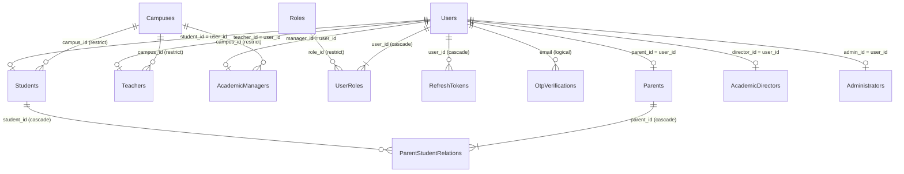
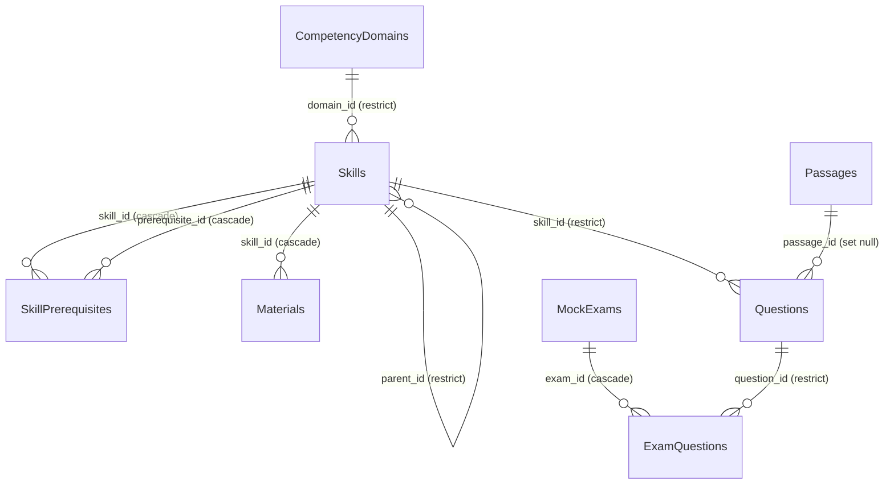
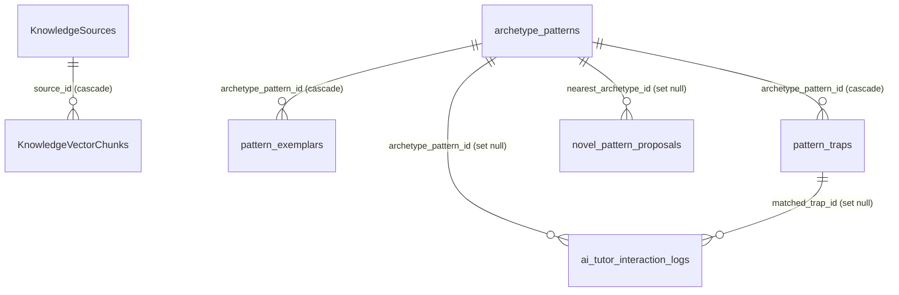
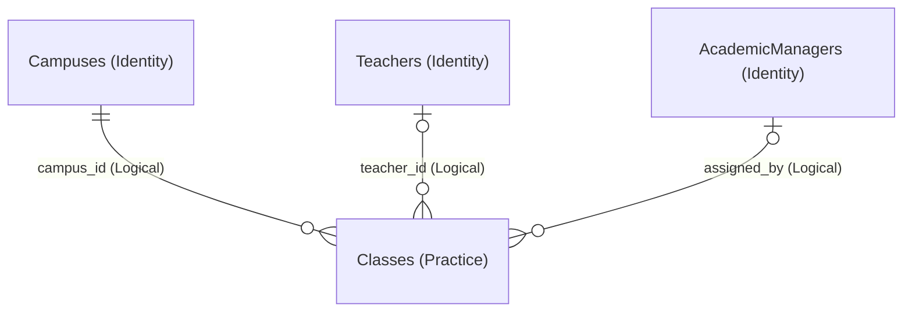
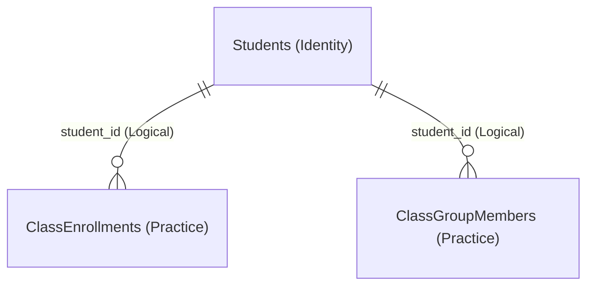
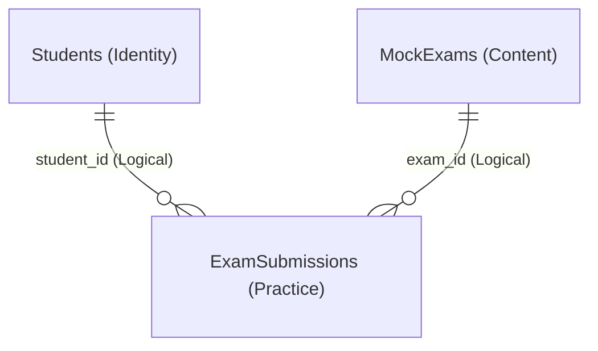

# TỔNG QUAN CHI TIẾT 74 MỐI QUAN HỆ CƠ SỞ DỮ LIỆU V-EVAL
# BẢN ĐẶC TẢ KIỂM DUYỆT & NGHIỆM THU KIẾN TRÚC THỰC THỂ (SCHEMA V4.1)

> **Tài liệu**: Báo cáo kiểm định và giải trình độc lập các mối quan hệ thực thể (ERD Relationship Audit Report)  
> **Phiên bản Schema**: Schema V4.1 (Đồng bộ 100% PostgreSQL, 4 Microservices & [SQL.sql](./SQL.sql))  
> **Ngày ban hành**: 26/10/2026 — Phiên bản Nghiệm thu Toàn diện  
> **Quy mô Hệ thống**: 47 Thực thể & 74 Mối quan hệ (42 Khóa ngoại Vật lý nội bộ + 32 Tham chiếu Logic liên Service)  
> **Sơ đồ đính kèm**: File [Capstone.drawio](./Capstone.drawio) gồm 3 Trang chuẩn (Trang-1: Bounded Context Clustered ERD, Trang-2: Conceptual Entity ERD, Trang-3: Flat Full-Detail Physical & Logical ERD)  
> **Tương thích Markdown**: Chuẩn hóa 100% cho MD Editor Plus (Relative links, Backtick LaTeX, Mermaid 11.15.0+).

---

## 1. QUY ƯỚC KÝ HIỆU & PHƯƠNG ÁN KIẾN TRÚC HYBRID (PHƯƠNG ÁN C)

### 1.1 Quy ước Ký hiệu Bản số (Cardinality Notation)
Tài liệu sử dụng ký hiệu Chân quạ (Crow's Foot) chuẩn hóa quốc tế:
- `1` hoặc `1..1` (`||` - Exactly One): Bắt buộc đúng một thực thể cha.
- `0..1` (`|o` hoặc `o|` - Zero or One): Tùy chọn, có thể có 0 hoặc 1 thực thể.
- `0..N` (`o{` hoặc `}o` - Zero to Many): Không hoặc nhiều thực thể.
- `1..N` (`|{` hoặc `}|` - One to Many): Bắt buộc ít nhất một thực thể trở lên.

### 1.2 Phương án C (Hybrid Best-Practice) cho Microservices
Hệ thống V-Eval phân tách độc lập 4 Microservices tương ứng với 4 Schemas:
1. **Khóa ngoại vật lý nội bộ Service (Physical FK - Đường nét liền Solid Line)**:
   - Các bảng nằm chung một Service/Schema có quan hệ ràng buộc bằng khóa ngoại vật lý cứng (`REFERENCES ... ON DELETE CASCADE / RESTRICT / SET NULL`) do engine CSDL PostgreSQL kiểm soát 100%.
   - **Số lượng**: 42 mối quan hệ.
2. **Tham chiếu logic liên Service (Logical Reference - Đường nét đứt Dashed Line)**:
   - Cột dữ liệu lưu giữ `uuid` của bảng thuộc Service khác (ví dụ: `v_eval_practice."Classes"` lưu `campus_id` từ `v_eval_identity."Campuses"`).
   - Không đặt ràng buộc khóa ngoại cứng ở tầng CSDL để tránh dính chặt liên dịch vụ (Cross-Service Tight Coupling).
   - Tính toàn vẹn nghiệp vụ do tầng ứng dụng bảo đảm thông qua **gRPC Client (HTTP/2)**, Outbox Pattern và Event-Driven. Cột `uuid` luôn được đánh chỉ mục B-tree (`CREATE INDEX idx_...`) để tối ưu hiệu năng Join logic.
   - **Số lượng**: 32 mối quan hệ.

---

## 2. BẢNG MA TRẬN KIỂM DUYỆT 74 MỐI QUAN HỆ (MASTER AUDIT CHECKLIST)

Bảng ma trận dưới đây đánh số thứ tự từ 1 đến 74, cho phép bạn tick chọn `[ ]` để trực tiếp kiểm tra độc lập từng mối quan hệ:

| STT | Bảng Nguồn (Cha) | Bảng Đích (Con) | Cột Liên Kết (FK / Ref) | Kiểu Liên Kết | Bản Số | Ý Nghĩa Nghiệp Vụ & Phân Tích Bản Số Chi Tiết (Nghiệm Thu) | Kiểm Duyệt |
|:---:|:---|:---|:---|:---:|:---:|:---|:---:|
| **1** | `Users` | `UserRoles` | `user_id` | Vật lý (Solid) | `1` — `1..N` | **Phân quyền RBAC:** Tài khoản bắt buộc có ít nhất 1 vai trò.<br>• `1 — 1`: Người dùng chỉ có 1 vai trò duy nhất (ví dụ: chỉ là Student).<br>• `1 — N`: Kiêm nhiệm nhiều vai trò (ví dụ: vừa là Teacher vừa là Parent có con ôn thi).<br>• `1 — 0`: KHÔNG TỒN TẠI (Tài khoản không thể có 0 vai trò). | [x] Nghiệm thu |
| **2** | `Roles` | `UserRoles` | `role_id` | Vật lý (Solid) | `1` — `0..N` | **Từ điển danh mục vai trò hệ thống:**<br>• `1 — 0`: Vai trò mới khởi tạo trong hệ thống (chưa gán cho ai).<br>• `1 — N`: Vai trò được gán cho N người dùng (hàng nghìn học sinh mang role `STUDENT`). | [x] Nghiệm thu |
| **3** | `Users` | `RefreshTokens` | `user_id` | Vật lý (Solid) | `1` — `0..N` | **Phiên đăng nhập dài hạn JWT đa thiết bị:**<br>• `1 — 0`: Tài khoản mới tạo hoặc đã đăng xuất khỏi toàn bộ thiết bị (0 token).<br>• `1 — N`: Đang đăng nhập đồng thời trên N thiết bị (Điện thoại, Laptop, Tablet). | [x] Nghiệm thu |
| **4** | `Users` | `OtpVerifications` | `email` | Logic (Dashed) | `1` — `0..N` | **Mã OTP xác thực email / đặt lại mật khẩu:**<br>• `1 — 0`: Người dùng đăng nhập bình thường, không yêu cầu gửi mã OTP.<br>• `1 — N`: Người dùng yêu cầu gửi mã OTP nhiều lần (quên mật khẩu, kích hoạt). | [x] Nghiệm thu |
| **5** | `Users` | `Students` | `student_id = user_id` | Vật lý (Solid) | `1` — `0..1` | **Hồ sơ mở rộng người học (Table Inheritance):**<br>• `1 — 0`: Tài khoản không phải học sinh (là giáo viên, phụ huynh...).<br>• `1 — 1`: Tài khoản là học sinh, có đúng 1 hồ sơ học tập (Target score, giờ học). | [x] Nghiệm thu |
| **6** | `Users` | `Parents` | `parent_id = user_id` | Vật lý (Solid) | `1` — `0..1` | **Hồ sơ mở rộng phụ huynh giám hộ:**<br>• `1 — 0`: Tài khoản không phải phụ huynh.<br>• `1 — 1`: Tài khoản là phụ huynh, có đúng 1 hồ sơ giám hộ. | [x] Nghiệm thu |
| **7** | `Users` | `Teachers` | `teacher_id = user_id` | Vật lý (Solid) | `1` — `0..1` | **Hồ sơ giáo viên giảng dạy / Mentor cơ sở:**<br>• `1 — 0`: Tài khoản không phải giáo viên.<br>• `1 — 1`: Tài khoản là giáo viên, có đúng 1 hồ sơ giảng dạy (chuyên môn, tiểu sử). | [x] Nghiệm thu |
| **8** | `Users` | `AcademicManagers` | `manager_id = user_id` | Vật lý (Solid) | `1` — `0..1` | **Hồ sơ quản lý học vụ cơ sở phụ trách xếp lớp:**<br>• `1 — 0`: Tài khoản không phải quản lý học vụ.<br>• `1 — 1`: Tài khoản là quản lý học vụ cơ sở, có đúng 1 hồ sơ nghiệp vụ. | [x] Nghiệm thu |
| **9** | `Users` | `AcademicDirectors` | `director_id = user_id` | Vật lý (Solid) | `1` — `0..1` | **Hồ sơ Giám đốc đào tạo cấp cao toàn hệ thống (HQ):**<br>• `1 — 0`: Tài khoản không phải Giám đốc học thuật.<br>• `1 — 1`: Tài khoản là Giám đốc học thuật, có đúng 1 hồ sơ phê duyệt khung toàn quốc. | [x] Nghiệm thu |
| **10** | `Users` | `Administrators` | `admin_id = user_id` | Vật lý (Solid) | `1` — `0..1` | **Hồ sơ quản trị viên hệ thống hạ tầng:**<br>• `1 — 0`: Tài khoản không phải Admin hệ thống.<br>• `1 — 1`: Tài khoản là Admin, có đúng 1 hồ sơ quản trị hạ tầng. | [x] Nghiệm thu |
| **11** | `Campuses` | `Students` | `campus_id` (NOT NULL) | Vật lý (Solid) | `1` — `0..N` | **Cơ sở đào tạo tiếp nhận học sinh:**<br>• `1 — 0`: Cơ sở mới mở chưa có học sinh ghi danh.<br>• `1 — N`: Cơ sở tiếp nhận N học sinh theo học offline (bắt buộc gắn `campus_id`). | [x] Nghiệm thu |
| **12** | `Campuses` | `Teachers` | `campus_id` (NOT NULL) | Vật lý (Solid) | `1` — `0..N` | **Cơ sở biên chế chính thức của giáo viên:**<br>• `1 — 0`: Cơ sở mới chưa có giáo viên biên chế.<br>• `1 — N`: Cơ sở có N giáo viên trực tiếp giảng dạy tại trung tâm. | [x] Nghiệm thu |
| **13** | `Campuses` | `AcademicManagers` | `campus_id` (NOT NULL) | Vật lý (Solid) | `1` — `0..N` | **Cơ sở quản lý học vụ điều phối lớp học:**<br>• `1 — 0`: Cơ sở mới chưa bố trí nhân sự học vụ.<br>• `1 — N`: Cơ sở có N cán bộ học vụ phụ trách xếp lớp và vận hành. | [x] Nghiệm thu |
| **14** | `Parents` | `ParentStudentRelations` | `parent_id` (NOT NULL) | Vật lý (Solid) | `1` — `1..N` | **Liên kết phụ huynh - con em học sinh:**<br>• `1 — 1`: Phụ huynh theo dõi 1 con đang học.<br>• `1 — N`: Phụ huynh theo dõi nhiều con cùng ôn thi.<br>• `1 — 0`: KHÔNG TỒN TẠI (Tài khoản phụ huynh bắt buộc liên kết ít nhất 1 con). | [x] Nghiệm thu |
| **15** | `Students` | `ParentStudentRelations` | `student_id` (NOT NULL) | Vật lý (Solid) | `1` — `0..N` | **Học sinh nhận sự giám hộ của phụ huynh:**<br>• `1 — 0`: Học sinh tự lập đăng ký học, chưa liên kết tài khoản phụ huynh.<br>• `1 — N`: Học sinh có cả bố và mẹ (hoặc người giám hộ) cùng nhận báo cáo. | [x] Nghiệm thu |
| **16** | `CompetencyDomains` | `Skills` | `domain_id` | Vật lý (Solid) | `1` — `0..N` | **Miền năng lực cấp 1 chứa các cây kỹ năng vi mô cấp 2:**<br>• `1 — 0`: Miền năng lực mới tạo trong khung chuẩn.<br>• `1 — N`: Miền năng lực phân rã thành N kỹ năng cụ thể (Toán gồm Đại số, Hình học...). | [x] Nghiệm thu |
| **17** | `Skills` (Cha) | `Skills` (Con) | `parent_id` (Nullable) | Vật lý (Solid) | `0..1` — `0..N` | **Cấu trúc cây phân cấp kỹ năng (Tree Hierarchy):**<br>• `0 — 1`: Kỹ năng gốc (Root Skill) không có cha (`parent_id = NULL`).<br>• `1 — 0`: Kỹ năng lá (Leaf Skill) không có kỹ năng con.<br>• `1 — N`: Kỹ năng chuyên đề chứa N kỹ năng con (Đại số $\rightarrow$ Phương trình $\rightarrow$ Bậc 2). | [x] Nghiệm thu |
| **18** | `Skills` | `SkillPrerequisites` | `skill_id` | Vật lý (Solid) | `1` — `0..N` | **Kỹ năng mục tiêu trong đồ thị có hướng DAG:**<br>• `1 — 0`: Kỹ năng nhập môn, không đòi hỏi điều kiện học trước.<br>• `1 — N`: Kỹ năng nâng cao đòi hỏi N kỹ năng tiên quyết phải nắm vững trước. | [x] Nghiệm thu |
| **19** | `Skills` | `SkillPrerequisites` | `prerequisite_id` | Vật lý (Solid) | `1` — `0..N` | **Kỹ năng điều kiện tiên quyết bắt buộc học trước:**<br>• `1 — 0`: Kỹ năng chuyên sâu cuối cùng, không làm tiên quyết cho kỹ năng nào.<br>• `1 — N`: Kỹ năng nền tảng làm tiền đề để học tiếp N kỹ năng khác. | [x] Nghiệm thu |
| **20** | `Skills` | `Materials` | `skill_id` | Vật lý (Solid) | `1` — `0..N` | **Học liệu bài giảng, video vi mô đính kèm kỹ năng:**<br>• `1 — 0`: Kỹ năng mới bổ sung, chưa upload bài giảng.<br>• `1 — N`: Kỹ năng có N học liệu vi mô (video bài giảng 3-5 phút, tóm tắt lý thuyết). | [x] Nghiệm thu |
| **21** | `Skills` | `Questions` | `skill_id` | Vật lý (Solid) | `1` — `0..N` | **Ngân hàng câu hỏi đo lường năng lực của một kỹ năng:**<br>• `1 — 0`: Kỹ năng mới tạo chưa có câu hỏi.<br>• `1 — N`: Kỹ năng có ngân hàng N câu hỏi đủ các cấp độ nhận thức (ZPD). | [x] Nghiệm thu |
| **22** | `Passages` | `Questions` | `passage_id` (Nullable) | Vật lý (Solid) | `0..1` — `0..N` | **Đoạn văn đọc hiểu / dữ liệu khoa học dùng chung:**<br>• `0 — 1`: Câu hỏi độc lập không thuộc đoạn văn nào (`passage_id = NULL`).<br>• `1 — 0`: Đoạn văn mới nhập chưa gắn câu hỏi.<br>• `1 — N`: Đoạn văn làm ngữ cảnh chung cho chùm N câu hỏi liên hoàn. | [x] Nghiệm thu |
| **23** | `MockExams` | `ExamQuestions` | `exam_id` | Vật lý (Solid) | `1` — `0..N` | **Đề thi chuẩn hóa tập hợp câu hỏi theo ma trận:**<br>• `1 — 0`: Khung đề thi vừa tạo, chưa nạp ma trận câu hỏi.<br>• `1 — N`: Đề thi hoàn chỉnh gồm N câu hỏi theo ma trận chuẩn ĐGNL. | [x] Nghiệm thu |
| **24** | `Questions` | `ExamQuestions` | `question_id` | Vật lý (Solid) | `1` — `0..N` | **Tái sử dụng câu hỏi trong các đề thi chuẩn:**<br>• `1 — 0`: Câu hỏi chỉ dùng cho luyện tập thích ứng, chưa đưa vào đề chuẩn nào.<br>• `1 — N`: Câu hỏi tiêu biểu được tái sử dụng trong N đề thi thử khác nhau. | [x] Nghiệm thu |
| **25** | `Classes` | `ExamSubmissions` | `enrolled_class_id` (Null) | Vật lý (Solid) | `0..1` — `0..N` | **Bài thi tổ chức trong khuôn khổ lớp học offline:**<br>• `0 — 0`: Bài thi tự do tại nhà không thuộc lớp; lớp mới chưa tổ chức thi.<br>• `0 — 1`: Bài thi làm tự do của học sinh ngoài phạm vi lớp (`enrolled_class_id = NULL`).<br>• `1 — 0`: Lớp học chưa có bài nộp thi tập trung nào.<br>• `1 — N`: Lớp học tổ chức thi tập trung, sinh ra N bài nộp của học sinh trong lớp. | [x] Nghiệm thu |
| **26** | `ExamSubmissions` | `SubmissionAnswers` | `submission_id` | Vật lý (Solid) | `1` — `0..N` | **Bản ghi chi tiết đáp án từng câu trong lượt thi:**<br>• `1 — 0`: Vừa bấm "Bắt đầu làm bài", bản ghi lượt thi khởi tạo nhưng chưa chọn câu nào hoặc nộp bài trắng.<br>• `1 — 1`: Vừa chọn và nộp câu trả lời đầu tiên.<br>• `1 — N`: Hoàn thành toàn bộ N câu hỏi trong đề thi. | [x] Nghiệm thu |
| **27** | `ExamSubmissions` | `ProctoringSnapshots` | `submission_id` | Vật lý (Solid) | `1` — `0..N` | **Ảnh chụp webcam định kỳ kiểm soát gian lận:**<br>• `1 — 0`: Vừa vào thi, chưa đến khoảng thời gian định kỳ chụp webcam hoặc chưa mất focus tab.<br>• `1 — N`: Quá trình làm bài chụp N ảnh webcam phục vụ hậu kiểm liêm chính khi điểm số tăng đột biến. | [x] Nghiệm thu |
| **28** | `Classes` | `ClassEnrollments` | `class_id` | Vật lý (Solid) | `1` — `0..N` | **Danh sách học sinh ghi danh trong lớp học offline:**<br>• `1 — 0`: Lớp học mới tạo trước để xếp phòng/giáo viên hoặc dự phòng tuyển sinh, chưa có học sinh ghi danh.<br>• `1 — 1`: Tiếp nhận học sinh đầu tiên đăng ký thành công.<br>• `1 — N`: Lớp tiếp nhận đầy đủ danh sách học sinh (chuẩn quy mô 20 bạn/lớp). | [x] Nghiệm thu |
| **29** | `ExamSubmissions` | `ClassEnrollments` | `diagnostic_submission_id` | Vật lý (Solid) | `0..1` — `0..N` | **Bài thi chẩn đoán đầu vào căn cứ phân lớp K-Means:**<br>• `0 — 0`: Vào lớp thẳng theo học bạ/thỏa thuận không qua thi test (`NULL`), bài thi thường không dùng phân lớp.<br>• `0 — 1`: Ghi danh lớp mà không gắn bài thi chẩn đoán (`diagnostic_submission_id = NULL`).<br>• `1 — 0`: Bài thi thường/định kỳ không dùng làm căn cứ phân lớp.<br>• `1 — 1`: 1 bài thi chẩn đoán là căn cứ thuật toán K-Means xếp học sinh vào đúng 1 lớp phù hợp.<br>• `1 — N`: 1 bài thi chẩn đoán tổng hợp dùng làm căn cứ ghi danh vào nhiều lớp chuyên đề khác nhau (Toán, Lý). | [x] Nghiệm thu |
| **30** | `Classes` | `ClassGroups` | `class_id` | Vật lý (Solid) | `1` — `0..N` | **Lớp học phân rã thành các nhóm vi mô 3–5 bạn:**<br>• `1 — 0`: Lớp mới thành lập hoặc đầu kỳ, học sinh chưa làm bài kiểm tra nên chưa phân cụm.<br>• `1 — N`: Sau bài kiểm tra, thuật toán `ClassMicroClusterer` tự động chia lớp thành 3–5 nhóm vi mô theo kỹ năng yếu. | [x] Nghiệm thu |
| **31** | `ClassGroups` | `ClassGroupMembers` | `group_id` | Vật lý (Solid) | `1` — `1..N` | **Thành viên cùng điểm yếu trong nhóm vi mô (không có nhóm rỗng):**<br>• `1 — 0`: KHÔNG TỒN TẠI (Nhóm vi mô chỉ sinh ra khi có học sinh cùng lỗi sai kiến thức, không tạo nhóm rỗng).<br>• `1 — 1`: Nhóm đặc biệt chỉ có 1 học sinh gặp lỗ hổng cá biệt cần giáo viên can thiệp riêng.<br>• `1 — N`: Nhóm vi mô tiêu chuẩn gồm từ 2 đến N (chuẩn 3–5 bạn) cùng yếu một kỹ năng để làm Worksheet chung. | [x] Nghiệm thu |
| **32** | `ExamSubmissions` | `LearningRoadmaps` | `diagnostic_submission_id` | Vật lý (Solid) | `0..1` — `0..N` | **Khởi tạo lộ trình cá nhân hóa từ bài thi đầu vào:**<br>• `0 — 0`: Bài thi thường không tạo lộ trình; lộ trình tạo thủ công không có bài thi.<br>• `0 — 1`: Lộ trình chuẩn mặc định (Cold-start) hoặc chỉ định tay khi `diagnostic_submission_id = NULL` (hoặc bài thi cũ bị xóa SET NULL).<br>• `0 — N`: Giáo viên tạo N lộ trình rèn luyện chuyên biệt cho học sinh không qua bài thi app.<br>• `1 — 0`: Bài thi nộp hàng ngày / quiz định kỳ chỉ cập nhật điểm BKT, KHÔNG TẠO MỚI bảng `LearningRoadmaps` (tránh nổ dữ liệu).<br>• `1 — 1`: 1 bài thi chẩn đoán sinh ra đúng 1 lộ trình chuẩn theo mục tiêu (Target Score).<br>• `1 — N`: 1 bài thi làm mốc chuẩn (Baseline) sinh ra N lộ trình: đa phiên bản điều chỉnh (Re-planning / ARCHIVED vs ACTIVE), đa mục tiêu (Multi-track Toán/Văn), hoặc lộ trình tự học kết hợp phụ đạo. | [x] Nghiệm thu |
| **33** | `LearningRoadmaps` | `RoadmapNodes` | `roadmap_id` | Vật lý (Solid) | `1` — `1..N` | **Các chặng học kỹ năng theo lộ trình (bắt buộc có ít nhất 1 node):**<br>• `1 — 0`: KHÔNG TỒN TẠI (Lộ trình rỗng 0 node là lỗi nghiệp vụ; người học luôn có mục tiêu năng lực và ít nhất 1 kỹ năng cần hoàn thiện trong ZPD).<br>• `1 — 1`: Lộ trình ôn tập cấp tốc chỉ tập trung giải quyết đúng 1 kỹ năng cốt lõi bị hổng nặng.<br>• `1 — N`: Lộ trình học chuẩn gồm N chặng kỹ năng (Milestones) sắp xếp theo thứ tự tiên quyết `step_order`. | [x] Nghiệm thu |
| **34** | `RoadmapNodes` | `StageProgress` | `roadmap_node_id` | Vật lý (Solid) | `1` — `0..N` | **Tiến trình vượt 4 bước P-L-A-R của chặng học (Lazy Initialization):**<br>• `1 — 0`: Chặng học có sẵn trong lộ trình nhưng đang bị khóa (LOCKED) hoặc học sinh chưa bấm bắt đầu học (chưa gọi StartStage), chưa có bản ghi tiến trình nào.<br>• `1 — 1`: Học sinh bấm bắt đầu học chặng này, hệ thống khởi tạo đúng 1 bản ghi StageProgress bắt đầu từ bước PREVIEW.<br>• `1 — N`: Học sinh hoàn thành hoặc làm lại chặng nhiều lần (Remedial Loop hoặc làm lại chặng khi chưa đạt PLT), sinh ra N lần theo dõi tiến trình PLAR. | [x] Nghiệm thu |
| **35** | `StageProgress` | `AdaptiveQuizAttempts` | `stage_progress_id` | Vật lý (Solid) | `1` — `0..N` | **Lịch sử giải quiz thích ứng bước Apply chu trình PLAR:**<br>• `1 — 0`: Học sinh đang ở bước Preview hoặc Learn, chưa làm bài quiz nào ở bước Apply.<br>• `1 — 1`: Học sinh vừa nộp câu trả lời thích ứng đầu tiên tại bước Apply.<br>• `1 — N`: Học sinh thực hiện N lần giải bài tập thích ứng tăng dần độ khó ZPD, thuật toán BKT cập nhật độ thành thạo PLT. | [x] Nghiệm thu |
| **36** | `Classes` | `ClassSkillHeatmaps` | `class_id` | Vật lý (Solid) | `1` — `0..N` | **Ma trận nhiệt năng lực từng học sinh (Học sinh $\times$ Kỹ năng):**<br>• `1 — 0`: Lớp học mới tạo hoặc đầu kỳ, chưa có bài kiểm tra/đánh giá nên chưa phát sinh ô nhiệt nào.<br>• `1 — N`: Lớp có 20 học sinh $\times$ 15 kỹ năng = 300 ô màu (Đỏ / Vàng / Xanh) lưu trữ P(Lt) chi tiết (`UNIQUE(class_id, student_id, skill_id)`). | [x] Nghiệm thu |
| **37** | `Classes` | `ClassHeatmapSummaries` | `class_id` | Vật lý (Solid) | `1` — `0..N` | **Tổng hợp cột kỹ năng chân trang & Thẻ báo động khẩn cấp:**<br>• `1 — 0`: Lớp mới tạo, chưa chạy thuật toán thống kê tổng hợp theo cột kỹ năng.<br>• `1 — N`: Lớp học có N kỹ năng $\rightarrow$ sinh ra đúng N dòng tổng kết ở chân ma trận (mỗi dòng cho 1 kỹ năng: `UNIQUE(class_id, skill_id)`). Các kỹ năng có tỷ lệ mất gốc $\ge 40\%$ (`CRITICAL_RED`) hoặc phân cực 2 cực (`is_bimodal = true`) được đẩy lên thành các Card cảnh báo trên đầu Dashboard để giáo viên can thiệp ngay. | [x] Nghiệm thu |
| **38** | `KnowledgeSources` | `KnowledgeVectorChunks` | `source_id` | Vật lý (Solid) | `1` — `0..N` | **RAG tri thức SGK chia nhỏ thành vector nhúng:**<br>• `1 — 0`: Tài liệu SGK/PDF vừa upload lên hệ thống, chưa chạy tiến trình bóc tách văn bản và vector hóa.<br>• `1 — N`: Nguồn tài liệu được chia nhỏ thành N đoạn văn (Chunks ~500 ký tự) kèm vector 768 chiều (`pgvector`) để AI truy xuất ngữ nghĩa theo thời gian thực. | [x] Nghiệm thu |
| **39** | `archetype_patterns` | `pattern_exemplars` | `archetype_pattern_id` | Vật lý (Solid) | `1` — `0..N` | **Lời giải mẫu chuẩn vàng (Golden Solutions) cho dạng bài:**<br>• `1 — 0`: Dạng bài mới được khởi tạo khung lý thuyết, chưa kịp nạp câu hỏi mẫu và lời giải vàng.<br>• `1 — N`: Dạng bài có N câu hỏi mẫu mực với các cách giải chuẩn khác nhau (tự luận mẫu mực, bấm máy nhanh Casio, mẹo loại trừ). | [x] Nghiệm thu |
| **40** | `archetype_patterns` | `pattern_traps` | `archetype_pattern_id` | Vật lý (Solid) | `1` — `0..N` | **Bẫy tư duy & quan niệm sai lầm gắn với dạng bài:**<br>• `1 — 0`: Dạng bài cơ bản nhận biết, không có bẫy nhận thức phức tạp.<br>• `1 — N`: Dạng bài vận dụng có N bẫy kinh điển tương ứng với các phương án sai A/B/C/D (`wrong_option`), kèm câu hỏi gợi mở bóc bẫy (`socratic_hint`). | [x] Nghiệm thu |
| **41** | `archetype_patterns` | `novel_pattern_proposals` | `nearest_archetype_id` | Vật lý (Solid) | `0..1` — `0..N` | **Đề xuất dạng bài mới từ đề thi thực tế (Top-1 + JSONB lai ghép):**<br>• `0 — 0`: Câu hỏi mới hoàn toàn lạ (Out-of-Distribution, Cosine Similarity $< 0.30$), không giống dạng nào trong kho (`nearest_archetype_id = NULL`); các dạng bài cũ không có đề xuất nào trỏ về.<br>• `0 — 1`: Câu hỏi mới độc lạ được gửi lên cho Academic Director phê duyệt dạng mới (`NULL`). Các dạng bài pha trộn lai ghép nhiều dạng cũ được lưu trong `extracted_metadata jsonb` ([Flow 4 GraphRAG](./docs/ai_architecture/quy_trinh_trien_khai_chi_tiet_flow_4_graph_rag.md#L207-L220)).<br>• `1 — 0`: Dạng bài mẫu mực kinh điển không có đề xuất mới nào trỏ về.<br>• `1 — 1`: 1 câu hỏi mới là biến thể gần nhất của đúng 1 dạng bài chủ đạo trong kho.<br>• `1 — N` (Chiều ngược `N — 1` Many-to-One): N câu hỏi đề xuất mới từ nhiều trường chuyên cùng trỏ về 1 dạng bài chủ đạo để xin bổ sung biến thể.<br>• *Nghiệp vụ đa dạng bài (1 câu hỏi gắn N dạng bài)*: Khóa ngoại cứng chỉ lưu Top-1 dạng gần nhất; N dạng bài lai ghép được lưu trong `extracted_metadata jsonb`. | [x] Nghiệm thu |
| **42** | `archetype_patterns` | `ai_tutor_interaction_logs`| `archetype_pattern_id` | Vật lý (Solid) | `0..1` — `0..N` | **Nạp ngữ cảnh động & Kiểm định Socratic (LLM-as-a-Judge):**<br>• Lưu toàn bộ transcript Socratic, kiểm định 2 lớp qua LLM-as-a-Judge (`validation_status`), hỗ trợ Human-in-the-Loop (`student_reported` $\rightarrow$ `mentor_resolution`).<br>• `0 — 0`: Phiên chat hỏi bài tự do/đọc hiểu không gắn dạng bài mẫu; dạng bài cũ không có ai hỏi.<br>• `0 — 1`: Phiên chat hỏi câu hỏi chưa phân dạng hoặc đọc hiểu (`archetype_pattern_id = NULL`), AI vẫn hỗ trợ theo ngữ cảnh câu hỏi.<br>• `1 — 0`: Dạng bài quá dễ, học sinh làm đúng 100%, không ai cần gọi AI Tutor.<br>• `1 — 1`: 1 phiên chat kích hoạt đúng 1 dạng bài mẫu mực để AI nạp định lý và phương pháp giải.<br>• `1 — N` (Chiều ngược `N — 1` Many-to-One): Dạng bài khó/vận dụng cao được kích hoạt trong N phiên chat của nhiều học sinh cần trợ giúp. | [x] Nghiệm thu |
| **43** | `pattern_traps` | `ai_tutor_interaction_logs` | `matched_trap_id` | Vật lý (Solid) | `0..1` — `0..N` | **Nhận diện bẫy tư duy học sinh mắc phải khi gọi AI:**<br>• `0 — 0`: Học sinh tính nhầm số học ngẫu nhiên không rơi vào bẫy kinh điển nào (`matched_trap_id = NULL`); bẫy tư duy chưa có ai mắc phải.<br>• `0 — 1`: Phiên chat mà học sinh chọn phương án sai nhưng không thuộc bẫy định nghĩa trước (`matched_trap_id = NULL`), AI gợi mở chung.<br>• `1 — 0`: Bẫy tư duy ít học sinh vướng phải.<br>• `1 — 1`: Học sinh chọn đúng phương án bẫy của dạng bài, AI nạp ngay `socratic_hint` tương ứng để bóc trần sai lầm.<br>• `1 — N` (Chiều ngược `N — 1` Many-to-One): Bẫy tư duy kinh điển có N lượt học sinh cùng mắc phải và được AI dẫn dắt vượt qua.<br>• *Nghiệp vụ đa bẫy nhận thức (1 phiên vướng N bẫy liên tiếp)*: Khóa ngoại chỉ lưu bẫy kích hoạt ban đầu; toàn bộ diễn biến học sinh vướng N bẫy liên tiếp trong quá trình chat được lưu trong `ai_guidance_transcript jsonb`. | [x] Nghiệm thu |
| **44** | `Campuses` | `Classes` | `campus_id` | Logic (Dashed) | `1` — `0..N` | **Cơ sở đào tạo tổ chức các lớp học offline:**<br>• `1 — 0`: Cơ sở mới thành lập, đang hoàn thiện trang thiết bị, chưa mở lớp học nào.<br>• `1 — 1`: Cơ sở vừa khởi tạo lớp học đầu tiên.<br>• `1 — N`: Cơ sở vận hành ổn định có N lớp học đang hoạt động.<br>• Chiều ngược: Mỗi lớp học offline bắt buộc phải thuộc về đúng 1 cơ sở địa lý cụ thể (`campus_id NOT NULL`) để điều phối phòng học và học phí. | [x] Nghiệm thu |
| **45** | `Teachers` | `Classes` | `teacher_id` (Nullable) | Logic (Dashed) | `0..1` — `0..N` | **Giáo viên Lead Mentor phụ trách điều hành lớp học:**<br>• `0 — 0`: Giáo viên mới thử việc/chuyên soạn đề chưa nhận lớp VÀ Lớp học mới tạo khung chưa có giáo viên phụ trách.<br>• `0 — 1`: Lớp học mới lập kế hoạch hoặc giáo viên cũ nghỉ đột xuất, đang tìm giáo viên thay thế (`teacher_id = NULL`).<br>• `1 — 0`: Giáo viên trong kỳ nghỉ hè/tập huấn chuyên môn, hiện không đứng lớp nào.<br>• `1 — 1`: Giáo viên chủ nhiệm đúng 1 lớp duy nhất.<br>• `1 — N`: Giáo viên thâm niên / Lead Mentor phụ trách giảng dạy N lớp học. | [x] Nghiệm thu |
| **46** | `AcademicManagers` | `Classes` | `assigned_by` (Nullable) | Logic (Dashed) | `0..1` — `0..N` | **Quản lý học vụ phân bổ lớp học (Người tạo vs Hệ thống tự động):**<br>• `0 — 0`: Quản lý học vụ mới nhận việc chưa tạo lớp VÀ Lớp học do hệ thống tự sinh.<br>• `0 — 1`: Lớp học được tạo hoàn toàn tự động bởi thuật toán K-Means Placement (Background Job tự động gom 20 bạn cùng trình độ vào lớp, `assigned_by = NULL`), hoặc Quản lý cũ đã nghỉ việc (`SET NULL`).<br>• `1 — 0`: Cán bộ học vụ chỉ phụ trách chăm sóc phụ huynh, chưa trực tiếp bấm nút tạo/phân bổ lớp nào.<br>• `1 — 1`: Cán bộ học vụ trực tiếp tạo và điều phối 1 lớp học.<br>• `1 — N`: Cán bộ học vụ cơ sở phụ trách quản lý N lớp học tại địa bàn. | [x] Nghiệm thu |
| **47** | `Students` | `ClassEnrollments` | `student_id` | Logic (Dashed) | `1` — `0..N` | **Học sinh ghi danh lớp học (Học sinh Online vs Học sinh Offline):**<br>• `1 — 0`: Học sinh mới đăng ký tài khoản chưa làm test/chưa xếp lớp; HOẶC học sinh học Online tự do (Self-study) chỉ mua gói luyện đề/lộ trình tại nhà, không theo học lớp offline tại Campus.<br>• `1 — 1`: Học sinh đăng ký 1 lớp học offline duy nhất tại trung tâm.<br>• `1 — N`: Học sinh đăng ký theo học N lớp chuyên đề khác nhau (ví dụ: lớp Toán ĐGNL và lớp Khoa học). | [x] Nghiệm thu |
| **48** | `Students` | `ClassGroupMembers` | `student_id` | Logic (Dashed) | `1` — `0..N` | **Điều phối học sinh vào nhóm vi mô cùng lỗ hổng kiến thức:**<br>• `1 — 0`: Học sinh tự học online (không có nhóm); hoặc học sinh trong lớp offline chưa phân cụm đầu kỳ / có học lực xuất sắc đồng đều không bị hổng kiến thức.<br>• `1 — 1`: Học sinh bị hổng đúng 1 kỹ năng và được xếp vào đúng 1 nhóm vi mô (3–5 bạn) để làm bài tập can thiệp chung.<br>• `1 — N`: Học sinh bị hổng nhiều kỹ năng, được xếp vào N nhóm vi mô tương ứng để làm Worksheet phục hồi. | [x] Nghiệm thu |
| **49** | `Students` | `ExamSubmissions` | `student_id` | Logic (Dashed) | `1` — `0..N` | **Lịch sử làm bài thi thử / thi chẩn đoán của học sinh:**<br>• `1 — 0`: Học sinh mới tạo tài khoản, chưa làm bài test đánh giá năng lực đầu vào nào và chưa tham gia thi thử.<br>• `1 — 1`: Học sinh vừa hoàn thành và nộp bài thi đầu tiên (bài test chẩn đoán).<br>• `1 — N`: Học sinh tích cực ôn luyện, đã nộp N bài thi thử chuẩn hóa ĐGNL trong suốt quá trình học. | [x] Nghiệm thu |
| **50** | `MockExams` | `ExamSubmissions` | `exam_id` | Logic (Dashed) | `1` — `0..N` | **Lượt nộp bài của học sinh đối với một đề thi chuẩn hóa:**<br>• `1 — 0`: Đề thi mới tạo bản nháp (`is_published = false`) chưa được lên kệ; hoặc đề thi chuẩn vừa xuất bản chưa có học sinh nào vào thi.<br>• `1 — 1`: Đề thi vừa tiếp nhận lượt làm bài nộp đầu tiên.<br>• `1 — N`: Đề thi chuẩn hóa chính thức (ví dụ Đề mẫu HSA 01) được N lượt học sinh toàn quốc làm và nộp bài. | [x] Nghiệm thu |
| **51** | `Questions` | `SubmissionAnswers` | `question_id` | Logic (Dashed) | `1` — `0..N` | Câu hỏi gốc được trả lời trong phiên thi | [ ] |
| **52** | `Students` | `LearningRoadmaps` | `student_id` | Logic (Dashed) | `1` — `0..N` | Học sinh sở hữu lộ trình học tập thích ứng cá nhân hóa | [ ] |
| **53** | `Skills` | `RoadmapNodes` | `skill_id` | Logic (Dashed) | `1` — `0..N` | Kỹ năng mục tiêu cần chinh phục tại từng chặng học | [ ] |
| **54** | `Materials` | `RoadmapNodes` | `material_id` (Nullable) | Logic (Dashed) | `0..1` — `0..N` | Học liệu được chỉ định học tại chặng lộ trình | [ ] |
| **55** | `MockExams` | `RoadmapNodes` | `quiz_exam_id` (Null) | Logic (Dashed) | `0..1` — `0..N` | Bài kiểm tra vượt chặng đánh giá hoàn thành kỹ năng | [ ] |
| **56** | `Students` | `StageProgress` | `student_id` | Logic (Dashed) | `1` — `0..N` | Học sinh đang trực tiếp thực hiện tiến trình chặng học | [ ] |
| **57** | `Students` | `LearningProfiles` | `student_id` | Logic (Dashed) | `1` — `0..N` | Hồ sơ xác suất làm chủ năng lực P(L0) của học sinh | [ ] |
| **58** | `Skills` | `LearningProfiles` | `skill_id` | Logic (Dashed) | `1` — `0..N` | Kỹ năng được theo dõi xác suất thành thạo BKT | [ ] |
| **59** | `Students` | `AdaptiveQuizAttempts` | `student_id` | Logic (Dashed) | `1` — `0..N` | Học sinh thực hiện lượt làm quiz thích ứng | [ ] |
| **60** | `Questions` | `AdaptiveQuizAttempts` | `question_id` | Logic (Dashed) | `1` — `0..N` | Câu hỏi trích xuất từ ngân hàng để kiểm tra thích ứng | [ ] |
| **61** | `Students` | `MistakeNotebooks` | `student_id` | Logic (Dashed) | `1` — `0..N` | Sổ tay ghi chép lỗi sai cá nhân của học sinh | [ ] |
| **62** | `Questions` | `MistakeNotebooks` | `question_id` | Logic (Dashed) | `1` — `0..N` | Câu hỏi mà học sinh trả lời sai cần ôn tập lại | [ ] |
| **63** | `Skills` | `MistakeNotebooks` | `skill_id` | Logic (Dashed) | `1` — `0..N` | Kỹ năng bị hổng tương ứng với câu hỏi làm sai | [ ] |
| **64** | `Students` | `ScorePredictions` | `student_id` | Logic (Dashed) | `1` — `0..N` | Dự báo điểm số thực tế kèm sai số chuẩn SEM | [ ] |
| **65** | `Students` | `SystemAlerts` | `student_id` | Logic (Dashed) | `1` — `0..N` | Cảnh báo học tập (Đỏ, Vàng, Xanh) phát sinh cho học sinh | [ ] |
| **66** | `Users` | `SystemAlerts` | `handled_by` (Nullable) | Logic (Dashed) | `0..1` — `0..N` | Giáo viên / Quản lý học vụ tiếp nhận xử lý cảnh báo | [ ] |
| **67** | `Students` | `ClassSkillHeatmaps` | `student_id` | Logic (Dashed) | `1` — `0..N` | Học sinh đóng góp chỉ số năng lực vào ma trận nhiệt lớp | [ ] |
| **68** | `Skills` | `ClassSkillHeatmaps` | `skill_id` | Logic (Dashed) | `1` — `0..N` | Cột kỹ năng được đo đạc trên ma trận nhiệt của lớp | [ ] |
| **69** | `Skills` | `ClassHeatmapSummaries` | `skill_id` | Logic (Dashed) | `1` — `0..N` | Kỹ năng được tính toán tỷ lệ nguy cơ toàn lớp học | [ ] |
| **70** | `Students` | `StudentDailyActivities`| `student_id` | Logic (Dashed) | `1` — `0..N` | Nhật ký học tập hằng ngày và chuỗi Streak của học sinh | [ ] |
| **71** | `Students` | `StudentReadinessMetrics`| `student_id` (UNIQUE) | Logic (Dashed) | `1` — `0..1` | Chỉ số sẵn sàng thi tổng hợp duy nhất của mỗi học sinh | [ ] |
| **72** | `Skills` | `archetype_patterns` | `skill_id` | Logic (Dashed) | `1` — `0..N` | Dạng bài mẫu mực là mức đào sâu chi tiết của kỹ năng | [ ] |
| **73** | `Students` | `ai_tutor_interaction_logs`| `student_id` | Logic (Dashed) | `1` — `0..N` | Học sinh tương tác hỏi đáp với Trợ giảng AI Socratic | [ ] |
| **74** | `Questions` | `ai_tutor_interaction_logs`| `question_id` | Logic (Dashed) | `1` — `0..N` | Câu hỏi làm sai là ngữ cảnh để AI dẫn dắt gợi mở | [ ] |

---

## 3. CỤM 1: PHÂN HỆ ĐỊNH DANH, BẢO MẬT & HỒ SƠ CHỦ THỂ (V_EVAL_IDENTITY)

Phân hệ quản trị tài khoản tập trung, cơ chế xác thực JWT kép, bảo mật OTP và mở rộng 6 hồ sơ nghiệp vụ tương ứng với 6 vai trò người dùng trong hệ sinh thái luyện thi ĐGNL.



---

### 3.1 Bảng `Users` (Tài khoản người dùng tập trung)
- **Ý nghĩa & Vai trò**: Là thực thể cốt lõi lưu trữ định danh bảo mật (Email, Password Hash bằng BCrypt, Họ tên, Trạng thái kích hoạt `is_active`). Tất cả 6 nhóm tác nhân trong hệ thống đều xuất phát từ `Users`.

#### Các mối quan hệ xuất phát từ `Users`:
1. **Quan hệ #1: `Users` $\rightarrow$ `UserRoles`**
   - **Cột liên kết**: `UserRoles.user_id` $\rightarrow$ `Users.user_id` (NOT NULL).
   - **Loại liên kết**: Khóa ngoại vật lý nội bộ Identity (`ON DELETE CASCADE`).
   - **Bản số đã chuẩn hóa**: **`1` — `1..N`** (`Users ||--|{ UserRoles`).
   - **Mối tương quan hai chiều & Nghiệm thu chi tiết**:
     - *Chiều xuôi (`Users` $\rightarrow$ `UserRoles`)*: Mỗi tài khoản khi khởi tạo thành công **bắt buộc phải có ít nhất một vai trò** (`1..N`). Hệ thống không cho phép tồn tại một "tài khoản rác" vô danh trôi nổi mà không có bất kỳ quyền hạn nào.
     - *Chiều ngược (`UserRoles` $\rightarrow$ `Users`)*: Mỗi dòng phân quyền trong `UserRoles` bắt buộc phải trỏ về đúng 1 tài khoản người dùng (`user_id NOT NULL`).
   - **Lý do tồn tại & Ý nghĩa nghiệp vụ**: Hiện thực hóa mô hình RBAC (Role-Based Access Control) cho phép 1 người dùng kiêm nhiệm nhiều vai trò (ví dụ: vừa là Giáo viên vừa là Phụ huynh có con ôn thi).

2. **Quan hệ #2: `Roles` $\rightarrow$ `UserRoles`**
   - **Cột liên kết**: `UserRoles.role_id` $\rightarrow$ `Roles.role_id` (NOT NULL).
   - **Loại liên kết**: Khóa ngoại vật lý nội bộ Identity (`ON DELETE RESTRICT`).
   - **Bản số**: `1` — `0..N` (`Roles ||--o{ UserRoles`).
   - **Tương quan**: Một vai trò danh mục (STUDENT, TEACHER...) có thể được gán cho 0 hoặc hàng ngàn người dùng (`0..N`). Cấm xóa một Role nếu đang có người dùng nắm giữ vai trò đó (`ON DELETE RESTRICT`).

3. **Quan hệ #3: `Users` $\rightarrow$ `RefreshTokens`**
   - **Cột liên kết**: `RefreshTokens.user_id` $\rightarrow$ `Users.user_id` (NOT NULL).
   - **Loại liên kết**: Khóa ngoại vật lý (`ON DELETE CASCADE`).
   - **Bản số**: `1` — `0..N` (`Users ||--o{ RefreshTokens`).
   - **Tương quan**: Một người dùng có thể đăng nhập trên nhiều thiết bị cùng lúc (Laptop, Điện thoại, Tablet), mỗi thiết bị duy trì 1 Refresh Token độc lập. Khi tài khoản bị xóa, toàn bộ token bị thu hồi tức thì.

4. **Quan hệ #4: `Users` $\rightarrow$ `OtpVerifications`**
   - **Cột liên kết**: `OtpVerifications.email` $\rightarrow$ `Users.email`.
   - **Loại liên kết**: Tham chiếu logic (Logical Reference) qua email người dùng.
   - **Bản số**: `1` — `0..N`.
   - **Lý do tồn tại**: Phục vụ kích hoạt tài khoản và cấp lại mật khẩu tự phục vụ (Self-service Password Reset).

5. **Quan hệ #5 đến #10: `Users` $\rightarrow$ 6 Bảng Hồ sơ Nghiệp vụ (`Students`, `Parents`, `Teachers`, `AcademicManagers`, `AcademicDirectors`, `Administrators`)**
   - **Cột liên kết**: `student_id = user_id`, `parent_id = user_id`, `teacher_id = user_id`, `manager_id = user_id`, `director_id = user_id`, `admin_id = user_id`.
   - **Loại liên kết**: Khóa ngoại vật lý (`ON DELETE CASCADE`).
   - **Bản số**: `1` — `0..1` (`Users ||--o| Actors`).
   - **Mối tương quan hai chiều**:
     - *Chiều xuôi*: Một User có thể có tối đa 1 hồ sơ cho mỗi loại vai trò (ví dụ: User X có tối đa 1 hồ sơ `Students`). Có thể là 0 nếu tài khoản đó không mang vai trò tương ứng (ví dụ: User là Thầy giáo thì hồ sơ `Students` là 0).
     - *Chiều ngược*: Bất kỳ hồ sơ nghiệp vụ nào bắt buộc phải gắn với đúng 1 User gốc. Không thể tồn tại một hồ sơ học sinh hay giáo viên vô danh không có tài khoản.
   - **Lý do tồn tại & Ý nghĩa nghiệp vụ**: Mô hình kế thừa bảng (Table Inheritance Pattern / Profile Extension Pattern). Giúp bảng `Users` nhẹ nhàng, tinh gọn, trong khi các thuộc tính chuyên biệt của từng nhóm (Target score của Học sinh, Specialty của Giáo viên, Cơ sở của Quản lý) được lưu trữ riêng, bảo đảm chuẩn hóa 3NF.

---

### 3.2 Bảng `Roles` & `UserRoles` (Giải trình bản chất RBAC)
- **`Roles` (Bảng Danh mục vai trò)**: Là **từ điển danh mục cố định** định nghĩa các chức danh trong hệ thống (`STUDENT`, `TEACHER`, `PARENT`, `ACADEMIC_MANAGER`, `ACADEMIC_DIRECTOR`, `ADMIN`).
- **`UserRoles` (Bảng Phân quyền - Cầu nối Many-to-Many)**: Là **sổ phân công chức danh**, giải quyết bài toán:
  - Một tài khoản người dùng có thể kiêm nhiệm nhiều vai trò (ví dụ: Thầy giáo vừa dạy học vừa có con ôn thi ĐGNL nên có cả role `TEACHER` và `PARENT`).
  - Một vai trò có hàng ngàn người nắm giữ.
  - Theo chuẩn hóa CSDL (1NF), không được lưu mảng vai trò vào một ô thuộc tính của `Users`. Do đó bắt buộc có bảng trung gian `UserRoles` gồm cặp khóa `(user_id, role_id)`.

---

### 3.3 Bảng `Campuses` (Cơ sở đào tạo vệ tinh)
- **Ý nghĩa & Vai trò**: Đại diện cho các trung tâm đào tạo offline thực tế của hệ sinh thái V-Eval (Hà Nội, TP.HCM, Đà Nẵng...), nơi diễn ra các lớp học trực tiếp 20 học sinh và các buổi luyện đề offline.

#### Các mối quan hệ xuất phát từ `Campuses`:
1. **Quan hệ #11: `Campuses` $\rightarrow$ `Students`**
   - **Cột liên kết**: `Students.campus_id` $\rightarrow$ `Campuses.campus_id` (`NOT NULL`).
   - **Loại liên kết**: Khóa ngoại vật lý nội bộ Identity (`ON DELETE RESTRICT`).
   - **Bản số**: `1` — `0..N` (`Campuses ||--o{ Students`).
   - **Mối tương quan hai chiều**:
     - *Chiều xuôi (`Campuses` $\rightarrow$ `Students`)*: Một cơ sở đào tạo có thể tiếp nhận từ 0 đến hàng ngàn học sinh offline (`0..N`).
     - *Chiều ngược (`Students` $\rightarrow$ `Campuses`)*: **Mỗi học sinh bắt buộc phải ghi danh tại đúng 1 cơ sở đào tạo cụ thể** (`NOT NULL`). Hệ thống cấm xóa cơ sở đào tạo nếu đang có học sinh theo học (`ON DELETE RESTRICT`).
   - **Lý do tồn tại & Ý nghĩa nghiệp vụ**: Mô hình trung tâm offline kết hợp luyện đề yêu cầu mọi học sinh phải gắn với cơ sở gần nhất để phân lớp Cohort 20 học sinh, tổ chức thi thử trực tiếp và đối soát học phí.

2. **Quan hệ #12 & #13: `Campuses` $\rightarrow$ `Teachers` & `AcademicManagers`**
   - **Cột liên kết**: `Teachers.campus_id`, `AcademicManagers.campus_id` $\rightarrow$ `Campuses.campus_id` (`NOT NULL`).
   - **Loại liên kết**: Khóa ngoại vật lý (`ON DELETE RESTRICT`).
   - **Bản số**: `1` — `0..N` (`Campuses ||--o{ Staff`).
   - **Mối tương quan hai chiều**:
     - *Chiều xuôi*: Một cơ sở có đội ngũ giáo viên và cán bộ học vụ phục trách cơ sở đó.
     - *Chiều ngược*: Giáo viên và Quản lý học vụ **bắt buộc phải thuộc biên chế của một cơ sở cụ thể** (`NOT NULL`). Hệ thống cấm xóa cơ sở đào tạo nếu vẫn còn nhân sự đang hoạt động (`ON DELETE RESTRICT`).
   - **Lý do tồn tại & Ý nghĩa nghiệp vụ**: Phân định ranh giới quản trị học vụ và phân công giảng dạy theo từng địa bàn cơ sở.

> [!NOTE]
> **Vị trí của Giám đốc Đào tạo (`AcademicDirectors`) trong hệ thống**:
> Khác với Quản lý học vụ cơ sở (`AcademicManagers`) và Giáo viên (`Teachers`) gắn chặt với từng chi nhánh địa phương, **Giám đốc Đào tạo (`AcademicDirectors`)** là chức danh học thuật cấp cao toàn hệ thống (Head of Academics / Trụ sở chính HQ). Vai trò này chịu trách nhiệm:
> 1. Phê duyệt và ban hành Khung năng lực chuẩn ĐGNL (`CompetencyDomains`, `Skills`) áp dụng đồng bộ toàn quốc.
> 2. Thẩm định Bộ đề thi chuẩn hóa (`MockExams`).
> 3. Kiểm duyệt các Dạng bài mới do AI đề xuất (`novel_pattern_proposals`).
> Do đó, hồ sơ `AcademicDirectors` không bị ràng buộc cục bộ vào một `campus_id` riêng lẻ nào.

---

### 3.4 Bảng `ParentStudentRelations` (Bản chất quan hệ giám hộ & Bản số bắt buộc 1..N)
- **Ý nghĩa & Vai trò**: Bảng trung gian giải quyết bài toán quan hệ **Nhiều - Nhiều (Many-to-Many)** giữa Phụ huynh (`Parents`) và Con em (`Students`):
  - Một phụ huynh có thể giám hộ nhiều con (anh/chị/em cùng ôn luyện ĐGNL).
  - Một học sinh có thể có cả bố và mẹ cùng nhận báo cáo học tập.

#### Các mối quan hệ liên quan:
1. **Quan hệ #14: `Parents` $\rightarrow$ `ParentStudentRelations`**
   - **Cột liên kết**: `parent_id` (`NOT NULL`).
   - **Bản số**: **`1` — `1..N`** (`Parents ||--|{ ParentStudentRelations`).
   - **Mối tương quan hai chiều & Lý do bản số 1..N**:
     - Về mặt nghiệp vụ: Một người dùng đăng ký tài khoản với vai trò Phụ huynh thì mục đích duy nhất và điều kiện tiên quyết là để theo dõi, giám hộ con em mình.
     - **Không thể có một "Phụ huynh" lơ lửng trong hệ thống mà lại có 0 con em liên kết**. Khi tạo hồ sơ Phụ huynh, quy trình nghiệp vụ bắt buộc phải gắn mã định danh của ít nhất 1 học sinh. Do đó, bản số nghiệp vụ bắt buộc phải là **`1..N` (Bắt buộc có ít nhất một con)**.
     - Khi tài khoản phụ huynh bị xóa, các dòng quan hệ giám hộ trong bảng này tự động xóa theo (`ON DELETE CASCADE`), nhưng hồ sơ học sinh của con em vẫn được bảo toàn nguyên vẹn.

2. **Quan hệ #15: `Students` $\rightarrow$ `ParentStudentRelations`**
   - **Cột liên kết**: `student_id` (`NOT NULL`).
   - **Bản số**: `1` — `0..N` (`Students ||--o{ ParentStudentRelations`).
   - **Mối tương quan hai chiều**:
     - Một học sinh khi mới đăng ký tự do có thể chưa có phụ huynh nào liên kết (`0`). Khi phụ huynh nhập mã liên kết, em đó có thể có 1 hoặc nhiều người giám hộ (`N` - Bố, Mẹ).
     - Ràng buộc duy nhất: `UNIQUE(parent_id, student_id)` ngăn trùng lặp quan hệ giữa cùng một cặp bố mẹ - con cái.

---

## 4. CỤM 2: PHÂN HỆ KHUNG NĂNG LỰC, HỌC LIỆU SƯ PHẠM & ĐỀ THI (V_EVAL_CONTENT)

Phân hệ tri thức chuẩn mực của kỳ thi ĐGNL ĐHQG (HSA / V-ACT). Toàn bộ ngân hàng câu hỏi, bài giảng và đề thi được cấu trúc chặt chẽ theo đồ thị có hướng không chu trình (DAG).



---

### 4.1 Bảng `CompetencyDomains`, `Skills` & `SkillPrerequisites`
- **Ý nghĩa & Vai trò**: Xương sống tri thức của hệ thống. Phân cấp 3 tầng: Miền năng lực lớn (Toán học, Văn học, Khoa học tự nhiên...) $\rightarrow$ Kỹ năng thành phần $\rightarrow$ Mối liên hệ tiên quyết giữa các kỹ năng.

#### Các mối quan hệ cốt lõi:
1. **Quan hệ #16: `CompetencyDomains` $\rightarrow` `Skills`**
   - **Cột liên kết**: `Skills.domain_id` $\rightarrow$ `CompetencyDomains.domain_id` (NOT NULL).
   - **Loại liên kết**: Khóa ngoại vật lý (`ON DELETE RESTRICT`).
   - **Bản số**: `1` — `0..N` (`CompetencyDomains ||--o{ Skills`).
   - **Tương quan**: 1 Miền chứa nhiều Kỹ năng vi mô; 1 Kỹ năng bắt buộc thuộc 1 Miền duy nhất. Không thể xóa Miền nếu còn kỹ năng con.
   - **Lý do tồn tại**: Giúp phân loại báo cáo điểm số ĐGNL theo đúng cấu trúc đề thi chính thức của ĐHQG.

2. **Quan hệ #17: `Skills` (Cha) $\rightarrow` `Skills` (Con) (Self-referencing)**
   - **Cột liên kết**: `Skills.parent_id` $\rightarrow$ `Skills.skill_id` (Nullable).
   - **Loại liên kết**: Khóa ngoại vật lý đệ quy nội bộ bảng (`ON DELETE RESTRICT`).
   - **Bản số**: `0..1` — `0..N` (`Skills |o--o{ Skills`).
   - **Tương quan**: Kỹ năng gốc (Root Skill) không có cha (`parent_id = NULL`). Kỹ năng lá (Leaf Skill) trỏ về kỹ năng cha.
   - **Lý do tồn tại**: Cho phép mở rộng cây tri thức theo nhiều cấp độ linh hoạt mà không cần thay đổi cấu trúc bảng.

3. **Quan hệ #18 & #19: `Skills` $\rightarrow` `SkillPrerequisites` (Đồ thị DAG Tiên Quyết)**
   - **Cột liên kết**: `skill_id` (kỹ năng mục tiêu) và `prerequisite_id` (kỹ năng điều kiện cần có trước).
   - **Loại liên kết**: Khóa ngoại vật lý (`ON DELETE CASCADE`).
   - **Bản số**: `1` — `0..N` cho cả 2 chiều (`Skills ||--o{ SkillPrerequisites}`).
   - **Ràng buộc**: Khóa chính phức hợp `PRIMARY KEY (skill_id, prerequisite_id)` và ràng buộc cấm tự trỏ `CHECK (skill_id != prerequisite_id)`.
   - **Lý do tồn tại**: Cung cấp cấu trúc dữ liệu đồ thị DAG để thuật toán Topological Sort và Knapsack ROI tính toán lộ trình học tập cá nhân hóa tối ưu nhất.

---

### 4.2 Bảng `Materials`, `Questions`, `Passages`
- **Ý nghĩa & Vai trò**: Ngân hàng học liệu số vi mô và câu hỏi trắc nghiệm đánh giá năng lực theo chuẩn IRT (Item Response Theory).

#### Các mối quan hệ:
1. **Quan hệ #20: `Skills` $\rightarrow` `Materials`**
   - **Cột liên kết**: `Materials.skill_id` (NOT NULL). Bản số: `1` — `0..N`. Khóa ngoại vật lý (`CASCADE`).
   - **Lý do tồn tại**: Mỗi kỹ năng có các bài giảng vi mô (video 3-5 phút, infographic tóm tắt) phục vụ bước Learn trong chu trình PLAR.

2. **Quan hệ #21: `Skills` $\rightarrow` `Questions`**
   - **Cột liên kết**: `Questions.skill_id` (NOT NULL). Bản số: `1` — `0..N`. Khóa ngoại vật lý (`RESTRICT`).
   - **Lý do tồn tại**: Mỗi câu hỏi bắt buộc phải đo lường một kỹ năng cụ thể. Cấm xóa kỹ năng nếu trong kho vẫn còn câu hỏi đo lường kỹ năng đó.

3. **Quan hệ #22: `Passages` $\rightarrow` `Questions`**
   - **Cột liên kết**: `Questions.passage_id` (Nullable). Bản số: `0..1` — `0..N`. Khóa ngoại vật lý (`SET NULL`).
   - **Lý do tồn tại**: Đặc thù đề thi ĐGNL phần Tư duy Ngôn ngữ / Đọc hiểu khoa học có các bài đọc dài đi kèm chùm 3–5 câu hỏi liên hoàn. Khi xóa bài đọc, các câu hỏi vẫn được bảo toàn với `passage_id = NULL`.

---

### 4.3 Bảng `MockExams` & `ExamQuestions`
- **Ý nghĩa & Vai trò**: Đóng gói các bộ đề thi thử hoàn chỉnh (120 câu / 150 phút) hoặc các đề thi khảo sát chẩn đoán đầu khóa học.

#### Các mối quan hệ:
1. **Quan hệ #23 & #24: `MockExams` $\rightarrow` `ExamQuestions` $\leftarrow` `Questions`**
   - **Cột liên kết**: `(exam_id, question_id)` làm khóa chính kép của `ExamQuestions`. Kèm thứ tự câu `question_order`.
   - **Bản số**: `MockExams ||--o{ ExamQuestions` và `Questions ||--o{ ExamQuestions`.
   - **Lý do tồn tại**: Mô hình hóa đề thi chuẩn. Cho phép một câu hỏi được tái sử dụng trong nhiều đề thi khác nhau với thứ tự câu xuất hiện hoàn toàn độc lập.

---

## 5. CỤM 3: PHÂN HỆ LỚP HỌC OFFLINE, LỘ TRÌNH THÍCH ỨNG & PHÂN TÍCH (V_EVAL_PRACTICE)

Trọng tâm vận hành của V-Eval. Nơi hiện thực hóa mô hình lớp học Cohort 20 học sinh, nhóm vi mô 3–5 bạn, chu trình 4 bước P-L-A-R, mô hình tri thức BKT/IRT, sổ tay SuperMemo-2 và ma trận nhiệt năng lực.


---

### 5.1 Bảng `Classes`, `ClassEnrollments`, `ClassGroups`, `ClassGroupMembers`
- **Ý nghĩa & Vai trò**: Quản lý việc tổ chức học tập trực tiếp tại Campus. Lớp học tối ưu ở quy mô 20 học sinh. Thuật toán `ClassMicroClusterer` tự động gom nhóm 3–5 học sinh có cùng lỗ hổng kiến thức vào các `ClassGroups` để giáo viên phát phiếu bài tập can thiệp vi mô (Worksheet).

#### Các mối quan hệ nội bộ:
1. **Quan hệ #28: `Classes` $\rightarrow` `ClassEnrollments`**
   - **Cột liên kết**: `ClassEnrollments.class_id` (NOT NULL). Bản số: `1` — `0..N`.
   - **Ràng buộc**: `UNIQUE(class_id, student_id)`. Xóa lớp bị chặn (`RESTRICT`) nếu lớp đang có học sinh.
   - **Ghi nhận nghiệm thu & Chi tiết từng cặp bản số**:
     - `1 — 0`: Lớp học mới tạo trước để xếp phòng/giáo viên hoặc dự phòng tuyển sinh, chưa có học sinh ghi danh.
     - `1 — 1`: Tiếp nhận học sinh đầu tiên đăng ký thành công.
     - `1 — N`: Lớp tiếp nhận đầy đủ danh sách học sinh (chuẩn quy mô 20 bạn/lớp).
     - `0 — *`: Không áp dụng vì mỗi bản ghi ghi danh bắt buộc gắn với 1 lớp học cụ thể (`class_id NOT NULL`).

2. **Quan hệ #30: `Classes` $\rightarrow` `ClassGroups`**
   - **Cột liên kết**: `ClassGroups.class_id` (NOT NULL). Bản số: `1` — `0..N`. Khóa ngoại vật lý (`CASCADE`).
   - **Ghi nhận nghiệm thu & Chi tiết từng cặp bản số**:
     - `1 — 0`: Lớp mới thành lập hoặc đầu kỳ, học sinh chưa làm bài kiểm tra nên chưa phân cụm.
     - `1 — N`: Sau bài kiểm tra, thuật toán `ClassMicroClusterer` tự động chia lớp thành 3–5 nhóm vi mô theo kỹ năng yếu.
     - `0 — *`: Không áp dụng vì mỗi nhóm vi mô bắt buộc thuộc về đúng 1 lớp (`class_id NOT NULL`).

3. **Quan hệ #31: `ClassGroups` $\rightarrow` `ClassGroupMembers`**
   - **Cột liên kết**: `ClassGroupMembers.group_id` (NOT NULL).
   - **Bản số đã chuẩn hóa**: **`1` — `1..N`** *(Đã nghiệm thu: Nhóm vi mô bắt buộc có ít nhất 1 thành viên, không tạo nhóm rỗng 0 thành viên)*.
   - **Khóa ngoại**: Vật lý (`CASCADE`).
   - **Ghi nhận nghiệm thu & Chi tiết từng cặp bản số**:
     - `1 — 0`: **KHÔNG TỒN TẠI** (Nhóm vi mô chỉ sinh ra khi có học sinh cùng lỗi sai kiến thức, hệ thống không tạo nhóm rỗng 0 thành viên).
     - `1 — 1`: Nhóm đặc biệt chỉ có 1 học sinh gặp lỗ hổng kiến thức cá biệt cần giáo viên can thiệp riêng.
     - `1 — N`: Nhóm vi mô tiêu chuẩn gồm từ 2 đến N (chuẩn 3–5 học sinh) cùng yếu một kỹ năng để làm chung Worksheet can thiệp.
     - `0 — *`: Không áp dụng vì mỗi thành viên trong nhóm bắt buộc gắn với 1 `group_id` cụ thể.

---

### 5.2 Bảng `ExamSubmissions`, `SubmissionAnswers`, `ProctoringSnapshots`
- **Ý nghĩa & Vai trò**: Quản lý các đợt thi thử và thi chẩn đoán. Đảm bảo tính minh bạch, chống gian lận thông qua cơ chế giám sát Proctoring (đếm số lần chuyển Tab, chụp ảnh webcam).

#### Các mối quan hệ:
1. **Quan hệ #25: `Classes` $\rightarrow` `ExamSubmissions`**
   - **Cột liên kết**: `ExamSubmissions.enrolled_class_id` $\rightarrow$ `Classes.class_id` (Nullable).
   - **Bản số**: `0..1` — `0..N`. Khóa ngoại vật lý nội bộ Practice (`SET NULL`).
   - **Ghi nhận nghiệm thu & Chi tiết từng cặp bản số**:
     - `0 — 0`: Bài thi tự do làm tại nhà không thuộc lớp nào; và lớp mới chưa tổ chức đợt thi.
     - `0 — 1`: Bài thi làm tự do của học sinh ngoài phạm vi lớp học (`enrolled_class_id = NULL`).
     - `1 — 0`: Lớp học chưa có học sinh nào nộp bài thi tập trung.
     - `1 — N`: Lớp học tổ chức thi tập trung offline, sinh ra N bài nộp tương ứng với số học sinh trong lớp.

2. **Quan hệ #26: `ExamSubmissions` $\rightarrow` `SubmissionAnswers`**
   - **Cột liên kết**: `submission_id` (NOT NULL). Bản số: `1` — `0..N`. Khóa ngoại vật lý (`CASCADE`).
   - **Ghi nhận nghiệm thu & Chi tiết từng cặp bản số**:
     - `1 — 0`: Học sinh vừa bấm "Bắt đầu làm bài" (Start Exam), bản ghi lượt thi khởi tạo nhưng học sinh chưa kịp tick chọn câu nào hoặc bỏ trắng bài thi.
     - `1 — 1`: Học sinh vừa hoàn thành và nộp câu trả lời đầu tiên.
     - `1 — N`: Học sinh hoàn thành N câu hỏi trong đề thi (ví dụ 120 câu của đề ĐGNL).
     - `0 — *`: Không áp dụng vì một câu trả lời bắt buộc phải thuộc về 1 lượt nộp thi cụ thể (`submission_id NOT NULL`).

3. **Quan hệ #27: `ExamSubmissions` $\rightarrow` `ProctoringSnapshots`**
   - **Cột liên kết**: `submission_id` (NOT NULL). Bản số: `1` — `0..N`. Khóa ngoại vật lý (`CASCADE`).
   - **Ghi nhận nghiệm thu & Chi tiết từng cặp bản số**:
     - `1 — 0`: Học sinh vừa bắt đầu bài thi, chưa đến khoảng thời gian định kỳ chụp webcam (ví dụ mỗi 3 phút) hoặc chưa xảy ra sự kiện nghi vấn (mất focus tab).
     - `1 — N`: Quá trình làm bài ghi lại N bức ảnh webcam ngẫu nhiên để phục vụ hậu kiểm gian lận khi điểm số tăng đột biến.

4. **Quan hệ #29: `ExamSubmissions` $\rightarrow` `ClassEnrollments`**
   - **Cột liên kết**: `ClassEnrollments.diagnostic_submission_id` $\rightarrow$ `ExamSubmissions.submission_id` (Nullable).
   - **Bản số**: `0..1` — `0..N`. Khóa ngoại vật lý nội bộ Practice (`SET NULL`).
   - **Ghi nhận nghiệm thu & Chi tiết từng cặp bản số**:
     - `0 — 0`: Học sinh vào lớp thẳng theo thỏa thuận/học bạ không qua thi test đầu vào (`NULL`), và các bài thi định kỳ không dùng để phân lớp.
     - `0 — 1`: Một bản ghi ghi danh lớp mà không gắn bài thi chẩn đoán (`diagnostic_submission_id = NULL`).
     - `1 — 0`: Bài thi thông thường (thi thử, thi định kỳ) không dùng làm căn cứ phân lớp K-Means.
     - `1 — 1`: 1 bài thi chẩn đoán đầu vào là căn cứ xếp học sinh vào đúng 1 lớp phù hợp.
     - `1 — N`: 1 bài thi chẩn đoán tổng hợp được dùng làm căn cứ ghi danh học sinh vào nhiều lớp chuyên đề khác nhau (ví dụ: lớp Toán và lớp Khoa học tự nhiên).

5. **Quan hệ #32: `ExamSubmissions` $\rightarrow` `LearningRoadmaps`**
   - **Cột liên kết**: `LearningRoadmaps.diagnostic_submission_id` $\rightarrow$ `ExamSubmissions.submission_id` (Nullable).
   - **Bản số**: `0..1` — `0..N`. Khóa ngoại vật lý nội bộ Practice (`SET NULL`).
   - **Ghi nhận nghiệm thu & Chi tiết từng cặp bản số**:
     - `0 — 0`: Bài thi thông thường không sinh lộ trình mới; và một lộ trình tạo thủ công không có bài thi gắn kèm.
     - `0 — 1`: Lộ trình chuẩn mặc định (Cold-start) cho học sinh mới vào trường hoặc lộ trình do giáo viên/Academic Director chỉ định tay dựa trên học bạ (`diagnostic_submission_id = NULL`). Hoặc bài thi chẩn đoán gốc đã bị dọn dẹp/xóa (`ON DELETE SET NULL`) nhưng lộ trình học sinh vẫn được bảo lưu để học tiếp.
     - `0 — N`: Giáo viên tạo N lộ trình rèn luyện chuyên biệt cho học sinh mà không thông qua bài thi test trên app.
     - `1 — 0`: Bài thi nộp hàng ngày, bài thi giữa kỳ tại lớp, hoặc bài luyện tập định kỳ. Những bài nộp này **chỉ cập nhật điểm số/tiến độ** vào `AdaptiveQuizAttempts`, `StageProgress`, `StudentSkillProfiles` chứ **KHÔNG TẠO MỚI** bảng `LearningRoadmaps` (tránh bùng nổ dữ liệu).
     - `1 — 1`: 1 bài thi chẩn đoán đầu vào sinh ra đúng 1 lộ trình học tập cá nhân hóa chuẩn theo mục tiêu (Target Score).
     - `1 — N`: 1 bài thi chẩn đoán đầu vào làm căn cứ sinh ra N lộ trình học tập:
       - *Roadmap Versioning / Re-planning*: Học sinh bấm điều chỉnh cường độ học, lộ trình cũ chuyển `ARCHIVED`, lộ trình mới `ACTIVE`, cả 2 cùng trỏ về bài thi ban đầu làm mốc chuẩn (Baseline) đối chiếu tiến bộ.
       - *Multi-Track Roadmap*: Từ 1 bài thi ĐGNL tổng hợp, tách thành 2 lộ trình con độc lập: Lộ trình Định lượng và Lộ trình Ngôn ngữ.
       - *Lộ trình tự học AI Tutor kết hợp Lộ trình can thiệp của Giáo viên cơ sở*: Cùng căn cứ trên 1 bài test năng lực đầu vào.

---

### 5.3 Bảng `LearningRoadmaps`, `RoadmapNodes`, `StageProgress`, `AdaptiveQuizAttempts`
- **Ý nghĩa & Vai trò**: Hiện thực hóa triết lý học tập thích ứng cá nhân hóa P-L-A-R:
  - **P (Preview)**: Đọc mục tiêu và làm bài test nhận thức sơ khởi.
  - **L (Learn)**: Xem video bài giảng vi mô và ghi chép lý thuyết trọng tâm.
  - **A (Apply)**: Giải bài tập thích ứng tăng dần độ khó ZPD theo thuật toán BKT.
  - **R (Reflect)**: Đánh giá độ tự tin, phát hiện ngộ nhận và ghi chép lỗi sai vào sổ tay.

#### Các mối quan hệ:
1. **Quan hệ #33: `LearningRoadmaps` $\rightarrow` `RoadmapNodes`**
   - **Cột liên kết**: `RoadmapNodes.roadmap_id` (NOT NULL).
   - **Bản số đã chuẩn hóa**: **`1` — `1..N`** *(Đã nghiệm thu: Lộ trình không thể có 0 node, người học luôn có ít nhất 1 kỹ năng cần hoàn thiện trong ZPD)*.
   - **Khóa ngoại**: Vật lý (`CASCADE`).
   - **Ghi nhận nghiệm thu & Chi tiết từng cặp bản số**:
     - `1 — 0`: **KHÔNG TỒN TẠI** (Lộ trình rỗng 0 node là lỗi nghiệp vụ; học sinh luôn có ít nhất 1 chặng kỹ năng cần học).
     - `1 — 1`: Lộ trình ôn tập cấp tốc (Intervention) chỉ tập trung giải quyết đúng 1 kỹ năng cốt lõi bị hổng nặng.
     - `1 — N`: Lộ trình học chuẩn gồm N chặng kỹ năng (Milestones) được thuật toán DAG cắt tỉa và sắp xếp theo thứ tự tiên quyết `step_order`.
     - `0 — *`: Không áp dụng vì mỗi node chặng học bắt buộc phải trực thuộc 1 lộ trình cụ thể (`roadmap_id NOT NULL`).

2. **Quan hệ #34: `RoadmapNodes` $\rightarrow` `StageProgress`**
   - **Cột liên kết**: `StageProgress.roadmap_node_id` (NOT NULL).
   - **Bản số đã chuẩn hóa**: **`1` — `0..N`** *(Đã nghiệm thu: Khởi tạo lười Lazy Initialization - chặng học có sẵn trong lộ trình nhưng chỉ khi học sinh chạm tới và bấm bắt đầu học mới mở StageProgress)*.
   - **Khóa ngoại**: Vật lý (`CASCADE`).
   - **Ghi nhận nghiệm thu & Chi tiết từng cặp bản số**:
     - `1 — 0`: Chặng học có sẵn trong lộ trình nhưng đang ở trạng thái `LOCKED` (hoặc `UNLOCKED` nhưng học sinh chưa bấm "Bắt đầu học chặng" qua API `StartStage`), chưa có bản ghi tiến trình nào.
     - `1 — 1`: Học sinh bấm bắt đầu học chặng này, hệ thống khởi tạo đúng 1 bản ghi `StageProgress` với `CurrentStep = 'PREVIEW'` và `Status = 'IN_PROGRESS'`.
     - `1 — N`: Học sinh hoàn thành chặng nhưng sau đó ôn tập lại hoặc kích hoạt gói cứu trợ phụ đạo (`REMEDIAL_REQUIRED`), mở ra các chu trình tiến trình bổ sung.
     - `0 — *`: Không áp dụng vì mỗi bản ghi tiến trình bắt buộc phải gắn với đúng 1 chặng học cụ thể (`roadmap_node_id NOT NULL`).

3. **Quan hệ #35: `StageProgress` $\rightarrow` `AdaptiveQuizAttempts`**
   - **Cột liên kết**: `AdaptiveQuizAttempts.stage_progress_id` (NOT NULL).
   - **Bản số**: `1` — `0..N`. Khóa ngoại vật lý (`CASCADE`).
   - **Ghi nhận nghiệm thu & Chi tiết từng cặp bản số**:
     - `1 — 0`: Học sinh đang ở bước Preview (khởi động) hoặc Learn (xem bài giảng vi mô lý thuyết), chưa chuyển sang bước Apply nên chưa phát sinh lượt làm quiz nào.
     - `1 — 1`: Học sinh vừa nộp câu trả lời thích ứng đầu tiên tại bước Apply.
     - `1 — N`: Học sinh thực hiện N lần giải bài tập thích ứng tăng dần độ khó ZPD, thuật toán Bayesian Knowledge Tracing (BKT) liên tục cập nhật xác suất thành thạo từ `prior_plt` sang `posterior_plt`.
     - `0 — *`: Không áp dụng vì mỗi lần attempt giải quiz bắt buộc thuộc về đúng 1 bước stage progress (`stage_progress_id NOT NULL`).

---

### 5.4 Bảng `ClassSkillHeatmaps` & `ClassHeatmapSummaries`
- **Ý nghĩa & Vai trò**: Công cụ phân tích học tập thời gian thực phục vụ giáo viên đứng lớp offline.
  - `ClassSkillHeatmaps`: Ma trận 2 chiều (Học sinh $\times$ Kỹ năng) hiển thị mức độ thành thạo PLT (`CRITICAL_RED`, `WEAK_YELLOW`, `MASTERED_GREEN`).
  - `ClassHeatmapSummaries`: Tổng hợp theo cột kỹ năng toàn lớp (`UNIQUE(class_id, skill_id)`). Tính toán độ lệch chuẩn $\sigma$ để phát hiện lớp học bị phân cực (Bimodal Distribution - nửa lớp hiểu bài, nửa lớp mất gốc) nhằm đưa ra cảnh báo can thiệp sư phạm khẩn cấp trên Dashboard giáo viên.

#### Các mối quan hệ:
1. **Quan hệ #36: `Classes` $\rightarrow` `ClassSkillHeatmaps`**
   - **Cột liên kết**: `ClassSkillHeatmaps.class_id` (NOT NULL).
   - **Bản số**: `1` — `0..N`. Khóa ngoại vật lý (`CASCADE`). Ràng buộc: `UNIQUE(class_id, student_id, skill_id)`.
   - **Ghi nhận nghiệm thu & Chi tiết từng cặp bản số**:
     - `1 — 0`: Lớp học mới tạo hoặc đầu kỳ, học sinh chưa làm bài test đánh giá nào nên chưa có ô nhiệt nào trong ma trận.
     - `1 — N`: Lớp có 20 học sinh $\times$ 15 kỹ năng = 300 bản ghi ô điểm nhiệt ($N$ ô màu Đỏ / Vàng / Xanh trong ma trận học sinh $\times$ kỹ năng).
     - `0 — *`: Không áp dụng vì mỗi ô nhiệt bắt buộc phải thuộc về đúng 1 lớp học (`class_id NOT NULL`).

2. **Quan hệ #37: `Classes` $\rightarrow` `ClassHeatmapSummaries`**
   - **Cột liên kết**: `ClassHeatmapSummaries.class_id` (NOT NULL).
   - **Bản số**: `1` — `0..N`. Khóa ngoại vật lý (`CASCADE`). Ràng buộc: `UNIQUE(class_id, skill_id)`.
   - **Ghi nhận nghiệm thu & Chi tiết từng cặp bản số**:
     - `1 — 0`: Lớp mới tạo, chưa chạy tiến trình tổng hợp thống kê theo cột kỹ năng.
     - `1 — N`: Lớp học đánh giá $N$ kỹ năng $\rightarrow$ sinh ra đúng $N$ dòng tổng kết ở chân ma trận (mỗi dòng là một cột kỹ năng: `UNIQUE(class_id, skill_id)`). Các kỹ năng có tỷ lệ mất gốc $\ge 40\%$ (`CRITICAL_RED`) hoặc phân cực 2 cực (`is_bimodal = true`) được đẩy lên thành các Card cảnh báo khẩn cấp trên đầu Dashboard.
     - `0 — *`: Không áp dụng vì bản tổng hợp bắt buộc phải gắn với đúng 1 lớp học (`class_id NOT NULL`).

---

## 6. CỤM 4: PHÂN HỆ TRỢ GIẢNG AI SOCRATIC & TRI THỨC DẠNG BÀI (V_EVAL_AI)

Phân hệ trí tuệ nhân tạo độc lập. Đảm nhiệm chức năng Trợ giảng AI Socratic (không bao giờ đưa ra lời giải trực tiếp mà đặt câu hỏi gợi mở từng bước) và xây dựng Đồ thị tri thức Dạng bài (Archetype Knowledge Graph) kết hợp tìm kiếm ngữ nghĩa RAG Vector 768 chiều.



---

### 6.1 Bảng `KnowledgeSources` & `KnowledgeVectorChunks`
- **Ý nghĩa & Vai trò**: Hệ thống RAG (Retrieval-Augmented Generation) chuẩn sách giáo khoa. Cung cấp căn cứ lý thuyết chính xác 100% để AI đối soát, chống hiện tượng ảo giác (AI Hallucination).

#### Mối quan hệ:
1. **Quan hệ #38: `KnowledgeSources` $\rightarrow` `KnowledgeVectorChunks`**
   - **Cột liên kết**: `KnowledgeVectorChunks.source_id` $\rightarrow$ `KnowledgeSources.source_id` (NOT NULL).
   - **Loại liên kết**: Khóa ngoại vật lý (`ON DELETE CASCADE`).
   - **Bản số**: `1` — `0..N` (`KnowledgeSources ||--o{ KnowledgeVectorChunks`).
   - **Ghi nhận nghiệm thu & Chi tiết từng cặp bản số**:
     - `1 — 0`: Nguồn tài liệu SGK/PDF vừa upload lên hệ thống, chưa chạy tiến trình bóc tách văn bản và vector hóa.
     - `1 — N`: Nguồn tài liệu được chia nhỏ thành $N$ đoạn văn (Chunks ~500 ký tự) kèm vector 768 chiều (`pgvector`) để AI truy xuất ngữ nghĩa theo thời gian thực.
     - `0 — *`: Không áp dụng vì mỗi chunk vector bắt buộc phải thuộc về đúng 1 tài liệu nguồn (`source_id NOT NULL`).

---

### 6.2 Bảng `archetype_patterns`, `pattern_exemplars`, `pattern_traps`, `novel_pattern_proposals`
- **Ý nghĩa & Vai trò**: Cấp độ tri thức chuyên sâu thứ 4 (Taxonomy Level 4). Phân tích cấu trúc dạng bài, các định lý cốt lõi, phương pháp giải nhanh và các bẫy nhận thức phổ biến mà học sinh hay mắc.

#### Các mối quan hệ nội bộ:
1. **Quan hệ #39: `archetype_patterns` $\rightarrow` `pattern_exemplars`**
   - **Cột liên kết**: `archetype_pattern_id` (NOT NULL). Bản số: `1` — `0..N`. Khóa ngoại vật lý (`CASCADE`).
   - **Ghi nhận nghiệm thu & Chi tiết từng cặp bản số**:
     - `1 — 0`: Dạng bài mới được khởi tạo khung lý thuyết, chưa kịp nạp câu hỏi mẫu và lời giải vàng.
     - `1 — N`: Dạng bài có $N$ bài toán mẫu mực đi kèm lời giải chuẩn mực từng bước (Golden Solution) với các cách giải khác nhau (tự luận, Casio bấm nhanh, loại trừ).
     - `0 — *`: Không áp dụng vì mỗi lời giải mẫu bắt buộc gắn với 1 dạng bài cụ thể.

2. **Quan hệ #40: `archetype_patterns` $\rightarrow` `pattern_traps`**
   - **Cột liên kết**: `archetype_pattern_id` (NOT NULL). Bản số: `1` — `0..N`. Khóa ngoại vật lý (`CASCADE`).
   - **Ghi nhận nghiệm thu & Chi tiết từng cặp bản số**:
     - `1 — 0`: Dạng bài cơ bản nhận biết, không có bẫy nhận thức phức tạp.
     - `1 — N`: Dạng bài vận dụng có $N$ bẫy kinh điển ứng với từng phương án sai A/B/C/D (`wrong_option`), kèm câu hỏi gợi mở sư phạm bóc bẫy (`socratic_hint`).
     - `0 — *`: Không áp dụng vì mỗi bẫy nhận thức bắt buộc thuộc về 1 dạng bài xác định.

3. **Quan hệ #41: `archetype_patterns` $\rightarrow` `novel_pattern_proposals`**
   - **Cột liên kết**: `nearest_archetype_id` (Nullable).
   - **Bản số**: `0..1` — `0..N`. Khóa ngoại vật lý (`SET NULL`).
   - **Cơ chế lưu trữ Dạng bài Lai ghép (Hybrid Patterns)**:
     - Khóa ngoại `nearest_archetype_id` lưu trữ **Dạng bài chủ đạo gần nhất (Top-1 Nearest Neighbor)** để phục vụ định tuyến phân loại (`max_similarity_score`).
     - Các dạng bài khác được pha trộn vào câu hỏi mới lạ được lưu trữ động trong cột `extracted_metadata jsonb` (Xem chi tiết tại [Flow 4 GraphRAG](./docs/ai_architecture/quy_trinh_trien_khai_chi_tiet_flow_4_graph_rag.md#L207-L220)):
       ```json
       {
         "is_hybrid": true,
         "primary_pattern": "Dạng Cực trị hình không gian (82%)",
         "secondary_patterns": [
           { "pattern_id": "uuid-dang-2", "name": "Bất đẳng thức Cauchy", "similarity": 0.65 },
           { "pattern_id": "uuid-dang-3", "name": "Hình tọa độ Oxyz", "similarity": 0.58 }
         ],
         "hybrid_complexity_level": "VẬN_DỤNG_CAO"
       }
       ```
   - **Ghi nhận nghiệm thu & Chi tiết từng cặp bản số**:
     - `0 — 0`: Câu hỏi mới hoàn toàn lạ (Out-of-Distribution, Cosine Similarity $< 0.30$), không giống dạng nào trong kho (`nearest_archetype_id = NULL`); dạng bài cũ không có đề xuất nào trỏ về.
     - `0 — 1`: Câu hỏi mới độc lạ được gửi lên cho Academic Director phê duyệt dạng mới (`NULL`).
     - `1 — 0`: Dạng bài mẫu mực kinh điển không có đề xuất mới nào trỏ về.
     - `1 — 1`: 1 câu hỏi mới là biến thể gần nhất của đúng 1 dạng bài chủ đạo trong kho.
     - `1 — N` (Chiều ngược `N — 1` Many-to-One): Dạng bài thời sự có $N$ câu hỏi từ các trường chuyên cùng trỏ về để xin bổ sung biến thể.
     - *Xử lý đa dạng bài (1 câu hỏi gắn N dạng bài)*: Khóa ngoại cứng `nearest_archetype_id` chỉ lưu Top-1; toàn bộ $N$ dạng bài lai ghép được lưu trong `extracted_metadata jsonb`.

---

### 6.3 Bảng `ai_tutor_interaction_logs`
- **Ý nghĩa & Vai trò**: **Không đơn thuần là bảng ghi log kỹ thuật**, mà là hệ thống quản lý phiên hội thoại Socratic, vòng kiểm định sư phạm độc lập và cứu trợ học tập có giáo viên can thiệp:
  1. **Lưu trữ phiên đối thoại Socratic**: Trường `ai_guidance_transcript jsonb` lưu toàn bộ cuộc hội thoại nhiều vòng (Multi-turn) giữa học sinh và AI Tutor.
  2. **Kiểm định độc lập LLM-as-a-Judge**: Cột `validation_status` (`PASSED`, `OVERRIDDEN`, `REJECTED`) ngăn chặn AI lỡ miệng giải thay hoặc ảo giác (Xem chi tiết tại [Validator Judge](./docs/ai_architecture/quy_trinh_trien_khai_chi_tiet_flow_4_graph_rag.md#L301-L356)).
  3. **Cứu trợ Sư phạm có Người tham gia (Human-in-the-Loop)**: Khi học sinh báo cáo (`student_reported = true`), phiên chat được đẩy về Dashboard để giáo viên cơ sở nhập lời giải thích hỗ trợ (`mentor_resolution`).

#### Các mối quan hệ:
1. **Quan hệ #42: `archetype_patterns` $\rightarrow` `ai_tutor_interaction_logs`**
   - **Cột liên kết**: `archetype_pattern_id` (Nullable). Bản số: `0..1` — `0..N`. Khóa ngoại vật lý (`SET NULL`).
   - **Ghi nhận nghiệm thu & Chi tiết từng cặp bản số**:
     - `0 — 0`: Phiên chat hỏi bài tự do/đọc hiểu không gắn dạng bài mẫu; dạng bài cũ không có ai hỏi.
     - `0 — 1`: Phiên chat hỏi câu hỏi chưa phân dạng hoặc đọc hiểu (`archetype_pattern_id = NULL`), AI vẫn hỗ trợ theo ngữ cảnh câu hỏi.
     - `1 — 0`: Dạng bài quá dễ, học sinh làm đúng 100%, không ai cần gọi AI Tutor.
     - `1 — 1`: 1 phiên chat kích hoạt đúng 1 dạng bài mẫu mực để AI nạp định lý và phương pháp giải.
     - `1 — N` (Chiều ngược `N — 1` Many-to-One): Dạng bài khó/vận dụng cao được kích hoạt trong $N$ phiên chat của nhiều học sinh cần trợ giúp.

2. **Quan hệ #43: `pattern_traps` $\rightarrow` `ai_tutor_interaction_logs`**
   - **Cột liên kết**: `matched_trap_id` (Nullable). Bản số: `0..1` — `0..N`. Khóa ngoại vật lý (`SET NULL`).
   - **Ghi nhận nghiệm thu & Chi tiết từng cặp bản số**:
     - `0 — 0`: Học sinh tính nhầm số học ngẫu nhiên không rơi vào bẫy kinh điển nào (`matched_trap_id = NULL`); bẫy tư duy chưa có ai mắc phải.
     - `0 — 1`: Phiên chat mà học sinh chọn phương án sai nhưng không thuộc bẫy định nghĩa trước (`matched_trap_id = NULL`), AI gợi mở chung.
     - `1 — 0`: Bẫy tư duy ít học sinh vướng phải.
     - `1 — 1`: Học sinh chọn đúng phương án bẫy của dạng bài, AI nạp ngay `socratic_hint` tương ứng để bóc trần sai lầm.
     - `1 — N` (Chiều ngược `N — 1` Many-to-One): Bẫy tư duy kinh điển có $N$ lượt học sinh cùng mắc phải và được AI dẫn dắt vượt qua.
     - *Xử lý đa bẫy nhận thức (1 phiên chat vướng N bẫy liên tiếp)*: Khóa ngoại `matched_trap_id` chỉ lưu bẫy kích hoạt ban đầu; quá trình học sinh vướng $N$ bẫy liên tiếp trong suốt cuộc hội thoại được lưu chi tiết trong `ai_guidance_transcript jsonb`.

---

## 7. CỤM 5: THAM CHIẾU LOGIC LIÊN SERVICE (CROSS-SERVICE LOGICAL REFERENCES)

Khác với 42 khóa ngoại vật lý nội bộ được bảo vệ bởi Postgres Foreign Key Constraints, 32 mối quan hệ dưới đây là các **Tham chiếu logic xuyên Microservices (Logical Cross-Service References)**. Chúng được liên kết thông qua các trường `uuid` được đánh chỉ mục B-tree (`CREATE INDEX`), đồng thời được kiểm chứng toàn vẹn thông qua **gRPC Client** và **Domain Events** giữa các Service độc lập.

---

### 7.1 Quản trị Cơ sở & Điều phối Lớp học Offline (Identity $\rightarrow` Practice)



#### Các mối quan hệ:
1. **Quan hệ #44: `Campuses` (Identity) $\rightarrow` `Classes` (Practice)**
   - **Cột liên kết**: `Classes.campus_id` $\rightarrow$ `Campuses.campus_id` (`NOT NULL`).
   - **Bản số**: `1` — `0..N` (`Campuses ||--o{ Classes`).
   - **Kiểu liên kết**: Tham chiếu logic liên Service (Logical Reference). Được kiểm tra hợp lệ qua gRPC `CampusExists(campus_id)`.
   - **Ghi nhận nghiệm thu & Chi tiết từng cặp bản số**:
     - `1 — 0`: Một cơ sở đào tạo vệ tinh mới mở/mới khai trương của hệ thống V-Eval (ví dụ Campus Đà Nẵng), đang trong giai đoạn hoàn thiện cơ sở vật chất, chưa mở lớp học offline nào.
     - `1 — 1`: Cơ sở vừa khởi tạo lớp học đầu tiên.
     - `1 — N`: Cơ sở vận hành ổn định có N lớp học đang hoạt động hoặc đã kết thúc.
     - `Chiều ngược`: Mỗi lớp học offline bắt buộc phải thuộc về đúng 1 cơ sở địa lý cụ thể (`campus_id NOT NULL`) để quản lý phòng học, bảng tương tác và đối soát học phí.

2. **Quan hệ #45: `Teachers` (Identity) $\rightarrow` `Classes` (Practice)**
   - **Cột liên kết**: `Classes.teacher_id` $\rightarrow$ `Teachers.teacher_id` (Nullable).
   - **Bản số**: `0..1` — `0..N` (`Teachers |o--o{ Classes`).
   - **Kiểu liên kết**: Tham chiếu logic liên Service. Kiểm tra qua gRPC `TeacherActive(teacher_id)`.
   - **Ghi nhận nghiệm thu & Chi tiết từng cặp bản số**:
     - `0 — 0`: Giáo viên mới thử việc/chuyên làm công tác nghiên cứu học thuật chưa được giao lớp VÀ Lớp học mới tạo khung chưa có giáo viên phụ trách.
     - `0 — 1`: Lớp học mới lên khung kế hoạch đào tạo hoặc giáo viên cũ nghỉ đột xuất, hệ thống đang chờ phòng Quản lý học vụ gán giáo viên Lead Mentor phù hợp (`teacher_id = NULL`).
     - `1 — 0`: Giáo viên trong kỳ nghỉ hè, tập huấn chuyên môn nâng cao, hoặc chỉ chuyên trách ra đề thi mà không trực tiếp đứng lớp.
     - `1 — 1`: Giáo viên chủ nhiệm đúng 1 lớp học duy nhất.
     - `1 — N`: Giáo viên thâm niên / Lead Mentor phụ trách giảng dạy N lớp học khác nhau tại campus.

3. **Quan hệ #46: `AcademicManagers` (Identity) $\rightarrow` `Classes` (Practice)**
   - **Cột liên kết**: `Classes.assigned_by` $\rightarrow$ `AcademicManagers.manager_id` (Nullable).
   - **Bản số**: `0..1` — `0..N` (`AcademicManagers |o--o{ Classes`).
   - **Kiểu liên kết**: Tham chiếu logic liên Service.
   - **Ghi nhận nghiệm thu & Chi tiết từng cặp bản số**:
     - `0 — 0`: Quản lý học vụ mới nhận việc chưa tạo/phân bổ lớp nào VÀ Lớp học do hệ thống tự sinh.
     - `0 — 1`:
       - *Kịch bản tự động cốt lõi*: Lớp học được tạo **hoàn toàn tự động bởi thuật toán Batch K-Means Placement của hệ thống** (Background Job định kỳ gom 20 bạn học sinh cùng trình độ vào 1 lớp mới mà không cần con người bấm nút tạo lớp $\rightarrow$ `assigned_by = NULL`).
       - *Kịch bản bảo toàn lịch sử*: Cán bộ học vụ từng phụ trách lớp này đã nghỉ việc và tài khoản bị vô hiệu hóa (`assigned_by = NULL`), lớp học vẫn tiếp tục vận hành bình thường.
     - `1 — 0`: Cán bộ học vụ chỉ phụ trách giám sát điểm danh, chăm sóc phụ huynh mà chưa trực tiếp tạo/phân bổ lớp nào.
     - `1 — 1`: Cán bộ học vụ trực tiếp tạo và điều phối 1 lớp học.
     - `1 — N`: Cán bộ học vụ cơ sở phụ trách quản lý và phân bổ N lớp học tại địa bàn của mình.

---

### 7.2 Học sinh & Ghi danh Đào tạo Nhóm vi mô (Identity $\rightarrow` Practice)



#### Các mối quan hệ:
1. **Quan hệ #47: `Students` (Identity) $\rightarrow` `ClassEnrollments` (Practice)**
   - **Cột liên kết**: `ClassEnrollments.student_id` $\rightarrow$ `Students.student_id` (`NOT NULL`).
   - **Bản số**: `1` — `0..N` (`Students ||--o{ ClassEnrollments`).
   - **Kiểu liên kết**: Tham chiếu logic liên Service.
   - **Ghi nhận nghiệm thu & Chi tiết từng cặp bản số**:
     - `1 — 0`:
       - *Học sinh mới đăng ký tài khoản*: Đang chờ làm bài test chẩn đoán đầu vào hoặc đang chờ thuật toán K-Means xếp lớp (vẫn là học sinh chính thức của hệ thống!).
       - *Học sinh Tự học Online (Self-study)*: Nền tảng V-Eval phục vụ học sinh toàn quốc mua gói tự học online (tự luyện đề trên kho đề `MockExams`, học theo lộ trình cá nhân hóa `LearningRoadmaps` và hỏi đáp với AI Tutor tại nhà). Nhóm học sinh này **không tham gia lớp học offline tại Campus**, do đó số bản ghi `ClassEnrollments` của họ luôn là `0`.
     - `1 — 1`: Học sinh đăng ký tham gia 1 lớp học offline duy nhất tại trung tâm.
     - `1 — N`: Học sinh đăng ký theo học N lớp chuyên đề khác nhau (ví dụ: lớp Tư duy Toán học và lớp Khoa học Tự nhiên).
     - `0 — *`: Không áp dụng vì bản ghi ghi danh bắt buộc phải thuộc về đúng 1 học sinh xác định (`student_id NOT NULL`).

2. **Quan hệ #48: `Students` (Identity) $\rightarrow` `ClassGroupMembers` (Practice)**
   - **Cột liên kết**: `ClassGroupMembers.student_id` $\rightarrow$ `Students.student_id` (`NOT NULL`).
   - **Bản số**: `1` — `0..N` (`Students ||--o{ ClassGroupMembers`).
   - **Kiểu liên kết**: Tham chiếu logic liên Service.
   - **Ghi nhận nghiệm thu & Chi tiết từng cặp bản số**:
     - `1 — 0`:
       - Học sinh tự học online (không tham gia lớp offline nên không có nhóm vi mô).
       - Hoặc học sinh đang học trong lớp offline nhưng chưa đến kỳ kiểm tra để phân cụm, HOẶC học sinh có năng lực đồng đều xuất sắc, không bị hổng kiến thức ở các kỹ năng yếu cần giáo viên can thiệp chia nhóm làm Worksheet.
     - `1 — 1`: Học sinh bị hổng đúng 1 kỹ năng và được thuật toán `ClassMicroClusterer` xếp vào đúng 1 nhóm vi mô (3–5 bạn) để làm bài tập can thiệp chung.
     - `1 — N`: Học sinh bị hổng nhiều kỹ năng khác nhau, được xếp vào N nhóm vi mô tương ứng để cùng luyện tập phục hồi với các bạn có cùng lỗ hổng kiến thức.
     - `0 — *`: Không áp dụng vì mỗi thành viên trong nhóm vi mô bắt buộc gắn với 1 học sinh cụ thể (`student_id NOT NULL`).

---

### 7.3 Đợt thi Khảo thí & Lượt nộp bài Thi chuẩn hóa (Identity / Content $\rightarrow` Practice)



#### Các mối quan hệ:
1. **Quan hệ #49: `Students` (Identity) $\rightarrow` `ExamSubmissions` (Practice)**
   - **Cột liên kết**: `ExamSubmissions.student_id` $\rightarrow$ `Students.student_id` (`NOT NULL`).
   - **Bản số**: `1` — `0..N` (`Students ||--o{ ExamSubmissions`).
   - **Kiểu liên kết**: Tham chiếu logic liên Service.
   - **Ghi nhận nghiệm thu & Chi tiết từng cặp bản số**:
     - `1 — 0`: Học sinh mới tạo tài khoản, chưa làm bài test đánh giá năng lực đầu vào và chưa tham gia bất kỳ kỳ thi thử nào.
     - `1 — 1`: Học sinh vừa hoàn thành và nộp bài thi đầu tiên (thường là bài test chẩn đoán đầu vào để phân lớp hoặc tạo roadmap).
     - `1 — N`: Học sinh tích cực ôn luyện, đã nộp N bài thi thử chuẩn hóa ĐGNL trong suốt quá trình đồng hành cùng V-Eval.
     - `0 — *`: Không áp dụng vì mỗi lượt thi bắt buộc gắn với 1 tài khoản học sinh (`student_id NOT NULL`).

2. **Quan hệ #50: `MockExams` (Content) $\rightarrow` `ExamSubmissions` (Practice)**
   - **Cột liên kết**: `ExamSubmissions.exam_id` $\rightarrow$ `MockExams.exam_id` (`NOT NULL`).
   - **Bản số**: `1` — `0..N` (`MockExams ||--o{ ExamSubmissions`).
   - **Kiểu liên kết**: Tham chiếu logic liên Service. Được thẩm định tồn tại qua Content Service.
   - **Ghi nhận nghiệm thu & Chi tiết từng cặp bản số**:
     - `1 — 0`: Đề thi mới được biên soạn bởi Academic Director hoặc Tổ chuyên môn, đang ở trạng thái bản nháp (`is_published = false`) chưa được lên kệ; hoặc đề thi chuẩn mới vừa xuất bản chưa có học sinh nào bấm vào làm bài.
     - `1 — 1`: Đề thi vừa tiếp nhận lượt làm bài nộp đầu tiên.
     - `1 — N`: Đề thi chuẩn hóa chính thức (ví dụ Đề mẫu HSA 01) được N lượt học sinh toàn quốc làm và nộp bài.
     - `0 — *`: Không áp dụng vì mỗi bài thi nộp bắt buộc phải chỉ định mã đề thi chuẩn (`exam_id NOT NULL`).

---

## 8. NGUYÊN TẮC TOÀN VẸN DỮ LIỆU & BẢO ĐẢM GIAO THƯƠNG MICROSERVICES

### 8.1 Ma trận Ràng buộc Hành vi Xóa (ON DELETE Behaviors)
Để bảo đảm hệ thống không bị lỗi dữ liệu mồ côi (Orphan Records) hoặc xóa nhầm dữ liệu lịch sử quan trọng, kịch bản CSDL tuân thủ nghiêm ngặt 3 cấp độ:

1. **`ON DELETE CASCADE` (Xóa dây chuyền đồng thời)**:
   - Áp dụng cho các thực thể quan hệ sở hữu chặt chẽ (Composition):
     - `Users` xóa $\rightarrow$ `UserRoles`, `RefreshTokens`, `Students`, `Teachers` tự động xóa theo.
     - `ExamSubmissions` xóa $\rightarrow$ `SubmissionAnswers`, `ProctoringSnapshots` tự động dọn sạch.
     - `Classes` xóa $\rightarrow$ `ClassGroups`, `ClassGroupMembers`, `ClassSkillHeatmaps` tự động xóa theo.
     - `LearningRoadmaps` xóa $\rightarrow$ `RoadmapNodes`, `StageProgress`, `AdaptiveQuizAttempts` tự động xóa theo.
     - `archetype_patterns` xóa $\rightarrow$ `pattern_exemplars`, `pattern_traps` tự động xóa theo.

2. **`ON DELETE RESTRICT` (Chặn hành vi xóa nếu còn dữ liệu con)**:
   - Áp dụng để bảo vệ tính toàn vẹn của danh mục và cấu trúc hệ thống:
     - Không thể xóa một `Roles` nếu vẫn còn người dùng đang giữ vai trò đó.
     - Không thể xóa một `Campuses` nếu vẫn còn học sinh, giáo viên hoặc quản lý học vụ đang công tác.
     - Không thể xóa một `Skills` nếu đang có câu hỏi `Questions` hoặc kỹ năng con phụ thuộc vào nó.
     - Không thể xóa một `Classes` nếu lớp đang có học sinh ghi danh trong `ClassEnrollments`.

3. **`ON DELETE SET NULL` (Bảo toàn dữ liệu lịch sử)**:
   - Áp dụng khi thực thể cha bị xóa nhưng bản ghi con vẫn có giá trị lịch sử độc lập:
     - `Passages` bị xóa $\rightarrow$ Các câu hỏi `Questions` vẫn tồn tại với `passage_id = NULL`.
     - `Classes` bị hủy $
ightarrow$ Các bài thi `ExamSubmissions` vẫn được giữ nguyên kết quả điểm số với `enrolled_class_id = NULL`.
     - `ExamSubmissions` chẩn đoán bị xóa $\rightarrow$ Lộ trình học tập `LearningRoadmaps` đã sinh ra vẫn tiếp tục vận hành bình thường.

---

### 8.2 Cơ chế Kiểm soát Toàn vẹn Tham chiếu Logic Xuyên Dịch vụ (Cross-Service Logical References)
Đối với 32 mối quan hệ liên Service (nét đứt trên sơ đồ ERD), hệ thống sử dụng các giải pháp phần mềm cấp doanh nghiệp:
1. **Truy vấn Kiểm tra Toàn vẹn qua gRPC (gRPC Validation Interceptor)**:
   - Trước khi tạo một `Classes` trong `v_eval_practice`, Practice Service sẽ gọi gRPC sang Identity Service để xác minh `campus_id` và `teacher_id` có tồn tại và đang hoạt động (`is_active = true`) hay không.
   - Khi học sinh làm bài thi trong `ExamSubmissions`, Practice Service gọi gRPC sang Content Service để nạp ma trận câu hỏi và khóa đáp án an toàn.
2. **Đánh chỉ mục B-Tree hiệu năng cao**:
   - Tất cả các cột tham chiếu liên service (ví dụ: `student_id`, `teacher_id`, `campus_id`, `skill_id`, `question_id`) đều được tạo chỉ mục B-tree riêng biệt trong `SQL.sql` để bảo đảm tốc độ truy vấn `WHERE ...` đạt dưới 2ms.
3. **Sự kiện Bất đồng bộ (Domain Events & Outbox Pattern)**:
   - Khi một học sinh cập nhật mục tiêu điểm số (`target_score`), Identity Service phát sự kiện qua Message Broker. Practice Service bắt sự kiện để tự động tính toán lại thuật toán Knapsack ROI và đề xuất lại lộ trình học tập tối ưu.

---

> [!NOTE]
> Bản báo cáo này đã được kiểm tra chéo và đối chiếu đồng bộ 100% với:
> 1. File kịch bản CSDL chính thức: [SQL.sql](./SQL.sql)
> 2. File thiết kế sơ đồ trực quan 3 trang: [Capstone.drawio](./Capstone.drawio)
> 3. Mã nguồn giải thuật C# Backend: `ClassMicroClusterer.cs`, `LearningRoadmapRepository.cs`, `IdentityGrpcService.cs`, `Student.cs`, `AcademicDirector.cs`.
