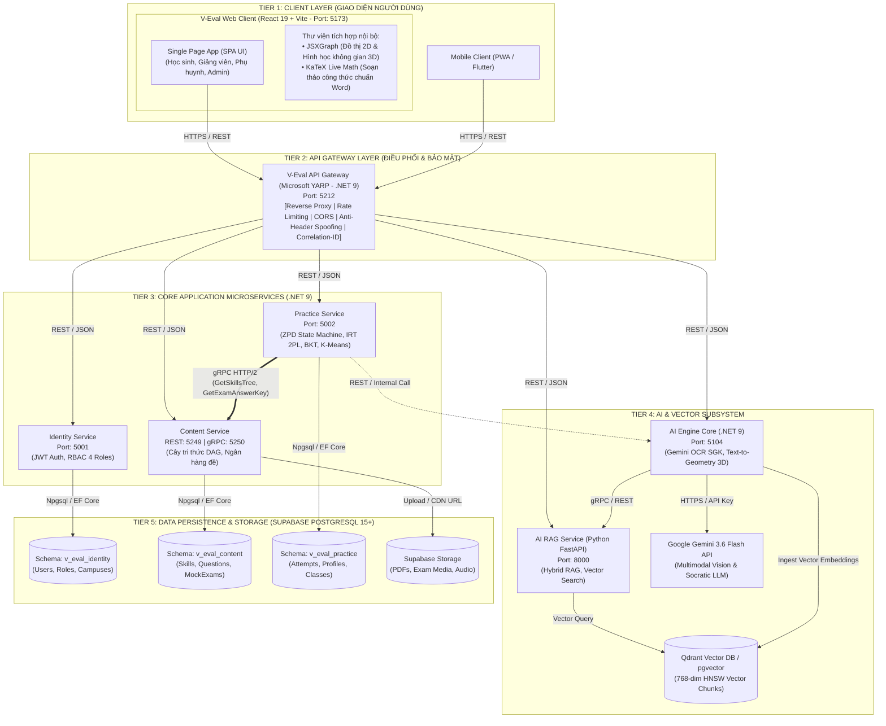

# SƠ ĐỒ KIẾN TRÚC TỔNG THỂ HỆ THỐNG V-EVAL (SYSTEM ARCHITECTURE DIAGRAM)

> [!NOTE]
> Bản vẽ thiết kế chuẩn hóa kiến trúc Microservices đa tầng dự án V-Eval CapStone 2026. Phục vụ trực quan hóa và làm mẫu đối chiếu vẽ tay cho đồ án tốt nghiệp.

---

## 1. SƠ ĐỒ KIẾN TRÚC MERMAID (INTERACTIVE MERMAID DIAGRAM)



---

## 2. BẢN VẼ HÌNH HỘP TRỰC QUAN ĐỂ VẼ TAY (BOX-DRAWING BLUEPRINT)

```text
┌───────────────────────────────────────────────────────────────────────────────────────────────────────────────────────┐
│                                           TIER 1: CLIENT LAYER (GIAO DIỆN)                                            │
│  ┌─────────────────────────────────────────────────────────────────────────────────────────┐  ┌────────────────────┐  │
│  │                              V-Eval Web Client (React 19 + Vite :5173)                  │  │ Mobile Client      │  │
│  │  ┌─────────────────────────────────────────┐  ┌───────────────────────────────────────┐ │  │ (PWA / Flutter)    │  │
│  │  │ Single Page Application (SPA UI)        │  │ Thư viện tích hợp nội bộ:             │ │  │                    │  │
│  │  │ (Student, Teacher, Parent, Admin)       │  │ • JSXGraph (Đồ thị 2D & Hình học 3D)  │ │  │                    │  │
│  │  │                                         │  │ • KaTeX Live Math (Công thức Toán)    │ │  │                    │  │
│  │  └─────────────────────────────────────────┘  └───────────────────────────────────────┘ │  │                    │  │
│  └─────────────────────────────────────────┬───────────────────────────────────────────────┘  └─────────┬──────────┘  │
└────────────────────────────────────────────┼────────────────────────────────────────────────────────────┼─────────────┘
                                             │ HTTPS / REST (Port 5212)                                   │
                                             ▼                                                            ▼
┌───────────────────────────────────────────────────────────────────────────────────────────────────────────────────────┐
│                                         TIER 2: API GATEWAY & EDGE SECURITY                                           │
│  ┌─────────────────────────────────────────────────────────────────────────────────────────────────────────────────┐  │
│  │                                    V-Eval API Gateway (Microsoft YARP - .NET 9)                                 │  │
│  │                     Port: 5212  [Reverse Proxy | Rate Limiting | CORS | Anti-Header Spoofing]                    │  │
│  └────────────────────────────────────────────────────────┬────────────────────────────────────────────────────────┘  │
└───────────────────────────────────────────────────────────┼───────────────────────────────────────────────────────────┘
               ┌──────────────────────┬─────────────────────┼─────────────────────┬──────────────────────┐
               │ REST                 │ REST                │ REST                │ REST                 │ REST
               ▼                      ▼                     ▼                     ▼                      ▼
┌────────────────────────────────────────────────────────┐  ┌───────────────────────────────────────────────────────────┐
│         TIER 3: CORE APPLICATION MICROSERVICES         │  │                 TIER 4: AI SUBSYSTEM                      │
│ ┌───────────────────┐    ┌───────────────────────────┐ │  │ ┌──────────────────────────┐  ┌──────────────────────────┐ │
│ │ Identity Service  │    │ Content Service           │ │  │ │ AI Engine Core (.NET 9)  │  │ AI RAG Service (Python)  │ │
│ │ Port: 5001        │    │ REST: 5249 | gRPC: 5250   │ │  │ │ Port: 5104               │  │ Port: 8000               │ │
│ │ (JWT, RBAC Roles) │    │ (Cây DAG, Ngân hàng đề)   │ │  │ │ (OCR SGK, Text-to-3D)    │  │ (Vector Search, RAG)     │ │
│ └───────────────────┘    └─────────────▲─────────────┘ │  │ └────────────┬─────────────┘  └────────────┬─────────────┘ │
│                                        ║               │  │              │ HTTPS                       │ Vector Query  │
│                          gRPC HTTP/2   ║               │  │              ▼                             ▼               │
│                          (Tamper-Proof)║               │  │ ┌──────────────────────────┐  ┌──────────────────────────┐ │
│                          ┌─────────────╩─────────────┐ │  │ │ Google Gemini 3.6 Flash  │  │ Qdrant Vector DB /       │ │
│                          │ Practice Service          │ │  │ │ Cloud API (OCR / LLM)    │  │ pgvector (768-dim HNSW)  │ │
│                          │ Port: 5002                │ │  │ └──────────────────────────┘  └──────────────────────────┘ │
│                          │ (ZPD, IRT 2PL, BKT, K-M)  │ │  │                                                            │
│                          └───────────────────────────┘ │  │                                                            │
└───────────────────────────┬────────────────────────────┘  └───────────────────────────────────────────────────────────┘
                            │
                            ▼ Npgsql / EF Core
┌───────────────────────────────────────────────────────────────────────────────────────────────────────────────────────┐
│                                 TIER 5: DATA PERSISTENCE (SUPABASE POSTGRESQL 15+)                                    │
│ ┌──────────────────────┐  ┌──────────────────────┐  ┌──────────────────────┐  ┌─────────────────────────────────────┐ │
│ │ Schema:              │  │ Schema:              │  │ Schema:              │  │ Supabase Storage                    │ │
│ │ v_eval_identity      │  │ v_eval_content       │  │ v_eval_practice      │  │ (Tài liệu SGK PDF,                  │ │
│ │ (Users, Roles,       │  │ (Skills DAG,         │  │ (Attempts, Profiles, │  │  Ảnh đề thi, Audio bài nghe)        │ │
│ │  Campuses, Tokens)   │  │  Questions, Exams)   │  │  Classes, Heatmaps)  │  │                                     │ │
│ └──────────────────────┘  └──────────────────────┘  └──────────────────────┘  └─────────────────────────────────────┘ │
└───────────────────────────────────────────────────────────────────────────────────────────────────────────────────────┘
```

---

## 📌 3. BẢNG CHÚ THÍCH CỔNG (PORTS) & GIAO THỨC (PROTOCOLS)

| Dịch vụ | Cổng (Port) | Giao thức | Vai trò chính |
| :--- | :---: | :--- | :--- |
| **Web Client** | `5173` | HTTPS | Giao diện React SPA tích hợp trực tiếp thư viện JSXGraph & KaTeX |
| **API Gateway** | `5212` | HTTPS / REST | Điểm đón duy nhất, phân phối luồng tải tới các microservice |
| **Identity Service** | `5001` | REST | Quản lý định danh, sinh JWT và phân quyền 4 vai trò |
| **Content Service** | `5249` / `5250` | REST & gRPC | Ngân hàng câu hỏi, cây tri thức DAG; cổng 5250 gRPC cấp dữ liệu gốc |
| **Practice Service** | `5002` | REST & gRPC Client | Khảo thí thích ứng ZPD, chấm thi IRT 2PL, cập nhật BKT, phân cụm bàn học |
| **AI Engine Core** | `5104` | REST | .NET 9 điều phối Gemini 3.6 Flash, sinh thẻ 3D/2D, xử lý OCR sách |
| **AI RAG Service** | `8000` | REST / gRPC | Python FastAPI truy vấn ngữ nghĩa trên cơ sở dữ liệu Vector |
| **Vector DB** | `6333` | gRPC / REST | Qdrant / pgvector lưu trữ chunk tài liệu 768 chiều HNSW |
| **PostgreSQL DB** | `5432` | TCP (Npgsql) | Cơ sở dữ liệu quan hệ 49 bảng chia theo 4 Schema độc lập |
