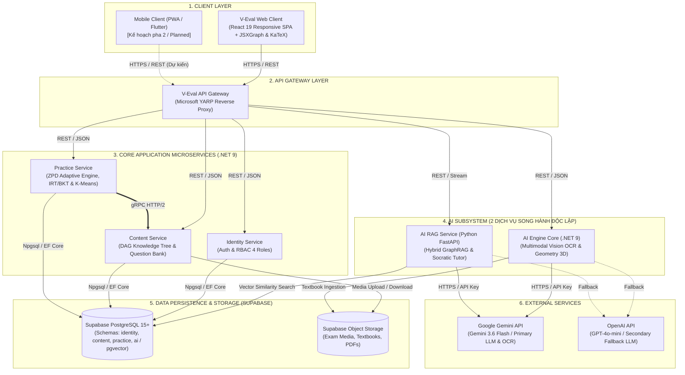
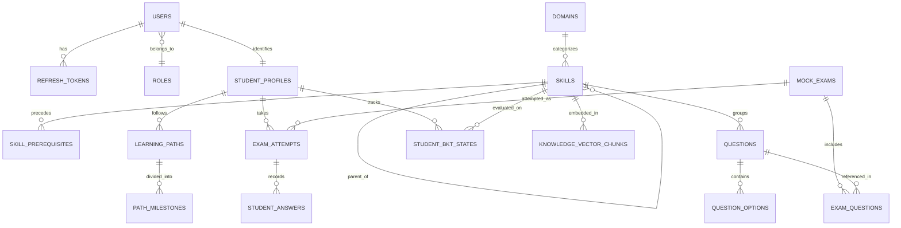
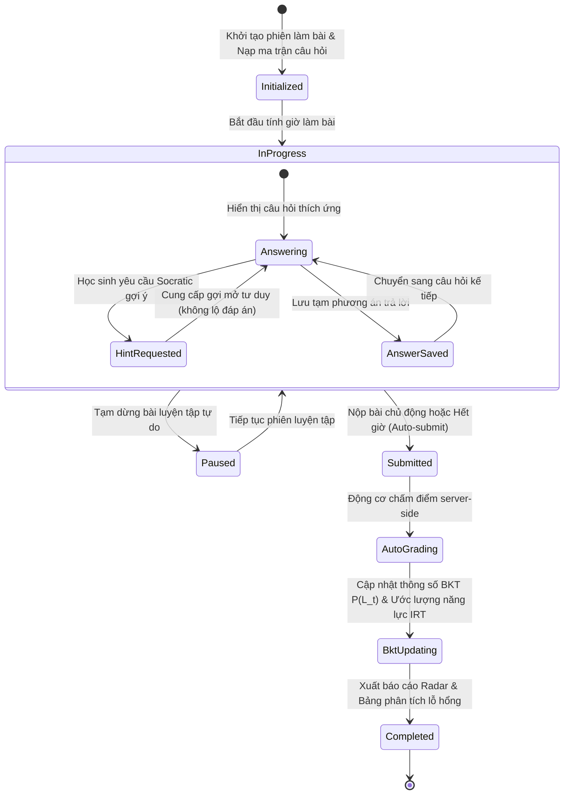
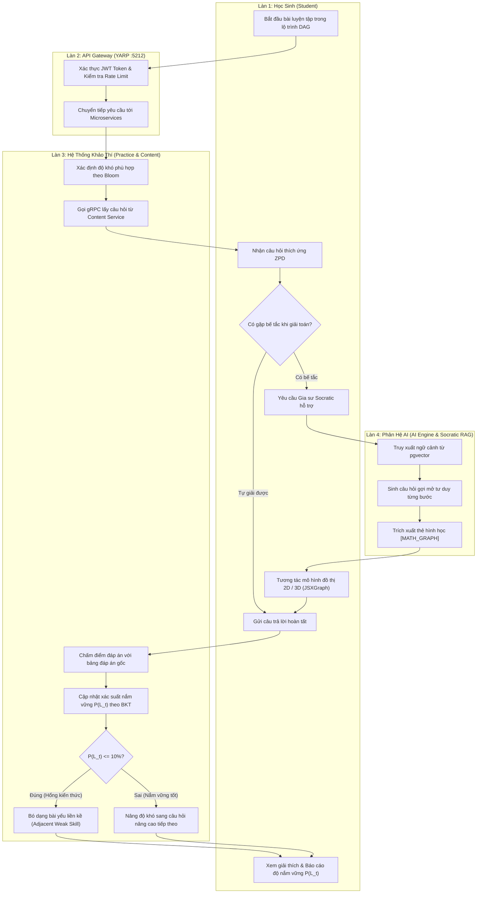

# TÀI LIỆU ĐẶC TẢ KIẾN TRÚC TỔNG THỂ HỆ THỐNG V-EVAL (ENTERPRISE SYSTEM ARCHITECTURE SPECIFICATION)

> [!IMPORTANT]
> **Tài liệu chuẩn kiến trúc chính thức phục vụ Review 2 (Report 4 - SDD & Design Brief) - Capstone 2026**
> - **Tên hệ thống**: Nền tảng Học tập Cá nhân hóa & Khảo thí Thích ứng ĐGNL ĐHQG-HCM (V-ACT)
> - **Kiến trúc chủ đạo**: Clean Architecture, Microservices phân tầng, API Gateway YARP, gRPC Server-to-Server, Phân hệ AI RAG (Google Gemini + pgvector), JSXGraph Native Engine & KaTeX Live Math
> - **Chuẩn hiển thị tài liệu**: Tương thích 100% với **MD Editor Plus** (không dùng ký tự `$` thô bao quanh công thức, liên kết tương đối `./`, sơ đồ Mermaid chuẩn 11.15.0+)

---

## 1. HỆ THỐNG TRONG MỘT ÁNH NHÌN (SYSTEM AT A GLANCE - 148 TỪ)

> V-Eval giải quyết bài toán ôn thi Đánh Giá Năng Lực (V-ACT) ĐHQG-HCM dàn trải và thiếu cá nhân hóa cho học sinh THPT, đồng thời hỗ trợ giáo viên quản lý lớp học phân hóa. Hệ thống áp dụng mô hình tâm trắc học IRT 2PL và Bayesian Knowledge Tracing để định lượng chính xác lỗ hổng kiến thức, tự động quy hoạch lộ trình học tập trên đồ thị DAG và phân cụm vi mô K-Means nhóm 3–5 học sinh có cùng điểm yếu. V-Eval tích hợp gia sư Socratic AI định hướng tư duy từng bước cùng thư viện JSXGraph dựng hình học 2D/3D tương tác. Nền tảng xây dựng theo kiến trúc Microservices phân tầng .NET 9 Clean Architecture, điều phối bởi API Gateway YARP, giao tiếp liên dịch vụ qua gRPC HTTP/2 và cô lập dữ liệu theo từng schema trên Supabase PostgreSQL.

---

## 2. BỘ 4 SƠ ĐỒ KIẾN TRÚC & DỮ LIỆU BẮT BUỘC (MÃ NGUỒN MERMAID)

### 2.1 Sơ Đồ 1: Kiến Trúc Tổng Quan Hệ Thống (System Overview Architecture)
*Mã nguồn độc lập*: [`./diagrams/architecture.mmd`](./diagrams/architecture.mmd)

---

### 2.2 Sơ Đồ 2: Sơ Đồ Thực Thể Logic (Logical ERD)
*Mã nguồn độc lập*: [`./diagrams/02_logical_erd.mmd`](./diagrams/02_logical_erd.mmd)

---

### 2.3 Sơ Đồ 3: Máy Trạng Thái Phiên Thi & Luyện Tập Thích Ứng (State Machine Diagram)
*Mã nguồn độc lập*: [`./diagrams/03_state_machine.mmd`](./diagrams/03_state_machine.mmd)

---

### 2.4 Sơ Đồ 4: Sơ Đồ Hoạt Động Phân Làn (Activity Diagram with Swimlanes)
*Mã nguồn độc lập*: [`./diagrams/04_activity_swimlane.mmd`](./diagrams/04_activity_swimlane.mmd)  
*Quy trình*: Luyện tập thích ứng trong vùng ZPD kết hợp Gia sư Socratic AI (Core Flow 3 & Core Flow 4).

---

## 3. BẢNG KHAI BÁO CÔNG NGHỆ CHUẨN REPORT 4 (5 NHÓM BẮT BUỘC)

### 3.1 Nhóm 1: Dịch Vụ Bên Thứ Ba & Dữ Liệu Gửi Đi (Third-Party Services)

| Dịch vụ bên ngoài | Nhà cung cấp & Model ID | Mục đích sử dụng | Dữ liệu gửi đi (Data Payload) | Cam kết bảo vệ dữ liệu (Data Privacy) |
| :--- | :--- | :--- | :--- | :--- |
| **Google Gemini Multimodal API** | Google AI (`gemini-3.6-flash`, `gemini-embedding-001`, `gemini-flash-lite-latest`) | Bóc tách OCR đề thi/SGK, Trợ lý gia sư Socratic gợi mở tư duy, trích xuất hình học 2D/3D (Primary LLM). | • Ảnh chụp trang sách giáo khoa / đề thi PDF. • Văn bản câu hỏi trắc nghiệm. • Lịch sử câu hỏi gợi mở của học sinh. | **Tuyệt đối KHÔNG gửi PII** (Họ tên, Email, SĐT, Điểm số cá nhân, User ID đều bị ẩn hoặc thay thế bằng UUID ẩn danh trước khi gọi API). |
| **OpenAI API (Fallback)** | OpenAI (`gpt-4o-mini`) | Mô hình LLM dự phòng khi Gemini API chạm rate-limit hoặc gặp sự cố mạng (Circuit Breaker Fallback). | Văn bản câu hỏi và ngữ cảnh gợi ý Socratic (Text prompt ẩn danh). | **Không gửi PII**, cấu hình cấm lưu trữ dữ liệu huấn luyện (Zero Data Retention API). |
| **Supabase PostgreSQL 15+** | Supabase (AWS Singapore Region) | CSDL quan hệ chính cho toàn hệ sinh thái (cô lập theo 4 schema độc lập). | SQL queries, bảng điểm, hồ sơ học tập, quan hệ cây tri thức DAG. | Kết nối SSL bắt buộc (`SSL Mode=Require`), lưu trữ tại trung tâm dữ liệu AWS Singapore chuẩn ISO/IEC 27001. |
| **Supabase Object Storage** | Supabase Storage (S3-compatible) | Lưu trữ file PDF sách giáo khoa, ảnh đồ thị toán trích xuất và tệp audio. | File binary tài liệu học tập, ảnh đề thi. | Thiết lập Bucket Policy phân quyền (chỉ đọc public CDN, ghi yêu cầu token xác thực). |

---

### 3.2 Nhóm 2: Ngăn Xếp Công Nghệ Kèm Phiên Bản Thực Tế (Technology Stack)

| Phân hệ / Tầng | Công nghệ / Thư viện | Phiên bản | Vai trò & Mục đích kỹ thuật |
| :--- | :--- | :---: | :--- |
| **API Gateway** | Microsoft YARP (.NET 9) | `v2.3.0` | Cổng tiếp nhận duy nhất, Reverse Proxy, Anti-Header Spoofing, Rate Limiting. |
| **Backend Core** | ASP.NET Core (.NET 9) | `net9.0` | Clean Architecture (Domain, Application, Infrastructure, API), MediatR CQRS, FluentValidation. |
| **Giao tiếp nội bộ** | gRPC .NET (HTTP/2 nhị phân) | `v2.67.0` | Kênh giao tiếp tốc độ cao giữa `Practice Service` và `Content Service` (`:5250`). |
| **ORM / Data Access** | Entity Framework Core & Npgsql | `v9.0.2` | Quản trị truy vấn dữ liệu theo từng Schema riêng biệt (`v_eval_*`). |
| **AI Subsystem (.NET)** | .NET 9 Core Vision OCR | `net9.0` | Trực tiếp gọi Gemini Multimodal Vision API OCR đề thi PDF và trích xuất hình học 2D/3D. |
| **AI Subsystem (Python)** | FastAPI, LangChain, psycopg | `v0.115+` | Triển khai Hybrid GraphRAG, Conversational Retrieval Chain và pgvector store. |
| **External LLM APIs** | Google Gemini & OpenAI | `gemini-3.6-flash` `gpt-4o-mini` | Động cơ ngôn ngữ đa phương thức chính và mô hình dự phòng chuyển tiếp. |
| **Vector Engine** | PostgreSQL Extension `vector` (pgvector) | `v0.3.0+` | Lưu trữ vector embeddings 3072 chiều trên schema `v_eval_ai`, tìm kiếm Cosine Similarity. |
| **Frontend Client** | React 19 + Vite 8 | `React 19.2.8` | Single Page Application responsive (Desktop & Mobile); Mobile App PWA/Flutter nằm trong lộ trình pha 2. |
| **Styling** | TailwindCSS v4 | `v4.3.3` | Utility-first CSS hiện đại, tối ưu kích thước bundle trình duyệt. |
| **Math Engines** | JSXGraph & KaTeX | `jsxgraph 1.14` `katex 0.19` | Dựng đồ thị vi tích phân 2D, mô hình hình học 3D xoay 360 độ và công thức toán học chuẩn Word. |

---

### 3.3 Nhóm 3: Môi Trường Triển Khai, CI/CD & Chiến Lược Rollback

| Môi trường | Hạ tầng & Cấu hình | Mục đích sử dụng | Cơ chế Triển khai & Giám sát |
| :--- | :--- | :--- | :--- |
| **Local Development** | Máy trạm lập trình Windows 11, .NET 9 SDK, Node 22, Python 3.11, Docker Desktop. | Lập trình tính năng, viết unit tests, chạy nhanh qua bộ script `Scripts/run_local/run_local.bat`. | Hot-reload Vite, `dotnet watch`, Swagger UI nội bộ. |
| **Staging Environment (Defense 1.1)** | Máy chủ VPS Ubuntu 24.04 LTS (4 vCPU, 8GB RAM), Docker Engine & Docker Compose v2. | Môi trường thử nghiệm liên thông tích hợp toàn diện phục vụ demo nghiệm thu đồ án. | Deploy tự động qua `docker-compose.yml`, kiểm tra qua `/healthz` Gateway. |
| **Production Environment** | Cụm máy chủ đám mây độc lập, Supabase Managed Database, CDN Cloudflare. | Vận hành thực tế cho người dùng cuối (Học sinh và Giảng viên luyện thi ĐGNL). | Containerized microservices, HTTPS/TLS tự động qua Reverse Proxy. |
| **Chiến lược Rollback** | **Zero-Downtime Container Tag Rollback (dưới 30 giây)**: Tất cả Docker Image đều được gắn thẻ phiên bản cố định (`veval-gateway:v1.0.0`, `veval-gateway:v1.0.1`). Khi container mới khởi động thất bại hoặc lỗi healthcheck `/healthz`, hệ thống tự động rollback về image phiên bản liền trước chỉ với 1 lệnh `docker compose up -d` trỏ lại image tag cũ. |

---

### 3.4 Nhóm 4: Quy Tắc Quản Trị Nhánh & Phiên Bản Git (Gitflow Strategy)

- **Nhánh `main`**: Nhánh mã nguồn ổn định nhất, chỉ nhận merge sau khi đã kiểm thử toàn diện trên Staging và có phê duyệt (Pull Request Review).
- **Nhánh `develop`**: Nhánh tích hợp mã nguồn chính của toàn đội ngũ cho các đợt Review.
- **Nhánh tính năng (`feature/<service>-<feature-name>`)**: Mỗi lập trình viên tạo nhánh riêng để phát triển từng use case.
- **Quy tắc gắn thẻ (Release Tags)**: Gắn tag cố định cho từng mốc bảo vệ: `review-1`, `review-2`, `defense-1.1`, `final-defense`.

---

### 3.5 Nhóm 5: Công Cụ AI Hỗ Trợ Phát Triển (AI Coding Assistants)

- **Antigravity IDE (Google DeepMind)**: Trợ lý lập trình AI hỗ trợ rà soát mã nguồn, kiểm thử tự động, chuẩn hóa sơ đồ kiến trúc Mermaid và quản lý tài liệu hệ thống.
- **GitHub Copilot / Gemini Code Assist**: Hỗ trợ tự động hoàn thiện mã nguồn C# .NET 9, React components và viết truy vấn LINQ/SQL.

---

## 4. BẢNG PHÂN BỔ THÀNH PHẦN HỆ THỐNG & ÁNH XẠ MÃ NGUỒN THỰC TẾ

| Nhóm Thành Phần | Tên Dịch Vụ / Module | Thư Mục Mã Nguồn Thực Tế | Cổng Local / Docker | Giao Thức Kết Nối | Trách Nhiệm Nghiệp Vụ Cốt Lõi |
| :--- | :--- | :--- | :---: | :--- | :--- |
| **Frontend Client** | `V-Eval-Web_Client` | `All Services/V-Eval-Web_Client` | `5173` / `80` | HTTPS / REST | SPA giao diện người dùng responsive, tích hợp JSXGraph (2D/3D) và KaTeX Live Math. |
| **Mobile Client** | `Mobile Client (PWA/Flutter)` | *Kế hoạch pha 2 (Roadmap)* | — | HTTPS / REST | Phiên bản ứng dụng di động cho học sinh và phụ huynh (kế hoạch mở rộng pha 2). |
| **API Gateway** | `V-Eval-Gateway` | `All Services/V-Eval-Gateway` | `5212` / `5212` | YARP Reverse Proxy | Cổng giao tiếp duy nhất, xác thực JWT, Rate Limiting, Anti-Header Spoofing. |
| **Core Microservice 1** | `V-Eval-Identity_Service` | `All Services/V-Eval-Identity_Service` | `5155` / `5001` | REST | Quản lý người dùng, phân quyền RBAC 4 vai trò, cấp phát JWT Token. |
| **Core Microservice 2** | `V-Eval-Content_Service` | `All Services/V-Eval-Content_Service` | `5249` / `5249` | REST + **gRPC `:5250`** | Cây tri thức DAG, Ngân hàng câu hỏi, Studio Soạn Thảo Sư Phạm cho Giảng viên. |
| **Core Microservice 3** | `V-Eval-Practice_Service` | `All Services/V-Eval-Practice_Service` | `5261` / `5002` | REST + gRPC Client | Khảo thí thích ứng ZPD, Chấm điểm, IRT 2PL, BKT, Phân cụm K-Means 3–5 bạn. |
| **AI Subsystem (.NET)** | `V-Eval-Ai_Engine` | `All Services/V-Eval-Ai_Engine` | `5104` / `5104` | REST | Bóc tách tài liệu SGK qua Gemini Vision, fallback OpenAI gpt-4o-mini, trích xuất 2D/3D. |
| **AI Subsystem (Python)** | `rag-service` | `.../V-Eval-Ai_Engine/rag-service` | `8000` / `8000` | REST + Streaming | Hybrid GraphRAG, Trợ lý Socratic gợi mở tư duy, tìm kiếm vector pgvector. |
| **Cơ Sở Dữ Liệu** | Supabase PostgreSQL 15+ | Cloud AWS Singapore | `5432` | Npgsql / EF Core | Cô lập dữ liệu theo 4 schema: `v_eval_identity`, `v_eval_content`, `v_eval_practice`, `v_eval_ai`. |

---

## 5. BỘ KỊCH BẢN PHẢN BIỆN KIẾN TRÚC REVIEW 2 (DEFENSE Q&A)

| Câu hỏi của Giảng viên / Hội đồng | Trọng tâm trên sơ đồ | Giải pháp kỹ thuật đã triển khai trong mã nguồn |
| :--- | :--- | :--- |
| **1. "Dịch vụ AI bên thứ ba (Gemini API) bị ngừng hoạt động hoặc bị nghẽn mạng thì hệ thống xử lý sao?"** | Nhánh kết nối `AI Engine --> Google Gemini API` | • Áp dụng mô hình **Circuit Breaker** (Polly .NET). Khi Gemini báo lỗi liên tục, tự động ngắt mạch bảo vệ hệ thống. • **Fallback sư phạm (Graceful Degradation)**: Chuyển hướng tức thì sang lấy lời giải chi tiết và gợi ý tĩnh (`Pre-computed Hints`) đã biên soạn sẵn trong `Content Service`. Học sinh làm bài bình thường không bị gián đoạn. |
| **2. "Vào đợt thi thử ĐGNL, lượng truy cập tăng vọt gấp 10 lần (10x Traffic Spike) thì kiến trúc mở rộng thế nào?"** | Tầng `API Gateway` và `Practice Service` | • Tất cả Microservices backend hoàn toàn **Stateless**, dễ dàng scale ngang số lượng Pods/Container trên Kubernetes/Docker Swarm. • Gateway phân phối tải cân bằng (Round Robin / Least Request). • Giao tiếp nội bộ chạy qua **gRPC HTTP/2 multiplexing**, tái sử dụng duy nhất 1 TCP connection, giảm 70% overhead mạng. • Tầng DB sử dụng Supabase Connection Pooling (Pgbouncer) giải phóng pool kết nối cực nhanh. |
| **3. "Tại sao không dùng chung 1 database mà lại phân chia nhiều Schema?"** | Tầng `Data Persistence` (`v_eval_*` schemas) | • Tuân thủ triệt để nguyên lý **Database-per-service** trong Microservices. • Tuyệt đối cấm viết câu lệnh SQL `JOIN` chéo schema. Mọi truy vấn trao đổi dữ liệu đều thông qua API Gateway hoặc gRPC Server-to-Server. • Dữ liệu phân quyền độc lập, sẵn sàng tách thành các Server Database vật lý riêng biệt khi cần mà không cần sửa code. |
| **4. "Tại sao chọn pgvector thay vì Qdrant độc lập?"** | Schema `v_eval_ai` trong Supabase PostgreSQL | • Giảm thiểu chi phí hạ tầng và độ phức tạp vận hành bằng cách tận dụng extension `vector` có sẵn trên chính CSDL PostgreSQL của Supabase. • Hỗ trợ truy vấn kết hợp (Hybrid Search) giữa dữ liệu quan hệ (Skill ID, Domain Code) và vector embedding 3072 chiều trong cùng một giao dịch ACID. |
