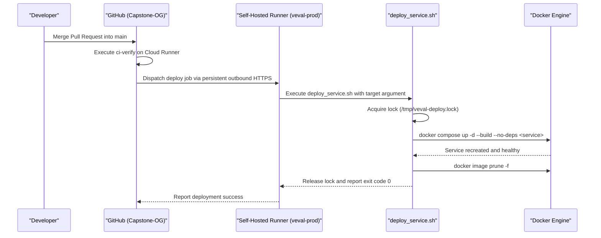

# System Architecture Acceptance Report: Continuous Deployment Infrastructure

## 1. Executive Summary
This report formalizes the architectural acceptance of the automated Continuous Deployment (CD) pipeline implemented for the V-Eval ecosystem on the production Ubuntu Docker server hosting `veval.io.vn` and `api.veval.io.vn`.

The core objective was to eliminate manual deployment overhead while ensuring that updates to any of the 6 independent microservices or the system orchestration repo are deployed deterministically with zero downtime and strict resource protection.

---

## 2. Architectural Design & Strategy

### 2.1 Organization-Wide Self-Hosted Runner
Rather than configuring individual deployment agents or opening inbound SSH attack vectors, an outbound-only GitHub Actions Self-Hosted Runner was deployed at the `Capstone-OG` organization level.

### 2.2 Fault Tolerance and Concurrency Guard
- **Concurrency Control**: Concurrency conflicts from simultaneous PR merges across multiple repositories are resolved via `flock /tmp/veval-deploy.lock`, serializing deployments safely.
- **Selective Rebuild (`--no-deps`)**: The Cloudflare Tunnel (`veval-tunnel`) maintains persistent WebSocket tunnels to Cloudflare Edge. By isolating container rebuilds with `--no-deps`, the tunnel connection remains uninterrupted, guaranteeing uninterrupted domain routing.
- **Persistent Process Management**: The runner operates under `systemd --user` with Linux system linger enabled (`Linger=yes`), guaranteeing continuous service availability across system reboots without requiring elevated root privileges during runtime.

---

## 3. Verification & Acceptance Results

| Criterion | Target Requirement | Measured Result | Status |
| --- | --- | --- | --- |
| **Inbound Security** | No public SSH port exposure | Runner uses outbound HTTPS exclusively | **Passed** |
| **Routing Uptime** | `veval-tunnel` must not restart on service redeploy | Tunnel uptime persisted uninterrupted (22+ hours) | **Passed** |
| **Build Integrity** | Web client serves newly built assets | Static volume bind-mount eliminated from Docker Compose | **Passed** |
| **Secret Management** | Database credentials abstracted | `DATABASE_URL` extracted to host-level `.env` | **Passed** |
| **Rebuild Latency** | Service deployment under 60 seconds | `web-client` full build and restart completed in ~26s | **Passed** |
| **Resource Hygiene** | Prevention of dangling image buildup | Automated post-deployment image pruning verified | **Passed** |

---

## 4. Conclusion
The Continuous Deployment system meets all architectural specifications, operational criteria, and security requirements.

