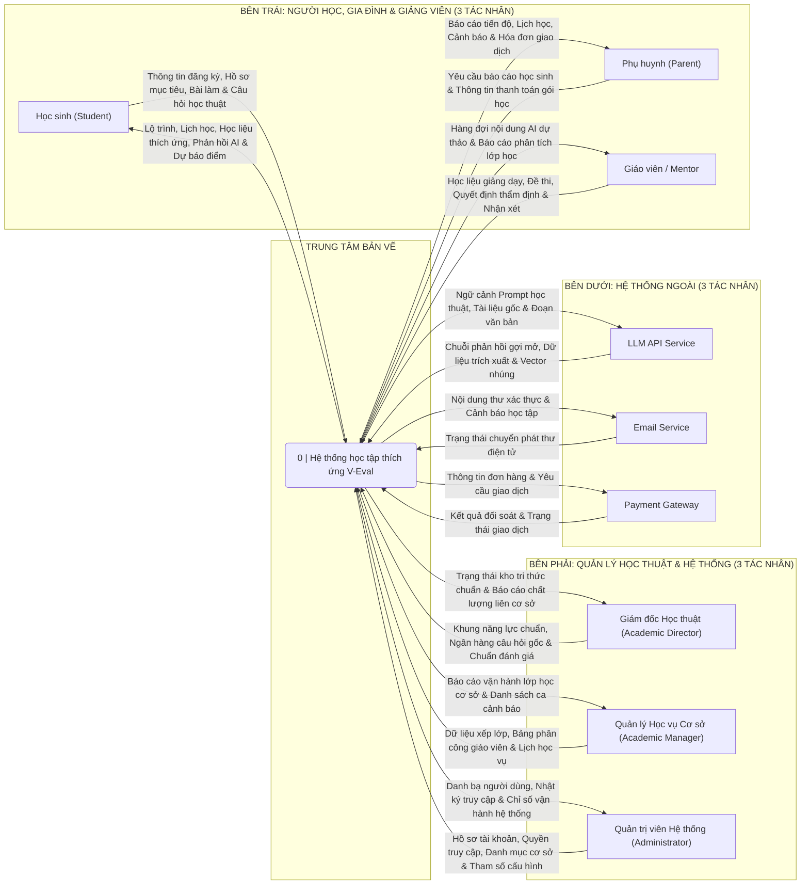

# ĐẶC TẢ SƠ ĐỒ NGỮ CẢNH (CONTEXT DIAGRAM / DFD LEVEL 0) - CHUẨN GANE & SARSON
## Dự án: V-Eval - Nền tảng học tập thích ứng luyện thi ĐGNL ĐHQG-HCM

> [!NOTE]
> - **Vai trò biên soạn**: Senior System Analyst
> - **Tiêu chuẩn ký hiệu áp dụng**: **Gane & Sarson** (Data Flow Diagram - Level `0` / Context Diagram)
> - **Tài liệu đối chiếu**: Đồng bộ phạm vi **6 System Roles** và **6 Business Core Flows** với [`phieu_dang_ky_de_tai_da_sua.md`](./phieu_dang_ky_de_tai_da_sua.md).
> - **Mục tiêu tài liệu**: Cung cấp Ma trận Luồng dữ liệu chuẩn cụm danh từ, nhãn gói dữ liệu rút gọn vừa khít khổ giấy A4, kiểm soát ranh giới phạm vi (*Out-of-Scope*), và hướng dẫn thao tác vẽ tay chuẩn kích thước trên **Draw.io (`app.diagrams.net`)**.

---

## 1. NGUYÊN TẮC & QUY ƯỚC TRÌNH BÀY CONTEXT DIAGRAM (GANE & SARSON)

Để sơ đồ đạt chuẩn học thuật và tránh các lỗi thường bị Hội đồng chấm đồ án bắt bẻ, bản vẽ tuân thủ 2 nhóm nguyên tắc sau:

### 1.1. Quy tắc bắt buộc của chuẩn ký hiệu Gane & Sarson
1. **Duy nhất 1 Tiến trình trung tâm (`Process 0`)**:
   - Toàn bộ hệ thống **V-Eval** (bao gồm Web, Companion Mobile, Backend và các mô-đun AI nội bộ) được biểu diễn bằng **1 hộp đen duy nhất** mang số hiệu `0` và tên định danh: **`Hệ thống học tập thích ứng V-Eval`** (*`V-Eval Adaptive Learning Platform`*).
   - **Hình dáng chuẩn Gane & Sarson**: **Hình chữ nhật bo tròn góc (Rounded Rectangle)** có vạch kẻ ngang ở phần đầu ghi số `0` *(không dùng hình tròn của chuẩn Yourdon/DeMarco)*.
2. **Không vẽ Kho dữ liệu (`Data Store`) ở mức Context (Level `0`)**:
   - Các CSDL nội bộ (`PostgreSQL`, kho lưu trữ vector, bộ nhớ đệm) nằm bên trong ranh giới hệ thống nên chỉ xuất hiện từ **DFD Level `1`** trở đi.
3. **Tên luồng dữ liệu (`Data Flow`) phải là CỤM DANH TỪ**:
   - Luồng dữ liệu mô tả **"Gói dữ liệu / Thông tin gì đang di chuyển"**, không dùng động từ chỉ hành động (tránh các từ đầu câu như *Đăng nhập, Gửi, Nhận, Xem, Duyệt, Tổ chức, Phân công, Cấp phát, Tra cứu...*).
4. **Không nối trực tiếp giữa các Tác nhân ngoài (`External Entities`)**:
   - Mọi luồng thông tin giữa các tác nhân (ví dụ giữa *Giáo viên*, *Học sinh* và *Phụ huynh*) đều phải đi qua tiến trình trung tâm `Process 0`.

### 1.2. Quy ước trình bày khuyến nghị cho báo cáo đồ án (Best Practices)
1. **Ưu tiên tách 2 mũi tên đơn chiều riêng biệt thay vì mũi tên 2 chiều (`<-->`)**:
   - Dù một số tài liệu thực hành cho phép mũi tên 2 chiều với luồng hỏi–đáp, trong đồ án Software Engineering dữ liệu đi vào (ví dụ: *Câu hỏi học thuật*) và dữ liệu đi ra (*Phản hồi gợi mở*) khác bản chất nhau nên tách thành **2 đường mũi tên 1 chiều song song** là cách trình bày tường minh, an toàn nhất.
2. **Đóng gói dữ liệu hai tầng (Two-Tier Data Bundling)**:
   - **Trên hình vẽ A4**: Mỗi tác nhân chỉ gắn **1 cặp mũi tên (1 Vào – 1 Ra)** với **nhãn gói dữ liệu khái quát ngắn gọn** (khoảng 2–4 cụm danh từ) để bản vẽ thoáng mắt, dễ đọc.
   - **Trong Bảng Ma trận thuyết minh bên dưới hình**: Giải thích chi tiết từng gói dữ liệu thành phần bên trong mỗi luồng tổng hợp đó.
3. **Tập trung vào Luồng dữ liệu Nghiệp vụ Logic (Logical Business DFD)**:
   - Ẩn các luồng hạ tầng xác thực lặp lại (*Thông tin đăng nhập / JWT Session Token*) trên cả 6 vai trò để nhãn mũi tên ngắn gọn và nổi bật đúng nghiệp vụ đặc trưng của từng tác nhân (chỉ giữ luồng nghiệp vụ tạo mới *Thông tin đăng ký & Hồ sơ mục tiêu* của Học sinh và *Hồ sơ tài khoản & Quyền truy cập* của Quản trị viên), đi kèm ghi chú quy ước xác thực chung bên dưới bảng.

---

## 2. MA TRẬN LUỒNG DỮ LIỆU CHI TIẾT (DATA FLOW MATRIX)

> [!IMPORTANT]
> **Quy tắc xác định chiều mũi tên**: Lấy hộp trung tâm **`0 | Hệ thống học tập thích ứng V-Eval`** làm gốc:
> - **Luồng Dữ Liệu Vào (`Entity -> V-Eval`)**: Đầu nhọn mũi tên hướng **VÀO** `Process 0`.
> - **Luồng Dữ Liệu Ra (`V-Eval -> Entity`)**: Đầu nhọn mũi tên đi **TỪ** `Process 0` hướng **RA** tác nhân ngoài.

### 2.1. Nhóm 6 Tác Nhân Con Người (Human External Entities)

| STT | Tác Nhân Ngoài (External Entity) | Luồng Dữ Liệu Vào (`Entity -> V-Eval`) *(Cụm danh từ)* | Luồng Dữ Liệu Ra (`V-Eval -> Entity`) *(Cụm danh từ)* | Mục Đích Nghiệp Vụ (Khớp 6 Core Flows) |
| :---: | :--- | :--- | :--- | :--- |
| **1** | **Học sinh** *(Student)* | • **Thông tin đăng ký & Hồ sơ mục tiêu** *(Registration Data & Target Score Profile)* | • **Trạng thái tài khoản & Hồ sơ người học** *(Account Status & Learner Profile)* | Khởi tạo tài khoản người học mới, thiết lập điểm mục tiêu, thời gian ôn luyện khả dụng và cơ sở theo học. |
| | | • **Bài làm chẩn đoán, Bài luyện tập thích ứng & Ghi chú phản tư** *(Diagnostic Answers, Adaptive Practice Submissions & Reflection Notes)* | • **Đề chẩn đoán, Học liệu thích ứng, Lộ trình & Lịch học cá nhân hóa** *(Diagnostic Items, Adaptive Materials, Personalized Roadmap & Study Schedule)* | Đánh giá năng lực đầu vào, sinh lộ trình/lịch học ưu tiên và phân phối bài tập thích ứng theo mức độ thành thạo. |
| | | • **Bài làm thi thử** *(Mock Exam Submissions)* | • **Kết quả thi thử & Phân tích chi tiết lời giải** *(Mock Exam Results & Step-by-Step Solution Breakdowns)* | Thực hiện bài thi thử mô phỏng trên nền tảng Web và nhận điểm số kèm phân tích chi tiết lời giải. |
| | | • **Câu hỏi học thuật** *(Academic Inquiry Messages)* | • **Phản hồi gợi mở từng bước & Tóm tắt kiến thức** *(Guided Step-by-Step Explanations & Concept Summaries)* | Hỗ trợ giải thích câu hỏi, làm rõ khái niệm và dẫn dắt tư duy dựa trên nguồn học liệu chuẩn. |
| | | *(Tổng hợp tự động từ lịch sử học tập & làm bài)* | • **Báo cáo tiến độ, Gợi ý ôn tập cá nhân hóa, Dự báo điểm & Cảnh báo sớm** *(Progress Dashboards, Personalized Study Recommendations, Score Forecast & Alerts)* | Hiển thị biểu đồ năng lực, lịch học, khoảng điểm dự báo và khuyến nghị điều chỉnh học tập trên Web & Companion Mobile. |
| **2** | **Phụ huynh** *(Parent)* | • **Yêu cầu báo cáo học sinh liên kết** *(Linked Student Report Requests)* | • **Báo cáo tiến độ, Lịch học, Mức sẵn sàng thi & Cảnh báo học tập** *(Progress Reports, Study Schedules, Exam Readiness & Alerts)* | Giúp phụ huynh theo dõi sự phát triển năng lực, lịch học, tiến độ tiệm cận điểm mục tiêu và nhận thông báo sớm trên Web & Mobile. |
| | | • **Thông tin đăng ký gói học & Yêu cầu thanh toán** *(Package Enrollment & Payment Requests)* | • **Hóa đơn điện tử & Lịch sử giao dịch** *(Electronic Receipts & Transaction History)* | Thực hiện thanh toán trực tuyến học phí/gói ôn luyện cho con trên cổng Phụ huynh và tra cứu biên lai giao dịch. |
| **3** | **Giáo viên / Mentor** *(Teacher / Mentor)* | • **Học liệu giảng dạy, Bài tập & Đề thi thử** *(Instructional Materials, Exercises & Mock Exams)* | • **Hàng đợi nội dung/gợi ý AI dự thảo** *(Draft AI Content & Recommendation Queue)* | Tổ chức học liệu, đề thi và cung cấp hàng đợi nội dung/gợi ý sinh bởi AI để giáo viên kiểm định chất lượng. |
| | | • **Quyết định thẩm định câu hỏi, Đánh giá chất lượng gợi ý AI & Nhận xét sư phạm** *(Question Quality Decisions, AI Recommendation Ratings & Pedagogical Feedback)* | • **Báo cáo phân tích tiến độ lớp học & Danh sách học sinh cần hỗ trợ** *(Class Competency Analytics & At-Risk Student Reports)* | Theo dõi chất lượng gợi ý AI, nắm bắt lỗ hổng kiến thức của lớp học và gửi phản hồi/hướng dẫn sư phạm kịp thời. |
| **4** | **Giám đốc Học thuật** *(Academic Director)* | • **Khung năng lực chuẩn, Ngân hàng câu hỏi gốc & Giáo trình tham chiếu** *(Competency Frameworks, Master Question Bank & Reference Knowledge Base)* | • **Trạng thái kho tri thức chuẩn** *(Master Knowledge Base Status)* | Chuẩn hóa cấu trúc tri thức, quản trị chất lượng ngân hàng câu hỏi gốc và nguồn tài liệu chuẩn cho AI. |
| | | • **Tham số chuẩn đánh giá học thuật** *(Academic Evaluation Standard Configs)* | • **Báo cáo chất lượng đào tạo liên cơ sở** *(Cross-Campus Educational Quality Reports)* | Thiết lập tiêu chuẩn đo lường học thuật và rà soát chất lượng đào tạo trên toàn hệ thống. |
| **5** | **Quản lý Học vụ Cơ sở** *(Academic Manager)* | • **Dữ liệu xếp lớp, Bảng phân công giáo viên & Lịch học vụ/thi thử** *(Class Placement Approvals, Teacher Assignments & Academic/Exam Schedules)* | • **Báo cáo vận hành lớp học tại cơ sở** *(Campus Class Operations Reports)* | Điều phối lịch học, phân công giảng dạy, duyệt xếp lớp học sinh và tổ chức kỳ thi thử tại chi nhánh. |
| | | • **Thông tin điều phối hỗ trợ học tập** *(Academic Support Coordination Records)* | • **Thống kê mức độ chuyên cần & Danh sách ca cảnh báo học vụ** *(Student Engagement Metrics & At-Risk Learner Summaries)* | Giám sát mức độ gắn kết học tập và điều phối hỗ trợ kịp thời cho nhóm học sinh có nguy cơ tụt hậu. |
| **6** | **Quản trị viên Hệ thống** *(Administrator)* | • **Hồ sơ tài khoản, Quyền truy cập & Danh mục cơ sở** *(User Account Records, Role Permissions & Campus Directories)* | • **Danh bạ người dùng & Nhật ký truy cập** *(User Directory & Access Audit Logs)* | Quản lý tài khoản người dùng, phân quyền RBAC cho các vai trò và quản trị danh mục cơ sở đào tạo. |
| | | • **Tham số cấu hình nền tảng & Dịch vụ AI** *(Platform & AI Service Configuration Settings)* | • **Chỉ số vận hành hệ thống & Trạng thái sao lưu dữ liệu** *(Platform Health Metrics & Data Backup Status Reports)* | Cấu hình tham số vận hành hệ thống/AI và giám sát tình trạng hoạt động, sao lưu an toàn dữ liệu. |

> *Lưu ý quy ước mô hình hóa (Logical DFD Note): Sơ đồ ngữ cảnh tập trung biểu diễn các luồng dữ liệu nghiệp vụ cốt lõi; toàn bộ 6 tác nhân người dùng trên đều thực hiện xác thực định danh và kiểm soát phiên truy cập thống nhất (JWT / RBAC) ở tầng hạ tầng trước khi trao đổi dữ liệu nghiệp vụ.*

---

### 2.2. Nhóm 3 Hệ Thống Ngoài (External Systems)

| STT | Hệ Thống Ngoài (External System) | Luồng Dữ Liệu Vào (`External -> V-Eval`) *(Cụm danh từ)* | Luồng Dữ Liệu Ra (`V-Eval -> External`) *(Cụm danh từ)* | Mục Đích Nghiệp Vụ & Tích Hợp |
| :---: | :--- | :--- | :--- | :--- |
| **7** | **LLM API Service** *(Dịch vụ LLM API)* | • **Chuỗi phản hồi gợi mở, Dữ liệu trích xuất học liệu & Vector nhúng** *(Generated Explanations, Extracted Content Data & Text Embeddings)* | • **Ngữ cảnh Prompt học thuật, Tài liệu gốc & Đoạn văn bản** *(Grounded Academic Prompts, Raw Documents & Text Chunks)* | Gửi ngữ cảnh học liệu đã kiểm soát sang dịch vụ LLM để sinh lời giải gợi mở từng bước, tóm tắt khái niệm và tạo vector tìm kiếm ngữ nghĩa. |
| **8** | **Email Service** *(Dịch vụ Thư điện tử)* | • **Trạng thái chuyển phát thư điện tử** *(Email Delivery Status Receipts)* | • **Nội dung thư xác thực & Cảnh báo học tập** *(Verification & Academic Alert Emails)* | Chuyển phát thư xác thực tài khoản, biên lai và thư cảnh báo tiến độ học tập tới địa chỉ email của người dùng. |
| **9** | **Payment Gateway** *(Cổng Thanh toán Điện tử)* | • **Kết quả đối soát & Trạng thái giao dịch** *(Payment Confirmation & Webhook Status)* | • **Thông tin đơn hàng & Yêu cầu giao dịch** *(Order Payloads & Payment Requests)* | Xử lý giao dịch thanh toán học phí/gói luyện thi trực tuyến của phụ huynh và đồng bộ tự động trạng thái kích hoạt gói học qua IPN/Webhook. |

---

## 3. KIỂM TRA ĐỐI CHIẾU RANH GIỚI PHẠM VI (SCOPE BOUNDARY CHECK)

Các luồng dữ liệu trên được kiểm soát chặt để nhất quán với phạm vi dự án (*In-Scope / Out-of-Scope*):

1. **Không tư vấn hướng nghiệp / xét tuyển đại học thay nhà trường**:
   - Hệ thống chỉ nhận **`Hồ sơ mục tiêu`** (mốc điểm chuẩn tham chiếu nội bộ, điểm mục tiêu, thời gian ôn thi) và trả ra **`Dự báo điểm & Gợi ý ôn tập cá nhân hóa`**, không có luồng dữ liệu phán quyết chọn ngành/trường đại học.
2. **Không áp dụng chế tài kỷ luật cưỡng chế**:
   - Không có luồng biên bản xử phạt hay quyết định kỷ luật; các luồng cảnh báo chỉ phục vụ **`Nhận xét sư phạm`** và **`Thông tin điều phối hỗ trợ học tập`**.
3. **Không can thiệp sâu nhân hệ điều hành (No OS-level Proctoring)**:
   - Hệ thống vận hành thuần túy trên trình duyệt Web và ứng dụng di động đi kèm, không thu thập danh sách tiến trình hay can thiệp cấp hệ điều hành của thiết bị người học.
4. **Không khóa cứng tên nhà cung cấp dịch vụ ngoài trên sơ đồ ngữ cảnh**:
   - Sử dụng tên gọi chuẩn khái quát **`LLM API Service`**, **`Email Service`** và **`Payment Gateway`** trên Context Diagram để kiến trúc linh hoạt khi lựa chọn nhà cung cấp thực thi (ví dụ: Gemini/OpenAI, SMTP, PayOS/VNPay/SePay).

---

## 4. NHÃN GÓI DỮ LIỆU RÚT GỌN & BẢN NHÁP BỐ CỤC (DÙNG TRỰC TIẾP KHI VẼ A4)

Để hình vẽ trên khổ giấy **A4 Landscape** thoáng, sạch và **100% nhãn đều là cụm danh từ ngắn gọn**, bạn dùng đúng bộ nhãn đã đóng gói dưới đây (chi tiết từng món nằm ở Bảng Mục 2):

---

## 5. HƯỚNG DẪN CÁCH VẼ TAY TỪNG BƯỚC TRÊN DRAW.IO (`app.diagrams.net`)

Làm theo đúng thông số hình học dưới đây, toàn bộ đường dây ngang và dọc sẽ chạy thẳng tắp, song song, không phải bẻ góc zíc-zắc và không cắt chéo nhau:

### Bước 1: Thiết lập trang giấy & Tìm ký hiệu Gane & Sarson
1. Mở [https://app.diagrams.net](https://app.diagrams.net) -> Chọn **Create New Diagram** -> **Blank Diagram**.
2. Ở bảng **Diagram** bên phải:
   - Chọn **Paper Size**: **A4 (210 mm x 297 mm)** -> Chọn **Landscape (Nằm ngang)** (tương đương vùng vẽ rộng khoảng `1120px x 790px`).
   - Tick bật **Grid** (`10px`) để dễ căn thẳng hàng.
3. Cách lấy hình chuẩn Gane & Sarson nhanh nhất:
   - **Cách 1 (Nhanh nhất, mọi phiên bản Draw.io đều có)**: Bấm vào ô **`Search Shapes`** ở góc trên bên trái, gõ từ khóa **`Gane`** hoặc **`DFD`** -> Kết quả hiện ngay hình **Process (Gane & Sarson)** và **External Entity**.
   - **Cách 2**: Bấm nút **`+ More Shapes...`** ở góc dưới bên trái -> Mục **Software** -> Bật thư viện **`Data Flow Diagrams`** (nếu có trong phiên bản hiện tại) -> **Apply**.

---

### Bước 2: Vẽ Tiến trình trung tâm `Process 0` (Kích thước chuẩn để ôm trọn 3 hộp dưới)
1. Kéo hình **Process (Gane & Sarson)** (hình chữ nhật bo tròn góc có thanh tiêu đề ngang trên đầu) đặt vào **chính giữa trang giấy**.
2. Chỉnh kích thước ở tab **Arrange** bên phải:
   - **Chiều rộng (`Width`) = `500px`**, **Chiều cao (`Height`) = `230px`**.
   - *(Lý do chọn `Width = 500px`: Ba hộp hệ thống ngoài bên dưới mỗi hộp rộng `150px` + 2 khe hở `25px` ở giữa = tổng `500px` bằng đúng bề ngang `Process 0`. Nhờ vậy cả 6 mũi tên nối xuống 3 hộp dưới đều thả **thẳng đứng 100%** từ đáy `Process 0` xuống mà không bị hụt ra ngoài rìa hộp!)*
3. Nội dung chữ bên trong:
   - **Ô tiêu đề nhỏ trên đỉnh**: Ghi số **`0`** (In đậm, `13pt`).
   - **Phần thân chính**: Ghi **`Hệ thống học tập thích ứng V-Eval`** *(hoặc `V-Eval Adaptive Learning Platform`)* — In đậm, `14pt`, nền xanh nhạt `#DAE8FC`, viền `#6C8EBF` dày `2pt`.

---

### Bước 3: Bố trí 9 Tác nhân ngoài theo bố cục đối xứng "`3 Trái – 3 Phải – 3 Dưới`"
1. Kéo 1 hình chữ nhật góc vuông **External Entity**, chỉnh kích thước ở tab **Arrange**: **`Width = 150px`**, **`Height = 56px`**, nền `#F5F5F5`, viền `#333333` dày `1.5pt`, chữ **In đậm** `11pt`.
2. Bấm `Ctrl + D` nhân bản đủ **9 hộp đồng nhất kích thước** và đặt cách `Process 0` khoảng **`150px – 160px`** (đủ chỗ đặt nhãn chữ 2 dòng gọn gàng trên khổ A4 ngang `1120px`):
   - **Cột Bên Trái (`3 hộp` gióng thẳng trục dọc, cách đều theo chiều cao `230px` của `Process 0`)**:
     1. Trên trái: **`Học sinh (Student)`**
     2. Giữa trái: **`Phụ huynh (Parent)`**
     3. Dưới trái: **`Giáo viên / Mentor`**
   - **Cột Bên Phải (`3 hộp` đối xứng gương sang bên phải)**:
     4. Trên phải: **`Giám đốc Học thuật (Academic Director)`**
     5. Giữa phải: **`Quản lý Học vụ Cơ sở (Academic Manager)`**
     6. Dưới phải: **`Quản trị viên Hệ thống (Administrator)`**
   - **Hàng Bên Dưới (`3 hộp` nằm dưới đáy `Process 0` khoảng `110px`, nằm gọn khít trong bề ngang `500px` của `Process 0`)**:
     7. Dưới trái: **`LLM API Service`**
     8. Dưới giữa: **`Email Service`**
     9. Dưới phải: **`Payment Gateway`**

---

### Bước 4: Nối dây Luồng dữ liệu (`Data Flows`) thẳng và song song bằng tọa độ điểm neo
1. Kéo 2 đường mũi tên đơn chiều riêng biệt (1 Vào, 1 Ra) giữa mỗi tác nhân ngoài và `Process 0`.
2. **Cách giữ 2 dây đi/về song song không bị dính chập vào nhau**:
   - **Cách kéo chuột nhanh**: Giữ phím **`Alt` + Kéo đầu dây** thả vào vị trí trên/dưới mép hộp (hoặc bắt vào các dấu `x` xanh trên viền hộp nếu shape hỗ trợ).
   - **Cách chính xác tuyệt đối bằng `Edit Style` (`Ctrl + E`)**: Nếu một số shape không có sẵn điểm neo `25% / 75%`, bạn chọn sợi dây -> bấm **`Ctrl + E`** và thêm tọa độ phần trăm từ `0` đến `1`:
     - Ví dụ dây đi ngang từ hộp Trái sang `Process 0` (nằm ở nửa trên hộp con): `exitX=1;exitY=0.3;exitDx=0;exitDy=0;` (và chỉnh `entryX=0;entryY=...` tương ứng trên cạnh trái `Process 0`).
     - Dây trả ngược từ `Process 0` về hộp Trái (nằm ở nửa dưới hộp con): `entryX=1;entryY=0.7;entryDx=0;entryDy=0;`.
3. Chọn tất cả các dây (`Ctrl + Shift + E`) -> Ở bảng **Style**: Chọn kiểu đường **`Orthogonal`** (hoặc **`Straight`** vì các hộp đã căn thẳng hàng ngang/dọc sẵn!), đầu mũi tên **`Classic`** dày `1.2pt`.

---

### Bước 5: Dán nhãn chữ (`Labels`) gọn sạch, không đè nét kẻ
1. Copy đúng các nhãn gói dữ liệu ngắn ở **Mục 4** dán vào từng đường mũi tên (cỡ chữ `9.5pt` hoặc `10pt`, font `Segoe UI` / `Arial`, bật `Word Wrap` để nhãn tự xuống 2 dòng gọn gàng trong khoảng trống `180px` giữa 2 hộp).
2. Ở tab **Text** của nhãn mũi tên: Chọn **`Background Color` = `#FFFFFF` (Trắng)** hoặc kéo điểm neo vàng của chữ lệch nhẹ khỏi đường kẻ `5px` để nét dây không gạch ngang qua dấu Tiếng Việt.

---

### Bước 6: Checklist rà soát 30 giây trước khi xuất ảnh chèn báo cáo
- [ ] Đúng **1 hộp trung tâm bo góc số `0`** (`500px x 230px`) + **9 hộp góc vuông bên ngoài** (`6 Roles` + `3 External Systems`)?
- [ ] Không có hình trụ `Data Store` nào xuất hiện ở Level `0`?
- [ ] Không có dây nối trực tiếp giữa 2 hộp ngoài?
- [ ] Đã đặt câu ghi chú nhỏ bên dưới hình/bảng thuyết minh trong báo cáo Word về quy ước ẩn luồng xác thực hạ tầng chung (`JWT / RBAC`) cho cả 6 vai trò người dùng?
- [ ] Toàn bộ nhãn chữ trên dây đều bắt đầu bằng **Danh từ** (*Thông tin, Lộ trình, Yêu cầu, Báo cáo, Học liệu, Hàng đợi, Khung năng lực, Dữ liệu, Hồ sơ, Ngữ cảnh, Chuỗi phản hồi, Nội dung, Trạng thái...*) — không sót bất kỳ động từ nào?
- [ ] Xuất ảnh sắc nét: Chọn **`File -> Export as -> PNG`**, đặt **`Zoom = 300%`**, tắt `Transparent Background` (nền trắng) và đặt `Border Width = 10`.
