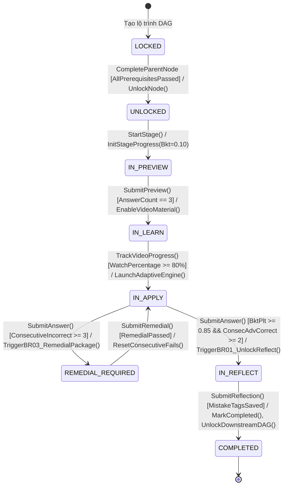
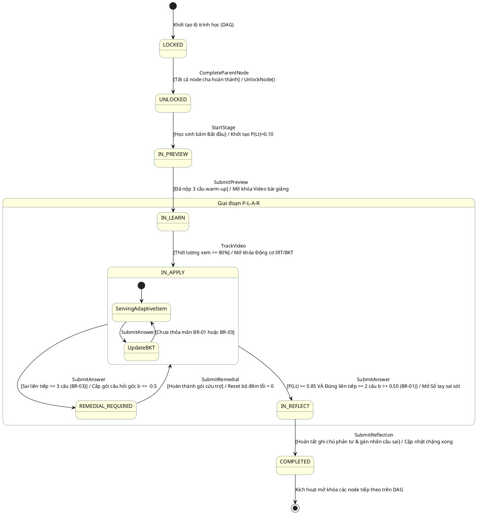
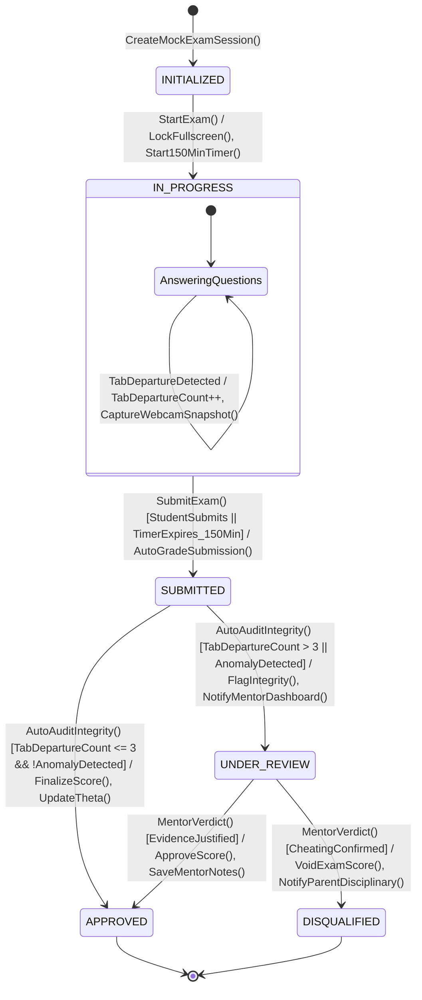
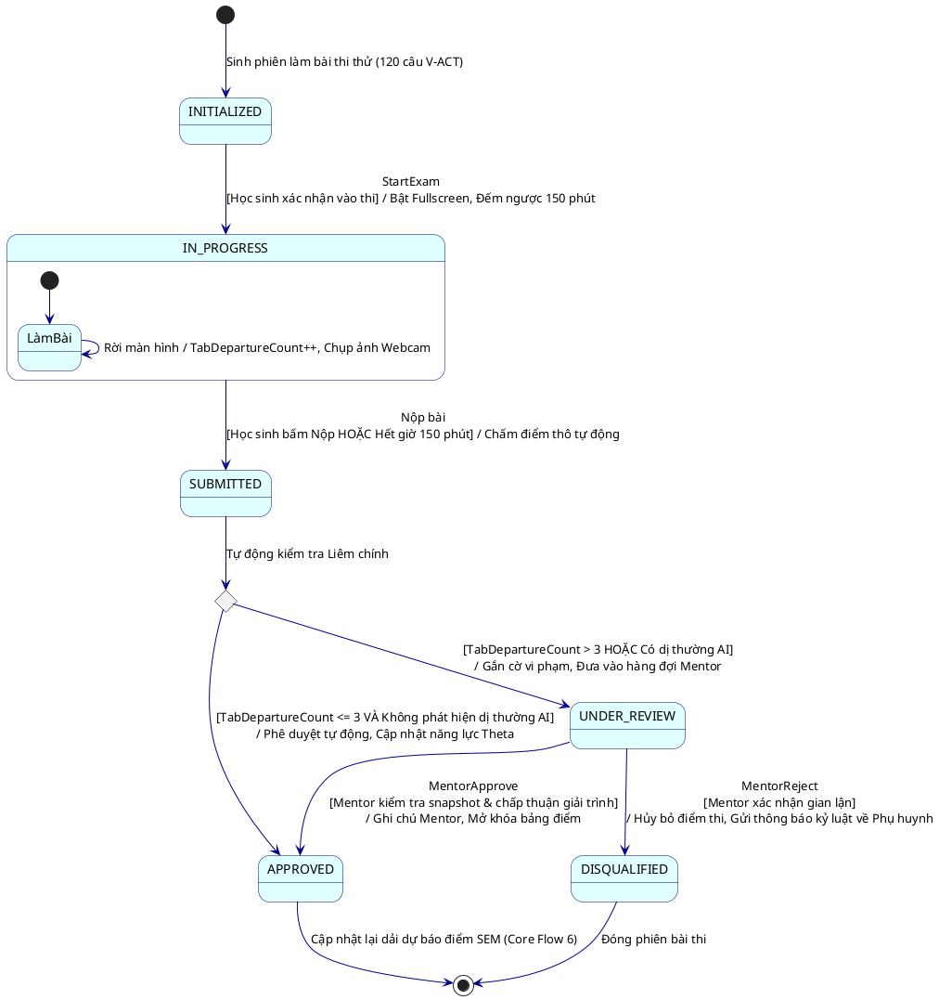
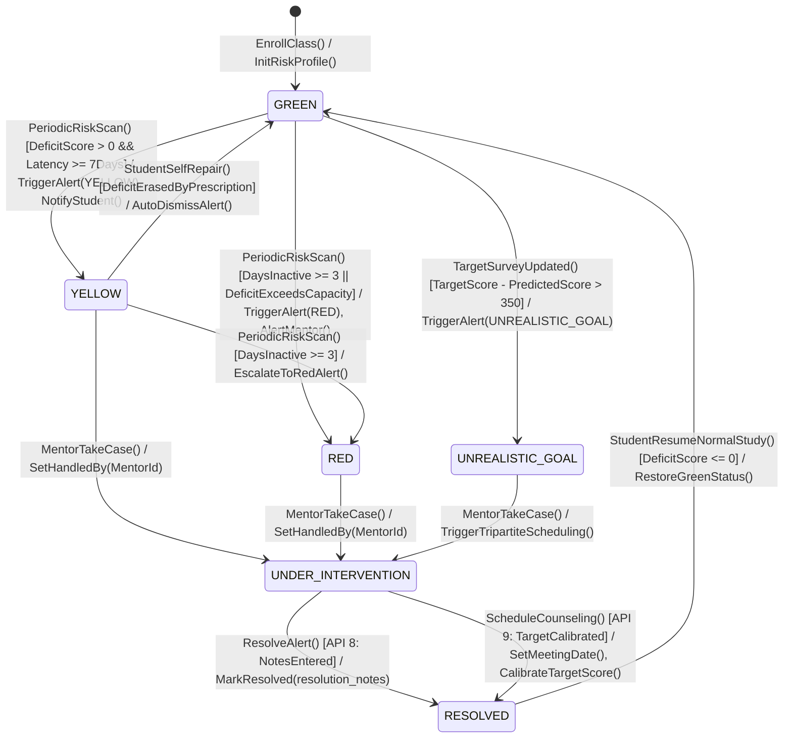
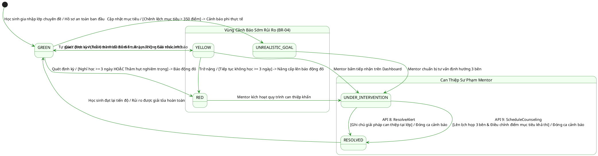

# TÀI LIỆU ĐẶC TẢ CHI TIẾT BIỂU ĐỒ TRẠNG THÁI (STATE MACHINE DIAGRAMS) CHO REVIEW 2

> **Tài liệu**: Đặc tả phân tích vòng đời thực thể & biểu đồ trạng thái chuẩn UML 2.5  
> **Dự án**: Nền tảng Đánh giá & Học tập Thích ứng V-Eval (Luyện thi ĐGNL V-ACT ĐHQG-HCM)  
> **Mục tiêu**: Cung cấp tài liệu nghiệp vụ, ma trận chuyển dịch trạng thái (Transitions), điều kiện bảo vệ (Guards), hành động kích hoạt (Actions) và mã nguồn biểu đồ sẵn sàng (Mermaid / PlantUML) cho 3 thực thể cốt lõi phục vụ bảo vệ Review 2 trước Hội đồng.

---

## 📌 1. NGUYÊN TẮC THIẾT KẾ STATE MACHINE DIAGRAM CHUẨN UML 2.5

Biểu đồ trạng thái (State Machine Diagram) tập trung mô tả **vòng đời của một thực thể dữ liệu đơn lẻ (Single Entity)** từ lúc khởi tạo đến khi kết thúc.

Mỗi mũi tên chuyển trạng thái (Transition) bắt buộc tuân theo cú pháp kinh điển:

```text
Event [Guard Condition] / Action
```

Trong đó:
- **`Event` (Sự kiện kích hoạt)**: Tác động từ phía Actor (Học sinh bấm nộp bài, Mentor duyệt) hoặc bộ đếm thời gian (Hết giờ 150 phút, Cron Job quét định kỳ).
- **`[Guard Condition]` (Điều kiện bảo vệ)**: Điều kiện logic đặt trong ngoặc vuông `[]`. Quá trình chuyển trạng thái **chỉ xảy ra** khi biểu thức này trả về `true`.
- **`/ Action` (Hành động thực thi)**: Tác vụ backend thực hiện ngay trên bước chuyển dịch (ví dụ: mở khóa nút tiếp theo, trừ điểm thâm hụt, kích hoạt thông báo).

---

## 💎 2. DANH SÁCH 3 THỰC THỂ ĐẮT GIÁ NHẤT CHO REVIEW 2

| STT | Tên Thực Thể | Phân Hệ Core Flow | Giá Trị Học Thuật & Điểm Nhấn Hội Đồng |
| :---: | :--- | :--- | :--- |
| **1** | **`StageProgress`** | **Core Flow 3** (Luyện tập thích ứng P-L-A-R) | Minh chứng chu trình sư phạm thích ứng 4 bước, luật BKT làm chủ kiến thức (`BR-01`) và phao cứu sinh chống nản chí (`BR-03`). |
| **2** | **`ExamSubmission`** | **Core Flow 3** (Module 3 - Thi thử chuẩn hóa 150') | Minh chứng năng lực kiểm soát gian lận toàn diện (rời tab, webcam snapshot) và cơ chế Giám sát có con người tham gia (**Human-in-the-loop**). |
| **3** | **`SystemAlert`** | **Core Flow 6** (Dự báo điểm SEM & Cảnh báo sớm) | Minh chứng cơ chế can thiệp sư phạm chủ động (Active Pedagogical Intervention) của Mentor trước khi học sinh rơi vào vùng nguy hiểm (`BR-04`). |

---

# 🚀 ĐỐI TƯỢNG 1: `StageProgress` (VÒNG ĐỜI CHẶNG HỌC P-L-A-R)

### 1.1 Khái Niệm & Ánh Xạ Kỹ Thuật (Domain Mapping)
- **Bảng CSDL**: `practice.StageProgress` liên kết 1-1 với chặng học `practice.RoadmapNodes`.
- **Mục tiêu sư phạm**: Đảm bảo người học không đốt cháy giai đoạn. Học sinh phải đi qua 4 bước **P (Preview) $\rightarrow$ L (Learn) $\rightarrow$ A (Apply) $\rightarrow$ R (Reflect)** và chỉ được công nhận hoàn thành khi thực sự đạt năng lực tinh thông.

### 1.2 Bảng Trạng Thái (State Dictionary)

| Mã Trạng Thái | Tên Trạng Thái | Ý Nghĩa Kỹ Thuật & Nghiệp Vụ |
| :--- | :--- | :--- |
| **`LOCKED`** | Khóa | Chặng học chưa đủ điều kiện tiên quyết (Node cha trên đồ thị DAG chưa xong). |
| **`UNLOCKED`** | Đã mở khóa | Node cha đã hoàn thành, học sinh có quyền bấm vào để bắt đầu chặng. |
| **`IN_PREVIEW`** | Khởi động (P) | Học sinh làm 3 câu trắc nghiệm Quick Check để đo lường kiến thức nền. |
| **`IN_LEARN`** | Tiếp thu (L) | Học sinh xem video bài giảng lý thuyết chuyên đề từ kho học liệu số. |
| **`IN_APPLY`** | Luyện thích ứng (A) | Động cơ IRT/BKT phục vụ bài tập thích ứng cá nhân hóa theo thời gian thực. |
| **`REMEDIAL_REQUIRED`**| Cứu trợ khẩn cấp | Phao cứu trợ (Luật `BR-03`): Bị văng vào nhánh phục hồi khi sai liên tiếp 3 câu. |
| **`IN_REFLECT`** | Phản tư (R) | Tinh thông đạt chuẩn (Luật `BR-01`), học sinh ghi chú bài học & phân loại câu sai. |
| **`COMPLETED`** | Hoàn thành | Đạt chuẩn chặng học, mở khóa các chặng tiếp theo trên đồ thị tri thức DAG. |

### 1.3 Ma Trận Chuyển Dịch Trạng Thái (Transition Matrix)

| Trạng thái nguồn | Sự kiện kích hoạt (`Event`) | Điều kiện bảo vệ (`[Guard]`) | Hành động thực thi (`/ Action`) | Trạng thái đích |
| :--- | :--- | :--- | :--- | :--- |
| `[*]` (Khởi tạo) | Khởi tạo lộ trình học tập | Không có | Tạo bản ghi với trạng thái mặc định | `LOCKED` |
| `LOCKED` | Hoàn thành chặng tiên quyết | `AllPrerequisitesCompleted == true` | Cập nhật `RoadmapNode.Status = UNLOCKED` | `UNLOCKED` |
| `UNLOCKED` | `StartStage` (Bấm Bắt đầu) | Không có | Khởi tạo `StageProgress` (`BktMasteryPlt = 0.10`) | `IN_PREVIEW` |
| `IN_PREVIEW` | `SubmitPreview` (Nộp 3 câu) | `AnswerCount == 3` | Chấm điểm, mở khóa video học liệu | `IN_LEARN` |
| `IN_LEARN` | `TrackVideo` (Xem bài giảng) | `VideoWatchPercentage >= 0.80` | Mở khóa động cơ bài tập thích ứng | `IN_APPLY` |
| `IN_APPLY` | `SubmitAnswer` (Làm sai) | `ConsecutiveIncorrect >= 3` *(Luật BR-03)* | Đổi trạng thái `REMEDIAL_REQUIRED`, cấp 3 câu cơ bản | `REMEDIAL_REQUIRED` |
| `REMEDIAL_REQUIRED`| `SubmitRemedial` (Xong cứu trợ)| `RemedialCompleted == true` | Reset `ConsecutiveIncorrect = 0`, khôi phục động cơ | `IN_APPLY` |
| `IN_APPLY` | `SubmitAnswer` (Đạt chuẩn) | `BktMasteryPlt >= 0.85 && ConsecAdvCorrect >= 2` *(BR-01)* | Mở khóa giao diện Phản tư (Sổ tay sai sót) | `IN_REFLECT` |
| `IN_REFLECT` | `SubmitReflection` (Xác nhận) | `MistakeTagsSaved == true` | `Status = COMPLETED`, kích hoạt mở khóa DAG con | `COMPLETED` |
| `COMPLETED` | Kết thúc chặng học | Không có | Lưu vết `CompletedAt`, cộng điểm năng lực | `[*]` (Kết thúc) |

---

### 1.4 Mã Sơ Đồ Mermaid (`StageProgress`)



### 1.5 Mã Sơ Đồ PlantUML (`StageProgress`)



---

# 🛡️ ĐỐI TƯỢNG 2: `ExamSubmission` (BÀI THI THỬ & GIÁM SÁT LIÊM CHÍNH)

### 2.1 Khái Niệm & Ánh Xạ Kỹ Thuật (Domain Mapping)
- **Bảng CSDL**: `practice.ExamSubmissions` liên kết `ProctoringSnapshots` và `SubmissionAnswers`.
- **Mục tiêu sư phạm**: Đảm bảo tính công bằng và nghiêm ngặt của kỳ thi thử 150 phút (120 câu hỏi V-ACT). Hệ thống tự động phát hiện nghi vấn rời màn hình, gian lận, và đưa vào hàng đợi cho **Mentor (Teacher)** thẩm định trước khi ghi nhận điểm số chính thức.

### 2.2 Bảng Trạng Thái (State Dictionary)

| Mã Trạng Thái | Tên Trạng Thái | Ý Nghĩa Kỹ Thuật & Nghiệp Vụ |
| :--- | :--- | :--- |
| **`INITIALIZED`** | Đã sẵn sàng | Đề thi 120 câu đã được chuẩn bị, học sinh vào phòng chờ chuẩn bị làm bài. |
| **`IN_PROGRESS`** | Đang làm bài | Đồng hồ đếm ngược 150 phút chạy, kích hoạt chế độ Fullscreen & giám sát AI. |
| **`SUBMITTED`** | Đã nộp bài | Học sinh chủ động bấm nộp hoặc hệ thống tự động thu bài khi hết 150 phút. |
| **`UNDER_REVIEW`** | Chờ Mentor duyệt | Hệ thống phát hiện vi phạm liêm chính (rời tab > 3 lần hoặc bất thường webcam). |
| **`APPROVED`** | Hợp lệ / Chấp thuận | Bài thi trong sạch hoặc Mentor xác nhận giải trình hợp lệ; ghi nhận năng lực $\theta$. |
| **`DISQUALIFIED`** | Bị hủy kết quả | Mentor xác nhận có hành vi gian lận; hủy kết quả bài thi, không ghi nhận điểm. |

### 2.3 Ma Trận Chuyển Dịch Trạng Thái (Transition Matrix)

| Trạng thái nguồn | Sự kiện kích hoạt (`Event`) | Điều kiện bảo vệ (`[Guard]`) | Hành động thực thi (`/ Action`) | Trạng thái đích |
| :--- | :--- | :--- | :--- | :--- |
| `[*]` (Khởi tạo) | Đăng ký phòng thi thử | Không có | Sinh đề thi 120 câu chuẩn phân bố V-ACT | `INITIALIZED` |
| `INITIALIZED` | `StartExam` (Bắt đầu thi) | Không có | Bật Fullscreen, khởi động bộ đếm 150 phút | `IN_PROGRESS` |
| `IN_PROGRESS` | `TabDeparture` (Rời tab) | `InExamMode == true` | `TabDepartureCount++`, chụp webcam lưu snapshot | `IN_PROGRESS` (Tự lặp) |
| `IN_PROGRESS` | `SubmitExam` (Nộp bài) | `TimeRemaining > 0` | Dừng đếm giờ, chấm điểm tự động | `SUBMITTED` |
| `IN_PROGRESS` | `TimeExpired` (Hết giờ) | `TimeRemaining == 0` | Tự động thu bài, đóng phiên thi | `SUBMITTED` |
| `SUBMITTED` | `AutoEvaluateIntegrity` | `TabDepartureCount <= 3 && AnomalyFlag == false` | Đổi `MentorVerdict = APPROVED`, cập nhật $\theta$ | `APPROVED` |
| `SUBMITTED` | `AutoEvaluateIntegrity` | `TabDepartureCount > 3 \|\| AnomalyFlag == true` | Đổi `IntegrityStatus = FLAGGED_FOR_REVIEW`, báo Mentor | `UNDER_REVIEW` |
| `UNDER_REVIEW` | `MentorApprove` (Duyệt đạt) | Mentor xem log & bằng chứng giải trình hợp lệ | `MentorVerdict = APPROVED`, mở khóa điểm số | `APPROVED` |
| `UNDER_REVIEW` | `MentorReject` (Hủy bài) | Mentor xác nhận hành vi gian lận nghiêm trọng | `MentorVerdict = DISQUALIFIED`, hủy điểm bài thi | `DISQUALIFIED` |
| `APPROVED` | Kết thúc quy trình bài thi | Không có | Tính toán lại dải điểm SEM và cập nhật hồ sơ | `[*]` (Kết thúc) |
| `DISQUALIFIED` | Kết thúc quy trình bài thi | Không có | Gửi thông báo vi phạm kỷ luật tới Phụ huynh | `[*]` (Kết thúc) |

---

### 2.4 Mã Sơ Đồ Mermaid (`ExamSubmission`)



### 2.5 Mã Sơ Đồ PlantUML (`ExamSubmission`)



---

# ⚠️ ĐỐI TƯỢNG 3: `SystemAlert` (VÒNG ĐỜI CẢNH BÁO SỚM & CAN THIỆP SƯ PHẠM)

### 3.1 Khái Niệm & Ánh Xạ Kỹ Thuật (Domain Mapping)
- **Bảng CSDL**: `practice.SystemAlerts` liên kết `ScorePredictions` và `ClassEnrollments`.
- **Mục tiêu sư phạm**: Hiện thực hóa quy tắc cảnh báo 3 cấp (`BR-04`). Ngăn chặn học sinh tụt hậu, nhắc nhở kịp thời khi có dấu hiệu chểnh mảng, và tổ chức can thiệp sư phạm 3 bên (Học sinh - Phụ huynh - Mentor) đối với học sinh đặt mục tiêu phi thực tế.

### 3.2 Bảng Trạng Thái (State Dictionary)

| Mã Trạng Thái | Tên Trạng Thái | Ý Nghĩa Kỹ Thuật & Nghiệp Vụ |
| :--- | :--- | :--- |
| **`GREEN`** | An toàn | Điểm dự báo bám sát mục tiêu ($D \le 0$), học tập đều đặn, không có nguy cơ. |
| **`YELLOW`** | Nhắc nhở | Trễ hạn lộ trình bù điểm 1 tuần ($D > 0$), hệ thống gửi thông báo đẩy nhắc nhở. |
| **`RED`** | Báo động khẩn | Nghỉ học liên tiếp $\ge 3$ ngày hoặc thời gian còn lại không đủ xóa nợ thâm hụt. |
| **`UNREALISTIC_GOAL`**| Mục tiêu không tưởng | Điểm mục tiêu vượt quá năng lực hiện tại $> 350$ điểm (nằm ngoài phân phối chuẩn ĐGNL). |
| **`UNDER_INTERVENTION`**| Đang can thiệp | Mentor đã tiếp nhận ca cảnh báo trên Dashboard (`HandledBy = MentorId`). |
| **`RESOLVED`** | Đã giải quyết | Hoàn thành can thiệp sư phạm (nộp bài bù điểm hoặc họp 3 bên điều chỉnh mục tiêu). |

### 3.3 Ma Trận Chuyển Dịch Trạng Thái (Transition Matrix)

| Trạng thái nguồn | Sự kiện kích hoạt (`Event`) | Điều kiện bảo vệ (`[Guard]`) | Hành động thực thi (`/ Action`) | Trạng thái đích |
| :--- | :--- | :--- | :--- | :--- |
| `[*]` (Khởi tạo) | Học sinh gia nhập lớp chuyên đề | Không có | Khởi tạo trạng thái rủi ro mặc định | `GREEN` |
| `GREEN` | Quét phân tích định kỳ (Cron Job) | `DeficitScore > 0 && LatencyDays >= 7` | Phát sinh `SystemAlert(YELLOW)`, gửi notification | `YELLOW` |
| `GREEN` hoặc `YELLOW`| Quét phân tích định kỳ | `DaysInactive >= 3 \|\| Deficit > MaxPossible` | Phát sinh `SystemAlert(RED)`, đẩy lên Dashboard Mentor | `RED` |
| `GREEN` | Khảo sát điều chỉnh mục tiêu | `TargetScore - PredictedScore > 350` | Phát sinh `SystemAlert(UNREALISTIC_GOAL)` | `UNREALISTIC_GOAL` |
| `YELLOW` | Học sinh tự giác hoàn thành bù điểm | `DeficitScore == 0` | Tự động đóng thông báo, ghi nhận tiến độ | `GREEN` |
| `YELLOW` / `RED` | Mentor bấm "Tiếp nhận xử lý" | `TeacherId != null` | Cập nhật `HandledBy = MentorId` | `UNDER_INTERVENTION` |
| `UNREALISTIC_GOAL`| Mentor bấm "Tiếp nhận xử lý" | `TeacherId != null` | Khởi tạo lịch hẹn tư vấn 3 bên | `UNDER_INTERVENTION` |
| `UNDER_INTERVENTION`| `ResolveAlert` (API 8) | Có ghi chú can thiệp sư phạm (`resolution_notes`) | Cập nhật `is_resolved = true`, lưu vết sư phạm | `RESOLVED` |
| `UNDER_INTERVENTION`| `ScheduleCounseling` (API 9) | Chốt lịch họp 3 bên & điều chỉnh lại `TargetScore` | Điều chỉnh mục tiêu thực tế, đóng ca cảnh báo | `RESOLVED` |
| `RESOLVED` | Học sinh quay lại học tập bình thường | `DeficitScore <= 0` | Xóa cờ cảnh báo, đưa học sinh về dải an toàn | `GREEN` |

---

### 3.4 Mã Sơ Đồ Mermaid (`SystemAlert`)



### 3.5 Mã Sơ Đồ PlantUML (`SystemAlert`)



---

## 🎯 4. HƯỚNG DẪN THUYẾT TRÌNH BẢO VỆ TRƯỚC HỘI ĐỒNG REVIEW 2

### 4.1 Lựa chọn Chiến Lược Khi Nộp Báo Cáo
Nếu tài liệu báo cáo giới hạn số lượng trang hoặc thời lượng thuyết trình có hạn, bạn nên chọn **2 sơ đồ đắt giá nhất**:
1. **Sơ đồ 1: `StageProgress` (P-L-A-R)**: Thể hiện bản sắc cốt lõi của V-Eval về mặt **Sư phạm cá nhân hóa (Pedagogy & Adaptivity)**.
2. **Sơ đồ 2: `ExamSubmission` (Giám sát 150')**: Thể hiện tính hoàn thiện về mặt **Vận hành hệ thống & Liêm chính học thuật (Integrity & Human-in-the-Loop)**.
*(Sơ đồ thứ 3 `SystemAlert` dùng làm Slide dự phòng hoặc đưa vào Phụ lục kiến trúc Core Flow 6 để gây ấn tượng mạnh khi Hội đồng hỏi sâu).*

### 4.2 Các Câu Hỏi Phản Biện Tiềm Năng & Cách Trả Lời Chuẩn Mực

> **Hỏi 1: Tại sao trong `StageProgress` lại cần trạng thái `REMEDIAL_REQUIRED` mà không cho học sinh làm tiếp câu khác?**
- **Trả lời**: *"Đây là hiện thực hóa quy tắc sư phạm `BR-03` chống nản chí (Frustration Avoidance). Khi học sinh sai liên tiếp 3 câu, thuật toán BKT xác định học sinh đang bị hổng kiến thức nền tảng của kỹ năng đó. Nếu tiếp tục phục vụ câu hỏi thông thường, học sinh sẽ tiếp tục sai và bỏ cuộc. Việc chuyển sang trạng thái `REMEDIAL_REQUIRED` giúp hệ thống tạm dừng động cơ thích ứng để cung cấp ngay một gói cứu trợ 3 câu cơ bản ở mức độ dễ nhất ($b \le -0.50$), giúp củng cố lại lý thuyết trước khi quay lại chặng chính."*

---

> **Hỏi 2: Tại sao trong `ExamSubmission`, hệ thống không tự động hủy bài thi luôn khi phát hiện rời màn hình quá 3 lần mà lại chuyển sang `UNDER_REVIEW`?**
- **Trả lời**: *"Trong thực tế thi trực tuyến, việc học sinh chuyển tab có thể do sự cố khách quan (cửa sổ thông báo hệ thống, trình duyệt bị pop-up, rớt mạng tạm thời). Nếu tự động hủy (`DISQUALIFIED`) ngay lập tức sẽ gây bất công và ức chế cho học sinh. Vì vậy, hệ thống áp dụng triết lý **Human-in-the-loop**: Hệ thống chỉ đóng vai trò thu thập chứng cứ (đếm số lần rời tab, chụp ảnh webcam qua `ProctoringSnapshots`) và gắn cờ `UNDER_REVIEW`. Quyết định phê duyệt hay hủy bài thuộc về thẩm quyền của **Giáo viên/Mentor** sau khi đã kiểm tra đối chứng log vi phạm."*

---

> **Hỏi 3: Cơ chế chuyển từ `UNREALISTIC_GOAL` sang `RESOLVED` trong `SystemAlert` vận hành thế nào?**
- **Trả lời**: *"Khi học sinh đặt mục tiêu lệch quá lớn so với điểm dự báo thực tế ($> 350$ điểm), thuật toán thống kê phân phối chuẩn ĐGNL chỉ ra xác suất đạt được là $< 2\%$. Mentor sẽ sử dụng API 9 (`ScheduleCounseling`) để tổ chức buổi gặp mặt 3 bên giữa Phụ huynh, Học sinh và Mentor. Tại đây, Mentor dựa trên số liệu phân tích của V-Eval để thuyết phục hạ mục tiêu xuống mức khả thi (ví dụ từ 1050 xuống 850), tái cấu trúc lộ trình và đóng ca cảnh báo thành công."*
