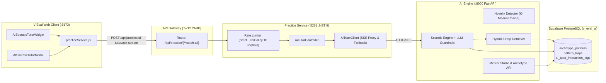
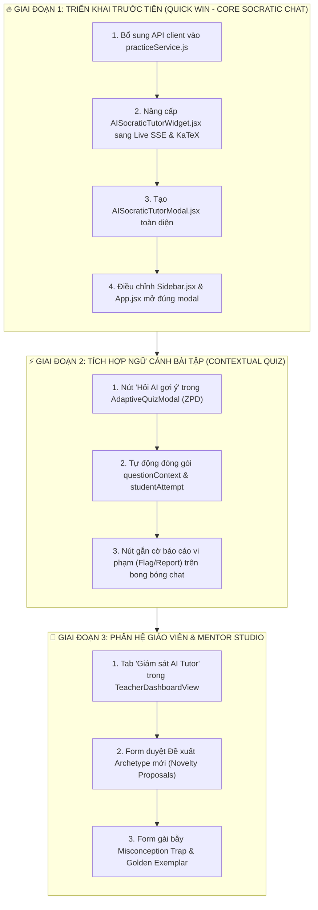
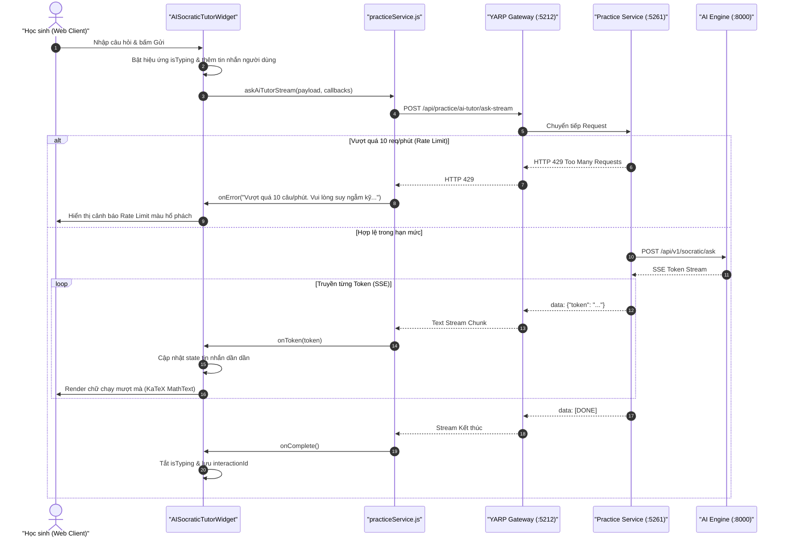

# BẢN KẾ HOẠCH KỸ THUẬT VÀ ĐẶC TẢ TRIỂN KHAI FRONTEND CORE FLOW 4: AI SOCRATIC TUTOR & GRAPHRAG CONTINUOUS LEARNING

> **Tên tiếng Anh**: Frontend Implementation Blueprint — GraphRAG Socratic AI Tutor & Human-in-the-Loop Continuous Learning  
> **Dự án**: Nền tảng Đánh giá & Học tập Thích ứng V-Eval (`V-Eval-Web_Client`)  
> **Ngày ban hành**: 13/10/2026 — Phiên bản 1.0  
> **Tương thích Markdown**: Chuẩn hóa 100% cho MD Editor Plus (Backtick LaTeX, Relative Links, Mermaid 11.15.0+)  
> **Mục tiêu**: Rà soát toàn bộ hiện trạng mã nguồn Frontend, xác định chính xác các thành phần triển khai trước tiên và thiết lập lộ trình phân kỳ kỹ thuật chi tiết.

---

## 1. TỔNG QUAN HIỆN TRẠNG MÃ NGUỒN FRONTEND (`V-Eval-Web_Client`)

### 1.1 Khung Công Nghệ & Nền Tảng Kỹ Thuật Sẵn Có
* **Khung ứng dụng**: React 19.2.8, đóng gói bằng Vite 8.3.0.
* **Giao diện & Styling**: Tailwind CSS v4.3.3, bộ icon Lucide React (`lucide-react`), hiệu ứng chuyển động `framer-motion` và hiệu ứng chúc mừng `canvas-confetti`.
* **Hiển thị Toán học & LaTeX**: Đã cài đặt thư viện `katex` (v0.19.0). Đã có sẵn component chuẩn hóa [MathText.jsx](./src/components/common/MathText.jsx) tự động phân tách và render công thức Toán dạng khối (`$$...$$`, `\[...\]`) và nội dòng (`$...$`, `\(...\)`).
* **Giao tiếp Mạng & Gateway**: [apiClient.js](./src/services/apiClient.js) trỏ trực tiếp vào **V-Eval API Gateway** qua cổng mặc định `:5212`. Hỗ trợ tự động tiêm JWT Bearer token và cơ chế làm mới phiên tự động (*Silent Token Refresh*).

---

### 1.2 Bảng Rà Soát Chi Tiết Các Thành Phần UI Hiện Tại Liên Quan Đến Flow 4

| Thành phần File | Vị trí Hiển thị | Hiện trạng Thực tế | Điểm nghẽn Cần khắc phục |
| :--- | :--- | :--- | :--- |
| [AISocraticTutorWidget.jsx](./src/components/dashboard/AISocraticTutorWidget.jsx) | Dashboard Học sinh (Cột phụ bên phải) | **100% Mock Data**: Dùng `setTimeout(1200ms)` và chuỗi phản hồi tĩnh được gán cứng. | Chưa kết nối API streaming thực tế; hai nút *"Mô phỏng như AI"* và *"Gợi mở Socratic"* bấm vào đang mở nhầm modal ZPD của Flow 3. |
| [Sidebar.jsx](./src/components/layout/Sidebar.jsx) | Thanh Menu Điều hướng chính | Có mục *"AI Socratic Tutor"* (badge `Flow 4`), kích hoạt sự kiện `onOpenAiTutor`. | **Mở nhầm modal Flow 3**: Hiện đang gọi `setIsZpdModalOpen(true)` trong [App.jsx](./src/App.jsx) vì chưa có Modal/Drawer toàn màn hình riêng cho Socratic Tutor. |
| [DiagnosticAssessmentPage.jsx](./src/components/diagnostic/DiagnosticAssessmentPage.jsx) | Màn hình Khảo sát Năng lực ban đầu | Có một Drawer phụ hỗ trợ hỏi AI về câu hỏi trắc nghiệm (dòng 514–560). | Đang gọi endpoint legacy cũ `/api/v1/chat/stream`, không đi qua Practice Service Rate Limiter và không lấy được `interaction_id` để report vi phạm. |
| [AdaptiveQuizModal.jsx](./src/components/modals/AdaptiveQuizModal.jsx) | Màn hình Luyện tập Thích ứng ZPD | Hiển thị câu hỏi, phương án và thước đo BKT `P(Lt)`. | **Chưa có nút hỏi trợ giúp Socratic**: Khi học sinh làm sai hoặc gặp câu khó, chưa có tùy chọn kết nối với AI Tutor để nhận gợi mở. |
| [TeacherDashboardView.jsx](./src/components/dashboard/TeacherDashboardView.jsx) | Dashboard Giáo viên Cơ sở | Đã có Bản đồ nhiệt lớp học (*Class Heatmap*) và phân nhóm vi mô. | **Hoàn toàn chưa có tab Mentor Studio**: Giáo viên chưa thể xem các phiên chat bị học sinh báo cáo vi phạm hay can thiệp gài bẫy ngộ nhận. |
| [practiceService.js](./src/services/practiceService.js) | Tầng Dịch vụ Luyện tập | Đang phục vụ Core Flow 1, Flow 2 và Flow 3. | **Chưa có hàm client nào cho Flow 4**: Thiếu các phương thức gọi endpoint `ai-tutor/ask-stream`, `report` và `interactions`. |
| [aiService.js](./src/services/aiService.js) | Tầng Dịch vụ AI Engine | Đang chứa OCR Gemini, nạp SGK và endpoint chat cũ. | Vẫn sử dụng endpoint RAG cũ `/api/v1/chat/stream`, chưa tích hợp GraphRAG Archetypes. |

---

## 2. MA TRẬN ĐỐI SOÁT HẠ TẦNG BACKEND VÀ KHẢ NĂNG KẾT NỐI

Toàn bộ hạ tầng Backend cho Core Flow 4 đã hoàn tất 100%, kiểm thử nghiêm ngặt và đã hợp nhất với nhánh `develop`:



### Bảng Đặc Tả Endpoint Sẵn Sàng Kết Nối

| STT | Endpoint | Method | Trách Nhiệm Backend | Đánh Giá Tích Hợp Frontend |
| :---: | :--- | :---: | :--- | :--- |
| **1** | `/api/practice/ai-tutor/ask-stream` | `POST` | Nhận câu hỏi, áp dụng Rate Limit (10 req/phút), stream từng token qua SSE, trả về `interaction_id` và cờ guardrail. | **Khả thi 100% ngay lập tức**: Frontend đã có `fetch` decoder trong `aiService.js`, chỉ cần chuyển route. |
| **2** | `/api/practice/ai-tutor/ask` | `POST` | Tương tự ask-stream nhưng trả về JSON đồng bộ (dành cho client không hỗ trợ SSE). | **Khả thi 100%**: Dùng làm cơ chế dự phòng (fallback). |
| **3** | `/api/practice/ai-tutor/report` | `POST` | Lưu phản hồi học sinh báo cáo AI vi phạm quy tắc (lộ đáp án, ảo giác, phản sư phạm). | **Khả thi 100%**: Cần thêm nút cắm cờ và modal xác nhận ngắn trên UI. |
| **4** | `/api/practice/ai-tutor/interactions` | `GET` | Truy vấn lịch sử tương tác kèm bộ lọc `flagged_only`, phục vụ Mentor xem xét. | **Khả thi**: Dành cho phân hệ Dashboard Giáo viên. |
| **5** | `/api/v1/socratic/override-exemplar` | `POST` | Giáo viên lưu lời giải chuẩn vào kho tri thức để làm mẫu Few-Shot. | **Khả thi**: Dành cho phân hệ Mentor Studio. |
| **6** | `/api/v1/socratic/add-trap` | `POST` | Giáo viên bổ sung bẫy sai lầm và câu hỏi bẻ khóa tư duy. | **Khả thi**: Dành cho phân hệ Mentor Studio. |

---

## 3. PHÂN KỲ TRIỂN KHAI FRONTEND: PHẦN NÀO LÀM TRƯỚC, PHẦN NÀO LÀM SAU?

Để đảm bảo tiến độ, tính an toàn hệ thống và tạo ra giá trị sử dụng ngay lập tức cho người dùng, lộ trình được chia thành **3 giai đoạn có thứ tự ưu tiên nghiêm ngặt**:



---

### 3.1 GIAI ĐOẠN 1: TRIỂN KHAI TRƯỚC TIÊN (ƯU TIÊN CAO NHẤT — LÀM NGAY)

> [!IMPORTANT]
> **Lý do ưu tiên làm trước**:
> 1. Trực tiếp giải quyết điểm nghẽn dữ liệu giả (Mock Data) đang hiển thị ở trang chủ học sinh.
> 2. Khắc phục ngay lỗi nghiệp vụ nghiêm trọng: Bấm menu *AI Socratic Tutor* trên Sidebar lại mở nhầm *AdaptiveQuizModal* (Flow 3).
> 3. Tận dụng 100% backend Practice Service (:5261) đã hoàn chỉnh và đã có Rate Limiter bảo vệ.

#### Các Công Việc Cụ Thể Trong Giai Đoạn 1:
1. **Cập nhật tầng API Service ([practiceService.js](./src/services/practiceService.js))**:
   * Thêm hàm `askAiTutorStream`:
     * Endpoint: `POST /api/practice/ai-tutor/ask-stream` (qua Gateway `:5212`).
     * Cơ chế: Sử dụng `fetch` đọc `ReadableStream` với `TextDecoder`. Bắt các sự kiện `data: {"token": "..."}`, `data: {"interaction_id": "..."}`, `data: [DONE]`.
     * Xử lý mã lỗi `429 Too Many Requests`: Đưa ra thông báo thân thiện giải thích học sinh đang hỏi quá nhanh (vượt quá 10 câu/phút).
   * Thêm hàm `reportAiTutorInteraction`:
     * Endpoint: `POST /api/practice/ai-tutor/report`.
     * Payload: `{ interactionId, reportedReason, feedbackNotes }`.
2. **Nâng cấp Component Widget ([AISocraticTutorWidget.jsx](./src/components/dashboard/AISocraticTutorWidget.jsx))**:
   * Xóa bỏ hoàn toàn mã giả lập `setTimeout`.
   * Kết nối trực tiếp hàm `practiceService.askAiTutorStream`.
   * Sử dụng component [MathText.jsx](./src/components/common/MathText.jsx) để render nội dung phản hồi, đảm bảo công thức Toán học được KaTeX biên dịch sắc nét.
   * Hiển thị trạng thái đang suy luận (*"AI đang truy vấn Tri thức ĐGNL..."*) và thanh tiến trình token mượt mà.
3. **Xây dựng Mới Component Modal Toàn Diện (`AISocraticTutorModal.jsx`)**:
   * Đặt tại: `src/components/modals/AISocraticTutorModal.jsx`.
   * Giao diện hai cột hiện đại:
     * *Cột trái (Khung chat chính)*: Hiển thị dòng thời gian trò chuyện Socratic, khung nhập câu hỏi, nút dừng stream (*Abort*).
     * *Cột phải (Bảng phân tích GraphRAG Tri thức)*: Hiển thị Dạng bài tương đương (*Archetype Pattern*), Định lý cốt lõi, Các bẫy sai lầm cần lưu ý (*Misconception Traps*).
4. **Sửa Đổi Điều Hướng Router ([App.jsx](./src/App.jsx) & [Sidebar.jsx](./src/components/layout/Sidebar.jsx))**:
   * Khai báo state `isAiTutorModalOpen`.
   * Cập nhật sự kiện click menu `AI Socratic Tutor` trên Sidebar và nút *"Mở rộng"* trên Widget để kích hoạt `setIsAiTutorModalOpen(true)`.

---

### 3.2 GIAI ĐOẠN 2: TÍCH HỢP NGỮ CẢNH BÀI TẬP (ƯU TIÊN TRUNG BÌNH)

> [!NOTE]
> Giai đoạn này kết nối sức mạnh Socratic vào trực tiếp quá trình luyện đề của học sinh, biến AI thành trợ lý đồng hành trong từng câu hỏi trắc nghiệm.

#### Các Công Việc Cụ Thể Trong Giai Đoạn 2:
1. **Tích hợp vào [AdaptiveQuizModal.jsx](./src/components/modals/AdaptiveQuizModal.jsx) (Luyện tập ZPD Flow 3)**:
   * Khi học sinh làm sai phương án hoặc dừng lại quá 45 giây ở một câu hỏi khó:
   * Hiển thị nút bấm tinh tế: **"💡 Chưa hiểu hướng tư duy? Hỏi Gia sư Socratic"**.
   * Khi học sinh bấm nút, tự động truyền gói dữ liệu:
     * `question`: Lời đề nghị hướng dẫn tư duy.
     * `questionContext`: Nội dung đề bài hiện tại + 4 phương án trắc nghiệm.
     * `studentAttempt`: Phương án học sinh đã chọn sai hoặc ghi chú phân vân.
   * AI Socratic sẽ sử dụng bẫy sai lầm (*Misconception Trap*) tương ứng với phương án sai để đặt câu hỏi phản biện, dẫn dắt học sinh tự nhận ra lỗ hổng.
2. **Cơ chế Gắn Cờ Vi Phạm Nhanh (In-chat Flagging)**:
   * Bên dưới mỗi bong bóng câu trả lời của AI, bổ sung icon cờ nhỏ (`Flag`).
   * Bấm vào sẽ mở popover với 3 lựa chọn nhanh:
     * *AI vô tình tiết lộ đáp án trực tiếp (Vi phạm quy tắc Socratic)*.
     * *AI đưa ra thông tin sai lệch / ảo giác*.
     * *Gợi ý khó hiểu hoặc không liên quan*.
   * Gửi ngay về `POST /api/practice/ai-tutor/report` kèm `interactionId`.

---

### 3.3 GIAI ĐOẠN 3: PHÂN HỆ GIÁO VIÊN & MENTOR STUDIO (ƯU TIÊN SAU CÙNG)

> [!TIP]
> Hiện tại Backend AI Engine đã có sẵn trang giao diện độc lập chuẩn Glassmorphic tại URL `http://localhost:8000/api/v1/socratic/view-mentor`. Do đó, giai đoạn 3 có thể thực hiện sau mà không ảnh hưởng tới vận hành của học sinh.

#### Các Công Việc Cụ Thể Trong Giai Đoạn 3:
1. **Tích hợp Tab Giám sát vào [TeacherDashboardView.jsx](./src/components/dashboard/TeacherDashboardView.jsx)**:
   * Thêm tab: **"Kiểm định AI Tutor & Tri thức ĐGNL"**.
   * Bảng danh sách các phiên trò chuyện bị học sinh cắm cờ (Flagged Interactions) lấy từ `GET /api/practice/ai-tutor/interactions?flagged_only=true`.
   * Giáo viên có thể xem chi tiết câu hỏi, phản hồi của AI và bấm xác nhận: *"Vi phạm thật"* hoặc *"Bình thường"*.
2. **Form Duyệt Đề Xuất Dạng Bài Mới (Academic Novelty Proposals)**:
   * Kết nối API `GET /api/v1/academic-graph/proposals`.
   * Hiển thị danh sách các bài toán mới lạ được AI phát hiện. Giáo viên bấm *"Phê duyệt (Approve)"* để đưa bài toán vào Đồ thị Tri thức ĐGNL làm dạng bài mới.
3. **Form Ghi Đè Lời Giải Mẫu & Cài Bẫy Ngộ Nhận**:
   * Form cho phép giáo viên nhập trực tiếp: Dạng bài, Lời giải mẫu sư phạm chuẩn (*Golden Exemplar*) và Các bẫy sai lầm phổ biến (*Misconception Traps*).

---

## 4. ĐẶC TẢ THIẾT KẾ KỸ THUẬT CHI TIẾT CHO GIAI ĐOẠN 1

### 4.1 Cấu Trúc Gói Tin DTO Giao Tiếp (Contracts)

#### A. Request Payload gửi lên API Gateway (`POST /api/practice/ai-tutor/ask-stream`)
```json
{
  "studentId": "00000000-0000-0000-0000-000000000001",
  "question": "Thầy ơi, bài này nếu mệnh đề P sai thì mệnh đề kéo theo P => Q có chắc chắn sai không ạ?",
  "questionContext": "Câu 8: Cho hai mệnh đề P và Q. Phát biểu nào sau đây đúng về quan hệ kéo theo?",
  "studentAttempt": "Em nghĩ là nếu P sai thì cả mệnh đề kéo theo cũng phải sai luôn.",
  "archetypePatternId": null
}
```

#### B. Định Dạng SSE Stream Nhận Về (Server-Sent Events)
```text
data: {"interaction_id": "98e1f0fd-aed6-45f6-beac-be24686b573c"}

data: {"token": "Thầy "}

data: {"token": "chào "}

data: {"token": "em! "}

data: {"token": "Hãy "}

data: {"token": "nhớ "}

data: {"token": "lại "}

data: {"token": "bảng "}

data: {"token": "chân "}

data: {"token": "trị: "}

data: {"token": "Khi tiền đề $P$ sai, thì mệnh đề $P \\Rightarrow Q$ nhận giá trị gì?"}

data: [DONE]
```

#### C. Request Payload Báo Cáo Vi Phạm (`POST /api/practice/ai-tutor/report`)
```json
{
  "interactionId": "98e1f0fd-aed6-45f6-beac-be24686b573c",
  "reportedReason": "revealed_direct_answer",
  "feedbackNotes": "AI nói thẳng đáp án là B thay vì đặt câu hỏi gợi mở cho em."
}
```

---

### 4.2 Sơ Đồ Tuần Tự Xử Lý Luồng SSE Streaming (Sequence Diagram)



---

### 4.3 Mã Nguồn Tham Chiếu: Tầng Dịch Vụ Client (`practiceService.js`)

Đoạn mã sẽ được bổ sung vào [practiceService.js](./src/services/practiceService.js):

```javascript
// =========================================================================
// Core Flow 4: Gia Sư AI Socratic & GraphRAG Continuous Learning
// =========================================================================

/**
 * Hỏi đáp gợi mở Socratic dạng SSE Streaming qua API Gateway (:5212) -> Practice Service (:5261)
 * Tự động kiểm soát giới hạn 10 câu/phút (StrictTutorPolicy) và lưu vết Interaction Log
 */
async askAiTutorStream({
  studentId,
  question,
  questionContext = null,
  studentAttempt = null,
  archetypePatternId = null,
  onToken,
  onInteractionId,
  onError,
  onComplete,
  signal
}) {
  const baseUrl = apiClient.getBaseUrl();
  const token = tokenStorage.getAccessToken();

  const headers = {
    'Content-Type': 'application/json',
    Accept: 'text/event-stream'
  };
  if (token) {
    headers.Authorization = `Bearer ${token}`;
  }

  const payload = {
    studentId: studentId || tokenStorage.getUser()?.id || '00000000-0000-0000-0000-000000000001',
    question,
    questionContext,
    studentAttempt,
    archetypePatternId
  };

  try {
    const response = await fetch(`${baseUrl}/api/practice/ai-tutor/ask-stream`, {
      method: 'POST',
      headers,
      body: JSON.stringify(payload),
      signal
    });

    if (response.status === 429) {
      const rateLimitError = new Error('Bạn đang gửi câu hỏi quá nhanh (Tối đa 10 câu/phút). Hãy dành thời gian suy ngẫm kỹ các câu hỏi dẫn dắt của AI trước khi gửi tiếp nhé!');
      rateLimitError.status = 429;
      if (onError) onError(rateLimitError);
      throw rateLimitError;
    }

    if (!response.ok) {
      throw new Error(`AI Tutor stream failed with HTTP ${response.status}`);
    }

    const reader = response.body.getReader();
    const decoder = new TextDecoder('utf-8');
    let buffer = '';
    let fullText = '';
    let interactionId = null;

    while (true) {
      const { value, done } = await reader.read();
      if (done) break;

      buffer += decoder.decode(value, { stream: true });
      const lines = buffer.split('\n');
      buffer = lines.pop() || '';

      for (const line of lines) {
        const trimmed = line.trim();
        if (!trimmed || !trimmed.startsWith('data:')) continue;

        const dataStr = trimmed.replace(/^data:\s*/, '');
        if (dataStr === '[DONE]') {
          if (onComplete) onComplete({ fullText, interactionId });
          return { fullText, interactionId };
        }

        try {
          const parsed = JSON.parse(dataStr);
          if (parsed.interaction_id) {
            interactionId = parsed.interaction_id;
            if (onInteractionId) onInteractionId(interactionId);
          }
          if (parsed.token) {
            fullText += parsed.token;
            if (onToken) onToken(parsed.token);
          }
          if (parsed.error) {
            throw new Error(parsed.error);
          }
        } catch (jsonErr) {
          // Bỏ qua các dòng không phải định dạng JSON
        }
      }
    }

    if (onComplete) onComplete({ fullText, interactionId });
    return { fullText, interactionId };
  } catch (err) {
    if (err.name === 'AbortError') {
      console.info('[AI Tutor Stream] Yêu cầu đã được học sinh hủy bỏ.');
      return { fullText: '', interactionId: null };
    }
    console.error('[AI Tutor Stream Error]:', err);
    if (onError) onError(err);
    throw err;
  }
},

/**
 * Báo cáo câu trả lời của AI vi phạm quy tắc sư phạm (Lộ đáp án, Ảo giác, Phản sư phạm)
 */
async reportAiTutorInteraction({ interactionId, reportedReason, feedbackNotes }) {
  return (await apiClient.post('/api/practice/ai-tutor/report', {
    interactionId,
    reportedReason,
    feedbackNotes
  })).data;
}
```

---

## 5. KẾ HOẠCH BÀN GIAO & TIÊU CHÍ NGHIỆM THU (ACCEPTANCE CRITERIA)

| Hạng Mục | Tiêu Chí Nghiệm Thu (Acceptance Criteria) | Trạng Thái |
| :--- | :--- | :---: |
| **API Integration** | Hàm `askAiTutorStream` gọi thành công qua Gateway `:5212`, nhận token chạy chữ liên tục và lấy được `interaction_id`. | Chờ thực hiện |
| **KaTeX Rendering** | Mọi công thức Toán dạng inline `$x^2 + 2x$` hay phân số block `$$\frac{a}{b}$$` đều được render chuẩn đẹp bởi [MathText.jsx](./src/components/common/MathText.jsx). | Chờ thực hiện |
| **Rate Limit 429** | Khi gửi liên tiếp quá 10 câu trong 1 phút, giao diện hiển thị thông báo nhẹ nhàng giải thích rõ quy định 10 req/phút thay vì báo lỗi hệ thống chung chung. | Chờ thực hiện |
| **Modal Router** | Bấm menu *"AI Socratic Tutor"* trên Sidebar mở đúng Modal chat Socratic toàn màn hình, không còn mở nhầm modal ZPD của Flow 3. | Chờ thực hiện |
| **Report Interaction** | Bấm nút báo cáo gửi thành công lên Backend, trạng thái cờ đỏ được cập nhật trong cơ sở dữ liệu `v_eval_ai.ai_tutor_interaction_logs`. | Chờ thực hiện |

---

## 6. KẾT LUẬN & ĐỀ XUẤT HÀNH ĐỘNG

* **Kết luận**: Hiện trạng Frontend đã có sẵn 90% nền tảng UI (Tailwind CSS, KaTeX parser, API Client, JWT Storage). Việc triển khai **Giai đoạn 1** hoàn toàn không gặp bất kỳ rào cản kỹ thuật nào và có thể hoàn thành trọn vẹn trong khoảng **60 - 90 phút**.
* **Đề xuất bước tiếp theo**: Bắt đầu thực thi ngay Bước 1 (cập nhật `practiceService.js`) và Bước 2 (nâng cấp `AISocraticTutorWidget.jsx` sang live streaming).
