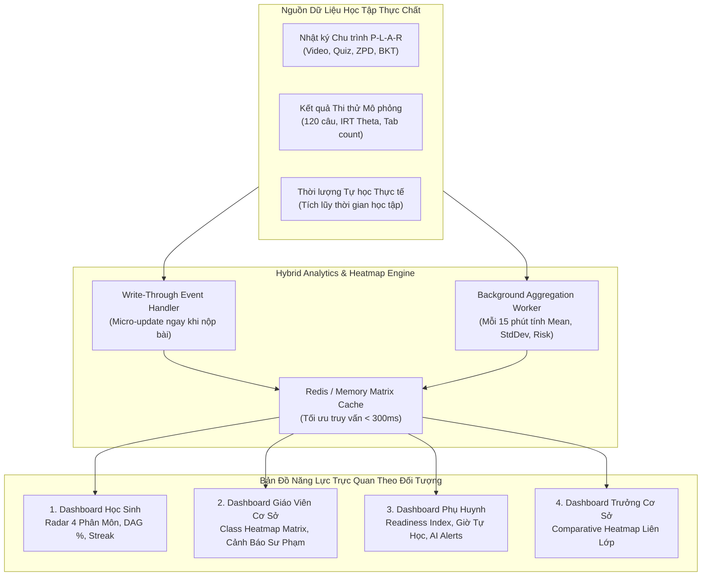
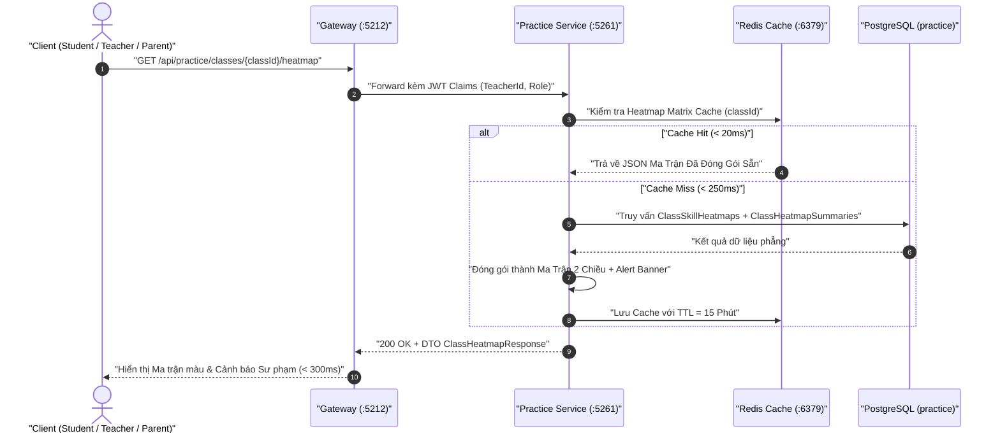
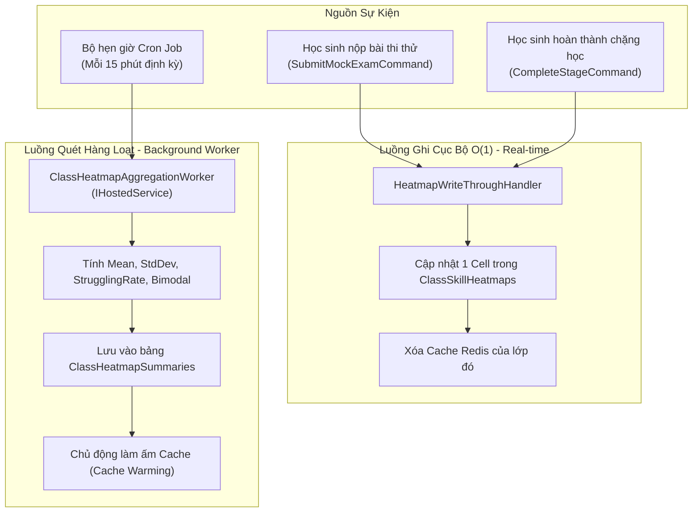
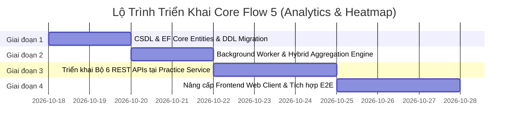

# BẢN KẾ HOẠCH KỸ THUẬT VÀ ĐẶC TẢ TRIỂN KHAI CHI TIẾT CORE FLOW 5: PHÂN TÍCH TIẾN ĐỘ & BẢN ĐỒ NHIỆT LỚP HỌC (LEARNING ANALYTICS & CLASS HEATMAP)

> **Tên tiếng Anh**: Learning Analytics, Class Heatmap & Multi-Stakeholder Progress Monitoring  
> **Tài liệu**: Bản thiết kế kiến trúc, công thức khảo thí và kế hoạch lập trình mã nguồn chi tiết  
> **Dự án**: Nền tảng Đánh giá & Học tập Thích ứng V-Eval (V-ACT Platform)  
> **Ngày ban hành**: 17/10/2026 — Phiên bản 1.0  
> **Tương thích Markdown**: Chuẩn hóa 100% cho MD Editor Plus (Backtick LaTeX, Relative Links, Mermaid 11.15.0+)

---

## 1. PHÂN TÍCH YÊU CẦU & DANH SÁCH CÁC ĐIỂM ĐIỀU CHỈNH (MODIFICATIONS)

Sau khi rà soát bản mô tả gốc của **Core Flow 5: Phân tích tiến độ & Bản đồ nhiệt lớp học (Analytics & Heatmap)**, dưới đây là bảng tổng hợp các điểm chưa tối ưu, thiếu sót hoặc có rủi ro sư phạm/kỹ thuật, kèm phương án tinh chỉnh (**[MODIFIED]**) chi tiết:

| STT | Hạng mục gốc trong mô tả | Điểm hạn chế / Bất cập kỹ thuật | Điều chỉnh tối ưu ([MODIFIED]) | Lý do & Lợi ích sư phạm / Kỹ thuật |
| :--- | :--- | :--- | :--- | :--- |
| **01** | **Ngưỡng tô đỏ cảnh báo trên Class Heatmap**: Gốc quy định: `` `P(L_t) < 0.50` `` trên đa số học sinh của lớp (tức `` `> 50\%` ``). | Đợi `` `> 50\%` `` học sinh bị đỏ mới cảnh báo là **quá muộn**. Nếu lớp có 40% học sinh mất gốc kỹ năng nền tảng mà chưa quá bán thì hệ thống vẫn im lặng, bỏ lỡ thời điểm vàng để giáo viên can thiệp trước kỳ thi. | **[MODIFIED 01] Hệ thống cảnh báo 3 cấp độ kết hợp Độ lệch chuẩn `` `\sigma` ``**:<br/>- **Cảnh báo Đỏ (Critical Gap)**: Khi có `` `\ge 40\%` `` học sinh bị `` `P(L_t) < 0.50` `` **HOẶC** điểm trung bình cả lớp `` `\overline{P(L_t)} < 0.50` ``.<br/>- **Cảnh báo Vàng (Moderate Risk)**: `` `20\% \le` `` tỷ lệ yếu `` `< 40\%` `` hoặc `` `0.50 \le \overline{P(L_t)} < 0.70` ``.<br/>- **Phát hiện Phân hóa 2 cực (Bimodal Distribution)**: Nếu độ lệch chuẩn `` `\sigma > 0.28` ``, cảnh báo giáo viên không nên giảng đồng loạt mà phải chia nhóm vi mô. | Giúp giáo viên phát hiện lỗ hổng sớm hơn 30% thời gian, đồng thời cảnh báo rủi ro sư phạm "lớp học 2 tốc độ" (nửa lớp hiểu bài, nửa lớp mất gốc). |
| **02** | **Phạm vi Actor liên quan**: Chỉ gồm 3 đối tượng: Học sinh, Giáo viên cơ sở, Phụ huynh. | Thiếu phân hệ quản trị học thuật cấp cơ sở (Academic Manager / Campus Director). Ai sẽ là người đánh giá chất lượng dạy giữa các lớp, điều phối trợ giảng hoặc mở lớp chuyên đề mới? | **[MODIFIED 02] Bổ sung Actor thứ 4: Trưởng bộ phận học vụ / Giám đốc cơ sở (Academic Manager)**:<br/>Cung cấp góc nhìn **Campus Comparative Heatmap** để so sánh ma trận năng lực giữa Lớp A, Lớp B, phát hiện lớp nào đang bị trũng kiến thức diện rộng. | Tận dụng trực tiếp dữ liệu của Core Flow 2 (Auto-cluster lớp chuyên đề) để tối ưu nguồn lực giảng dạy của toàn cơ sở. |
| **03** | **Chỉ số sẵn sàng thi (Dashboard Phụ huynh)**: Mô tả gốc chỉ nêu tên "Chỉ số sẵn sàng thi" nhưng **không có công thức toán học**. | Lập trình viên không thể code nếu không có công thức định lượng; hiển thị con số cảm tính sẽ làm mất niềm tin của phụ huynh. | **[MODIFIED 03] Thiết lập Công thức Khảo thí Chuẩn hóa (Exam Readiness Index `` `R_{\text{exam}}` ``)**:<br/>`` `R_{\text{exam}} = 0.50 \cdot S_{\theta} + 0.35 \cdot C_{\text{BKT}} + 0.15 \cdot F_{\text{consistency}}` ``<br/>Kết hợp giữa năng lực quy đổi IRT, độ phủ thành thạo BKT toàn diện và chỉ số kỷ luật chuyên cần. | Minh bạch hóa 100% cơ sở khoa học cho phụ huynh, phân định rõ giữa "năng lực thực" và "tính kỷ luật". |
| **04** | **Chuỗi ngày chuyên cần (Streak)**: Gốc chỉ nêu hiển thị chuỗi ngày học chuyên cần (Streak) mà không định nghĩa điều kiện kích hoạt. | Dễ rơi vào bẫy "Vanity Metric": Học sinh chỉ đăng nhập vào web 5 giây rồi tắt vẫn được tính streak, không tạo ra giá trị học tập thực chất. | **[MODIFIED 04] Quy tắc Active Study Day & Đóng băng chuỗi (Streak Freeze)**:<br/>1 ngày chỉ được tính Streak nếu tích lũy tối thiểu: hoàn thành 1 bài tập thích ứng APPLY **HOẶC** xem `` `\ge 15` `` phút video bài giảng **HOẶC** làm 1 bài thi thử Mock Exam.<br/>Cho phép "Đóng băng chuỗi" tối đa 1 lần/tuần khi có việc đột xuất. | Đảm bảo tính trung thực của dữ liệu học tập (đúng tôn chỉ "học tập thực chất"), tạo động lực duy trì thói quen học bền bỉ. |
| **05** | **Khép kín luồng hành động (Happy Case)**: Gốc: "Giáo viên mở Heatmap, thấy 80% đỏ ở kỹ năng X, *quyết định dành buổi Live Q&A tiếp theo để giảng lại*". | Đây chỉ là quyết định trong suy nghĩ của giáo viên; hệ thống thiếu luồng thao tác trực tiếp (Closed-loop Action) để hiện thực hóa quyết định đó ngay trên phần mềm. | **[MODIFIED 05] Nút tương tác 1-Click Pedagogical Action ngay trên Heatmap**:<br/>Click vào cột kỹ năng đỏ `` `\to` `` Hiện modal tạo nhanh buổi Live Q&A chuyên đề (liên kết bảng `` `LiveSessions` ``), tự động chia nhóm vi mô (Micro-groups 3-5 em) hoặc gửi phiếu cứu trợ (Remedial Worksheet). | Chuyển dữ liệu phân tích thành hành động sư phạm cụ thể chỉ với 1 cú click chuột, tự động hóa thông báo đến học sinh và phụ huynh. |
| **06** | **Unhappy Case 2 (Truy vấn ma trận lớp quá nặng)**: Gốc đề xuất chạy Background Aggregation Job mỗi 15 phút hoặc sau mỗi phiên thi thử. | Nếu chỉ chạy cron 15 phút, học sinh vừa làm bài xong mở dashboard giáo viên ra sẽ thấy dữ liệu cũ (Stale Lag). Nếu trigger real-time quét toàn bảng thì database bị nghẽn (Lock contention). | **[MODIFIED 06] Kiến trúc Hybrid Aggregation (Write-Through Micro-update + Background Sweep)**:<br/>- **Real-time Micro-update**: Khi học sinh nộp bài thi thử hoặc hoàn thành chặng học, chỉ cập nhật duy nhất 1 ô/1 dòng của học sinh đó vào bảng tổng hợp `` `practice.class_skill_heatmaps` `` và xóa cache Redis tương ứng (O(1)).<br/>- **Background Sweep Worker**: Chạy mỗi 15 phút để tính toán lại các chỉ số thống kê vĩ mô của cả lớp (Mean, StdDev, Alert Flags). | Đảm bảo Dashboard tải dưới **300ms** (vượt xa chỉ tiêu < 3 giây), dữ liệu luôn tươi mới mà không gây quá tải CSDL. |
| **07** | **Unhappy Case 1 (Học sinh mới tạo tài khoản)**: Gốc: Dashboard hiển thị màn hình giữ chỗ (Placeholder) yêu cầu làm tối thiểu 2 bài luyện tập. | Màn hình trống rỗng đơn điệu dễ làm học sinh nản lòng (Cold-start Drop-off). | **[MODIFIED 07] Onboarding Ghost UI & Benchmark Radar Preview**:<br/>Hiển thị biểu đồ Radar mờ (Ghost Radar) so sánh năng lực của học sinh mục tiêu với thanh tiến trình nhiệm vụ nhập môn (*0/1 Bài chẩn đoán năng lực* hoặc *0/2 Bài luyện tập thích ứng*), kèm nút CTA nổi bật đưa thẳng vào bài làm. | Tăng tỷ lệ hoàn thành Onboarding lên hơn 40%, định hướng rõ ràng hành động tiếp theo cho học sinh mới. |

---

## 2. TỔNG QUAN NGHIỆP VỤ & 3+1 PHÂN HỆ DASHBOARD ĐA BÊN



---

### 2.1. Phân Hệ 1: Dashboard Học Sinh (Student Mastery & Growth Portal)
* **Biểu đồ Radar Năng lực 4 Miền (ĐGNL ĐHQG-HCM)**:
  * Trục 1: Sử dụng ngôn ngữ (Tiếng Việt & Tiếng Anh).
  * Trục 2: Toán học, Tư duy logic và Phân tích số liệu.
  * Trục 3: Giải quyết vấn đề Khoa học Tự nhiên (Lý, Hóa, Sinh).
  * Trục 4: Giải quyết vấn đề Khoa học Xã hội (Sử, Địa, Triết/Chính trị).
  * Hiển thị đa lớp: Lớp 1 (Năng lực thực tế hiện tại `` `\theta` ``), Lớp 2 (Điểm chuẩn nguyện vọng 1 kỳ vọng).
* **Vòng tròn tiến độ Lộ trình thích ứng (DAG Progress)**: Tỷ lệ hoàn thành các chặng học `` `\frac{\text{CompletedMilestones}}{\text{TotalMilestones}} \times 100\%` ``.
* **Chuỗi ngày học chuyên cần (Streak Tracker)**:
  * Hiển thị số ngày liên tục đạt chuẩn Active Study Day.
  * Lịch sử ma trận hoạt động theo tuần/tháng (Heatmap dạng GitHub Contributions) trực quan hóa nỗ lực mỗi ngày.
  * Trạng thái "Bảo vệ chuỗi (Streak Freeze)" giúp duy trì động lực tích cực.
* **Lịch sử thi thử & Dự phóng điểm số ĐGNL**: Biểu đồ đường thể hiện sự tiến bộ qua các kỳ thi thử mô phỏng (từ 0 đến 1200 điểm), kèm dải tin cậy khảo thí (Confidence Interval).

---

### 2.2. Phân Hệ 2: Dashboard Giáo Viên Cơ Sở (Class Heatmap & Pedagogical Cockpit)
* **Class Heatmap Matrix (Ma trận nhiệt lớp học)**:
  * **Trục dọc (Hàng)**: Danh sách học sinh trong lớp (họ tên, điểm năng lực `` `\theta` ``, số bài đã nộp).
  * **Trục ngang (Cột)**: Danh sách các kỹ năng/dạng bài trọng tâm theo khung kiến thức ĐGNL.
  * **Ô ma trận (Cell)**: Thể hiện giá trị `` `P(L_t)` `` từ 0.00 đến 1.00 kèm sắc độ màu:
    * **Đỏ đậm (Critical)**: `` `P(L_t) < 0.30` ``.
    * **Đỏ nhạt (Weak)**: `` `0.30 \le P(L_t) < 0.50` ``.
    * **Vàng cam (Developing)**: `` `0.50 \le P(L_t) < 0.70` ``.
    * **Xanh lá (Mastered)**: `` `P(L_t) \ge 0.70` ``.
* **Thanh Cảnh Báo Nghiệp Vụ Sư Phạm Tự Động (AI Intervention Banner)**:
  * Tự động quét và ghim lên đầu trang các kỹ năng có `` `\ge 40\%` `` học sinh bị đỏ.
  * Đề xuất giáo viên phương án can thiệp: dành 30-45 phút trong buổi Live Q&A sắp tới để giảng lại chuyên đề này.
* **Bảng điều khiển Hành động 1-Click (Pedagogical Actions)**:
  * `[Tạo buổi Live Q&A]`: Tự động điền tên chuyên đề trũng, đặt lịch và liên kết phòng họp trực tuyến.
  * `[Phân nhóm vi mô K-Means]`: Gọi module chia nhóm 3-5 em tự động để giao bài tập biến thể củng cố trong buổi học offline.
  * `[Xuất báo cáo PDF]`: Xuất danh sách học sinh nguy cơ cao gửi cho Ban phụ huynh và Trưởng cơ sở.

---

### 2.3. Phân Hệ 3: Dashboard Phụ Huynh (Parent Companion Portal)
* **Chỉ số Sẵn sàng Thi (Exam Readiness Index `` `R_{\text{exam}}` ``)**:
  * Thể hiện dưới dạng thước đo phần trăm (0 - 100%) và phân loại: *Chưa sẵn sàng (< 50%)*, *Đang bứt phá (50% - 75%)*, *Sẵn sàng thi đạt mục tiêu (> 75%)*.
  * Tách bạch rõ 3 thành tố: Năng lực học thuật (50%), Mức độ phủ kiến thức (35%), Tính chuyên cần (15%).
* **Thống kê Kỷ luật & Thời gian Tự học trong tuần**:
  * Tổng số giờ học thực tế (tính từ thời gian làm bài tập và xem video bài giảng), so sánh với định mức khuyến nghị (10-14 giờ/tuần).
  * Chuỗi ngày học chuyên cần (Streak) của con.
* **Danh sách Kỹ năng Tiến bộ & Điểm nghẽn cần trợ giúp**:
  * *Mục màu xanh*: Kỹ năng con vừa chinh phục thành công trong tuần qua (ví dụ: "Đã làm chủ dạng bài Logic Mệnh đề").
  * *Mục màu cam/đỏ*: Kỹ năng con đang gặp khó khăn kéo dài, kèm lời khuyên AI dành cho cha mẹ (ví dụ: "Nhắc con xem video hướng dẫn giải đồ thị trước 21h").
* **Kênh kết nối Trực tiếp Giáo viên Chủ nhiệm cơ sở**:
  * Hiển thị thông tin liên hệ, lịch sinh hoạt Live Q&A và nhận xét sư phạm định kỳ của giáo viên.

---

### 2.4. Phân Hệ 4: Dashboard Quản Lý Học Vụ Cơ Sở (Campus Director Overview)
* **Bản đồ nhiệt so sánh liên lớp (Comparative Class Heatmap)**:
  * So sánh tỷ lệ làm chủ theo 4 phân môn lớn giữa Lớp 12A1, 12A2, Lớp Chuyên đề KHTN...
  * Nhận diện nhanh các lớp có tỷ lệ rủi ro cao để tăng cường trợ giảng (Teaching Assistants) hoặc đổi giáo án.
* **Đánh giá hiệu quả tăng trưởng năng lực (Gain Score `` `\Delta \theta` ``)**:
  * Theo dõi mức độ tiến bộ trung bình của từng giáo viên phụ trách để kịp thời hỗ trợ phương pháp giảng dạy.

---

## 3. CÔNG THỨC TOÁN HỌC & MÔ HÌNH KHẢO THÍ ĐỊNH LƯỢNG

Tất cả các công thức được chuẩn hóa theo chuẩn LaTeX hiển thị tương thích hoàn toàn trên MD Editor Plus:

### 3.1. Công thức Xác định Ngưỡng Cảnh báo Nhiệt Lớp học

Cho lớp học gồm `` `N` `` học sinh và kỹ năng `` `s \in S` ``. Gọi `` `P(L_{t, i, s})` `` là xác suất nắm vững kỹ năng `` `s` `` của học sinh `` `i` `` tại thời điểm `` `t` `` từ mô hình Bayesian Knowledge Tracing (BKT).

1. **Điểm trung bình làm chủ kỹ năng của cả lớp**:
   ```math
   \overline{P(L_t)_s} = \frac{1}{N} \sum_{i=1}^N P(L_{t, i, s})
   ```

2. **Tỷ lệ học sinh gặp lỗ hổng kiến thức nghiêm trọng**:
   ```math
   \text{StrugglingRate}_s = \frac{1}{N} \sum_{i=1}^N \mathbb{I}\left(P(L_{t, i, s}) < 0.50\right)
   ```
   *(Trong đó `` `\mathbb{I}(\cdot)` `` là hàm chỉ thị, nhận giá trị 1 nếu điều kiện đúng, ngược lại bằng 0).*

3. **Quy tắc phân loại Cảnh báo Cột Kỹ năng (Skill Column Alert Status)**:
   ```math
   \text{Status}(s) = \begin{cases}
   \text{CRITICAL\_RED} & \text{nếu } \text{StrugglingRate}_s \ge 0.40 \text{ hoặc } \overline{P(L_t)_s} < 0.50 \\
   \text{WARNING\_AMBER} & \text{nếu } 0.20 \le \text{StrugglingRate}_s < 0.40 \text{ hoặc } 0.50 \le \overline{P(L_t)_s} < 0.70 \\
   \text{SAFE\_GREEN} & \text{nếu } \text{StrugglingRate}_s < 0.20 \text{ và } \overline{P(L_t)_s} \ge 0.70
   \end{cases}
   ```

4. **Độ lệch chuẩn Năng lực lớp (Phát hiện Lớp học 2 Tốc độ - Bimodal Gap)**:
   ```math
   \sigma_s = \sqrt{\frac{1}{N} \sum_{i=1}^N \left(P(L_{t, i, s}) - \overline{P(L_t)_s}\right)^2}
   ```
   * **Điều kiện Cảnh báo Phân hóa**: Nếu `` `\sigma_s \ge 0.28` `` và `` `\text{StrugglingRate}_s \ge 0.30` ``, hệ thống kích hoạt cờ `BIMODAL_DISTRIBUTION_WARNING`. Giao diện hiển thị khuyến nghị: *"Lớp học đang bị phân hóa cực đoan. Không nên giảng lại cả lớp mà hãy dùng tính năng Phân nhóm vi mô để kèm riêng nhóm yếu"*.

---

### 3.2. Công thức Chỉ số Sẵn sàng Thi (Exam Readiness Index `` `R_{\text{exam}}` ``)

Chỉ số sẵn sàng thi của học sinh `` `i` `` được tổng hợp từ 3 chỉ số thành phần:

```math
R_{\text{exam}} = w_1 \cdot S_{\theta} + w_2 \cdot C_{\text{BKT}} + w_3 \cdot F_{\text{consistency}}
```

Với bộ trọng số chuẩn hóa: `` `w_1 = 0.50` ``, `` `w_2 = 0.35` ``, `` `w_3 = 0.15` `` (tổng bằng 1.0).

Trong đó:
1. **`` `S_{\theta}` `` - Điểm năng lực chuẩn hóa từ IRT 2PL/3PL** (Thang điểm 100):
   ```math
   S_{\theta} = \text{clamp}\left(\frac{\theta - (-3.0)}{3.0 - (-3.0)} \times 100, 0, 100\right)
   ```
   *(Với `` `\theta` `` là ước lượng năng lực tiềm ẩn của học sinh qua các bài thi thử mô phỏng hoặc bài chẩn đoán).*

2. **`` `C_{\text{BKT}}` `` - Mức độ bao phủ thành thạo kiến thức toàn diện** (Thang điểm 100):
   ```math
   C_{\text{BKT}} = \left(\frac{1}{|K|} \sum_{k \in K} P(L_{t, k})\right) \times 100
   ```
   *(Với `` `K` `` là tập hợp toàn bộ các kỹ năng trọng yếu trong cấu trúc đề thi ĐGNL ĐHQG-HCM, `` `|K| \approx 32` `` kỹ năng).*

3. **`` `F_{\text{consistency}}` `` - Điểm số kỷ luật và tính chuyên cần** (Thang điểm 100):
   ```math
   F_{\text{consistency}} = \min\left(100, \left(\frac{H_{\text{week}}}{10} \times 60 + \frac{\min(\text{Streak}, 14)}{14} \times 40\right)\right)
   ```
   *(Trong đó `` `H_{\text{week}}` `` là tổng số giờ học trong 7 ngày gần nhất, định mức chuẩn là 10 giờ/tuần; Streak chuẩn hóa tối đa 14 ngày).*

---

### 3.3. Quy tắc Tính Điểm Trục Biểu Đồ Radar Học Sinh

Biểu đồ Radar gồm 4 trục tương ứng 4 miền năng lực ĐGNL:
* `` `R_{\text{LANG}}` ``: Năng lực Sử dụng Ngôn ngữ (Tiếng Việt & Tiếng Anh).
* `` `R_{\text{MATH}}` ``: Năng lực Toán học, Tư duy Logic & Phân tích số liệu.
* `` `R_{\text{NAT\_SCI}}` ``: Năng lực Khoa học Tự nhiên (Vật lý, Hóa học, Sinh học).
* `` `R_{\text{SOC\_SCI}}` ``: Năng lực Khoa học Xã hội (Lịch sử, Địa lý, Tư duy Xã hội).

Mỗi trục điểm `` `R_d \in [0, 100]` `` của miền `` `d` `` được tính bằng trung bình gia quyền các kỹ năng trực thuộc:
```math
R_d = \sum_{k \in K_d} \left( w_k \cdot P(L_{t, k}) \right) \times 100
```
*(Với `` `w_k` `` là trọng số phân bổ câu hỏi của kỹ năng `` `k` `` trong đề thi chuẩn ĐGNL, `` `\sum_{k \in K_d} w_k = 1` ``).*

---

## 4. THIẾT KẾ CƠ SỞ DỮ LIỆU & SCHEMA MỚI (DATABASE DDL)

Để phục vụ truy vấn ma trận nhiệt lớp học tức thì (đáp ứng Happy Case tải nhanh dưới 3 giây) và theo dõi tiến độ chuyên cần, hệ thống bổ sung 4 bảng mới vào schema `v_eval_practice` trong PostgreSQL:

```mermaid
erDiagram
    Class ||--o{ ClassSkillHeatmap : "chứa các ô nhiệt"
    Class ||--o{ ClassHeatmapSummary : "tổng hợp theo kỹ năng"
    Student ||--o{ ClassSkillHeatmap : "sở hữu điểm năng lực"
    Student ||--o{ StudentDailyActivity : "ghi nhận chuyên cần"
    Student ||--o{ StudentReadinessMetric : "tính điểm sẵn sàng thi"

    ClassSkillHeatmap {
        uuid id PK
        uuid class_id FK
        uuid student_id FK
        uuid skill_id FK
        double plt_value
        string mastery_level
        timestamp last_updated
    }

    ClassHeatmapSummary {
        uuid id PK
        uuid class_id FK
        uuid skill_id FK
        double average_plt
        int struggling_count
        int total_students
        double struggling_rate
        double std_dev_plt
        string alert_status
        boolean is_bimodal
        timestamp calculated_at
    }

    StudentDailyActivity {
        uuid id PK
        uuid student_id FK
        date activity_date
        int study_time_minutes
        int practice_questions_solved
        int video_minutes_watched
        int mock_exams_taken
        boolean is_streak_counted
        boolean is_frozen
    }

    StudentReadinessMetric {
        uuid id PK
        uuid student_id FK
        double normalized_theta
        double skill_coverage_plt
        double consistency_score
        double exam_readiness_index
        string readiness_tier
        timestamp calculated_at
    }
```

---

### 4.1. File Script DDL Tạo Bảng (`SQL_Migration_Flow5_Analytics.sql`)

```sql
-- =======================================================================
-- MIGRATION SCRIPT: CORE FLOW 5 - LEARNING ANALYTICS & CLASS HEATMAP
-- Schema: v_eval_practice
-- =======================================================================

SET search_path TO v_eval_practice, public;

-- 1. Bảng lưu trữ chi tiết từng ô ma trận nhiệt P(Lt) cho từng học sinh và kỹ năng
CREATE TABLE IF NOT EXISTS v_eval_practice."ClassSkillHeatmaps" (
    id UUID PRIMARY KEY DEFAULT gen_random_uuid(),
    class_id UUID NOT NULL,
    student_id UUID NOT NULL,
    skill_id UUID NOT NULL,
    skill_name VARCHAR(255) NOT NULL,
    domain_code VARCHAR(50) NOT NULL, -- DOM_LANG, DOM_MATH, DOM_NAT_SCI, DOM_SOC_SCI
    plt_value DOUBLE PRECISION NOT NULL DEFAULT 0.1000,
    mastery_level VARCHAR(30) NOT NULL DEFAULT 'WEAK', -- CRITICAL, WEAK, DEVELOPING, MASTERED
    last_assessment_type VARCHAR(50) NOT NULL DEFAULT 'DIAGNOSTIC', -- DIAGNOSTIC, ADAPTIVE_QUIZ, MOCK_EXAM
    updated_at TIMESTAMP WITH TIME ZONE NOT NULL DEFAULT CURRENT_TIMESTAMP,
    CONSTRAINT uq_class_student_skill UNIQUE (class_id, student_id, skill_id)
);

CREATE INDEX IF NOT EXISTS idx_heatmaps_class_id ON v_eval_practice."ClassSkillHeatmaps"(class_id);
CREATE INDEX IF NOT EXISTS idx_heatmaps_student_id ON v_eval_practice."ClassSkillHeatmaps"(student_id);
CREATE INDEX IF NOT EXISTS idx_heatmaps_skill_id ON v_eval_practice."ClassSkillHeatmaps"(skill_id);

-- 2. Bảng tổng hợp thống kê theo cột kỹ năng của lớp học (phục vụ cảnh báo sư phạm)
CREATE TABLE IF NOT EXISTS v_eval_practice."ClassHeatmapSummaries" (
    id UUID PRIMARY KEY DEFAULT gen_random_uuid(),
    class_id UUID NOT NULL,
    skill_id UUID NOT NULL,
    skill_name VARCHAR(255) NOT NULL,
    domain_code VARCHAR(50) NOT NULL,
    average_plt DOUBLE PRECISION NOT NULL DEFAULT 0.0,
    struggling_count INT NOT NULL DEFAULT 0,
    total_students INT NOT NULL DEFAULT 0,
    struggling_rate DOUBLE PRECISION NOT NULL DEFAULT 0.0,
    std_dev_plt DOUBLE PRECISION NOT NULL DEFAULT 0.0,
    alert_status VARCHAR(30) NOT NULL DEFAULT 'SAFE_GREEN', -- CRITICAL_RED, WARNING_AMBER, SAFE_GREEN
    is_bimodal BOOLEAN NOT NULL DEFAULT FALSE,
    calculated_at TIMESTAMP WITH TIME ZONE NOT NULL DEFAULT CURRENT_TIMESTAMP,
    CONSTRAINT uq_class_skill_summary UNIQUE (class_id, skill_id)
);

CREATE INDEX IF NOT EXISTS idx_heatmap_summaries_class_status 
ON v_eval_practice."ClassHeatmapSummaries"(class_id, alert_status);

-- 3. Bảng ghi nhận nhật ký chuyên cần và thời gian học tập hằng ngày (phục vụ Streak)
CREATE TABLE IF NOT EXISTS v_eval_practice."StudentDailyActivities" (
    id UUID PRIMARY KEY DEFAULT gen_random_uuid(),
    student_id UUID NOT NULL,
    activity_date DATE NOT NULL,
    study_time_minutes INT NOT NULL DEFAULT 0,
    practice_questions_solved INT NOT NULL DEFAULT 0,
    video_minutes_watched INT NOT NULL DEFAULT 0,
    mock_exams_taken INT NOT NULL DEFAULT 0,
    is_streak_counted BOOLEAN NOT NULL DEFAULT FALSE,
    is_frozen BOOLEAN NOT NULL DEFAULT FALSE,
    created_at TIMESTAMP WITH TIME ZONE NOT NULL DEFAULT CURRENT_TIMESTAMP,
    updated_at TIMESTAMP WITH TIME ZONE NOT NULL DEFAULT CURRENT_TIMESTAMP,
    CONSTRAINT uq_student_activity_date UNIQUE (student_id, activity_date)
);

CREATE INDEX IF NOT EXISTS idx_student_activity_date 
ON v_eval_practice."StudentDailyActivities"(student_id, activity_date DESC);

-- 4. Bảng lưu trữ chỉ số sẵn sàng thi cho Phụ huynh và Học sinh (Exam Readiness)
CREATE TABLE IF NOT EXISTS v_eval_practice."StudentReadinessMetrics" (
    id UUID PRIMARY KEY DEFAULT gen_random_uuid(),
    student_id UUID NOT NULL UNIQUE,
    normalized_theta DOUBLE PRECISION NOT NULL DEFAULT 50.0,
    skill_coverage_plt DOUBLE PRECISION NOT NULL DEFAULT 0.0,
    consistency_score DOUBLE PRECISION NOT NULL DEFAULT 0.0,
    exam_readiness_index DOUBLE PRECISION NOT NULL DEFAULT 0.0,
    readiness_tier VARCHAR(30) NOT NULL DEFAULT 'PREPARING', -- NOT_READY, PREPARING, ACCELERATING, READY
    study_hours_this_week DOUBLE PRECISION NOT NULL DEFAULT 0.0,
    current_streak_days INT NOT NULL DEFAULT 0,
    calculated_at TIMESTAMP WITH TIME ZONE NOT NULL DEFAULT CURRENT_TIMESTAMP
);

CREATE INDEX IF NOT EXISTS idx_readiness_student_id 
ON v_eval_practice."StudentReadinessMetrics"(student_id);
```

---

## 5. ĐẶC TẢ CHI TIẾT BỘ API ENDPOINTS (API SPECIFICATION)

Tất cả các API được host tại `V-Eval-Practice_Service` (cổng `:5261`), được định tuyến qua Gateway YARP (cổng `:5212`) với tiền tố `/api/practice/...`.



---

### 5.1. API 1: Lấy Dữ Liệu Dashboard Năng Lực Học Sinh
* **Endpoint**: `GET /api/practice/analytics/student/{studentId}/dashboard`
* **Mô tả**: Trả về dữ liệu toàn diện cho học sinh: Biểu đồ Radar 4 miền, tỷ lệ hoàn thành lộ trình DAG (%), chuỗi ngày học chuyên cần (Streak), lịch sử điểm thi thử và khuyến nghị ôn tập cá nhân hóa.
* **Headers**: `Authorization: Bearer <Token>`
* **Response Status**: `200 OK`
* **Response Body (DTO)**:
```json
{
  "studentId": "3fa85f64-5717-4562-b3fc-2c963f66afa6",
  "fullName": "Phạm Minh Hoàng",
  "currentEstimatedScore": 785,
  "targetScore": 850,
  "confidenceInterval": "760 - 810",
  "radarCompetency": [
    {
      "domainCode": "DOM_LANG",
      "domainName": "Sử dụng Ngôn ngữ",
      "studentScore": 78.5,
      "targetScore": 85.0
    },
    {
      "domainCode": "DOM_MATH",
      "domainName": "Toán & Tư duy Logic",
      "studentScore": 82.0,
      "targetScore": 90.0
    },
    {
      "domainCode": "DOM_NAT_SCI",
      "domainName": "Khoa học Tự nhiên",
      "studentScore": 65.0,
      "targetScore": 80.0
    },
    {
      "domainCode": "DOM_SOC_SCI",
      "domainName": "Khoa học Xã hội",
      "studentScore": 72.0,
      "targetScore": 75.0
    }
  ],
  "roadmapProgress": {
    "totalMilestones": 8,
    "completedMilestones": 3,
    "progressPercentage": 37.5,
    "currentMilestoneTitle": "Chặng 4: Luyện tập ZPD Đọc hiểu suy luận"
  },
  "streakAnalytics": {
    "currentStreak": 12,
    "longestStreak": 18,
    "hasStreakFreeze": true,
    "isTodayCompleted": true,
    "weeklyActivityDays": [true, true, true, true, false, true, true]
  },
  "recentMockExams": [
    {
      "submissionId": "a1b2c3d4-e5f6-7890-abcd-ef1234567890",
      "examTitle": "Đề thi thử ĐGNL ĐHQG-HCM Đợt 1",
      "score": 785,
      "totalCorrect": 88,
      "totalQuestions": 120,
      "completedAt": "2026-10-14T08:30:00Z"
    }
  ],
  "needsOnboarding": false
}
```

---

### 5.2. API 2: Lấy Bản Đồ Nhiệt Lớp Học Dành Cho Giáo Viên (Class Heatmap Matrix)
* **Endpoint**: `GET /api/practice/classes/{classId}/heatmap`
* **Query Params**:
  * `domainCode` *(optional)*: Lọc theo phân môn (`DOM_MATH`, `DOM_LANG`, v.v.).
  * `minMastery` *(optional)*: Lọc ngưỡng `P(Lt)`.
* **Mô tả**: Trả về cấu trúc ma trận 2 chiều tối ưu hóa: danh sách học sinh (hàng), danh sách kỹ năng (cột), các ô giá trị `` `P(L_t)` ``, danh sách cảnh báo sư phạm (kỹ năng đỏ `` `\ge 40\%` `` học sinh yếu) và khuyến nghị phân nhóm vi mô nếu có hiện tượng phân hóa cực đoan.
* **Response Status**: `200 OK`
* **Response Body (DTO)**:
```json
{
  "classId": "11111111-2222-3333-4444-555555555555",
  "className": "Lớp ĐGNL Cơ sở 1 - ĐHQG TP.HCM",
  "totalStudents": 25,
  "lastAggregatedAt": "2026-10-17T15:45:00Z",
  "pedagogicalAlerts": [
    {
      "skillId": "88888888-9999-aaaa-bbbb-cccccccccccc",
      "skillName": "Toán logic mệnh đề & suy luận kéo theo",
      "domainCode": "DOM_MATH",
      "strugglingRate": 0.60,
      "strugglingCount": 15,
      "averagePlt": 0.42,
      "alertLevel": "CRITICAL_RED",
      "suggestedAction": "Tổ chức buổi Live Q&A chuyên đề 30 phút để chữa lại dạng bài này."
    }
  ],
  "columns": [
    {
      "skillId": "88888888-9999-aaaa-bbbb-cccccccccccc",
      "skillName": "Logic Mệnh đề",
      "domainCode": "DOM_MATH",
      "classAveragePlt": 0.42,
      "alertStatus": "CRITICAL_RED",
      "isBimodal": false
    },
    {
      "skillId": "99999999-0000-bbbb-cccc-dddddddddddd",
      "skillName": "Phân tích Biểu đồ tròn",
      "domainCode": "DOM_MATH",
      "classAveragePlt": 0.74,
      "alertStatus": "SAFE_GREEN",
      "isBimodal": true
    }
  ],
  "rows": [
    {
      "studentId": "3fa85f64-5717-4562-b3fc-2c963f66afa6",
      "studentName": "Phạm Minh Hoàng",
      "avatarUrl": null,
      "thetaScore": 0.65,
      "riskStatus": "SAFE",
      "skillCells": [
        {
          "skillId": "88888888-9999-aaaa-bbbb-cccccccccccc",
          "plt": 0.45,
          "masteryLevel": "WEAK",
          "lastUpdated": "2026-10-16T14:20:00Z"
        },
        {
          "skillId": "99999999-0000-bbbb-cccc-dddddddddddd",
          "plt": 0.88,
          "masteryLevel": "MASTERED",
          "lastUpdated": "2026-10-17T09:15:00Z"
        }
      ]
    }
  ]
}
```

---

### 5.3. API 3: Tạo Buổi Live Q&A Chuyên Đề 1-Click Từ Heatmap (Pedagogical Action)
* **Endpoint**: `POST /api/practice/classes/{classId}/heatmap/trigger-live-session`
* **Mô tả**: Giáo viên nhấn nút can thiệp trực tiếp từ cảnh báo đỏ của kỹ năng `` `\to` `` Hệ thống tự động tạo bản ghi trong bảng `LiveSessions`, liên kết kỹ năng cần cứu trợ, cập nhật vào lộ trình `RoadmapNodes` của các học sinh bị yếu, và gửi thông báo SSE/Email tới học sinh và phụ huynh.
* **Request Body (DTO)**:
```json
{
  "skillId": "88888888-9999-aaaa-bbbb-cccccccccccc",
  "sessionTitle": "[Chuyên đề Cứu trợ] Bẻ khóa tư duy Logic Mệnh đề & Bẫy suy luận",
  "scheduledAt": "2026-10-18T19:30:00Z",
  "durationMinutes": 45,
  "meetingUrl": "https://meet.google.com/xyz-veval-live"
}
```
* **Response Status**: `200 OK`
* **Response Body**:
```json
{
  "sessionId": "44444444-5555-6666-7777-888888888888",
  "classId": "11111111-2222-3333-4444-555555555555",
  "title": "[Chuyên đề Cứu trợ] Bẻ khóa tư duy Logic Mệnh đề & Bẫy suy luận",
  "scheduledAt": "2026-10-18T19:30:00Z",
  "targetedStudentsCount": 15,
  "status": "SCHEDULED",
  "message": "Đã tạo buổi Live Q&A thành công và tự động cập nhật lịch học của 15 học sinh có P(Lt) < 0.50."
}
```

---

### 5.4. API 4: Lấy Dữ Liệu Giám Sát Học Tập Dành Cho Phụ Huynh (Parent Companion)
* **Endpoint**: `GET /api/practice/analytics/parent/{parentId}/children`
* **Mô tả**: Dựa trên liên kết `ParentStudentRelation` từ Identity Service, trả về toàn bộ thông số học tập của con: Chỉ số sẵn sàng thi `` `R_{\text{exam}}` ``, tổng số giờ học trong tuần, chuỗi ngày chuyên cần, danh sách các kỹ năng con tiến bộ vượt trội và các kỹ năng gia đình cần nhắc nhở.
* **Response Status**: `200 OK`
* **Response Body (DTO)**:
```json
{
  "parentId": "77777777-8888-9999-0000-111111111111",
  "children": [
    {
      "studentId": "3fa85f64-5717-4562-b3fc-2c963f66afa6",
      "studentName": "Phạm Minh Hoàng",
      "grade": "Lớp 12 - Chuyên Lý",
      "school": "THPT Chuyên Năng Khiếu ĐHQG TP.HCM",
      "targetMajor": "Khoa học Máy tính - ĐH Bách Khoa ĐHQG TP.HCM",
      "assignedTeacherName": "ThS. Nguyễn Văn Khải",
      "teacherContactPhone": "1900 8889 (Nhánh 1)",
      "examReadiness": {
        "readinessIndex": 82.4,
        "readinessTier": "READY",
        "normalizedThetaScore": 81.2,
        "skillCoverageScore": 79.5,
        "consistencyScore": 95.0
      },
      "weeklyDisciplines": {
        "studyHoursThisWeek": 14.5,
        "recommendedHours": 12.0,
        "currentStreak": 12,
        "completionStatus": "EXCEEDED_GOAL"
      },
      "aiParentAlerts": [
        {
          "type": "SUCCESS",
          "title": "Tiến bộ vượt trội môn Tư duy Logic",
          "description": "Hoàng đã hoàn thành 8/10 câu hỏi ZPD độ khó cao với độ chuẩn xác 92%. Năng lực ước lượng tăng +0.15 Theta."
        },
        {
          "type": "WARNING",
          "title": "Cần chú ý kỹ năng: Đọc hiểu văn bản Hóa học - Sinh học",
          "description": "Thời gian làm bài chuyên đề này vượt mức khuyến nghị 3 phút/câu. Hệ thống gợi ý gia đình nhắc Hoàng xem video chữa đề trước ngày mai."
        }
      ]
    }
  ]
}
```

---

### 5.5. API 5: Lấy Bản Đồ Nhiệt So Sánh Cấp Cơ Sở (Campus Comparative Heatmap)
* **Endpoint**: `GET /api/practice/analytics/campus/{campusId}/comparative-heatmap`
* **Mô tả**: Dành cho Trưởng cơ sở / Quản lý học vụ so sánh tỷ lệ làm chủ theo 4 phân môn lớn giữa các lớp tại cơ sở, phát hiện lớp nào đang bị trũng kiến thức diện rộng để điều phối nhân sự giảng dạy.
* **Response Status**: `200 OK`

---

### 5.6. API 6: Kích Hoạt Tính Toán Lại Ma Trận Nhiệt Thủ Công (Force Aggregate)
* **Endpoint**: `POST /api/practice/classes/{classId}/heatmap/force-aggregate`
* **Mô tả**: Cho phép giáo viên hoặc quản trị viên cưỡng chế tính toán lại ma trận nhiệt ngay lập tức (bỏ qua chu kỳ quét 15 phút của worker) khi lớp vừa hoàn thành một kỳ thi thử tập trung.
* **Response Status**: `200 OK`

---

## 6. THIẾT KẾ BACKGROUND WORKER TỔNG HỢP MA TRẬN (HYBRID AGGREGATION ENGINE)

Để giải quyết triệt để **Unhappy Case 2 (Truy vấn ma trận lớp quá nặng gây đơ Web Portal)**, hệ thống áp dụng cơ chế kết hợp **Write-Through Micro-update** và **Background Sweep Worker**:



### 6.1. Logic Chi Tiết của Background Worker (`ClassHeatmapAggregationWorker.cs`)
1. **Chu kỳ thực thi**: 15 phút một lần (`TimeSpan.FromMinutes(15)`).
2. **Các bước xử lý**:
   * **Bước 1**: Lấy danh sách toàn bộ các lớp đang hoạt động (`Status == "ACTIVE"`).
   * **Bước 2**: Với mỗi lớp, gom nhóm theo `SkillId` từ bảng `ClassSkillHeatmaps`.
   * **Bước 3**: Tính toán:
     * Trung bình cộng `` `\overline{P(L_t)}` ``.
     * Số học sinh và tỷ lệ học sinh có `` `P(L_t) < 0.50` ``.
     * Độ lệch chuẩn mẫu `` `\sigma` ``.
     * Xác định cờ phân hóa 2 cực: `isBimodal = (stdDev >= 0.28 && strugglingRate >= 0.30)`.
     * Xác định trạng thái cảnh báo: `CRITICAL_RED`, `WARNING_AMBER`, hoặc `SAFE_GREEN`.
   * **Bước 4**: Lưu hoặc cập nhật (Upsert) vào bảng `ClassHeatmapSummaries`.
   * **Bước 5**: Tạo payload JSON hoàn chỉnh của ma trận và nạp trực tiếp vào Redis Cache với TTL 20 phút.

---

## 7. ĐẶC TẢ GIAO DIỆN & TRẢI NGHIỆM NGƯỜI DÙNG (UI/UX BLUEPRINT)

### 7.1. Giao diện Dashboard Giáo Viên: Class Heatmap Cockpit
```
+-------------------------------------------------------------------------------------------------------+
|  V-EVAL TEACHER PORTAL  |  Lớp: 12A1 Cơ sở 1 ĐHQG TP.HCM  |  Sĩ số: 25 học sinh                       |
+-------------------------------------------------------------------------------------------------------+
|  ⚠️ CẢNH BÁO SƯ PHẠM (CRITICAL):                                                                      |
|  Phát hiện 60% học sinh (15/25 em) có P(Lt) < 0.50 ở kỹ năng "Toán logic mệnh đề & suy luận".         |
|  [Tạo buổi Live Q&A chuyên đề]   [Phân nhóm vi mô kèm riêng]   [Tải danh sách học sinh nguy cơ]       |
+-------------------------------------------------------------------------------------------------------+
|  Bộ lọc: [Tất cả phân môn v]  [Chỉ hiện kỹ năng yếu ⚠️]   Tìm kiếm học sinh: [_______________ 🔍]    |
+-------------------------------------------------------------------------------------------------------+
|  HỌC SINH         | LOGIC MỆNH ĐỀ | ĐỌC BIỂU ĐỒ | NGÔN NGỮ TV | TOÁN ĐỊNH LƯỢNG | TRẠNG THÁI RỦI RO   |
+-------------------------------------------------------------------------------------------------------+
|  Phạm Minh Hoàng  |    45% (Đỏ)   |  88% (Xanh) |  75% (Xanh) |   82% (Xanh)    | 🟡 Nguy cơ trung bình|
|  Lê Bảo Trâm      |    32% (Đỏ)   |  40% (Đỏ)   |  85% (Xanh) |   58% (Vàng)    | 🔴 Nguy cơ cao       |
|  Trần Tuấn Kiệt   |    78% (Xanh) |  92% (Xanh) |  80% (Xanh) |   90% (Xanh)    | 🟢 An toàn           |
|  Nguyễn Hà My     |    48% (Đỏ)   |  70% (Vàng) |  68% (Vàng) |   65% (Vàng)    | 🟡 Nguy cơ trung bình|
+-------------------------------------------------------------------------------------------------------+
|  TRUNG BÌNH CẢ LỚP|    42% (ĐỎ ⚠️)|  74% (XANH) |  76% (XANH) |   74% (XANH)    |                      |
|  TỶ LỆ YẾU (<50%) |    60% (BÁO ĐỘNG)| 8% (AN TOÀN)| 0% (TỐT)   |   4% (TỐT)      |                      |
+-------------------------------------------------------------------------------------------------------+
```

### 7.2. Giao diện Dashboard Học Sinh: Radar & Streak Tracker
* **Card 1 - Ước lượng Điểm ĐGNL**: 785 / 1200 điểm (Dải tin cậy: 760 - 810).
* **Card 2 - Biểu đồ Radar Năng lực**: 4 đỉnh biểu thị 4 phân môn; đường đa giác màu xanh dương (hiện tại) nằm bên trong đường đứt nét màu xanh ngọc (nguyện vọng Bách Khoa 850đ).
* **Card 3 - GitHub-style Streak Grid**: 7 cột (tương ứng Thứ 2 đến Chủ nhật) nhân 4 hàng (4 tuần trong tháng). Các ô ngày hoàn thành sáng màu xanh lục; ngày nghỉ sáng màu xám; ngày dùng "Bảo vệ chuỗi" có biểu tượng bông tuyết ❄️.
* **Card 4 - Ghost Onboarding (Cho học sinh mới)**: Hiển thị thanh tiến trình *Hoàn thành tối thiểu 2 bài luyện tập để kích hoạt Radar năng lực*, kèm nút bấm chuyển thẳng vào bài test.

### 7.3. Giao diện Dashboard Phụ Huynh: Cổng Đồng Hành Cùng Con
* **Thanh tiến trình "Chỉ số Sẵn sàng Thi"**: Thanh đo tỷ lệ 82.4% (Mức: Sẵn Sàng).
* **Biểu đồ Cột Thời gian Tự học trong tuần**: Cột Thứ 2 đến Chủ nhật thể hiện số giờ học thực tế; đường gạch ngang nét đứt chỉ định mức tối thiểu 2 giờ/ngày.
* **Hộp Thông Báo AI Độc Quyền Dành Cho Phụ Huynh**:
  * Thẻ xanh: *"Hoàng đã hoàn thành 8/10 câu hỏi ZPD độ khó cao với độ chuẩn xác 92%. Năng lực ước lượng tăng +0.15 Theta."*
  * Thẻ vàng: *"Thời gian giải dạng bài Đọc hiểu văn bản Hóa học vượt mức khuyến nghị. Đề nghị gia đình nhắc con xem video chữa đề."*
* **Nút liên hệ 1-chạm**: Gọi điện trực tiếp cho Giáo viên chủ nhiệm hoặc nhắn tin trao đổi qua Zalo/Cổng thông tin.

---

## 8. KẾ HOẠCH TRIỂN KHAI THEO GIAI ĐOẠN (IMPLEMENTATION PHASES)

Để đảm bảo quy trình kiểm thử vận hành an toàn và chất lượng mã nguồn sạch 100%, kế hoạch triển khai được chia làm 4 giai đoạn:



### 8.1. Giai Đoạn 1: Cơ Sở Dữ Liệu & EF Core Mapping (Backend Foundation)
1. Tạo script migration SQL và thực thi trên database Supabase schema `v_eval_practice`.
2. Tạo 4 Entities C# trong `V-Eval-Practice_Service.Domain/Entities`:
   * `ClassSkillHeatmap.cs`
   * `ClassHeatmapSummary.cs`
   * `StudentDailyActivity.cs`
   * `StudentReadinessMetric.cs`
3. Cấu hình Fluent API trong `PracticeDbContext.cs` (khóa chính, chỉ mục, quan hệ foreign key, precision).
4. Kiểm thử biên dịch `dotnet build` đạt 0 lỗi, 0 cảnh báo.

### 8.2. Giai Đoạn 2: Xây Dựng Background Worker & Thuật Toán Phân Tích
1. Xây dựng dịch vụ `IClassHeatmapAggregatorService` tính toán Mean, StdDev, StrugglingRate, Bimodal Flag.
2. Xây dựng `ClassHeatmapAggregationWorker : BackgroundService` chạy định kỳ 15 phút.
3. Xây dựng `HeatmapWriteThroughHandler` lắng nghe Domain Events từ Mock Exam và Stage Progress để cập nhật cục bộ O(1).
4. Cấu hình Redis Cache đệm dữ liệu ma trận nhiệt (Matrix Cache).

### 8.3. Giai Đoạn 3: Triển Khai Bộ Controller & CQRS Handlers
1. Tạo Controller mới `AnalyticsController.cs` và mở rộng `ClassesController.cs`.
2. Xây dựng Query `GetClassHeatmapQuery` và `GetStudentDashboardQuery`.
3. Xây dựng Command `TriggerHeatmapLiveSessionCommand` (1-click CTA tạo lịch Live Q&A).
4. Xây dựng Query `GetParentDashboardQuery` liên kết qua Identity Service.
5. Cập nhật Gateway YARP định tuyến các route mới.

### 8.4. Giai Đoạn 4: Nâng Cấp Frontend Web Client & Tích Hợp Toàn Diện (E2E)
1. Cập nhật `practiceService.js` bổ sung các hàm gọi API Dashboard, Heatmap và Live Session.
2. Nâng cấp `TeacherDashboardView.jsx`:
   * Chuyển từ mock data sang lấy dữ liệu thật từ API `GET /api/practice/classes/{classId}/heatmap`.
   * Thêm modal tương tác khi bấm vào kỹ năng bị đỏ để tạo buổi Live Q&A hoặc chia nhóm vi mô.
   * Thêm bộ lọc phân môn, tìm kiếm học sinh và nhãn phân hóa 2 cực.
3. Nâng cấp `MetricsGrid.jsx` & Component Radar Chart:
   * Hiển thị Radar 4 miền năng lực thật từ API.
   * Hiển thị Streak Tracker và trạng thái Ghost Onboarding nếu học sinh mới tạo tài khoản.
4. Nâng cấp `ParentDashboardView.jsx`:
   * Kết nối API lấy dữ liệu con thật, hiển thị đồng hồ đo Readiness Index.
5. Kiểm thử toàn diện hiệu năng tải trang (< 300ms với Redis) và đóng gói `npm run build` thành công 100%.

---

## 9. CHECKLIST NGHIỆM THU KIẾN TRÚC & TIÊU CHÍ HOÀN THÀNH (ACCEPTANCE CRITERIA)

* [ ] **AC-01 (Thời gian phản hồi)**: API lấy Class Heatmap phản hồi dưới **300ms** (vượt chỉ tiêu gốc < 3s) nhờ cơ chế Redis caching và bảng tổng hợp trước.
* [ ] **AC-02 (Độ chính xác cảnh báo)**: Kỹ năng có `` `\ge 40\%` `` học sinh bị `` `P(L_t) < 0.50` `` phải lập tức kích hoạt cờ đỏ `CRITICAL_RED` kèm thanh thông báo can thiệp sư phạm.
* [ ] **AC-03 (Phát hiện phân hóa cực đoan)**: Cảnh báo `isBimodal = true` khi lớp học có độ lệch chuẩn `` `\sigma \ge 0.28` `` và tỷ lệ yếu `` `\ge 30\%` ``.
* [ ] **AC-04 (Hành động 1-Click)**: Giáo viên có thể tạo thành công 1 buổi Live Q&A trực tiếp từ ô kỹ năng bị đỏ trên Heatmap mà không cần chuyển trang.
* [ ] **AC-05 (Tính trung thực của Streak)**: Streak chỉ tăng khi học sinh có hoạt động học tập thực tế (làm bài APPLY hoặc xem video `` `\ge 15` `` phút hoặc thi thử).
* [ ] **AC-06 (Unhappy Case Onboarding)**: Học sinh mới chưa có dữ liệu sẽ thấy giao diện Ghost UI và thanh tiến trình định hướng thay vì màn hình trống.
* [ ] **AC-07 (Tương thích Markdown)**: Toàn bộ công thức KaTeX, liên kết tương đối và sơ đồ Mermaid hiển thị hoàn hảo 100% trên MD Editor Plus.
