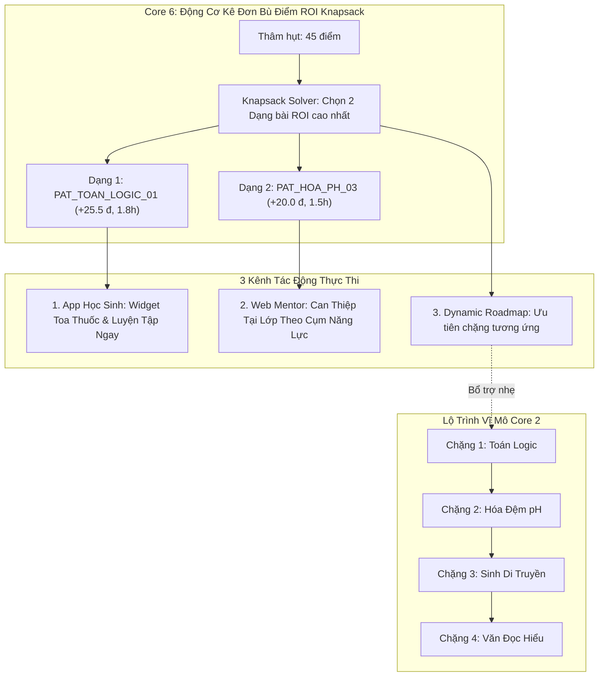
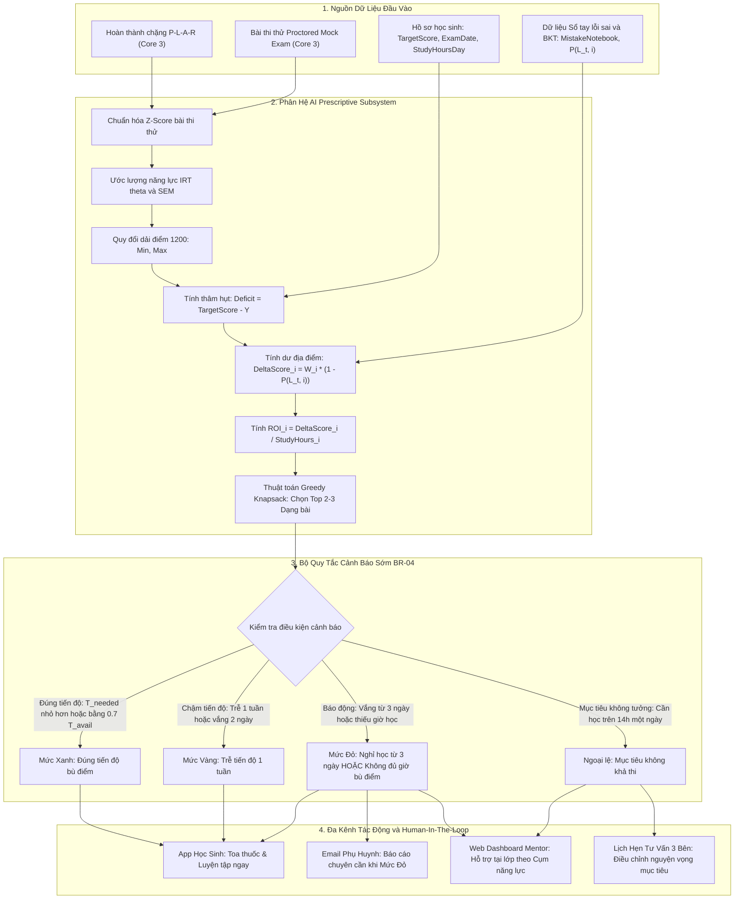
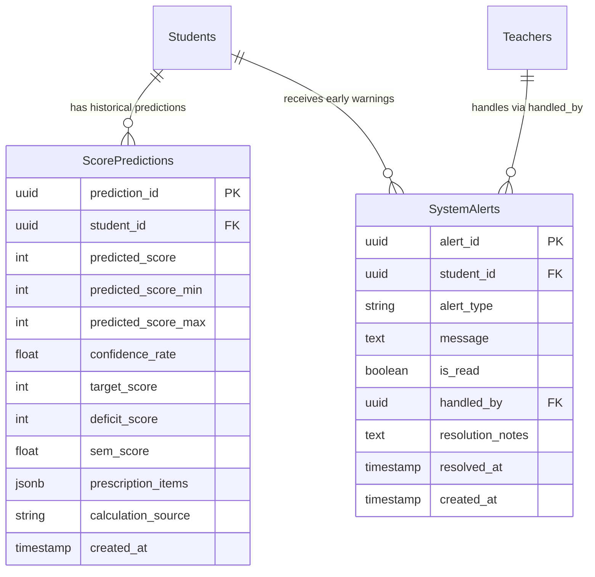

# BẢN KẾ HOẠCH KỸ THUẬT VÀ ĐẶC TẢ TRIỂN KHAI TOÀN DIỆN CORE FLOW 6: DỰ BÁO KHOẢNG ĐIỂM & CẢNH BÁO SỚM THEO LỖ HỔNG KIẾN THỨC

> **Tên tiếng Anh**: Performance Score Range Prediction, Deficit Balance Sheet & Early Warning Prescriptive Engine  
> **Tài liệu**: Bản kế hoạch kiến trúc & hướng dẫn triển khai mã nguồn chi tiết (Engineering Implementation Blueprint)  
> **Dự án**: Nền tảng Đánh giá & Học tập Thích ứng V-Eval (V-ACT ĐHQG-HCM)  
> **Ngày ban hành**: 16/10/2026 — Phiên bản 1.2 (Bổ sung bộ API Ôn tập hành động cho Học sinh & Tinh gọn Can thiệp Mentor theo Cụm năng lực)  
> **Tương thích Markdown**: Chuẩn hóa 100% cho MD Editor Plus (Backtick LaTeX, Relative Links, Mermaid 11.15.0+)

---

## 📌 1. BỐI CẢNH VÀ TƯ DUY THIẾT KẾ ĐỘT PHÁ (PARADIGM SHIFT)

### 1.1 Vấn Đề Cốt Lõi Của Các Hệ Thống Truyền Thống
* **Con số xác suất vô hồn**: Các nền tảng EdTech thông thường chỉ đưa ra một tỷ lệ phần trăm chung chung (ví dụ: *"Bạn có 58% cơ hội đỗ mục tiêu 850 điểm"*). Con số này gây hoang mang, tạo cảm giác bất an nhưng hoàn toàn bế tắc vì người học không biết mình cần làm gì tiếp theo.
* **Dự báo điểm đơn nhất (Point Estimate)**: Điểm số bài thi chuẩn hóa phụ thuộc vào sai số đo lường (Measurement Error). Việc khẳng định *"Bạn sẽ đạt đúng 740 điểm"* là thiếu cơ sở khoa học và dễ dẫn đến mất niềm tin khi kết quả thực tế dao động.
* **Cảnh báo muộn**: Đa số cảnh báo chỉ xuất hiện khi học sinh đã trượt một kỳ thi lớn, lúc này không còn đủ quỹ thời gian để cứu vãn.

### 1.2 Giải Pháp V-Eval: Bảng Cân Đối Thâm Hụt Điểm & Kê Đơn Hành Động (Prescriptive Action)
Core Flow 6 chuyển dịch hoàn toàn từ mô hình *Dự đoán thụ động (Predictive Analytics)* sang *Kê đơn hành động chủ động (Prescriptive Analytics)*:
1. **Dải điểm tin cậy khoa học [Lower, Upper]**: Kết hợp mô hình IRT 2PL, hàm thông tin Fisher `I(θ)` và sai số chuẩn đo lường `SEM(θ)` để công bố khoảng điểm kỳ vọng 95% trên thang 1200 điểm của ĐGNL ĐHQG-HCM:
   ```text
   [Y_min, Y_max] = [Y(θ) - 1.96 * SEM_1200,  Y(θ) + 1.96 * SEM_1200]
   ```
2. **Bảng cân đối thâm hụt điểm (Score Deficit Balance Sheet)**: Định lượng chính xác số điểm còn thiếu:
   ```text
   Δ_Deficit = max(0, TargetScore - CurrentScore)
   ```
3. **Kê đơn tối ưu hóa ROI (Knapsack Prescription)**: Quét toàn bộ dữ liệu BKT và Sổ tay lỗi sai từ Core 3, xác định các dạng bài (Patterns) có tỷ suất sinh lời điểm số trên mỗi giờ học (ROI) cao nhất để bù đắp vừa đủ số điểm thâm hụt.
4. **Hệ thống cảnh báo sớm 3 cấp (BR-04 Early Warning)**: Tự động đo tốc độ học (Velocity) đối chiếu với ngày thi, phát cảnh báo đa kênh (Push App, Email Phụ huynh, Flag Dashboard Mentor) với sự tham gia của con người (Human-in-the-loop).

---

## 🧭 2. CƠ CHẾ KẾT NỐI VỚI LỘ TRÌNH BAN ĐẦU (MACRO VS. MICRO PATH)

> [!IMPORTANT]
> **Giải đáp kiến trúc cốt lõi**: Kê đơn bù điểm Knapsack **KHÔNG LÀM XÁO TRỘN hay ĐẬP ĐI XÂY LẠI** lộ trình học ban đầu (Core 2 `LearningRoadmaps`). Thay vào đó, nó vận hành như một **"Toa thuốc vi mô bổ trợ" (Micro-Prescription Layer)** bám sát thực tế:



1. **Hiển thị độc lập tại Widget "Toa Thuốc Bù Điểm Tuần Này" trên App Học Sinh**:
   * Học sinh không bị ngợp trước toàn bộ lộ trình dài hàng chục chặng, mà chỉ cần tập trung hoàn thành 2–3 dạng bài mũi nhọn trong tuần đó để gỡ gạc số điểm thâm hụt. Có nút bấm nhận ngay câu hỏi biến thể để ôn tập tức thì.
2. **Tích hợp liền mạch vào Ca hỗ trợ của Mentor tại lớp trực tiếp**:
   * Kết nối trực tiếp với bối cảnh lớp học trực tiếp ở Core 2 & Core 3 và các Cụm năng lực sẵn có (`AbilityGroups`). Mentor mở Dashboard, thấy danh sách học sinh đang có cảnh báo hổng dạng bài này, trực tiếp gọi em đó lại hướng dẫn 5–10 phút ngay trong buổi học và bấm Xác nhận đã xử lý (`Resolve Alert`).
3. **Cập nhật thích ứng vào chặng học (Dynamic Remedial Injection)**:
   * Nếu chặng học chứa kỹ năng của dạng bài này đang diễn ra: Hệ thống tự động ưu tiên phân phối các câu hỏi thuộc dạng bài này trong pha *Apply (A)* của chu trình P-L-A-R.
   * Nếu kỹ năng này thuộc chặng học cũ đã qua: Hệ thống cắm 1 *Remedial Node* bổ trợ nhẹ vào đầu chặng kế tiếp mà không làm thay đổi cấu trúc cây tiên quyết DAG.

---

## 🗺️ 3. SƠ ĐỒ LUỒNG DỮ LIỆU & KIẾN TRÚC TỔNG THỂ



---

## 📐 4. HỆ THỐNG MÔ HÌNH TOÁN HỌC & CÔNG THỨC CHI TIẾT

### 4.1 Ước Lượng Dải Điểm Năng Lực Kỳ Vọng [Lower, Upper] (IRT 2PL + SEM)
* **Quy đổi chỉ số năng lực IRT sang thang 1200 ĐGNL ĐHQG-HCM**:
  Hàm tuyến tính chuẩn hóa từ không gian `θ ∈ [-3.0, +3.0]` sang thang điểm `[0, 1200]`:
  ```text
  Y(θ) = 600 + 150 * θ
  ```
  *(Tại `θ = 0.0`, điểm chuẩn hóa là 600; tại `θ = +3.0`, điểm đạt từ 1050 đến 1200 điểm)*.
* **Hàm thông tin bài thi (Fisher Test Information Function)**:
  ```text
  I(θ) = ∑ [ a_j² * P_j(θ) * (1 - P_j(θ)) ]   (với j = 1 đến 120 câu)
  ```
  với xác suất làm đúng câu hỏi `j` theo mô hình 2PL:
  ```text
  P_j(θ) = 1 / (1 + exp(-1.7 * a_j * (θ - b_j)))
  ```
* **Sai số chuẩn của phép đo (Standard Error of Measurement - SEM)**:
  ```text
  SEM(θ) = 1 / sqrt(I(θ))
  SEM_1200 = SEM(θ) * 150
  ```
* **Khoảng tin cậy 95% (95% Confidence Interval)**:
  ```text
  [Y_lower, Y_upper] = [Y(θ) - 1.96 * SEM_1200,  Y(θ) + 1.96 * SEM_1200]
  ```
  *Ý nghĩa sư phạm*: Tuyệt đối không đưa ra một con số cứng nhắc (ví dụ: đúng 750 điểm), mà công bố dải điểm kỳ vọng khoa học: `[715, 785]` điểm.

---

### 4.2 Bảng Cân Đối Thâm Hụt Điểm (Score Deficit Balance Sheet)
* **Số điểm thâm hụt ròng (Net Score Deficit)**:
  ```text
  Δ_Deficit = max(0, TargetScore - Y(θ))
  ```
* **Phân rã thâm hụt theo 3 phần cấu trúc đề thi ĐGNL (120 câu / 1200 điểm)**:
  1. Phần 1: Sử dụng ngôn ngữ (Tiếng Việt & Tiếng Anh - 40 câu / 400 điểm).
  2. Phần 2: Toán học, tư duy logic và phân tích số liệu (30 câu / 300 điểm).
  3. Phần 3: Giải quyết vấn đề (Khoa học tự nhiên & xã hội - 50 câu / 500 điểm).

---

### 4.3 Bài Toán Tối Ưu Kê Đơn Hành Động (Knapsack / Greedy ROI Optimization)

> [!NOTE]
> **Bản chất của thuật toán**: Hệ thống **KHÔNG PHẢI chỉ chăm chăm chọn dạng bài có điểm số cao nhất** (vì dạng quá khó sẽ khiến học sinh tốn hàng chục giờ mà vẫn không hiểu, phản tác dụng). 
> Ngược lại, thuật toán tìm kiếm **"Trái ngọt tầm thấp" (Low-hanging Fruit / Sweet Spot)**: Những dạng bài **dễ cải thiện nhất, tốn ít giờ học nhất nhưng gỡ lại được nhiều điểm nhất trong cấu trúc đề thi**.

#### Bước 1: Bộ lọc khả thi theo Vùng phát triển gần nhất (ZPD Feasibility Filter)
Trước khi tính toán, hệ thống tự động **LOẠI BỎ** ngay lập tức những dạng bài "quá sức" mà năng lực hiện tại của học sinh chưa thể tiếp thu:
* **Điều kiện lọc an toàn ZPD**:
  ```text
  Độ khó trung bình dạng bài:  b_i ≤ θ_current + 0.80
  ```
  *(Ví dụ: Học sinh đang ở mức trung bình `θ = 0.0` sẽ không bao giờ bị kê đơn dạng bài Vận dụng cao `b = +2.0`. Hệ thống chỉ cho phép các dạng bài trong ngưỡng tiếp thu vừa sức `b ≤ +0.80`)*.

#### Bước 2: Định lượng các thành phần tối ưu ROI

* **Dư địa điểm có thể nhặt lại từ Dạng bài `i` (Potential Score Gain)**:
  Dựa trên ma trận đề thi 120 câu, mỗi dạng bài chiếm trọng số điểm `W_i`:
  ```text
  ΔScore_i = W_i * (1 - P(L_t, i))
  ```
  Trong đó:
  * `W_i = Số câu thuộc dạng i * Điểm trung bình mỗi câu` (chiếm càng nhiều câu trong đề thì điểm gỡ gạc càng lớn).
  * `P(L_t, i)` là xác suất thành thạo hiện tại của dạng bài `i` (trích xuất từ BKT và cờ `IsMastered` của Sổ tay lỗi sai Core 3).

* **Số giờ học ước tính để thành thạo Dạng bài `i` (Estimated Study Hours)**:
  Thời gian học được tính toán cá nhân hóa theo độ khó và loại lỗi sai trong Sổ tay lỗi sai:
  ```text
  H_i = H_base * (1 - P(L_t, i)) * (1 + 0.3 * (b_i - θ_current)) * ErrorTypeDiscount
  ```
  Trong đó:
  * `H_base = 2.0` giờ (thời lượng cơ sở để hoàn thành 1 chu trình P-L-A-R kèm ôn tập ngắt quãng).
  * `(b_i - θ_current)`: Khoảng cách độ khó so với năng lực hiện tại. Dạng bài càng gần năng lực thì học càng nhanh.
  * `ErrorTypeDiscount` (Hệ số sửa lỗi nhanh từ Sổ tay lỗi sai):
    * Lỗi do tính ẩu (`CARELESS`) hoặc đọc sót đề (`MISREAD_QUESTION`): `Discount = 0.6` (chỉ cần nhắc nhở và luyện 2-3 câu biến thể là ăn trọn điểm, tốn cực ít thời gian).
    * Lỗi do hổng lý thuyết cơ bản (`MISSING_CONCEPT`): `Discount = 1.0` (cần xem lại video và làm bài luyện tập đầy đủ).

* **Chỉ số Tỷ suất sinh lời điểm số (Return on Investment - ROI)**:
  ```text
  ROI_i = ΔScore_i / H_i   (số điểm nhặt lại được trên MỖI GIỜ HỌC)
  ```
  *Ý nghĩa*: Một dạng bài có ROI cao nhất chính là **dạng bài dễ tăng điểm nhất với thời gian ngắn nhất**!

#### Bước 3: Thuật toán Kê đơn tối ưu (Top 2–3 Knapsack Selector)
1. Lọc các dạng bài học sinh còn yếu (`P(L_t, i) < 0.70`) và thỏa mãn bộ lọc ZPD (`b_i ≤ θ + 0.8`).
2. Sắp xếp danh sách dạng bài giảm dần theo chỉ số `ROI_i`.
3. Áp dụng giải thuật Tham lam (Greedy) có ràng buộc để chọn ra **2 đến 3 dạng bài** có tổng `∑ ΔScore_i ≈ Δ_Deficit` (hoặc tối đa hóa điểm số đạt được trong quỹ thời gian học khả dụng).

---

#### 📊 Ví dụ minh họa so sánh 3 trường hợp:
| Dạng bài | Trọng số trong đề | Độ khó `b` | Thời gian cần học | Dư địa nhặt lại | ROI (Điểm / Giờ) | Hệ thống có chọn không? |
| :--- | :---: | :---: | :---: | :---: | :---: | :--- |
| **Dạng A (Vận dụng cao tổ hợp)** | 30 điểm | `+2.2` (Quá khó) | 8.0 giờ | 25 điểm | `3.1` đ/h | ❌ **LOẠI**: Quá khó, vi phạm ZPD, tốn 8h mà dễ nản |
| **Dạng B (Nhận biết định nghĩa)** | 5 điểm | `-1.5` (Quá dễ) | 0.5 giờ | 3 điểm | `6.0` đ/h | ⚠️ **Thấp**: Rất dễ nhưng điểm quá ít, không bù đủ thâm hụt |
| **Dạng C (Logic mệnh đề - ẩu)** | 35 điểm | `+0.2` (Vừa sức) | 1.8 giờ | 26 điểm | **`14.4` đ/h** | ✅ **ƯU TIÊN SỐ 1**: Dễ cải thiện, điểm lớn, học nhanh cán đích |

---

### 4.4 Quy Tắc Cảnh Báo Sớm BR-04 (Rule Engine Parameters)
* **Các biến số vận hành**:
  * `D_remain = ExamDate - CurrentDate` (Số ngày còn lại đến kỳ thi).
  * `T_avail = D_remain * StudyHoursPerDay` (Tổng số giờ học khả dụng).
  * `T_needed = ∑ H_k` (Tổng số giờ cần thiết để hoàn thành toa thuốc bù điểm).
  * `Inactive_Days`: Số ngày liên tiếp học sinh không tham gia bất kỳ hoạt động học tập nào (P-L-A-R hoặc làm bài tập).
* **Bảng trạng thái cảnh báo**:
  | Mức Độ | Trạng Thái | Điều Kiện Kích Hoạt | Kênh Tác Động |
  | :--- | :---: | :--- | :--- |
  | 🟢 **Mức Xanh** | `ON_TRACK` | `T_needed ≤ 0.7 * T_avail` **VÀ** `Inactive_Days < 2` | App Học sinh: Hiển thị toa thuốc bình thường |
  | 🟡 **Mức Vàng** | `WARNING` | `0.7 * T_avail < T_needed ≤ T_avail` **HOẶC** `Inactive_Days = 2` | App Học sinh: Cảnh báo nhắc nhở chặng bài |
  | 🔴 **Mức Đỏ** | `CRITICAL_ALERT`| `Inactive_Days ≥ 3` **HOẶC** `T_needed > T_avail` | App Học sinh + Email Phụ huynh + Flag Dashboard Mentor |

---

## 🛠️ 5. XỬ LÝ 3 KỊCH BẢN NGOẠI LỆ (UNHAPPY CASES)

### 5.1 Ngoại Lệ 1: Điểm Thi Thử Sụt Giảm Do Đề Thi Chung Quá Khó
* **Nguyên nhân**: Đề thi thử đợt đó có phổ điểm lệch phải nghiêm trọng, nhiều câu hỏi quá khó làm toàn bộ thí sinh sụt giảm điểm thô.
* **Giải pháp xử lý**:
  Trước khi đưa vào tính toán thâm hụt điểm, hệ thống tự động chuẩn hóa điểm thô của học sinh dựa trên phổ điểm của toàn bộ học sinh cùng tham gia đợt thi:
  ```text
  Z = (X - μ_cohort) / σ_cohort
  ```
  Năng lực `θ` được cập nhật theo điểm chuẩn hóa `Z` thay vì điểm thô `X`. Điều này triệt tiêu hoàn toàn sai số do đề thi khó bất thường, ngăn chặn việc phát cảnh báo sai lệch làm học sinh hoang mang.

### 5.2 Ngoại Lệ 2: Mục Tiêu Quá Xa Vời Thực Tế (Unrealistic Goal)
* **Tình huống**: Học sinh có năng lực hiện tại 500 điểm nhưng đặt mục tiêu 1050 điểm trong khi chỉ còn 3 tuần nữa là đến ngày thi chính thức.
* **Giải pháp xử lý**:
  1. Hệ thống tính toán cường độ học yêu cầu:
     ```text
     RequiredDailyHours = T_needed / D_remain
     ```
  2. Nếu `RequiredDailyHours > 14.0` giờ/ngày:
     * Hệ thống **KHÔNG phát cảnh báo thúc ép** học sinh (tránh áp lực tâm lý tiêu cực).
     * Bật cờ trạng thái `alert_type = 'UNREALISTIC_GOAL'` trong bảng `SystemAlerts`.
     * Tự động gửi thông báo ưu tiên tới **Mentor**: *"Học sinh có mục tiêu vượt ngưỡng khả thi, cần phiên tư vấn định hướng lại nguyện vọng"*.
     * Mentor kích hoạt buổi họp 3 bên (Học sinh - Phụ huynh - Mentor) để hạ mục tiêu về khoảng an toàn (ví dụ: điều chỉnh về 750 điểm phù hợp với ngành/trường khả thi).

### 5.3 Ngoại Lệ 3: Phụ Huynh Chặn Thông Báo / Tắt Quyền Push Notification
* **Tình huống**: Thiết bị của phụ huynh từ chối quyền Push Notification hoặc token FCM hết hạn.
* **Giải pháp xử lý**:
  1. Khi kích hoạt Mức Đỏ (`CRITICAL_ALERT`), hệ thống ưu tiên đẩy Push Notification qua Firebase Cloud Messaging.
  2. Nếu Firebase trả về lỗi (`NotRegistered`, `InvalidRegistration`) hoặc sau **24 giờ** không có sự kiện mở thông báo (`PushOpenedEvent = false`):
     * Worker tự động fallback sang kênh **Email Báo Cáo Chuyên Cần**.
     * Template Email được thiết kế trang trọng, chứa biểu đồ thâm hụt điểm, bảng theo dõi chuyên cần và lời kêu gọi đồng hành cùng học sinh.

---

## 💾 6. THIẾT KẾ CƠ SỞ DỮ LIỆU TINH GỌN (LEAN SCHEMA IN SQL.SQL)

> [!TIP]
> **Phương án kiến trúc tối ưu**: Tận dụng 100% hai bảng `ScorePredictions` và `SystemAlerts` đã có sẵn trong file chuẩn [SQL.sql (dòng 313-345)](./SQL/SQL.sql#L313-L345). Không cần tạo thêm các bảng quan hệ con phức tạp, sử dụng cột `jsonb` cho Toa thuốc giúp truy vấn 1 lần là lấy được toàn bộ dữ liệu.

### 6.1 Mở Rộng Bảng `ScorePredictions` (PostgreSQL)
```sql
ALTER TABLE "ScorePredictions" 
  ADD COLUMN IF NOT EXISTS "target_score" int,
  ADD COLUMN IF NOT EXISTS "deficit_score" int,
  ADD COLUMN IF NOT EXISTS "sem_score" double precision,
  ADD COLUMN IF NOT EXISTS "prescription_items" jsonb,
  ADD COLUMN IF NOT EXISTS "calculation_source" varchar DEFAULT 'MOCK_EXAM';
```

#### Cấu Trúc Payload `prescription_items` (JSONB):
```json
[
  {
    "pattern_id": "PAT_TOAN_LOGIC_01",
    "pattern_name": "Quy nạp logic mệnh đề điều kiện",
    "skill_id": "b3e1a8a2-...",
    "delta_score": 25.5,
    "study_hours_needed": 1.8,
    "roi_score": 14.16,
    "priority_rank": 1,
    "is_remedied": false
  },
  {
    "pattern_id": "PAT_HOA_PH_03",
    "pattern_name": "Tính pH dung dịch đệm axit yếu",
    "skill_id": "c4f2b9b3-...",
    "delta_score": 20.0,
    "study_hours_needed": 1.5,
    "roi_score": 13.33,
    "priority_rank": 2,
    "is_remedied": false
  }
]
```

### 6.2 Sử Dụng Bảng `SystemAlerts` Cho Cảnh Báo BR-04
Bảng `SystemAlerts` sẵn có trong `SQL.sql` đã đầy đủ các trường thiết yếu:
* `alert_id` (uuid PRIMARY KEY)
* `student_id` (uuid FK)
* `alert_type` (varchar): `'GREEN'`, `'YELLOW'`, `'RED'`, `'UNREALISTIC_GOAL'`
* `message` (text): Nội dung chi tiết lý do kích hoạt cảnh báo
* `is_read` (boolean): Trạng thái học sinh đã xem (dùng để tắt badge thông báo trên App)
* `handled_by` (uuid FK): Mentor trực tiếp hỗ trợ học sinh
* `resolution_notes` (text): Ghi chú của Mentor (ví dụ: *"Đã hướng dẫn phương pháp giải dạng bài Logic mệnh đề trong giờ học trực tiếp"*)
* `resolved_at` (timestamp): Thời điểm xử lý xong
* `created_at` (timestamp)



---

## 💻 7. BẢN ĐỒ API & THIẾT KẾ CLEAN ARCHITECTURE

### 7.1 Danh Sách Endpoints RESTful & Đặc Tả Input / Output (Practice Service - Port 5261)

| HTTP Method | Đường Dẫn Endpoint | Vai Trò | Mục Đích Nghiệp Vụ |
| :--- | :--- | :--- | :--- |
| `GET` | `/api/practice/predictions/my-forecast` | Học sinh | Xem dải điểm kỳ vọng [Min, Max], số điểm thâm hụt và Toa thuốc bù điểm (Top 2–3 dạng bài có ROI cao nhất). |
| `GET` | `/api/practice/predictions/prescriptions/{patternId}/practice-session` | Học sinh | Bắt đầu ôn tập: Lấy gói 3–5 câu hỏi biến thể từ Ngân hàng đề để làm bài luyện tập ngay cho dạng bài trong toa thuốc. |
| `POST` | `/api/practice/predictions/prescriptions/{patternId}/submit-session` | Học sinh | Nộp bài ôn tập: Chấm điểm, tăng độ thành thạo `P(L_t)`, trừ bớt điểm thâm hụt và cập nhật tiến độ toa thuốc. |
| `POST` | `/api/practice/predictions/recalculate` | Học sinh / Hệ thống | Kích hoạt tái tính toán lại dải điểm và cập nhật toa thuốc sau khi hoàn thành bài thi thử hoặc chuỗi bài tập. |
| `GET` | `/api/practice/early-warnings/my-alerts` | Học sinh | Xem danh sách các cảnh báo cá nhân (Mức Vàng trễ hạn, Mức Đỏ nguy cơ, hoặc nhắc nhở từ giáo viên). |
| `PATCH` | `/api/practice/early-warnings/{alertId}/read` | Học sinh | Đánh dấu đã đọc cảnh báo để tắt badge chuông thông báo trên App. |
| `GET` | `/api/practice/early-warnings/dashboard` | Giáo viên / Mentor | Dashboard cảnh báo học sinh trong lớp phụ trách (lọc Đỏ/Vàng/Mục tiêu không tưởng, xem dạng bài học sinh đang hổng). |
| `POST` | `/api/practice/early-warnings/{alertId}/resolve` | Giáo viên / Mentor | Xác nhận đã can thiệp/hướng dẫn học sinh tại lớp theo cụm năng lực có sẵn kèm ghi chú giải quyết (`resolution_notes`). |
| `POST` | `/api/practice/early-warnings/{alertId}/schedule-counseling` | Giáo viên / Mentor | Hẹn lịch tư vấn 3 bên định hướng lại mục tiêu khả thi cho trường hợp mục tiêu không tưởng (`UNREALISTIC_GOAL`). |

---

#### 1. `GET /api/practice/predictions/my-forecast`
* **Mô tả**: Dành cho Học sinh truy cập trang chủ hoặc widget "Dự Báo & Toa Thuốc Bù Điểm". Hệ thống tự động bóc tách `student_id` từ JWT Claims để truy vấn bản ghi dự báo mới nhất.
* **Headers**: `Authorization: Bearer <JWT_Token>`
* **Input (Query Parameters)**:
  * `include_history` *(boolean, optional, default: false)*: Nếu `true`, trả về thêm lịch sử 5 lần dự báo điểm trước đó để vẽ biểu đồ tiến độ.
* **Output (200 OK)**:
  ```json
  {
    "success": true,
    "message": "Truy vấn bảng cân đối thâm hụt và toa thuốc bù điểm thành công",
    "data": {
      "prediction_id": "7f8b3c4a-6d2e-4b8a-9f1c-3e5a7b9c1d2e",
      "student_id": "3fa85f64-5717-4562-b3fc-2c963f66afa6",
      "current_ability_theta": 0.85,
      "predicted_score": 728,
      "score_range": {
        "lower_bound": 695,
        "upper_bound": 761
      },
      "sem_score": 16.8,
      "confidence_rate": 0.95,
      "target_score": 800,
      "deficit_score": 72,
      "status": "WARNING",
      "calculation_source": "MOCK_EXAM",
      "last_calculated_at": "2026-10-14T08:30:00Z",
      "score_breakdown": [
        {
          "part_name": "Phần 1: Sử dụng ngôn ngữ",
          "max_score": 400,
          "estimated_score": 265,
          "deficit": 20
        },
        {
          "part_name": "Phần 2: Toán học, logic và phân tích số liệu",
          "max_score": 300,
          "estimated_score": 195,
          "deficit": 35
        },
        {
          "part_name": "Phần 3: Giải quyết vấn đề (KHTN & KHXH)",
          "max_score": 500,
          "estimated_score": 268,
          "deficit": 17
        }
      ],
      "prescription": {
        "total_deficit": 72,
        "total_study_hours_needed": 3.3,
        "expected_recovered_score": 45.5,
        "items": [
          {
            "priority_rank": 1,
            "pattern_id": "PAT_TOAN_LOGIC_01",
            "pattern_name": "Quy nạp logic mệnh đề điều kiện",
            "skill_id": "b3e1a8a2-8f24-42b7-a37f-5374828b6d1a",
            "skill_name": "Tư duy logic suy luận",
            "current_mastery_plt": 0.42,
            "delta_score": 25.5,
            "study_hours_needed": 1.8,
            "roi_score": 14.16,
            "is_remedied": false
          },
          {
            "priority_rank": 2,
            "pattern_id": "PAT_HOA_PH_03",
            "pattern_name": "Tính pH dung dịch đệm axit yếu",
            "skill_id": "c4f2b9b3-9a35-43c8-b48g-6485939c7e2b",
            "skill_name": "Hóa học phân tích cơ bản",
            "current_mastery_plt": 0.50,
            "delta_score": 20.0,
            "study_hours_needed": 1.5,
            "roi_score": 13.33,
            "is_remedied": false
          }
        ]
      }
    }
  }
  ```

---

#### 2. `GET /api/practice/predictions/prescriptions/{patternId}/practice-session`
* **Mô tả**: Học sinh bấm vào dạng bài trong Toa thuốc để ôn tập ngay. Hệ thống trích xuất thông tin kỹ năng, gọi sang Content Service để bốc 3–5 câu hỏi biến thể (Isomorphic Variants) phù hợp với độ khó ZPD của học sinh.
* **Headers**: `Authorization: Bearer <JWT_Token>`
* **Path Parameter**: `patternId` *(string, required)*: Mã dạng bài trong toa thuốc (ví dụ: `PAT_TOAN_LOGIC_01`).
* **Output (200 OK)**:
  ```json
  {
    "success": true,
    "message": "Khởi tạo bài luyện tập vi mô cho dạng bài thành công",
    "data": {
      "session_id": "a1b2c3d4-e5f6-7a8b-9c0d-1e2f3a4b5c6d",
      "pattern_id": "PAT_TOAN_LOGIC_01",
      "pattern_name": "Quy nạp logic mệnh đề điều kiện",
      "skill_id": "b3e1a8a2-8f24-42b7-a37f-5374828b6d1a",
      "target_questions_count": 3,
      "expected_delta_score": 25.5,
      "questions": [
        {
          "question_id": "8f1a2b3c-4d5e-6f7a-8b9c-0d1e2f3a4b5c",
          "content": "Cho mệnh đề: 'Nếu trời mưa thì đường trơn'. Mệnh đề nào sau đây là phản đảo tương đương logic?",
          "options": [
            { "key": "A", "content": "Nếu đường trơn thì trời mưa" },
            { "key": "B", "content": "Nếu đường không trơn thì trời không mưa" },
            { "key": "C", "content": "Trời không mưa hoặc đường trơn" },
            { "key": "D", "content": "Đường không trơn và trời mưa" }
          ],
          "difficulty_level": 0.2
        }
      ]
    }
  }
  ```

---

#### 3. `POST /api/practice/predictions/prescriptions/{patternId}/submit-session`
* **Mô tả**: Học sinh nộp bài sau khi hoàn thành gói câu hỏi ôn tập vi mô. Hệ thống chấm điểm, cập nhật xác suất thành thạo BKT `P(L_t)`, trừ bớt điểm thâm hụt và cập nhật cờ `is_remedied = true` trong toa thuốc nếu đạt ngưỡng thành thạo.
* **Headers**: `Authorization: Bearer <JWT_Token>`
* **Path Parameter**: `patternId` *(string, required)*: Mã dạng bài vừa ôn tập.
* **Input (Request Body)**:
  ```json
  {
    "session_id": "a1b2c3d4-e5f6-7a8b-9c0d-1e2f3a4b5c6d",
    "answers": [
      {
        "question_id": "8f1a2b3c-4d5e-6f7a-8b9c-0d1e2f3a4b5c",
        "selected_option": "B",
        "time_spent_seconds": 45
      }
    ]
  }
  ```
* **Output (200 OK)**:
  ```json
  {
    "success": true,
    "message": "Nộp bài ôn tập thành công, đã cập nhật năng lực dạng bài",
    "data": {
      "pattern_id": "PAT_TOAN_LOGIC_01",
      "total_questions": 3,
      "correct_count": 3,
      "accuracy": 1.0,
      "previous_mastery_plt": 0.42,
      "new_mastery_plt": 0.88,
      "is_mastered": true,
      "points_recovered": 25.5,
      "remaining_deficit": 46.5
    }
  }
  ```

---

#### 4. `POST /api/practice/predictions/recalculate`
* **Mô tả**: Kích hoạt việc chạy lại toàn bộ quy trình: ước lượng năng lực `θ`, tính dải điểm `[Min, Max]`, thâm hụt và giải bài toán Knapsack chọn 2–3 dạng bài bù điểm. Được gọi tự động sau khi hoàn thành bài thi thử, hoàn thành chặng học P-L-A-R hoặc do học sinh chủ động bấm tính lại.
* **Headers**: `Authorization: Bearer <JWT_Token>`
* **Input (Request Body)**:
  ```json
  {
    "student_id": "3fa85f64-5717-4562-b3fc-2c963f66afa6",
    "trigger_source": "MOCK_EXAM",
    "reference_submission_id": "e5b8d234-93c4-4251-9311-82741938fa45"
  }
  ```
  *(Nếu học sinh tự gọi, `student_id` có thể để trống; hệ thống tự trích xuất từ JWT token)*.
* **Output (200 OK / 201 Created)**:
  ```json
  {
    "success": true,
    "message": "Đã tính toán lại dải điểm và cập nhật toa thuốc bù điểm thành công",
    "data": {
      "prediction_id": "8a9c4d5b-7e3f-5c9b-0a2d-4f6b8c0d2e3f",
      "predicted_score": 735,
      "score_range": {
        "lower_bound": 702,
        "upper_bound": 768
      },
      "deficit_score": 65,
      "status": "ON_TRACK",
      "prescription_items_count": 2,
      "created_at": "2026-10-14T10:15:20Z"
    }
  }
  ```

---

#### 5. `GET /api/practice/early-warnings/my-alerts`
* **Mô tả**: Dành cho Học sinh truy cập trung tâm thông báo hoặc trang chủ để xem các cảnh báo cá nhân từ hệ thống BR-04 (Mức Vàng trễ hạn, Mức Đỏ nguy cơ, hoặc ghi chú hướng dẫn từ giáo viên).
* **Headers**: `Authorization: Bearer <JWT_Token>`
* **Input (Query Parameters)**:
  * `is_read` *(boolean, optional)*: Lọc theo trạng thái đã đọc hay chưa.
  * `limit` *(int, optional, default: 10)*: Số lượng thông báo lấy về.
* **Output (200 OK)**:
  ```json
  {
    "success": true,
    "data": {
      "unread_count": 1,
      "alerts": [
        {
          "alert_id": "4b6c8d1e-2f3a-4b5c-6d7e-8f9a0b1c2d3e",
          "alert_type": "RED",
          "message": "Bạn đã không hoạt động 3 ngày liên tiếp và tốc độ bù điểm đang chậm hơn 1 tuần so với kế hoạch thi.",
          "advice": "Hãy hoàn thành 2 dạng bài trong Toa thuốc tuần này để duy trì phong độ và gỡ lại 45 điểm thâm hụt.",
          "is_read": false,
          "created_at": "2026-10-14T02:00:00Z",
          "handled_by_mentor": "Thầy Trần Hoàng Nam",
          "resolution_notes": "Thầy đã nhắc nhở em trong buổi học sáng nay, hãy làm gói câu hỏi logic nhé!"
        }
      ]
    }
  }
  ```

---

#### 6. `PATCH /api/practice/early-warnings/{alertId}/read`
* **Mô tả**: Học sinh bấm vào thông báo cảnh báo, hệ thống đánh dấu `is_read = true` để tắt badge đỏ trên biểu tượng chuông thông báo.
* **Headers**: `Authorization: Bearer <JWT_Token>`
* **Path Parameter**: `alertId` *(uuid, required)*: Mã cảnh báo cần đánh dấu.
* **Output (200 OK)**:
  ```json
  {
    "success": true,
    "message": "Đã đánh dấu thông báo là đã đọc",
    "data": {
      "alert_id": "4b6c8d1e-2f3a-4b5c-6d7e-8f9a0b1c2d3e",
      "is_read": true
    }
  }
  ```

---

#### 7. `GET /api/practice/early-warnings/dashboard`
* **Mô tả**: Dành cho Giáo viên / Mentor quản lý lớp học. Lọc ra danh sách các học sinh đang rơi vào Mức Đỏ (`CRITICAL_ALERT`), Mức Vàng (`WARNING`) hoặc Mục tiêu không tưởng (`UNREALISTIC_GOAL`), kèm dạng bài học sinh đang hổng để giáo viên can thiệp trực tiếp tại lớp theo cụm năng lực sẵn có (`AbilityGroups`).
* **Headers**: `Authorization: Bearer <JWT_Token>` (Role: `Teacher`, `Mentor`, `AcademicManager`)
* **Input (Query Parameters)**:
  * `class_id` *(uuid, optional)*: Lọc theo lớp học phụ trách.
  * `severity` *(string, optional, enum: `ALL`, `RED`, `YELLOW`, `UNREALISTIC_GOAL`, default: `ALL`)*.
  * `page` *(int, optional, default: 1)*.
  * `page_size` *(int, optional, default: 20)*.
  * `search` *(string, optional)*: Tìm kiếm theo tên hoặc mã học sinh.
* **Output (200 OK)**:
  ```json
  {
    "success": true,
    "data": {
      "summary": {
        "total_active_alerts": 12,
        "critical_red_count": 4,
        "warning_yellow_count": 6,
        "unrealistic_goal_count": 2
      },
      "pagination": {
        "current_page": 1,
        "page_size": 20,
        "total_items": 12,
        "total_pages": 1
      },
      "items": [
        {
          "alert_id": "4b6c8d1e-2f3a-4b5c-6d7e-8f9a0b1c2d3e",
          "student_id": "3fa85f64-5717-4562-b3fc-2c963f66afa6",
          "student_name": "Nguyễn Văn An",
          "student_email": "an.nguyen@example.com",
          "class_name": "Lớp ĐGNL Cấp Tốc - Thủ Đức 02",
          "avatar_url": "https://cdn.v-eval.edu.vn/avatars/an.jpg",
          "severity": "RED",
          "inactive_days": 3,
          "target_score": 800,
          "predicted_score": 728,
          "deficit_score": 72,
          "days_remaining_to_exam": 25,
          "required_daily_hours": 3.8,
          "trigger_reason": "Nghỉ học 3 ngày liên tiếp và tốc độ bù điểm chậm hơn 1 tuần so với kế hoạch",
          "is_handled": false,
          "handled_by_mentor_name": null,
          "suggested_patterns": [
            {
              "pattern_id": "PAT_TOAN_LOGIC_01",
              "pattern_name": "Quy nạp logic mệnh đề điều kiện",
              "delta_score": 25.5,
              "study_hours_needed": 1.8
            },
            {
              "pattern_id": "PAT_HOA_PH_03",
              "pattern_name": "Tính pH dung dịch đệm axit yếu",
              "delta_score": 20.0,
              "study_hours_needed": 1.5
            }
          ]
        }
      ]
    }
  }
  ```

---

#### 8. `POST /api/practice/early-warnings/{alertId}/resolve`
* **Mô tả**: Giáo viên / Mentor xác nhận đã hỗ trợ/kèm học sinh xong trong giờ học trực tiếp tại lớp theo cụm năng lực có sẵn. Hệ thống cập nhật thẳng vào bảng `SystemAlerts` (`handled_by = current_user_id`, `resolution_notes`, `resolved_at = now()`) mà không phát sinh thêm bảng thừa.
* **Headers**: `Authorization: Bearer <JWT_Token>` (Role: `Teacher`, `Mentor`)
* **Path Parameter**: `alertId` *(uuid, required)*: Mã cảnh báo cần xử lý.
* **Input (Request Body)**:
  ```json
  {
    "resolution_notes": "Đã gọi em lại hướng dẫn trực tiếp bài toán quy nạp logic mệnh đề trong 10 phút cuối giờ học. Em đã hiểu bản chất và làm đúng câu ví dụ."
  }
  ```
* **Output (200 OK)**:
  ```json
  {
    "success": true,
    "message": "Đã ghi nhận hỗ trợ học sinh và giải quyết cảnh báo thành công",
    "data": {
      "alert_id": "4b6c8d1e-2f3a-4b5c-6d7e-8f9a0b1c2d3e",
      "student_id": "3fa85f64-5717-4562-b3fc-2c963f66afa6",
      "is_resolved": true,
      "handled_by": "Thầy Trần Hoàng Nam",
      "resolution_notes": "Đã gọi em lại hướng dẫn trực tiếp bài toán quy nạp logic mệnh đề trong 10 phút cuối giờ học. Em đã hiểu bản chất và làm đúng câu ví dụ.",
      "resolved_at": "2026-10-14T11:00:00Z"
    }
  }
  ```

---

#### 9. `POST /api/practice/early-warnings/{alertId}/schedule-counseling`
* **Mô tả**: Dành riêng cho trường hợp ngoại lệ **Mục tiêu không tưởng (`UNREALISTIC_GOAL`)** khi học sinh đặt điểm quá cao trong thời gian quá gấp (ví dụ: cần học > 14 tiếng/ngày). Mentor tạo lịch hẹn tư vấn 3 bên (Học sinh - Phụ huynh - Mentor) để định hướng lại nguyện vọng trường/ngành khả thi.
* **Headers**: `Authorization: Bearer <JWT_Token>` (Role: `Teacher`, `Mentor`, `AcademicManager`)
* **Path Parameter**: `alertId` *(uuid, required)*: Mã cảnh báo.
* **Input (Request Body)**:
  ```json
  {
    "scheduled_at": "2026-10-16T14:30:00Z",
    "meeting_type": "ONLINE_MEETING",
    "meeting_url": "https://meet.google.com/xyz-veval-counsel",
    "suggested_new_target_score": 750,
    "mentor_advice": "Hiện tại năng lực em ở mức 520, chỉ còn 3 tuần thi. Mục tiêu 1050 điểm đòi hỏi học 16h/ngày là không an toàn. Đề xuất điều chỉnh mục tiêu 750 điểm phù hợp nguyện vọng khối ngành Kinh tế/Kỹ thuật khả thi."
  }
  ```
* **Output (200 OK)**:
  ```json
  {
    "success": true,
    "message": "Đã tạo lịch hẹn tư vấn 3 bên và gửi email mời tham dự thành công",
    "data": {
      "alert_id": "4b6c8d1e-2f3a-4b5c-6d7e-8f9a0b1c2d3e",
      "student_id": "3fa85f64-5717-4562-b3fc-2c963f66afa6",
      "counseling_time": "2026-10-16T14:30:00Z",
      "meeting_url": "https://meet.google.com/xyz-veval-counsel",
      "status": "COUNSELING_SCHEDULED"
    }
  }
  ```

---

### 7.2 Chi Tiết Các Lớp Trong Clean Architecture (.NET 9)

```
V-Eval-Practice_Service/
├── V-Eval-Practice_Service.Domain/
│   └── Entities/
│       ├── ScorePrediction.cs (Mở rộng TargetScore, DeficitScore, SemScore, PrescriptionItemsJson)
│       └── SystemAlert.cs (Entity ánh xạ bảng SystemAlerts)
├── V-Eval-Practice_Service.Application/
│   ├── Common/
│   │   ├── Models/
│   │   │   └── PrescriptionItemDto.cs (POCO serialize vào JSONB)
│   │   └── Interfaces/
│   │       ├── IPrescriptiveEngine.cs (Knapsack ROI Solver)
│   │       ├── IEarlyWarningRuleEngine.cs (BR-04 Logic)
│   │       └── INotificationDispatcher.cs (Push Notification & Email)
│   └── Features/
│       ├── Predictions/
│       │   ├── Commands/
│       │   │   ├── RecalculateForecast/
│       │   │   │   ├── RecalculateForecastCommand.cs
│       │   │   │   ├── RecalculateForecastCommandHandler.cs
│       │   │   │   └── RecalculateForecastCommandValidator.cs
│       │   │   └── SubmitPrescriptionSession/
│       │   │       ├── SubmitPrescriptionSessionCommand.cs
│       │   │       ├── SubmitPrescriptionSessionCommandHandler.cs
│       │   │       └── SubmitPrescriptionSessionCommandValidator.cs
│       │   └── Queries/
│       │       ├── GetStudentForecast/
│       │       │   ├── GetStudentForecastQuery.cs
│       │       │   ├── GetStudentForecastQueryHandler.cs
│       │       │   └── ForecastResponseDto.cs
│       │       └── GetPrescriptionPracticeSession/
│       │           ├── GetPrescriptionPracticeSessionQuery.cs
│       │           ├── GetPrescriptionPracticeSessionQueryHandler.cs
│       │           └── PrescriptionPracticeSessionResponseDto.cs
│       └── EarlyWarnings/
│           ├── Commands/
│           │   ├── MarkAlertAsRead/
│           │   │   ├── MarkAlertAsReadCommand.cs
│           │   │   └── MarkAlertAsReadCommandHandler.cs
│           │   ├── ResolveAlert/
│           │   │   ├── ResolveAlertCommand.cs
│           │   │   └── ResolveAlertCommandHandler.cs
│           │   └── ScheduleCounseling/
│           │       ├── ScheduleCounselingCommand.cs
│           │       └── ScheduleCounselingCommandHandler.cs
│           └── Queries/
│               ├── GetStudentAlerts/
│               │   ├── GetStudentAlertsQuery.cs
│               │   ├── GetStudentAlertsQueryHandler.cs
│               │   └── StudentAlertsResponseDto.cs
│               └── GetMentorAlertDashboard/
│                   ├── GetMentorAlertDashboardQuery.cs
│                   ├── GetMentorAlertDashboardQueryHandler.cs
│                   └── MentorAlertDashboardResponseDto.cs
├── V-Eval-Practice_Service.Infrastructure/
│   ├── Services/
│   │   ├── PrescriptiveEngine.cs (Greedy Knapsack ROI Algorithm)
│   │   ├── EarlyWarningRuleEngine.cs (BR-04 State Evaluator)
│   │   └── NotificationDispatcher.cs (FCM & SendGrid/SMTP Dispatcher)
│   └── BackgroundJobs/
│       └── EarlyWarningDailyScanWorker.cs (BackgroundService / Quartz chạy lúc 02:00 AM)
└── V-Eval-Practice_Service.API/
    └── Controllers/
        ├── PredictionsController.cs (my-forecast, practice-session, submit-session, recalculate)
        └── EarlyWarningsController.cs (my-alerts, read, dashboard, resolve, schedule-counseling)
```

---

## 🚀 8. KẾ HOẠCH TRIỂN KHAI THEO TỪNG GIAI ĐOẠN (EXECUTION PHASES)

### Phase 1: Mở Rộng Schema & Cập Nhật Entity (Ngày 1–2)
* Thêm các thuộc tính mới vào `ScorePrediction.cs` và cấu hình ánh xạ EF Core `ScorePredictionConfiguration` hỗ trợ cột `jsonb`.
* Bổ sung entity `SystemAlert.cs` trong `Domain.Entities` khớp với cấu trúc bảng `SystemAlerts` trong `SQL.sql`.
* Tạo migration EF Core và cập nhật database PostgreSQL.

### Phase 2: Triển Khai Động Cơ Dự Báo & Kê Đơn Tối Ưu ROI (Ngày 3–4)
* Xây dựng module Psychometrics: chuyển đổi IRT `θ` sang thang 1200, tính `SEM` và khoảng tin cậy 95%.
* Viết thuật toán `PrescriptiveEngine`:
  * Quét ma trận 120 câu và các lỗ hổng tri thức từ `MistakeNotebook` & `LearningProfiles`.
  * Tính `` `\Delta\text{Score}_i` ``, `` `H_i` ``, `` `\text{ROI}_i` ``.
  * Giải bài toán chọn lọc 2–3 dạng bài tối ưu theo Greedy Knapsack.
* Đảm bảo tính toán hoàn tất trong **dưới 100ms** cho mỗi yêu cầu.

### Phase 3: Triển Khai Rule Engine Cảnh Báo Sớm BR-04 & Background Scanner (Ngày 5–6)
* Viết logic `EarlyWarningRuleEngine` phân loại 3 mức Xanh/Vàng/Đỏ và kiểm tra cờ `UNREALISTIC_GOAL`.
* Cài đặt `EarlyWarningDailyScanWorker` (chạy định kỳ hàng ngày vào 02:00 sáng):
  * Tự động quét toàn bộ học sinh đang hoạt động.
  * Kiểm tra số ngày vắng mặt `` `Inactive\_Days` `` và tỷ lệ hoàn thành chặng học.
  * Tự động ghi nhận cảnh báo vào bảng `SystemAlerts`.

### Phase 4: RESTful APIs Cho Học Sinh & Mentor (Closed-Loop) (Ngày 7–8)
* Triển khai bộ 9 RESTful APIs tinh gọn:
  * **Phân hệ Predictions**:
    * `GET /api/practice/predictions/my-forecast`: Học sinh xem dải điểm và toa thuốc bù điểm.
    * `GET /api/practice/predictions/prescriptions/{patternId}/practice-session`: Học sinh lấy đề ôn tập làm ngay.
    * `POST /api/practice/predictions/prescriptions/{patternId}/submit-session`: Học sinh nộp bài và trừ điểm thâm hụt.
    * `POST /api/practice/predictions/recalculate`: Tái tính toán điểm sau bài thi thử.
  * **Phân hệ EarlyWarnings**:
    * `GET /api/practice/early-warnings/my-alerts`: Học sinh xem cảnh báo cá nhân.
    * `PATCH /api/practice/early-warnings/{alertId}/read`: Học sinh đánh dấu đã đọc thông báo.
    * `GET /api/practice/early-warnings/dashboard`: Dashboard cảnh báo học sinh cho Mentor.
    * `POST /api/practice/early-warnings/{alertId}/resolve`: Mentor xác nhận đã hỗ trợ học sinh tại lớp theo cụm năng lực.
    * `POST /api/practice/early-warnings/{alertId}/schedule-counseling`: Mentor tạo lịch tư vấn 3 bên cho ca mục tiêu không tưởng.

### Phase 5: Xử Lý Ngoại Lệ, Dispatcher Đa Kênh & Kiểm Thử (Ngày 9–10)
* Triển khai bộ chuẩn hóa Z-Score khi chấm điểm bài thi thử tập trung.
* Cài đặt fallback Email cho phụ huynh nếu Push Notification thất bại sau 24h.
* Viết Unit Tests và Integration Tests cho các kịch bản ngoại lệ.
* Cập nhật tài liệu kỹ thuật đầy đủ (`docs/daily.md`, `docs/process.md`, `UPDATE.md`) theo đúng quy chuẩn dự án.
