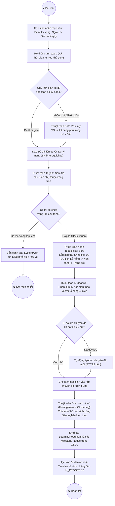
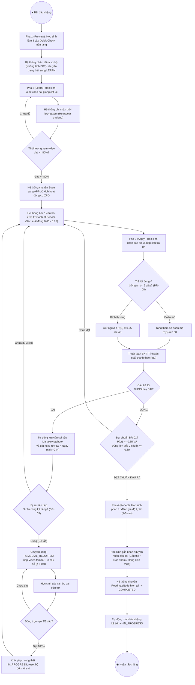
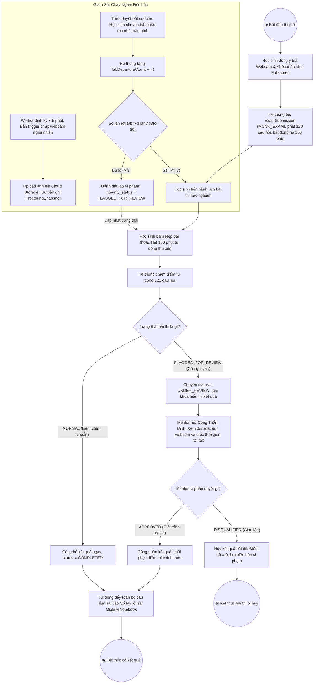
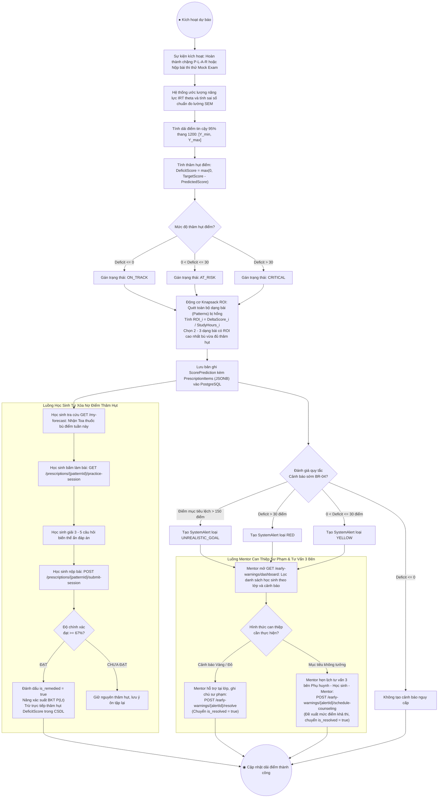

# TÀI LIỆU ĐẶC TẢ CHI TIẾT SƠ ĐỒ HOẠT ĐỘNG (ACTIVITY DIAGRAMS) CORE FLOW 2, 3 VÀ 6

> **Tài liệu**: Đặc tả phân tích nghiệp vụ & luồng hoạt động phục vụ thiết kế Activity Diagram chuẩn UML 2.5  
> **Hệ thống**: Nền tảng Đánh giá & Học tập Thích ứng V-Eval (V-ACT ĐHQG-HCM)  
> **Phạm vi tài liệu**: Core Flow 2 (Lộ trình học & Gom cụm lớp), Core Flow 3 (Luyện tập thích ứng P-L-A-R & Thi thử giám sát), Core Flow 6 (Dự báo điểm SEM & Cảnh báo sớm BR-04)  
> **Mục đích sử dụng**: Cung cấp ngữ cảnh kỹ thuật, phân làn Swimlane, các điểm rẽ nhánh (Decision Diamonds) và trạng thái dữ liệu chi tiết để AI (hoặc kỹ sư phần mềm) dễ dàng phân tích và xuất mã Mermaid / PlantUML Activity Diagram chuẩn xác 100%.

---

## 📌 HƯỚNG DẪN CẤU TRÚC PHÂN TÍCH CHO AI VẼ DIAGRAM

Mỗi phân hệ Core Flow dưới đây được chuẩn hóa theo 6 mục cốt lõi:
1. **Mục tiêu luồng nghiệp vụ & Tác nhân (Actors / Swimlanes)**.
2. **Danh sách các điểm quyết định & Điều kiện rẽ nhánh (Decision Points & Guards)**.
3. **Mô tả hành động tuần tự theo từng làn (Step-by-Step Swimlane Actions)**.
4. **Các luồng ngoại lệ & Nhánh cứu trợ (Alternative / Exception Flows)**.
5. **Chuyển dịch trạng thái thực thể dữ liệu (Data State Transitions)**.
6. **Mẫu Prompt & Khung mã Mermaid / PlantUML sẵn sàng tạo biểu đồ**.

---

## 🔑 ÁNH XẠ VAI TRÒ CHUẨN TRONG HỆ THỐNG (SYSTEM ROLES RBAC MAPPING)

> [!NOTE]
> Trong cơ sở dữ liệu phân quyền thực tế của V-Eval (`iam.roles` trong `Identity_Service`), hệ thống quản lý **6 vai trò định danh chuẩn (`SystemRoles`)**:
> 1. **`STUDENT`**: Học sinh (Người học thực hiện bài test, lộ trình tự học và bài thi).
> 2. **`TEACHER`**: Giáo viên — **Đây chính là "Mentor" trong toàn bộ mô tả nghiệp vụ và tài liệu thiết kế**. Trong mô hình Blended Learning của V-Eval, Giáo viên đảm nhận vai trò Mentor đồng hành, quản lý nhóm vi mô 3–5 em trên lớp, duyệt bài thi thử giám sát và can thiệp sư phạm giải quyết cảnh báo sớm.
> 3. **`ACADEMIC_MANAGER`**: Quản lý học vụ — **Đây chính là "Điều phối viên học vụ"**. Đảm nhận chuẩn hóa khung năng lực, kiểm định đồ thị tiên quyết DAG và tiếp nhận cảnh báo chu trình dữ liệu từ thuật toán Tarjan.
> 4. **`PARENT`**: Phụ huynh (Nhận thông báo tiến độ, cảnh báo sớm và tham gia buổi tư vấn 3 bên).
> 5. **`ACADEMIC_DIRECTOR`**: Giám đốc học thuật (Theo dõi dashboard phân tích tổng thể).
> 6. **`ADMINISTRATOR`**: Quản trị viên hệ thống.
>
> 👉 **Quy tắc vẽ Swimlane**: Khi vẽ sơ đồ Activity Diagram:
> * Làn **Giáo viên / Mentor** tương ứng với vai trò **`TEACHER`**.
> * Làn **Điều phối viên học vụ** tương ứng với vai trò **`ACADEMIC_MANAGER`**.
> * Làn **Học sinh** tương ứng với vai trò **`STUDENT`**.

---


# PHẦN 1: CORE FLOW 2 - QUY HOẠCH LỘ TRÌNH HỌC TẬP THÍCH ỨNG & PHÂN CỤM LỚP CHUYÊN ĐỀ

## 1.1 Mục Tiêu & Tác Nhân (Swimlanes)
* **Mục tiêu**: Tiếp nhận hồ sơ năng lực đầu vào từ Core Flow 1, thực thi các giải thuật đồ thị DAG và K-Means để xây dựng lộ trình học tập tối ưu, tự động phân cụm lớp chuyên đề (sĩ số tối đa 20 em) và chia nhóm vi mô (3–5 em) trên lớp.
* **3 Làn phân quyền (Swimlanes)**:
  * **Làn 1: Học sinh (`Student`)**: Thực hiện khảo sát mục tiêu (Target Score, Exam Date, Study Hours/Day), kích hoạt tạo lộ trình, nhận Timeline các chặng học và danh sách nhóm vi mô.
  * **Làn 2: Hệ thống V-Eval Backend & Graph Engine (`System / Graph Engine`)**: Cắt tỉa kỹ năng (Path Pruner), kiểm tra chu trình đồ thị (Tarjan Cycle Detector), sắp xếp topo (Topological Sorter), phân cụm K-Means lỗ hổng 4 miền, chia nhóm vi mô trên lớp và sinh bản ghi CSDL.
  * **Làn 3: Giáo viên / Điều phối viên học vụ (`Mentor / Academic Coordinator`)**: Tiếp nhận lớp chuyên đề được phân bổ, theo dõi danh sách nhóm học tập vi mô và duyệt/nhận cảnh báo hệ thống khi phát hiện lỗi chu trình dữ liệu.

## 1.2 Danh Sách Các Điểm Quyết Định (Decision Points)
1. **[Quyết định 1: Quỹ thời gian học tập có đủ không?]**:
   * *Điều kiện*: Tổng thời lượng các kỹ năng cần học `T_needed` so với Quỹ thời gian khả dụng `T_avail = (ExamDate - Today) * StudyHoursDay`.
   * *Nhánh `[Không đủ thời gian]`*: Kích hoạt thuật toán **Path Pruning Engine** cắt tỉa các kỹ năng phụ có trọng số đề thi `< 5%` để đảm bảo trọng tâm.
   * *Nhánh `[Đủ thời gian]`*: Giữ nguyên toàn bộ danh mục kỹ năng cần bồi dưỡng.
2. **[Quyết định 2: Đồ thị tiên quyết có bị chu trình kín không?]**:
   * *Điều kiện*: Thuật toán **Tarjan's Strongly Connected Components** quét bảng `SkillPrerequisites`.
   * *Nhánh `[Có chu trình kín]`*: Phát sinh `SystemAlert` cảnh báo mức CRITICAL gửi Academic Coordinator can thiệp dữ liệu; tạm dừng luồng sinh tự động.
   * *Nhánh `[DAG hợp lệ (Không chu trình)]`*: Chuyển tiếp sang thuật toán **Kahn's Topological Sort**.
3. **[Quyết định 3: Lớp chuyên đề hiện tại có vượt quá sĩ số 20 học sinh không?]**:
   * *Điều kiện*: Số lượng học sinh có cùng cụm lỗ hổng K-Means đăng ký vào lớp `CurrentEnrollment >= 20`.
   * *Nhánh `[Đã đủ 20 học sinh]`*: Tự động đóng lớp hiện tại và khởi tạo mã lớp mới với số thứ tự tăng dần (ví dụ: `THEMATIC_MATH_02`).
   * *Nhánh `[Còn chỗ]`*: Ghi danh trực tiếp học sinh vào lớp hiện tại.

## 1.3 Mô Tả Luồng Hoạt Động Tuần Tự (Step-by-Step Actions)



## 1.4 Chuyển Dịch Trạng Thái Thực Thể
* `LearningRoadmap`: Được tạo với trạng thái `ACTIVE`.
* `RoadmapNode` (Chặng học): Chặng đầu tiên mang trạng thái `IN_PROGRESS`; tất cả các chặng kế tiếp mang trạng thái `LOCKED`.
* `ClassEnrollment`: Liên kết học sinh với `ThematicClass`, gán thuộc tính `MicroGroupId`.

---

# PHẦN 2: CORE FLOW 3 - LUYỆN TẬP THÍCH ỨNG (P-L-A-R) & PHÒNG THI THỬ CÓ GIÁM SÁT

Core Flow 3 được chia làm 2 phân hệ hoạt động cốt lõi:
* **Phân hệ 3A: Chu trình tự học thích ứng tại nhà P-L-A-R & Sổ tay lỗi sai SM-2**.
* **Phân hệ 3B: Phòng thi thử chuẩn hóa có giám sát liêm chính học thuật (Proctored Mock Exam - BR-20)**.

---

## 2A. LUỒNG CHU TRÌNH TỰ HỌC THÍCH ỨNG P-L-A-R & SỔ TAY LỖI SAI

### 2A.1 Mục Tiêu & Tác Nhân (Swimlanes)
* **Mục tiêu**: Dẫn dắt học sinh hoàn thành chặng học theo 4 pha khép kín: **Preview (Khởi động) -> Learn (Xem video) -> Apply (Thích ứng ZPD & BKT) -> Reflect (Phản tư & Lập lịch ôn tập ngắt quãng)**. Tự động cứu trợ khi gặp bế tắc (Remedial Node - BR-03).
* **2 Làn phân quyền**:
  * **Làn 1: Học sinh (`Student`)**: Làm 3 câu Quick Check, xem video lý thuyết, làm bài tập thích ứng từng câu, phản tư gắn nhãn nhận thức sai và làm bài ôn tập lặp lại ngắt quãng.
  * **Làn 2: Hệ thống thích ứng (`Adaptive Engine - IRT & BKT`)**: Đánh giá điều kiện thời lượng xem video (`>= 80%`), chọn câu hỏi ZPD, tính xác suất thành thạo `P(L_t)`, phạt đoán mò (`t < 5s`), tự động cắm mốc cứu trợ (Remedial Node), lưu Sổ tay lỗi sai và tính toán khoảng cách ngày SM-2.

### 2A.2 Danh Sách Các Điểm Quyết Định (Decision Points)
1. **[Quyết định 1: Thời lượng xem video bài giảng có đạt chuẩn không?]**:
   * *Điều kiện*: Thời lượng xem thực tế tích lũy `WatchPercentage >= 80%`.
   * *Nhánh `[Chưa đạt]`*: Giữ State Machine ở bước `LEARN`, yêu cầu học sinh xem tiếp.
   * *Nhánh `[Đạt >= 80%]`*: State Machine tự động kích hoạt chuyển sang bước `APPLY`.
2. **[Quyết định 2: Thời gian trả lời câu hỏi có bị phạt đoán mò không? (BR-08)]**:
   * *Điều kiện*: Học sinh trả lời đúng câu hỏi vận dụng có độ khó `b >= 0.50` nhưng thời gian suy nghĩ `t < 5 giây`.
   * *Nhánh `[Đoán mò]`*: Tăng tham số đoán mò `P(G) = 0.60` để kiềm chế tăng điểm ảo trong công thức BKT.
   * *Nhánh `[Suy nghĩ bình thường]`*: Áp dụng tham số đoán mò mặc định `P(G) = 0.25`.
3. **[Quyết định 3: Học sinh có bị sai 3 câu liên tiếp không? (Quy tắc cứu trợ BR-03)]**:
   * *Điều kiện*: Bộ đếm câu sai liên tiếp `consecutive_incorrect == 3`.
   * *Nhánh `[Đúng (Bế tắc)]`*: Khóa luồng Apply chính, chuyển trạng thái sang `REMEDIAL_REQUIRED`, phát gói cứu trợ (Tóm tắt công thức + 3 câu hỏi cơ bản `b < 0.0`).
   * *Nhánh `[Sai < 3 câu]`*: Tiếp tục luồng Apply thông thường.
4. **[Quyết định 4: Học sinh có hoàn thành gói cứu trợ 100% không?]**:
   * *Điều kiện*: Kết quả nộp bài cứu trợ đạt `Score == 3/3 (100%)`.
   * *Nhánh `[Đạt 3/3]`*: Reset bộ đếm lỗi sai về 0, khôi phục trạng thái `IN_PROGRESS` để tiếp tục pha Apply.
   * *Nhánh `[Chưa đạt 3/3]`*: Yêu cầu làm lại hoặc luân phiên bộ câu hỏi biến thể cơ bản khác.
5. **[Quyết định 5: Đạt chuẩn đầu ra hoàn thành chặng học chưa? (BR-01)]**:
   * *Điều kiện*: Xác suất thành thạo `P(L_t) >= 0.85` **VÀ** làm đúng liên tiếp tối thiểu 2 câu có độ khó `b >= 0.50`.
   * *Nhánh `[Đạt chuẩn]`*: Mở khóa bước `REFLECT`, cho phép học sinh nộp đánh giá độ tự tin và chuyển chặng sang `COMPLETED`, đồng thời mở khóa chặng kế tiếp (`RoadmapNode[k+1] = IN_PROGRESS`).
   * *Nhánh `[Chưa đạt]`*: Bốc tiếp câu hỏi ZPD trong dải xác suất đúng `[0.60, 0.75]`.

### 2A.3 Mô Tả Luồng Hoạt Động Tuần Tự (Step-by-Step Actions)



---

## 2B. LUỒNG PHÒNG THI THỬ CHUẨN HÓA CÓ GIÁM SÁT (PROCTORED MOCK EXAM)

### 2B.1 Mục Tiêu & Tác Nhân (Swimlanes)
* **Mục tiêu**: Tổ chức kỳ thi thử chuẩn hóa ĐGNL ĐHQG-HCM gồm 120 câu hỏi trắc nghiệm trong 150 phút, tích hợp cơ chế giám sát liêm chính học thuật (chống chuyển tab, chụp webcam ngẫu nhiên) và quy trình thẩm định bài thi của Mentor (BR-20).
* **3 Làn phân quyền**:
  * **Làn 1: Học sinh (`Student`)**: Bật webcam, cấp quyền toàn màn hình, làm bài thi 120 câu, nộp bài.
  * **Làn 2: Hệ thống giám sát (`Proctoring Engine & Practice Service`)**: Đếm ngược đồng hồ 150 phút, bắt sự kiện rời tab (`visibilitychange` / `blur`), định kỳ 3–5 phút chụp ảnh webcam ngẫu nhiên qua background worker, chấm điểm tự động và phân luồng trạng thái (`COMPLETED` vs `FLAGGED_FOR_REVIEW`).
  * **Làn 3: Giáo viên / Giám thị (`Mentor`)**: Tra cứu danh sách các bài thi bị cắm cờ, đối soát dòng thời gian sự kiện rời tab và chuỗi ảnh chụp webcam, ra phán quyết công nhận (`APPROVED`) hoặc hủy bài thi (`DISQUALIFIED`).

### 2B.2 Danh Sách Các Điểm Quyết Định (Decision Points)
1. **[Quyết định 1: Học sinh có vi phạm chuyển tab quá giới hạn không? (BR-20)]**:
   * *Điều kiện*: Số lần rời khỏi tab trình duyệt hoặc thoát toàn màn hình `tab_departure_count > 3`.
   * *Nhánh `[Vượt quá 3 lần]`*: Tự động cập nhật `integrity_status = FLAGGED_FOR_REVIEW` và gửi cảnh báo nhắc nhở trên màn hình thi.
   * *Nhánh `[<= 3 lần]`*: Giữ `integrity_status = NORMAL`.
2. **[Quyết định 2: Trạng thái liêm chính khi nộp bài thi là gì?]**:
   * *Điều kiện*: Trạng thái `integrity_status` tại thời điểm nộp bài (hoặc khi hết giờ 150 phút).
   * *Nhánh `[NORMAL]`*: Công bố kết quả điểm số chính thức, chuyển `status = COMPLETED`, tự động phân tích điểm sang Core Flow 6.
   * *Nhánh `[FLAGGED_FOR_REVIEW]`*: Đóng băng công bố kết quả chính thức, chuyển `status = UNDER_REVIEW`, gửi biên bản thi về cổng thẩm định của Mentor.
3. **[Quyết định 3: Phán quyết thẩm định của Mentor là gì?]**:
   * *Điều kiện*: Đánh giá của Mentor sau khi xem bằng chứng ảnh webcam và nhật ký rời tab.
   * *Nhánh `[APPROVED - Chấp thuận]`*: Giữ nguyên điểm số làm bài, chuyển trạng thái sang `COMPLETED`, mở khóa xem lời giải chi tiết.
   * *Nhánh `[DISQUALIFIED - Hủy kết quả]`*: Thiết lập điểm thi về `0 điểm`, ghi nhận biên bản vi phạm quy chế thi.

### 2B.3 Mô Tả Luồng Hoạt Động Tuần Tự (Step-by-Step Actions)



---

# PHẦN 3: CORE FLOW 6 - DỰ BÁO KHOẢNG ĐIỂM SEM, BẢNG CÂN ĐỐI THÂM HỤT & CẢNH BÁO SỚM BR-04

## 3.1 Mục Tiêu & Tác Nhân (Swimlanes)
* **Mục tiêu**: Đóng vai trò là "Bộ điều hướng hành động thông minh" (Prescriptive Engine). Hệ thống tính toán dải điểm tin cậy khoa học 95% theo mô hình SEM, định lượng thâm hụt so với mục tiêu, giải bài toán Knapsack ROI chọn 2–3 dạng bài bù điểm mũi nhọn, đồng thời kích hoạt cảnh báo sớm 3 cấp (Vàng, Đỏ, Mục tiêu không tưởng) và hỗ trợ Mentor lên lịch tư vấn 3 bên.
* **3 Làn phân quyền (Swimlanes)**:
  * **Làn 1: Học sinh (`Student`)**: Tra cứu dải điểm dự báo `[Min, Max]`, xem bảng thâm hụt điểm, nhận "Toa thuốc bù điểm tuần này", làm bài tập vi mô biến thể, nộp bài xóa nợ điểm và nhận thông báo cảnh báo sớm cá nhân.
  * **Làn 2: Hệ thống dự báo & Thuật toán (`Prescriptive AI Engine`)**: Tính toán sai số chuẩn SEM, tính điểm thâm hụt `Deficit`, giải thuật toán Knapsack ROI lựa chọn dạng bài tối ưu, tự động phân loại cấp độ cảnh báo BR-04, phân phối câu hỏi biến thể và trừ nợ điểm thâm hụt khi học sinh thi đạt.
  * **Làn 3: Giáo viên / Mentor (`Mentor`)**: Theo dõi Dashboard cảnh báo sớm học sinh theo lớp, tiếp nhận danh sách ca cảnh báo đỏ/vàng, thực hiện can thiệp sư phạm giải quyết ca (`Resolve Alert`), hoặc lên lịch hẹn tư vấn 3 bên định hướng lại mục tiêu (`Schedule Counseling`).

## 3.2 Danh Sách Các Điểm Quyết Định (Decision Points)
1. **[Quyết định 1: Phân loại trạng thái cân đối điểm số (Deficit Classification)]**:
   * *Điều kiện*: Điểm thâm hụt `DeficitScore = max(0, TargetScore - PredictedScore)`.
   * *Nhánh `[Deficit <= 0]`*: Trạng thái `ON_TRACK` (Đang bám sát hoặc vượt mục tiêu).
   * *Nhánh `[0 < Deficit <= 30]`*: Trạng thái `AT_RISK` (Có nguy cơ, thâm hụt nhẹ).
   * *Nhánh `[Deficit > 30]`*: Trạng thái `CRITICAL` (Báo động đỏ, thâm hụt nghiêm trọng).
2. **[Quyết định 2: Phân loại cấp độ Cảnh báo sớm theo Quy tắc BR-04]**:
   * *Điều kiện*: Đối chiếu `DeficitScore`, chênh lệch năng lực so với phân phối chuẩn ĐGNL, và Tốc độ tích lũy điểm/ngày.
   * *Nhánh `[PredictedScore thấp hơn TargetScore > 150 điểm]`*: Cảnh báo `UNREALISTIC_GOAL` (Mục tiêu không tưởng, vượt quá khả năng bứt phá trong thời gian còn lại).
   * *Nhánh `[Deficit > 30 điểm HOẶC Tốc độ học chậm không kịp ngày thi]`*: Cảnh báo `RED` (Cảnh báo đỏ nguy cấp).
   * *Nhánh `[0 < Deficit <= 30 điểm]`*: Cảnh báo `YELLOW` (Cảnh báo vàng cần nhắc nhở).
3. **[Quyết định 3: Kết quả làm bài tập vi mô Toa thuốc bù điểm có đạt chuẩn xóa nợ không?]**:
   * *Điều kiện*: Học sinh làm bài kiểm tra vi mô 3–5 câu thuộc dạng bài bù điểm, tỷ lệ đúng `Accuracy >= 67%` (tương đương đúng tối thiểu 2/3 câu hoặc 4/5 câu).
   * *Nhánh `[Đạt >= 67%]`*: Đánh dấu dạng bài đã khắc phục `is_remedied = true`, tăng xác suất thành thạo BKT, **trừ trực tiếp điểm thâm hụt `deficit_score`** trong bảng `ScorePredictions`.
   * *Nhánh `[Chưa đạt < 67%]`*: Giữ nguyên điểm nợ thâm hụt, khuyến nghị học sinh tiếp tục ôn tập hoặc yêu cầu AI Tutor hướng dẫn.
4. **[Quyết định 4: Mentor lựa chọn hình thức can thiệp sư phạm nào?]**:
   * *Điều kiện*: Căn cứ vào loại cảnh báo trên Dashboard của Mentor.
   * *Nhánh `[Cảnh báo RED / YELLOW]`*: Mentor hỗ trợ trực tiếp tại lớp theo nhóm vi mô và ghi chú giải quyết can thiệp (`POST /resolve`).
   * *Nhánh `[Cảnh báo UNREALISTIC_GOAL]`*: Mentor thiết lập lịch hẹn tư vấn 3 bên (Phụ huynh - Học sinh - Mentor), đề xuất mức điểm mục tiêu khả thi theo phân phối chuẩn (`POST /schedule-counseling`).

## 3.3 Mô Tả Luồng Hoạt Động Tuần Tự (Step-by-Step Actions)



---

# PHẦN 4: MA TRẬN TỔNG HỢP SO SÁNH 3 CORE FLOWS (DÀNH CHO BÁO CÁO ARCHITECTURE)

| Đặc tính kiến trúc | Core Flow 2 (Path Planning) | Core Flow 3 (Adaptive & Mock Exam) | Core Flow 6 (Score Prediction & Alert) |
| :--- | :--- | :--- | :--- |
| **Bản chất nghiệp vụ** | Lập kế hoạch lộ trình vĩ mô & xếp lớp chuyên đề | Thực thi tự học thích ứng vi mô & thi thử liêm chính | Kê đơn hành động bù điểm & cảnh báo sớm 3 cấp |
| **Thuật toán lõi** | `PathPruner`, `Tarjan SCC`, `TopologicalSort`, `KMeans++` | `IRT 2PL ZPD`, `BKT P(Lt)`, `Spaced Repetition SM-2` | `Fisher Information I(θ)`, `SEM 95%`, `Greedy Knapsack ROI` |
| **Tác nhân chính** | Học sinh, Hệ thống Graph, Điều phối viên | Học sinh, Hệ thống Adaptive, Mentor giám thị | Học sinh, Phân hệ AI Prescriptive, Mentor tư vấn |
| **Thực thể CSDL trọng tâm** | `LearningRoadmaps`, `RoadmapNodes`, `ThematicClasses` | `StageProgress`, `MistakeNotebooks`, `ExamSubmissions` | `ScorePredictions`, `SystemAlerts` |
| **Quy tắc hệ thống (BR)** | Khống chế sĩ số lớp $\le 20$, Nhóm vi mô 3–5 em | BR-01 (Mastery), BR-03 (Remedial), BR-08 (Guess), BR-20 (Proctor) | BR-04 (Cảnh báo sớm 3 cấp: Yellow, Red, Unrealistic Goal) |
| **Cơ chế phản hồi** | Tự động mở khóa chặng tuần tự trên Timeline | Rẽ nhánh cứu trợ khi sai 3 câu; Spaced review ngày mai | Toa thuốc gỡ điểm tuần này; Mentor can thiệp / hẹn tư vấn 3 bên |

---

# PHẦN 5: BỘ PROMPT CHUẨN ĐỂ YÊU CẦU AI VẼ DIAGRAM (READY-TO-USE PROMPTS)

Nếu bạn muốn gửi cho một AI khác (như ChatGPT, Claude, Midjourney Diagram, hoặc Mermaid Renderer) để vẽ Activity Diagram, hãy copy nguyên văn đoạn prompt dưới đây:

````markdown
Bạn là một Kiến trúc sư Hệ thống phần mềm chuyên nghiệp (Principal System Architect) chuyên về UML 2.5 và Mermaid.js / PlantUML.
Dưới đây là bản đặc tả chi tiết luồng nghiệp vụ của Hệ thống Đánh giá & Học tập Thích ứng V-Eval.

Nhiệm vụ của bạn:
1. Hãy phân tích kỹ các làn phân quyền (Swimlanes), các điểm quyết định rẽ nhánh (Decision Diamonds), các điều kiện bảo vệ [guard conditions] và các trạng thái dữ liệu được mô tả trong tài liệu.
2. Vẽ sơ đồ Hoạt động (Activity Diagram) hoàn chỉnh, trực quan và chuyên nghiệp.
3. Sử dụng cú pháp chuẩn Mermaid `flowchart TD` (hoặc PlantUML `skinparam activity`):
   - Có phân làn `subgraph` rõ ràng cho từng Actor: [Học sinh], [Hệ thống V-Eval / AI Engine], [Giáo viên / Mentor].
   - Bắt đầu bằng nút Start tròn đen `((● Bắt đầu))` và kết thúc bằng nút End đôi `((◉ Kết thúc))`.
   - Các điểm quyết định sử dụng hình thoi `{...}` có nhãn rõ ràng cho từng nhánh rẽ.
   - Các tên node chứa dấu ngoặc hoặc ký tự đặc biệt phải được bọc trong dấu ngoặc kép `""`.
   - Không lồng ghép cấu trúc sai chuẩn.

[Dán nội dung Phần 1, Phần 2 hoặc Phần 3 của tài liệu này vào đây]
````
