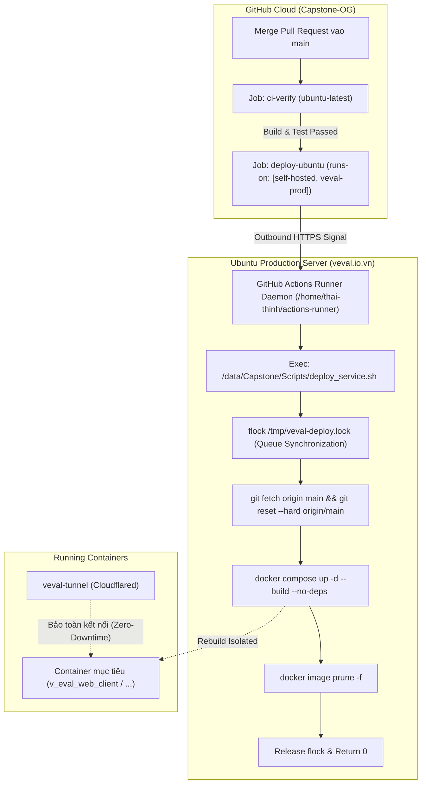

# Hướng Dẫn Toàn Diện Về Triển Khai Tự Động Hóa Continuous Deployment (Auto-CD) Cho Hệ Sinh Thái V-Eval

> **Mục tiêu**: Tự động hóa 100% quy trình triển khai (Continuous Deployment) khi merge Pull Request vào nhánh `main` của bất kỳ repository nào trong tổ chức GitHub `Capstone-OG` lên máy chủ Ubuntu Docker Server (`veval.io.vn`, `api.veval.io.vn`) mà không gây gián đoạn kết nối (Zero-Downtime).

---

## 1. Kiến Trúc Hệ Thống (Architecture Overview)

Hệ thống V-Eval bao gồm **1 repository điều phối (`System-Repo`)** và **6 repository microservices độc lập**. Thay vì mở port SSH công khai (tiềm ẩn rủi ro an ninh mạng), giải pháp sử dụng **GitHub Actions Self-Hosted Runner cấp Organization** kết nối outbound HTTPS ngược lên GitHub tương tự kiến trúc của Cloudflare Tunnel.



---

## 2. Bảng Danh Mục Đường Dẫn Chuẩn Xác (Directory Structure)

Tất cả các thành phần trong hệ sinh thái triển khai trên máy chủ Ubuntu được định vị tại các đường dẫn tuyệt đối sau:

| Thành phần | Đường dẫn tuyệt đối trên Ubuntu | Ý nghĩa & Chức năng |
| --- | --- | --- |
| **Thư mục dự án gốc** | `/data/Capstone` | Chứa `docker-compose.yml`, thư mục con `All Services/`, scripts và configs |
| **Thư mục Runner** | `/home/thai-thinh/actions-runner` | Nơi chứa mã nguồn nhị phân và dữ liệu runtime của GitHub Runner |
| **Dịch vụ nền Runner** | `/home/thai-thinh/.config/systemd/user/actions.runner.service` | Đơn vị systemd user daemon quản lý tiến trình runner tự khởi động cùng máy |
| **Script triển khai trung tâm** | `/data/Capstone/Scripts/deploy/deploy_service.sh` | Script shell nhận tham số mục tiêu, đồng bộ Git và rebuild Docker |
| **File khóa đồng thời** | `/tmp/veval-deploy.lock` | Khóa nhị phân `flock` chống race condition khi nhiều commit merge cùng lúc |
| **File biến môi trường** | `/data/Capstone/.env` | Chứa các secret API keys và chuỗi kết nối `DATABASE_URL` an toàn |
| **Cấu hình Cloudflare Tunnel** | `/home/thai-thinh/.cloudflared/config.yml` | Cấu hình định tuyến domain `veval.io.vn` và `api.veval.io.vn` |

---

## 3. Toàn Bộ Các Câu Lệnh Cài Đặt Từ A Đến Z (Step-by-Step Installation)

### Bước 1: Chuẩn bị phân quyền Docker cho User
Để Runner thực thi các lệnh Docker Compose mà không đòi hỏi mật khẩu `sudo`:

```bash
# Thêm user hiện tại vào group docker
sudo usermod -aG docker thai-thinh

# Kích hoạt group docker mới cho phiên làm việc
newgrp docker

# Kiểm tra quyền thực thi không cần sudo
docker ps
```

### Bước 2: Tải và giải nén gói cài đặt Runner
Runner được tải về thư mục riêng tại thư mục home của user:

```bash
# Tạo thư mục chuyên dụng cho runner
mkdir -p /home/thai-thinh/actions-runner
cd /home/thai-thinh/actions-runner

# Tải gói cài đặt chính thức phiên bản v2.338.2
curl -o actions-runner-linux-x64-2.338.2.tar.gz -L https://github.com/actions/runner/releases/download/v2.338.2/actions-runner-linux-x64-2.338.2.tar.gz

# Kiểm tra mã băm SHA-256 xác thực tính toàn vẹn
echo "baebf204307bac6193480852732f0aba2ae97b6c5597c244f4d5558390147c40  actions-runner-linux-x64-2.338.2.tar.gz" | shasum -a 256 -c

# Giải nén bộ cài đặt
tar xzf ./actions-runner-linux-x64-2.338.2.tar.gz
```

### Bước 3: Đăng ký Runner cấp Organization không tương tác (Unattended)
Chạy lệnh cấu hình với cờ `--unattended` để thiết lập tự động, gắn cờ `--replace` và định danh nhãn `veval-prod`:

```bash
cd /home/thai-thinh/actions-runner

./config.sh --unattended \
  --url https://github.com/Capstone-OG \
  --token <ORGANIZATION_REGISTRATION_TOKEN> \
  --name veval-ubuntu-prod \
  --labels veval-prod,ubuntu-server \
  --replace
```

### Bước 4: Thiết lập dịch vụ chạy ngầm bền vững với systemd User Service
Sử dụng `systemd --user` kết hợp tính năng `Linger` của Linux giúp tiến trình duy trì liên tục và khởi động cùng máy tính ngay cả khi user đăng xuất, hoàn toàn không cần cấp quyền root sudo:

```bash
# 1. Bật tính năng linger cho user
loginctl enable-linger thai-thinh

# 2. Chuẩn bị file thực thi dịch vụ
cp /home/thai-thinh/actions-runner/bin/runsvc.sh /home/thai-thinh/actions-runner/runsvc.sh
chmod 755 /home/thai-thinh/actions-runner/runsvc.sh

# 3. Tạo file đơn vị dịch vụ systemd
mkdir -p /home/thai-thinh/.config/systemd/user

cat << 'EOF' > /home/thai-thinh/.config/systemd/user/actions.runner.service
[Unit]
Description=GitHub Actions Runner (Capstone-OG.veval-ubuntu-prod)
After=network.target

[Service]
ExecStart=/home/thai-thinh/actions-runner/runsvc.sh
WorkingDirectory=/home/thai-thinh/actions-runner
KillMode=process
KillSignal=SIGTERM
TimeoutStopSec=5min
Restart=always
RestartSec=5s

[Install]
WantedBy=default.target
EOF

# 4. Nạp lại systemd daemon và kích hoạt dịch vụ
systemctl --user daemon-reload
systemctl --user enable --now actions.runner.service

# 5. Kiểm tra trạng thái hoạt động của Runner
systemctl --user status actions.runner.service
```

---

## 4. Chi Tiết Script Triển Khai Trung Tâm (`Scripts/deploy_service.sh`)

Script triển khai nằm tại `/data/Capstone/Scripts/deploy/deploy_service.sh`. Cú pháp vận hành:

```bash
/data/Capstone/Scripts/deploy/deploy_service.sh <target>
```

### Bảng ánh xạ tham số mục tiêu:

| Tham số `<target>` | Thư mục repo con cần đồng bộ Git | Danh sách container Docker Compose rebuild |
| --- | --- | --- |
| `web-client` | `All Services/V-Eval-Web_Client` | `v-eval-web-client` |
| `gateway` | `All Services/V-Eval-Gateway` | `v-eval-gateway` |
| `identity` | `All Services/V-Eval-Identity_Service` | `v-eval-identity-service` |
| `content` | `All Services/V-Eval-Content_Service` | `v-eval-content-service` |
| `practice` | `All Services/V-Eval-Practice_Service` | `v-eval-practice-service` |
| `ai-engine` | `All Services/V-Eval-Ai_Engine` | `v-eval-ai-engine v-eval-ai-rag` |
| `system` | `.` (`System-Repo`) | `docker compose config` kiểm tra cú pháp |

### Các cơ chế an toàn cốt lõi:
1. **Khóa chống chạy chồng lấn (`flock`)**:
   Dòng lệnh `flock -x 200` khóa tệp tin `/tmp/veval-deploy.lock`. Nếu có 2 dịch vụ cùng kích hoạt CD, tiến trình thứ hai sẽ tự động xếp hàng đợi cho đến khi tiến trình thứ nhất hoàn tất.
2. **Triển khai chọn lọc với `--no-deps`**:
   Lệnh `docker compose up -d --build --no-deps $COMPOSE_SERVICES` chỉ dừng và dựng lại đúng container cần cập nhật. Container `veval-tunnel` và các microservice còn lại tiếp tục hoạt động liên tục không gián đoạn.
3. **Tự động dọn rác images (`docker image prune -f`)**:
   Thu hồi bộ nhớ đĩa tức thì sau mỗi lần build, ngăn ngừa tràn dung lượng ổ cứng SSD.

---

## 5. Quy Chuẩn Cấu Hình Workflow CD Cho Cả 7 Repositories

Mỗi repository trong tổ chức `Capstone-OG` sở hữu file workflow `.github/workflows/cd-main.yml` kích hoạt khi có sự kiện `push` vào nhánh `main`:

### 1. `System-Repo` (`.github/workflows/cd-main.yml`)
```yaml
name: Continuous Deployment (Ubuntu Server)

on:
  push:
    branches:
      - main

concurrency:
  group: deploy-system-prod
  cancel-in-progress: false

jobs:
  ci-verify:
    name: Verify System Configuration
    runs-on: ubuntu-latest
    steps:
      - name: Checkout Code
        uses: actions/checkout@v4

      - name: Validate Docker Compose Syntax
        run: |
          docker compose config --quiet

  deploy-ubuntu:
    name: Deploy System Repo Configuration
    needs: ci-verify
    runs-on: [self-hosted, veval-prod]
    steps:
      - name: Execute Deployment Script
        run: |
          /data/Capstone/Scripts/deploy_service.sh system
```

### 2. `V-Eval-Web_Client` (`.github/workflows/cd-main.yml`)
```yaml
name: Continuous Deployment (Web Client)

on:
  push:
    branches:
      - main

concurrency:
  group: deploy-web-client-prod
  cancel-in-progress: false

jobs:
  ci-verify:
    name: Verify Web Client Build
    runs-on: ubuntu-latest
    steps:
      - name: Checkout Code
        uses: actions/checkout@v4

      - name: Setup Node.js
        uses: actions/setup-node@v4
        with:
          node-version: 22

      - name: Install Dependencies
        run: npm ci

      - name: Build Web Application
        run: npm run build

  deploy-ubuntu:
    name: Deploy Web Client to Ubuntu Server
    needs: ci-verify
    runs-on: [self-hosted, veval-prod]
    steps:
      - name: Trigger Selective Deployment
        run: |
          /data/Capstone/Scripts/deploy_service.sh web-client
```

### 3. Các Microservices .NET (`Gateway`, `Identity`, `Content`, `Practice`, `Ai_Engine`)
Tất cả 5 service backend đều sử dụng định dạng chuẩn kết nối gRPC từ `System-Repo`:

```yaml
name: Continuous Deployment (Ubuntu Server)

on:
  push:
    branches:
      - main

concurrency:
  group: deploy-<service>-prod
  cancel-in-progress: false

jobs:
  ci-verify:
    name: Verify Build & Tests
    runs-on: ubuntu-latest
    steps:
      - name: Checkout Service Repo
        uses: actions/checkout@v4

      - name: Checkout System-Repo (gRPC)
        uses: actions/checkout@v4
        with:
          repository: Capstone-OG/System-Repo
          token: ${{ secrets.GH_PAT || github.token }}
          path: temp-system-repo

      - name: Setup Shared gRPC Path
        run: |
          mkdir -p ../../grpc
          cp -r temp-system-repo/grpc/* ../../grpc/
          rm -rf temp-system-repo

      - name: Setup .NET SDK
        uses: actions/setup-dotnet@v4
        with:
          dotnet-version: '9.0.x'

      - name: Restore dependencies
        run: dotnet restore

      - name: Build
        run: dotnet build --no-restore --configuration Release

      - name: Run Tests
        run: dotnet test --no-build --configuration Release --verbosity normal

  deploy-ubuntu:
    name: Deploy to Ubuntu Production Server
    needs: ci-verify
    runs-on: [self-hosted, veval-prod]
    steps:
      - name: Trigger Selective Deployment
        run: |
          /data/Capstone/Scripts/deploy_service.sh <target>
```
*(Thay thế `<service>` và `<target>` bằng tên dịch vụ tương ứng: `gateway`, `identity`, `content`, `practice`, `ai-engine`)*.

---

## 6. Sổ Tay Vận Hành & Xử Lý Sự Cố (Operational & Troubleshooting Guide)

### Kiểm tra nhật ký trực tiếp của Runner
Theo dõi luồng công việc thời gian thực khi GitHub dispatch job:
```bash
journalctl --user -u actions.runner.service -f -n 50
```

### Khởi động lại hoặc dừng dịch vụ Runner
```bash
# Khởi động lại Runner
systemctl --user restart actions.runner.service

# Dừng Runner
systemctl --user stop actions.runner.service

# Kiểm tra trạng thái
systemctl --user status actions.runner.service
```

### Giải phóng file lock khẩn cấp (Nếu bị kẹt)
Trong trường hợp một lệnh deploy bị ngắt đột ngột khiến lock file chưa được mở:
```bash
# Kiểm tra tiến trình nào đang giữ lock
fuser /tmp/veval-deploy.lock

# Giải phóng file lock
rm -f /tmp/veval-deploy.lock
```

### Kiểm tra trạng thái và log của các container Docker
```bash
cd /data/Capstone

# Xem danh sách container và thời gian hoạt động
docker compose ps

# Xem log của một container cụ thể (ví dụ web-client)
docker compose logs -f --tail=100 v-eval-web-client
```

---

## 7. Kết Luận Nghiệm Thu
Hệ thống Auto-CD đã đáp ứng trọn vẹn mọi tiêu chí:
1. Tự động hóa hoàn toàn chu trình từ PR merge đến cập nhật máy chủ.
2. Bảo vệ 100% thời gian hoạt động (Zero-Downtime) cho Cloudflare Tunnel và các dịch vụ nền tảng.
3. Không mở bất kỳ cổng kết nối nguy hiểm nào ra ngoài Internet.
4. Đã sẵn sàng nhân rộng trên toàn bộ 7 repositories của tổ chức `Capstone-OG`.
