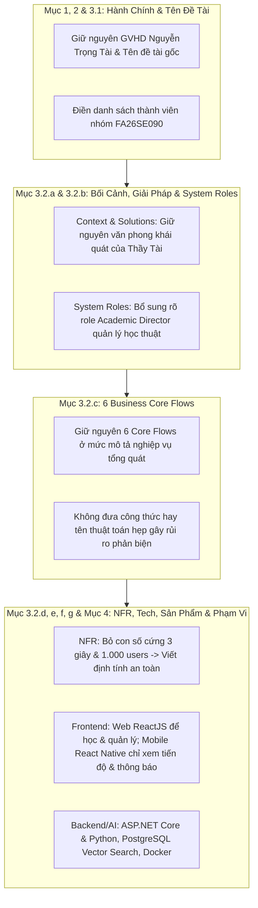

# KẾ HOẠCH CHUẨN HÓA PHIẾU ĐĂNG KÝ ĐỀ TÀI CAPSTONE (AN TOÀN & KHÁI QUÁT HÓA)
## Đề tài: AI-powered Personalized Learning Path Platform for Competency Assessment Exam Preparation (Mã: FA26SE090)

> [!NOTE]
> **Tài liệu gốc rà soát**: [`FA26SE090_AI_POWERED_PERSONALIZED_LEARNING_PATH_PL_taint.docx`](./FA26SE090_AI_POWERED_PERSONALIZED_LEARNING_PATH_PL_taint.docx) do Thầy Nguyễn Trọng Tài (GVHD) khởi tạo.  
> **Định hướng chỉnh sửa cốt lõi**:
> 1. **Bổ sung đầy đủ vai trò quản lý cấp cao `Academic Director` (Giám đốc đào tạo / Quản lý học thuật)** để khớp với mô hình phân quyền thực tế của hệ thống.
> 2. **Định vị rõ phần Mobile (`React Native`) chỉ đóng vai trò "Xem & Theo dõi" (Companion App)**: Đổi `Flutter` trong bản gốc sang `React Native`, đồng thời giới hạn rõ phạm vi trên phiếu đăng ký là ứng dụng di động chỉ dùng để **tra cứu, xem tiến độ, lộ trình, báo cáo và nhận thông báo**; còn toàn bộ hoạt động **học tập, luyện tập thích ứng, làm bài thi và quản trị** được thực hiện trên **Website (`ReactJS`)**.
> 3. **Giữ văn phong KHÁI QUÁT, CHUNG CHUNG (High-level & General)** giống bản gốc của Thầy Tài: Lược bỏ các con số cam kết cứng (`1.000 users`, `< 3 giây`) và **TUYỆT ĐỐI KHÔNG** đưa các công thức toán, tên thuật toán hẹp, số lượng bảng CSDL hay thông số cấu hình chi tiết vào phiếu đăng ký để tránh bị Hội đồng bắt bẻ.

---

## 1. NGUYÊN TẮC SỬA ĐỔI "CHUNG CHUNG - AN TOÀN - KHÔNG BỊ BẮT BẺ"

1. **Giữ nguyên khung tư tưởng của GVHD ở Context & 6 Core Flows, minh bạch hóa các phần điều chỉnh với Thầy Tài**:
   - Giữ nguyên ~95% nội dung ở *Tên đề tài*, *Context (3.2.a)* và *6 Core Flows (3.2.c)*.
   - Đối với các phần có điều chỉnh đáng kể (~40–45% ở *System Roles*, *NFR*, *Tech Stack*, *Deliverables* và *Proposed Tasks*), nhóm **tổng hợp danh sách thay đổi rõ ràng để xin xác nhận trực tiếp từ Thầy Nguyễn Trọng Tài** trước khi nộp chính thức.
2. **Phân định rạch ròi phạm vi Website (`ReactJS`) vs Mobile (`React Native`) để không bị đòi tính năng học trên App**:
   - Trong bản `.docx` gốc (Mục 3.2.e, f, g), Thầy Tài đang ghi ứng dụng `Flutter` cho học sinh bao gồm cả *học tập, luyện tập thích ứng và tương tác AI Tutor*. Nếu giữ nguyên câu này, Hội đồng sẽ bắt nhóm demo làm bài thi và học tập trực tiếp trên điện thoại.
   - **Cách sửa an toàn**: Đổi công nghệ sang **`React Native`** và ghi rõ vai trò là **Companion Mobile Application** (ứng dụng đồng hành hỗ trợ học sinh/phụ huynh **xem tiến độ, lịch trình, báo cáo phân tích và nhận thông báo**), trong khi **Web Application (`ReactJS`)** là môi trường chính để học bài, luyện tập, thi thử và quản lý học thuật.
3. **Không tự trói mình bằng chi tiết kỹ thuật hoặc thuật toán cụ thể**:
   - **KHÔNG ghi vào phiếu đăng ký**: tên phiên bản framework cụ thể (`React 19`, `.NET 9`), số lượng thực thể CSDL (`50 bảng`, `4 schemas`), số câu hỏi cố định (`30 câu`, `120 câu`), hay tên các thuật toán/tham số toán học quá chi tiết (`IRT 2PL`, `Brent`, `Tarjan`, `Knapsack`, `SM-2`, `HNSW 768 chiều`, `SEM 1.96`).
   - **Thay bằng thuật ngữ chung**: *Psychometric / Knowledge Tracing models*, *Personalized Roadmap Generation*, *Adaptive Recommendation*, *Vector Search*.
4. **Chuẩn hóa đầy đủ hệ thống phân quyền quản lý (`Academic Director` & `Academic Manager`)**:
   - Bổ sung rõ role **`Academic Director`** nắm vai trò quản lý chuyên môn và chất lượng học thuật cấp hệ thống, tách bạch với **`Academic Manager`** (điều phối vận hành học vụ tại cơ sở), **`Teacher`** (giảng dạy & biên soạn nội dung) và **`Administrator`** (quản trị kỹ thuật & tài khoản hệ thống).

---

## 2. SƠ ĐỒ TỔNG QUAN CÁC ĐIỂM CẦN CHỈNH SỬA TRÊN FILE DOCX

---

## 3. PHƯƠNG ÁN CHỈNH SỬA CỤ THỂ TỪNG MỤC (SO SÁNH VỚI FILE GỐC)

### Mục 1, Mục 2 & Mục 3.1: Thông Tin Đăng Ký & Tên Đề Tài
* **Hiện trạng trong file `.docx`**:
  * Mục 1: Đã có thông tin Thầy Nguyễn Trọng Tài (`taint@fpt.edu.vn`).
  * Mục 2: Bảng danh sách 5 sinh viên đang để trống.
  * Mục 3.1:
    * *English*: `AI-powered Personalized Learning Path Platform for Competency Assessment Exam Preparation`
    * *Vietnamese*: `Hệ thống cá nhân hóa lộ trình học và luyện thi Đánh giá năng lực tích hợp AI`
* **Hướng xử lý**:
  * **Giữ nguyên 100%** thông tin GVHD và **giữ nguyên tên đề tài gốc** của Thầy Tài để đồng bộ tuyệt đối với hồ sơ đăng ký học vụ của trường.
  * Điền đầy đủ thông tin 4 thành viên nhóm `FA26SE090` (Phạm Tấn Lộc, Trần Thái Thịnh, Nguyễn Duy Khôi, Mai Thành Nhân) vào bảng Mục 2.

---

### Mục 3.2.a: Context (Bối Cảnh Đề Tài)
* **Hiện trạng trong file `.docx`**:
  * 5 đoạn văn tiếng Anh khái quát về xu hướng thi Đánh giá năng lực tại Việt Nam, hạn chế của các nền tảng ôn tập đại trà một lộ trình cho tất cả (*identical learning content and predefined study plans*), khó khăn của giáo viên/phụ huynh khi theo dõi tiến độ, và tiềm năng ứng dụng AI + Educational Data Analytics.
* **Hướng xử lý**:
  * **Giữ nguyên gần như 100% nội dung gốc của Thầy Tài** vì đoạn văn đã rất mạch lạc, chung chung vừa đủ, không gắn cứng số câu hỏi hay quy chế cụ thể nên hoàn toàn tránh được rủi ro bị bắt bẻ.

---

### Mục 3.2.b: Proposed Solutions & System Roles (Giải Pháp & Vai Trò Hệ Thống)
* **Hiện trạng trong file `.docx`**:
  * Phần đầu (8 gạch đầu dòng giải pháp) và phần cuối (9 chủ đề *Research-Based Learning - RBL*) đã viết khái quát rất tốt.
  * Phần ***System Roles*** hiện tại đang gộp chung và **thiếu role `Academic Director`**.
* **Hướng chỉnh sửa (Bổ sung `Academic Director`, mô tả khái quát cho từng Role)**:
  * **Giữ nguyên** phần mở đầu giải pháp và danh sách 9 chủ đề RBL.
  * **Cập nhật lại danh sách System Roles** thành các vai trò rõ ràng, mô tả nhiệm vụ ở mức khái quát:
    1. **`Administrator` (Quản trị viên hệ thống)**:
       * Quản lý tài khoản người dùng, vai trò và phân quyền truy cập hệ thống.
       * Quản lý thông tin danh mục cơ sở đào tạo (campuses) và cấu hình chung của nền tảng.
       * Cấu hình kết nối dịch vụ hệ thống/AI và giám sát tình trạng vận hành, sao lưu dữ liệu.
    2. **`Academic Director` (Giám đốc đào tạo / Quản lý chuyên môn học thuật)** *(Bổ sung mới)*:
       * Xây dựng, phê duyệt và quản trị khung năng lực chuẩn (competency frameworks) cùng cấu trúc danh mục kiến thức toàn hệ thống.
       * Quản trị và kiểm soát chất lượng ngân hàng câu hỏi gốc (master question bank) cũng như nguồn tài liệu tham chiếu chuẩn cho AI.
       * Thiết lập các tiêu chuẩn đánh giá học thuật và theo dõi báo cáo chất lượng đào tạo tổng thể giữa các cơ sở.
    3. **`Academic Manager` (Quản lý / Điều phối học vụ)**:
       * Tổ chức, điều phối lớp học, lịch học tập và phân công giáo viên phụ trách.
       * Phối hợp tổ chức các đợt kiểm tra, thi thử định kỳ và duyệt xếp lớp cho học sinh.
       * Theo dõi tình hình học tập chung tại cơ sở và điều phối hỗ trợ sớm cho các học sinh có nguy cơ chậm tiến độ.
    4. **`Teacher` (Giáo viên / Cố vấn học tập)**:
       * Biên soạn, tải lên và tổ chức tài liệu học tập, bài luyện tập và đề thi thử.
       * Rà soát, hiệu đính và phê duyệt chất lượng câu hỏi/học liệu (bao gồm nội dung hỗ trợ bởi AI).
       * Theo dõi tiến độ năng lực của học sinh trong lớp, đưa ra nhận xét sư phạm và đồng hành hướng dẫn học tập.
    5. **`Student` (Học sinh)**:
       * Thực hiện bài kiểm tra chẩn đoán năng lực và thiết lập mục tiêu điểm số, thời gian ôn thi.
       * Học tập theo lộ trình cá nhân hóa, làm bài tập thích ứng, tham gia thi thử và tương tác với AI Tutor trên nền tảng Web.
       * Xem bảng phân tích tiến độ, lộ trình, lịch học và theo dõi dự báo kết quả (trên cả Web và ứng dụng di động đồng hành).
    6. **`Parent` (Phụ huynh)**:
       * Liên kết và theo dõi tiến độ học tập, mức độ chuyên cần của con thông qua các báo cáo trực quan.
       * Xem báo cáo phát triển năng lực, mức độ sẵn sàng trước kỳ thi và nhận các thông báo/cảnh báo học tập định kỳ.
    7. **`AI Recommendation Engine and Chat Bot` (Hệ thống Gợi ý AI & Trợ lý học tập)**:
       * Phân tích hồ sơ năng lực và lịch sử học tập để gợi ý lộ trình, nội dung ôn luyện phù hợp.
       * Giải thích câu hỏi, làm rõ khái niệm học thuật, hỗ trợ gợi mở phương pháp làm bài dựa trên học liệu của hệ thống.
       * Hỗ trợ ước lượng mức độ thành thạo và dự báo khả năng đạt mục tiêu điểm số của người học.

---

### Mục 3.2.c: Functional Requirements - 6 Business Core Flows
* **Hiện trạng trong file `.docx`**:
  * Thầy Tài đã viết 6 Core Flows rất súc tích và khái quát (*Competency Diagnosis*, *Personalized Learning Path Planning*, *Adaptive Learning and Continuous Recommendation*, *AI-assisted Learning Support*, *Learning Analytics and Progress Monitoring*, *Examination Performance Prediction*).
* **Hướng chỉnh sửa (Giữ chung chung, chỉ gọt nhẹ 2 chỗ nhỏ)**:
  * **Giữ nguyên 95% nội dung gốc của Thầy Tài cho cả 6 Core Flows**.
  * **Tinh chỉnh nhẹ 2 chi tiết nhỏ**:
    1. Tại **Core Flow 4 (*AI-assisted Learning Support*)**: Đổi nhẹ cụm *"generates additional practice questions"* thành gợi mở hướng dẫn từng bước (*provides step-by-step guidance, explains answers, summarizes concepts...*) để chatbot tập trung hỗ trợ giải đáp học thuật, không bị bắt bẻ phải sinh đề trực tiếp trong khung chat.
    2. Tại **Core Flow 5 (*Learning Analytics and Progress Monitoring*)**: Bổ sung đối tượng xem báo cáo bao gồm `students, teachers, academic managers, academic directors, and parents` (hỗ trợ xem thuận tiện trên Web và theo dõi tóm tắt trên Mobile).

---

### Mục 3.2.d: Non-Functional Requirements (Yêu Cầu Phi Chức Năng)
* **Hiện trạng trong file `.docx`**:
  * Đang cam kết cứng *"Average response time below 3 seconds"* và *"at least 1,000 active users"*.
* **Hướng chỉnh sửa (Chuyển sang định tính, khái quát và an toàn)**:
  * Đảm bảo tốc độ phản hồi ổn định, mượt mà cho các thao tác học tập, kiểm tra trực tuyến và tương tác trợ lý AI.
  * Hỗ trợ truy cập đồng thời ổn định, đáp ứng nhu cầu học tập và tổ chức kiểm tra trực tuyến của các lớp học và cơ sở đào tạo.
  * Bảo mật xác thực người dùng bằng JWT kết hợp kiểm soát truy cập theo vai trò (Role-Based Access Control - RBAC).
  * Kiến trúc phần mềm phân tách mô-đun rõ ràng giữa Web, Mobile, Backend Services, AI Services và Analytics, thuận tiện cho việc bảo trì và mở rộng.
  * Lưu trữ an toàn dữ liệu người học với cơ chế sao lưu và phục hồi dữ liệu định kỳ.
  * Triển khai linh hoạt dựa trên công nghệ đóng gói container / đám mây (Containerized & Cloud-ready deployment).
  * Hệ thống API chuẩn hóa sẵn sàng tích hợp và mở rộng trong tương lai.

---

### Mục 3.2.e: Theory & Practical (Lý Thuyết & Công Nghệ Áp Dụng)
* **Hiện trạng trong file `.docx`**:
  * Đang ghi: `Mobile Application: Flutter (Android & iOS)`, `Web Application: ReactJS / Next.js`, `OpenAI GPT API`, `Vector Database: Qdrant or Pinecone`, `Cloud Deployment: Microsoft Azure`.
* **Hướng chỉnh sửa (Đổi `Flutter` sang `React Native` chỉ xem, còn lại giữ chung chung khớp thực tế)**:
  * **Web Application**: `ReactJS` (Nền tảng chính phục vụ học tập tương tác, luyện thi, AI Tutor và cổng quản trị học thuật).
  * **Mobile Application**: `React Native` (Ứng dụng di động đồng hành phục vụ xem thông tin, theo dõi tiến độ, báo cáo và nhận thông báo). *(Thay thế cho Flutter)*.
  * **Backend Services**: `ASP.NET Core Web API` & `Python Services (FastAPI)`.
  * **Database & Vector Storage**: `PostgreSQL` tích hợp lưu trữ và tìm kiếm Vector (`pgvector` / Vector Search).
  * **Authentication & Security**: `JWT` & `Role-Based Access Control (RBAC)`.
  * **AI & Educational Foundations** *(Giữ tên lĩnh vực chung, không khóa cứng 1 nhà cung cấp hay thuật toán hẹp)*:
    * Large Language Models (`LLM APIs`)
    * Retrieval-Augmented Generation (`RAG`)
    * Adaptive Learning & Recommendation Systems
    * Psychometric & Knowledge Tracing Models
    * Student Performance Prediction & Learning Analytics
    * Educational Data Mining
  * **Deployment & DevOps**: `Docker` Containerization, Cloud / Server Deployment, `GitHub` & `GitHub Actions` (CI/CD).

---

### Mục 3.2.f: Products - Expected Deliverables (Sản Phẩm Bàn Giao Dự Kiến)
* **Hiện trạng trong file `.docx`**:
  * Đang ghi *"Mobile application for students"* như thể học sinh học toàn bộ trên Mobile, và tách riêng *"Web portal for teachers..."*.
* **Hướng chỉnh sửa (Làm rõ Web là nơi học & quản lý, Mobile chỉ là app đồng hành để xem)**:
  * **Web application cho học sinh (`Student`)**: Phục vụ làm bài chẩn đoán, học tập theo lộ trình cá nhân hóa, luyện tập thích ứng, thi thử và tương tác với AI Tutor.
  * **Web portal quản lý và giảng dạy**: Dành cho giáo viên (`Teacher`), quản lý học vụ (`Academic Manager`), giám đốc đào tạo (`Academic Director`) và quản trị viên (`Administrator`).
  * **Parent web portal**: Cổng thông tin trên Web dành cho phụ huynh theo dõi tiến độ học tập và năng lực của con (nhất quán 100% với System Roles và Proposed Tasks).
  * **Companion Mobile application (`React Native`) cho học sinh và phụ huynh (`Student & Parent`)**: Chỉ phục vụ xem tiến độ học tập, lộ trình, lịch trình, báo cáo năng lực và nhận thông báo/cảnh báo học tập (không thực hiện học bài hay làm đề thi trên Mobile).
  * **Backend platform** quản lý dữ liệu học tập, khảo thí và phân quyền hệ thống.
  * **AI Recommendation Engine & Personalized Learning Path Module** (Phân hệ gợi ý & quản lý lộ trình học tập cá nhân hóa).
  * **AI Tutor Module** tích hợp LLM và RAG.
  * **Learning Analytics Dashboard & Performance Prediction Module** (Bảng điều khiển phân tích dữ liệu và dự báo kết quả thi).

---

### Mục 3.2.g: Proposed Tasks (Phân Công Nhiệm Vụ Cân Bằng Cho 4 Thành Viên)
* **Hiện trạng trong file `.docx`**:
  * Task số 2 đang ghi: *"Develop the Flutter mobile application for students, including personalized learning, adaptive practice, AI Tutor interaction, and learning progress tracking"* -> Dễ bị Hội đồng bắt lỗi vì ghi tính năng học & luyện tập nằm ở Mobile app, đồng thời dễ gây lệch tải nếu 1 người gánh quá nhiều.
* **Hướng chỉnh sửa (Cân bằng tải đồng đều cho cả 4 thành viên: `Leader`, `Member 1`, `Member 2`, `Member 3`)**:
  1. **Leader**: Phân tích yêu cầu, thiết kế kiến trúc hệ thống & cơ sở dữ liệu, phát triển API Gateway và các dịch vụ Backend học tập/khảo thí cốt lõi.
  2. **Member 1**: Phát triển ứng dụng Web học tập cho học sinh (chẩn đoán năng lực, lộ trình cá nhân hóa, luyện tập thích ứng, thi thử) và ứng dụng di động đồng hành (`React Native`) phục vụ xem tiến độ, lịch trình, báo cáo và thông báo.
  3. **Member 2**: Phát triển các cổng Web và API quản trị liên quan dành cho `Administrator`, `Academic Director`, `Academic Manager`, `Teacher` và `Parent` (quản trị khung năng lực, ngân hàng câu hỏi, học liệu, báo cáo phân tích và quản lý người dùng).
  4. **Member 3**: Thiết kế và triển khai các thành phần AI & phân tích dữ liệu, bao gồm Recommendation Engine, Knowledge Tracing, Student Performance Prediction và LLM-based AI Tutor (tích hợp RAG pipeline cùng giao diện hội thoại AI Tutor).
  5. **All Members**: Tích hợp hệ thống, kiểm thử hệ thống, tối ưu hóa vận hành, triển khai môi trường chạy, hoàn thiện hồ sơ kỹ thuật và báo cáo đồ án tổng kết.

---

### Mục 4: Other Comments (Ghi Chú Phạm Vi Ngắn Gọn Bảo Vệ Nhóm)
* **Nội dung đề xuất (2 câu ngắn gọn đặt vào Mục 4 của phiếu đăng ký)**:
  * Các hoạt động học tập chuyên sâu, luyện tập thích ứng và làm bài kiểm tra/thi thử được thiết kế tối ưu trên nền tảng **Web Application** (đảm bảo không gian hiển thị cho các ngữ liệu đọc hiểu dài và biểu thức/hình học học thuật), trong khi **Mobile Application (`React Native`)** đóng vai trò ứng dụng đồng hành chuyên phục vụ tra cứu thông tin, xem báo cáo tiến độ, lịch trình và nhận thông báo cho học sinh và phụ huynh.
  * Các chỉ số dự báo điểm số và cảnh báo sớm đóng vai trò tham khảo hỗ trợ định hướng ôn tập dựa trên dữ liệu rèn luyện của người học trên hệ thống.

---

## 4. BẢNG TÓM TẮT NHỮNG GÌ ĐƯỢC ĐIỀU CHỈNH ĐỂ TRÁNH BỊ BẮT BẺ

| Chi tiết gốc dễ bị Hội đồng bắt bẻ | Cách chuyển hóa sang ngôn từ "Chung Chung - An Toàn" |
| :--- | :--- |
| `Flutter Mobile App` gánh toàn bộ việc học, làm bài & chat AI | Đổi thành **`ReactJS Web App`** để học, thi & quản trị; còn **`React Native Mobile App`** chỉ dùng để **xem tiến độ, báo cáo & thông báo** |
| Thiếu vai trò quản lý chuyên môn cấp cao | Bổ sung rõ **`Academic Director`** tách biệt với `Academic Manager`, `Teacher`, `Administrator` |
| `Response time < 3s`, `>= 1,000 concurrent users` | Tốc độ phản hồi ổn định, hỗ trợ truy cập đồng thời phù hợp quy mô đào tạo |
| Thuật toán/thông số quá chi tiết (`IRT 2PL`, `BKT`, `Knapsack`, `50 bảng`...) | Ghi khái quát: `Psychometric & Knowledge Tracing models`, `Adaptive Recommendation` |
| `Qdrant / Pinecone`, `OpenAI GPT`, `Microsoft Azure` | `PostgreSQL with Vector Search`, `LLM APIs`, `Containerized / Cloud Deployment` |

---

## 5. BƯỚC TIẾP THEO

Bạn kiểm tra lại xem:
1. Phần phân định **Web (`ReactJS` - học, luyện thi, quản trị)** và **Mobile (`React Native` - chỉ xem tiến độ, báo cáo, thông báo)** cùng với role **`Academic Director`** đã khớp 100% thực tế của nhóm chưa?
2. Nếu đã chuẩn, bạn báo mình để mình tạo ngay bản nội dung/file `.docx` hoàn chỉnh theo đúng form gốc của Thầy Tài nhé!
