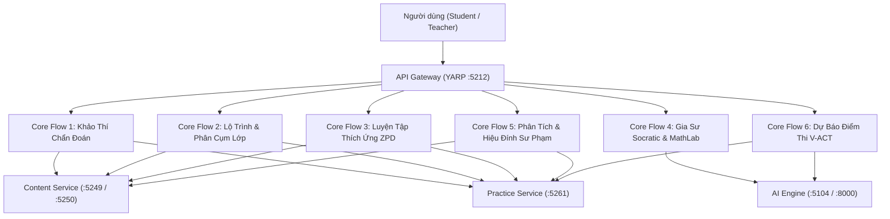
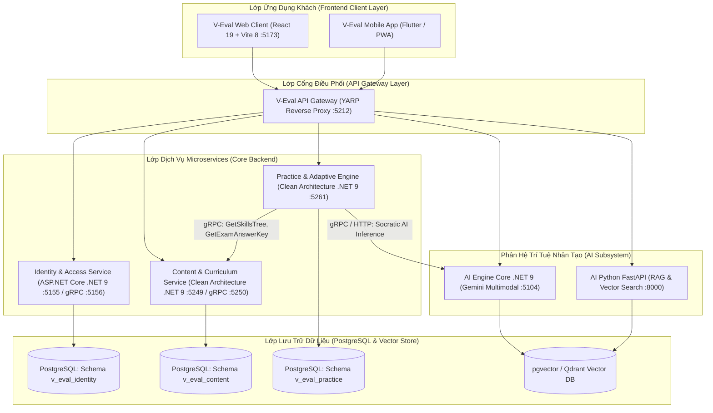
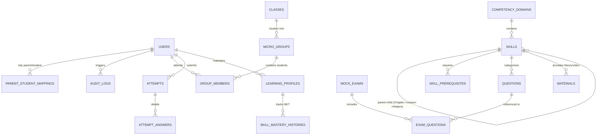
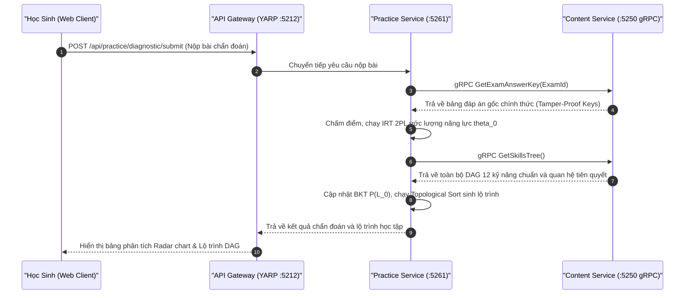
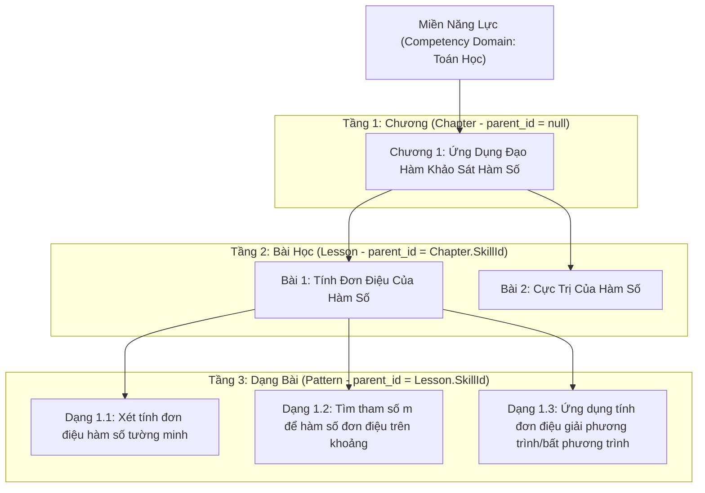
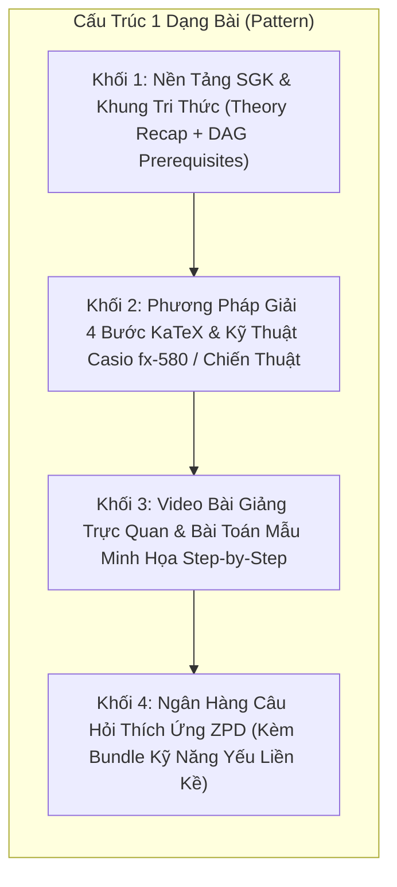
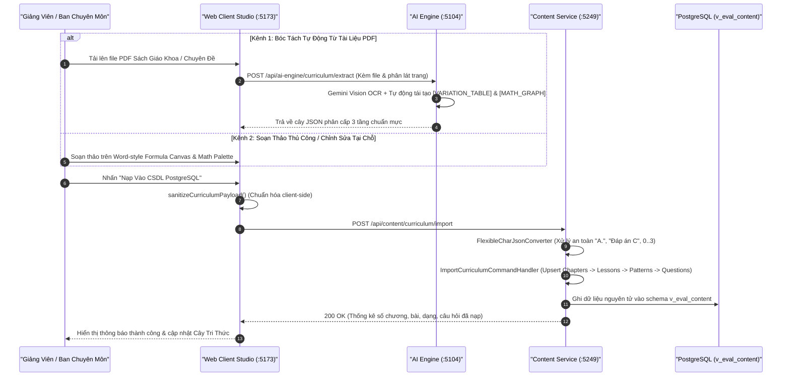
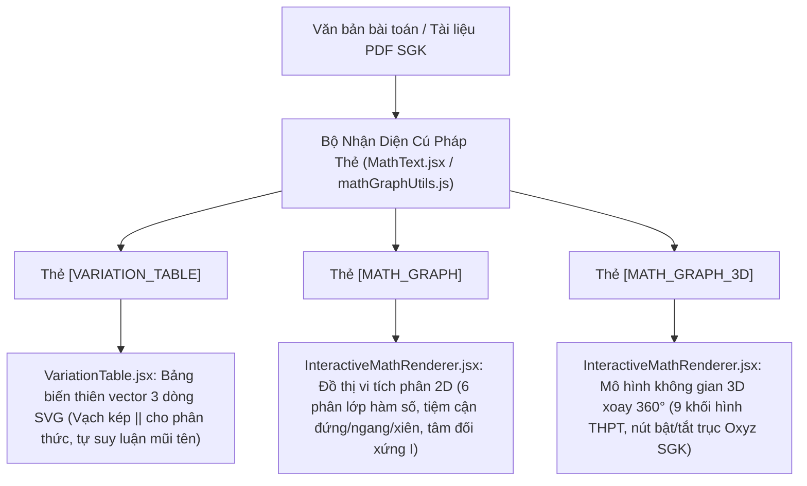
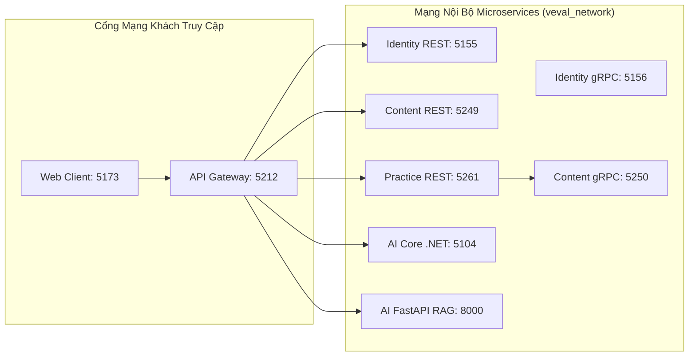

# TÀI LIỆU ĐẶC TẢ KIẾN TRÚC TỔNG THỂ HỆ THỐNG V-EVAL (ENTERPRISE SYSTEM ARCHITECTURE SPECIFICATION)

> [!IMPORTANT]
> **Tài liệu chuẩn kiến trúc toàn diện dự án V-Eval Capstone 2026**
> - **Hệ thống**: Nền tảng Học tập Cá nhân hóa & Khảo thí Thích ứng ĐGNL ĐHQG-HCM (V-ACT)
> - **Kiến trúc chủ đạo**: Clean Architecture, Microservices đa dịch vụ, gRPC Server-to-Server, AI Engine Đa phương thức (Gemini 3.6 Flash + Python RAG), JSXGraph Native Engine & KaTeX Live Math
> - **Chuẩn hiển thị tài liệu**: Tương thích 100% với **MD Editor Plus** (không dùng ký tự `$` thô bao quanh công thức, liên kết tương đối `./`, sơ đồ Mermaid chuẩn 11.15.0+)

---

## 1. TỔNG QUAN KIẾN TRÚC & PHẠM VI NGHIỆP VỤ HỆ THỐNG

### 1.1 Tầm Nhìn & Sứ Mệnh Kiến Trúc
Hệ thống **V-Eval** được thiết kế nhằm giải quyết bài toán luyện thi Đánh Giá Năng Lực (ĐGNL) ĐHQG-HCM (thang điểm 1.200) thông qua phương pháp học tập cá nhân hóa sâu:
1. **Chẩn đoán năng lực ban đầu chuẩn tâm trắc học**: Sử dụng mô hình Item Response Theory (IRT 2PL) và Bayesian Knowledge Tracing (BKT) để định lượng chính xác năng lực tiềm ẩn (`\theta_0`) của học sinh trên 4 miền tri thức và 12 kỹ năng chuẩn.
2. **Quy hoạch lộ trình học tập thông minh & phân cụm vi mô lớp học**: Tự động sinh đồ thị học tập Directed Acyclic Graph (DAG) bằng thuật toán Topological Sort và phân cụm học sinh trong lớp học offline (tối đa 20 học sinh) thành các nhóm bàn 3–5 bạn có cùng lỗ hổng tri thức (`CommonWeakSkillIds`).
3. **Luyện tập thích ứng trong Vùng Phát Triển Gần Nhất (ZPD - Zone of Proximal Development)**: Điều hướng câu hỏi tự động bám sát cấp độ nhận thức Revised Bloom 6 mức độ, tự động đóng gói bài tập củng cố và đính kèm kỹ năng yếu liền kề khi độ nắm vững (`P(L_t) <= 10%`).
4. **Trợ lý gia sư Socratic AI & Trực quan hóa hình học/giải tích 2D/3D (MathLab)**: Trợ giảng AI gợi mở từng bước mà không làm lộ đáp án, tự động tái tạo bảng biến thiên vector (`[VARIATION_TABLE]`), đồ thị vi tích phân 2D kèm tiệm cận (`[MATH_GRAPH]`) và hình học không gian 3D xoay 360 độ (`[MATH_GRAPH_3D]`).
5. **Cơ chế nạp tri thức động kép (Dual-Channel Ingestion) & Zero-Hardcode 100%**: Xóa bỏ hoàn toàn mã nguồn giả lập hoặc mảng tĩnh, hệ thống nạp tri thức tự động từ sách giáo khoa chuyên đề qua AI Vision OCR kết hợp bộ công cụ hiệu đính trực quan dành riêng cho Giảng viên.

---

### 1.2 Ma Trận Vai Trò Người Dùng (System Roles)
Hệ thống phân định 4 nhóm vai trò với phạm vi phân quyền nghiêm ngặt (Role-Based Access Control - RBAC):

| Vai Trò | Mã Quyền | Phạm Vi Hoạt Động & Quyền Hạn |
| :--- | :--- | :--- |
| **Học Sinh** (`Student`) | `ROLE_STUDENT` | Tham gia thi chẩn đoán đầu vào, xem lộ trình học tập DAG cá nhân hóa, làm bài tập thích ứng ZPD, tương tác với Socratic AI Tutor, tương tác mô hình 3D/2D, xem phân tích năng lực Radar chart và dự phóng điểm thi V-ACT. |
| **Phụ Huynh** (`Parent`) | `ROLE_PARENT` | Nhận liên kết tài khoản học sinh, giám sát bảng phân tích tiến độ học tập, nhận thông báo cảnh báo chuyên cần/sa sút học lực, theo dõi dự báo điểm chuẩn đại học. |
| **Giảng Viên / Mentor** (`Teacher`) | `ROLE_TEACHER` | Quản trị lớp học offline trần 20 học sinh, xem kết quả phân cụm vi mô K-Means bàn học, phê duyệt lộ trình học tập DRAFT, sử dụng Studio Soạn Thảo Sư Phạm (Word-style Formula Canvas) để hiệu đính 4 khối nội dung dạng bài, duyệt ngân hàng câu hỏi. |
| **Ban Chuyên Môn / Admin** (`Academic Director / Admin`) | `ROLE_ADMIN` | Quản trị danh mục 4 miền năng lực và 12 kỹ năng chuẩn ĐGNL, vận hành động cơ AI OCR bóc tách tài liệu sách giáo khoa, quản lý kiểm toán hệ thống (`audit_logs`), cấu hình các tham số khảo thí và định tuyến API Gateway. |

---

### 1.3 Ma Trận Ánh Xạ 6 Luồng Nghiệp Vụ Cốt Lõi (Core Flows 1 - 6)



| Luồng Nghiệp Vụ | Tên Luồng | Dịch Vụ Chủ Quản | Trọng Tâm Kiến Trúc Kỹ Thuật |
| :--- | :--- | :--- | :--- |
| **Core Flow 1** | **Competency Diagnosis** (Khảo Thí Chẩn Đoán Ban Đầu) | `Content Service` & `Practice Service` | Đề thi chuẩn 30 câu đại diện 4 miền tri thức; tính toán năng lực tiềm ẩn `\theta_0` qua mô hình tâm trắc học IRT 2PL (MAP/Brent Optimizer), khởi tạo giá trị BKT ban đầu `P(L_0)`, trực quan hóa Radar chart năng lực. |
| **Core Flow 2** | **Learning Path & Thematic Micro-Grouping** (Quy Hoạch Lộ Trình & Phân Cụm Lớp Học) | `Practice Service` & `Content Service` | Phân cụm K-Means đồng nhất ràng buộc (lớp học offline trần 20 học sinh, chia thành các bàn 3–5 bạn có cùng lỗ hổng `CommonWeakSkillIds`); đóng gói bộ đề Quiz củng cố tự động qua API 19; sắp xếp Topological Sort trên DAG cây tri thức. |
| **Core Flow 3** | **Adaptive Practice in ZPD** (Luyện Tập Thích Ứng Trong Vùng ZPD) | `Practice Service` & `Content Service` | Máy trạng thái thích ứng (Adaptive State Machine); cập nhật xác suất nắm vững `P(L_t)` theo BKT; điều chỉnh cấp độ Bloom tiếp theo; tự động đính kèm dạng bài yếu liền kề (Adjacent Weak Skill Bundling) khi `P(L_t) <= 10%`. |
| **Core Flow 4** | **Socratic AI Tutor & MathLab Engine** (Gia Sư Gợi Mở & Toán Học Tương Tác) | `AI Engine` & `Web Client` | Động cơ Socratic Tutor gợi mở bước giải không làm lộ đáp án; hệ thống thẻ tương tác nội sinh `[VARIATION_TABLE]`, `[MATH_GRAPH]`, `[MATH_GRAPH_3D]`; tự động dựng hình từ đề bài chữ (Text-to-Geometry). |
| **Core Flow 5** | **Learning Analytics & Curriculum Studio** (Phân Tích Tiến Độ & Hiệu Đính Sư Phạm) | `Content Service`, `Practice Service`, `Web Client` | Studio Soạn Thảo Sư Phạm Word-style Formula Canvas; trọn bộ REST API hiệu đính 4 khối tri thức dạng bài; báo cáo phân tích đa chiều cho học sinh, phụ huynh và giảng viên. |
| **Core Flow 6** | **Performance Prediction** (Dự Báo Điểm Thi ĐGNL VNU-HCM) | `AI Engine` & `Practice Service` | Mô hình hồi quy đa biến và ánh xạ phân phối xác suất dự phóng điểm thi chính thức trên thang điểm 1.200 V-ACT kèm khoảng tin cậy sai số đo chuẩn (SEM). |

---

## 2. KIẾN TRÚC TỔNG THỂ MICROSERVICES & BẢN ĐỒ GIAO TIẾP HỆ THỐNG

### 2.1 Sơ Đồ Kiến Trúc Hệ Thống Toàn Cảnh (System Landscape Architecture)



---

### 2.2 Đặc Tả Từng Thành Phần Dịch Vụ

#### 1. V-Eval API Gateway (`V-Eval-Gateway`)
* **Công nghệ cốt lõi**: Microsoft YARP (Yet Another Reverse Proxy) trên nền .NET 9.
* **Cổng vận hành**: Cổng HTTP `5212`.
* **Nhiệm vụ kiến trúc**:
  * Đóng vai trò điểm tiếp nhận duy nhất (Single Point of Entry) cho tất cả client.
  * Định tuyến thông minh theo cụm dịch vụ (`identity-cluster`, `content-cluster`, `practice-cluster`, `ai-engine-cluster`, `ai-rag-cluster`).
  * Cấu hình hạn mức thời gian `ActivityTimeout` mở rộng lên **10 phút** (`00:10:00`) cho các tác vụ AI bóc tách tài liệu sách giáo khoa khổ lớn (>100 trang).
  * Tiêm mã định danh phân tán `X-Correlation-ID` phục vụ OpenTelemetry distributed tracing.
  * Quản trị chính sách CORS tập trung cho phép Web Client (`http://localhost:5173`, `http://localhost:3000`).

#### 2. Identity & Access Service (`V-Eval-Identity_Service`)
* **Công nghệ cốt lõi**: ASP.NET Core .NET 9, Microsoft Entity Framework Core, PostgreSQL Npgsql.
* **Cổng vận hành**: Cổng REST `5155`, Cổng gRPC Server `5156`.
* **Lưu trữ**: Supabase PostgreSQL Schema `v_eval_identity`.
* **Nhiệm vụ kiến trúc**:
  * Quản lý đăng ký, đăng nhập xác thực JWT Token (Access Token 15 phút, Refresh Token 7 ngày).
  * Phân quyền RBAC 4 cấp (`Student`, `Parent`, `Teacher`, `Admin`).
  * Quản lý thực thể liên kết Phụ huynh - Học sinh (`parent_student_mappings`).
  * Cung cấp gRPC endpoint phục vụ xác thực server-to-server.

#### 3. Content & Curriculum Service (`V-Eval-Content_Service`)
* **Công nghệ cốt lõi**: .NET 9 Clean Architecture, CQRS Pattern (MediatR), FluentValidation, EF Core Npgsql.
* **Cổng vận hành**: Cổng REST `5249`, Cổng gRPC Server `5250`.
* **Lưu trữ**: Supabase PostgreSQL Schema `v_eval_content`.
* **Nhiệm vụ kiến trúc**:
  * **Cây Dàn Kiến Thức & Khung Tri Thức 3 Tầng**: Quản lý quan hệ tự tham chiếu phân cấp chuẩn SGK GDPT 2018 (`Chương` -> `Bài học` -> `Dạng bài`).
  * **4 Khối Sư Phạm Dạng Bài**: Nền tảng SGK (Khối 1), Phương pháp giải KaTeX từng bước (Khối 2), Video bài giảng & câu hỏi mẫu (Khối 3), Ngân hàng câu hỏi thích ứng (Khối 4).
  * **Cơ chế Nạp Tri Thức Động Kép (Dual Ingestion)**: Tiếp nhận dữ liệu cây tri thức qua `POST /api/content/curriculum/import` với bộ chuyển đổi an toàn `FlexibleCharJsonConverter` (khử lỗi System.Char, xử lý `"A."`, `"Đáp án C"`, `0..3`, `null`).
  * **Trọn Bộ REST API Hiệu Đính Cho Giảng Viên**: Cập nhật Dạng bài (`PUT /patterns/{id}`), cập nhật Node (`PUT /nodes/{id}`), tạo Node mới (`POST /nodes`), xóa an toàn Node và làm sạch liên kết DAG (`DELETE /nodes/{id}`).
  * **Bộ Đề Quiz Thích Ứng (API 19)**: Tự động đóng gói đề thi 5–10 câu theo danh sách `SkillIds` / `CommonWeakSkillIds` chuẩn phân loại Bloom 6 cấp độ.
  * **gRPC Server ([`content.proto`](./All%20Services/V-Eval-Content_Service/V-Eval-Content_Service.API/Protos/content.proto))**:
    * `GetSkillsTree`: Xuất toàn bộ đồ thị DAG 12 kỹ năng kèm trọng số kiểm tra, quan hệ tiên quyết và mã miền chuẩn hóa (`domain_code`).
    * `GetExamAnswerKey`: Cung cấp đáp án gốc tamper-proof phục vụ chấm thi.
    * `GetQuestionsByDifficulty`: Trích xuất ngân hàng câu hỏi theo độ khó.

#### 4. Practice & Adaptive Service (`V-Eval-Practice_Service`)
* **Công nghệ cốt lõi**: .NET 9 Clean Architecture, CQRS (MediatR), EF Core Npgsql.
* **Cổng vận hành**: Cổng REST `5261`.
* **Lưu trữ**: Supabase PostgreSQL Schema `v_eval_practice`.
* **Nhiệm vụ kiến trúc**:
  * **Phân Cụm Lớp Học Vi Mô K-Means (Thematic Micro-Grouping)**: Quản lý lớp học offline trần 20 học sinh; phân bổ thành các bàn 3–5 bạn có cùng vector điểm yếu tri thức (`CommonWeakSkillIds`).
  * **Máy Trạng Thái Luyện Tập Thích Ứng (ZPD State Machine)**: Quản trị phiên làm bài (`Attempts`), theo dõi sự biến thiên năng lực theo mô hình Bayesian Knowledge Tracing (`P(L_t)`).
  * **Cơ Chế Bó Kỹ Năng Yếu Liền Kề (Adjacent Weak Skill Bundling)**: Tự động đính kèm câu hỏi ôn tập của nút tiên quyết trong đồ thị DAG khi `P(L_t) <= 10%`.
  * **Ước Lượng Tâm Trắc Học IRT 2PL**: Tính toán chỉ số năng lực tiềm ẩn `\theta_0` qua phương pháp cực đại hậu nghiệm MAP và thuật toán tối ưu hóa Brent.
  * **Sinh Lộ Trình Ôn Tập Cá Nhân Hóa**: Thuật toán Topological Sort sắp xếp thứ tự học tập tối ưu trên đồ thị DAG tri thức.

#### 5. AI Subsystem (`V-Eval-Ai_Engine` & Python RAG)
* **Công nghệ cốt lõi**: .NET 9 Clean Architecture C# thuần kết hợp Python FastAPI RAG Service.
* **Cổng vận hành**: Cổng .NET REST `5104`, Cổng Python FastAPI `8000`.
* **Nhiệm vụ kiến trúc**:
  * **Bóc Tách Khung Chương Trình & Dạng Bài Sư Phạm**: Bóc tách tài liệu sách giáo khoa PDF/DOCX sang cây tri thức chuẩn SGK GDPT 2018 (Miền -> Chương -> Bài -> Dạng bài kèm 4 khối nội dung KaTeX).
  * **Động Cơ Nhận Diện Dạng Bài C# Thuần**: Phân tích bản chất dạng bài, phân định môn STEM (hỗ trợ Casio fx-580/880) và môn Ngữ văn/KHXH (chiến lược hành văn, cấm nhắc Casio).
  * **Sinh Câu Hỏi Thích Ứng Bám Sát Dạng Bài**: Endpoint `POST /api/ai-engine/curriculum/generate-questions` tiếp nhận ngữ cảnh sư phạm (`theoryRecap`, `solutionMethod`, `existing_questions`) sinh câu hỏi mới không trùng lặp (nhiệt độ 0.7).
  * **Chuẩn Hóa Đáp Án Đúng `NormalizeCorrectOption`**: Tự động chuyển đổi mọi định dạng đáp án do LLM sinh ra về ký tự đơn `'A'`, `'B'`, `'C'`, `'D'`.
  * **Tự Động Dựng Hình 3D & 2D (Text-to-Geometry / Text-to-Calculus)**: Tự động tính tọa độ đỉnh, đường phụ nét đứt, phương trình tiệm cận và nhúng thẻ `[MATH_GRAPH_3D]`, `[MATH_GRAPH]`, `[VARIATION_TABLE]` vào cả bài giảng lẫn câu hỏi.
  * **Cơ Chế Dự Phòng Đa Tầng (Multi-Model Failover Fallback)**: Ưu tiên `gemini-3.6-flash` (200 OK ~1.5s), tự động chuyển đổi sang các model và API key dự phòng khi gặp mã lỗi HTTP 503/500/429.

#### 6. V-Eval Web Client (`V-Eval-Web_Client`)
* **Công nghệ cốt lõi**: React 19, Vite 8, Tailwind CSS, JSXGraph native vector engine, KaTeX math renderer, Lucide icons.
* **Cổng vận hành**: Cổng HTTP `5173`.
* **Nhiệm vụ kiến trúc**:
  * **Không Gian Làm Việc Toàn Cảnh (Panoramic Workspace)**: Giao diện độc lập toàn màn hình dành cho Giảng viên biên tập và Học sinh tương tác.
  * **Trình Soạn Thảo Công Thức WYSIWYG Như Microsoft Word**: Canvas `WordStyleFormulaCanvas.jsx` cho phép click trực tiếp vào từng vị trí số trên công thức để sửa đổi, thanh công cụ Math Bubble nổi và thanh Ribbon 1-click.
  * **Sidebar Ký Hiệu Phân Cấp 3 Tầng**: `HierarchicalMathPalette.jsx` tổ chức cây thư mục Accordion chứa hàng trăm công thức & hợp chất hóa học chuẩn SGK GDPT 2018.
  * **Động Cơ Render Toán Học Đa Phương Thức**: Component `InteractiveMathRenderer.jsx` kết xuất trực tiếp đồ thị 2D, mô hình không gian 3D xoay 360 độ và bảng biến thiên vector không dùng ảnh tĩnh.
  * **Bộ Lọc Chuẩn Hóa Payload Client-Side**: Tự động lọc sạch dữ liệu nạp tri thức qua `sanitizeCurriculumPayload` trước khi gửi tới API backend.

---

## 3. KIẾN TRÚC DỮ LIỆU & PHÂN TÁCH SCHEMA CSDL (DATABASE TOPOLOGY)

Hệ thống sử dụng nền tảng cơ sở dữ liệu quan hệ PostgreSQL (Supabase Managed Instance) với kiến trúc phân tách Schema độc lập nhằm đảm bảo tính toàn vẹn dữ liệu và phân định rõ ranh giới ngữ cảnh (Bounded Contexts) theo triết lý Domain-Driven Design (DDD).



### 3.1 Bảng Phân Bổ Schema & Danh Mục Bảng Vật Lý

| Schema PostgreSQL | Bảng Dữ Liệu | Mục Đích Lưu Trữ & Ranh Giới Nghiệp Vụ |
| :--- | :--- | :--- |
| **`v_eval_identity`** | `users` | Thông tin tài khoản định danh, email băm, mật khẩu băm BCrypt, trạng thái kích hoạt OTP. |
| | `roles` & `user_roles` | Danh mục 4 quyền hạn hệ thống và bảng liên kết đa-đa tài khoản - vai trò. |
| | `parent_student_mappings`| Quan hệ ghép nối tài khoản Phụ huynh - Học sinh, trạng thái chấp thuận liên kết. |
| | `audit_logs` | Nhật ký kiểm toán bảo mật, lưu vết thao tác đăng nhập, cấp quyền và đổi trạng thái. |
| **`v_eval_content`** | `competency_domains` | 4 Miền năng lực chuẩn V-ACT: Toán học, Ngữ văn, KHTN, KHXH kèm mã miền `domain_code`. |
| | `skills` | Cây tri thức phân cấp 3 tầng với khóa ngoại tự tham chiếu `parent_id`: Chương -> Bài -> Dạng. |
| | `skill_prerequisites` | Đồ thị có hướng không chu trình (DAG) lưu trữ các quan hệ tiên quyết giữa các kỹ năng/dạng bài. |
| | `materials` | 4 Khối sư phạm: Nội dung lý thuyết SGK KaTeX (Khối 1), Phương pháp giải (Khối 2), Video bài giảng (Khối 3). |
| | `questions` | Ngân hàng câu hỏi gốc: Đề bài LaTeX, 4 đáp án A-D, đáp án đúng `correct_option`, độ khó Bloom 1-6, lời giải chi tiết. |
| | `mock_exams` & `exam_questions` | Đề thi chẩn đoán 30 câu, đề thi thử và bộ đề Quiz củng cố thích ứng (API 19) kèm thứ tự câu hỏi. |
| **`v_eval_practice`** | `classes` | Lớp học offline (tối đa 20 học sinh) do Giảng viên/Mentor phụ trách quản lý. |
| | `micro_groups` & `group_members` | Các nhóm bàn học vi mô (3–5 học sinh) được gom cụm bởi thuật toán K-Means dựa trên `CommonWeakSkillIds`. |
| | `attempts` & `attempt_answers` | Phiên làm bài kiểm tra/chẩn đoán/quiz của học sinh, thời gian làm từng câu, điểm số và trạng thái nộp bài. |
| | `learning_profiles` | Hồ sơ năng lực học tập của học sinh: Năng lực tiềm ẩn IRT `\theta_0`, sai số đo chuẩn SEM, điểm dự phóng V-ACT. |
| | `skill_mastery_histories` | Lịch sử cập nhật xác suất nắm vững tri thức BKT `P(L_t)` của từng kỹ năng/dạng bài sau mỗi câu hỏi. |
| | `recommendation_nodes` | Các nút lộ trình học tập được Topological Sort đề xuất cho học sinh theo thứ tự ưu tiên. |

---

## 4. KIẾN TRÚC GIAO TIẾP LIÊN DỊCH VỤ (INTER-SERVICE COMMUNICATION)

### 4.1 Cơ Chế Giao Tiếp Đồng Bộ: gRPC HTTP/2 High-Performance
Hệ thống sử dụng giao thức **gRPC trên nền HTTP/2** cho toàn bộ các tương tác nội bộ giữa các microservice đòi hỏi băng thông lớn, độ trễ cực thấp (< 5ms) và tính toàn vẹn kiểu dữ liệu chặt chẽ (Strict Typing Contract qua Protocol Buffers):



### 4.2 Hợp Đồng Giao Tiếp Chuẩn ([`content.proto`](./All%20Services/V-Eval-Content_Service/V-Eval-Content_Service.API/Protos/content.proto))
Tệp giao ước protobuf `content.proto` được chia sẻ giữa Content Service và Practice Service:
* `GetSkillsTree`: Xuất toàn bộ cây kỹ năng với định danh mã miền (`domain_code`) như `DOM_MATH`, `DOM_LANG`, `DOM_NAT_SCI`, `DOM_SOC_SCI` phục vụ phân cụm K-Means không cần heuristics.
* `GetExamAnswerKey`: Cung cấp danh sách khóa đáp án đúng phục vụ chấm thi tự động.
* `GetQuestionsByDifficulty`: Trích xuất danh sách câu hỏi phục vụ các vòng lặp ZPD.

---

## 5. KIẾN TRÚC CÂY DÀN TRI THỨC 3 TẦNG & 4 KHỐI SƯ PHẠM ĐỘNG

### 5.1 Cấu Trúc Phân Cấp 3 Tầng Chuẩn Sư Phạm SGK GDPT 2018
Thay vì sử dụng danh sách phẳng thiếu tính sư phạm, V-Eval tổ chức kiến trúc tri thức phân cấp sâu 3 tầng dựa trên quan hệ tự tham chiếu `parent_id` trong bảng `skills`:



### 5.2 4 Khối Sư Phạm Chuẩn Mực Bắt Buộc Trên Từng Dạng Bài
Mỗi Dạng bài (`Pattern`) trên hệ thống bắt buộc phải trang bị trọn vẹn 4 khối nội dung học thuật độc lập:



1. **Khối 1 (Nền tảng SGK & Tiên quyết DAG)**: Định nghĩa, định lý cốt lõi, công thức KaTeX và liên kết các kỹ năng nền tảng bắt buộc phải nắm vững trước khi học dạng bài này (`SkillPrerequisites`).
2. **Khối 2 (Phương pháp giải riêng & Chiến thuật)**:
   * Môn STEM: Quy trình giải 4 bước thuật toán KaTeX, bẫy đề thi ĐGNL hay gặp, hướng dẫn bấm máy tính Casio fx-580VN X / fx-880BTG.
   * Môn Ngữ văn / KHXH: Phương pháp lập luận, cấu trúc mở - thân - kết, sơ đồ tư duy, cấm hoàn toàn các biến số toán học hoặc mẹo Casio.
3. **Khối 3 (Video bài giảng & Bài toán mẫu)**: Video bài giảng trực quan (`VideoUrl`, `DurationSeconds`) và bài toán mẫu minh họa có lời giải chi tiết từng bước.
4. **Khối 4 (Ngân hàng câu hỏi thích ứng ZPD)**: Tập hợp các câu hỏi trắc nghiệm đã hiệu chuẩn theo độ khó Bloom (L1-L4). Khi học sinh làm bài tập tại dạng này mà kỹ năng tiên quyết liền kề có độ thuần thục `P(L_t) <= 10%`, hệ thống tự động bó (bundle) các câu hỏi của dạng tiên quyết vào đề luyện tập.

---

## 6. KIẾN TRÚC NẠP TRI THỨC ĐỘNG KÉP & BỘ CHUYỂN ĐỔI UNIVERSAL INGESTION (0% HARDCODE)

### 6.1 Cơ Chế Nạp Kép Bổ Trợ (Dual-Channel Ingestion Pipeline)
Hệ thống thiết lập 2 kênh nạp tri thức song song, xóa bỏ hoàn toàn việc nạp tĩnh qua mã nguồn:
* **Kênh 1: AI Vision Document Ingestion (`POST /api/ai-engine/curriculum/extract`)**:
  * Tiếp nhận tài liệu PDF sách giáo khoa hoặc chuyên đề luyện thi (hỗ trợ phân lát trang `startPage` - `endPage` cho tài liệu lớn > 100 trang).
  * Bộ phân tích đa phương thức Gemini 3.6 Flash tự động bóc tách cấu trúc Chương -> Bài -> Dạng kèm 4 khối KaTeX và xuất ra payload JSON chuẩn mực.
* **Kênh 2: Giảng Viên & Ban Chuyên Môn Curation (`POST /api/content/curriculum/import`)**:
  * Tiếp nhận dữ liệu cây tri thức hoàn chỉnh và nạp thẳng vào cơ sở dữ liệu PostgreSQL.



---

### 6.2 Giải Pháp Universal Ingestion & Bộ Chuyển Đổi Dữ Liệu Linh Hoạt (0% Hardcode)

#### Vấn Đề Kỹ Thuật Đã Xử Lý Triệt Để:
* Khi AI Engine bóc tách đề thi hoặc người dùng dán JSON từ các nguồn tài liệu khác nhau, trường phương án đúng `correctOption` thường xuất hiện dưới dạng chuỗi dài (như `"A."`, `"(B)"`, `"[C]"`, `"D:"`), chuỗi từ khóa (`"Đáp án C"`, `"Phương án B"`, `"Option A"`), số nguyên 0-indexed (`0`, `1`, `2`, `3`), hoặc chuỗi rỗng/`null`.
* Bộ giải tuần tự mặc định của `System.Text.Json` trong .NET khi đọc vào thuộc tính `char CorrectOption` sẽ ném ngoại lệ `JsonException: The JSON value could not be converted to System.Char`, dẫn đến thất bại toàn bộ Model Binding và trả về mã lỗi HTTP 400 Bad Request (`The dto field is required`).

#### Giải Pháp Kiến Trúc 3 Tầng Bảo Vệ:
1. **Tầng Backend Content Service**:
   * Triển khai bộ chuyển đổi `FlexibleCharJsonConverter` và `FlexibleNullableCharJsonConverter` kế thừa `JsonConverter<char>` trong namespace `V_Eval_Content_Service.Application.Common.Converters`.
   * Thuật toán bóc tách 4 bước:
     1. Loại bỏ các ký tự dấu phân cách bao quanh (`.`, `:`, `()`, `[]`, nháy kép/đơn). Nếu chiều dài còn 1 ký tự và thuộc `'A'..'D'` (hoặc `'0'..'3'`), trả về ngay ký tự chuẩn hóa.
     2. Tìm kiếm khớp từ khóa tiếng Việt / tiếng Anh bằng Regex: `(?:(?:đáp\s*án|phương\s*án|chọn|câu|answer|choice|option)\s*[:\-\.]?\s*)?([A-D])\b`.
     3. Quét ký tự `'A'..'D'` xuất hiện đầu tiên trong chuỗi.
     4. Quét số nguyên `0..3` trong chuỗi và ánh xạ sang `'A'..'D'`.
   * Đăng ký converter toàn cục tại `Program.cs` thông qua `.AddJsonOptions(...)` và gắn thuộc tính `[JsonConverter(typeof(FlexibleCharJsonConverter))]` trên tất cả các DTO câu hỏi.
   * Phòng thủ an toàn tại `ImportCurriculumCommandHandler.cs`: Giới hạn an toàn `char.ToUpperInvariant` trong phạm vi `'A'..'D'`.
2. **Tầng Backend AI Engine Service**:
   * Xây dựng hai hàm trợ giúp `NormalizeCorrectOption` và `ExtractJsonNodeAsString` trong `CurriculumAiService.cs`.
   * Bảo vệ toàn diện 5 luồng: Bóc tách SGK (`ExtractCurriculumAsync`), sinh câu hỏi dạng bài (`GeneratePatternQuestionsAsync`), trích xuất regex dự phòng (`ExtractFallbackCurriculumFromText`, `ExtractQuestionsViaRegex`), và phân tích sư phạm dạng bài (`AnalyzePatternAsync`).
3. **Tầng Frontend Client-Side**:
   * Xây dựng bộ lọc `sanitizeCurriculumPayload(payload)` và `normalizeCorrectOption(raw)` trong `src/services/contentService.js`.
   * Tự động duyệt qua toàn bộ cây JSON phân cấp và chuẩn hóa tất cả các trường `correctOption` về duy nhất một ký tự in hoa `'A'`, `'B'`, `'C'`, `'D'` trước khi đẩy vào HTTP request payload.
   * Định dạng thông báo lỗi chi tiết khi backend trả về RFC 9110 Problem Details trên giao diện `CurriculumExplorerView.jsx`.

---

## 7. HỆ THỐNG HÌNH HỌC KHÔNG GIAN 3D, ĐỒ THỊ 2D & BẢNG BIẾN THIÊN VECTOR (MATHLAB NATIVE ENGINE)

Để loại bỏ hoàn toàn việc sử dụng ảnh chụp tĩnh gây mờ nhòe và không thể tương tác, hệ thống trang bị động cơ đồ họa vector toán học nội sinh **MathLab Native Engine** (kết hợp thư viện JSXGraph và chuẩn render KaTeX):



### 7.1 Thẻ Bảng Biến Thiên Vector `[VARIATION_TABLE]`
* **Đặc tả cú pháp chuẩn**:
  ```text
  [VARIATION_TABLE]
  x: -inf, x1, x2, +inf
  y': + | - | 0 | +
  y: -inf, y1, y2, +inf
  dir: up, down, up
  [/VARIATION_TABLE]
  ```
* **Khả năng sư phạm**:
  * Hỗ trợ đầy đủ các hàm đa thức liên tục (bậc 3, trùng phương bậc 4, parabol bậc 2).
  * Hỗ trợ hàm phân thức hữu tỉ có tiệm cận đứng gián đoạn (bậc 1/1 và bậc 2/1) với ký hiệu vạch kép `||` trên cả hàng đạo hàm $y'$ và hàng giá trị biến thiên $y$.
  * Tự động suy luận hướng mũi tên (`directions`) từ dấu của $y'$ khi AI sinh thiếu dòng `dir`, hỗ trợ chuỗi khai báo nằm trên 1 dòng đơn.

### 7.2 Thẻ Đồ Thị Vi Tích Phân 2D `[MATH_GRAPH]`
* **Đặc tả cú pháp chuẩn**:
  ```text
  [MATH_GRAPH:type=rational,a=2,b=1,c=1,d=-1,interval=[-5,5],title=Đồ thị hàm số y=(2x+1)/(x-1)]
  ```
* **Khả năng sư phạm**:
  * Hỗ trợ trọn vẹn 6 phân lớp hàm số: `cubic` (bậc 3), `quartic` (trùng phương bậc 4), `rational` (phân thức 1/1), `rational_21` (phân thức 2/1), `quadratic` (parabol bậc 2), và `custom` (biểu thức đại số tùy biến).
  * **Tự động dựng đường tiệm cận & tâm đối xứng**:
    * Hàm phân thức 1/1 (`y = (ax+b)/(cx+d)`): Tự động tính và vẽ đường tiệm cận đứng `x = -d/c` (nét đứt màu xám), tiệm cận ngang `y = a/c` (nét đứt màu xám), và điểm tâm đối xứng `I(-d/c, a/c)`.
    * Hàm phân thức 2/1 (`y = (ax^2+bx+c)/(dx+e)`): Tự động vẽ tiệm cận đứng `x = -e/d`, tiệm cận xiên `y = (a/d)x + (bd - ae)/d^2` nét đứt và tâm đối xứng `I`.
  * **Ngắt nét gián đoạn**: Kích hoạt cờ `discontinuous: isRational` trong JSXGraph, loại bỏ triệt để hiện tượng vẽ nối một đường thẳng đứng xuyên qua tiệm cận.

### 7.3 Thẻ Mô Hình Hình Học Không Gian 3D `[MATH_GRAPH_3D]`
* **Đặc tả cú pháp chuẩn**:
  ```text
  [MATH_GRAPH_3D:shapeType=pyramid_rect_sa,a=4,b=3,h=5,labels=S,A,B,C,D,title=Hình chóp S.ABCD đáy hình chữ nhật]
  ```
* **Khả năng sư phạm**:
  * Hỗ trợ 9 khối hình không gian trọng tâm SGK: Tứ diện (`tetrahedron`), chóp có cạnh bên vuông góc đáy (`pyramid_rect_sa`, `pyramid_tri_sa`), chóp đều (`pyramid_regular_quad`, `pyramid_regular_tri`), chóp có mặt bên vuông góc đáy (`pyramid_side_perp`), lăng trụ tam giác (`prism_tri`), hình hộp và hình lập phương (`box_cube`).
  * Xoay 360 độ tự do (Trackball Interaction), phóng to thu nhỏ.
  * Tắt hoàn toàn vách lưới trắng thành hộp phía sau (`xPlaneRear`, `yPlaneRear`, `zPlaneRear`), đảm bảo nền trắng đồng nhất 100% như trang sách giáo khoa.
  * Công tắc chuyển đổi bật/tắt hệ trục tọa độ Oxyz chuẩn màu sắc (Trục X đỏ, Trục Y xanh lá, Trục Z xanh dương).

### 7.4 Tự Động Dựng Hình Từ Đề Bài Chữ (Text-to-Geometry / Text-to-Calculus)
* Ngay cả khi file PDF đề thi hoặc tài liệu đầu vào hoàn toàn không có hình ảnh sẵn mà chỉ mô tả bằng lời văn (ví dụ: *"Cho hình chóp S.ABCD có đáy là hình vuông cạnh a, SA vuông góc với đáy..."* hoặc *"Cho hàm số y = (2x-1)/(x+1)..."*), AI Engine đóng vai trò máy dựng hình toán học: tự động suy luận loại hình, tính toán tọa độ các đỉnh $(x, y, z)$, phân định nét đứt (`dash=2`) hoặc nét liền (`dash=0`), và nhúng thẻ cấu trúc tương tác vào cả nội dung bài giảng lẫn câu hỏi trắc nghiệm.

---

## 8. MÔ HÌNH TOÁN HỌC KHẢO THÍ, ADAPTIVE & THUẬT TOÁN PHÂN CỤM

### 8.1 Mô Hình Ứng Đáp Câu Hỏi IRT 2PL (Item Response Theory 2-Parameter Logistic)
Được triển khai trong `Practice Service` và Python Engine phục vụ đánh giá năng lực tiềm ẩn của thí sinh tại bài thi chẩn đoán đầu vào:

Xác suất một học sinh có năng lực `\theta` trả lời đúng một câu hỏi $i$ có độ khó $b_i$ và độ phân biệt $a_i$ được xác định theo công thức:

```math
P(X_i = 1 \mid \theta, a_i, b_i) = \frac{1}{1 + e^{-1.7 a_i (\theta - b_i)}}
```

* Tham số năng lực `\theta`: Chuẩn hóa trên dải `[-3.0 .. +3.0]`, với `0.0` là năng lực trung bình của toàn bộ học sinh dự thi.
* Tham số độ phân biệt $a_i$: Đo lường khả năng phân hóa học sinh giỏi và học sinh yếu (`0.5 <= a_i <= 2.5`).
* Tham số độ khó $b_i$: Ánh xạ trực tiếp từ 6 cấp độ nhận thức Revised Bloom (`[-1.8 .. +2.2]`).
* Thuật toán ước lượng: Sử dụng phương pháp Cực đại Hậu nghiệm (Maximum A Posteriori - MAP) kết hợp bộ tối ưu hóa số Brent (Brent Optimizer), đảm bảo hội tụ nghiệm trong thời gian < 50ms.

---

### 8.2 Mô Hình Vết Tri Thức Bayes (Bayesian Knowledge Tracing - BKT)
Được vận hành trong máy trạng thái ZPD của `Practice Service` để cập nhật trạng thái làm chủ tri thức sau từng câu hỏi:

Mô hình định lượng trạng thái tri thức thông qua bộ 4 tham số:
1. `P(L_0)`: Xác suất ban đầu học sinh đã nắm vững dạng bài (khởi tạo từ kết quả thi chẩn đoán IRT).
2. `P(T)`: Xác suất học sinh học được và chuyển trạng thái từ chưa nắm vững sang nắm vững sau khi làm câu hỏi (mặc định 0.15).
3. `P(S)`: Xác suất sơ suất làm sai dù đã nắm vững kiến thức - Slip rate (mặc định 0.10).
4. `P(G)`: Xác suất đoán mò trúng đáp án dù chưa nắm vững kiến thức - Guess rate (mặc định 0.25 với trắc nghiệm 4 phương án).

Quy tắc cập nhật Bayes:
* Khi học sinh trả lời **ĐÚNG** ($obs = 1$):
  ```math
  P(L_t \mid Correct) = \frac{P(L_{t-1}) \cdot (1 - P(S))}{P(L_{t-1}) \cdot (1 - P(S)) + (1 - P(L_{t-1})) \cdot P(G)}
  ```
* Khi học sinh trả lời **SAI** ($obs = 0$):
  ```math
  P(L_t \mid Incorrect) = \frac{P(L_{t-1}) \cdot P(S)}{P(L_{t-1}) \cdot P(S) + (1 - P(L_{t-1})) \cdot (1 - P(G))}
  ```
* Xác suất nắm vững trước bước tiếp theo:
  ```math
  P(L_{t+1}) = P(L_t \mid obs) + (1 - P(L_t \mid obs)) \cdot P(T)
  ```
* **Ngưỡng Vượt Qua (Clearance Threshold)**: Khi `P(L_t) >= 0.85`, dạng bài được xác nhận đã thuần thục.
* **Ngưỡng Cảnh Báo Lỗ Hổng Sâu (Prerequisite Gap Trigger)**: Khi `P(L_t) <= 0.10`, hệ thống tự động kích hoạt cơ chế bó dạng bài tiên quyết liền kề vào lượt làm bài kế tiếp.

---

### 8.3 Thuật Toán Phân Cụm Lớp Học Vi Mô Đồng Nhất Ràng Buộc (Constrained Homogeneous K-Means)
Được triển khai trong `Practice Service` nhằm hỗ trợ Giảng viên tổ chức các buổi dạy học phân hóa tại lớp học offline:
* **Ràng buộc nghiệp vụ thực tế**:
  * Sĩ số một lớp học tối đa 20 học sinh.
  * Mỗi nhóm bàn học vi mô phải chứa từ 3 đến 5 học sinh (tối đa 6 học sinh).
* **Vector đặc trưng đầu vào**:
  * Đặc trưng vĩ mô: Điểm thành phần trên 4 miền năng lực `[Toán, Ngữ văn, KHTN, KHXH]` dựa trên `domain_code` do Content Service cung cấp.
  * Đặc trưng vi mô: Vector điểm số thuần thục trên từng kỹ năng/dạng bài (`MasteryScore < 0.60`).
* **Quy trình phân cụm**:
  1. Khởi tạo tâm cụm K-Means theo khoảng cách cực đại (K-Means++).
  2. Gán học sinh vào các cụm sao cho khoảng cách khoảng cách Euclid về vector điểm yếu là nhỏ nhất.
  3. Áp dụng thuật toán cân bằng tải ràng buộc (Capacity-Constrained Assignment) để đảm bảo không bàn nào dưới 3 bạn và không bàn nào vượt quá 5 bạn.
  4. Trích xuất danh sách lỗ hổng chung của bàn học (`CommonWeakSkillIds`).
  5. Tự động gọi Content Service API 19 (`POST /api/content/exams/quiz`) để đóng gói ngay bộ đề phiếu bài tập củng cố riêng biệt cho từng bàn học.

---

### 8.4 Thuật Toán Sắp Xếp Topo (Topological Sort) Trên Đồ Thị Tri Thức DAG
Đồ thị cây kỹ năng $G = (V, E)$ gồm tập đỉnh $V$ là các kỹ năng/dạng bài và tập cạnh có hướng $E$ là các quan hệ tiên quyết (`SkillPrerequisites`).
* Thuật toán kiểm tra bậc vào (In-Degree) dựa trên giải thuật Kahn:
  1. Xác định tập các nút có bậc vào bằng 0 (không có điều kiện tiên quyết chưa học).
  2. Đưa các nút này vào hàng đợi lộ trình đề xuất `recommendation_nodes`.
  3. Giảm bậc vào của các nút phụ thuộc liền kề khi một kỹ năng đạt chuẩn làm chủ (`P(L_t) >= 0.85`).
  4. Triệt tiêu hoàn toàn vòng lặp tri thức, đảm bảo học sinh luôn học nền tảng vững chắc trước khi tiếp cận các dạng bài vận dụng cao.

---

## 9. QUY TRÌNH DEVOPS, DEPLOYMENT & QUẢN TRỊ REPOSITORY

### 9.1 Cơ Cấu Multi-Repo GitHub Organization
Hệ thống được tổ chức chuyên nghiệp dưới dạng **GitHub Organization** với các kho lưu trữ độc lập:

| Repository Name | Công Nghệ & Vai Trò | URL Tham Chiếu Git |
| :--- | :--- | :--- |
| **`System-Repo`** | Quản trị toàn hệ thống, tài liệu kiến trúc, scripts vận hành tự động. | `https://github.com/Capstone-OG/System-Repo.git` |
| **`v-eval-gateway`** | API Gateway định tuyến tập trung YARP trên nền .NET 9. | `https://github.com/Capstone-OG/v-eval-gateway.git` |
| **`v-eval-identity-service`** | Microservice quản lý tài khoản, định danh, phân quyền RBAC và JWT. | `https://github.com/Capstone-OG/v-eval-identity-service.git` |
| **`v-eval-content-service`** | Microservice quản lý kho tri thức SGK, câu hỏi, đề thi và gRPC Server. | `https://github.com/Capstone-OG/v-eval-content-service.git` |
| **`v-eval-practice-service`** | Microservice quản lý luyện tập thích ứng ZPD, K-Means phân cụm và IRT/BKT. | `https://github.com/Capstone-OG/v-eval-practice-service.git` |
| **`v-eval-ai-engine`** | Động cơ AI phân tích dạng bài, bóc tách OCR PDF, Python RAG và MathLab. | `https://github.com/Capstone-OG/v-eval-ai-engine.git` |
| **`v-eval-web-client`** | Ứng dụng web React 19, Vite 8, JSXGraph vector engine, Studio Sư phạm. | `https://github.com/Capstone-OG/v-eval-web-client.git` |

---

### 9.2 Danh Mục Cổng Port & Điều Phối Mạng Nội Bộ (Port Mapping)



---

### 9.3 Bộ Kịch Bản Tự Động Hóa Vận Hành (`Scripts/`)
Thư mục `Scripts/` tại kho lưu trữ gốc cung cấp các công cụ vận hành tự động chuẩn Windows Batch:
* [`Scripts/run_local/run_local.bat`](./../Scripts/run_local/run_local.bat): Khởi chạy toàn bộ hệ thống cục bộ với 6 tùy chọn linh hoạt, tự động quét và giải phóng các cổng port bị xung đột trước khi khởi động.
* [`Scripts/run_docker/run_docker.bat`](./../Scripts/run_docker/run_docker.bat): Đóng gói và chạy toàn bộ cụm dịch vụ qua Docker Compose trên mạng ảo `veval_network`.
* [`Scripts/push/push.bat`](./../Scripts/push/push.bat): Kịch bản kiểm tra lịch sử đồng bộ (ahead/behind/diverged) và đẩy mã nguồn đồng thời lên tất cả các kho lưu trữ với thông báo Discord webhook.
* [`Scripts/pull/pull.bat`](./../Scripts/pull/pull.bat): Đồng bộ mã nguồn mới nhất từ remote cho toàn bộ các repository con.

---

### 9.4 Quy Tắc Kiểm Thử & Nghiệm Thu Kiến Trúc Bắt Buộc (Acceptance Checklist)
Mọi lượt cập nhật tính năng mới hoặc sửa lỗi trong hệ thống phải tuân thủ nghiêm ngặt 3 bước theo quy tắc `AGENTS.md`:
1. **Bước 1: Code & Kiểm thử vận hành**:
   * Tất cả các dự án .NET 9 biên dịch sạch 100% (**0 Error, 0 Warning**).
   * Web Client chạy `npm run build` hoàn thành với mã thoát 0.
   * Cấu hình Docker kiểm tra qua `docker compose config` hợp lệ 100%.
2. **Bước 2: Cập nhật tài liệu kỹ thuật bắt buộc**:
   * Cập nhật nhật ký ngày hiện tại vào `docs/daily.md` của các service liên quan.
   * Cập nhật bảng tiến độ tại `docs/process.md`.
   * Bổ sung báo cáo nghiệm thu kiến trúc chi tiết tại `docs/architecture_acceptance.md`.
   * Làm mới file `UPDATE.md` của các service và `UPDATE.md` tại thư mục gốc, **xóa toàn bộ nội dung của các ngày trước và chỉ giữ duy nhất một mục tiến độ của ngày hiện tại `[DD/MM/YYYY]`**.
3. **Bước 3: Thực hiện Git Commit & Push**:
   * Chỉ khi Bước 2 hoàn thành 100%, mới được phép thực hiện commit và push lên các kho lưu trữ tương ứng.

---

## 10. TỔNG KẾT & ĐÁNH GIÁ CHẤT LƯỢNG HỆ THỐNG

Kiến trúc hệ thống **V-Eval Capstone 2026** được xây dựng với các tiêu chí chất lượng hàng đầu:
* **Tính Mô-đun Hóa Cao (High Modularity)**: Mỗi microservice nắm giữ một ranh giới nghiệp vụ riêng biệt, sở hữu cơ sở dữ liệu và schema độc lập, giao tiếp thông suốt qua gRPC và YARP Gateway.
* **Khả Năng Mở Rộng Linh Hoạt (High Scalability)**: Các dịch vụ tính toán nặng (AI Engine, K-Means Clustering, IRT/BKT) được tách biệt hoàn toàn, có thể co giãn độc lập (Horizontal Pod Autoscaling) mà không ảnh hưởng đến nghiệp vụ đọc/ghi ngân hàng câu hỏi.
* **Trải Nghiệm Toán Học Trực Quan Đỉnh Cao (State-of-the-art Math Experience)**: Sử dụng JSXGraph native và KaTeX nội dòng thay thế 100% ảnh chụp tĩnh mờ nhòe, cho phép học sinh xoay lật mô hình 3D, quan sát tiệm cận đồ thị 2D và bảng biến thiên vector trực tiếp.
* **Nguyên Tắc Zero-Hardcode 100%**: Toàn bộ dữ liệu tri thức, câu hỏi, lộ trình và phân tích năng lực đều được truy vấn và tính toán động từ cơ sở dữ liệu thực tế kết hợp trí tuệ nhân tạo, đảm bảo tính ứng dụng thực tiễn cao nhất cho môi trường giáo dục Việt Nam.
