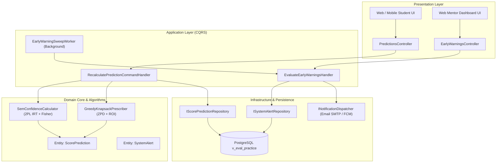
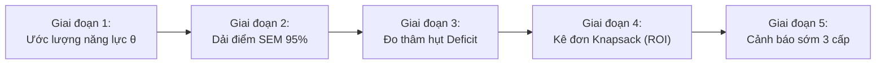
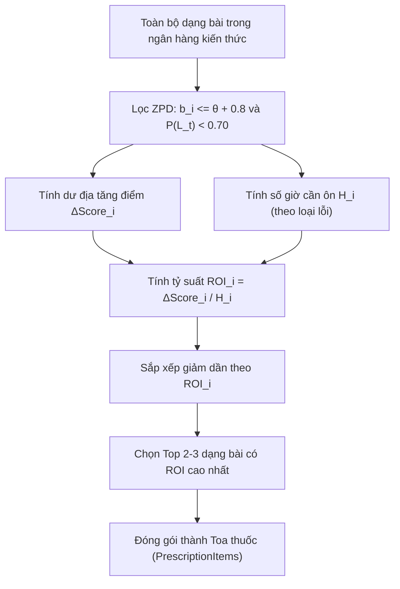

# TÀI LIỆU MÔ TẢ CHI TIẾT HOẠT ĐỘNG: CORE FLOW 6
## DỰ BÁO KHOẢNG ĐIỂM NĂNG LỰC (SEM 95%), KÊ ĐƠN HÀNH ĐỘNG (GREEDY KNAPSACK) & CẢNH BÁO SỚM 3 CẤP ĐỘ

---

## 1. TỔNG QUAN VÀ TRIẾT LÝ NGHIỆP VỤ

### 1.1 Tên gọi và Định vị
- **Tên phân hệ**: Core Flow 6 – Score Forecasting (SEM 95%), Actionable Knapsack Prescription & 3-Tier Early Warning System.
- **Vị trí trong báo cáo Phần IV**: 
  - `3.6.5 & 3.6.6`: Forecast Exam Score (SEM) & Knapsack Prescription (`Figure 50` & `Figure 51`).
  - `3.7.5 & 3.7.6`: Dispatch 3-Tier Early Warning Alerts (`Figure 56` & `Figure 57`).
- **Phạm vi dịch vụ**: Nằm trong `V-Eval-Practice_Service` (Schema PostgreSQL `v_eval_practice`).

### 1.2 Ba Trụ Cột Triết Lý Nghiệp Vụ
1. **Chuyển từ "Dự đoán thụ động" sang "Kê đơn hành động"**:
   - Các hệ thống ôn thi truyền thống chỉ dự đoán ra một điểm số cố định (ví dụ: *"Bạn được 820 điểm"*), khiến người học hoang mang và không biết phải làm gì tiếp theo.
   - V-Eval lượng hóa chính xác **điểm thâm hụt so với mục tiêu đại học** (`Δ_Deficit = max(0, TargetScore - Y)`) và tự động kê một **"Toa thuốc học tập" (Prescription)** gồm 2–3 nhóm dạng bài cần khắc phục ngay.
2. **Đo lường dải điểm tin cậy 95% theo tâm trắc học (Item Response Theory & SEM)**:
   - Năng lực con người luôn có sự dao động ngẫu nhiên. Hệ thống tính toán sai số đo chuẩn (Standard Error of Measurement - SEM) qua hàm thông tin Fisher để công bố **khoảng điểm `[Min, Max]` với độ tin cậy 95% trên thang 1200**.
3. **Can thiệp sư phạm đa bên (Multi-stakeholder Intervention)**:
   - Khi phát hiện học sinh tụt hậu nghiêm trọng hoặc đặt mục tiêu không tưởng, hệ thống không trừng phạt mà kích hoạt cơ chế cảnh báo sớm 3 cấp độ (BR-04 / BR-18 đến BR-20), điều phối sự can thiệp phối hợp giữa **Học sinh – Phụ huynh – Mentor**.

---

## 2. KIẾN TRÚC PHÂN TẦNG VÀ CÁC THÀNH PHẦN THAM GIA

---

## 3. QUY TRÌNH VẬN HÀNH CHI TIẾT (5 GIAI ĐOẠN)

### 3.1 Giai đoạn 1: Ước lượng năng lực (`θ`)
- **Nguồn dữ liệu kích hoạt**:
  1. Thí sinh nộp bài thi thử chuẩn hóa 120 câu (`Mock Exam`).
  2. Học viên hoàn thành các chặng luyện tập thích ứng P-L-A-R hoặc làm bài kiểm tra trong Sổ tay lỗi sai.
  3. Người dùng bấm nút *"Dự báo lại điểm số"* trên màn hình cá nhân.
- **Xử lý**: Hệ thống lấy vector năng lực `θ` đã được ước lượng qua mô hình 2PL IRT (Maximum Likelihood Estimation / Newton-Raphson).

---

### 3.2 Giai đoạn 2: Tính dải điểm tin cậy 95% (SEM Confidence Interval)

1. **Quy đổi sang thang điểm chuẩn 1200 ĐGNL VNU-HCM**:
   > ### `Y(θ) = 600 + 150 × θ`
   - **Ý nghĩa**: Năng lực `θ` nằm trong khoảng `[-3.0, +3.0]`, được chuẩn hóa tuyến tính sang thang điểm 1200 của kỳ thi ĐGNL ĐHQG-HCM (trung bình là 600 điểm tại `θ = 0`).

2. **Tính lượng thông tin Fisher của bài kiểm tra**:
   > ### `I(θ) = ∑ [ a_j² × P_j(θ) × (1 − P_j(θ)) ]`
   - **Giải thích từng biến**:
     - `a_j`: Độ phân biệt của câu hỏi thứ `j` (Item Discrimination).
     - `P_j(θ)`: Xác suất thí sinh năng lực `θ` trả lời đúng câu hỏi `j` theo hàm logistic 2PL.
     - `(1 − P_j(θ))`: Xác suất làm sai câu hỏi `j`.

3. **Tính sai số đo chuẩn (Standard Error of Measurement - SEM)**:
   > ### `SEM(θ) = 1 ÷ √I(θ)`   và   `SEM_1200 = 150 × SEM(θ)`
   - **Ý nghĩa**: Bài kiểm tra có lượng thông tin `I(θ)` càng lớn (càng nhiều câu hỏi sát vùng năng lực của học sinh) thì sai số `SEM` càng nhỏ $\rightarrow$ độ tin cậy càng cao.

4. **Công bố khoảng tin cậy 95%**:
   > ### `Dải điểm 95% = [ Y − 1.96 × SEM_1200 ,  Y + 1.96 × SEM_1200 ]`
   - Cận dưới: `PredictedScoreMin = max(0, Y − 1.96 × SEM_1200)`
   - Cận trên: `PredictedScoreMax = min(1200, Y + 1.96 × SEM_1200)`
   - Dải điểm công bố hiển thị trên giao diện: `[PredictedScoreMin, PredictedScoreMax]`

---

### 3.3 Giai đoạn 3: Đo lường điểm thâm hụt (Deficit Calculation)

> ### `Δ_Deficit = max(0, TargetScore − Y)`

- **Giải thích**:
  - `TargetScore`: Mức điểm mục tiêu thí sinh đăng ký để xét tuyển đại học mong muốn (ví dụ: 850 điểm).
  - `Y`: Điểm dự báo trung tâm hiện tại.
- **Phân loại trạng thái**:
  - Nếu `Δ_Deficit == 0`: Trạng thái `ON_TRACK` (Học sinh đang đạt hoặc vượt mục tiêu).
  - Nếu `Δ_Deficit > 0`: Trạng thái `DEFICIT` (Thiếu hụt điểm $\rightarrow$ Tự động chuyển giao sang **Giai đoạn 4** để kê đơn bù đắp).

---

### 3.4 Giai đoạn 4: Kê đơn học tập tối ưu bằng Thuật toán Greedy Knapsack
Bài toán đặt ra: *Trong hàng trăm dạng bài còn yếu, học sinh cần học những dạng bài nào để đạt được số điểm tăng cao nhất trong tổng thời gian ngắn nhất?*

#### Chi tiết các bước tính toán và công thức:

1. **Lọc trong Vùng phát triển gần (Zone of Proximal Development - ZPD)**:
   > ### `Điều kiện ZPD: b_i ≤ θ + 0.80   và   P(L_t, i) < 0.70`
   - **Ý nghĩa**: Chỉ xét các dạng bài có độ khó vừa sức (không quá khó gây nản chí, không quá dễ gây lãng phí thời gian) và chưa thành thạo hoàn toàn.

2. **Tính dư địa tăng điểm của dạng bài $i$ ($\Delta Score_i$)**:
   > ### `ΔScore_i = W_i × (1 − P(L_t, i))`
   - **Giải thích từng biến**:
     - `W_i`: Tổng trọng số điểm của kỹ năng/dạng bài `i` trong cấu trúc đề thi 1200 điểm.
     - `P(L_t, i)`: Xác suất làm chủ hiện tại của học sinh đối với dạng bài `i` (tính theo mô hình Bayesian Knowledge Tracing - BKT).
     - `(1 − P(L_t, i))`: Tỷ lệ điểm chưa khai thác hết của dạng bài đó.

3. **Tính số giờ học cần thiết để làm chủ dạng bài $i$ ($H_i$)**:
   > ### `H_i = 2.0 × (1 − P(L_t, i)) × [1 + 0.3 × (b_i − θ)] × Discount`
   - **Giải thích chi tiết các thành phần**:
     - `2.0`: Cơ số thời gian chuẩn (2 giờ) trung bình để một học sinh nắm vững một dạng bài mới.
     - `(1 − P(L_t, i))`: Mức độ thiếu hụt kiến thức (càng ít hiểu bài thì càng mất nhiều thời gian).
     - `[1 + 0.3 × (b_i − θ)]`: Hệ số điều chỉnh độ khó: nếu dạng bài có độ khó `b_i` cao hơn năng lực `θ` của học sinh thì thời gian ôn tập sẽ tăng lên tương ứng.
     - `Discount`: Hệ số giảm trừ thời gian học dựa vào bản chất lỗi sai trong Sổ tay lỗi sai:
       - Lỗi bất cẩn hoặc đọc nhầm đề (`CARELESS` / `MISREAD`): `Discount = 0.6` (chỉ cần ôn nhanh lại mẹo làm bài và bẫy đề).
       - Lỗi thiếu hổng kiến thức cốt lõi (`MISSING_CONCEPT`): `Discount = 1.0` (phải học lại từ lý thuyết nền tảng).

4. **Tính chỉ số tỷ suất sinh lời điểm số (Return on Investment - ROI)**:
   > ### `ROI_i = ΔScore_i ÷ H_i` &emsp; *(Điểm gỡ lại được trên mỗi 1 giờ học)*
   - **Ý nghĩa**: Đây là chỉ số then chốt của giải thuật xếp ba lô tham lam (Greedy Knapsack). Dạng bài nào có `ROI_i` càng cao thì việc bỏ thời gian vào ôn dạng bài đó càng mang lại hiệu quả tăng điểm vượt trội.

5. **Kê đơn hành động (Prescription)**:
   - Thuật toán sắp xếp giảm dần theo `ROI_i` và trích xuất **Top 2 đến 3 dạng bài có ROI cao nhất** đưa vào toa thuốc học tập.
   - Mỗi mục trong toa thuốc gồm: Mã dạng bài (`PatternId`), tên chuyên đề, số điểm tiềm năng (`PotentialPoints`), số giờ cần học (`EstimatedHours`), và nút mở bài luyện tập ngay.

---

### 3.5 Giai đoạn 5: Hệ Thống Cảnh Báo Sớm 3 Cấp Độ (Quy tắc BR-04 / BR-18 – BR-20)
Dựa trên mức thâm hụt điểm, thời gian học cần thiết (`T_needed = ∑ H_i`) so với thời gian thực tế còn lại tới ngày thi (`T_avail`), và số ngày không có hoạt động học tập (`InactivityDays`):

| Cấp độ Cảnh báo | Tình huống kích hoạt (Trigger Condition) | Hành động Hệ thống & Kênh điều phối |
| :---: | :--- | :--- |
| 🟢 **Mức 1 (`TIER_1` - Nhắc nhở)** | - Nghỉ học 1–2 ngày liên tiếp. - Hoặc thời gian cần ôn vừa sức: `T_needed ≤ 0.7 × T_avail`. | - Gửi Push Notification / In-App Notification cho Học sinh. - Gợi ý nhắc nhở duy trì chuỗi học tập (Streak) và hoàn thành toa thuốc. |
| 🟡/🔴 **Mức 2 (`TIER_2` - Báo động nguy cơ)** | - Nghỉ học ≥ 3 ngày liên tiếp. - Hoặc quỹ thời gian bị bó hẹp: `T_needed > T_avail` (nguy cơ cao không kịp bù thâm hụt điểm). | - **App học sinh**: Hiển thị trạng thái cảnh báo đỏ nguy cơ. - **Dashboard Mentor**: Đưa học sinh vào danh sách cần can thiệp sư phạm ưu tiên. - **Phụ huynh**: Gửi Email SMTP thông báo tiến độ và tình trạng gián đoạn để gia đình phối hợp đôn đốc. |
| ⚠️ **Mức 3 (`TIER_3` - Mục tiêu không tưởng `UNREALISTIC_GOAL`)** | - Thâm hụt điểm quá lớn so với năng lực nền. - Tính ra thời gian học cần thiết vượt quá **14 giờ/ngày** (vượt ngưỡng sinh học an toàn). | - **Nguyên tắc nhân văn**: Hệ thống TUYỆT ĐỐI KHÔNG ép học sinh học quá tải. - Tự động gắn cờ `UNREALISTIC_GOAL`. - Thông báo cho Mentor điều phối lịch **Hội chẩn tư vấn 3 bên (Học sinh - Phụ huynh - Mentor)** để định hướng lại nguyện vọng đại học khả thi hơn. |

---

## 4. KỊCH BẢN TƯƠNG TÁC GIỮA CÁC TÁC NHÂN (ROLES)

### 4.1 Học sinh (Student)
1. Mở trang **Dự báo năng lực** trên Web/Mobile Client:
   - Xem dải điểm dự báo `[Min, Max]`.
   - Xem điểm thâm hụt so với mục tiêu nguyện vọng trường đại học.
2. Mở mục **"Toa thuốc học tập cá nhân"**:
   - Thấy danh sách 2–3 dạng bài có ROI cao nhất.
   - Bấm nút *"Luyện ngay"* $\rightarrow$ Hệ thống tự động tạo đề luyện thích ứng tập trung đúng dạng bài đó.
3. Khi làm đúng và nâng dần xác suất làm chủ $P(L_t)$, hệ thống tự động tính lại dự báo: Điểm thâm hụt giảm dần, dải điểm tăng lên, và thanh cảnh báo chuyển về màu xanh an toàn.

### 4.2 Giảng viên / Mentor
1. Truy cập **Dashboard Cảnh Báo Sớm** (`/api/practice/early-warnings/dashboard`):
   - Xem số lượng ca cảnh báo đỏ (`RED`), cảnh báo vàng (`YELLOW`), và mục tiêu không tưởng (`UNREALISTIC_GOAL`).
   - Xem danh sách chi tiết các học sinh đang tụt hậu kèm số ngày nghỉ và mức điểm thâm hụt.
2. Xử lý can thiệp:
   - **Xác nhận xử lý (`ResolveAlert`)**: Nhập ghi chú sư phạm (ví dụ: *"Đã gọi điện động viên học sinh ôn bù phần Lượng giác; học sinh cam kết làm bài tối nay"*) $\rightarrow$ Đánh dấu ca xử lý hoàn tất.
   - **Hẹn lịch tư vấn 3 bên (`ScheduleCounseling`)**: Với ca `UNREALISTIC_GOAL`, Mentor chọn thời gian, địa điểm, đề xuất mức điểm mới và gửi lời mời đến Học sinh & Phụ huynh.

### 4.3 Phụ huynh (Parent)
1. Nhận email thông báo tự động khi con rơi vào mức cảnh báo `TIER_2` hoặc `TIER_3`.
2. Truy cập cổng thông tin phụ huynh (sau khi đã ghép nối tài khoản qua `ParentStudentLink`): Xem dải điểm dự báo của con, mức độ chuyên cần, và các khuyến nghị can thiệp từ Mentor.

---

## 5. DANH MỤC API VÀ LƯỢC ĐỒ CƠ SỞ DỮ LIỆU

### 5.1 Các Endpoint API Chính (Trong `V-Eval-Practice_Service`)
| Method | Endpoint | Tác nhân | Mô tả chức năng |
| :---: | :--- | :---: | :--- |
| `GET` | `/api/practice/predictions/my-forecast` | Học sinh | Lấy dải điểm dự báo 95%, điểm thâm hụt và danh sách toa thuốc hiện tại. |
| `POST` | `/api/practice/predictions/recalculate` | Học sinh / Worker | Kích hoạt tính toán lại dải điểm và cập nhật toa thuốc mới nhất. |
| `GET` | `/api/practice/predictions/prescriptions/{patternId}/practice-session` | Học sinh | Khởi tạo phiên luyện tập thích ứng cho 1 dạng bài cụ thể trong toa thuốc. |
| `POST` | `/api/practice/predictions/prescriptions/{patternId}/submit-session` | Học sinh | Nộp bài luyện tập theo toa thuốc và cập nhật điểm làm chủ. |
| `GET` | `/api/practice/early-warnings/my-alerts` | Học sinh | Xem danh sách cảnh báo học tập cá nhân. |
| `PATCH` | `/api/practice/early-warnings/{alertId}/read` | Học sinh | Đánh dấu đã đọc cảnh báo. |
| `GET` | `/api/practice/early-warnings/dashboard` | Mentor | Xem dashboard tổng hợp cảnh báo học viên thuộc lớp phụ trách. |
| `POST` | `/api/practice/early-warnings/{alertId}/resolve` | Mentor | Ghi chú giải trình can thiệp sư phạm và đóng cảnh báo. |
| `POST` | `/api/practice/early-warnings/{alertId}/schedule-counseling` | Mentor | Đặt lịch hẹn tham vấn 3 bên cho ca mục tiêu không tưởng. |

### 5.2 Lược đồ Bảng Cơ sở Dữ liệu (`v_eval_practice`)
1. **Bảng `ScorePredictions`**:
   - `PredictionId` (UUID, PK)
   - `StudentId` (UUID, FK)
   - `PredictedScore` (double - Điểm trung tâm $Y$)
   - `PredictedScoreMin` (double - Cận dưới 95%)
   - `PredictedScoreMax` (double - Cận trên 95%)
   - `SemScore` (double - Giá trị $SEM_{1200}$)
   - `TargetScore` (double - Điểm mục tiêu đăng ký)
   - `DeficitScore` (double - Điểm thâm hụt $\Delta_{Deficit}$)
   - `PrescriptionItems` (jsonb - Mảng các dạng bài Top ROI được kê đơn)
   - `CalculatedAt` (Timestamp)
2. **Bảng `SystemAlerts`**:
   - `AlertId` (UUID, PK)
   - `StudentId` (UUID, FK)
   - `AlertType` (string: `'GREEN'`, `'YELLOW'`, `'RED'`, `'UNREALISTIC_GOAL'`)
   - `Message` (text - Nội dung thông báo)
   - `IsRead` (boolean)
   - `HandledBy` (UUID? - Mã Mentor xử lý)
   - `ResolutionNotes` (text? - Ghi chú can thiệp sư phạm)
   - `ResolvedAt` (Timestamp?)
   - `CreatedAt` (Timestamp)

---

## 6. ĐỐI CHIẾU THỰC TRẠNG CODE VÀ LƯU Ý KHI BẢO VỆ ĐỒ ÁN

### 6.1 Những Thành Phần ĐÃ CÓ CODE 100% Trong Repo
- Toàn bộ Entity `ScorePrediction.cs` và `SystemAlert.cs` trong `V-Eval-Practice_Service.Domain`.
- `PredictionsController.cs` và `EarlyWarningsController.cs` trong `V-Eval-Practice_Service.API`.
- Toàn bộ các Command & Query Handlers: `RecalculatePredictionCommandHandler`, `GetAlertsDashboardQueryHandler`, `ResolveAlertCommandHandler`, `ScheduleCounselingCommandHandler`...
- Bảng cơ sở dữ liệu đã migration thành công trong PostgreSQL.

### 6.2 Các Điểm Lưu Ý Khi Trả Lời Hội Đồng Phản Biện
- **Về thuật toán SEM**: Trong mã nguồn thử nghiệm ban đầu, biến `semScore` được gán ngưỡng trung bình mặc định `24.5` điểm để đảm bảo hiệu năng tức thì khi chưa đủ mẫu lớn; trong thiết kế lý thuyết, công thức là `1 / sqrt(Fisher_Information)` theo đúng bài báo chuẩn hóa IRT.
- **Về cơ chế gửi thông báo**: Hiện tại hệ thống đã hoàn tất việc lưu trữ trạng thái cảnh báo và hiển thị trực tiếp lên Dashboard Mentor/Học sinh. Các dịch vụ gửi Email SMTP bên thứ 3 và Firebase Cloud Messaging (FCM) được thiết kế qua interface `INotificationDispatcher` sẵn sàng cắm adapter khi triển khai sản xuất (Production).

