# Kế Hoạch Triển Khai Auto-CD Nhánh `main` Lên Ubuntu Docker Server (`veval.io.vn`)

> **Mục tiêu**: Tự động hóa 100% quy trình triển khai (Continuous Deployment) mỗi khi merge Pull Request vào nhánh `main` của bất kỳ service nào trong hệ sinh thái V-Eval lên máy chủ Ubuntu đang chạy Docker Compose + Cloudflare Tunnel (`veval.io.vn`, `api.veval.io.vn`).

---

## 1. Kiến Trúc Tổng Quan (GitHub Organization Self-Hosted Runner)

Vì hệ thống V-Eval gồm **1 repo điều phối (`System-Repo`)** chứa [docker-compose.yml](../../docker-compose.yml) và **6 repo microservice độc lập** trong cùng tổ chức `Capstone-OG`, phương án tối ưu nhất là cài đặt **1 GitHub Actions Self-Hosted Runner** cấp Organization trên máy chủ Ubuntu.

```mermaid
flowchart LR
  Merge["Merge PR vao main"] --> CI["GitHub Cloud CI (Build va Test)"]
  CI --> Runner["Self-Hosted Runner tren Ubuntu"]
  Runner --> Lock["Khoa flock chong chay chong cheo"]
  Lock --> Pull["git pull origin main (dung repo vua sua)"]
  Pull --> Build["docker compose up -d --build --no-deps service"]
  Build --> Health["Kiem tra Healthcheck va don image cu"]
  Health --> Live["Cap nhat live tren veval.io.vn"]
```



### Ưu điểm của kiến trúc này
- **Không cần mở port SSH / không cần IP tĩnh**: Runner chủ động kết nối ngược (outbound HTTPS) lên GitHub giống như `cloudflared`.
- **1 Runner phục vụ toàn bộ 7 repo**: Cài đặt 1 lần duy nhất ở cấp Organization `Capstone-OG`.
- **Triển khai chọn lọc (Selective Deploy)**: Chỉ rebuild đúng container của service vừa merge `main` (~15–45 giây), tuyệt đối không khởi động lại `veval-tunnel` hay làm gián đoạn các service khác.
- **Bảo toàn cấu hình máy chủ**: File `.env` và chứng chỉ `/home/thai-thinh/.cloudflared` giữ nguyên trên Ubuntu.

---

## 2. Các Điểm Kỹ Thuật Cần Chỉnh Trước Khi Bật CD

1. **Bỏ bind-mount `dist` cứng của `v-eval-web-client` trong `docker-compose.yml`**:
   - Hiện tại `v-eval-web-client` đang mount `./All Services/V-Eval-Web_Client/dist:/usr/share/nginx/html:ro`.
   - Nếu giữ dòng mount này, khi Docker rebuild image mới, Nginx vẫn đọc thư mục `dist` cũ trên host. Cần gỡ dòng mount `dist` để Nginx phục vụ trực tiếp bản build mới bên trong image Docker.
2. **Bảo mật `DATABASE_URL` của `v-eval-ai-rag`**:
   - Chuyển chuỗi kết nối DB đang ghi cứng trong `docker-compose.yml` sang biến môi trường `${DATABASE_URL}` trong file `.env` trên máy chủ Ubuntu.

---

## 3. Lộ Trình Triển Khai 4 Giai Đoạn

### Giai đoạn 1: Cài đặt GitHub Self-Hosted Runner trên Ubuntu (Làm 1 lần ~5 phút)
1. Đảm bảo thư mục dự án trên Ubuntu (`/data/Capstone`) đã clone đủ `System-Repo` và 6 repo con trong `All Services/`, tất cả đang ở nhánh `main`.
2. Cấp quyền Docker không cần `sudo` cho user chạy Runner:
   ```bash
   sudo usermod -aG docker thai-thinh
   newgrp docker
   ```
3. Truy cập `https://github.com/organizations/Capstone-OG/settings/actions/runners/new`, chọn **Linux (x64)**, chạy bộ lệnh tải & đăng ký với label `veval-prod`.
4. Cài Runner thành dịch vụ nền `systemd` để tự khởi động cùng máy chủ:
   ```bash
   sudo ./svc.sh install
   sudo ./svc.sh start
   sudo ./svc.sh status
   ```

### Giai đoạn 2: Script Triển Khai Trung Tâm (`Scripts/deploy_service.sh`)
Tạo 1 script duy nhất trong `System-Repo` để mọi repo gọi chung:
- **Khóa đồng thời**: Dùng `flock /tmp/veval-deploy.lock` để xếp hàng an toàn nếu 2 repo cùng merge `main` một lúc.
- **Cập nhật mã nguồn**: `git fetch origin main && git reset --hard origin/main` đúng thư mục repo mục tiêu.
- **Ánh xạ mục tiêu Docker Compose**:

| Tham số truyền vào | Thư mục Repo cần pull | Service Docker Compose rebuild |
| --- | --- | --- |
| `web-client` | `All Services/V-Eval-Web_Client` | `v-eval-web-client` |
| `gateway` | `All Services/V-Eval-Gateway` | `v-eval-gateway` |
| `identity` | `All Services/V-Eval-Identity_Service` | `v-eval-identity-service` |
| `content` | `All Services/V-Eval-Content_Service` | `v-eval-content-service` |
| `practice` | `All Services/V-Eval-Practice_Service` | `v-eval-practice-service` |
| `ai-engine` | `All Services/V-Eval-Ai_Engine` | `v-eval-ai-engine v-eval-ai-rag` |
| `system` | `.` (`System-Repo`) | `docker compose config` (không restart `tunnel`) |

- **Lệnh triển khai chuẩn**:
  ```bash
  docker compose up -d --build --no-deps <service-name>
  docker image prune -f
  ```

### Giai đoạn 3: File Workflow `.github/workflows/cd-main.yml` Cho 7 Repo
Mỗi repo có 1 file workflow kích hoạt khi `push` vào `main` gồm 2 job:
1. **`ci-verify` (`runs-on: ubuntu-latest`)**: Chạy build/test (`npm run build`, `dotnet test`, `docker compose config`). Nếu lỗi sẽ dừng ngay, không deploy.
2. **`deploy-ubuntu` (`needs: ci-verify`, `runs-on: [self-hosted, veval-prod]`)**: Gọi trực tiếp `/data/Capstone/Scripts/deploy_service.sh <target>`.

### Giai đoạn 4: Kiểm Thử & Nghiệm Thu
1. Chạy thử thủ công `./Scripts/deploy_service.sh web-client` trên Ubuntu để kiểm chứng thời gian rebuild và xác nhận `https://veval.io.vn` nhận bản mới.
2. Thử merge 1 PR nhỏ vào `main` trên `V-Eval-Web_Client` và theo dõi toàn trình CI → CD trên tab **GitHub Actions**.
3. Kiểm tra lại trạng thái `veval-tunnel` không bị ngắt kết nối trong suốt quá trình rebuild các service.
