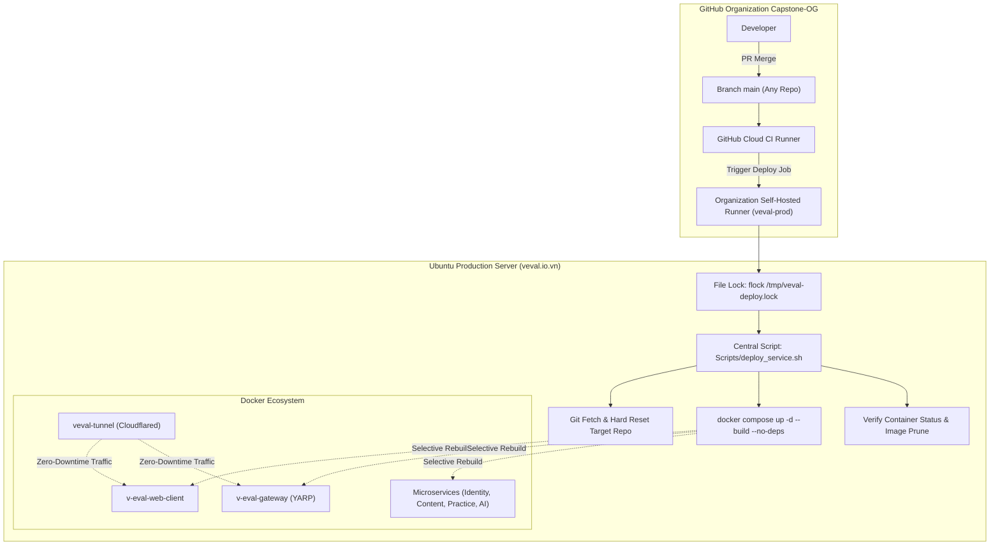

# TIẾN ĐỘ VÀ QUY TRÌNH HỆ THỐNG (PROCESS & TRACKING) - SYSTEM REPO

## 1. Kiến Trúc Điều Phối & Tự Động Hóa Triển Khai (Continuous Deployment)

Hệ thống điều phối trung tâm quản lý 6 microservices và 1 reverse proxy YARP cùng 1 Cloudflare Tunnel được triển khai trên nền tảng Docker Compose tại máy chủ Ubuntu (`veval.io.vn`).

---

## 2. Bảng Theo Dõi Tiến Độ Chi Tiết (Tracking Table)

| Hạng mục | Thành phần liên quan | Trạng thái | Tiến độ chi tiết |
| --- | --- | --- | --- |
| **Tinh chỉnh Docker Compose** | [docker-compose.yml](../docker-compose.yml) | Hoàn thành (100%) | Đã gỡ bỏ volume bind-mount tĩnh `dist` của Web Client; bảo mật `DATABASE_URL` cho AI RAG qua file `.env`. Đã kiểm tra `docker compose config` hợp lệ. |
| **Script triển khai trung tâm** | [Scripts/deploy_service.sh](../Scripts/deploy_service.sh) | Hoàn thành (100%) | Đã tích hợp `flock`, ánh xạ chuẩn 7 mục tiêu (`web-client`, `gateway`, `identity`, `content`, `practice`, `ai-engine`, `system`), tự động pull `origin/main`, rebuild `--no-deps`, dọn rác images. |
| **Cài đặt GitHub Runner** | `/home/thai-thinh/actions-runner` | Hoàn thành (100%) | Đăng ký thành công cấp Organization `Capstone-OG`, gán nhãn `veval-prod`, cấu hình dịch vụ `systemd --user` (`actions.runner.service`) kèm `Linger=yes`, đang ở trạng thái `Listening for Jobs`. |
| **Workflow CD Toàn Bộ 7 Repositories** | [.github/workflows/cd-main.yml](../.github/workflows/cd-main.yml) & 6 services | Hoàn thành (100%) | Đã thiết lập trực tiếp file workflow `.github/workflows/cd-main.yml` cho cả 7 repository (`System-Repo` + 6 microservices), cấu hình 2 stage: `ci-verify` (Cloud Ubuntu + nạp gRPC) và `deploy-ubuntu` (Self-hosted Runner `veval-prod`). |
| **Tài liệu hướng dẫn toàn diện A-Z** | [docs/huong_dan_trien_khai_auto_cd_toan_dien.md](./huong_dan_trien_khai_auto_cd_toan_dien.md) | Hoàn thành (100%) | Đã biên soạn tài liệu chi tiết gồm kiến trúc, full câu lệnh từ A-Z, bảng đường dẫn tuyệt đối, chi tiết script và sổ tay xử lý sự cố. |
| **Kiểm thử nghiệm thu thực tế** | Container `v_eval_web_client` & `veval-tunnel` | Hoàn thành (100%) | Đã chạy thử nghiệm script thực tế: `v_eval_web_client` rebuild và khởi động lại trơn tru trong 26s, `veval-tunnel` và các service khác duy trì liên tục không gián đoạn. |

