# HƯỚNG DẪN SỬA TRỰC TIẾP BÁO CÁO TỔNG (CAPSTONE MASTER REPORT)

> [!NOTE]
> **File Word gốc đang sửa:** [`Report7_Final Project Report (2).docx`](./Report7_Final%20Project%20Report%20%282%29.docx). Mục nào gắn nhãn **`🟢 [ĐỂ NGUYÊN]`** thì giữ nguyên không cần sửa trong Word; mục nào gắn nhãn **`✏️ [ĐÃ SỬA]`**, **`➕ [THÊM MỚI]`** hoặc **`🗑️ [XÓA BỎ]`** thì copy phần chữ mới thay vào dòng tương ứng.

**Tiến độ rà soát & chuẩn hóa hiện tại:**
- [x] **Front Matter** (*Cover Page, Acknowledgement, Definition and Acronyms*)
- [x] **Part I. Project Introduction**
- [x] **Part II. Project Management Plan**
- [x] **Part III. Software Requirement Specification**
- [ ] **Part IV. Software Design Description** *(Chờ gửi tiếp)*
- [ ] **Part V. Software Testing Documentation** *(Chờ gửi tiếp)*
- [ ] **Part VI & VII. Release Package, User Guides & Appendix** *(Chờ gửi tiếp)*

---

# PHẦN MỞ ĐẦU (FRONT MATTER)

---

## 1. Trang Bìa (`Cover Page`) — ✏️ `[ĐÃ SỬA - Điền thông tin vào các ô Placeholder mẫu & đổi Hanoi -> Ho Chi Minh City]`

> **Sửa thành (Điền vào trang bìa Word, xóa bớt dòng Member thứ 5 dư thừa):**

- **Project name:** AI-powered Personalized Learning Path Platform for Competency Assessment Exam Preparation
- **Group Name:** `FA26SE090`
- **Group Members:**
  - Phạm Tấn Lộc — `SE184400`
  - Trần Thái Thịnh — `SE182004`
  - Nguyễn Duy Khôi — `SE184910`
  - Mai Thành Nhân — `SE184916`
- **Supervisor:** Mr. Nguyễn Trọng Tài
- **Ext Supervisor:** *(Để trống hoặc xóa nếu không có)*
- **Capstone Project code:** `FA26SE090`
- **Địa điểm & Thời gian cuối trang bìa:** `- Ho Chi Minh City, 11/2026 -` *(thay cho* `- Hanoi, <month>/<year> -`*)*

---

## 2. Mục lục (`Table of Contents`) — 🟢 `[ĐỂ NGUYÊN cấu trúc — Chỉ bấm chuột phải -> Update Field sau khi sửa xong toàn bài]`

---

## 3. Lời cảm ơn (`Acknowledgement`) — ➕ `[THÊM MỚI - Thay cho dòng "[Fill team’s acknowledgement here…]"]`

> **Copy đoạn dưới đây dán đè vào dòng** `[Fill team’s acknowledgement here…]`**:**

We would like to express our sincere gratitude to our supervisor, Mr. Nguyễn Trọng Tài, for his dedicated guidance, insightful feedback, and continuous encouragement throughout the research, design, and implementation of this Capstone Project. His expertise in software engineering and educational systems has been invaluable in helping our team refine both the pedagogical foundation and technical architecture of the platform.

We also extend our appreciation to the faculty members and review council of the Software Engineering Department at FPT University Ho Chi Minh City for their constructive evaluations during the project milestones, as well as to our peers and family members for their unwavering support during the completion of this project.

---

## 4. Bảng Thuật ngữ & Từ viết tắt (`Definition and Acronyms`) — ✏️ `[ĐÃ SỬA TOÀN BỘ - Xóa dòng nhắc nhở mẫu, xóa rác "PWM: Psychology website" / "AWS" & bổ sung từ viết tắt của đề tài]`

> **Xóa câu** `[Fill all the definitions, acronyms,...]` **và thay bảng cũ bằng bảng chuẩn A–Z dưới đây:**

| Acronym | Definition |
| --- | --- |
| API | Application Programming Interface |
| BA | Business Analysis |
| BKT | Bayesian Knowledge Tracing |
| BR | Business Rule |
| DAG | Directed Acyclic Graph |
| DGNL / V-ACT | VNU-HCM Competency Assessment Examination (Đánh giá Năng lực ĐHQG-HCM) |
| ERD | Entity Relationship Diagram |
| GraphRAG | Graph-based Retrieval-Augmented Generation |
| GUI | Graphical User Interface |
| IRT | Item Response Theory |
| JWT | JSON Web Token |
| LLM | Large Language Model |
| OTP | One-Time Password |
| P-L-A-R | Preview – Learn – Apply – Reflect Pedagogical Loop |
| PM | Project Manager |
| RAG | Retrieval-Augmented Generation |
| RBAC | Role-Based Access Control |
| SDD | Software Design Description |
| SEM | Standard Error of Measurement |
| SM-2 | SuperMemo-2 Spaced Repetition Algorithm |
| SPMP | Software Project Management Plan |
| SRS | Software Requirement Specification |
| SSE | Server-Sent Events |
| UAT | User Acceptance Test |
| UC | Use Case |
| VNU-HCM | Vietnam National University, Ho Chi Minh City |
| ZPD | Zone of Proximal Development |

---

# I. Project Introduction

---

## 1. Overview

### 1.1 Project Information

- `Project name`: **🟢** `[ĐỂ NGUYÊN]`
- `Project code`: **🟢** `[ĐỂ NGUYÊN]`
- `Group name`: **🟢** `[ĐỂ NGUYÊN]`
- `Software type`: **✏️** `[ĐÃ SỬA]`
  - *Bản gốc:* `Software type: Web, Mobile App`
  - *Sửa thành:* `Software type: Web Application & Companion Mobile App`

### 1.2 Project Team — 🟢 `[ĐỂ NGUYÊN]`

*(Bảng danh sách giảng viên và 4 thành viên hiện tại đã đúng tên, email, SĐT — để nguyên).*

---

## 2. Product Background

- **Đoạn mở đầu (**`The entrance examination preparation sector... limitations:`**)**: **🟢** `[ĐỂ NGUYÊN]`
- **Bullet 1 (**`One-size-fits-all instruction...`**)**: **🟢** `[ĐỂ NGUYÊN]`
- **Bullet 2 (**`Inefficient learning focus...`**)**: **🟢** `[ĐỂ NGUYÊN]`
- **Bullet 3 (**`Limited multi-campus synchronization...`**)**: **✏️** `[ĐÃ SỬA NHẸ 1 TỪ - bỏ chữ "live" để không dính Live Classroom đã cắt bỏ]`
  - *Bản gốc:* `Limited multi-campus synchronization: Centers lack automated tools to balance self-paced digital learning with localized branch operations and live teacher-led interventions.`
  - *Sửa thành:* `Limited multi-campus synchronization: Centers lack automated tools to balance self-paced digital learning with localized branch operations and **timely** teacher-led interventions.`
- **Bullet 4 (**`Lack of grounded, real-time guidance...`**)**: **🟢** `[ĐỂ NGUYÊN]`
- **Đoạn kết cuối mục 2 (**`With the continuous growth...`**)**: **✏️** `[ĐÃ SỬA NHẸ - đổi "Online Blended Learning" thành "AI-powered Personalized Adaptive Learning"]`
  - *Bản gốc:* `With the continuous growth of adaptive learning technologies and multi-campus educational demand, there is a strong need for an intelligent Online Blended Learning platform that personalizes learning paths, traces atomic competencies, and provides real-time AI tutor support for DGNL candidates.`
  - *Sửa thành:* `With the continuous growth of adaptive learning technologies and multi-campus educational demand, there is a strong need for an intelligent **AI-powered Personalized Adaptive Learning** platform that personalizes learning paths, traces atomic competencies, and provides real-time AI tutor support for DGNL candidates.`

---

## 3. Existing Systems

- 

### 3.1 VETA EDU — 🟢 `[ĐỂ NGUYÊN 100%]`

- 

### 3.2 DOL THPT (DOL English) — 🟢 `[ĐỂ NGUYÊN 100%]`

- 

### 3.3 Tuyensinh247 — 🟢 `[ĐỂ NGUYÊN 100%]`

---

## 4. Business Opportunity

- **Đoạn 1 (**`The VNU-HCM Competency Assessment Examination... out of 1200).`**)**: **🟢** `[ĐỂ NGUYÊN]`
- **Đoạn 2 (**`However, existing local platforms... student ability.`**)**: **🟢** `[ĐỂ NGUYÊN]`
- **Đoạn 3 (**`Currently, there is no specialized EdTech platform... AI support.`**)**: **🟢** `[ĐỂ NGUYÊN]`
- **Đoạn 4 — Đoạn cuối cùng (**`Our project fills this market gap...`**)**: **✏️** `[ĐÃ SỬA - bỏ chữ "online blended" & "live Q&A sessions", làm rõ Web + Companion Mobile]`
  - *Bản gốc:* `Our project fills this market gap by delivering an online blended learning platform tailored specifically for the VNU-HCM DGNL structure. The platform gives students a personalized study roadmap with adaptive exercises that match their current ability level, while providing centers with centralized tools to manage branch operations, track class heatmaps, and assign teachers for targeted live Q&A sessions.`
  - *Sửa thành:* `Our project fills this market gap by delivering an **AI-powered personalized adaptive learning** platform tailored specifically for the VNU-HCM DGNL structure. The platform gives students a personalized study roadmap with adaptive exercises that match their current ability level **on the Web platform (supported by a Companion Mobile App for viewing progress and alerts)**, while providing centers with centralized tools to manage branch operations, track class heatmaps, and **empower teachers to conduct targeted pedagogical interventions and micro-cohort support**.`

---

## 5. Software Product Vision — 🟢 `[ĐỂ NGUYÊN 100%]`

---

## 6. Project Scope & Limitations

### 6.1 Major Features

#### Common User

- `FE-01: Register & Verify Account`: **🟢** `[ĐỂ NGUYÊN]`
- `FE-02: User Authentication`: **🟢** `[ĐỂ NGUYÊN]`
- `FE-03: Manage Profile & Security`: **🟢** `[ĐỂ NGUYÊN]`

#### Student

- `FE-04: Target Score Configuration`: **✏️** `[ĐÃ SỬA - Khớp chốt sau Review 2: lưu trường/ngành chỉ để đánh giá kết quả nội bộ tại cơ sở, không mâu thuẫn với OS-01]`
  - *Bản gốc:* `FE-04: Target Score Configuration – Configure target university majors and benchmark scores on the 1200 scale to quantify score deficits.`
  - *Sửa thành:* `FE-04: Target Score & Benchmark Configuration – Record self-selected target universities/majors and reference benchmark scores on the 1200 scale strictly as an internal evaluation baseline at the center to quantify score deficits and evaluate whether learners achieve their initial academic goals.`
- `FE-05: Standardized Diagnostic Assessment`: **🟢** `[ĐỂ NGUYÊN]` *(giữ nguyên công thức* `θ₀` *có sẵn trong Word)*
- `FE-06: Dynamic DAG Learning Roadmap`: **🟢** `[ĐỂ NGUYÊN]` *(giữ nguyên công thức* `P(L₀) ≥ 0.85` *có sẵn trong Word)*
- `FE-07: Adaptive P-L-A-R Practice`: **🟢** `[ĐỂ NGUYÊN]` *(giữ nguyên công thức* `≥ 80%` *có sẵn trong Word)*
- `FE-08: Socratic AI Tutor Interaction`: **🟢** `[ĐỂ NGUYÊN]`
- `FE-09: Standardized Proctored Mock Exam`: **🟢** `[ĐỂ NGUYÊN]`
- `FE-10: Spaced Repetition Mistake Notebook`: **🟢** `[ĐỂ NGUYÊN]`
- `FE-11: Score Forecasting & Knapsack Remedial Prescription`: **✏️** `[ĐÃ SỬA NHẸ - thêm vế xem tiến độ/lịch học/dự báo trên Companion Mobile]`
  - *Bản gốc:* `FE-11: Score Forecasting & Knapsack Remedial Prescription – View bounded score intervals [Min,Max] at 95% confidence and receive greedy Knapsack prescriptions targeting the top 2–3 high-yield question patterns.`
  - *Sửa thành:* `FE-11: Score Forecasting & Knapsack Remedial Prescription – View bounded score intervals [Min,Max] at 95% confidence and receive greedy Knapsack prescriptions targeting the top 2–3 high-yield question patterns **on the Web platform, with progress dashboards, study schedules, and score forecasts also viewable via the Companion Mobile App**.`

#### Parent

- `FE-12: Student Account Linkage & Package Payment`: **✏️** `[ĐÃ SỬA - Bổ sung thanh toán gói học/luyện thi trực tuyến của Phụ huynh qua Payment Gateway chung để linh hoạt chọn cổng lúc code và đồng bộ với SRS 4.1 & Context Diagram]`
  - *Bản gốc:* `FE-12: Pair Student Account – Link guardian accounts with student profiles via secure 6-digit one-time pairing codes.`
  - *Sửa thành:* `FE-12: Student Account Linkage & Package Payment – Link guardian accounts with student profiles **and complete online tuition/mock exam package payments via an integrated electronic payment gateway on the Parent Web Portal**.` *(Ghi chú: Nếu nhóm muốn tách Thanh toán thành 1 dòng FE riêng thay vì gộp ở FE-12 thì chèn `FE-15` ngay dưới `FE-14` và tịnh tiến `FE-15..25` lên `FE-16..26`).*
- `FE-13: Passive Progress & Readiness Oversight`: **✏️** `[ĐÃ SỬA NHẸ - ghi rõ xem trên cả Parent Web Portal & Companion Mobile App]`
  - *Bản gốc:* `FE-13: Passive Progress & Readiness Oversight – Read-only dashboard monitoring completed study hours, streak continuity, and milestone completion.`
  - *Sửa thành:* `FE-13: Passive Progress & Readiness Oversight – Read-only dashboard **on the Parent Web Portal and Companion Mobile App** monitoring completed study hours, **study schedules**, streak continuity, milestone completion, **and target score progress**.`
- `FE-14: Receive Academic Status Alerts`: **✏️** `[ĐÃ SỬA NHẸ - ghi rõ nhận trên Web & Companion Mobile]`
  - *Bản gốc:* `FE-14: Receive Academic Status Alerts – Receive automated alerts regarding study inactivity and score deficit thresholds.`
  - *Sửa thành:* `FE-14: Receive Academic Status Alerts – Receive automated alerts regarding study inactivity and score deficit thresholds **across the Parent Web Portal and Companion Mobile App**.`

#### Teacher / Mentor

- `FE-15: Class Competency Heatmap`: **🟢** `[ĐỂ NGUYÊN]` *(giữ nguyên công thức* `P(Lₜ) < 0.50` *có sẵn trong Word)*
- `FE-16: 1-Click Micro-Intervention Dispatch`: **🟢** `[ĐỂ NGUYÊN]`
- `FE-17: Mock Exam Proctoring Review`: **🟢** `[ĐỂ NGUYÊN]`
- `FE-18: Socratic Knowledge Moderation`: **✏️** `[ĐÃ SỬA NHẸ - bổ sung ý biên soạn học liệu/đề thi & giám sát chất lượng gợi ý AI khớp Phiếu đăng ký]`
  - *Bản gốc:* `FE-18: Socratic Knowledge Moderation – Review student-flagged AI interactions and override canonical explanations to correct pedagogical drift.`
  - *Sửa thành:* `FE-18: Content Curation & AI Quality Moderation – **Develop learning materials and mock exams, monitor AI recommendation quality,** review student-flagged AI interactions, and override canonical explanations to correct pedagogical drift.`

#### `Academic Director & Manager` — ✏️ `[ĐÃ SỬA - Tách tiêu đề gộp thành 2 Role riêng biệt để khớp đủ 6 Roles với Use Case & Context Diagram]`

> **1) Sửa tiêu đề** `Academic Director & Manager` **thành** `Academic Director` **và giữ nguyên 3 dòng** `FE-19, FE-20, FE-21` **bên dưới:**

- **Tiêu đề nhóm 1:** `Academic Director`
  - `FE-19: Master Competency Framework Governance`: **🟢** `[ĐỂ NGUYÊN]`
  - `FE-20: Master Item Bank & Psychometric Calibration`: **✏️** `[ĐÃ SỬA NHẸ - thêm 5 chữ cuối về báo cáo liên cơ sở]`
    - *Sửa thành:* `FE-20: Master Item Bank & Psychometric Calibration – Curate canonical questions, calibrate 2PL IRT parameters (a,b), approve isomorphic variants, **and review cross-campus quality reports**.`
  - `FE-21: GraphRAG Knowledge Base Management`: **🟢** `[ĐỂ NGUYÊN]`

> **2) Thêm tiêu đề** `Academic Manager` **ngay bên dưới cho dòng** `FE-22` **(và thêm** `FE-23` **theo dõi chuyên cần/hỗ trợ học sinh nguy cơ):**

- **Tiêu đề nhóm 2:** `Academic Manager`
  - `FE-22: Campus Cohort Operations`: **🟢** `[ĐỂ NGUYÊN]`
  - `FE-23: Student Engagement & Support Coordination` — **➕** `[THÊM MỚI]`:
    - `FE-23: Student Engagement & Support Coordination – Monitor branch-level attendance, comparative class heatmaps, and coordinate timely academic support for at-risk learners.`

#### Administrator — ✏️ `[ĐÃ SỬA NHẸ - Đẩy số thứ tự lên FE-24 và FE-25 do thêm FE-23 ở trên]`

- `FE-24` ***(đổi số từ*** `FE-23` ***cũ)*:** `FE-24: User Administration & RBAC – Manage platform accounts, **campus directories,** assign functional roles, and enforce account suspensions.`
- `FE-25` ***(đổi số từ*** `FE-24` ***cũ)*:** **🟢** `[ĐỂ NGUYÊN nội dung, chỉ đổi mã thành FE-25]`

---

### 6.2 Limitations

- `LI-01` (*Internet & Network Dependency*): **🟢** `[ĐỂ NGUYÊN]`
- `LI-02` (*Third-party LLM Gateway Availability*): **🟢** `[ĐỂ NGUYÊN]`
- `LI-03` (*PostgreSQL pgvector Retrieval Boundary*): **🟢** `[ĐỂ NGUYÊN]` *(giữ nguyên công thức* `≥ 0.75` *trong Word)*
- `LI-04` (*Initial Psychometric Calibration Boundary*): **🟢** `[ĐỂ NGUYÊN]` *(giữ nguyên công thức* `θ₀` *trong Word)*
- `LI-05` (*Pedagogical Governance Boundary*): **🟢** `[ĐỂ NGUYÊN]`
- `LI-06` (*Geographic & Exam Alignment Scope*): **🟢** `[ĐỂ NGUYÊN]`
- `LI-07` **(*Companion Mobile Application Scope*)** — **➕** `[THÊM MỚI 1 dòng vào bảng Limitations]`:
  - **Cột 1:** `LI-07`
  - **Cột 2:** `Companion Mobile Application Scope: Interactive assessments, 120-item proctored mock exams, graph-based learning roadmaps, Socratic AI chat, and center administration operate exclusively on the Web Application; the Companion Mobile App is dedicated to viewing learning progress, study schedules, score forecasts, and status notifications.`
- `OS-01` **(*Out-of-Scope: University Admission & Career Counseling*)** — **✏️** `[ĐÃ SỬA - Làm rõ mốc trường đại học ở FE-04 chỉ để đánh giá kết quả nội bộ, không tư vấn chọn trường/ngành theo điểm]`:
  - *Bản gốc:* `Out-of-Scope: University Admission & Career Counseling: The platform focuses strictly on quantitative ability measurement and score recovery; it does not provide psychological career profiling or qualitative major consultation.`
  - *Sửa thành:* `Out-of-Scope: University Admission & Career Counseling: **While students may record an initial target university benchmark solely as a fixed reference to evaluate training goal attainment at the center,** the platform **does not recommend universities or majors based on test scores, predict official admission probabilities,** or provide psychological career counseling.`
- `OS-02` **(*Out-of-Scope: Coercive Disciplinary & Family Enforcement*)** — **✏️** `[ĐÃ SỬA NHẸ - Xóa đúng chữ "3-tier" để không tự đá tính năng Cảnh báo sớm 3 mức độ]`:
  - *Bản gốc:* `Out-of-Scope: Coercive Disciplinary & Family Enforcement: Learner engagement relies on autonomous motivation (Streaks); the system provides read-only views for parents and strictly rejects coercive 3-tier punitive tracking.`
  - *Sửa thành:* `Out-of-Scope: Coercive Disciplinary & Family Enforcement: Learner engagement relies on autonomous motivation (Streaks); the system provides read-only views for parents and strictly rejects coercive **disciplinary or** punitive tracking.`
- `OS-03` (*Out-of-Scope: OS-Level / Kernel Proctoring Extensions*): **🟢** `[ĐỂ NGUYÊN]`

---

---

# II. Project Management Plan

> [!WARNING] ⚠️
> Tóm tắt 7 lỗi lớn phát hiện trong Phần II của file Word gốc (Đã xử lý triệt để bên dưới): 1. Cộng sai toán học bảng WBS 1.1: Nhóm #4 (3.0 + 3.0 + 3.5 + 2.0 = 11.5) nhưng dòng tổng ghi 13.5, làm tổng toàn bảng 112.5 bị vênh 2.0 man-days! Đã bổ sung dòng 4.5 (2.0 man-days) để phép cộng đúng chuẩn 100% mà không phải sửa các số tổng khác. 2. Sót công nghệ cũ đã bỏ (Qdrant, >= 0.78, Live Q&A): Dòng WBS 5.3, Risk #3, Risk #8 và 2.2.4 vẫn ghi Qdrant và 0.78 — mâu thuẫn trực diện với LI-03 (pgvector, 0.75) và mục 6.3 ở cuối Phần II! 3. Bỏ trống hoàn toàn mục 2.1 Project Process: Vẫn còn nguyên câu nhắc mẫu [Draw and describe the software development process model...]. 4. Bảng 2.3 Training Plan viết Tiếng Việt & còn chữ nháp: Còn nguyên dòng (Điền tên bạn làm Mobile) và Mandatory(Optional) giữa báo cáo Tiếng Anh! 5. Lệch Mục lục & Bỏ trống cột Due Date ở mục 3: Thiếu bảng Master Schedule (có trong Mục lục đầu bài), cột Due Date trống trơn, và dòng #5, #6, #7 quên mất Student Web App, Parent Web Portal, Academic Director & Python FastAPI. 6. Lệch tên GitHub Organization & Mất chữ Commit Convention ở 6.2: Mục 6.2 ghi org V-Eval nhưng 6.3 ghi Capstone-OG (thực tế git remote là Capstone-OG), thiếu repo V-Eval-Web_Client, và dòng quy tắc commit bị mất chữ trong ngoặc nhọn chỉ còn trơ dấu ():.

---

## 1. Overview

### 1.1 Scope & Estimation (Bảng WBS)

- **Nhóm** `1. Identity & Access Management (6.0 man-days)` (`1.1 -> 1.5`): **🟢** `[ĐỂ NGUYÊN 100%]` *(phép cộng* `1.0 + 1.5 + 1.0 + 1.5 + 1.0 = 6.0` *đã đúng)*.
- **Nhóm** `2. Profile & Campus Directory Management (6.0 man-days)`:
  - `2.1`, `2.3`: **🟢** `[ĐỂ NGUYÊN]`
  - `2.2`: **✏️** `[ĐÃ SỬA NHẸ - thêm Target University Benchmark khớp FE-04 Phần I]`
    - *Sửa thành:* `Configure Target University Benchmark, Target Score (1200 scale), Exam Date & Campus Selection` | `Medium` | `1.5`
  - `2.4`: **✏️** `[ĐÃ SỬA - Gắn thêm tích hợp cổng thanh toán gói học của Phụ huynh (ghi chung Payment Gateway) để giữ nguyên tổng 6.0 & 112.5 man-days]`
    - *Bản gốc:* `Parent Account Linking via Student Verification Token` | `Simple` | `1.0`
    - *Sửa thành:* `Parent Account Linking **& Online Tuition/Package Payment Gateway Integration**` | `Medium` | `1.0`
  - `2.5`: **✏️** `[ĐÃ SỬA LỖI THIẾU DẤU NGOẶC ĐƠN]`
    - *Bản gốc:* `Campus Branch Directory Management (Campus CRUD`
    - *Sửa thành:* `Campus Branch Directory Management (Campus CRUD**)**` | `Medium` | `1.5`
- **Nhóm** `3. Diagnostic Assessment & Automated Placement (14.0 man-days)` (`3.1 -> 3.6`): **🟢** `[ĐỂ NGUYÊN 100%]` *(phép cộng* `2.0 + 2.0 + 3.5 + 2.0 + 2.5 + 2.0 = 14.0` *đã đúng)*.
- **Nhóm** `4. Curriculum Framework & Master Item Bank Governance (13.5 man-days)` — **🔴** `[BẮT BUỘC BỔ SUNG DÒNG 4.5 ĐỂ KHÔNG BỊ SAI PHÉP CỘNG 11.5 vs 13.5]`:
  - `4.1`, `4.2`, `4.3`, `4.4`: **🟢** `[ĐỂ NGUYÊN]` *(hiện mới cộng được* `3.0 + 3.0 + 3.5 + 2.0 = 11.5`*, thiếu* `2.0`*)*
  - `4.5` — **➕** `[THÊM MỚI 1 dòng ngay dưới 4.4]`:
    - `#`: `4.5` | `WBS Item`: `Canonical Reference Corpus Curation & Tagging for AI Grounding` | `Complexity`: `Medium` | `Est. Effort`: `2.0`
    - *(Sau khi thêm dòng* `4.5 = 2.0`*, tổng nhóm* `#4` *khớp đúng* `13.5` *và tổng toàn dự án* `112.5 man-days` *khớp chính xác tuyệt đối!)*
- **Nhóm** `5. Personalized Learning Path Planning (10.5 man-days)`:
  - `5.1`, `5.2`, `5.4`: **🟢** `[ĐỂ NGUYÊN]`
  - `5.3`: **✏️** `[ĐÃ SỬA - Xóa chữ "Live Q&A Schedules" đã loại bỏ khỏi đề tài]`
    - *Bản gốc:* `Integration of Micro-Lectures, Formative Quizzes & Live Q&A Schedules`
    - *Sửa thành:* `Integration of **4-Step P-L-A-R Stages (Preview, Learn, Apply & Reflect)**` | `Medium` | `2.0`
- **Nhóm** `6. Adaptive Practice via ZPD & Bayesian Knowledge Tracing (13.0 man-days)` (`6.1 -> 6.4`): **🟢** `[ĐỂ NGUYÊN 100%]` *(phép cộng* `13.0` *đã đúng)*.
- **Nhóm** `7. Socratic AI Tutor & Knowledge Retrieval Pipeline (16.0 man-days)` (`7.1 -> 7.5`): **🟢** `[ĐỂ NGUYÊN 100%]` *(phép cộng* `16.0` *đã đúng, đã ghi chuẩn* `pgvector` *và* `0.75`*)*.
- **Nhóm** `8. Class Heatmap & Proctored Mock Exam Operations (11.0 man-days)`:
  - **Tiêu đề dòng** `#8`: **✏️** `[ĐÃ SỬA NHẸ - bỏ chữ "Offline" ở đầu vì Heatmap chạy trên Web]` -&gt; `Class Competency Heatmap & Proctored Mock Exam Operations`
  - `8.1`, `8.2`, `8.3`: **🟢** `[ĐỂ NGUYÊN]`
  - `8.4`: **✏️** `[ĐÃ SỬA NHẸ 1 từ - đổi "Disqualification" thành "Flagged Submission" để không đụng OS-02]`
    - *Sửa thành:* `Post-Hoc Mentor Audit Console & **Flagged Submission** Review Workflow` | `Medium` | `1.5`
- **Nhóm** `9. Learning Analytics, Score Forecasting & Early Warnings (16.0 man-days)`:
  - `9.1`: **✏️** `[ĐÃ SỬA NHẸ - ghi rõ có cả Parent & Companion Mobile]`
    - *Sửa thành:* `Student **& Parent Progress Views (Web & Companion Mobile)**, Mastery Tracking & Study Streaks` | `Medium` | `2.5`
  - `9.2`, `9.3`, `9.5`, `9.6`: **🟢** `[ĐỂ NGUYÊN]`
  - `9.4`: **✏️** `[ĐÃ SỬA NHẸ - bản gốc ghi "Tri-Color" (3 màu) nhưng trong ngoặc lại liệt kê 4 mục!]`
    - *Bản gốc:* `Tri-Color Early Warning System (Green / Yellow / Red / Unrealistic Goal)`
    - *Sửa thành:* `**Multi-Tier** Early Warning System (**Yellow / Red / Unrealistic Goal Alerts**)` | `Medium` | `2.5`
- **Nhóm** `10. System Administration & Infrastructure Configuration (6.5 man-days)` (`10.1 -> 10.4`): **🟢** `[ĐỂ NGUYÊN 100%]`.
- **Dòng cuối** `Total Estimated Effort (man-days): 112.5 man-days`: **🟢** `[ĐỂ NGUYÊN]`.

---

### 1.2 Project Objectives

- **Dưới dòng tiêu đề con** `Overall Objective` *(hiện trong Word đang bị bỏ trống đoạn dẫn trước khi vào bảng)* — **➕** `[THÊM MỚI 1 đoạn ngắn 2 câu]`:

  > Deliver a production-ready, containerized AI-powered adaptive learning platform (Web Application & Companion Mobile App) within the scheduled Capstone timeline (`112.5 man-days`), achieving zero critical/blocker defects at release while ensuring high psychometric accuracy and strictly grounded AI tutoring.

- **Bảng Testing Stages**:

  - Dòng `#1 (Reviewing)`, `#3 (Integration Testing)`, `#4 (System Testing)`, `#5 (Acceptance Testing)`, `Total`: **🟢** `[ĐỂ NGUYÊN]`
  - **Dòng** `#2 (Unit Testing)`: **✏️** `[ĐÃ SỬA NHẸ - làm mềm phạm vi coverage vào core logic & thêm pytest cho khớp mục 6.3]`
    - *Cột Test Coverage sửa thành:* `≥ 80% **core domain & algorithmic** code coverage`
    - *Cột Notes câu đầu sửa thành:* `Executed by developers on individual methods, classes, and business logic using automated test frameworks (xUnit, **pytest**).`

---

### 1.3 Project Risks

- **Risk** `#1`**,** `#2`**,** `#4`**,** `#5`**,** `#6`**,** `#7`**,** `#9`: **🟢** `[ĐỂ NGUYÊN 100%]`
- **Risk** `#3` **(*Hallucination or pedagogical deviation...*)**: **✏️** `[ĐÃ SỬA - Đổi "0.78 in Qdrant" thành "0.75 in PostgreSQL pgvector" khớp Phần I]`
  - *Bản gốc (cột Response Plans):* `Enforce strict RAG similarity verification (Cosine Similarity >= 0.78 in Qdrant); apply multi-layered system prompt constraints against direct answer disclosure; route out-of-syllabus inquiries to teacher moderation queues.`
  - *Sửa thành:* `Enforce strict RAG similarity verification (Cosine Similarity **>= 0.75 in PostgreSQL pgvector**); apply multi-layered system prompt constraints against direct answer disclosure; route out-of-syllabus inquiries to teacher moderation queues.`
- **Risk** `#8` **(*Qdrant Vector Database or Redis Cache...*)**: **✏️** `[ĐÃ SỬA - Xóa chữ "Qdrant" đã bỏ]`
  - *Cột Risk Description sửa thành:* `**PostgreSQL pgvector Index** or Redis Cache service interruption`
  - *Cột Response Plans sửa thành:* `Configure automatic reconnection policies; allow temporary direct database fallback from PostgreSQL when Redis is down **and static explanation fallback if vector search degrades**; record detailed operational error logs for administrator review.`

---

## 2. Management Approach

### 2.1 Project Process — ➕ `[THÊM MỚI TOÀN BỘ - Xóa câu nhắc "[Draw and describe the software development process model...]"]`

> **1) Vẽ 1 sơ đồ ngang đơn giản trên Draw.io chèn vào mục 2.1 theo luồng mẫu dưới đây:**

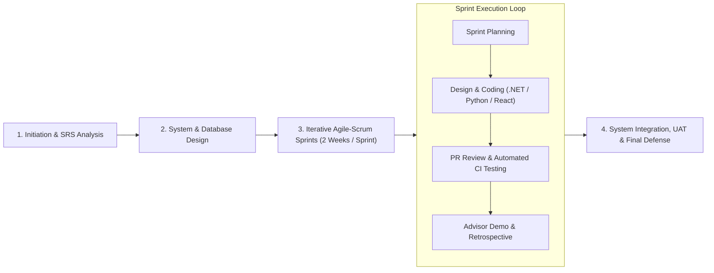

> **2) Copy đoạn văn Tiếng Anh dưới đây dán ngay bên dưới hình vẽ:**

The team adopts an **Iterative Agile–Scrum** software development methodology tailored to the academic milestones of the FPT University Capstone Project. Rather than relying on a rigid Waterfall sequence, the `112.5 man-days` of engineering effort are organized into **two-week Sprints**, enabling early architectural validation and continuous feedback from the academic supervisor:

- **Phase 1 — Initiation & Requirement Specification:** Finalize project scope, analyze VNU-HCM DGNL competency domains, define system roles, and baseline the SRS and Use Case models.
- **Phase 2 — Architectural & Database Design:** Establish the microservices topology, `.proto` gRPC contracts, OpenAPI specifications, and the 4-schema PostgreSQL + `pgvector` database design.
- **Phase 3 — Iterative Sprint Execution (Core Development):** Each 2-week Sprint follows a structured cycle of *Sprint Planning → Parallel Implementation (Backend, AI/RAG, Web & Companion Mobile) → Peer Pull Request Review & CI Unit Testing → Weekly Supervisor Demonstration & Sprint Retrospective*. High-risk algorithmic modules (IRT 2PL, DAG Topological Sort, BKT, and Socratic GraphRAG) are prioritized in early sprints.
- **Phase 4 — System Hardening, UAT & Release:** Conduct end-to-end integration testing, load testing on mock exam workflows, user acceptance testing (UAT), and final documentation packaging for defense.

---

### 2.2 Quality Management

- `2.2.1 Defect Prevention`: **✏️** `[ĐÃ SỬA - Bổ sung ReactJS Web và Python FastAPI vốn bị thiếu ở bản gốc]`
  - *Đoạn* `Coding Standards` *sửa câu đầu thành:* `Coding Standards: Establish and strictly enforce language-specific conventions across the **.NET backend** (C# Clean Architecture principles, static code analysis via Roslyn analyzers), **Python AI/RAG service** (FastAPI modular routing, Pydantic type validation), and **client applications** (**ReactJS Web SPA and React Native Companion Mobile** with ESLint and Prettier). Standardized naming conventions, modular architectural separation, and automated formatting minimize common syntax errors while improving code readability and long-term maintainability.`
  - *Đoạn* `Interface Contract Standardization`*:* **🟢** `[ĐỂ NGUYÊN]`
- `2.2.2 Reviewing`: **🟢** `[ĐỂ NGUYÊN 100%]`
- `2.2.3 Unit Testing`: **✏️** `[ĐÃ SỬA NHẸ câu đầu - thêm pytest & Web tests khớp mục 6.3]`
  - *Đoạn* `Component Validation` *sửa câu đầu thành:* `Component Validation: Develop automated unit test suites (using **xUnit for .NET services, pytest for Python FastAPI AI modules, and automated JavaScript/TypeScript test runners for client modules**) to validate individual methods, service handlers, and utility functions in isolation.` *(Câu thứ 2 và đoạn* `Automated Regression Prevention` ***🟢*** `[ĐỂ NGUYÊN]`*).*
- `2.2.4 Integration Testing`: **✏️** `[ĐÃ SỬA dòng cuối - thay "Qdrant" bằng "PostgreSQL pgvector & FastAPI RAG"]`
  - *Đoạn* `Module Interaction`*:* **🟢** `[ĐỂ NGUYÊN]`
  - *Đoạn* `Data Flow Consistency` *sửa thành:* `Data Flow Consistency: Identify and resolve edge cases concerning data serialization, transactional consistency across PostgreSQL database contexts via Entity Framework Core, and persistence interactions with Redis cache, **PostgreSQL pgvector, and the Python FastAPI GraphRAG service**.`
- `2.2.5 System Testing`: **✏️** `[ĐÃ SỬA NHẸ dòng cuối - bổ sung Desktop/Tablet Web Browsers]`
  - *Đoạn* `Full End-to-End Validation`*:* **🟢** `[ĐỂ NGUYÊN]`
  - *Đoạn* `Non-Functional Testing` *sửa cuối câu thành:* `...role-based access security (JWT claims enforcement), and **responsive user interface rendering across modern desktop/tablet web browsers and Companion Mobile target devices**.`
- `2.2.6 Continuous Improvement`: **🟢** `[ĐỂ NGUYÊN 100%]`

---

### 2.3 Training Plan — ✏️ `[ĐÃ SỬA TOÀN BỘ BẢNG - Chuyển sang Tiếng Anh 100%, xóa chữ nháp "(Điền tên bạn làm Mobile)" & bổ sung đủ kỹ năng cốt lõi cho cả 4 thành viên]`

> **Thay bảng Tiếng Việt nháp cũ bằng bảng Tiếng Anh hoàn chỉnh dưới đây:**

| Training Area | Participants | When, Duration | Waiver Criteria |
| --- | --- | --- | --- |
| .NET 9 Clean Architecture, YARP Gateway & gRPC Inter-Service Communication | Phạm Tấn Lộc, Nguyễn Duy Khôi | Week 1 – Week 2 (10 days) | Mandatory (Waived if prior .NET microservices project completed) |
| Psychometric Modeling (2PL IRT, BKT, SM-2 & Knapsack Optimization) | Phạm Tấn Lộc, Mai Thành Nhân | Week 1 – Week 2 (10 days) | Mandatory |
| GraphRAG Pipeline, LangChain, Python FastAPI & PostgreSQL `pgvector` | Mai Thành Nhân | Week 1 – Week 3 (14 days) | Mandatory |
| Interactive Academic Web UI (`React 19`, `KaTeX`, `JSXGraph`) & Companion Mobile (`React Native`) | Trần Thái Thịnh, Nguyễn Duy Khôi | Week 1 – Week 2 (14 days) | Mandatory |

---

## 3. Master Schedule & Project Deliverables — ✏️ `[ĐÃ SỬA TIÊU ĐỀ & BỔ SUNG LỊCH TRÌNH ĐỂ KHỚP MỤC LỤC ĐẦU BÀI + ĐIỀN DUE DATE]`

*(Trong Mục lục đầu bài ghi* `3. Master Schedule` *nhưng bên dưới chỉ có* `Project Deliverables` *và để trống cột* `Due Date`*. Nên đổi tiêu đề mục* `3` *thành* `3. Master Schedule & Project Deliverables` *gồm* `3.1` *và* `3.2` *như sau):*

### 3.1 Master Schedule — ➕ `[THÊM MỚI]`

| Phase / Milestone | Key Activities | Timeline | Status / Deliverable Gate |
| --- | --- | --- | --- |
| **Milestone 1: Initiation & SRS** | Project registration, domain analysis, Use Case & SRS baseline | Week 1 – Week 3 | Project Plan & SRS v1.0 |
| **Milestone 2: Architecture & DB Design (Review 1)** | 4-schema PostgreSQL + `pgvector` design, gRPC/REST contracts, core Identity & Content APIs | Week 4 – Week 6 | Review 1 Package & SDD v1.0 |
| **Milestone 3: Core Adaptive & AI Implementation (Review 2)** | Diagnostic IRT 2PL, DAG Roadmap, P-L-A-R/BKT engine, Socratic GraphRAG Tutor, Score Forecast & Student/Management Web Portals | Week 7 – Week 11 | Review 2 Tag (`review-2`) & Working Prototype |
| **Milestone 4: Companion Mobile, Testing & Final Defense** | Companion Mobile viewing screens, E2E/Load testing, UAT bug fixing, final Capstone documentation | Week 12 – Week 15 | Final Release Package & Defense |

### 3.2 Project Deliverables *(từ bảng mục* `3` *cũ)* — ✏️ `[ĐÃ SỬA: Điền cột Due Date & sửa dòng #5, #6, #7 cho khớp đủ 6 Roles + Python AI + Companion Mobile]`

| \# | Deliverable | Due Date | Notes |
| --- | --- | --- | --- |
| 1 | Project Plan Document | Week 2 | Software Project Management Plan (SPMP), WBS, and risk register |
| 2 | Use Case Specification | Week 3 | Functional requirements and use case models across all **6 user roles** |
| 3 | Design Documents (SDD) | Week 6 | UI/UX wireframes, microservices architecture, sequence diagrams, and 4-schema ERD |
| 4 | SRS Document | Week 8 | Finalized Software Requirements Specification synchronized after Review 1 & 2 |
| 5 | **Web Learning, Parent & Management Portals** | Week 11 | **Primary Web SPA (**`ReactJS`**) for Student, Parent, Teacher, Academic Manager, Academic Director, and Administrator** |
| 6 | **Companion Mobile Application** | Week 12 | **Companion mobile app (**`React Native`**) for students and parents to view progress, schedules, forecasts, and alerts** |
| 7 | **Core Backend & AI/RAG Services** | Week 11 | **.NET 9 microservices, gRPC contracts, IRT/BKT/Knapsack engines, and Python FastAPI GraphRAG Socratic service** |
| 8 | Testing & Release Documents | Week 14 | Test plan, unit/integration/system test cases, test reports, and user manuals |

---

## 4. Project Organization & Responsibility Assignments — ✏️ `[ĐÃ SỬA NHẸ TIÊU ĐỀ KHỚP MỤC LỤC & BỔ SUNG DÒNG CODE THỰC THI]`

*(Giữ nguyên 6 dòng tài liệu đầu tiên của bạn, và **thêm 4 dòng phát triển phần mềm bên dưới** để Hội đồng thấy rõ ai code phần nào khớp với Phiếu đăng ký đề tài):*

- `D ~ Do; R ~ Review; S ~ Support; I ~ Informed`
- **6 dòng đầu (**`Project Planning` **-&gt;** `Prepare Software Test Plan Document`**)**: **🟢** `[ĐỂ NGUYÊN]`
- **➕** `[THÊM MỚI 4 dòng cuối vào bảng Responsibility Assignments]`:

| Responsibility | `locptse184400` | `thinhttse182004` | `khoindse184910` | `nhanmtse184916` |
| --- | --- | --- | --- | --- |
| API Gateway & Core Assessment/Adaptive Backend Services | **D** | S | S | R |
| Student Learning Web App & Companion Mobile App | R | **D** | S | S |
| Management & Parent Web Portals + Content/IAM APIs | R | S | **D** | S |
| Socratic AI GraphRAG Service, Analytics & Test Execution | R | S | R | **D** |

---

## 5. Project Communications — 🟢 `[ĐỂ NGUYÊN 100%]`

---

## 6. Configuration Management

### 6.1 Document Management — 🟢 `[ĐỂ NGUYÊN 100%]`

### 6.2 Source Code Management — ✏️ `[ĐÃ SỬA 3 lỗi: Đồng bộ tên GitHub Org "Capstone-OG", bổ sung repo Web/Mobile bị thiếu & sửa dòng Commit Convention bị mất chữ]`

1. **Đoạn đầu & Danh sách Repositories** — **✏️** `[ĐÃ SỬA tên Org thành Capstone-OG & thêm repo Frontend]`:
   - *Bản gốc:* `The project source code is managed using GitHub under the organization V-Eval, which contains the following repositories:` *(thiếu repo Web Client)*
   - *Sửa thành:*`The project source code is managed using GitHub under the organization **Capstone-OG**, which contains the following repositories:`
     - `System-Repo` (Master orchestration, Docker Compose, deployment scripts, and master documentation)
     - `V-Eval-Gateway` (YARP API Gateway)
     - `V-Eval-Identity_Service` (Authentication, RBAC & Multi-Campus User Profiles)
     - `V-Eval-Content_Service` (4-Tier Competency DAG, Curriculum & Master Question Bank)
     - `V-Eval-Practice_Service` (Diagnostic IRT, Adaptive P-L-A-R, BKT, Mock Exams, Forecasting & Alerts)
     - `V-Eval-Ai_Engine` (.NET AI Orchestrator & Python FastAPI Socratic GraphRAG Service)
     - `V-Eval-Web_Client` **(Primary ReactJS Web Application across all 6 system roles)**
     - `V-Eval-Mobile_App` **(React Native Companion Mobile Application)** *(Ghi chú: Nếu để chung nhánh/thư mục thì ghi chú tương ứng; nếu tách repo riêng thì giữ dòng này)*
2. `Branching Strategy`: **🟢** `[ĐỂ NGUYÊN]`
3. `Commit Convention` — **✏️** `[ĐÃ SỬA LỖI MẤT KÝ TỰ TRONG DẤU < > CHỈ CÒN "():"]`:
   - *Bản gốc (bị lỗi mất chữ):* `All commits follow the Conventional Commit standard to maintain consistent commit history and clear traceability: ():`
   - *Sửa thành:*`All commits follow the Conventional Commit standard to maintain consistent commit history and clear traceability:`
     - **Format:** `<type>(<scope>): <short summary>`
     - **Examples:** `feat(practice): implement knapsack remedial prescription`, `fix(rag): enforce cosine similarity threshold 0.75`
4. `Pull Request Workflow`**,** `Version Control & Deployment`**,** `Team Collaboration`: **🟢** `[ĐỂ NGUYÊN]` *(chỉ đổi nhẹ chữ* `Backend & Services team` *ở câu cuối thành* `Development team` *vì 4 nhánh cá nhân bao gồm cả Frontend & Backend)*.

---

### 6.3 Tools & Infrastructures — ✏️ `[ĐÃ SỬA NHẸ 1 DÒNG - Thêm React Native & Payment Gateway API chung vào dòng Technology cho đồng bộ Phần I & SRS 4.1]`

- **Dòng** `Technology`:
  - *Sửa thành:* `.NET 9 ASP.NET Core Web API, YARP Reverse Proxy Gateway, Python FastAPI, gRPC HTTP/2, React 19, Vite, Tailwind CSS, KaTeX, JSXGraph, **React Native (Companion Mobile), Electronic Payment Gateway API (e.g., PayOS / VNPay / SePay)**`
- **Tất cả 9 dòng còn lại (**`Database`**,** `Vector DB & AI`**,** `Caching`**,** `IDEs`**,** `Diagramming`**,** `Documentation`**,** `Version Control`**,** `Deployment Server`**,** `Testing Frameworks`**)**: **🟢** `[ĐỂ NGUYÊN]`
  - *(Mẹo kiểm tra nội bộ cho nhóm trước khi qua Phần IV: Ở dòng* `Vector DB & AI` *hiện ghi* `768-dimensional HNSW Index / text-embedding-004`*, trong khi file* `rag-service/config.py` *có hằng số* `gemini-embedding-001 (3072)`*. Hãy thống nhất chọn 1 thông số xuyên suốt với Phần IV Database Design để không bị lệch số chiều vector nhé!)*


---
---

# III. Software Requirement Specification

> [!WARNING]
> Cảnh báo các xung đột nghiêm trọng phát hiện trong Phần III của file Word gốc (Đã xử lý chi tiết bên dưới):

1. **Ghi sai tên kỳ thi thành `VNUHCM-EPT`** (ở `2.1 Guest` & `SCR-12`): `VNU-EPT` là kỳ thi chứng chỉ Tiếng Anh, **không phải** ĐGNL (`VNU-HCM DGNL / V-ACT`)!
2. **Vi phạm trực diện `OS-01` (Tư vấn chọn trường `Reach / Target / Safety`)**: Ở Phần I vừa cấm tư vấn trường/ngành theo điểm số, nhưng Phần III lại để nguyên **`SCR-19 University Advisory`**, **`3.3.11`**, **`SCR-35`**, **`3.6.3`**, **`3.1.4 (#6)`** và **`BR-23`**! Đã chuyển `SCR-19` & `3.3.11` sang **Toa thuốc ôn tập Knapsack & Đề bù điểm (`Remedial Prescription`)** đúng code thật.
3. **Để nguyên dòng chữ Tiếng Việt `"Chưa triển khai"` ngay giữa báo cáo SRS Tiếng Anh** (ở `3.3.13 Bookmark`, `3.3.14 Export Report`, `3.4.1 Pair Student Account`) và còn sót `SCR-21 / 3.4.2 Parent Survey` đã cắt từ Review 1! Đã thay thế `SCR-21`, `3.4.2` và `UC31` bằng **Thanh toán gói học trực tuyến của Phụ huynh (`Parent Tuition & Package Payment via Payment Gateway`)** khớp hoàn toàn với `4.1 Software Interfaces` và Context Diagram!
4. **Dính hàng loạt Use Cases của `Live Classroom` đã cắt bỏ**: `UC18 (Attend live class)`, `UC19 (Watch recorded live lecture)`, `UC34 (Host live class)`, `UC33/45/46`, `3.5.4 (Zoom/Meet)`. Đã đổi khéo 3 mã `UC18, UC19, UC34` sang đúng 3 tính năng thật (`P-L-A-R`, `Mistake Notebook SM-2`, `Audit Flagged Mock Exam`) để bạn **không bị xáo trộn số thứ tự `UC01 -> UC66`**!
5. **Vi phạm trực diện `OS-02` (Dùng từ `Disciplinary Escalation / Hủy kết quả thi`)**: Xuất hiện ở `SCR-22, SCR-28, SCR-38, 3.4.4, 3.5.6, BR-18..20, MSG10, MSG12`. Đã đổi sang thuật ngữ đồng hành sư phạm (`Early Warning & Academic Support`) và sửa `MSG10` đúng cơ chế `UNDER_REVIEW`.
6. **Dính công nghệ cũ đã bỏ ở `3.1.4` & `4.1`**: Còn nguyên **`RabbitMQ`**, **`ONNX regression models`**, **`Google SSO`**, **`SMS OTP`** và ghi nhầm **`Mobile Camera` cho phòng thi thử** (trái với `LI-07` chỉ thi thử trên Web)! Riêng mục cổng thanh toán ở `4.1` được **sửa từ khóa cứng `VNPay` sang tên chung `Electronic Payment Gateway` (`e.g., PayOS / VNPay / SePay`)** và gắn rõ cho vai trò **`Parent`** để linh hoạt lúc code.

---

## 1. Product Overview (Overall Description) — ➕ `[THÊM MỚI ĐOẠN DẪN ĐANG BỊ TRỐNG & CẬP NHẬT CONTEXT DIAGRAM]`

- **Đoạn văn phía trên `Figure 02. Context Diagram`** *(hiện trong Word đang bỏ trống)* — **➕ `[THÊM MỚI]`**:
  > The **V-Eval Platform** operates as a centralized AI-powered adaptive learning ecosystem connecting six human stakeholder roles (*Student, Parent, Teacher/Mentor, Academic Manager, Academic Director, and Administrator*) alongside three external service integrations (*LLM API Service*, *Email Service*, and *Payment Gateway*). High-complexity interactive learning, diagnostic calibration, timed mock examinations, Socratic AI tutoring, online package payment, and center governance are delivered via the **Web Application**, while progress dashboards, study schedules, score forecasts, and early alerts are additionally accessible via the **Companion Mobile App**. Figure 02 illustrates the high-level system boundary and logical business data flows in Gane & Sarson notation.

- **`Figure 02. Context Diagram`**: **✏️ `[CẬP NHẬT HÌNH VẼ MỚI]`**
  - Chèn hình Context Diagram mới (`6 Roles` + `3 External Systems: LLM API Service, Email Service, Payment Gateway`) vẽ theo đúng đặc tả tại [`dac_ta_context_diagram_dfd_level_0.md`](./dac_ta_context_diagram_dfd_level_0.md).
  - Đặt dòng chú thích nhỏ ngay dưới `Figure 02`:
    > *Note: Figure 02 models logical business data flows; stateless authentication and role-based session verification (JWT/RBAC) apply uniformly across all six authenticated user roles.*

---

## 2. User Requirements

### 2.1 Actor — ✏️ `[ĐÃ SỬA 4 DÒNG ĐỂ XÓA "VNUHCM-EPT", XÓA "LIVE Q&A" & BỔ SUNG THANH TOÁN CHO PARENT]`

- **`Guest`**: **✏️ `[ĐÃ SỬA - đổi "VNUHCM-EPT" thành "VNU-HCM DGNL (V-ACT)"]`**
  - *Sửa thành:* `Unauthenticated user; browses platform introduction, **VNU-HCM DGNL (V-ACT)** exam structure, campus directory, and registers a new learner or guardian account.`
- **`Student`**: **✏️ `[ĐÃ SỬA - xóa "attends Live Q&A sessions", bổ sung rõ xem lịch học & tiến độ trên Web/Mobile]`**
  - *Sửa thành:* `Enrolled learner; completes initial diagnostic tests (θ₀), follows personalized DAG roadmaps, **engages in adaptive P-L-A-R practice and simulated mock exams,** interacts with the Socratic AI Tutor, and tracks **study schedules, learning progress, and** score forecasts across Web and Companion Mobile.`
- **`Parent`**: **✏️ `[ĐÃ SỬA - xóa "tracks Live Q&A attendance" & bổ sung thanh toán gói học cho con]`**
  - *Sửa thành:* `Student guardian; links accounts, **enrolls and completes online tuition/mock exam package payments for their child on the Parent Web Portal,** monitors study hours, **study schedules, milestone completion, target score progress,** and receives early academic status alerts on Web and Companion Mobile.`
- **`Teacher`**: **✏️ `[ĐÃ SỬA - xóa "hosts real-time Live Q&A sessions, records attendance"]`**
  - *Sửa thành:* `Campus instructor / Mentor; curates learning materials and mock exams, monitors class competency heatmaps, **dispatches micro-cohort interventions, audits flagged mock exam attempts, and moderates AI-generated content**.`
- **`Academic Manager`**: **🟢 `[ĐỂ NGUYÊN]`**
- **`Academic Director`**: **🟢 `[ĐỂ NGUYÊN]`**
- **`Administrator`**: **🟢 `[ĐỂ NGUYÊN]`**

---

### 2.2 Use Case Diagram — ✏️ `[LƯU Ý ĐỒNG BỘ HÌNH VẼ VỚI BẢNG 2.3 BÊN DƯỚI]`
*(Kiểm tra trên hình vẽ Use Case Diagram không còn các hình elip `Live Class / University Advisory / Bookmark / Export PDF` đã lược bỏ, và nối tác nhân `Parent` + `Payment Gateway` vào Use Case `Pay tuition & learning package`).*

---

### 2.3 Use Case Description (`UC01 -> UC66`)

> [!TIP]
> Mẹo giữ nguyên khung đánh số UC01 -> UC66 cực nhàn: Thay vì xóa dòng làm lệch toàn bộ mã số UC bên dưới, các UC cũ thuộc mảng Live Class / Chưa triển khai được thay thế trực tiếp bằng các tính năng có thật trong Phần I, Cổng Thanh toán Phụ huynh & Code vốn đang bị thiếu trong bảng UC!

- **`UC01 -> UC09`**: **🟢 `[ĐỂ NGUYÊN]`**
- **`UC10 (Set target score & deadline)`**: **✏️ `[ĐÃ SỬA NHẸ khớp FE-04]`** -> `Set target benchmark & score` | `Student` | `A student can record their initial target university benchmark, target score, and exam date as a baseline reference.`
- **`UC11 -> UC12`**: **🟢 `[ĐỂ NGUYÊN]`**
- **`UC13 (View roadmap timeline)`**: **✏️ `[ĐÃ SỬA NHẸ - bổ sung rõ xem Lịch học cá nhân hóa đồng bộ với Parent UC33 & Companion Mobile LI-07]`**
  - `UC13` | `View roadmap & study schedule` | `Student` | `A student can view their learning roadmap milestones, **personalized study schedules, cohort exam dates,** and progress status.`
- **`UC14 -> UC17`**: **🟢 `[ĐỂ NGUYÊN]`**
- **`UC18`** *(gốc là `Attend live class` đã bỏ)* — **✏️ `[THAY BẰNG P-L-A-R STAGE]`**:
  - `UC18` | `Complete P-L-A-R learning stage` | `Student` | `A student can complete the 4-step Preview, Learn, Apply, and Reflect learning loop for an unlocked milestone.`
- **`UC19`** *(gốc là `Watch recorded lecture` của live session đã bỏ)* — **✏️ `[THAY BẰNG MISTAKE NOTEBOOK SM-2]`**:
  - `UC19` | `Review mistake notebook` | `Student, AI System` | `A student can review historical incorrect attempts and practice spaced-repetition (SM-2) isomorphic variants.`
- **`UC20 -> UC22`**: **🟢 `[ĐỂ NGUYÊN]`**
- **`UC23`** *(gốc là `Bookmark questions` — mục 3.3.13 ghi Chưa triển khai)* — **✏️ `[THAY BẰNG REFLECTION NOTE CÓ THẬT]`**:
  - `UC23` | `Record mistake reflection notes` | `Student` | `A student can log self-reflection notes on cognitive mistakes within the Mistake Notebook.`
- **`UC24`**: **🟢 `[ĐỂ NGUYÊN]`**
- **`UC25`** *(gốc là `Export study report` — mục 3.3.14 ghi Chưa triển khai)* — **✏️ `[THAY BẰNG KNAPSACK PRESCRIPTION CÓ THẬT]`**:
  - `UC25` | `Generate remedial prescription` | `Student, AI System` | `A student can generate and complete high-yield Knapsack micro-revision sessions to close score deficits.`
- **`UC26 -> UC30`**: **🟢 `[ĐỂ NGUYÊN]`**
- **`UC31`** *(gốc là `Export parent report` chưa triển khai)* — **✏️ `[THAY BẰNG THANH TOÁN GÓI HỌC CỦA PHỤ HUYNH QUA PAYMENT GATEWAY]`**:
  - `UC31` | `Pay tuition & learning package` | `Parent, Payment Gateway` | `A parent can enroll in a tuition or mock exam package for their linked child, complete online payment via the integrated payment gateway, and view electronic receipts.`
- **`UC32`**: **🟢 `[ĐỂ NGUYÊN]`**
- **`UC33 (Track study schedule)`**: **✏️ `[ĐÃ SỬA NHẸ - bỏ chữ "live class timetables"]`**
  - *Sửa cột Description thành:* `A parent can track their child's **personalized study schedules** and milestone readiness.`
- **`UC34`** *(gốc là `Host live class` đã bỏ)* — **✏️ `[THAY BẰNG HẬU KIỂM THI THỬ FE-17 CÓ THẬT]`**:
  - `UC34` | `Audit flagged mock exam attempts` | `Teacher` | `A teacher can inspect proctoring logs and review mock exam submissions flagged as UNDER_REVIEW.`
- **`UC35 -> UC39`**: **🟢 `[ĐỂ NGUYÊN]`**
- **`UC40 (Approve AI content)`**: **✏️ `[ĐÃ SỬA NHẸ khớp phân quyền Director là Gatekeeper cuối]`** -> `Evaluate AI content & recommendations` | `Teacher` | `A teacher can evaluate AI-generated drafts and monitor AI recommendation quality before master bank escalation.`
- **`UC41 -> UC44`**: **🟢 `[ĐỂ NGUYÊN]`**
- **`UC45 (Assign teachers to classes)`**: **✏️ `[ĐÃ SỬA 1 từ - bỏ chữ "online"]`** -> `An academic manager can assign teachers and mentors to **campus cohorts**.`
- **`UC46 (Coordinate timetable)`**: **✏️ `[ĐÃ SỬA 1 cụm - bỏ chữ "live class"]`** -> `An academic manager can coordinate **cohort schedules** and local mock exam dates.`
- **`UC47 -> UC58`**: **🟢 `[ĐỂ NGUYÊN]`**
- **`UC59 (Manage course categories - Admin)`**: **🟢 `[ĐỂ NGUYÊN]`** *(hoặc đổi nhẹ thành `View system audit logs` cho khớp `3.8.5` của Admin vì cây chương trình đã do Academic Director quản lý ở `UC50`)*.
- **`UC60 -> UC66`**: **🟢 `[ĐỂ NGUYÊN]`**

---

## 3. Functional Requirements

### 3.1.1 Screen Flow — 🟢 `[ĐỂ NGUYÊN cấu trúc 3.1.1.1 -> 3.1.1.6]`
- Chỉ chỉnh nhẹ nhãn `3.1.1.6` thành: `Parent - Web Portal & Companion Mobile Screen Flow` (cho đồng bộ với `Student` ở `3.1.1.5`).

---

### 3.1.2 Screen Description (`SCR-00 -> SCR-40`)

- **`SCR-00`, `SCR-01`, `SCR-03`, `SCR-04`, `SCR-05`, `SCR-06`**: **🟢 `[ĐỂ NGUYÊN]`**
- **`SCR-02 (Login)`**: **✏️ `[ĐÃ SỬA NHẸ - Xóa "or Google Single Sign-On (SSO)" vì code chỉ dùng Email/Password JWT]`**
  - *Sửa câu đầu thành:* `Enables users to authenticate using registered Email and Password credentials.`
- **`SCR-07 (Chat)`**: **🗑️ `[XÓA HOẶC ĐỔI SANG NOTIFICATION CENTER]`** *(Hệ thống không có Messenger chat người-với-người trực tiếp; để giữ mã số `SCR-07` không bị nhảy số thì đổi `SCR-07` thành **`Notification Center` — Displays system alerts, early warning notices, and milestone reminders for authenticated users**).*
- **`SCR-08`, `SCR-09`, `SCR-10`**: **🟢 `[ĐỂ NGUYÊN]`**
- **`SCR-11 (Target Setting)`**: **✏️ `[ĐÃ SỬA - Khớp FE-04 sau Review 2]`**
  - *Sửa thành:* `Target Setting | Target & Benchmark Setup | Captures the student's self-selected target university/major benchmark, target score (300–1200 scale), official exam date, and daily available study hours strictly as an internal baseline to measure score deficits.`
- **`SCR-12 (Diagnostic Test)`**: **✏️ `[ĐÃ SỬA 1 TỪ - Đổi "VNUHCM-EPT" thành "VNU-HCM DGNL"]`**
  - *Sửa câu đầu thành:* `Delivers a standardized 30-question diagnostic assessment mirroring the official **VNU-HCM DGNL** section proportions.`
- **`SCR-13`**: **🟢 `[ĐỂ NGUYÊN]`**
- **`SCR-14 (Personalized Roadmap)`**: **✏️ `[ĐÃ SỬA NHẸ - bổ sung hiển thị Lịch học theo ngày/tuần trên Web & Companion Mobile]`**
  - *Sửa thành:* `SCR-14` | `Roadmap & Schedule` | `Personalized Roadmap & Study Schedule` | `Renders the adaptive Directed Acyclic Graph (DAG) learning roadmap **and daily/weekly study schedules**, visualizing learning modules prioritized by Return on Investment (ROI) and milestone completion states.`
- **`SCR-15 -> SCR-18`**: **🟢 `[ĐỂ NGUYÊN]`**
- **`SCR-19` *(gốc là `University Advisory` — VI PHẠM `OS-01`!)* ** — **✏️ `[THAY BẰNG TOA THUỐC KNAPSACK CÓ THẬT TRONG CODE]`**:
  - *Sửa thành:* `SCR-19` | `Remedial Prescription` | `Knapsack Study Prescription` | `Generates prioritized micro-revision prescriptions targeting the top 2–3 high-yield question patterns maximizing expected score gain per available study hour.`
- **`SCR-20 (Score Forecast & What-If)`**: **🟢 `[ĐỂ NGUYÊN]`**
- **`SCR-21` *(gốc là `Parent Survey` — ĐÃ BỊ CẮT BỎ TỪ REVIEW 1!)* ** — **✏️ `[THAY BẰNG MÀN HÌNH LIÊN KẾT HỌC SINH & THANH TOÁN GÓI HỌC CỦA PHỤ HUYNH]`**:
  - *Sửa thành:* `SCR-21` | `Linkage & Billing` | `Student Linkage & Package Payment` | `Allows parents to link their guardian account with their child's student profile, pay for tuition or mock exam packages via the integrated online payment gateway, and view transaction history.`
- **`SCR-22 (Child Progress Dashboard)`**: **✏️ `[ĐÃ SỬA 2 CHỮ CUỐI - Xóa chữ "disciplinary escalation"]`**
  - *Sửa thành:* `Displays weekly academic engagement metrics, study schedules, Exam Readiness Index, roadmap completion rates, and **early academic support alerts**.`
- **`SCR-23 -> SCR-25`, `SCR-27`**: **🟢 `[ĐỂ NGUYÊN]`**
- **`SCR-26 (Mentoring Session)`**: **✏️ `[ĐÃ SỬA NHẸ - đổi sang quản lý can thiệp nhóm vi mô, tránh hiểu nhầm Live Classroom]`**
  - *Sửa thành:* `SCR-26` | `Intervention Dispatch` | `Micro-Intervention Workspace` | `Aggregates shared mistake patterns across micro-cohorts and dispatches targeted remedial assignments or academic support consultations.`
- **`SCR-28 (Intervention Task List)`**: **✏️ `[ĐÃ SỬA 1 TỪ - đổi "disciplinary framework" thành "early warning support" khớp OS-02]`**
  - *Sửa thành:* `Tracks escalated student support workflows across the 3-tier **early warning support** framework: automated reminders, mentor check-ins, and 3-way parent-student-mentor consultations.`
- **`SCR-29 -> SCR-34`**: **🟢 `[ĐỂ NGUYÊN]`**
- **`SCR-35` *(gốc là `Admission Benchmark Config` cho advisory — dễ đụng `OS-01`)* ** — **✏️ `[THAY BẰNG CAMPUS COMPARATIVE HEATMAP CÓ THẬT TRONG CODE]`**:
  - *Sửa thành:* `SCR-35` | `Campus Analytics` | `Campus Comparative Heatmap` | `Visualizes cross-class mastery rates across the 4 DGNL competency domains within a campus branch to guide resource and teacher allocation.`
- **`SCR-36`, `SCR-37`, `SCR-39`, `SCR-40`**: **🟢 `[ĐỂ NGUYÊN]`**
- **`SCR-38 (Manage Accounts)`**: **✏️ `[ĐÃ SỬA 2 CHỮ CUỐI - xóa "and disciplinary status management"]`** -> đổi thành `and account activation status management`.

---

### 3.1.3 Screen Authorization — ✏️ `[ĐỒNG BỘ LẠI 5 TÊN MÀN HÌNH VỪA ĐỔI Ở 3.1.2]`
- Đổi dòng `Chat` -> `Notification Center` (tick `x` cho cả 6 role đã đăng nhập).
- Đổi dòng `Personalized Roadmap` -> `Personalized Roadmap & Study Schedule` (giữ nguyên các dấu tick `x` của `Student`, `Parent`, `Mentor / Teacher`).
- Đổi dòng `University Advisory` -> `Knapsack Study Prescription` (tick `x` cho `Student`, `Mentor / Teacher`).
- Đổi dòng `Parent Survey` -> `Student Linkage & Package Payment` (tick `x` cho `Parent`, `Student`).
- Đổi dòng `Admission Benchmark Config` -> `Campus Comparative Heatmap` (tick `x` cho `Academic Manager`, `Academic Director`).
- Các dòng còn lại: **🟢 `[ĐỂ NGUYÊN]`**.

---

### 3.1.4 Non-screen Functions — ✏️ `[ĐÃ SỬA DÒNG #1, #3, #6 ĐỂ XÓA "RABBITMQ", "DISCIPLINARY", "ONNX REGRESSION"]`

- **Dòng `#1 (Real-time BKT Mastery Updater)`**: **✏️ `[ĐÃ SỬA - Xóa chữ "via RabbitMQ"]`**
  - *Sửa thành:* `Processes student item submission events **via scoped domain handlers and gRPC inter-service calls** to compute updated latent mastery probabilities P(Lₜ) per skill/pattern in real time, determining next-item selection.`
- **Dòng `#2`, `#4`, `#5`**: **🟢 `[ĐỂ NGUYÊN]`**
- **Dòng `#3 (Inactivity & Anomaly Escalation Service)`**: **✏️ `[ĐÃ SỬA NHẸ - đổi thành early-warning support]`**
  - *Sửa thành:* `Inspects student activity telemetry daily via **hosted background workers** to automate the 3-tier **early-warning support** workflow: motivational alerts (1–2 days inactive), mentor check-in tasks (3 days), and 3-way support consultations.`
- **Dòng `#6 (Score Forecast Calibration Service)`**: **✏️ `[ĐÃ SỬA - Xóa "embedded ONNX regression models" & "admissions recommendations" để khớp 3.9.3!]`**
  - *Bản gốc:* `Periodically re-executes embedded ONNX regression models against empirical mock performance and roadmap velocity, refreshing projected score distributions and admissions recommendations.`
  - *Sửa thành:* `Periodically recalculates **2PL IRT latent trait estimates, Fisher Information SEM intervals, and Greedy Knapsack ROI rankings** against empirical practice/mock performance, refreshing projected score intervals and remedial prescriptions.`

---

### 3.1.5 Conceptual ERD — 🟢 `[ĐỂ NGUYÊN — kiểm tra hình không còn bảng live_sessions & có bảng giao dịch thanh toán khi hoàn thiện DB]`

---

### 3.2 -> 3.9 Detailed Functional Specifications

- **`3.2 Authentication & Account Management` (`3.2.1 -> 3.2.7`)**: **🟢 `[ĐỂ NGUYÊN 100%]`** *(Viết rất chặt chẽ, đúng chuẩn validation thực tế)*.
- **`3.3 Student Learning & Practice`**:
  - **`3.3.1 Target Setting & Survey`**: **✏️ `[ĐÃ SỬA NHẸ Purpose khớp FE-04]`** -> `Purpose: Record self-selected target university/major benchmark, baseline target score (300–1200), exam date, and study availability strictly as an internal training evaluation baseline.`
  - **`3.3.2 -> 3.3.4`, `3.3.6 -> 3.3.10`**: **🟢 `[ĐỂ NGUYÊN 100%]`**
  - **`3.3.5 View Roadmap & Stages`**: **✏️ `[ĐÃ SỬA NHẸ - đổi tên thành "View Roadmap & Study Schedule" và thêm "personalized study schedules" vào Purpose cho khớp UC13 & LI-07]`**.
  - **`3.3.11` *(gốc là `University Advisory` — VI PHẠM `OS-01`)* ** — **✏️ `[THAY BẰNG KNAPSACK REMEDIAL PRESCRIPTION KHỚP CODE THẬT]`**:
    - **Title:** `3.3.11 Knapsack Remedial Prescription & Micro-Revision`
    - **Function trigger:** `User clicks “Tạo toa thuốc ôn tập” button`
    - **Actors:** `Student, AI System`
    - **Purpose:** `Quantify score deficits and generate prioritized micro-revision sessions targeting high-ROI question patterns`
    - **Data requirement:** `studentId, availableStudyMinutes`
    - **Validation:** `Student must have an active score forecast; availableStudyMinutes between 15 and 240 minutes`
    - **Business rules:** `BR-06, BR-23`
  - **`3.3.12 Score Forecast & What-If`**: **🟢 `[ĐỂ NGUYÊN]`**
  - **`3.3.13 Bookmark Questions ("Chưa triển khai")` & `3.3.14 Export Study Report ("Chưa triển khai")`**: **🗑️ `[XÓA BỎ CẢ 2 MỤC NÀY KHỎI FILE WORD]`** *(Tuyệt đối không để chữ "Chưa triển khai" trong SRS nộp Hội đồng!)*
- **`3.4 Parent Portal`**:
  - **`3.4.1 Pair Student Account`** *(đang ghi `"Chưa triển khai"`)* — **✏️ `[VIẾT ĐẦY ĐỦ NỘI DUNG CHUẨN SRS THAY CHO CHỮ "CHƯA TRIỂN KHAI"]`**:
    - **Function trigger:** `User submits student linkage verification on the Parent Portal`
    - **Actors:** `Parent, Student`
    - **Purpose:** `Establish an authorized guardian-student relationship to unlock read-only progress, billing, and alert views`
    - **Data requirement:** `parentId, studentIdentifier / pairingToken`
    - **Validation:** `Target student account must be ACTIVE; duplicate parent-student relation is prevented`
    - **Business rules:** `BR-02`
  - **`3.4.2` *(gốc là `Parent Survey` đã cắt bỏ)* ** — **✏️ `[THAY TRỰC TIẾP BẰNG THANH TOÁN GÓI HỌC CỦA PHỤ HUYNH ĐỂ KHÔNG PHẢI ĐÁNH LẠI SỐ 3.4.3 & 3.4.4!]`**:
    - **Title:** `3.4.2 Tuition & Learning Package Payment`
    - **Function trigger:** `Parent selects a study/mock exam package for a linked student and clicks “Thanh toán trực tuyến”`
    - **Actors:** `Parent, Payment Gateway`
    - **Purpose:** `Process secure online tuition/package payments for a linked student and activate corresponding course or mock exam entitlements upon verified payment webhook callback`
    - **Data requirement:** `parentId, linkedStudentId, packageId, amount, paymentMethod, gatewayWebhookSignature`
    - **Validation:** `Parent must have an active verified link with linkedStudentId; package must be ACTIVE; webhook cryptographic signature and idempotency transaction reference must be valid`
    - **Business rules:** `BR-02`
  - **`3.4.3 View Child Progress Dashboard`**: **🟢 `[ĐỂ NGUYÊN]`**
  - **`3.4.4 Receive Inactivity & Support Alerts`**: **✏️ `[ĐÃ SỬA NHẸ - đổi chữ "disciplinary thresholds" thành "engagement thresholds"]`**.
- **`3.5 Teacher & Mentoring Operations`**:
  - `3.5.1`, `3.5.2`, `3.5.3`, `3.5.5`: **🟢 `[ĐỂ NGUYÊN]`**
  - **`3.5.4`**: **✏️ `[ĐÃ SỬA NHẸ - bỏ chữ "(Zoom, Google Meet, MS Teams)" để tránh dính Live Classroom; đổi thành điều phối bài tập/phiên hỗ trợ nhóm vi mô tại cơ sở]`**.
  - **`3.5.6`**: **✏️ `[ĐÃ SỬA TIÊU ĐỀ - đổi "(Disciplinary Escalation)" thành "(Early Warning Support)"]`**.
- **`3.6 Academic Manager Operations`**:
  - `3.6.1`, `3.6.2`, `3.6.4`, `3.6.5`: **🟢 `[ĐỂ NGUYÊN]`**
  - **`3.6.3` *(gốc là `Admission Benchmark Configuration` cho advisory)* ** — **✏️ `[THAY BẰNG CAMPUS COMPARATIVE HEATMAP KHỚP SCR-35 & CODE THẬT]`**:
    - **Title:** `3.6.3 View Campus Comparative Heatmap`
    - **Function trigger:** `User navigates to the Campus Comparative Analytics view`
    - **Actors:** `Academic Manager, Academic Director`
    - **Purpose:** `Compare domain-level mastery distributions across classes within a campus to coordinate faculty support`
    - **Data requirement:** `campusId`
    - **Validation:** `campusId must exist and belong to the manager's authorized branch`
    - **Business rules:** `BR-16`
- **`3.7 Academic Director Governance` (`3.7.1 -> 3.7.4`)**: **🟢 `[ĐỂ NGUYÊN 100%]`**
- **`3.8 System Administration` (`3.8.1 -> 3.8.5`)**: **🟢 `[ĐỂ NGUYÊN 100%]`** *(Giữ nguyên `payment endpoints` ở mục `3.8.4` vì hệ thống có tích hợp cổng thanh toán trực tuyến cho Phụ huynh!)*.
- **`3.9 Autonomous AI Subsystem`**:
  - `3.9.1`: **🟢 `[ĐỂ NGUYÊN]`**
  - **`3.9.2`**: **✏️ `[ĐÃ SỬA 2 CHỮ ở Function trigger - xóa "via message queue", đổi thành "upon every item attempt submission"]`**.
  - **`3.9.3`**: **✏️ `[ĐÃ SỬA 2 CHỖ NHỎ]`**:
    1. Ở dòng `Business Outcome`: Đổi `against admission benchmarks` thành `against the student's configured target score`.
    2. **Xóa dòng cuối cùng** `Acceptance Status: 100% Fully Implemented across 9 dedicated REST endpoints in V-Eval-Practice_Service.` *(câu báo cáo code nội bộ không để trong SRS)*. Toàn bộ công thức toán học `SEM`, `Deficit`, `Knapsack ROI` ở giữa **🟢 `[ĐỂ NGUYÊN 100%]`**.

---

## 4. Non-Functional Requirements

### 4.1 External Interfaces — ✏️ `[ĐÃ SỬA MỤC SOFTWARE & HARDWARE INTERFACES: XÓA "RABBITMQ" & "MOBILE CAMERA", ĐỔI "PAYMENT GATEWAY (VNPAY)" THÀNH TÊN CHUNG LINH HOẠT CHO PARENT]`

- **`User Interfaces`**: **🟢 `[ĐỂ NGUYÊN 100%]`**
- **`Software Interfaces`** — **✏️ `[ĐÃ SỬA: Xóa RabbitMQ, đổi Payment Gateway sang chuẩn chung không khóa cứng VNPay]`**:
  - **Artificial Intelligence Engine (LLM APIs):** **🟢 `[ĐỂ NGUYÊN]`**
  - **Inter-Service Communication *(thay cho dòng Message Broker RabbitMQ)*:** `Utilizes high-performance gRPC over HTTP/2 for synchronous internal microservice calls (Identity, Content, Practice, AI Engine) and .NET Hosted Background Workers for scheduled analytical sweeps.`
  - **Email & Notification Service:** `Integrates with SMTP email services to dispatch account verification OTPs, password recovery tokens, electronic payment receipts, and academic progress alert emails, complemented by in-app notifications on Web and Companion Mobile.`
  - **Electronic Payment Gateway *(sửa từ `Payment Gateway (VNPay)` để không khóa cứng nhà cung cấp)*:** `Integrates with third-party electronic payment gateways (e.g., PayOS, VNPay, or SePay) via secure HTTPS checkout / VietQR and IPN/Webhook callbacks with cryptographic signature verification, enabling parents to pay for their linked child's tuition and mock exam packages and automatically activate enrollment entitlements.`
- **`Hardware Interfaces`** — **✏️ `[ĐÃ SỬA 2 CHỮ - Bỏ chữ "and mobile" khớp LI-07]`**:
  - *Sửa thành:* `Camera (Browser Webcam): The **Web application requires** user-consented permission to access the client device's webcam to capture periodic snapshots during proctored mock examinations for post-hoc integrity verification.`

---

### 4.2 Quality Attributes

- **`4.2.1 Usability`** & **`4.2.2 Reliability`**: **🟢 `[ĐỂ NGUYÊN 100%]`**
- **`4.2.3 Performance`**: **✏️ `[ĐÃ SỬA NHẸ dòng cuối Resource Usage - bỏ webcam trên mobile]`**
  - *Dòng `Resource Usage` sửa thành:* `Client-side web and companion mobile apps must optimize memory and rendering usage, ensuring interactive math graph rendering and web browser snapshot routines do not cause browser freezes or excessive resource consumption.`
- **`4.2.4 Security`**: **✏️ `[ĐÃ SỬA 2 CHỮ ở dòng cuối Identity Verification - bỏ "or SMS"]`**
  - *Dòng `Identity Verification` sửa thành:* `System registration and password recovery procedures require identity validation via **email OTP** to prevent automated bot provisioning and duplicate spam accounts.`

---

## 5. Requirement Appendix

### 5.1 Business Rules (`BR-01 -> BR-25`)

- **`BR-01 -> BR-04`, `BR-06 -> BR-17`, `BR-21 -> BR-22`, `BR-24`**: **🟢 `[ĐỂ NGUYÊN 100%]`** *(Đã khớp chuẩn mọi hằng số toán học với Phần I & II!)*.
- **`BR-05`**: **✏️ `[ĐÃ SỬA NHẸ cuối câu]`** -> Đổi `It is identical across all prospective academic majors.` thành `It maintains a standardized structure across all learners regardless of initial target score benchmarks.`
- **`BR-18`, `BR-19`, `BR-20`**: **✏️ `[ĐÃ SỬA CỘT CATEGORY - Đổi "Disciplinary Escalation (Tier 1/2/3)" thành "Early Warning Support (Tier 1/2/3)"]`** *(giữ nguyên cột Rule Definition vì nội dung bên trong đã rất chuẩn sư phạm!)*.
- **`BR-23`** *(gốc là `Admissions Advisory` Reach/Target/Safety — VI PHẠM `OS-01`!)* — **✏️ `[THAY BẰNG QUY TẮC DỰ BÁO SEM & KNAPSACK]`**:
  - `BR-23` | `Score Forecasting & Prescription` | `Projected exam scores are bounded within a 95% confidence interval derived from 2PL IRT Standard Error of Measurement (SEM), and Knapsack prescriptions prioritize the top 2–3 patterns with the highest expected score gain per study hour.`
- **`BR-25`** *(gốc nói về public chats không tồn tại)* — **✏️ `[ĐỔI SANG KIỂM SOÁT ĐẦU VÀO AI TUTOR]`**:
  - `BR-25` | `AI Input Governance` | `Student prompts submitted to the Socratic AI Tutor are validated against character limits, profanity filters, and direct answer-extraction attempts prior to LLM invocation.`

---

### 5.2 Common Requirements (`5.2.1 -> 5.2.3`) — 🟢 `[ĐỂ NGUYÊN 99%]`
*(Chỉ ở dòng cuối `5.2.1 Sensitive Data Protection`, đổi 2 chữ `Parental surveys` thành `Payment transaction records` -> `Student assessment records, payment transaction records, and behavioral study logs are protected...`).*

---

### 5.3 Application Messages List (`MSG01 -> MSG13`)

- **`MSG01 -> MSG07`, `MSG09`, `MSG11`, `MSG13`**: **🟢 `[ĐỂ NGUYÊN 100%]`**
- **`MSG08`**: **✏️ `[ĐÃ SỬA NHẸ - bỏ "/số điện thoại" vì chỉ gửi OTP qua Email]`**
  - *Sửa thành:* `Mã xác thực OTP đã được gửi đến **{email}**. Vui lòng kiểm tra hộp thư.`
- **`MSG10`** *(gốc dọa `"bị hủy kết quả"` — mâu thuẫn với `BR-21` & `OS-02`!)* — **✏️ `[ĐÃ SỬA ĐÚNG LOGIC UNDER_REVIEW]`**:
  - *Bản gốc:* `Cảnh báo: Bạn vừa rời khỏi màn hình thi ({số_lần}/3). Vi phạm quá 3 lần bài thi sẽ bị hủy kết quả.`
  - *Sửa thành:* `Cảnh báo: Bạn vừa rời khỏi màn hình thi ({số_lần}/3). Vượt quá 3 lần bài thi sẽ **được gắn cờ chờ Giảng viên thẩm định**.`
- **`MSG12`**: **✏️ `[ĐÃ SỬA CỘT TRIGGER CONTEXT - đổi "disciplinary escalation" thành "early-warning support alert"]`** *(giữ nguyên câu Tiếng Việt bên phải vì câu Tiếng Việt rất nhẹ nhàng, chuẩn sư phạm!)*.


---

# IV. Software Design Description

> [!IMPORTANT]
> Phần IV dưới đây được biên soạn theo đúng khung chuẩn Đồ án Tốt nghiệp FPTU (đối chiếu trực tiếp từ file mẫu `6819_HCM_FA25SE208_GFA67_Final_Report.docx` và khung mục lục của `Report7_Final Project Report (2).docx`), đồng bộ 100% với **Phần I, II, III**, mã nguồn thực tế trong `All Services/` và schema cơ sở dữ liệu PostgreSQL + `pgvector`.

**Lưu ý thao tác Word & Quy ước ký hiệu trong Phần IV:**

- **Cập nhật Mục lục tự động (Table of Contents) trong Word**: Mục lục đầu file `Report7_Final Project Report (2).docx` đang lưu cache tiêu đề cũ (`4. Class Specification / 5. Data & Database Design`), trong khi phần ruột trang dưới đã đổi sang khung mới (`1. System Design -> 2. Database Design -> 3. Detailed Design`). Sau khi dán nội dung Phần IV vào Word, bạn bấm chuột phải vào Mục lục đầu trang -> chọn **`Update Field` -> `Update entire table`** để Word tự động đồng bộ số trang và tiêu đề mới.
- **Ý nghĩa 3 nhãn trạng thái dành cho nhóm (chỉ để nhóm đọc và vẽ hình, KHÔNG copy dòng nhãn Tiếng Việt vào Word)**:
  - **`✅ [ĐÃ CÓ SẴN DIAGRAM]`**: Mục bạn đã có sẵn hình (`System Architecture`, `Conceptual/Logical/Physical ERD`). Bạn chỉ cần đối chiếu nhanh **Checklist đồng bộ** để chắc chắn hình không sót chi tiết cũ, sau đó copy đoạn văn/bảng Tiếng Anh chuẩn bên dưới dán vào Word.
  - **`🎨 [HƯỚNG DẪN VẼ TAY DRAW.IO]`**: Gồm công thức vẽ thủ công từng bước trên **diagrams.net (Draw.io)** (chọn bảng công cụ nào, kéo hình gì, nối mũi tên nét liền hay nét đứt, điền chữ gì), kèm bản phác thảo trực quan để bạn nhìn mẫu vẽ theo ngay và đoạn văn Tiếng Anh chuẩn dán vào Word.
  - **`🔜 [SẮP TRIỂN KHAI — THIẾT KẾ ĐỒNG BỘ PHẦN I, II, III]`**: Các hạng mục đã cam kết trong phạm vi đồ án nhưng nhóm đang/sắp code (như **Thanh toán gói học trực tuyến của Phụ huynh qua Cổng thanh toán điện tử**, **Mã ghép nối Phụ huynh – Học sinh**, **Companion Mobile App**). Trong phần văn bản Tiếng Anh dán vào Word, toàn bộ các mục này được viết theo **văn phong đặc tả thiết kế hoàn chỉnh** (tuyệt đối không ghi chữ *"chưa làm"* trong báo cáo nộp hội đồng), giúp đồ án liền mạch và bao phủ 100% Use Cases.

**Bộ quy tắc chuẩn UML 2.5 khi vẽ tay trên Draw.io (áp dụng chung cho toàn bộ Phần IV):**

- **Font & Kích thước chuẩn**: Chọn font **`Helvetica`** hoặc **`Arial`** (cỡ `11pt` cho nội dung hàm/thuộc tính, `12pt Bold` cho tên Class/Package/Lifeline), nền trắng, viền đen `#1F2937` độ dày `1px`–`1.5px`, xuất ảnh **`File -> Export as -> PNG -> Zoom 200% (300 DPI)`** để dán vào Word không bị vỡ nét.
- **4 loại mũi tên UML bắt buộc phân biệt đúng trên Draw.io (bảng `UML` bên trái)**:
  - **Dependency / Import (`- - - >`, nét đứt, đầu mũi tên hở `Open Arrow`)**: Dùng trong **Package Diagram** (package A gọi package B) và **Class Diagram** khi Controller/Handler phụ thuộc tạm thời vào DTO/Command.
  - **Realization / Implementation (`- - - |>`, nét đứt, đầu tam giác rỗng `Hollow Triangle`)**: Dùng trong **Class Diagram** khi `Service` hoặc `Repository` implement `Interface` (ví dụ `IdentityGrpcService ..|> IIdentityService`).
  - **Association / Injection (`───>`, nét liền, đầu mũi tên hở)**: Dùng trong **Class Diagram** khi một lớp giữ biến tham chiếu qua Constructor DI (ví dụ `SubmitDiagnosticCommandHandler ───> IDiagnosticRepository`).
  - **Synchronous Call vs. Return Message (trong `Sequence Diagram`)**: Gọi hàm đồng bộ dùng **nét liền mũi tên đặc (`───▶`)**; kết quả trả về dùng **nét đứt mũi tên hở (`- - - >`)**.

---

## 1. System Design

### 1.1 System Architecture — ✅ `[ĐÃ CÓ SẴN DIAGRAM — ĐỐI CHIẾU CHECKLIST & DÁN VĂN BẢN MẪU]`

**Checklist 5 điểm kiểm tra lại hình `System Architecture` hiện có của bạn trước khi chốt:**

1. **Client Tier (2 kênh truy cập khớp `LI-07`)**: Có đủ **`Web Application (React 19 + Vite)`** (dành cho cả 6 roles, bao gồm Webcam Proctoring & Authoring Studio) và **`Companion Mobile Application (React Native)`** `🔜 [SẮP TRIỂN KHAI]` (dành cho Student & Parent xem lộ trình, lịch học, ôn tập thẻ nhớ, nhận cảnh báo và theo dõi tiến độ).
2. **API Gateway Tier**: Mọi request HTTP/REST từ Web & Mobile đi qua **`YARP API Gateway (:5212)`** (xác thực JWT Claims, định tuyến reverse proxy và rate limiting).
3. **Microservices & AI Engine Tier (giao tiếp nội bộ bằng `gRPC HTTP/2`, KHÔNG vẽ `RabbitMQ`)**:
   - **`Identity Service (.NET 9)`**: Quản lý Auth, JWT, OTP, RBAC 6 roles, Campus Directory, Parent-Student Pairing và Billing/Package Subscriptions.
   - **`Content Service (.NET 9)`**: Quản lý Master Taxonomy DAG (Tarjan's Algorithm), Master Question Bank (2PL IRT `a, b`), Digital Learning Materials và Mock Exam Blueprints.
   - **`Practice Service (.NET 9)`**: Xử lý chấm điểm Diagnostic 2PL IRT, sinh lộ trình DAG Topological Sort, vòng lặp thích ứng P-L-A-R + BKT, Mistake Notebook (SM-2/Leitner), thi thử Proctoring, dự báo điểm SEM + Knapsack, phân lớp Constrained K-Means và Background Worker quét cảnh báo sớm 3 tầng.
   - **`AI Engine (.NET 9 Orchestrator + Python FastAPI RAG Service)`**: Điều phối hội thoại Socratic AI Tutor, Hybrid GraphRAG (`PostgreSQL pgvector` Cosine Similarity `>= 0.75`), Validator Judge chống lộ đáp án và Novelty Detector.
4. **Data & Caching Tier (KHÔNG vẽ `Qdrant`)**: Chỉ gồm **`PostgreSQL 16 + pgvector Extension`** (chia 4 schemas độc lập: `v_eval_identity`, `v_eval_content`, `v_eval_practice`, `v_eval_ai`) và **`Redis 7 Distributed Cache`** (lưu Class Competency Heatmap, phiên làm bài thi và trạng thái tạm thời).
5. **External Systems Tier (đúng 3 hệ thống ngoài khớp Context Diagram)**: **`LLM API Service`** (OpenAI/Gemini), **`Email Service (SMTP)`**, và **`Electronic Payment Gateway`** *(ghi tên chung như `Payment Gateway (e.g., PayOS / VNPay)`, không khóa cứng 1 hãng)*.

**Đoạn văn Tiếng Anh chuẩn dán vào Word (Mục `1.1 System Architecture`):**

```markdown
The V-Eval platform adopts a modular, cloud-ready Microservices Architecture combined with Clean Architecture and Command Query Responsibility Segregation (CQRS) principles to ensure high maintainability, domain isolation, and low-latency psychometric computation. As illustrated in Figure 12, the architecture is organized into five logical tiers:

1. **Client Presentation Tier**:
   - **Web Application (React 19, Vite, Tailwind CSS)**: Serves as the primary multi-role workspace for Students, Parents, Teachers/Mentors, Academic Managers, Academic Directors, and Administrators. It supports complex interactive workflows including MathJax/KaTeX scientific rendering, DAG visual authoring, Competency Heatmaps, and browser-based webcam proctoring during simulated mock exams.
   - **Companion Mobile Application (React Native)**: Acts as a lightweight companion client for Students and Parents, supporting personalized roadmap and study schedule tracking, daily adaptive flashcard/mistake reviews, Socratic AI chat, early-warning push notifications, and progress monitoring.

2. **API Gateway Tier (.NET 9 YARP Reverse Proxy)**:
   - Serves as the single unified entry point for all HTTPS RESTful client requests. It handles centralized routing, CORS enforcement, request rate limiting, and JWT Bearer token forwarding to downstream domain services.

3. **Core Domain Microservices & AI Engine Tier**:
   - **Identity Service (.NET 9)**: Manages user registration, Email OTP verification, JWT access/refresh token lifecycle, 6-role RBAC enforcement, multi-campus branch catalogs, secure Parent–Student pairing codes, and study package payment processing.
   - **Content Service (.NET 9)**: Governs the VNU-HCM DGNL (V-ACT) Competency Taxonomy DAG (enforcing acyclicity via Tarjan's Strongly Connected Components algorithm), Master Question Bank with 2PL IRT parameters (`a`, `b`), multimedia micro-lectures, and simulated mock exam blueprints.
   - **Practice Service (.NET 9)**: Executes core psychometric and adaptive learning workflows via MediatR CQRS pipelines, including 2PL IRT Maximum Likelihood Estimation (MLE) diagnostic scoring, Topological Sort roadmap scheduling, Bayesian Knowledge Tracing (BKT) updates within the Zone of Proximal Development (`0.60 - 0.75`), SM-2/Leitner spaced-repetition mistake scheduling, SEM confidence-interval score forecasting, Greedy Knapsack remedial prescriptions, Constrained K-Means cohort clustering, and hosted background workers for three-tier early-warning sweeps.
   - **AI Engine (.NET 9 gRPC Orchestrator & Python FastAPI RAG Service)**: Combines a .NET 9 gRPC gateway and token quota controller with a specialized Python FastAPI service (`rag-service`) implementing Hybrid GraphRAG retrieval, Socratic pedagogical state machines, automated Validator Judge guardrails (blocking direct answer leakage), and Novelty Pattern Discovery.
   - **Inter-Service Communication**: Synchronous, strongly typed internal communication across microservices (`Practice <-> Content`, `Practice <-> Identity`, `Practice <-> AI Engine`) is executed over high-throughput **HTTP/2 gRPC** contracts (`.proto`).

4. **Persistence & Distributed Caching Tier**:
   - **PostgreSQL 16 with `pgvector` Extension**: Enforces logical database-per-service isolation through four dedicated schemas (`v_eval_identity`, `v_eval_content`, `v_eval_practice`, and `v_eval_ai`), storing both relational transactional records and HNSW-indexed dense vector embeddings for grounded GraphRAG retrieval.
   - **Redis 7 Cache**: Provides sub-second caching for aggregated class competency heatmaps, active assessment timers, and high-frequency session states.

5. **External Integration Tier**:
   - Integrates over HTTPS/TLS with **External LLM APIs** for Socratic hint synthesis and vector embeddings, an **SMTP Email Service** for OTP verification and pedagogical alerts, and an **Electronic Payment Gateway** (via webhook callbacks) for online tuition package subscriptions.

*[Chèn hình của bạn vào đây: Figure 12. System Architecture]*
```

---

### 1.2 Package Diagram

#### 1.2.1 Web API & Backend Service Package Diagram — 🎨 `[PLAN HƯỚNG DẪN VẼ TAY DRAW.IO THEO MẪU HÌNH 1]`

**Bí quyết vàng vừa giống 100% bố cục 4 tầng chồng dọc của Hình 1 mẫu, vừa đúng chuẩn Clean Architecture thực tế trong `.csproj`:**
- Trong code thực tế của V-Eval (`API.csproj` -> `Infrastructure.csproj` -> `Application.csproj` -> `Domain.csproj`), chỉ cần xếp thứ tự 4 tầng từ trên xuống là **`API` -> `Infrastructure` -> `Application` -> `Domain`**, toàn bộ mũi tên `<<import>>` sẽ **chảy thẳng 1 chiều từ trên xuống dưới y hệt Hình 1 mẫu** mà không phạm luật Dependency Inversion (`Application` chỉ phụ thuộc `Domain`, tuyệt đối không phụ thuộc ngược vào `Infrastructure`)!
- Dùng ký hiệu đại diện **`FA26SE090.VEval.<Service>.*`** để **1 hình duy nhất đại diện hợp lệ cho toàn bộ 4 `.NET 9 Microservices`** (`Identity`, `Content`, `Practice`, `AI Orchestrator`), kèm 1 khung nhỏ gọn bên phải cho **`FA26SE090.VEval.RagService`** (Python FastAPI).

**Plan vẽ tay từng bước trên Draw.io (Mục `1.2.1` — mất khoảng 7 phút):**

1. **Bước 1 — Chỉnh công cụ chuẩn trước khi kéo hình**:
   - Mở `app.diagrams.net` -> Bấm ô **Search Shapes** góc trái trên, gõ chữ **`Folder`** hoặc mở mục **`UML`** chọn hình **`Package`** (loại có tai tab bo góc phía trên trái giống hệt Hình 1 mẫu).
   - Ở thanh **Style** bên phải: chọn `Line Width = 2 pt`, màu viền `#222222`, nền `White (#FFFFFF)`, Font `Helvetica` hoặc `Arial` cỡ `12pt`.
2. **Bước 2 — Vẽ khung Folder bao ngoài cùng**:
   - Kéo 1 hình `Folder / Package` thật to kích thước **`960px x 760px`** làm khung bao ngoài (có thể để trống chữ trên tai tab giống ảnh mẫu, hoặc ghi `FA26SE090.VEval.Backend`).
3. **Bước 3 — Xếp 4 tầng ngang từ trên xuống dưới (Cột bên trái, mỗi khung rộng `620px x 140px`, cách nhau `45px`)**:
   - **Tầng 1 (Trên cùng)**: Ghi trên tai tab: **`FA26SE090.VEval.<Service>.APIs`**. Kéo **4 folder nhỏ** (`130px x 70px`) xếp hàng ngang bên trong:
     - `Middlewares` | `Controllers` | `GrpcServices` | `Protos`
   - **Tầng 2**: Ghi trên tai tab: **`FA26SE090.VEval.<Service>.Infrastructure`**. Kéo **4 folder nhỏ** xếp hàng ngang bên trong:
     - `DbContext` | `Repositories` | `ExternalClients` | `BackgroundJobs`
   - **Tầng 3**: Ghi trên tai tab: **`FA26SE090.VEval.<Service>.Application`**. Kéo **4 folder nhỏ** xếp hàng ngang bên trong:
     - `Interfaces` | `Commands` | `Queries` | `Handlers`
   - **Tầng 4 (Dưới cùng)**: Ghi trên tai tab: **`FA26SE090.VEval.<Service>.Domain`**. Kéo **3 folder nhỏ** căn đều bên trong:
     - `Entities` | `Enums` | `Utils`
4. **Bước 4 — Đặt 1 khung dọc bên phải cho Python AI (`240px x 480px`, tùy chọn để ăn điểm AI)**:
   - Ghi trên tai tab: **`FA26SE090.VEval.RagService`**. Bên trong xếp **4 folder nhỏ** theo chiều dọc:
     - `Routers` -> `SocraticEngine` -> `GraphRAG` -> `VectorStore`
5. **Bước 5 — Nối dây mũi tên nét đứt `<<import>>`**:
   - Chọn kiểu dây `Dashed` (nét đứt), đầu mũi tên hở `Open Arrow (V)`, độ dày `2 pt`.
   - Kẻ thẳng từ đáy **Tầng 1 (`APIs`)** xuống đỉnh **Tầng 2 (`Infrastructure`)**, nhấp đúp giữa dây gõ **`<<import>>`**.
   - Kẻ thẳng từ đáy **Tầng 2 (`Infrastructure`)** xuống đỉnh **Tầng 3 (`Application`)**, gõ **`<<import>>`**.
   - Kẻ thẳng từ đáy **Tầng 3 (`Application`)** xuống đỉnh **Tầng 4 (`Domain`)**, gõ **`<<import>>`**.
   - Kẻ 1 dây ngang từ cạnh phải **Tầng 2 (`Infrastructure`)** sang khung **`RagService`**, gõ **`<<HTTP / gRPC>>`**.

**Bản phác thảo trực quan đúng bố cục Hình 1 để bạn nhìn vẽ theo:**

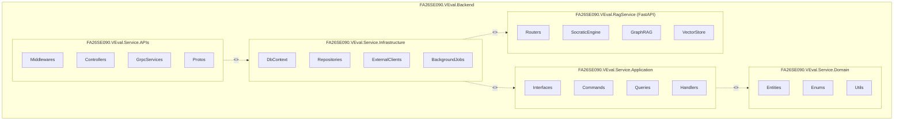

**Đoạn văn & Bảng Tiếng Anh chuẩn dán vào Word (Mục `1.2.1`):**

```markdown
#### 1.2.1 Web API & Backend Service Package Diagram

Because all .NET 9 domain microservices (`Identity`, `Content`, `Practice`, and `AI Orchestrator`) strictly adhere to a unified Clean Architecture template, Figure 13 illustrates the canonical internal package structure shared across each .NET backend service, paired with the specialized Python FastAPI `RagService` module. Dependencies flow strictly inward toward `Application` and `Domain` in accordance with the Dependency Inversion Principle.

*[Chèn hình Draw.io của bạn vào đây: Figure 13. Web API & Backend Service Package Diagram]*

| No | Package | Description |
| :--- | :--- | :--- |
| 01 | **FA26SE090.VEval.\<Service\>.APIs** | Top-level entry point exposing RESTful `Controllers`, internal HTTP/2 `GrpcServices`, `.proto` contracts (`Protos`), JWT authentication, and global exception `Middlewares`. |
| 02 | **FA26SE090.VEval.\<Service\>.Infrastructure** | Persistence and integration layer containing multi-schema EF Core `DbContext`, PostgreSQL `Repositories`, `BackgroundJobs`, and `ExternalClients` (Redis 7 cache, SMTP email, and Electronic Payment Gateway adapters). |
| 03 | **FA26SE090.VEval.\<Service\>.Application** | Core use-case layer implementing MediatR CQRS (`Commands`, `Queries`, `Handlers`), psychometric algorithms (2PL IRT, BKT, Tarjan DAG, Topological Sort, Knapsack), and repository/service `Interfaces`. |
| 04 | **FA26SE090.VEval.\<Service\>.Domain** | Foundational enterprise layer encapsulating domain `Entities`, `Enums`, and mathematical `Utils` with zero dependencies on external frameworks or databases. |
| 05 | **FA26SE090.VEval.RagService** | Specialized Python FastAPI module comprising `Routers`, `SocraticEngine` (with `ValidatorJudge` anti-leakage guardrails), `GraphRAG` hybrid retrieval (`Cosine >= 0.75`), and `pgvector` `VectorStore` ingestion. |
```

---

#### 1.2.2 Web Application Package Diagram — 🎨 `[PLAN HƯỚNG DẪN VẼ TAY DRAW.IO THEO MẪU HÌNH 2]`

**Plan vẽ tay từng bước trên Draw.io (Mục `1.2.2` — giống hệt bố cục `UI + Service + ENV` của Hình 2 mẫu):**

1. **Bước 1 — Vẽ khung Folder bao ngoài cùng**:
   - Kéo 1 hình `Folder` lớn kích thước **`900px x 760px`** bao trọn toàn bộ sơ đồ.
2. **Bước 2 — Vẽ Khối trên `UI` (`560px x 300px`)**:
   - Mở mục **`UML`** -> kéo hình **`Package (Tab vuông góc trái trên)`**, gõ chữ **`UI`** vào ô tab vuông nhỏ góc trái trên.
   - Bên trong khối `UI`, kéo **3 hình `Folder` nhỏ** (`130px x 75px`) xếp thành hình tam giác ngược y hệt Hình 2 mẫu:
     - Góc trái trên: **`Layouts`** (AppShell, RoleSidebar, ExamFullScreenGuard)
     - Góc phải trên: **`Components`** (KaTeX Renderer, Radar Chart, Heatmap, Modals)
     - Chính giữa bên dưới: **`Pages`** (6 Role Workspaces, Diagnostic, MockExam, ParentBilling)
3. **Bước 3 — Vẽ Khối dưới `Service` (`560px x 320px`, đặt thẳng hàng ngay dưới khối `UI`, cách `35px`)**:
   - Kéo 1 hình **`Package (Tab vuông góc trái trên)`**, gõ chữ **`Service`** vào ô tab vuông.
   - Bên trong khối `Service`, kéo **4 hình `Folder` nhỏ** (`130px x 75px`) xếp thành lưới **2 hàng x 2 cột** y hệt Hình 2 mẫu:
     - Hàng trên bên trái: **`Routes`** (`ProtectedRoute`, Role Router)
     - Hàng trên bên phải: **`Hooks`** (`useAuth`, `useExamTimer`, `useWebcamProctoring`)
     - Hàng dưới bên trái: **`Features`** *(hoặc `Services` — Axios API slices)*
     - Hàng dưới bên phải: **`Store`** *(hoặc `Context` — `AuthContext`, `ExamSessionState`)*
4. **Bước 4 — Vẽ Folder `ENV` nằm lẻ bên phải ngoài khối `Service`**:
   - Kéo **1 hình `Folder` nhỏ** (`130px x 75px`) đặt ở bên phải khối `Service` (cách cạnh phải khối `Service` khoảng `90px`), gõ chữ **`ENV`**.
5. **Bước 5 — Đi dây vuông góc (`Orthogonal Dashed Arrow`) sạch đẹp**:
   - Chọn kiểu dây vuông góc `Waypoints -> Orthogonal`, nét đứt `Dashed`, mũi tên hở `Open Arrow`:
   - **Bên trong `UI`**: Nối vuông góc giữa `Pages` với `Layouts` và `Components` *(lưu ý chuẩn UML `<<import>>`: `Pages` import `Layouts` và `Components` nên mũi tên trỏ từ `Pages` lên `Layouts` và `Components`; nếu bạn muốn giữ chiều giống hệt ảnh mẫu `Layouts - - -> Pages` để nhìn thuận luồng lắp ghép UI thì ghi chú là luồng cung cấp component đều được, nhưng chiều chuẩn UML là **`Pages - - -> Layouts`** và **`Pages - - -> Components`**)*.
   - **Giữa `UI` và `Service`**: Từ `Routes` nối nét đứt lên `Pages` (hoặc `Pages - - -> Routes` & `Pages - - -> Hooks` như đường gấp khúc ở giữa 2 khối).
   - **Bên trong `Service`**: `Hooks - - -> Features` và `Hooks - - -> Store` (hoặc `Features - - -> Store`).
   - **Ra ngoài `ENV`**: Từ cạnh phải khối `Service` (hoặc từ `Features`) kẻ 1 mũi tên sang **`ENV`**.

**Bản phác thảo trực quan đúng bố cục `UI + Service + ENV` của Hình 2 mẫu:**

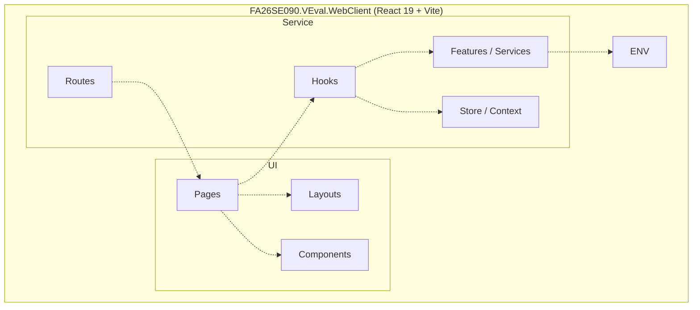

**Đoạn văn & Bảng Tiếng Anh chuẩn dán vào Word (Mục `1.2.2`):**

```markdown
#### 1.2.2 Web Application Package Diagram

Figure 14 depicts the front-end package organization of the V-Eval Web Application built with React 19, Vite, and Tailwind CSS, structured into two primary subsystems—`UI` and `Service`—alongside externalized `ENV` runtime configurations.

*[Chèn hình Draw.io của bạn vào đây: Figure 14. Web Application Package Diagram]*

| No | Package | Description |
| :--- | :--- | :--- |
| 01 | **Components** | Contains reusable UI widgets, KaTeX scientific formula renderers, multi-domain competency radar charts, heatmaps, and interactive assessment cards. |
| 02 | **Layouts** | Provides structural page shells (Header, 6-role Navigation Sidebar, and distraction-free Full-Screen Exam Guard) ensuring visual consistency. |
| 03 | **Pages** | Top-level application views mapped to all 6 roles (Student Learning Hub & Schedule, Diagnostic Test, Proctored Mock Exam, Parent Package Billing, Teacher Heatmap, Director DAG Studio, and Admin Console). |
| 04 | **Routes** | Configures client-side routing tables, role-based access guards (`ProtectedRoute`), and view transitions. |
| 05 | **Store / Context** | Manages global client states including authenticated JWT claims, token refresh synchronization, campus selection, and active exam session state. |
| 06 | **Hooks** | Encapsulates reusable stateful logic including browser webcam snapshot capture, tab-visibility listeners, countdown timers, and data fetching hooks. |
| 07 | **Features / Services** | Centralized Axios API modules communicating with backend microservices (`auth`, `user`, `content`, `practice`, `ai`, `billing`) via the YARP API Gateway. |
| 08 | **ENV** | Stores Vite environment variables (`VITE_API_GATEWAY_URL`), proctoring thresholds, and client runtime constants. |
```

---

#### 1.2.3 Companion Mobile Application Package Diagram — 🎨 `[ĐỒNG BỘ CÙNG PHONG CÁCH UI + SERVICE + ENV]` | 🔜 `[SẮP TRIỂN KHAI]`

**Plan vẽ tay nhanh trên Draw.io (Mục `1.2.3` — bạn chỉ cần `Duplicate` tab `1.2.2` rồi sửa tên 3 hộp trong 1 phút!):**

1. Nhấp chuột phải vào tab `1.2.2` vừa vẽ xong trên Draw.io -> chọn **`Duplicate`** để giữ nguyên 100% khung `UI`, `Service`, `ENV` đồng bộ nét vẽ với Hình 2!
2. Trong khối **`UI`** ở trên: xóa `Layouts`, chỉ giữ 2 folder ngang nhau là **`Screens`** (trái) và **`Components`** (phải), nối `Screens - - -> Components`.
3. Trong khối **`Service`** ở dưới: đổi `Routes` thành **`Navigator`**, giữ nguyên **`Hooks`**, **`Features`**, **`Store`**, thêm 1 folder **`API`** nối ra **`ENV`** bên ngoài (giống hệt `Figure 12` Mobile trong báo cáo mẫu `GFA67`!).

**Bản phác thảo trực quan cho `1.2.3`:**

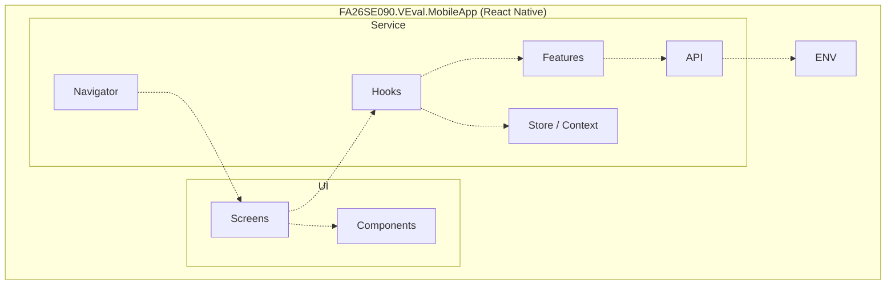

**Đoạn văn & Bảng Tiếng Anh chuẩn dán vào Word (Mục `1.2.3`):**

```markdown
#### 1.2.3 Companion Mobile Application Package Diagram

Figure 15 illustrates the package architecture of the V-Eval Companion Mobile Application built with React Native, organized into `UI`, `Service`, and `ENV` layers. Consistent with constraint `LI-07`, the mobile client supports roadmap and study schedule tracking, daily mistake flashcard reviews, Socratic AI chat, and parent early-warning push notifications.

*[Chèn hình Draw.io của bạn vào đây: Figure 15. Companion Mobile Application Package Diagram]*

| No | Package | Description |
| :--- | :--- | :--- |
| 01 | **Components** | Touch-optimized mobile UI widgets including LaTeX formula cards, interactive spaced-repetition flashcards, study calendar items, and mastery gauges. |
| 02 | **Screens** | Mobile view containers for Personalized Roadmap & Study Schedule, Mistake Notebook Review, Socratic AI Chat, Score Forecast, and Parent Progress Alerts. |
| 03 | **Navigator** | Configures React Navigation stack and bottom-tab navigators separating guest authentication, Student Companion tabs, and Parent Monitoring tabs. |
| 04 | **Store / Context** | Manages encrypted token storage (`SecureStore`), linked child-account switching for Parents, and unread alert badge states. |
| 05 | **Hooks** | Encapsulates push-notification token registration, study streak timers, and network status listeners. |
| 06 | **Features** | Domain state slices coordinating roadmap synchronization, flashcard review queues, and AI tutor conversation threads. |
| 07 | **API** | Axios HTTP client with JWT refresh interceptors communicating with downstream services through the YARP API Gateway. |
| 08 | **ENV** | Stores API Gateway endpoint URLs, push notification identifiers, and mobile build configuration constants. |
```

---

## 2. Database Design

### 2.1 Logical ERD & Physical ERD — ✅ `[ĐÃ CÓ SẴN DIAGRAM — ĐỐI CHIẾU CHECKLIST CHỈNH NHANH]`

**Checklist 5 điểm cực kỳ quan trọng để rà lại hình `ERD` hiện có của bạn (đảm bảo khớp 100% SRS & Code):**

1. **XÓA 2 bảng thừa của tính năng Live Classroom đã hủy**: Nếu trong hình ERD của bạn (vẽ từ file `SQL.sql` cũ) còn 2 bảng **`LiveSessions`** và **`LiveSessionAttendance`** trong schema `v_eval_practice`, hãy **xóa bỏ 2 bảng này** để không bị hội đồng bắt lỗi mâu thuẫn với Phần I–III!
2. **THÊM 2 bảng Thanh toán gói học `🔜 [SẮP TRIỂN KHAI]` vào schema `v_eval_identity`**:
   - **`StudyPackages`**: `package_id (UUID, PK)`, `package_code (VARCHAR)`, `package_name (VARCHAR)`, `duration_days (INT)`, `price_amount (DECIMAL)`, `ai_daily_quota (INT)`, `is_active (BOOLEAN)`.
   - **`PaymentTransactions`**: `transaction_id (UUID, PK)`, `order_code (VARCHAR, UNIQUE)`, `parent_id (UUID, FK -> Users)`, `student_id (UUID, FK -> Students)`, `package_id (UUID, FK -> StudyPackages)`, `amount (DECIMAL)`, `payment_provider (VARCHAR)`, `status (VARCHAR: PENDING / PAID / CANCELLED / FAILED)`, `paid_at (TIMESTAMPTZ)`, `created_at (TIMESTAMPTZ)`.
3. **Kiểm tra bảng `OtpTokens` & `RefreshTokens` (`v_eval_identity`)**: Code thực tế của `V-Eval-Identity_Service` có `IOtpRepository` và `IRefreshTokenRepository` phục vụ `UC02 Verify Account` và `JWT Refresh Token`. Nên có mặt trong ERD và bảng mô tả bên dưới.
4. **Kiểm tra cụm bảng GraphRAG trong `v_eval_ai`**: Ngoài 6 bảng trong `SQL.sql` (`KnowledgeSources`, `KnowledgeVectorChunks`, `AITutorSessions`, `AITutorMessages`, `ScorePredictions`, `TokenUsageLogs`), Python `rag-service` (`graph_schema.sql`) có thêm các bảng cốt lõi tạo nên điểm nhấn đồ án là **`ArchetypePatterns`**, **`PatternExemplars`** và **`NovelPatternProposals`** (phục vụ Academic Director duyệt dạng toán mới).
5. **Thống nhất kiểu dữ liệu `vector(768)`**: File `SQL.sql` dùng `vector(768)` trong khi `graph_schema.sql` ghi `vector(3072)`. Trên hình Physical ERD, hãy thống nhất ghi **`vector(768)`** (hoặc cùng một số chiều duy nhất) cho cả `KnowledgeVectorChunks.embedding` và `ArchetypePatterns.embedding`. Đồng thời, các đường nối **giữa 2 schema khác nhau** (ví dụ `v_eval_practice.PersonalRoadmaps.student_id` tham chiếu sang `v_eval_identity.Students.student_id`) nên vẽ bằng **đường nét đứt (Logical Cross-Schema Reference)** đúng chuẩn Microservices.

**Đoạn văn Tiếng Anh chuẩn dán vào Word (Mục `2. Database Design` — trước bảng mô tả):**

```markdown
## 2. Database Design

V-Eval utilizes **PostgreSQL 16** augmented with the **`pgvector`** extension as its unified relational and vector persistence engine, complemented by **Redis 7** for distributed caching. Following the Microservices Database-per-Service pattern, physical storage is partitioned into four logically isolated schemas:

- **`v_eval_identity`**: Stores user credentials, role assignments, OTP/refresh tokens, campus directory records, parent–student authorization links, study packages, and electronic payment transactions.
- **`v_eval_content`**: Stores the Competency Taxonomy DAG (`CompetencyNodes` and `CompetencyEdges`), calibrated Master Question Bank (`Questions` with 2PL IRT parameters `a` and `b`), multimedia `LearningMaterials`, and `MockExams` blueprints.
- **`v_eval_practice`**: Stores diagnostic submissions, student ability vectors, personalized DAG roadmaps, P-L-A-R stages, BKT mastery tracking, spaced-repetition mistake notebooks, proctored mock exam submissions, thematic campus cohorts, and multi-tier early-warning alerts.
- **`v_eval_ai`**: Stores curated curriculum documents, HNSW-indexed `pgvector` chunks, archetype problem patterns, novel pattern proposals, Socratic AI chat sessions/messages, daily token usage quotas, and SEM-bounded score predictions.

Cross-schema entity references (such as `student_id`, `question_id`, and `node_id`) are maintained at the application/gRPC boundary as immutable `UUID` identifiers without tight cross-service foreign-key locks, preserving independent deployability across microservices.

### 2.1 Logical Entity Relationship Diagram

*[Chèn hình Logical ERD của bạn vào đây: Figure 16. Logical Entity Relationship Diagram]*

### 2.2 Physical Entity Relationship Diagram

*[Chèn hình Physical ERD của bạn vào đây: Figure 17. Physical Entity Relationship Diagram]*
```

---

### 2.2 Table Descriptions — 📋 `[BẢNG ĐẶC TẢ 34 BẢNG CHUẨN DÁN THẲNG VÀO WORD]`

*(Lưu ý cho nhóm: Bảng dưới đây đã **loại bỏ sạch `LiveSessions` & `LiveSessionAttendance`**, đồng thời **bổ sung sẵn `StudyPackages` & `PaymentTransactions`** để đồng bộ tuyệt đối với Phần I, II, III. Trong Word, bạn copy nguyên bảng Tiếng Anh bên dưới dán ngay sau hình `Physical ERD` như đúng file mẫu `GFA67`!)*

```markdown
### 2.3 Database Table Descriptions

| No | Table (`Schema`) | Description |
| :--- | :--- | :--- |
| 01 | **Campuses** (`v_eval_identity`) | Stores physical training branch locations, contact information, and operational statuses across the multi-campus network.<br>- Primary keys: `campus_id`<br>- Foreign keys: None |
| 02 | **Users** (`v_eval_identity`) | Stores core authentication credentials, profile attributes, campus affiliation, and primary role (`STUDENT`, `PARENT`, `TEACHER`, `ACADEMIC_MANAGER`, `ACADEMIC_DIRECTOR`, `ADMIN`).<br>- Primary keys: `user_id`<br>- Foreign keys: `campus_id` references `Campuses(campus_id)` |
| 03 | **OtpTokens** (`v_eval_identity`) | Stores time-limited one-time passwords (OTP) for account email activation and forgotten-password recovery workflows.<br>- Primary keys: `otp_id`<br>- Foreign keys: `user_id` references `Users(user_id)` |
| 04 | **RefreshTokens** (`v_eval_identity`) | Tracks issued JWT refresh tokens, expiration timestamps, and revocation flags to support secure session rotation.<br>- Primary keys: `token_id`<br>- Foreign keys: `user_id` references `Users(user_id)` |
| 05 | **Students** (`v_eval_identity`) | Extends `Users` with learner-specific academic goals including target VNU-HCM DGNL score (`0–1200`), official exam date, target university benchmark reference, and current baseline ability estimate.<br>- Primary keys: `student_id`<br>- Foreign keys: `student_id` references `Users(user_id)` |
| 06 | **ParentStudentLinks** (`v_eval_identity`) | Manages verified authorization pairings between Parent accounts and Student accounts via one-time student pairing codes.<br>- Primary keys: `link_id`<br>- Foreign keys: `parent_id` references `Users(user_id)`, `student_id` references `Students(student_id)` |
| 07 | **StudyPackages** (`v_eval_identity`) | Defines commercial study and mock-exam subscription plans, validity durations, pricing, and daily Socratic AI token allowances.<br>- Primary keys: `package_id`<br>- Foreign keys: None |
| 08 | **PaymentTransactions** (`v_eval_identity`) | Records parent-initiated online package purchase orders, electronic payment gateway references, webhook verification statuses, and digital invoice timestamps.<br>- Primary keys: `transaction_id`<br>- Foreign keys: `parent_id` references `Users(user_id)`, `student_id` references `Students(student_id)`, `package_id` references `StudyPackages(package_id)` |
| 09 | **CompetencyNodes** (`v_eval_content`) | Represents hierarchical curriculum units (`SECTION`, `DOMAIN`, `TOPIC`, `SKILL`, `PATTERN`) within the VNU-HCM DGNL Master Taxonomy.<br>- Primary keys: `node_id`<br>- Foreign keys: `parent_id` references `CompetencyNodes(node_id)` |
| 10 | **CompetencyEdges** (`v_eval_content`) | Defines directed prerequisite dependencies (`REQUIRES`) between competency nodes, validated as a cycle-free Directed Acyclic Graph (DAG) via Tarjan's algorithm.<br>- Primary keys: `edge_id`<br>- Foreign keys: `source_node_id` references `CompetencyNodes(node_id)`, `target_node_id` references `CompetencyNodes(node_id)` |
| 11 | **Questions** (`v_eval_content`) | Stores the Master Question Bank including LaTeX stems, JSONB options, step-by-step solutions, 2PL IRT discrimination (`irt_a`) and difficulty (`irt_b`) parameters, and Academic Director approval status (`DRAFT`, `PENDING_REVIEW`, `PUBLISHED`).<br>- Primary keys: `question_id`<br>- Foreign keys: `node_id` references `CompetencyNodes(node_id)`, `created_by` logical reference to `v_eval_identity.Users(user_id)` |
| 12 | **LearningMaterials** (`v_eval_content`) | Stores theory micro-lecture video metadata, duration requirements, and PDF summary sheets mapped to specific competency nodes for the Learn (`L`) phase.<br>- Primary keys: `material_id`<br>- Foreign keys: `node_id` references `CompetencyNodes(node_id)` |
| 13 | **MockExams** (`v_eval_content`) | Defines full-length 120-item / 150-minute VNU-HCM DGNL simulated exam blueprints, blueprint matrix configurations, and scheduled exam windows.<br>- Primary keys: `exam_id`<br>- Foreign keys: None |
| 14 | **DiagnosticSubmissions** (`v_eval_practice`) | Records 30-item diagnostic placement test attempts, item-level response latency logs, and initial multi-domain 2PL IRT ability estimates (`theta_0`).<br>- Primary keys: `submission_id`<br>- Foreign keys: `student_id` logical reference to `v_eval_identity.Students(student_id)` |
| 15 | **PersonalRoadmaps** (`v_eval_practice`) | Stores individualized learning roadmaps generated via Topological Sort, tracking target scores, active status, and overall completion percentages.<br>- Primary keys: `roadmap_id`<br>- Foreign keys: `student_id` logical reference to `v_eval_identity.Students(student_id)` |
| 16 | **RoadmapNodes** (`v_eval_practice`) | Represents topologically ordered competency milestones and scheduled study dates within a student's personalized roadmap (`LOCKED`, `UNLOCKED`, `IN_PROGRESS`, `MASTERED`).<br>- Primary keys: `roadmap_node_id`<br>- Foreign keys: `roadmap_id` references `PersonalRoadmaps(roadmap_id)`, `node_id` logical reference to `v_eval_content.CompetencyNodes(node_id)` |
| 17 | **LearningStages** (`v_eval_practice`) | Tracks sequential execution of the four pedagogical stages (`PROBE`, `LEARN`, `APPLY`, `REINFORCE`) within each unlocked roadmap milestone.<br>- Primary keys: `stage_id`<br>- Foreign keys: `roadmap_node_id` references `RoadmapNodes(roadmap_node_id)` |
| 18 | **StudentCompetencies** (`v_eval_practice`) | Maintains real-time student skill states including Bayesian Knowledge Tracing mastery probability `P(L_t)`, local IRT `theta`, and BKT transition parameters (`p_init`, `p_transit`, `p_guess`, `p_slip`).<br>- Primary keys: `tracking_id`<br>- Foreign keys: `student_id` logical reference to `v_eval_identity.Students(student_id)`, `node_id` logical reference to `v_eval_content.CompetencyNodes(node_id)` |
| 19 | **PracticeAttempts** (`v_eval_practice`) | Logs granular item-by-item adaptive practice responses, correctness, response latency (`time_spent_sec`), and Socratic hint usage counts.<br>- Primary keys: `attempt_id`<br>- Foreign keys: `student_id` logical reference to `v_eval_identity.Students(student_id)`, `question_id` logical reference to `v_eval_content.Questions(question_id)`, `stage_id` references `LearningStages(stage_id)` |
| 20 | **MistakeNotebooks** (`v_eval_practice`) | Schedules spaced-repetition reviews for incorrect items using SM-2 / Leitner box intervals (`box_level`, `ease_factor`, `next_review_at`).<br>- Primary keys: `mistake_id`<br>- Foreign keys: `student_id` logical reference to `v_eval_identity.Students(student_id)`, `question_id` logical reference to `v_eval_content.Questions(question_id)` |
| 21 | **ExamSubmissions** (`v_eval_practice`) | Records simulated mock exam attempts, scaled `0–1200` scores, tab-switch violation counters, webcam proctoring snapshot logs, and mentor integrity review statuses (`VALID`, `UNDER_REVIEW`, `INVALIDATED`).<br>- Primary keys: `exam_sub_id`<br>- Foreign keys: `exam_id` logical reference to `v_eval_content.MockExams(exam_id)`, `student_id` logical reference to `v_eval_identity.Students(student_id)` |
| 22 | **ExamAnswerDetails** (`v_eval_practice`) | Stores per-question selected options, correctness flags, and time spent within a simulated mock exam submission.<br>- Primary keys: `detail_id`<br>- Foreign keys: `exam_sub_id` references `ExamSubmissions(exam_sub_id)`, `question_id` logical reference to `v_eval_content.Questions(question_id)` |
| 23 | **Classes** (`v_eval_practice`) | Represents campus cohorts and thematic remedial classes formed via Constrained K-Means ability clustering (`FOUNDATIONAL`, `STANDARD`, `INTENSIVE`).<br>- Primary keys: `class_id`<br>- Foreign keys: `campus_id` logical reference to `v_eval_identity.Campuses(campus_id)`, `teacher_id` logical reference to `v_eval_identity.Users(user_id)` |
| 24 | **ClassEnrollments** (`v_eval_practice`) | Maps students to assigned campus cohorts and tracks enrollment lifecycle states (`ACTIVE`, `TRANSFERRED`, `COMPLETED`).<br>- Primary keys: `enrollment_id`<br>- Foreign keys: `class_id` references `Classes(class_id)`, `student_id` logical reference to `v_eval_identity.Students(student_id)` |
| 25 | **SystemAlerts** (`v_eval_practice`) | Stores three-tier early-warning pedagogical notifications (`TIER_1` Student reminder, `TIER_2` Parent & Mentor alert, `TIER_3` Academic Manager academic support intervention).<br>- Primary keys: `alert_id`<br>- Foreign keys: `student_id` logical reference to `v_eval_identity.Students(student_id)`, `recipient_id` logical reference to `v_eval_identity.Users(user_id)` |
| 26 | **KnowledgeSources** (`v_eval_ai`) | Stores metadata and ingestion statuses (`PROCESSING`, `INDEXED`, `FAILED`) for canonical reference documents approved for Socratic AI grounding.<br>- Primary keys: `source_id`<br>- Foreign keys: `node_id` logical reference to `v_eval_content.CompetencyNodes(node_id)` |
| 27 | **KnowledgeVectorChunks** (`v_eval_ai`) | Stores chunked pedagogical passages and HNSW-indexed `pgvector` embeddings retrieved during Hybrid GraphRAG similarity searches.<br>- Primary keys: `chunk_id`<br>- Foreign keys: `source_id` references `KnowledgeSources(source_id)` |
| 28 | **ArchetypePatterns** (`v_eval_ai`) | Stores structured problem-solving archetypes, heuristic steps, core LaTeX formulas, and pattern embeddings for GraphRAG reasoning.<br>- Primary keys: `pattern_id`<br>- Foreign keys: `node_id` logical reference to `v_eval_content.CompetencyNodes(node_id)` |
| 29 | **PatternExemplars** (`v_eval_ai`) | Stores canonical worked examples and common student misconception traps linked to each `ArchetypePattern` to guide Socratic scaffolding.<br>- Primary keys: `exemplar_id`<br>- Foreign keys: `pattern_id` references `ArchetypePatterns(pattern_id)` |
| 30 | **NovelPatternProposals** (`v_eval_ai`) | Queues newly detected problem patterns (`Cosine < 0.75`) discovered by the AI Novelty Detector for Academic Director moderation (`PENDING`, `APPROVED`, `REJECTED`).<br>- Primary keys: `proposal_id`<br>- Foreign keys: `suggested_parent_node_id` logical reference to `v_eval_content.CompetencyNodes(node_id)` |
| 31 | **AITutorSessions** (`v_eval_ai`) | Tracks contextual Socratic tutoring threads anchored to a specific student, question item, or competency skill node.<br>- Primary keys: `session_id`<br>- Foreign keys: `student_id` logical reference to `v_eval_identity.Students(student_id)`, `context_question_id` logical reference to `v_eval_content.Questions(question_id)` |
| 32 | **AITutorMessages** (`v_eval_ai`) | Stores individual `USER` and `ASSISTANT` turns, Socratic scaffolding steps, Validator Judge pass flags, and prompt/completion token counts.<br>- Primary keys: `message_id`<br>- Foreign keys: `session_id` references `AITutorSessions(session_id)` |
| 33 | **TokenUsageLogs** (`v_eval_ai`) | Tracks daily aggregated LLM token consumption per student (`student_id, usage_date`) to enforce fair-use daily budget caps.<br>- Primary keys: `usage_id`<br>- Foreign keys: `student_id` logical reference to `v_eval_identity.Students(student_id)` |
| 34 | **ScorePredictions** (`v_eval_ai`) | Stores longitudinal 2PL IRT projected total scores (`0–1200`), SEM 95% confidence bounds, readiness status, and top Greedy Knapsack remedial node recommendations.<br>- Primary keys: `prediction_id`<br>- Foreign keys: `student_id` logical reference to `v_eval_identity.Students(student_id)` |
```


---


## 3. Detailed Design

> [!IMPORTANT]
> Toàn bộ mục **3. Detailed Design** dưới đây tuân thủ **100% quy chuẩn trình bày của báo cáo mẫu FPTU (`6819_HCM_FA25SE208_GFA67_Final_Report.docx`)**: Chia thành **7 Phân hệ quản lý (`3.1 -> 3.7`)**, trong đó **TỪNG CHỨC NĂNG LẺ (20 chức năng cốt lõi)** đều được tách riêng thành **1 cặp bài trùng `Class Diagram` (số lẻ) + `Sequence Diagram` (số chẵn)** nối tiếp nhau từ **`Figure 18` đến `Figure 57` (tổng cộng 40 sơ đồ, tương đương quy mô 36 sơ đồ của nhóm mẫu)** — tuyệt đối không gộp chung 1 Class Diagram cho nhiều Sequence Diagram!

**Mẹo vẽ siêu tốc 40 hình trên Draw.io (Chỉ cần dựng 1 khung mẫu, các hình sau bấm `Duplicate Tab` sửa chữ trong 2 phút):**

- **Mẫu chuẩn `Class Diagram` cho 1 chức năng CQRS (theo đúng style `Figure 15` của nhóm mẫu `GFA67`)**:
  - **Đỉnh giữa**: Đặt hộp `<Feature>Controller` nối xuống `<Feature>Handler` (chứa đúng 1 hàm `+ Handle(request: <Feature>Command) : Task`).
  - **Hàng giữa bên trái**: Đặt các hộp `<<interface>>` mà Handler đó gọi trực tiếp (`IUnitOfWork`, `I<Entity>Repository`, `IOtpService` / `IContentGrpcClient`...).
  - **Góc dưới bên phải**: Đặt **2 đến 3 hộp `Domain Entity`** thực sự bị đọc/ghi trong chức năng đó (ghi đầy đủ các trường `+ Id: Guid`, `+ CreatedAt: DateTime`... và nối quan hệ `1 ───> 0..*` giữa các Entity).
- **Mẫu chuẩn `Sequence Diagram` cho 1 chức năng CQRS (theo đúng style `Figure 16` của nhóm mẫu `GFA67`)**:
  - Góc trái trên vẽ 1 khung frame gắn nhãn tên luồng (ví dụ `Register Account & Verify OTP`).
  - Hàng ngang **Lifelines** từ trái qua phải: `Actor` -> `Web / Mobile UI` -> `:<Name>Controller` -> `:<Feature>Handler` -> `:I<Entity>Repository` -> `:IUnitOfWork` -> `PostgreSQL` *(+ Hệ thống ngoài nếu có)*.
  - Đánh số thứ tự từng mũi tên `1, 2, 3...`, bọc các nhánh kiểm tra lỗi trong khung **`alt [Invalid condition]`** trả mã lỗi HTTP sớm, bọc nhánh tùy chọn trong khung **`opt [...]`**, và chốt bằng `SaveChangesAsync()` xuống Database.

---

### 3.1 Identity, Account Linkage & Tuition Payment Management

**Đoạn văn Tiếng Anh mở đầu mục `3.1` dán vào Word:**

```markdown
### 3.1 Identity, Account Linkage & Tuition Payment Management

This section describes the detailed design of the Identity, Account Linkage, and Tuition Payment Management module within `V-Eval-Identity_Service`. This module enables guests to register accounts and activate access via Email OTP verification, authenticates users with role-based JWT tokens, pairs Parent and Student accounts via secure authorization codes, and processes online study-package payments through an external Electronic Payment Gateway.
```

---

#### Cặp Chức Năng 1 (`3.1.1` & `3.1.2`): Register Account & Verify Email OTP — ✅ `[ĐÃ CÓ CODE LOGIC OTP]` | 🔜 `[CHƯA GẮN SMTP GỬI MAIL THẬT — hiện đang trả OTP qua API test]`

##### `3.1.1 Class Diagram - Register Account & Verify Email OTP` (`Figure 18`) — 🎨 `[HƯỚNG DẪN VẼ CHI TIẾT TỪNG HỘP DRAW.IO]`

1. **Hàng 1 (Đỉnh giữa)**:
   - Hộp **`AuthController`**: phương thức `+ Register(cmd: RegisterUserCommand) : Task`, `+ VerifyAccount(cmd: VerifyAccountCommand) : Task`.
   - Hộp **`RegisterAndVerifyHandler`** *(gộp gọn `RegisterUserHandler` & `VerifyAccountHandler` của cùng luồng kích hoạt)*: phương thức `+ Handle(cmd: RegisterUserCommand) : Task`, `+ Handle(cmd: VerifyAccountCommand) : Task`.
2. **Hàng 2 (Các `<<interface>>` được Inject từ trái sang phải)**:
   - Hộp **`<<interface>> IUserRepository`**: `+ IsEmailUniqueAsync(email: string) : Task`, `+ GetByEmailAsync(email: string) : Task`, `+ AddAsync(user: User) : Task`, `+ Update(user: User) : void`.
   - Hộp **`<<interface>> IOtpRepository`**: `+ AddAsync(otp: OtpVerification) : Task`, `+ GetLatestValidOtpAsync(email: string, code: string) : Task`, `+ Update(otp: OtpVerification) : void`.
   - Hộp **`<<interface>> IOtpService`**: `+ GenerateOtpCode() : string`, `+ SendOtpEmailAsync(email: string, otp: string) : Task`.
   - Hộp **`<<interface>> IUnitOfWork`**: `+ SaveChangesAsync() : Task`.
3. **Hàng 3 (Các `Domain Entities` góc dưới phải — ghi rõ thuộc tính thật trong code)**:
   - Hộp **`User`**: `+ UserId: Guid`, `+ Email: string`, `+ PasswordHash: string`, `+ FullName: string`, `+ Phone: string`, `+ IsActive: bool`, `+ CreatedAt: DateTime`.
   - Hộp **`UserRole`**: `+ UserId: Guid`, `+ RoleId: Guid`.
   - Hộp **`Student`**: `+ StudentId: Guid`, `+ TargetScore: int`, `+ ExamDate: DateTime?`, `+ CreatedAt: DateTime`.
   - Hộp **`OtpVerification`**: `+ OtpId: Guid`, `+ Email: string`, `+ OtpCode: string`, `+ Type: string`, `+ ExpiresAt: DateTime`, `+ IsUsed: bool`.
4. **Cách nối dây trên Draw.io**:
   - `AuthController - - -> RegisterAndVerifyHandler` (nét đứt `<<MediatR>>`).
   - `RegisterAndVerifyHandler ───>` nối mũi tên liền sang cả 4 `<<interface>>` (`IUserRepository`, `IOtpRepository`, `IOtpService`, `IUnitOfWork`) và nối vào `User`, `OtpVerification`.
   - Quan hệ giữa các Entity: `User "1" ───> "0..*" UserRole`, `User "1" ───> "0..1" Student`.

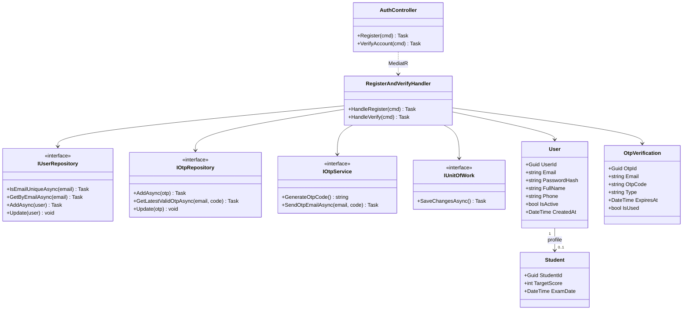

##### `3.1.2 Sequence Diagram - Register Account & Verify Email OTP` (`Figure 19`) — 🎨 `[HƯỚNG DẪN VẼ CHI TIẾT TRÊN DRAW.IO]`

1. **Đặt 8 Lifelines từ trái sang phải**: `Guest` (Actor) -> `Web / Mobile UI` -> `:AuthController` -> `:RegisterAndVerifyHandler` -> `:IUserRepository` -> `:IOtpRepository & IOtpService` -> `:IUnitOfWork` -> `PostgreSQL & SMTP`.
2. **Các khung điều kiện chuẩn trên Draw.io**:
   - Khung **`alt [Email already exists]`** sau bước `IsEmailUniqueAsync(email)`: trả `409 Conflict (Auth.EmailAlreadyExists)` về UI.
   - Khung **`opt [RoleName == STUDENT]`**: khởi tạo bản ghi `Student` tương ứng `UserId`.
   - Khung **`alt [OTP invalid or expired]`** ở nửa dưới khi xác thực mã 6 chữ số: trả `400 Bad Request (Auth.InvalidOtp)` nếu hết hạn `10 phút`, ngược lại bật `Otp.IsUsed = true`, `User.IsActive = true` và `SaveChangesAsync()`.

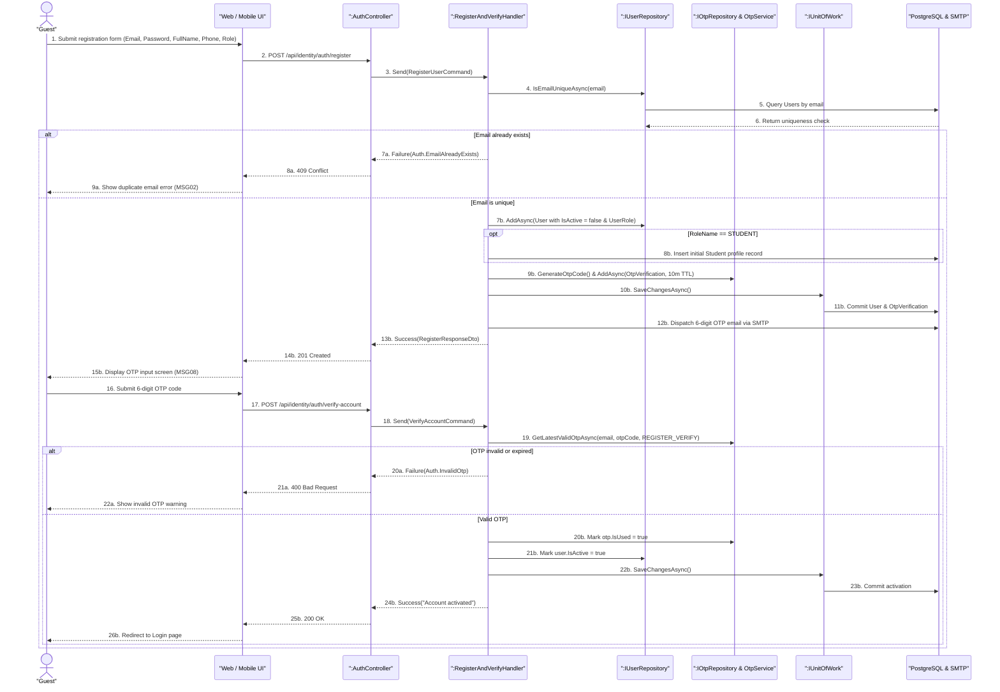

**Văn bản Tiếng Anh dán Word cho `3.1.1` & `3.1.2`:**

```markdown
#### 3.1.1 Class Diagram - Register Account & Verify Email OTP
*[Insert Figure 18. Register Account & Verify Email OTP - Class Diagram]*

#### 3.1.2 Sequence Diagram - Register Account & Verify Email OTP
*[Insert Figure 19. Register Account & Verify Email OTP - Sequence Diagram]*
```

---

#### Cặp Chức Năng 2 (`3.1.3` & `3.1.4`): User Login & Issue JWT Tokens — ✅ `[ĐÃ CÓ CODE THỰC TẾ]`

##### `3.1.3 Class Diagram - User Login & Issue JWT Tokens` (`Figure 20`) — 🎨 `[HƯỚNG DẪN VẼ CHI TIẾT TỪNG HỘP DRAW.IO]`

1. **Mẹo vẽ nhanh**: Nhấp chuột phải vào tab `3.1.1` trên Draw.io -> bấm **`Duplicate`**.
2. Giữ nguyên `AuthController` và `IUnitOfWork`, đổi hộp giữa thành **`LoginHandler`** (`+ Handle(cmd: LoginCommand) : Task`).
3. Hàng `<<interface>>` giữ **4 hộp đúng y code `LoginCommand.cs`**:
   - **`<<interface>> IUserRepository`**: `+ GetByEmailWithRolesAsync(email: string) : Task`.
   - **`<<interface>> IPasswordHasher`**: `+ Verify(password: string, hash: string) : bool`.
   - **`<<interface>> IJwtProvider`**: `+ GenerateAccessToken(user: User, roles: List) : string`, `+ GenerateRefreshToken() : string`.
   - **`<<interface>> IRefreshTokenRepository`**: `+ AddAsync(token: RefreshToken) : Task`.
4. Hàng `Domain Entities` góc phải dưới đặt **3 hộp**:
   - **`User`** (`UserId`, `Email`, `PasswordHash`, `IsActive`, `CampusId`)
   - **`Role`** (`RoleId: Guid`, `RoleName: string`)
   - **`RefreshToken`** (`TokenId: Guid`, `UserId: Guid`, `Token: string`, `ExpiresAt: DateTime`, `IsRevoked: bool`, `CreatedAt: DateTime`), nối `User "1" ───> "0..*" RefreshToken`.

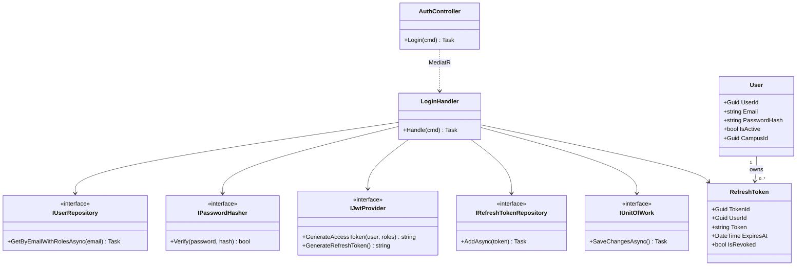

##### `3.1.4 Sequence Diagram - User Login & Issue JWT Tokens` (`Figure 21`) — 🎨 `[HƯỚNG DẪN VẼ CHI TIẾT TRÊN DRAW.IO]`

1. **Lifelines**: `User (All 6 Roles)` -> `Web / Mobile UI` -> `:AuthController` -> `:LoginHandler` -> `:IUserRepository` -> `:IPasswordHasher & IJwtProvider` -> `:IRefreshTokenRepository & IUnitOfWork` -> `PostgreSQL`.
2. Đặt **2 khung `alt` kiểm tra bảo mật nối tiếp nhau** giống hệt `LoginCommand.cs` (dòng 58–71):
   - Khung 1 **`alt [User null or Password mismatch]`** -> trả `401 Unauthorized (Auth.InvalidCredentials)`.
   - Khung 2 **`alt [!user.IsActive]`** -> trả `403 Forbidden (Auth.AccountNotActivated)`.
   - Nếu vượt qua cả 2: sinh `AccessToken` + `RefreshToken (7 days)`, lưu vào bảng `RefreshTokens` qua `SaveChangesAsync()` và trả `AuthResponseDto`.

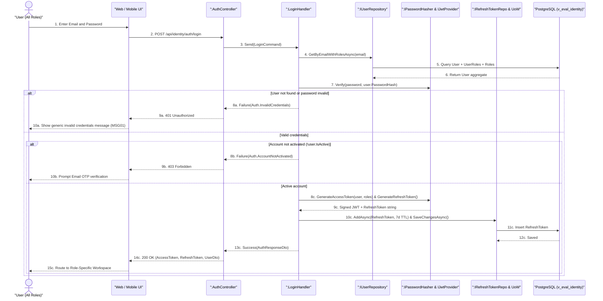

**Văn bản Tiếng Anh dán Word cho `3.1.3` & `3.1.4`:**

```markdown
#### 3.1.3 Class Diagram - User Login & Issue JWT Tokens
*[Insert Figure 20. User Login & Issue JWT Tokens - Class Diagram]*

#### 3.1.4 Sequence Diagram - User Login & Issue JWT Tokens
*[Insert Figure 21. User Login & Issue JWT Tokens - Sequence Diagram]*
```

---

#### Cặp Chức Năng 3 (`3.1.5` & `3.1.6`): Link Parent-Student Account — 🔜 `[SẮP TRIỂN KHAI — ĐÃ CÓ ENTITY ParentStudentRelation TRONG CODE]`

##### `3.1.5 Class Diagram - Link Parent-Student Account` (`Figure 22`) — 🎨 `[HƯỚNG DẪN VẼ CHI TIẾT TỪNG HỘP DRAW.IO]`

1. `Duplicate` tab `3.1.3` trên Draw.io:
   - Đổi Controller thành **`StudentsController`** (`+ GeneratePairingCode() : Task`, `+ LinkStudentByCode(cmd: LinkParentStudentCommand) : Task`).
   - Đổi Handler thành **`LinkParentStudentHandler`** (`+ Handle(cmd: LinkParentStudentCommand) : Task`).
   - Hàng `<<interface>>`: `ICurrentUserService`, `IStudentRepository`, `IOtpRepository` (tái sử dụng bảng `OtpVerification` với `Type = "PARENT_PAIRING"`), `IUnitOfWork`.
   - Hàng `Domain Entities` góc phải dưới (khớp 100% file `ParentStudentRelation.cs` thật trong repo!):
     - **`Parent`** (`ParentId: Guid`, `Occupation: string`)
     - **`Student`** (`StudentId: Guid`, `TargetScore: int`, `ExamDate: DateTime?`)
     - **`ParentStudentRelation`** (`RelationId: Guid`, `ParentId: Guid`, `StudentId: Guid`, `CreatedAt: DateTime`), nối `Parent "1" ───> "0..*" ParentStudentRelation` và `Student "1" ───> "0..*" ParentStudentRelation`.

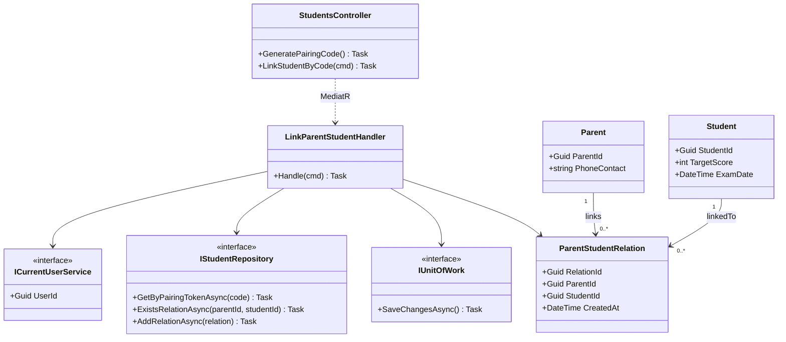

##### `3.1.6 Sequence Diagram - Link Parent-Student Account` (`Figure 23`) — 🎨 `[HƯỚNG DẪN VẼ CHI TIẾT TRÊN DRAW.IO]`

1. **Lifelines**: `Parent` (Actor) -> `Parent Web / Mobile UI` -> `:StudentsController` -> `:LinkParentStudentHandler` -> `:ICurrentUserService` -> `:IStudentRepository` -> `:IUnitOfWork` -> `PostgreSQL`.
2. Đặt 2 khung `alt`:
   - **`alt [Pairing code invalid or expired]`** -> trả `400 Bad Request`.
   - **`alt [Relation already exists]`** -> trả `409 Conflict`.
   - Ngược lại tạo mới `ParentStudentRelation` -> `SaveChangesAsync()` -> trả hồ sơ học tập của con về Dashboard Phụ huynh.

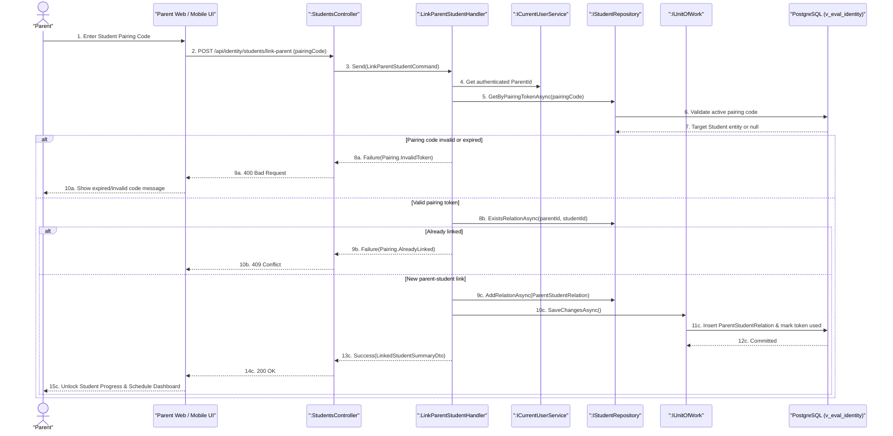

**Văn bản Tiếng Anh dán Word cho `3.1.5` & `3.1.6`:**

```markdown
#### 3.1.5 Class Diagram - Link Parent-Student Account
*[Insert Figure 22. Link Parent-Student Account - Class Diagram]*

#### 3.1.6 Sequence Diagram - Link Parent-Student Account
*[Insert Figure 23. Link Parent-Student Account - Sequence Diagram]*
```

---

#### Cặp Chức Năng 4 (`3.1.7` & `3.1.8`): Pay for Study Package — 🔜 `[SẮP TRIỂN KHAI — ĐỒNG BỘ FE-12, UC31, SCR-21]`

##### `3.1.7 Class Diagram - Pay for Study Package` (`Figure 24`) — 🎨 `[HƯỚNG DẪN VẼ CHI TIẾT TỪNG HỘP DRAW.IO]`

1. `Duplicate` tab `3.1.5` trên Draw.io:
   - Controller: **`PaymentsController`** (`+ CreateCheckout(cmd: CreatePackageCheckoutCommand) : Task`, `+ HandleWebhook(payload: PaymentWebhookPayload) : Task`).
   - Handler: **`PayForPackageHandler`** (`+ HandleCheckout(cmd) : Task`, `+ HandleWebhook(cmd) : Task`).
   - Hàng `<<interface>>`: `IPaymentRepository`, `IPaymentGatewayService` (`+ CreatePaymentLinkAsync(tx) : Task`, `+ VerifyWebhookSignature(payload) : bool`), `IEmailService`, `IUnitOfWork`.
   - Hàng `Domain Entities`:
     - **`StudyPackage`** (`PackageId: Guid`, `PackageName: string`, `DurationDays: int`, `PriceAmount: decimal`, `AiDailyQuota: int`)
     - **`PaymentTransaction`** (`TransactionId: Guid`, `OrderCode: string`, `ParentId: Guid`, `StudentId: Guid`, `PackageId: Guid`, `Amount: decimal`, `Status: string`, `PaidAt: DateTime?`), nối `StudyPackage "1" ───> "0..*" PaymentTransaction`.

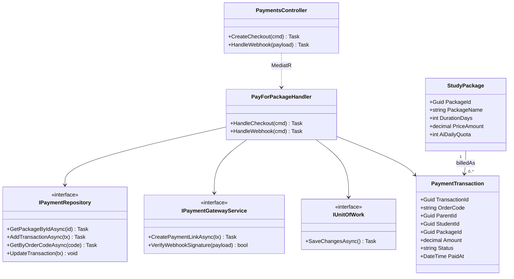

##### `3.1.8 Sequence Diagram - Pay for Study Package` (`Figure 25`) — 🎨 `[HƯỚNG DẪN VẼ CHI TIẾT TRÊN DRAW.IO]`

1. **Lifelines**: `Parent` -> `Parent Web Portal` -> `:PaymentsController` -> `:PayForPackageHandler` -> `:IPaymentRepository & UoW` -> `PostgreSQL` -> `Electronic Payment Gateway`.
2. Nửa trên tạo `PaymentTransaction (PENDING)` và lấy `CheckoutUrl / QR` từ `Electronic Payment Gateway`; nửa dưới nhận Webhook callback, đặt khung **`alt [Valid HMAC Signature & Paid]`** cập nhật `Status = PAID`, gia hạn gói học cho `Student` và hiển thị hóa đơn điện tử.

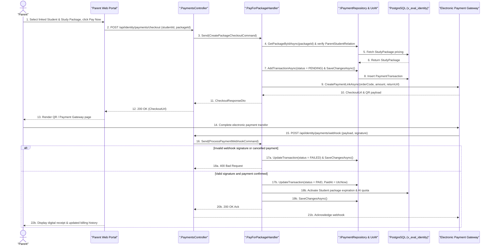

**Văn bản Tiếng Anh dán Word cho `3.1.7` & `3.1.8`:**

```markdown
#### 3.1.7 Class Diagram - Pay for Study Package
*[Insert Figure 24. Pay for Study Package - Class Diagram]*

#### 3.1.8 Sequence Diagram - Pay for Study Package
*[Insert Figure 25. Pay for Study Package - Sequence Diagram]*
```

---

### 3.2 Competency Taxonomy DAG & Master Question Bank Management

**Đoạn văn Tiếng Anh mở đầu mục `3.2` dán vào Word:**

```markdown
### 3.2 Competency Taxonomy DAG & Master Question Bank Management

This section describes the detailed design of the Competency Taxonomy DAG and Master Question Bank Management module within `V-Eval-Content_Service`. It enables Academic Directors to define prerequisite skill dependencies while enforcing Directed Acyclic Graph (DAG) acyclicity via Tarjan's Strongly Connected Components algorithm, allows Teachers/Mentors to author draft LaTeX questions with 2PL IRT parameters, and enforces Academic Director quality review prior to Master Bank publication.
```

---

#### Cặp Chức Năng 5 (`3.2.1` & `3.2.2`): Add Competency Prerequisite Edge (`Tarjan's Algorithm`) — ✅ `[ĐÃ CÓ CODE]`

##### `3.2.1 Class Diagram - Add Competency Prerequisite Edge` (`Figure 26`)

- **Các hộp vẽ trên Draw.io**: `CurriculumController` -> `AddDependencyEdgeHandler` -> `ICompetencyGraphRepository`, `TarjanCycleDetectorService` (`+ HasCycle(nodes, edges) : bool`), `IUnitOfWork` -> Entities: `CompetencyNode` (`NodeId`, `Code`, `Name`, `NodeLevel`, `WeightInExam`) & `CompetencyEdge` (`EdgeId`, `SourceNodeId`, `TargetNodeId`, `EdgeType`).

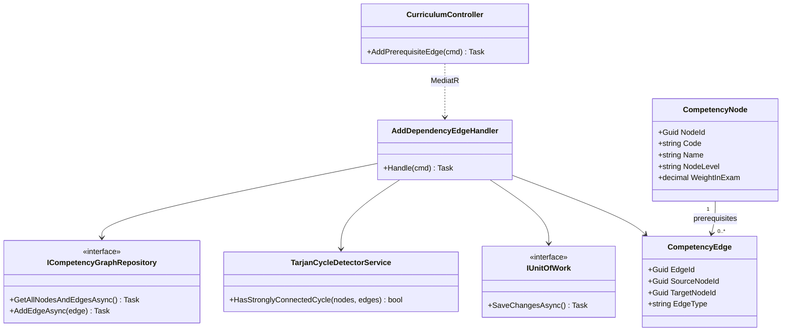

##### `3.2.2 Sequence Diagram - Add Competency Prerequisite Edge` (`Figure 27`)

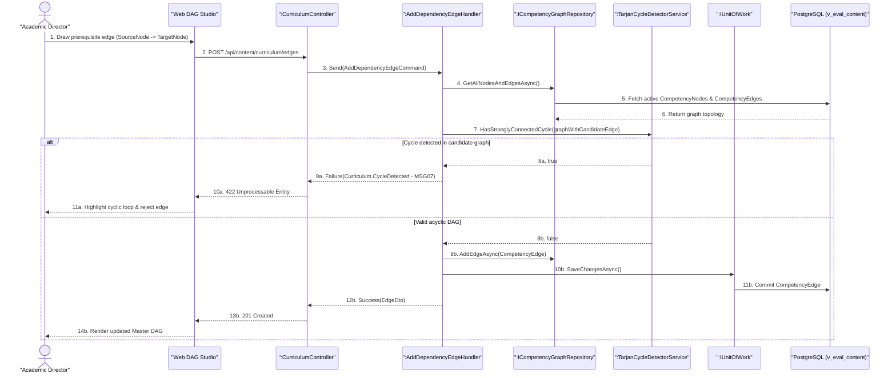

---

#### Cặp Chức Năng 6 (`3.2.3` & `3.2.4`): Create Draft Question Item — ✅ `[ĐÃ CÓ CODE]`

##### `3.2.3 Class Diagram - Create Draft Question Item` (`Figure 28`)

- **Các hộp vẽ trên Draw.io**: `QuestionsController` -> `CreateQuestionHandler` -> `IQuestionRepository`, `ICompetencyGraphRepository`, `IUnitOfWork` -> Entities: `Question` (`QuestionId`, `NodeId`, `ContentLatex`, `OptionsJson`, `CorrectOption`, `IrtA`, `IrtB`, `ApprovalStatus`) & `CompetencyNode`.

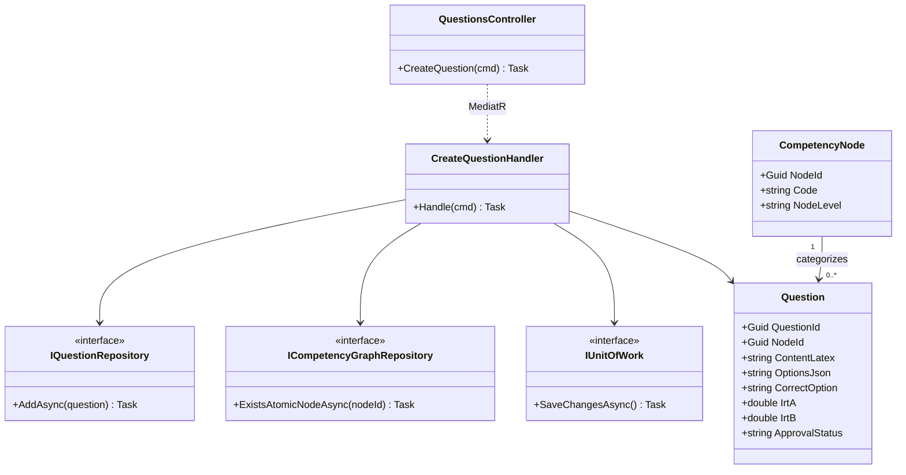

##### `3.2.4 Sequence Diagram - Create Draft Question Item` (`Figure 29`)

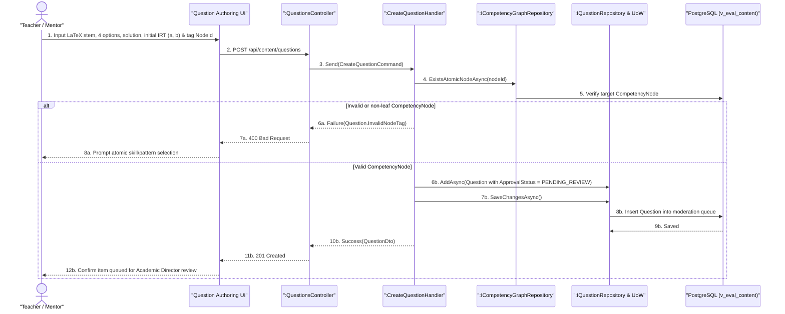

---

#### Cặp Chức Năng 7 (`3.2.5` & `3.2.6`): Approve Question into Master Bank — 🔜 `[ĐANG MỞ RỘNG TỪ UpdateQuestionCommand — bổ sung cờ PENDING_REVIEW -> PUBLISHED cho Academic Director]`

##### `3.2.5 Class Diagram - Approve Question into Master Bank` (`Figure 30`)

- **Các hộp vẽ trên Draw.io**: `QuestionsController` -> `ApproveQuestionHandler` -> `IQuestionRepository`, `ICurrentUserService`, `IUnitOfWork` -> Entity: `Question` (`QuestionId`, `IrtA`, `IrtB`, `ApprovalStatus`, `ReviewedBy`, `PublishedAt`).

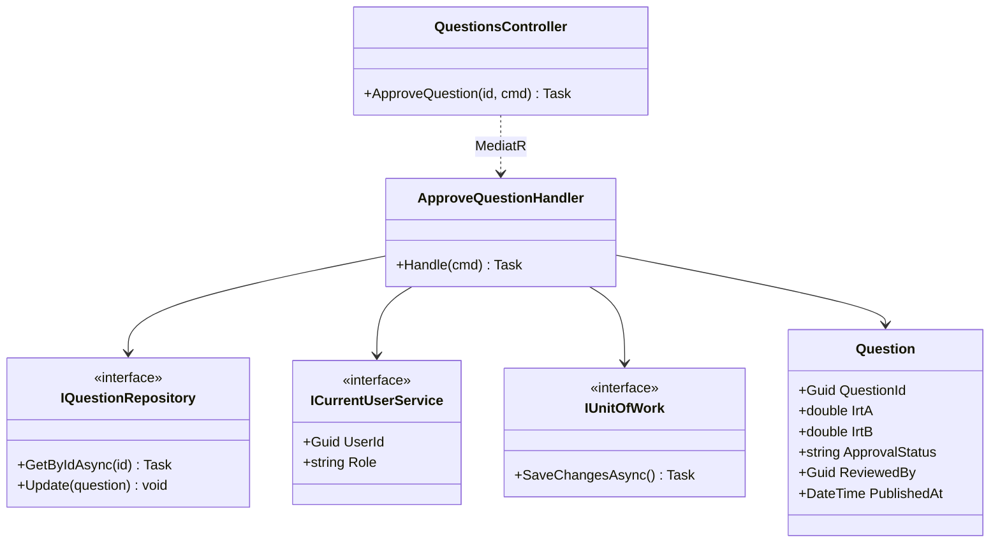

##### `3.2.6 Sequence Diagram - Approve Question into Master Bank` (`Figure 31`)

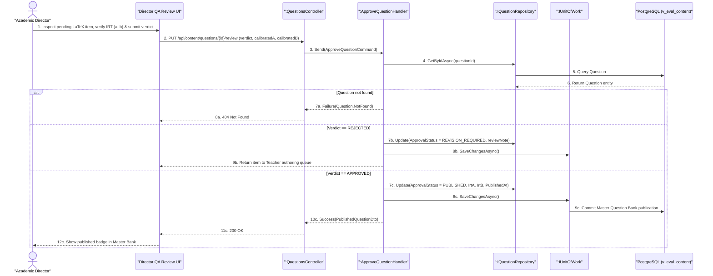

**Văn bản Tiếng Anh dán Word cho `3.2.1 -> 3.2.6`:**

```markdown
#### 3.2.1 Class Diagram - Add Competency Prerequisite Edge
*[Insert Figure 26. Add Competency Prerequisite Edge - Class Diagram]*

#### 3.2.2 Sequence Diagram - Add Competency Prerequisite Edge
*[Insert Figure 27. Add Competency Prerequisite Edge - Sequence Diagram]*

#### 3.2.3 Class Diagram - Create Draft Question Item
*[Insert Figure 28. Create Draft Question Item - Class Diagram]*

#### 3.2.4 Sequence Diagram - Create Draft Question Item
*[Insert Figure 29. Create Draft Question Item - Sequence Diagram]*

#### 3.2.5 Class Diagram - Approve Question into Master Bank
*[Insert Figure 30. Approve Question into Master Bank - Class Diagram]*

#### 3.2.6 Sequence Diagram - Approve Question into Master Bank
*[Insert Figure 31. Approve Question into Master Bank - Sequence Diagram]*
```


---

### 3.3 Diagnostic Assessment & Personalized Roadmap Management

**Đoạn văn Tiếng Anh mở đầu mục `3.3` dán vào Word:**

```markdown
### 3.3 Diagnostic Assessment & Personalized Roadmap Management

This section describes the detailed design of the Diagnostic Assessment and Personalized Roadmap Management module within `V-Eval-Practice_Service`. It processes 30-item diagnostic placement submissions using Two-Parameter Logistic Item Response Theory (2PL IRT) Maximum Likelihood Estimation to establish baseline ability vectors (`theta_0`), and executes Kahn's Topological Sort over the Master Taxonomy DAG to synthesize individualized learning roadmaps and study schedules.
```

---

#### Cặp Chức Năng 8 (`3.3.1` & `3.3.2`): Submit Diagnostic Test (`2PL IRT Scoring`) — ✅ `[ĐÃ CÓ CODE THỰC TẾ]`

##### `3.3.1 Class Diagram - Submit Diagnostic Test` (`Figure 32`)

- **Các hộp vẽ trên Draw.io**: `DiagnosticSubmissionsController` -> `SubmitDiagnosticCommandHandler` -> `IContentGrpcClient`, `IrtTwoPlEstimator`, `IDiagnosticRepository`, `IStudentCompetencyRepository`, `IUnitOfWork` -> Entities: `DiagnosticSubmission` (`SubmissionId`, `StudentId`, `ThetaVectorJson`, `TotalTimeSec`, `SubmittedAt`) & `StudentCompetency` (`TrackingId`, `StudentId`, `NodeId`, `MasteryProbability`, `CurrentTheta`).

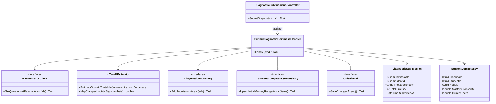

##### `3.3.2 Sequence Diagram - Submit Diagnostic Test` (`Figure 33`)

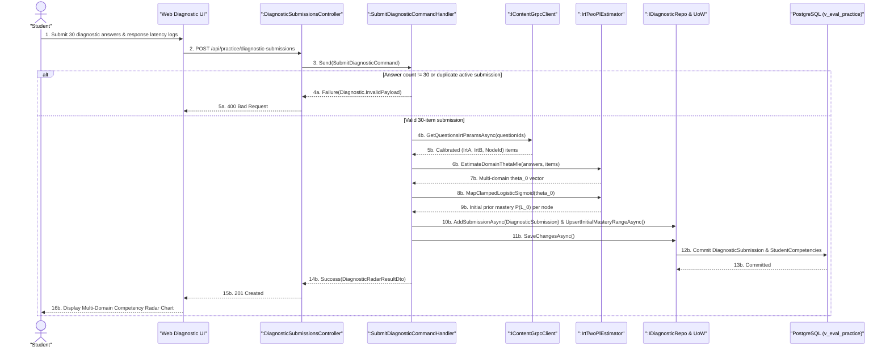

---

#### Cặp Chức Năng 9 (`3.3.3` & `3.3.4`): Generate Personalized DAG Roadmap & Schedule — ✅ `[ĐÃ CÓ CODE THỰC TẾ]`

##### `3.3.3 Class Diagram - Generate Personalized DAG Roadmap & Schedule` (`Figure 34`)

- **Các hộp vẽ trên Draw.io**: `RoadmapsController` -> `GenerateRoadmapCommandHandler` -> `IContentGrpcClient`, `IIdentityGrpcClient` (lấy `TargetScore`, `ExamDate`), `TopologicalRoadmapPlanner`, `IRoadmapRepository`, `IUnitOfWork` -> Entities: `PersonalRoadmap` (`RoadmapId`, `StudentId`, `TargetScore`, `Status`), `RoadmapNode` (`RoadmapNodeId`, `RoadmapId`, `NodeId`, `SequenceOrder`, `ScheduledDate`, `Status`), `LearningStage` (`StageId`, `RoadmapNodeId`, `StageType`, `IsCompleted`).

```mermaid
classDiagram
    class RoadmapsController {
        +GenerateRoadmap(cmd) Task
        +GetRoadmapSchedule(studentId) Task
    }
    class GenerateRoadmapCommandHandler {
        +Handle(cmd) Task
    }
    class IContentGrpcClient {
        <<interface>>
        +GetMasterDagTopologyAsync() Task
    }
    class TopologicalRoadmapPlanner {
        +SortAndPruneDag(nodes, edges, mastery, examDate) List
        +AllocateStudySchedule(orderedNodes, examDate) List
    }
    class IRoadmapRepository {
        <<interface>>
        +DeactivateOldRoadmapsAsync(studentId) Task
        +AddRoadmapGraphAsync(roadmap) Task
    }
    class IUnitOfWork {
        <<interface>>
        +SaveChangesAsync() Task
    }
    class PersonalRoadmap {
        +Guid RoadmapId
        +Guid StudentId
        +int TargetScore
        +string Status
    }
    class RoadmapNode {
        +Guid RoadmapNodeId
        +Guid RoadmapId
        +Guid NodeId
        +int SequenceOrder
        +DateTime ScheduledDate
        +string Status
    }
    class LearningStage {
        +Guid StageId
        +Guid RoadmapNodeId
        +string StageType
        +bool IsCompleted
    }

    RoadmapsController ..> GenerateRoadmapCommandHandler : MediatR
    GenerateRoadmapCommandHandler --> IContentGrpcClient
    GenerateRoadmapCommandHandler --> TopologicalRoadmapPlanner
    GenerateRoadmapCommandHandler --> IRoadmapRepository
    GenerateRoadmapCommandHandler --> IUnitOfWork
    GenerateRoadmapCommandHandler --> PersonalRoadmap
    PersonalRoadmap "1" --> "1..*" RoadmapNode : contains
    RoadmapNode "1" --> "4" LearningStage : P-L-A-R
```

##### `3.3.4 Sequence Diagram - Generate Personalized DAG Roadmap & Schedule` (`Figure 35`)

```mermaid
sequenceDiagram
    actor Student as "Student"
    participant UI as "Web / Mobile UI"
    participant Ctrl as ":RoadmapsController"
    participant Hdl as ":GenerateRoadmapCommandHandler"
    participant Grpc as ":IContentGrpcClient"
    participant Planner as ":TopologicalRoadmapPlanner"
    participant Repo as ":IRoadmapRepository & UoW"
    participant DB as "PostgreSQL (v_eval_practice)"

    Student->>UI: 1. Confirm Target Score & Official Exam Date to generate roadmap
    UI->>Ctrl: 2. POST /api/practice/roadmaps/generate
    Ctrl->>Hdl: 3. Send(GenerateRoadmapCommand)
    Hdl->>DB: 4. Load StudentCompetencies P(L_0) baseline
    alt Diagnostic baseline missing
        Hdl-->>Ctrl: 5a. Failure(Roadmap.DiagnosticRequired)
        Ctrl-->>UI: 6a. 412 Precondition Failed
        UI-->>Student: 7a. Redirect to Diagnostic Assessment
    else Baseline available
        Hdl->>Grpc: 5b. GetMasterDagTopologyAsync()
        Grpc-->>Hdl: 6b. Master CompetencyNodes & CompetencyEdges
        Hdl->>Planner: 7b. SortAndPruneDag(nodes, edges, P(L_0), examDate)
        Planner-->>Hdl: 8b. Topologically ordered milestones (skipping mastered P(L_0) >= 0.85)
        Hdl->>Planner: 9b. AllocateStudySchedule(orderedNodes, examDate)
        Planner-->>Hdl: 10b. Milestones with ScheduledDate & 4 P-L-A-R LearningStages each
        Hdl->>Repo: 11b. DeactivateOldRoadmapsAsync() & AddRoadmapGraphAsync(PersonalRoadmap)
        Hdl->>Repo: 12b. SaveChangesAsync()
        Repo->>DB: 13b. Commit PersonalRoadmap, RoadmapNodes & LearningStages
        Hdl-->>Ctrl: 14b. Success(PersonalRoadmapScheduleDto)
        Ctrl-->>UI: 15b. 201 Created
        UI-->>Student: 16b. Render interactive DAG Roadmap & Weekly Study Schedule
    end
```

**Văn bản Tiếng Anh dán Word cho `3.3.1 -> 3.3.4`:**

```markdown
#### 3.3.1 Class Diagram - Submit Diagnostic Test
*[Insert Figure 32. Submit Diagnostic Test - Class Diagram]*

#### 3.3.2 Sequence Diagram - Submit Diagnostic Test
*[Insert Figure 33. Submit Diagnostic Test - Sequence Diagram]*

#### 3.3.3 Class Diagram - Generate Personalized DAG Roadmap & Schedule
*[Insert Figure 34. Generate Personalized DAG Roadmap & Schedule - Class Diagram]*

#### 3.3.4 Sequence Diagram - Generate Personalized DAG Roadmap & Schedule
*[Insert Figure 35. Generate Personalized DAG Roadmap & Schedule - Sequence Diagram]*
```

---

### 3.4 Adaptive P-L-A-R Practice & Mistake Notebook Management

**Đoạn văn Tiếng Anh mở đầu mục `3.4` dán vào Word:**

```markdown
### 3.4 Adaptive P-L-A-R Practice & Mistake Notebook Management

This section describes the detailed design of the Adaptive P-L-A-R Practice and Mistake Notebook Management module within `V-Eval-Practice_Service`. It recommends practice items tailored to the learner's Zone of Proximal Development (`0.60 - 0.75`), dynamically updates skill mastery probabilities via Bayesian Knowledge Tracing (BKT), unlocks dependent DAG milestones upon reaching the `0.85` mastery threshold, and schedules spaced-repetition mistake reviews using the SM-2 / Leitner algorithm.
```

---

#### Cặp Chức Năng 10 (`3.4.1` & `3.4.2`): Recommend Next Question in ZPD Band — ✅ `[ĐÃ CÓ CODE THỰC TẾ]`

##### `3.4.1 Class Diagram - Recommend Next Question in ZPD Band` (`Figure 36`)

- **Các hộp vẽ trên Draw.io**: `StagesController` -> `GetNextQuestionQueryHandler` -> `IPracticeAttemptRepository`, `IContentGrpcClient`, `ZpdItemSelector` -> Entities: `LearningStage`, `StudentCompetency`.

```mermaid
classDiagram
    class StagesController {
        +GetNextQuestion(stageId) Task
    }
    class GetNextQuestionQueryHandler {
        +Handle(query) Task
    }
    class IPracticeAttemptRepository {
        <<interface>>
        +GetAttemptedQuestionIdsAsync(studentId, nodeId) Task
        +GetStudentCompetencyAsync(studentId, nodeId) Task
    }
    class IContentGrpcClient {
        <<interface>>
        +GetPublishedQuestionsByNodeAsync(nodeId) Task
    }
    class ZpdItemSelector {
        +SelectOptimalZpdItem(theta, candidates, minP, maxP) QuestionDto
    }
    class LearningStage {
        +Guid StageId
        +Guid RoadmapNodeId
        +string StageType
        +bool IsCompleted
    }
    class StudentCompetency {
        +Guid TrackingId
        +Guid NodeId
        +double CurrentTheta
        +double MasteryProbability
    }

    StagesController ..> GetNextQuestionQueryHandler : MediatR
    GetNextQuestionQueryHandler --> IPracticeAttemptRepository
    GetNextQuestionQueryHandler --> IContentGrpcClient
    GetNextQuestionQueryHandler --> ZpdItemSelector
    GetNextQuestionQueryHandler --> LearningStage
    GetNextQuestionQueryHandler --> StudentCompetency
```

##### `3.4.2 Sequence Diagram - Recommend Next Question in ZPD Band` (`Figure 37`)

```mermaid
sequenceDiagram
    actor Student as "Student"
    participant UI as "Web / Mobile Practice UI"
    participant Ctrl as ":StagesController"
    participant Hdl as ":GetNextQuestionQueryHandler"
    participant Repo as ":IPracticeAttemptRepository"
    participant Grpc as ":IContentGrpcClient"
    participant ZPD as ":ZpdItemSelector"
    participant DB as "PostgreSQL (v_eval_practice)"

    Student->>UI: 1. Open unlocked Apply / Probe stage
    UI->>Ctrl: 2. GET /api/practice/stages/{stageId}/next-question
    Ctrl->>Hdl: 3. Send(GetNextQuestionQuery)
    Hdl->>Repo: 4. GetStudentCompetencyAsync() & GetAttemptedQuestionIdsAsync()
    Repo->>DB: 5. Fetch current theta & answered item IDs
    DB-->>Repo: 6. Return competency state
    Hdl->>Grpc: 7. GetPublishedQuestionsByNodeAsync(nodeId)
    Grpc-->>Hdl: 8. Candidate Question bank items (IrtA, IrtB)
    alt All candidate items exhausted or stage locked
        Hdl-->>Ctrl: 9a. Failure(Stage.NoAvailableQuestion)
        Ctrl-->>UI: 10a. 404 / Stage Complete summary
    else Unseen candidates available
        Hdl->>ZPD: 9b. SelectOptimalZpdItem(currentTheta, unseenItems, 0.60, 0.75)
        ZPD-->>Hdl: 10b. Selected ZPD QuestionDto (without answer key)
        Hdl-->>Ctrl: 11b. Success(QuestionDto)
        Ctrl-->>UI: 12b. 200 OK
        UI-->>Student: 13b. Render KaTeX question stem & interactive options
    end
```

---

#### Cặp Chức Năng 11 (`3.4.3` & `3.4.4`): Submit Practice Answer & Update BKT Mastery — ✅ `[ĐÃ CÓ CODE THỰC TẾ]`

##### `3.4.3 Class Diagram - Submit Practice Answer & Update BKT Mastery` (`Figure 38`)

- **Các hộp vẽ trên Draw.io**: `StagesController` -> `SubmitAnswerCommandHandler` -> `IContentGrpcClient`, `BktMasteryService`, `IPracticeAttemptRepository`, `IMistakeNotebookRepository`, `IRoadmapRepository`, `IUnitOfWork` -> Entities: `PracticeAttempt`, `StudentCompetency`, `MistakeNotebook`.

```mermaid
classDiagram
    class StagesController {
        +SubmitAnswer(stageId, cmd) Task
    }
    class SubmitAnswerCommandHandler {
        +Handle(cmd) Task
    }
    class IContentGrpcClient {
        <<interface>>
        +VerifyQuestionAnswerAsync(questionId, option) Task
    }
    class BktMasteryService {
        +ComputePosteriorMastery(pL, isCorrect, pT, pG, pS) double
        +UpdateLocalTheta(theta, isCorrect, a, b) double
    }
    class IPracticeAttemptRepository {
        <<interface>>
        +AddAttemptAsync(attempt) Task
    }
    class IMistakeNotebookRepository {
        <<interface>>
        +EnqueueWrongQuestionAsync(studentId, questionId) Task
    }
    class IUnitOfWork {
        <<interface>>
        +SaveChangesAsync() Task
    }
    class PracticeAttempt {
        +Guid AttemptId
        +Guid StudentId
        +Guid QuestionId
        +string SelectedOption
        +bool IsCorrect
        +int TimeSpentSec
    }
    class StudentCompetency {
        +Guid TrackingId
        +double MasteryProbability
        +double PTransit
        +double PGuess
        +double PSlip
    }

    StagesController ..> SubmitAnswerCommandHandler : MediatR
    SubmitAnswerCommandHandler --> IContentGrpcClient
    SubmitAnswerCommandHandler --> BktMasteryService
    SubmitAnswerCommandHandler --> IPracticeAttemptRepository
    SubmitAnswerCommandHandler --> IMistakeNotebookRepository
    SubmitAnswerCommandHandler --> IUnitOfWork
    SubmitAnswerCommandHandler --> PracticeAttempt
    SubmitAnswerCommandHandler --> StudentCompetency
```

##### `3.4.4 Sequence Diagram - Submit Practice Answer & Update BKT Mastery` (`Figure 39`)

```mermaid
sequenceDiagram
    actor Student as "Student"
    participant UI as "Web / Mobile Practice UI"
    participant Ctrl as ":StagesController"
    participant Hdl as ":SubmitAnswerCommandHandler"
    participant Grpc as ":IContentGrpcClient"
    participant BKT as ":BktMasteryService"
    participant Repo as ":Practice & Mistake Repos + UoW"
    participant DB as "PostgreSQL (v_eval_practice)"

    Student->>UI: 1. Select option & submit answer
    UI->>Ctrl: 2. POST /api/practice/stages/{stageId}/submit-answer
    Ctrl->>Hdl: 3. Send(SubmitAnswerCommand)
    Hdl->>Grpc: 4. VerifyQuestionAnswerAsync(questionId, selectedOption)
    Grpc-->>Hdl: 5. Return (isCorrect, correctOption, explanationLatex, a, b)
    Hdl->>BKT: 6. ComputePosteriorMastery(P(L_t-1), isCorrect) & UpdateLocalTheta()
    BKT-->>Hdl: 7. Updated P(L_t) & updatedTheta
    Hdl->>Repo: 8. AddAttemptAsync(PracticeAttempt) & update StudentCompetency
    opt Answer is incorrect (!isCorrect)
        Hdl->>Repo: 9. EnqueueWrongQuestionAsync(boxLevel = 1, nextReview = +24h)
    end
    opt Updated P(L_t) >= 0.85 mastery threshold
        Hdl->>Repo: 10. Mark RoadmapNode = MASTERED & unlock downstream DAG milestones
    end
    Hdl->>Repo: 11. SaveChangesAsync()
    Repo->>DB: 12. Commit PracticeAttempt, StudentCompetency & Roadmap updates
    Hdl-->>Ctrl: 13. Success(AnswerFeedbackDto)
    Ctrl-->>UI: 14. 200 OK
    UI-->>Student: 15. Display step-by-step solution & updated Mastery progress bar
```

---

#### Cặp Chức Năng 12 (`3.4.5` & `3.4.6`): Review Spaced-Repetition Mistake Notebook (`SM-2`) — ✅ `[ĐÃ CÓ CODE THỰC TẾ]`

##### `3.4.5 Class Diagram - Review Spaced-Repetition Mistake Notebook` (`Figure 40`)

- **Các hộp vẽ trên Draw.io**: `MistakesController` -> `SubmitMistakeReviewCommandHandler` -> `IMistakeNotebookRepository`, `Sm2SpacedRepetitionCalculator`, `IUnitOfWork` -> Entity: `MistakeNotebook` (`MistakeId`, `StudentId`, `QuestionId`, `BoxLevel`, `EaseFactor`, `NextReviewAt`, `IsResolved`).

```mermaid
classDiagram
    class MistakesController {
        +GetDueReviews(studentId) Task
        +SubmitMistakeReview(id, cmd) Task
    }
    class SubmitMistakeReviewCommandHandler {
        +Handle(cmd) Task
    }
    class IMistakeNotebookRepository {
        <<interface>>
        +GetByIdAsync(mistakeId) Task
        +Update(mistake) void
    }
    class Sm2SpacedRepetitionCalculator {
        +CalculateNextInterval(boxLevel, easeFactor, isCorrect, quality) Sm2ScheduleResult
    }
    class IUnitOfWork {
        <<interface>>
        +SaveChangesAsync() Task
    }
    class MistakeNotebook {
        +Guid MistakeId
        +Guid StudentId
        +Guid QuestionId
        +int BoxLevel
        +double EaseFactor
        +DateTime NextReviewAt
        +bool IsResolved
    }

    MistakesController ..> SubmitMistakeReviewCommandHandler : MediatR
    SubmitMistakeReviewCommandHandler --> IMistakeNotebookRepository
    SubmitMistakeReviewCommandHandler --> Sm2SpacedRepetitionCalculator
    SubmitMistakeReviewCommandHandler --> IUnitOfWork
    SubmitMistakeReviewCommandHandler --> MistakeNotebook
```

##### `3.4.6 Sequence Diagram - Review Spaced-Repetition Mistake Notebook` (`Figure 41`)

```mermaid
sequenceDiagram
    actor Student as "Student"
    participant UI as "Web / Mobile Mistake Deck"
    participant Ctrl as ":MistakesController"
    participant Hdl as ":SubmitMistakeReviewCommandHandler"
    participant Repo as ":IMistakeNotebookRepository"
    participant SM2 as ":Sm2SpacedRepetitionCalculator"
    participant UoW as ":IUnitOfWork"
    participant DB as "PostgreSQL (v_eval_practice)"

    Student->>UI: 1. Complete due flashcard review item
    UI->>Ctrl: 2. POST /api/practice/mistakes/{mistakeId}/review
    Ctrl->>Hdl: 3. Send(SubmitMistakeReviewCommand)
    Hdl->>Repo: 4. GetByIdAsync(mistakeId)
    Repo->>DB: 5. Query MistakeNotebook
    DB-->>Repo: 6. Return MistakeNotebook
    alt Mistake item not found
        Hdl-->>Ctrl: 7a. Failure(Mistake.NotFound)
        Ctrl-->>UI: 8a. 404 Not Found
    else Valid review submission
        Hdl->>SM2: 7b. CalculateNextInterval(BoxLevel, EaseFactor, isCorrect)
        alt Answered correctly
            SM2-->>Hdl: 8b. Promote BoxLevel + 1 (mark IsResolved = true if BoxLevel >= 5)
        else Answered incorrectly again
            SM2-->>Hdl: 8c. Reset BoxLevel = 1 & NextReviewAt = +24h
        end
        Hdl->>Repo: 9b. Update(MistakeNotebook)
        Hdl->>UoW: 10b. SaveChangesAsync()
        UoW->>DB: 11b. Commit updated SM-2 schedule
        Hdl-->>Ctrl: 12b. Success(MistakeReviewResultDto)
        Ctrl-->>UI: 13b. 200 OK
        UI-->>Student: 14b. Show next due review date & streak progress
    end
```

**Văn bản Tiếng Anh dán Word cho `3.4.1 -> 3.4.6`:**

```markdown
#### 3.4.1 Class Diagram - Recommend Next Question in ZPD Band
*[Insert Figure 36. Recommend Next Question in ZPD Band - Class Diagram]*

#### 3.4.2 Sequence Diagram - Recommend Next Question in ZPD Band
*[Insert Figure 37. Recommend Next Question in ZPD Band - Sequence Diagram]*

#### 3.4.3 Class Diagram - Submit Practice Answer & Update BKT Mastery
*[Insert Figure 38. Submit Practice Answer & Update BKT Mastery - Class Diagram]*

#### 3.4.4 Sequence Diagram - Submit Practice Answer & Update BKT Mastery
*[Insert Figure 39. Submit Practice Answer & Update BKT Mastery - Sequence Diagram]*

#### 3.4.5 Class Diagram - Review Spaced-Repetition Mistake Notebook
*[Insert Figure 40. Review Spaced-Repetition Mistake Notebook - Class Diagram]*

#### 3.4.6 Sequence Diagram - Review Spaced-Repetition Mistake Notebook
*[Insert Figure 41. Review Spaced-Repetition Mistake Notebook - Sequence Diagram]*
```

---

### 3.5 Socratic AI Tutor & Knowledge Corpus Management

**Đoạn văn Tiếng Anh mở đầu mục `3.5` dán vào Word:**

```markdown
### 3.5 Socratic AI Tutor & Knowledge Corpus Management

This section describes the detailed design of the Socratic AI Tutor and Knowledge Corpus Management module across `V-Eval-Ai_Engine` (.NET gRPC Orchestrator and Python FastAPI `rag-service`). It governs curriculum document chunking and HNSW `pgvector` indexing for canonical grounding, and orchestrates step-by-step Socratic tutoring safeguarded by Cosine Similarity filtering (`>= 0.75`) and an automated Validator Judge preventing direct answer disclosure.
```

---

#### Cặp Chức Năng 13 (`3.5.1` & `3.5.2`): Ingest Curriculum Document to `pgvector` — ✅ `[ĐÃ CÓ CODE THỰC TẾ]`

##### `3.5.1 Class Diagram - Ingest Curriculum Document to pgvector` (`Figure 42`)

- **Các hộp vẽ trên Draw.io**: `DocumentsRouter` (FastAPI `documents.py`) -> `CurriculumIngestionPipeline` (`ingestion.py`) -> `EmbeddingClient`, `PgVectorRepository` -> Entities: `KnowledgeSource` (`SourceId`, `NodeId`, `Title`, `Status`) & `KnowledgeVectorChunk` (`ChunkId`, `SourceId`, `ContentText`, `Embedding`, `TokenCount`).

```mermaid
classDiagram
    class DocumentsRouter {
        +ingest_approved_document(payload) IngestResponse
    }
    class CurriculumIngestionPipeline {
        +parse_and_chunk_markdown(content, max_tokens) List
        +ingest_chunks_async(source_id, node_id, chunks) int
    }
    class EmbeddingClient {
        +embed_batch_async(texts) List
    }
    class PgVectorRepository {
        +create_knowledge_source(meta) UUID
        +bulk_insert_hnsw_chunks(chunks) void
    }
    class KnowledgeSource {
        +UUID SourceId
        +UUID NodeId
        +string Title
        +string Status
    }
    class KnowledgeVectorChunk {
        +UUID ChunkId
        +UUID SourceId
        +string ContentText
        +Vector768 Embedding
        +int TokenCount
    }

    DocumentsRouter ..> CurriculumIngestionPipeline : invokes
    CurriculumIngestionPipeline --> EmbeddingClient
    CurriculumIngestionPipeline --> PgVectorRepository
    PgVectorRepository --> KnowledgeSource
    KnowledgeSource "1" --> "1..*" KnowledgeVectorChunk : indexedAs
```

##### `3.5.2 Sequence Diagram - Ingest Curriculum Document to pgvector` (`Figure 43`)

```mermaid
sequenceDiagram
    actor Director as "Academic Director"
    participant UI as "Corpus Management UI"
    participant Orch as ":AiEngine Orchestrator"
    participant Fast as ":DocumentsRouter (FastAPI)"
    participant Pipe as ":CurriculumIngestionPipeline"
    participant LLM as "External Embedding API"
    participant VecDB as "PostgreSQL pgvector (v_eval_ai)"

    Director->>UI: 1. Approve & trigger indexing for canonical reference document
    UI->>Orch: 2. POST /api/ai/documents/ingest (nodeId, documentContent)
    Orch->>Fast: 3. Forward ingestion payload
    Fast->>VecDB: 4. Insert KnowledgeSource (status = PROCESSING)
    Fast->>Pipe: 5. parse_and_chunk_markdown(documentContent)
    Pipe-->>Fast: 6. Semantic LaTeX-preserving chunks
    Fast->>LLM: 7. embed_batch_async(chunks)
    alt Embedding API timeout or quota error
        LLM-->>Fast: 8a. Error 429 / 503
        Fast->>VecDB: 9a. Update KnowledgeSource (status = FAILED)
        Fast-->>UI: 10a. Return 502 Ingestion Failed
    else Embeddings generated
        LLM-->>Fast: 8b. Dense 768-dim vectors
        Fast->>VecDB: 9b. Bulk insert KnowledgeVectorChunks (HNSW index) & set status = INDEXED
        VecDB-->>Fast: 10b. Indexed chunk count
        Fast-->>Orch: 11b. IngestResponseDto (chunkCount, status = INDEXED)
        Orch-->>UI: 12b. 200 OK
        UI-->>Director: 13b. Show INDEXED grounding badge on CompetencyNode
    end
```

---

#### Cặp Chức Năng 14 (`3.5.3` & `3.5.4`): Ask Socratic AI Tutor (`GraphRAG & Validator Judge`) — ✅ `[ĐÃ CÓ CODE THỰC TẾ]`

##### `3.5.3 Class Diagram - Ask Socratic AI Tutor` (`Figure 44`)

- **Các hộp vẽ trên Draw.io**: `AiTutorController` -> `AiGrpcService` (kiểm tra `TokenUsageLog`) -> `SocraticTutorRouter` -> `HybridRetriever`, `NoveltyDetector`, `SocraticEngine`, `ValidatorJudge` -> Entities: `AITutorSession`, `AITutorMessage`, `TokenUsageLog`.

```mermaid
classDiagram
    class AiTutorController {
        +AskTutor(cmd) Task
    }
    class AiGrpcService {
        +CheckDailyQuotaAndForwardAsync(req) Task
    }
    class SocraticTutorRouter {
        +generate_socratic_turn(req) TutorTurnDto
    }
    class HybridRetriever {
        +search_grounded_chunks_and_patterns(vec, node_id) GroundedContext
    }
    class SocraticEngine {
        +build_socratic_hint(context, history) string
    }
    class ValidatorJudge {
        +verify_no_direct_answer(hint, answer_key) bool
    }
    class AITutorSession {
        +Guid SessionId
        +Guid StudentId
        +Guid ContextQuestionId
    }
    class AITutorMessage {
        +Guid MessageId
        +Guid SessionId
        +string SenderRole
        +string Content
        +int TokensUsed
    }

    AiTutorController ..> AiGrpcService : gRPC
    AiGrpcService --> SocraticTutorRouter : HTTP
    SocraticTutorRouter --> HybridRetriever
    SocraticTutorRouter --> SocraticEngine
    SocraticTutorRouter --> ValidatorJudge
    SocraticTutorRouter --> AITutorSession
    AITutorSession "1" --> "1..*" AITutorMessage : logs
```

##### `3.5.4 Sequence Diagram - Ask Socratic AI Tutor` (`Figure 45`)

```mermaid
sequenceDiagram
    actor Student as "Student"
    participant UI as "Web / Mobile Chat UI"
    participant Grpc as ":AiTutor API & AiGrpcService"
    participant Fast as ":SocraticTutorRouter"
    participant Ret as ":HybridRetriever"
    participant Judge as ":ValidatorJudge"
    participant VecDB as "PostgreSQL pgvector (v_eval_ai)"
    participant LLM as "External LLM API"

    Student->>UI: 1. Submit question prompt while solving item
    UI->>Grpc: 2. POST /api/practice/ai-tutor/ask (questionId, prompt)
    Grpc->>VecDB: 3. Verify daily TokenUsageLog < budget cap (BR-25)
    alt Daily token quota exceeded
        Grpc-->>UI: 4a. 429 Too Many Requests (Quota reached)
    else Within daily token quota
        Grpc->>Fast: 4b. Forward Socratic request
        Fast->>Ret: 5b. search_grounded_chunks_and_patterns(prompt, nodeId)
        Ret->>VecDB: 6b. HNSW Cosine search (>= 0.75) on Chunks & ArchetypePatterns
        VecDB-->>Ret: 7b. Grounded passages & misconception traps
        opt Max Cosine Similarity < 0.75
            Ret->>VecDB: 8b. Queue NovelPatternProposal (PENDING) for Academic Director
        end
        Fast->>LLM: 9b. Generate scaffolded Socratic guiding question
        LLM-->>Fast: 10b. Draft hint response
        Fast->>Judge: 11b. verify_no_direct_answer(draftHint, correctOption)
        opt Direct answer leakage detected
            Judge->>LLM: 12b. Rewrite strictly as Socratic conceptual question
            LLM-->>Fast: 13b. Sanitized Socratic hint
        end
        Fast->>VecDB: 14b. Append AITutorMessages & increment TokenUsageLogs
        Fast-->>Grpc: 15b. Approved Socratic response
        Grpc-->>UI: 16b. 200 OK
        UI-->>Student: 17b. Render step-by-step Socratic guiding question
    end
```

**Văn bản Tiếng Anh dán Word cho `3.5.1 -> 3.5.4`:**

```markdown
#### 3.5.1 Class Diagram - Ingest Curriculum Document to pgvector
*[Insert Figure 42. Ingest Curriculum Document to pgvector - Class Diagram]*

#### 3.5.2 Sequence Diagram - Ingest Curriculum Document to pgvector
*[Insert Figure 43. Ingest Curriculum Document to pgvector - Sequence Diagram]*

#### 3.5.3 Class Diagram - Ask Socratic AI Tutor
*[Insert Figure 44. Ask Socratic AI Tutor - Class Diagram]*

#### 3.5.4 Sequence Diagram - Ask Socratic AI Tutor
*[Insert Figure 45. Ask Socratic AI Tutor - Sequence Diagram]*
```


---

### 3.6 Proctored Mock Exam & Score Forecasting Management

**Đoạn văn Tiếng Anh mở đầu mục `3.6` dán vào Word:**

```markdown
### 3.6 Proctored Mock Exam & Score Forecasting Management

This section describes the detailed design of the Proctored Mock Exam and Score Forecasting Management module within `V-Eval-Practice_Service`. It handles 120-item / 150-minute simulated VNU-HCM DGNL exam submissions on the Web Application with automated proctoring telemetry, enforces non-punitive `UNDER_REVIEW` Mentor verification when proctoring thresholds are exceeded (`BR-21`), and computes 95% SEM confidence-interval score projections alongside Greedy Knapsack remedial prescriptions (`BR-23`).
```

---

#### Cặp Chức Năng 15 (`3.6.1` & `3.6.2`): Submit Proctored Mock Exam — ✅ `[ĐÃ CÓ CODE THỰC TẾ]`

##### `3.6.1 Class Diagram - Submit Proctored Mock Exam` (`Figure 46`)

- **Các hộp vẽ trên Draw.io**: `MockExamsController` -> `SubmitMockExamCommandHandler` -> `IContentGrpcClient`, `IMockExamSubmissionRepository`, `IUnitOfWork` -> Entities: `ExamSubmission` (`ExamSubId`, `ExamId`, `StudentId`, `ScaledScore1200`, `TabViolationCount`, `SnapshotsJson`, `IntegrityStatus`) & `ExamAnswerDetail` (`DetailId`, `ExamSubId`, `QuestionId`, `SelectedOption`, `IsCorrect`).

```mermaid
classDiagram
    class MockExamsController {
        +LogProctoringEvent(subId, cmd) Task
        +SubmitMockExam(subId, cmd) Task
    }
    class SubmitMockExamCommandHandler {
        +Handle(cmd) Task
    }
    class IContentGrpcClient {
        <<interface>>
        +GetMockExamAnswerKeysAsync(examId) Task
    }
    class IMockExamSubmissionRepository {
        <<interface>>
        +GetActiveSubmissionAsync(subId) Task
        +UpdateSubmissionWithDetails(sub) void
    }
    class IUnitOfWork {
        <<interface>>
        +SaveChangesAsync() Task
    }
    class ExamSubmission {
        +Guid ExamSubId
        +Guid ExamId
        +Guid StudentId
        +int ScaledScore1200
        +int TabViolationCount
        +string IntegrityStatus
        +DateTime SubmittedAt
    }
    class ExamAnswerDetail {
        +Guid DetailId
        +Guid ExamSubId
        +Guid QuestionId
        +string SelectedOption
        +bool IsCorrect
    }

    MockExamsController ..> SubmitMockExamCommandHandler : MediatR
    SubmitMockExamCommandHandler --> IContentGrpcClient
    SubmitMockExamCommandHandler --> IMockExamSubmissionRepository
    SubmitMockExamCommandHandler --> IUnitOfWork
    SubmitMockExamCommandHandler --> ExamSubmission
    ExamSubmission "1" --> "1..120" ExamAnswerDetail : contains
```

##### `3.6.2 Sequence Diagram - Submit Proctored Mock Exam` (`Figure 47`)

```mermaid
sequenceDiagram
    actor Student as "Student"
    participant WebUI as "Web Proctored Exam UI"
    participant Ctrl as ":MockExamsController"
    participant Hdl as ":SubmitMockExamCommandHandler"
    participant Grpc as ":IContentGrpcClient"
    participant Repo as ":IMockExamSubmissionRepo & UoW"
    participant DB as "PostgreSQL (v_eval_practice)"

    Student->>WebUI: 1. Complete 120-item mock exam (or timer expires at 150m)
    WebUI->>Ctrl: 2. POST /api/practice/mock-exams/{subId}/submit (answers, tabCount)
    Ctrl->>Hdl: 3. Send(SubmitMockExamCommand)
    Hdl->>Repo: 4. GetActiveSubmissionAsync(subId)
    Hdl->>Grpc: 5. GetMockExamAnswerKeysAsync(examId)
    Grpc-->>Hdl: 6. Return 120 calibrated item keys & IRT weights
    Hdl->>Hdl: 7. Score 120 items onto 0-1200 scale
    alt TabViolationCount > 3 or webcam anomaly flagged (BR-21)
        Hdl->>Repo: 8a. Set IntegrityStatus = UNDER_REVIEW (do not auto-void)
        Hdl->>Repo: 9a. SaveChangesAsync()
        Repo->>DB: 10a. Commit flagged ExamSubmission & ExamAnswerDetails
        Hdl-->>WebUI: 11a. 200 OK (Status = UNDER_REVIEW, MSG10)
        WebUI-->>Student: 12a. Notify submission pending Teacher/Mentor review
    else Clean proctoring telemetry
        Hdl->>Repo: 8b. Set IntegrityStatus = VALID
        Hdl->>Repo: 9b. SaveChangesAsync()
        Repo->>DB: 10b. Commit valid ExamSubmission & ExamAnswerDetails
        Hdl-->>WebUI: 11b. 200 OK (ScaledScore1200, sectionBreakdown)
        WebUI-->>Student: 12b. Display official mock exam score report
    end
```

---

#### Cặp Chức Năng 16 (`3.6.3` & `3.6.4`): Mentor Review Flagged Exam Submission — ✅ `[ĐÃ CÓ CODE THỰC TẾ]`

##### `3.6.3 Class Diagram - Mentor Review Flagged Exam Submission` (`Figure 48`)

- **Các hộp vẽ trên Draw.io**: `MockExamsController` -> `MentorReviewCommandHandler` -> `IMockExamSubmissionRepository`, `ICurrentUserService`, `IUnitOfWork` -> Entity: `ExamSubmission` (`ExamSubId`, `TabViolationCount`, `SnapshotsJson`, `IntegrityStatus`, `ReviewedBy`, `MentorNote`).

```mermaid
classDiagram
    class MockExamsController {
        +MentorReviewSubmission(subId, cmd) Task
    }
    class MentorReviewCommandHandler {
        +Handle(cmd) Task
    }
    class IMockExamSubmissionRepository {
        <<interface>>
        +GetByIdAsync(subId) Task
        +Update(sub) void
    }
    class ICurrentUserService {
        <<interface>>
        +Guid UserId
    }
    class IUnitOfWork {
        <<interface>>
        +SaveChangesAsync() Task
    }
    class ExamSubmission {
        +Guid ExamSubId
        +int TabViolationCount
        +string SnapshotsJson
        +string IntegrityStatus
        +Guid ReviewedBy
        +string MentorNote
    }

    MockExamsController ..> MentorReviewCommandHandler : MediatR
    MentorReviewCommandHandler --> IMockExamSubmissionRepository
    MentorReviewCommandHandler --> ICurrentUserService
    MentorReviewCommandHandler --> IUnitOfWork
    MentorReviewCommandHandler --> ExamSubmission
```

##### `3.6.4 Sequence Diagram - Mentor Review Flagged Exam Submission` (`Figure 49`)

```mermaid
sequenceDiagram
    actor Mentor as "Teacher / Mentor"
    participant UI as "Teacher Proctoring Review UI"
    participant Ctrl as ":MockExamsController"
    participant Hdl as ":MentorReviewCommandHandler"
    participant Repo as ":IMockExamSubmissionRepository"
    participant UoW as ":IUnitOfWork"
    participant DB as "PostgreSQL (v_eval_practice)"

    Mentor->>UI: 1. Inspect webcam snapshot timeline & tab-departure logs, submit decision
    UI->>Ctrl: 2. PUT /api/practice/mock-exams/{subId}/mentor-review (verdict, note)
    Ctrl->>Hdl: 3. Send(MentorReviewCommand)
    Hdl->>Repo: 4. GetByIdAsync(subId)
    Repo->>DB: 5. Fetch flagged ExamSubmission
    alt Submission not in UNDER_REVIEW state
        Hdl-->>Ctrl: 6a. Failure(MockExam.InvalidReviewState)
        Ctrl-->>UI: 7a. 400 Bad Request
    else Verdict == APPROVE_VALID
        Hdl->>Repo: 6b. Update(IntegrityStatus = VALID, MentorNote)
        Hdl->>UoW: 7b. SaveChangesAsync()
        UoW->>DB: 8b. Release official score & trigger score forecast update
        Hdl-->>UI: 9b. Confirm valid score released to Student
    else Verdict == REQUIRE_RETEST
        Hdl->>Repo: 6c. Update(IntegrityStatus = RETEST_REQUIRED, MentorNote)
        Hdl->>UoW: 7c. SaveChangesAsync()
        UoW->>DB: 8c. Record supportive retest request
        Hdl-->>UI: 9c. Notify Student with constructive retest schedule
    end
```

---

#### Cặp Chức Năng 17 (`3.6.5` & `3.6.6`): Forecast Exam Score (`SEM`) & Knapsack Prescription — ✅ `[ĐÃ CÓ CODE THỰC TẾ]`

##### `3.6.5 Class Diagram - Forecast Exam Score (SEM) & Knapsack Prescription` (`Figure 50`)

- **Các hộp vẽ trên Draw.io**: `PredictionsController` -> `RecalculatePredictionCommandHandler` -> `IStudentCompetencyRepository`, `SemConfidenceCalculator`, `GreedyKnapsackPrescriber`, `IScorePredictionRepository`, `IUnitOfWork` -> Entity: `ScorePrediction` (`PredictionId`, `StudentId`, `ProjectedScore`, `LowerBound95`, `UpperBound95`, `RecommendedNodesJson`).

```mermaid
classDiagram
    class PredictionsController {
        +RecalculateForecast(studentId) Task
        +GetPrescriptionSession(studentId, hours) Task
    }
    class RecalculatePredictionCommandHandler {
        +Handle(cmd) Task
    }
    class SemConfidenceCalculator {
        +ComputeScoreAnd95Ci(competencies, weights) SemForecastResult
    }
    class GreedyKnapsackPrescriber {
        +OptimizeTopRemedialNodes(competencies, budgetHours) List
    }
    class IScorePredictionRepository {
        <<interface>>
        +AddPredictionAsync(pred) Task
    }
    class IUnitOfWork {
        <<interface>>
        +SaveChangesAsync() Task
    }
    class ScorePrediction {
        +Guid PredictionId
        +Guid StudentId
        +int ProjectedScore
        +int LowerBound95
        +int UpperBound95
        +string RecommendedNodesJson
    }

    PredictionsController ..> RecalculatePredictionCommandHandler : MediatR
    RecalculatePredictionCommandHandler --> SemConfidenceCalculator
    RecalculatePredictionCommandHandler --> GreedyKnapsackPrescriber
    RecalculatePredictionCommandHandler --> IScorePredictionRepository
    RecalculatePredictionCommandHandler --> IUnitOfWork
    RecalculatePredictionCommandHandler --> ScorePrediction
```

##### `3.6.6 Sequence Diagram - Forecast Exam Score (SEM) & Knapsack Prescription` (`Figure 51`)

```mermaid
sequenceDiagram
    actor Student as "Student"
    participant UI as "Web / Mobile Forecast UI"
    participant Ctrl as ":PredictionsController"
    participant Hdl as ":RecalculatePredictionCommandHandler"
    participant SEM as ":SemConfidenceCalculator"
    participant Knap as ":GreedyKnapsackPrescriber"
    participant Repo as ":IScorePredictionRepo & UoW"
    participant DB as "PostgreSQL (practice & ai)"

    Student->>UI: 1. Open Score Forecast & Target Benchmark Gap View
    UI->>Ctrl: 2. POST /api/practice/predictions/recalculate (availableHours)
    Ctrl->>Hdl: 3. Send(RecalculatePredictionCommand)
    Hdl->>DB: 4. Load StudentCompetencies, TargetScore & DAG exam weights
    Hdl->>SEM: 5. ComputeScoreAnd95Ci(competencies, fisherInformation)
    SEM-->>Hdl: 6. ProjectedScore & [LowerBound95, UpperBound95]
    Hdl->>Knap: 7. OptimizeTopRemedialNodes(skillGaps, studyCostHours, availableHours)
    Knap-->>Hdl: 8. Top 2-3 high-ROI competency nodes (max DeltaScore / Hour)
    Hdl->>Repo: 9. AddPredictionAsync(ScorePrediction) & SaveChangesAsync()
    Repo->>DB: 10. Commit ScorePrediction snapshot
    Hdl-->>Ctrl: 11. Success(ScoreForecastAndPrescriptionDto)
    Ctrl-->>UI: 12. 200 OK
    UI-->>Student: 13. Render 95% CI score band vs Target Benchmark & Remedial Drill cards
```

**Văn bản Tiếng Anh dán Word cho `3.6.1 -> 3.6.6`:**

```markdown
#### 3.6.1 Class Diagram - Submit Proctored Mock Exam
*[Insert Figure 46. Submit Proctored Mock Exam - Class Diagram]*

#### 3.6.2 Sequence Diagram - Submit Proctored Mock Exam
*[Insert Figure 47. Submit Proctored Mock Exam - Sequence Diagram]*

#### 3.6.3 Class Diagram - Mentor Review Flagged Exam Submission
*[Insert Figure 48. Mentor Review Flagged Exam Submission - Class Diagram]*

#### 3.6.4 Sequence Diagram - Mentor Review Flagged Exam Submission
*[Insert Figure 49. Mentor Review Flagged Exam Submission - Sequence Diagram]*

#### 3.6.5 Class Diagram - Forecast Exam Score (SEM) & Knapsack Prescription
*[Insert Figure 50. Forecast Exam Score (SEM) & Knapsack Prescription - Class Diagram]*

#### 3.6.6 Sequence Diagram - Forecast Exam Score (SEM) & Knapsack Prescription
*[Insert Figure 51. Forecast Exam Score (SEM) & Knapsack Prescription - Sequence Diagram]*
```

---

### 3.7 Multi-Campus Cohort, Heatmap & Early Warning Management

**Đoạn văn Tiếng Anh mở đầu mục `3.7` dán vào Word:**

```markdown
### 3.7 Multi-Campus Cohort, Heatmap & Early Warning Management

This section describes the detailed design of the Multi-Campus Cohort, Heatmap, and Early Warning Management module within `V-Eval-Practice_Service`. It supports Academic Managers in clustering campus cohorts via Constrained K-Means, accelerates Teacher class competency heatmaps through Redis 7 cache-aside storage, and runs scheduled background sweeps to dispatch three-tier pedagogical early-warning support alerts (`BR-18` to `BR-20`).
```

---

#### Cặp Chức Năng 18 (`3.7.1` & `3.7.2`): Auto-Cluster Campus Cohorts (`Constrained K-Means`) — ✅ `[ĐÃ CÓ CODE THỰC TẾ]`

##### `3.7.1 Class Diagram - Auto-Cluster Campus Cohorts` (`Figure 52`)

- **Các hộp vẽ trên Draw.io**: `ClassesController` -> `AutoClusterThematicClassesCommandHandler` -> `IClassRepository`, `ConstrainedKMeansClusterer`, `IUnitOfWork` -> Entities: `Class` (`ClassId`, `CampusId`, `ClassName`, `TierLevel`, `MaxCapacity`) & `ClassEnrollment` (`EnrollmentId`, `ClassId`, `StudentId`, `Status`).

```mermaid
classDiagram
    class ClassesController {
        +AutoClusterCohorts(cmd) Task
    }
    class AutoClusterThematicClassesCommandHandler {
        +Handle(cmd) Task
    }
    class ConstrainedKMeansClusterer {
        +PartitionByAbilityAndCapacity(vectors, kTiers, minSize, maxSize) List
    }
    class IClassRepository {
        <<interface>>
        +GetUnassignedCampusStudentsAsync(campusId) Task
        +AddClassesAndEnrollmentsAsync(classes) Task
    }
    class IUnitOfWork {
        <<interface>>
        +SaveChangesAsync() Task
    }
    class Class {
        +Guid ClassId
        +Guid CampusId
        +string ClassName
        +string TierLevel
        +int MaxCapacity
    }
    class ClassEnrollment {
        +Guid EnrollmentId
        +Guid ClassId
        +Guid StudentId
        +string Status
    }

    ClassesController ..> AutoClusterThematicClassesCommandHandler : MediatR
    AutoClusterThematicClassesCommandHandler --> ConstrainedKMeansClusterer
    AutoClusterThematicClassesCommandHandler --> IClassRepository
    AutoClusterThematicClassesCommandHandler --> IUnitOfWork
    AutoClusterThematicClassesCommandHandler --> Class
    Class "1" --> "1..*" ClassEnrollment : enrolls
```

##### `3.7.2 Sequence Diagram - Auto-Cluster Campus Cohorts` (`Figure 53`)

```mermaid
sequenceDiagram
    actor Manager as "Academic Manager"
    participant UI as "Campus Manager UI"
    participant Ctrl as ":ClassesController"
    participant Hdl as ":AutoClusterThematicClassesHandler"
    participant KMeans as ":ConstrainedKMeansClusterer"
    participant Repo as ":IClassRepository & UoW"
    participant DB as "PostgreSQL (v_eval_practice)"

    Manager->>UI: 1. Configure capacity bounds & trigger cohort clustering for campus_id
    UI->>Ctrl: 2. POST /api/practice/classes/auto-cluster (campusId, maxCapacity)
    Ctrl->>Hdl: 3. Send(AutoClusterThematicClassesCommand)
    Hdl->>Repo: 4. GetUnassignedCampusStudentsAsync(campusId)
    Repo->>DB: 5. Fetch diagnosed students & baseline theta_0 vectors
    DB-->>Repo: 6. Student ability vectors
    alt Insufficient diagnosed students for clustering
        Hdl-->>Ctrl: 7a. Failure(Cohort.InsufficientPool)
        Ctrl-->>UI: 8a. 400 Bad Request
    else Sufficient student pool
        Hdl->>KMeans: 7b. PartitionByAbilityAndCapacity(vectors, 3 tiers, minCap, maxCap)
        KMeans-->>Hdl: 8b. Balanced Foundational / Standard / Intensive cohorts
        Hdl->>Repo: 9b. AddClassesAndEnrollmentsAsync(cohorts) & SaveChangesAsync()
        Repo->>DB: 10b. Commit Classes & ClassEnrollments
        Hdl-->>Ctrl: 11b. Success(CohortPlacementResultDto)
        Ctrl-->>UI: 12b. 201 Created
        UI-->>Manager: 13b. Display cohort rosters for approval
    end
```

---

#### Cặp Chức Năng 19 (`3.7.3` & `3.7.4`): View Class Competency Heatmap (`Redis Cache`) — ✅ `[ĐÃ CÓ CODE THỰC TẾ]`

##### `3.7.3 Class Diagram - View Class Competency Heatmap` (`Figure 54`)

- **Các hộp vẽ trên Draw.io**: `ClassesController` -> `GetClassHeatmapQueryHandler` -> `IClassHeatmapCacheService`, `IClassRepository`, `IStudentCompetencyRepository` -> Entities: `Class`, `StudentCompetency`.

```mermaid
classDiagram
    class ClassesController {
        +GetClassHeatmap(classId) Task
    }
    class GetClassHeatmapQueryHandler {
        +Handle(query) Task
    }
    class IClassHeatmapCacheService {
        <<interface>>
        +GetHeatmapAsync(classId) Task
        +SetHeatmapAsync(classId, dto, ttlSec) Task
    }
    class IClassRepository {
        <<interface>>
        +GetEnrolledStudentIdsAsync(classId) Task
    }
    class IStudentCompetencyRepository {
        <<interface>>
        +GetMatrixByStudentsAsync(studentIds) Task
    }
    class Class {
        +Guid ClassId
        +Guid TeacherId
        +string ClassName
    }
    class StudentCompetency {
        +Guid StudentId
        +Guid NodeId
        +double MasteryProbability
    }

    ClassesController ..> GetClassHeatmapQueryHandler : MediatR
    GetClassHeatmapQueryHandler --> IClassHeatmapCacheService
    GetClassHeatmapQueryHandler --> IClassRepository
    GetClassHeatmapQueryHandler --> IStudentCompetencyRepository
    GetClassHeatmapQueryHandler --> Class
    GetClassHeatmapQueryHandler --> StudentCompetency
```

##### `3.7.4 Sequence Diagram - View Class Competency Heatmap` (`Figure 55`)

```mermaid
sequenceDiagram
    actor Teacher as "Teacher / Mentor"
    participant UI as "Teacher Dashboard UI"
    participant Ctrl as ":ClassesController"
    participant Hdl as ":GetClassHeatmapQueryHandler"
    participant Cache as ":IClassHeatmapCacheService (Redis 7)"
    participant Repo as ":Class & Competency Repos"
    participant DB as "PostgreSQL (v_eval_practice)"

    Teacher->>UI: 1. Select assigned cohort to inspect Competency Heatmap
    UI->>Ctrl: 2. GET /api/practice/classes/{classId}/heatmap
    Ctrl->>Hdl: 3. Send(GetClassHeatmapQuery)
    Hdl->>Cache: 4. GetHeatmapAsync("heatmap:" + classId)
    alt Redis cache hit
        Cache-->>Hdl: 5a. Return cached ClassHeatmapDto
    else Redis cache miss
        Hdl->>Repo: 5b. GetEnrolledStudentIdsAsync(classId)
        Repo->>DB: 6b. Query ClassEnrollments & StudentCompetencies
        DB-->>Repo: 7b. Raw Student x Skill P(L_t) records
        Hdl->>Hdl: 8b. Aggregate mastery matrix & identify top bottleneck nodes
        Hdl->>Cache: 9b. SetHeatmapAsync(classId, dto, ttl = 300s)
    end
    Hdl-->>Ctrl: 10. Success(ClassHeatmapDto)
    Ctrl-->>UI: 11. 200 OK
    UI-->>Teacher: 12. Render color-coded Competency Heatmap & bottleneck summary
```

---

#### Cặp Chức Năng 20 (`3.7.5` & `3.7.6`): Dispatch 3-Tier Early Warning Alerts — ✅ `[ĐÃ CÓ CODE]` | 🔜 `[MOBILE PUSH]`

##### `3.7.5 Class Diagram - Dispatch 3-Tier Early Warning Alerts` (`Figure 56`)

- **Các hộp vẽ trên Draw.io**: `EarlyWarningsController` + `EarlyWarningSweepWorker` -> `EvaluateEarlyWarningsHandler` -> `ISystemAlertRepository`, `INotificationDispatcher`, `IUnitOfWork` -> Entity: `SystemAlert` (`AlertId`, `StudentId`, `RecipientId`, `AlertTier`, `ReasonSummary`, `IsAcknowledged`, `CreatedAt`).

```mermaid
classDiagram
    class EarlyWarningsController {
        +GetAlertsByRole(campusId, tier) Task
        +AcknowledgeAlert(alertId, cmd) Task
    }
    class EarlyWarningSweepWorker {
        +ExecuteScheduledSweepAsync() Task
    }
    class EvaluateEarlyWarningsHandler {
        +EvaluateStudentRiskTier(inactivityDays, missedMilestones) string
        +HandleSweepAsync() Task
    }
    class ISystemAlertRepository {
        <<interface>>
        +GetAtRiskStudentMetricsAsync() Task
        +AddAlertsRangeAsync(alerts) Task
    }
    class INotificationDispatcher {
        <<interface>>
        +DispatchEmailAndMobilePushAsync(alerts) Task
    }
    class IUnitOfWork {
        <<interface>>
        +SaveChangesAsync() Task
    }
    class SystemAlert {
        +Guid AlertId
        +Guid StudentId
        +Guid RecipientId
        +string AlertTier
        +string ReasonSummary
        +bool IsAcknowledged
    }

    EarlyWarningsController ..> EvaluateEarlyWarningsHandler : MediatR
    EarlyWarningSweepWorker ..> EvaluateEarlyWarningsHandler : triggers
    EvaluateEarlyWarningsHandler --> ISystemAlertRepository
    EvaluateEarlyWarningsHandler --> INotificationDispatcher
    EvaluateEarlyWarningsHandler --> IUnitOfWork
    EvaluateEarlyWarningsHandler --> SystemAlert
```

##### `3.7.6 Sequence Diagram - Dispatch 3-Tier Early Warning Alerts` (`Figure 57`)

```mermaid
sequenceDiagram
    participant Worker as ":EarlyWarningSweepWorker"
    participant Hdl as ":EvaluateEarlyWarningsHandler"
    participant Repo as ":ISystemAlertRepository & UoW"
    participant DB as "PostgreSQL (v_eval_practice)"
    participant Notify as ":INotificationDispatcher (SMTP / Push)"
    actor Recipients as "Student / Parent / Mentor / Manager"

    Worker->>Hdl: 1. Trigger scheduled daily risk sweep
    Hdl->>Repo: 2. GetAtRiskStudentMetricsAsync()
    Repo->>DB: 3. Aggregate study inactivity days & overdue RoadmapNodes
    DB-->>Repo: 4. Student risk metrics list
    Hdl->>Hdl: 5. Classify supportive tiers (BR-18 TIER_1, BR-19 TIER_2, BR-20 TIER_3)
    opt At-risk students detected
        Hdl->>Repo: 6. AddAlertsRangeAsync(SystemAlerts) & SaveChangesAsync()
        Repo->>DB: 7. Commit SystemAlerts
        Hdl->>Notify: 8. DispatchEmailAndMobilePushAsync(SystemAlerts)
        Notify-->>Recipients: 9. Deliver supportive reminder / Parent-Mentor alert / Manager ticket (MSG12)
    end
```

**Văn bản Tiếng Anh dán Word cho `3.7.1 -> 3.7.6`:**

```markdown
#### 3.7.1 Class Diagram - Auto-Cluster Campus Cohorts
*[Insert Figure 52. Auto-Cluster Campus Cohorts - Class Diagram]*

#### 3.7.2 Sequence Diagram - Auto-Cluster Campus Cohorts
*[Insert Figure 53. Auto-Cluster Campus Cohorts - Sequence Diagram]*

#### 3.7.3 Class Diagram - View Class Competency Heatmap
*[Insert Figure 54. View Class Competency Heatmap - Class Diagram]*

#### 3.7.4 Sequence Diagram - View Class Competency Heatmap
*[Insert Figure 55. View Class Competency Heatmap - Sequence Diagram]*

#### 3.7.5 Class Diagram - Dispatch 3-Tier Early Warning Alerts
*[Insert Figure 56. Dispatch 3-Tier Early Warning Alerts - Class Diagram]*

#### 3.7.6 Sequence Diagram - Dispatch 3-Tier Early Warning Alerts
*[Insert Figure 57. Dispatch 3-Tier Early Warning Alerts - Sequence Diagram]*
```

---

### Bảng Tổng Hợp Toàn Bộ 46 Hình Vẽ Của Phần IV (`Figure 12` -> `Figure 57`) — Khớp 100% Quy Chuẩn Đồ Án Mẫu `GFA67`

| Số Figure | Tên Hình Chuẩn Trong Word | Mục | Phân Loại |
| :--- | :--- | :--- | :--- |
| **Figure 12** | System Architecture | `IV.1.1` | ✅ Đã có sẵn |
| **Figure 13** | Web API & Backend Service Package Diagram | `IV.1.2.1` | ✅ Bạn vừa vẽ xong |
| **Figure 14** | Web Application Package Diagram | `IV.1.2.2` | ✅ Bạn vừa vẽ xong |
| **Figure 15** | Companion Mobile Application Package Diagram | `IV.1.2.3` | 🎨 Duplicate từ `1.2.2` (`🔜 Sắp triển khai`) |
| **Figure 16** | Logical Entity Relationship Diagram | `IV.2.1` | ✅ Đã có sẵn |
| **Figure 17** | Physical Entity Relationship Diagram | `IV.2.2` | ✅ Đã có sẵn |
| **Figure 18** | Register Account & Verify Email OTP - Class Diagram | `IV.3.1.1` | ✅ Đã có code *(🔜 chưa gắn SMTP gửi mail thật)* |
| **Figure 19** | Register Account & Verify Email OTP - Sequence Diagram | `IV.3.1.2` | ✅ Đã có code *(🔜 chưa gắn SMTP gửi mail thật)* |
| **Figure 20** | User Login & Issue JWT Tokens - Class Diagram | `IV.3.1.3` | ✅ Đã có code hoàn chỉnh |
| **Figure 21** | User Login & Issue JWT Tokens - Sequence Diagram | `IV.3.1.4` | ✅ Đã có code hoàn chỉnh |
| **Figure 22** | Link Parent-Student Account - Class Diagram | `IV.3.1.5` | 🔜 Chưa triển khai Command *(đã có Entity `ParentStudentRelation`)* |
| **Figure 23** | Link Parent-Student Account - Sequence Diagram | `IV.3.1.6` | 🔜 Chưa triển khai Command *(đã có Entity `ParentStudentRelation`)* |
| **Figure 24** | Pay for Study Package - Class Diagram | `IV.3.1.7` | 🔜 Chưa triển khai *(bảng `StudyPackages`, `PaymentTransactions` & Webhook)* |
| **Figure 25** | Pay for Study Package - Sequence Diagram | `IV.3.1.8` | 🔜 Chưa triển khai *(bảng `StudyPackages`, `PaymentTransactions` & Webhook)* |
| **Figure 26** | Add Competency Prerequisite Edge - Class Diagram | `IV.3.2.1` | ✅ Đã có code (`TarjanCycleDetector`) |
| **Figure 27** | Add Competency Prerequisite Edge - Sequence Diagram | `IV.3.2.2` | ✅ Đã có code (`TarjanCycleDetector`) |
| **Figure 28** | Create Draft Question Item - Class Diagram | `IV.3.2.3` | ✅ Đã có code (`CreateQuestionCommand`) |
| **Figure 29** | Create Draft Question Item - Sequence Diagram | `IV.3.2.4` | ✅ Đã có code (`CreateQuestionCommand`) |
| **Figure 30** | Approve Question into Master Bank - Class Diagram | `IV.3.2.5` | 🔜 Chưa tách riêng bước duyệt `PENDING_REVIEW -> PUBLISHED` cho Director |
| **Figure 31** | Approve Question into Master Bank - Sequence Diagram | `IV.3.2.6` | 🔜 Chưa tách riêng bước duyệt `PENDING_REVIEW -> PUBLISHED` cho Director |
| **Figure 32** | Submit Diagnostic Test - Class Diagram | `IV.3.3.1` | ✅ Đã có code (`SubmitDiagnosticCommandHandler`) |
| **Figure 33** | Submit Diagnostic Test - Sequence Diagram | `IV.3.3.2` | ✅ Đã có code (`SubmitDiagnosticCommandHandler`) |
| **Figure 34** | Generate Personalized DAG Roadmap & Schedule - Class Diagram | `IV.3.3.3` | ✅ Đã có code (`GenerateRoadmap` / `TopologicalSorter`) |
| **Figure 35** | Generate Personalized DAG Roadmap & Schedule - Sequence Diagram | `IV.3.3.4` | ✅ Đã có code (`GenerateRoadmap` / `TopologicalSorter`) |
| **Figure 36** | Recommend Next Question in ZPD Band - Class Diagram | `IV.3.4.1` | ✅ Đã có code (`ZpdQuestionSelector`) |
| **Figure 37** | Recommend Next Question in ZPD Band - Sequence Diagram | `IV.3.4.2` | ✅ Đã có code (`ZpdQuestionSelector`) |
| **Figure 38** | Submit Practice Answer & Update BKT Mastery - Class Diagram | `IV.3.4.3` | ✅ Đã có code (`BktEngine`) |
| **Figure 39** | Submit Practice Answer & Update BKT Mastery - Sequence Diagram | `IV.3.4.4` | ✅ Đã có code (`BktEngine`) |
| **Figure 40** | Review Spaced-Repetition Mistake Notebook - Class Diagram | `IV.3.4.5` | ✅ Đã có code (`SubmitDailyReviewCommand` / `SpacedRepetitionCalculator`) |
| **Figure 41** | Review Spaced-Repetition Mistake Notebook - Sequence Diagram | `IV.3.4.6` | ✅ Đã có code (`SubmitDailyReviewCommand` / `SpacedRepetitionCalculator`) |
| **Figure 42** | Ingest Curriculum Document to pgvector - Class Diagram | `IV.3.5.1` | ✅ Đã có code (`documents.py` & `ingestion.py`) |
| **Figure 43** | Ingest Curriculum Document to pgvector - Sequence Diagram | `IV.3.5.2` | ✅ Đã có code (`documents.py` & `ingestion.py`) |
| **Figure 44** | Ask Socratic AI Tutor - Class Diagram | `IV.3.5.3` | ✅ Đã có code (`socratic_tutor.py`, `hybrid_retriever.py`, `validator_judge.py`) |
| **Figure 45** | Ask Socratic AI Tutor - Sequence Diagram | `IV.3.5.4` | ✅ Đã có code (`socratic_tutor.py`, `hybrid_retriever.py`, `validator_judge.py`) |
| **Figure 46** | Submit Proctored Mock Exam - Class Diagram | `IV.3.6.1` | ✅ Đã có code Backend *(🔜 đang hoàn thiện UI Webcam trên Web)* |
| **Figure 47** | Submit Proctored Mock Exam - Sequence Diagram | `IV.3.6.2` | ✅ Đã có code Backend *(🔜 đang hoàn thiện UI Webcam trên Web)* |
| **Figure 48** | Mentor Review Flagged Exam Submission - Class Diagram | `IV.3.6.3` | ✅ Đã có code (`MentorReviewCommandHandler`) |
| **Figure 49** | Mentor Review Flagged Exam Submission - Sequence Diagram | `IV.3.6.4` | ✅ Đã có code (`MentorReviewCommandHandler`) |
| **Figure 50** | Forecast Exam Score (SEM) & Knapsack Prescription - Class Diagram | `IV.3.6.5` | ✅ Đã có code (`PredictionsController`) |
| **Figure 51** | Forecast Exam Score (SEM) & Knapsack Prescription - Sequence Diagram | `IV.3.6.6` | ✅ Đã có code (`PredictionsController`) |
| **Figure 52** | Auto-Cluster Campus Cohorts - Class Diagram | `IV.3.7.1` | ✅ Đã có code (`AutoClusterThematicClassesCommandHandler`) |
| **Figure 53** | Auto-Cluster Campus Cohorts - Sequence Diagram | `IV.3.7.2` | ✅ Đã có code (`AutoClusterThematicClassesCommandHandler`) |
| **Figure 54** | View Class Competency Heatmap - Class Diagram | `IV.3.7.3` | ✅ Đã có code (`GetClassHeatmapQueryHandler` + Redis) |
| **Figure 55** | View Class Competency Heatmap - Sequence Diagram | `IV.3.7.4` | ✅ Đã có code (`GetClassHeatmapQueryHandler` + Redis) |
| **Figure 56** | Dispatch 3-Tier Early Warning Alerts - Class Diagram | `IV.3.7.5` | ✅ Đã có code Alert DB *(🔜 chưa gắn gửi Email/Mobile Push tự động)* |
| **Figure 57** | Dispatch 3-Tier Early Warning Alerts - Sequence Diagram | `IV.3.7.6` | ✅ Đã có code Alert DB *(🔜 chưa gắn gửi Email/Mobile Push tự động)* |

---

### 📋 Checklist Riêng Các Hạng Mục `🔜 CHƯA TRIỂN KHAI / ĐANG HOÀN THIỆN` (Dành Cho Nhóm Theo Dõi Code — KHÔNG Copy Bảng Này Vào Word)

| STT | Hạng Mục Trong Phần IV | Hiện Trạng Code Thực Tế Trong Repo | Việc Nhóm Cần Code Bổ Sung Để Khớp 100% Báo Cáo |
| :--- | :--- | :--- | :--- |
| 01 | **`1.2.3` Companion Mobile App (`React Native`)** | Chưa khởi tạo project Mobile trong repo. | Dựng app Companion gọn nhẹ (Xem lộ trình & lịch học, Ôn thẻ lỗi sai SM-2, Chat Socratic AI, Nhận cảnh báo Phụ huynh/Học sinh). |
| 02 | **`2.2` Bảng `07 StudyPackages` & `08 PaymentTransactions` + `3.1.7 / 3.1.8` Pay for Study Package** | Chưa có Entity, Migration và Controller thanh toán trong `V-Eval-Identity_Service`. | Tạo 2 Entity + Migration vào `v_eval_identity`, viết `PaymentsController` + tích hợp cổng thanh toán điện tử (PayOS / SePay / VNPay) & Webhook. |
| 03 | **`3.1.5 / 3.1.6` Link Parent-Student Account** | Đã có Entity `ParentStudentRelation.cs` và `GetParentDashboardQuery`, nhưng chưa có API sinh mã ghép nối 1 lần & nhập mã. | Viết thêm `GeneratePairingCodeCommand` (cho Student) và `LinkParentStudentCommand` (cho Parent) trong `V-Eval-Identity_Service`. |
| 04 | **`3.1.1 / 3.1.2` SMTP Email Dispatch cho OTP** | Đã có `OtpService.cs` sinh mã 6 số & lưu DB, nhưng hiện đang trả kèm mã OTP trong JSON response để test. | Gắn `SmtpClient / MailKit` gửi mail thật vào `IOtpService` (và dùng chung cho gửi biên lai/cảnh báo sớm). |
| 05 | **`3.2.5 / 3.2.6` Academic Director Approve Question** | Đã có CRUD câu hỏi (`CreateQuestionCommand`, `UpdateQuestionCommand`) và `PublishMockExamCommand`. | Thêm trường/trạng thái `ApprovalStatus (PENDING_REVIEW -> PUBLISHED)` và endpoint duyệt câu hỏi cho role `ACADEMIC_DIRECTOR`. |
| 06 | **`3.6.1 / 3.6.2` UI Webcam Proctoring trên Web** | Backend đã có đủ `LogTabDepartureCommand`, `UploadSnapshotCommand`, `MentorReviewCommand`. | Hoàn thiện giao diện chụp snapshot webcam định kỳ & bắt sự kiện `visibilitychange` bên `V-Eval-Web_Client`. |
| 07 | **`3.7.5 / 3.7.6` Gửi Email / Push Notification cho Cảnh báo sớm 3 tầng** | Đã có `EarlyWarningsController`, `GetAlertsDashboardQuery`, `ResolveAlertCommand`, `ScheduleCounselingCommand`. | Bổ sung Background Worker định kỳ + gọi `INotificationDispatcher` bắn Email / Mobile Push khi phát sinh cảnh báo `TIER_1 / 2 / 3`. |
