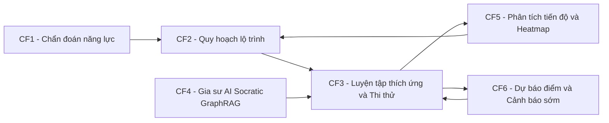
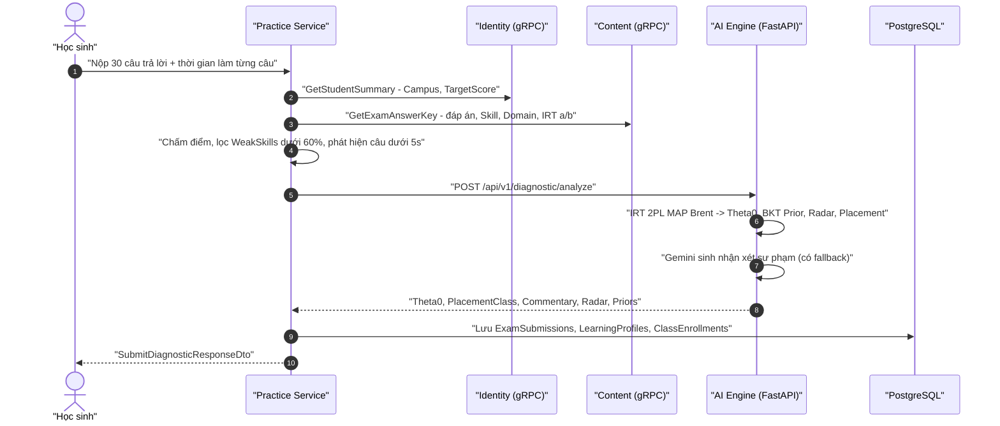
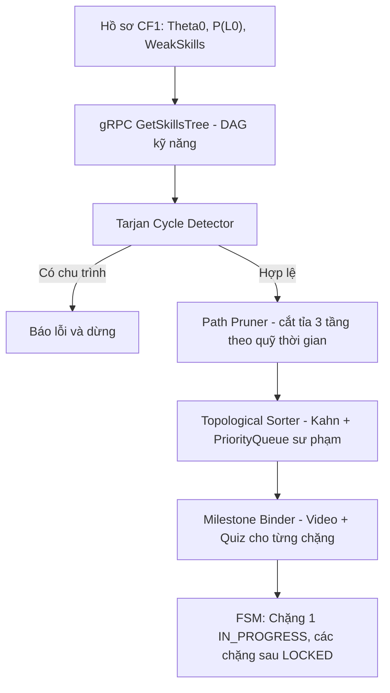
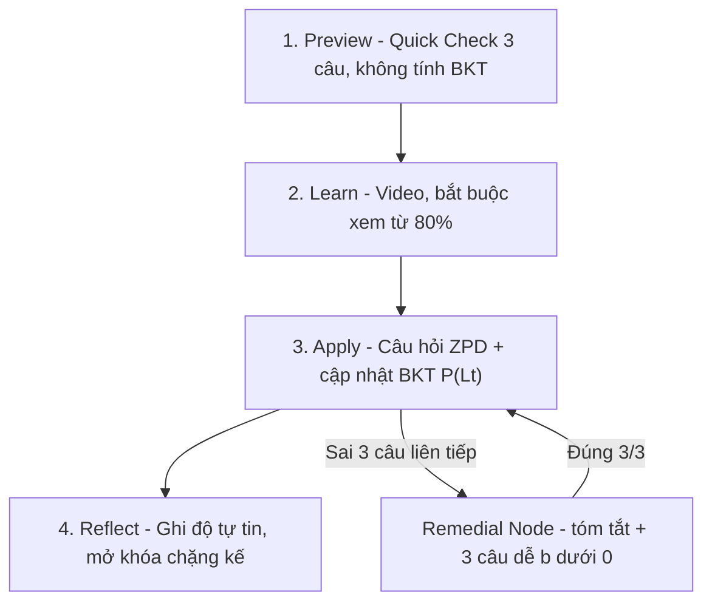
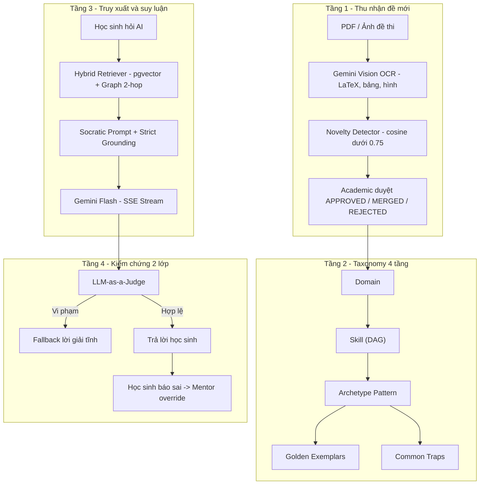
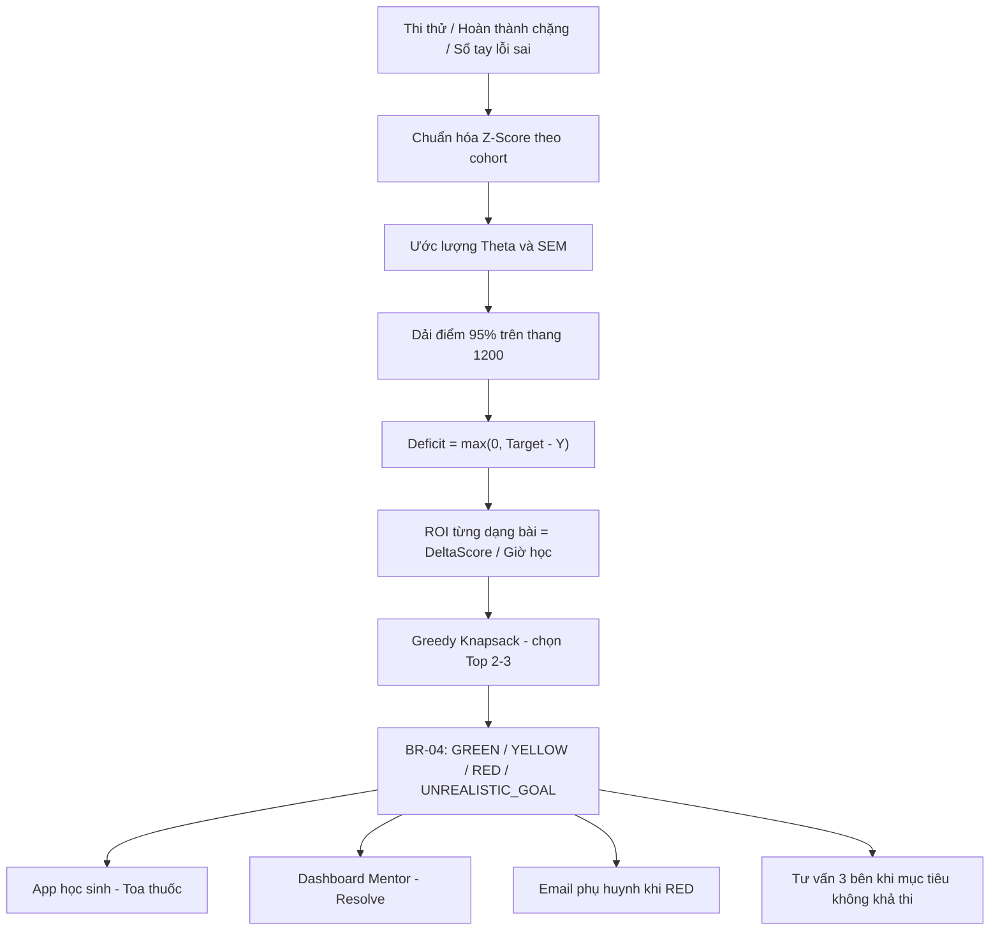

# TỔNG HỢP 6 CORE FLOW - HỆ THỐNG V-EVAL

> [!NOTE]
> Tài liệu tổng hợp toàn bộ 6 luồng nghiệp vụ cốt lõi (Core Flow) của nền tảng V-Eval - luyện thi ĐGNL ĐHQG-HCM (V-ACT).
> Nội dung được đối chiếu với tài liệu thiết kế trong `docs/` và mã nguồn thực tế (Controllers của Practice Service) tính đến **24/10/2026**.

---

## 0. BỨC TRANH TỔNG THỂ

### 0.1 Chuỗi giá trị 6 Core Flow

| # | Core Flow | Câu hỏi nghiệp vụ trả lời | Thuật toán / Kỹ thuật chính | Trạng thái |
| :---: | :--- | :--- | :--- | :---: |
| 1 | Chẩn đoán năng lực đầu vào | Học sinh đang ở đâu? | IRT 2PL + MAP Brent, BKT Prior, Gemini nhận xét | ✅ |
| 2 | Quy hoạch lộ trình cá nhân hóa | Học cái gì, theo thứ tự nào? | Tarjan, Path Pruning, Topological Sort, K-Means++ / Elbow | ✅ |
| 3 | Luyện tập thích ứng và Thi thử | Học thế nào cho hiệu quả? | P-L-A-R FSM, ZPD IRT, BKT, SM-2, Proctoring | ✅ |
| 4 | Trợ lý Gia sư AI | Bí thì hỏi ai? | GraphRAG (pgvector + Graph), Socratic, LLM-as-a-Judge | ✅ |
| 5 | Phân tích tiến độ và Heatmap | Lớp / con tôi đang tiến bộ ra sao? | BKT Heatmap, `R_exam`, Hybrid Aggregation | 🟡 |
| 6 | Dự báo điểm và Cảnh báo sớm | Có kịp đạt mục tiêu không, cần làm gì? | SEM 95%, Deficit, Greedy Knapsack ROI, BR-04 | ✅ / 🟡 |

> Quy ước: ✅ Đã triển khai · 🟡 Một phần / còn điểm cần hoàn thiện · ⏳ Kế hoạch.

### 0.2 Kiến trúc Microservices liên quan

| Service | Công nghệ | Vai trò trong 6 Core Flow |
| :--- | :--- | :--- |
| `V-Eval-Gateway` | YARP `:5212` | Định tuyến, JWT, Claims Transformation |
| `V-Eval-Identity_Service` | .NET 9, gRPC `:5156` | Hồ sơ học sinh, Campus, `TargetScore`, `ExamDate` |
| `V-Eval-Content_Service` | .NET 9 `:5249`, gRPC `:5250` | Ngân hàng câu hỏi (IRT `a`, `b`), cây kỹ năng DAG, đáp án |
| `V-Eval-Practice_Service` | .NET 9 `:5261` | Host chính CF1-3, CF5, CF6 và proxy CF4 |
| `V-Eval-Ai_Engine` (`rag-service`) | FastAPI `:8000` | Psychometrics CF1, GraphRAG + Socratic CF4, OCR |
| `V-Eval-Web_Client` | React 19 + Vite 8 | Giao diện học sinh, giáo viên, phụ huynh, học vụ |

### 0.3 Actor

| Actor | Tham gia Core Flow |
| :--- | :--- |
| Học sinh (Student) | 1, 2, 3, 4, 5, 6 |
| Giáo viên / Mentor (Teacher) | 3 (duyệt thi thử), 4 (Mentor Studio), 5 (Heatmap), 6 (xử lý cảnh báo) |
| Academic Manager / Director | 2 (phân cụm lớp, phân công GV), 4 (duyệt dạng bài mới), 5 (Heatmap liên lớp) |
| Phụ huynh (Parent) | 5 (Dashboard phụ huynh), 6 (Email cảnh báo đỏ, tư vấn 3 bên) |

---

## 1. CORE FLOW 1 - CHẨN ĐOÁN NĂNG LỰC ĐẦU VÀO

### 1.1 Mục tiêu
- Học sinh làm đề chẩn đoán rút gọn **30 câu** giữ tỉ lệ các phần thi ĐGNL.
- Ước lượng năng lực tiềm ẩn `θ₀` và ma trận xác suất làm chủ ban đầu `P(L₀)` cho toàn bộ cây kỹ năng.
- Tự động xếp lớp tại Campus và trả báo cáo trực quan (Radar, kỹ năng yếu, nhận xét AI).

### 1.2 Luồng xử lý

### 1.3 Thuật toán cốt lõi
| Thành phần | Công thức / Quy tắc |
| :--- | :--- |
| Xác suất đúng IRT 2PL | `P_i(θ) = 1 / (1 + e^{-1.7 · a_i (θ - b_i)})` |
| Ước lượng `θ₀` | MAP với prior `N(0, 2²)`, tối ưu Brent trong `[-4, 4]` (< 15ms) |
| Chống đoán mò | Trả lời `< 5s` → giảm độ phân biệt `a_i ← 0.1` |
| BKT Prior | `P(L₀) = Sigmoid(θ)`, kẹp trong `[0.05, 0.95]` |
| Cold-start | Kỹ năng chưa được hỏi → suy diễn từ `θ_domain` của miền cha |
| Phân lớp | `FOUNDATION` (`θ₀ < -0.5`), `ACCELERATION` (`-0.5 ≤ θ₀ ≤ 0.5`), `BREAKTHROUGH` (`θ₀ > 0.5`) |

### 1.4 Bảo mật và ngoại lệ
- `DiagnosticExamDto` loại bỏ `CorrectOption`, `Explanation` (anti-cheat).
- Bỏ dở quá 24h → `EXPIRED`, chặn nộp lại.

### 1.5 API chính
| Method | Endpoint | Mô tả |
| :---: | :--- | :--- |
| `GET` | `/api/content/diagnostic-test` | Lấy đề chẩn đoán 30 câu (ẩn đáp án) |
| `POST` | `/api/practice/diagnostic-submissions` | Nộp bài, chạy toàn bộ chuỗi chẩn đoán |
| `GET` | `/api/practice/diagnostic-submissions/{id}` | Xem kết quả 1 bài nộp |
| `GET` | `/api/practice/diagnostic-submissions/student/{studentId}` | Lịch sử chẩn đoán của học sinh |
| `POST` | `/api/v1/diagnostic/analyze` (AI Engine) | Phân tích psychometrics |

**Đầu ra chuyển giao CF2**: `θ₀`, vector `P(L₀)`, `WeakSkillIds`, `EnrolledClassId`.

📄 Chi tiết: [core_flow_1_chan_doan_nang_luc.md](./core_flow/core_flow_1_chan_doan_nang_luc.md) · [core_flow_1_step_by_step_logic.md](./core_flow/core_flow_1_step_by_step_logic.md)

---

## 2. CORE FLOW 2 - QUY HOẠCH LỘ TRÌNH CÁ NHÂN HÓA

### 2.1 Mục tiêu
- Biến hồ sơ năng lực CF1 thành **Roadmap Timeline** nhiều chặng, tuân thủ quan hệ tiên quyết giữa kỹ năng.
- Co giãn lộ trình theo quỹ thời gian (`ExamDate`, `StudyHoursPerDay`).
- Gom nhóm học sinh theo lỗ hổng kiến thức (lớp chuyên đề + nhóm vi mô trong lớp).

### 2.2 Pipeline sinh lộ trình

| Thuật toán | Vai trò |
| :--- | :--- |
| **Tarjan SCC** | Phát hiện vòng lặp trong đồ thị tiên quyết |
| **Path Pruning 3 tầng** | Khi tổng thời lượng > quỹ thời gian: cắt kỹ năng trọng số thấp / đã khá |
| **Topological Sort (Kahn + PriorityQueue)** | Ưu tiên: kỹ năng hổng → trọng số đề cao → kỹ năng yếu |
| **Milestone Binder** | Gắn bài giảng video + quiz củng cố vào từng chặng |
| **K-Means++ + Elbow** | Phân cụm lớp chuyên đề theo vector `P(L₀)` 4 miền |
| **ClassMicroClusterer** | Chia nhóm vi mô **3-5 HS** trong lớp 20 HS |

### 2.3 Quy tắc tổ chức lớp
- Sĩ số tối đa `MaxClassCapacity = 20`, tự động mở lớp mới khi đầy.
- Mô hình **1 Teacher / 1 lớp offline** + Academic Manager điều phối.
- Phân hệ Live Session (8 API) **đã loại bỏ** do chuyển sang mô hình học tập trung offline.

### 2.4 API chính
| Method | Endpoint | Actor | Mô tả |
| :---: | :--- | :--- | :--- |
| `POST` | `/api/practice/roadmaps/generate` | Học sinh | Sinh lộ trình từ kết quả chẩn đoán |
| `GET` | `/api/practice/roadmaps/my-roadmap` | Học sinh | Timeline, % hoàn thành, các Stage |
| `GET` | `/api/practice/roadmaps/nodes/{nodeId}` | Học sinh | Chi tiết chặng học |
| `PUT` | `/api/practice/classes/{classId}/assign-teacher` | Academic Manager | Phân công giáo viên |
| `POST` | `/api/practice/classes/auto-cluster` | Academic Manager | K-Means sinh lớp chuyên đề |
| `POST` | `/api/practice/classes/{classId}/micro-groups/auto-partition` | Teacher | Chia nhóm vi mô 3-5 HS |
| `GET` | `/api/practice/classes/{classId}/micro-groups` | Teacher | Xem nhóm vi mô |
| `POST` | `/api/practice/classes/{classId}/micro-groups/{groupId}/assign-worksheet` | Teacher | Phát đề luyện cho nhóm |

### 2.5 Còn trong kế hoạch
- ⏳ Trạng thái `PENDING_APPROVAL` - Mentor duyệt lộ trình trước khi áp dụng.
- ⏳ AI gợi ý cân bằng tải giáo viên.

📄 Chi tiết: [core_flow_2_quy_hoach_lo_trinh_hoc_tap.md](./core_flow/core_flow_2_quy_hoach_lo_trinh_hoc_tap.md) · [ke_hoach_trien_khai_core_flow_2_path_planning.md](./core_flow/ke_hoach_trien_khai_core_flow_2_path_planning.md)

---

## 3. CORE FLOW 3 - LUYỆN TẬP THÍCH ỨNG & THI THỬ MÔ PHỎNG

### 3.1 Mục tiêu
- Chu trình tự học mỗi chặng **P-L-A-R** (38-45 phút) với câu hỏi vừa sức (ZPD).
- Theo dõi mức thành thạo theo thời gian thực bằng BKT.
- Sổ tay lỗi sai + ôn tập ngắt quãng bằng câu biến thể.
- Phòng thi thử 120 câu / 150 phút có giám sát gian lận.

### 3.2 Chu trình P-L-A-R

### 3.3 Business Rules
| Mã | Quy tắc |
| :---: | :--- |
| **BR-01** | Hoàn thành chặng khi `P(L_t) ≥ 0.85` **và** đúng liên tiếp ≥ 2 câu khó `b ≥ 0.50` |
| **BR-03** | Sai liên tiếp 3 câu → `REMEDIAL_REQUIRED`, cấp gói cứu trợ (video tóm tắt + công thức + 3 câu `b < 0.0`) |
| **BR-08** | Đúng câu khó `b ≥ 0.50` trong `< 5s` → tăng `P(G)` từ 0.25 lên 0.60 |
| **BR-15** | Câu sai vào Sổ tay lỗi sai, `next_review_date = ngày mai`, ôn bằng câu Isomorphic |
| **BR-20** | Thi thử: rời tab > 3 lần → `FLAGGED_FOR_REVIEW`; Mentor kết luận `APPROVED` / `DISQUALIFIED` |

### 3.4 Thuật toán
- **ZPD Selection**: chọn câu có `P(Correct | θ, a, b)` trong `[0.60, 0.75]`; fallback mở rộng `[0.50, 0.85]`.
- **BKT Update** (`P(T) = 0.15`, `P(S) = 0.10`, `P(G) = 0.25`):
  - Đúng: `P(L|obs) = P(L)(1-S) / [P(L)(1-S) + (1-P(L))G]`
  - Sai: `P(L|obs) = P(L)S / [P(L)S + (1-P(L))(1-G)]`
  - Chuyển trạng thái: `P(L_{t+1}) = P(L|obs) + (1 - P(L|obs)) · T`
- **Spaced Repetition SM-2**: ôn lại bằng câu biến thể cùng dạng bài; `is_mastered` khi đúng 3 lần liên tiếp.

### 3.5 Dữ liệu chính (schema `practice`)
`stage_progress` · `adaptive_quiz_attempts` · `mistake_notebook` · `mock_exam_submissions` · `proctoring_snapshots`

### 3.6 API chính
| Nhóm | Method | Endpoint |
| :--- | :---: | :--- |
| P-L-A-R | `POST` | `/api/practice/stages/{roadmapNodeId}/start` |
| | `POST` | `/api/practice/stages/{stageProgressId}/preview-submit` |
| | `POST` | `/api/practice/stages/{stageProgressId}/track-video` |
| | `GET` | `/api/practice/stages/{stageProgressId}/next-question` |
| | `POST` | `/api/practice/stages/{stageProgressId}/submit-answer` |
| | `GET` | `/api/practice/stages/{stageProgressId}/remedial` |
| | `POST` | `/api/practice/stages/{stageProgressId}/remedial-submit` |
| | `POST` | `/api/practice/stages/{stageProgressId}/reflect-complete` |
| Sổ tay lỗi sai | `GET` | `/api/practice/mistakes` |
| | `GET` | `/api/practice/mistakes/daily-review` |
| | `POST` | `/api/practice/mistakes/{id}/tag-error` |
| | `POST` | `/api/practice/mistakes/{id}/review-submit` |
| Thi thử | `POST` | `/api/practice/mock-exams/{examId}/start` |
| | `POST` | `/api/practice/mock-exams/{submissionId}/log-tab-departure` |
| | `POST` | `/api/practice/mock-exams/{submissionId}/upload-snapshot` |
| | `POST` | `/api/practice/mock-exams/{submissionId}/submit` |
| | `GET` | `/api/practice/mock-exams/{submissionId}` |
| | `PATCH` | `/api/practice/mock-exams/{submissionId}/mentor-review` |

### 3.7 Còn trong kế hoạch
- ⏳ Cờ "làm quá nhanh" toàn bài thi thử; ghi nhận đồng ý của phụ huynh trước khi bật camera.
- ⏳ Đẩy thông báo cho Mentor khi học sinh rơi vào Remedial.

📄 Chi tiết: [ke_hoach_trien_khai_core_flow_3_adaptive_practice.md](./core_flow/ke_hoach_trien_khai_core_flow_3_adaptive_practice.md)

---

## 4. CORE FLOW 4 - TRỢ LÝ GIA SƯ AI SOCRATIC (GRAPHRAG)

### 4.1 Mục tiêu
- Giải quyết việc Academic không bao quát hết dạng đề mới ngoài thị trường.
- Gia sư AI **gợi mở theo phương pháp Socratic**, không đưa đáp án, không bịa lời giải.
- Kiểm chứng 2 tầng: máy (LLM-as-a-Judge) + người (Mentor).

### 4.2 Kiến trúc 4 tầng

### 4.3 Cơ chế an toàn
| Cơ chế | Mô tả |
| :--- | :--- |
| **Strict Grounding** | Độ tương đồng `< 0.75` → `LOW_CONFIDENCE`, không bịa (fail-closed) |
| **Đáp án do người nhập** | `correct_option` lấy từ DB, AI chỉ giải thích |
| **Socratic Guardrails** | Dùng `pattern_traps` để đặt câu hỏi phản biện theo phương án sai |
| **Rate Limiter** | `StrictTutorPolicy` 10 req/phút/học sinh |
| **Audit** | Mọi tương tác lưu `ai_tutor_interaction_logs` |
| **Câu AI sinh** | Gắn `UNVERIFIED_AI_GENERATED` / `IsPublished = false`, chỉ dùng tự luyện |

### 4.4 API chính
| Method | Endpoint | Service | Mô tả |
| :---: | :--- | :--- | :--- |
| `POST` | `/api/practice/ai-tutor/ask-stream` | Practice (proxy) | Hỏi AI, stream SSE, trả `interaction_id` |
| `POST` | `/api/practice/ai-tutor/ask` | Practice (proxy) | Bản đồng bộ JSON (fallback) |
| `POST` | `/api/practice/ai-tutor/report` | Practice | Học sinh báo AI vi phạm |
| `GET` | `/api/practice/ai-tutor/interactions` | Practice | Mentor xem lịch sử, lọc `flagged_only` |
| `POST` | `/api/v1/socratic/override-exemplar` | AI Engine | Mentor ghi đè lời giải chuẩn |
| `POST` | `/api/v1/socratic/add-trap` | AI Engine | Mentor thêm bẫy tư duy |
| `GET` | `/api/v1/academic-graph/proposals` | AI Engine | Danh sách dạng bài mới chờ duyệt |

### 4.5 Hotfix đang mở
- `HF-AI-01` (CRITICAL): `diagnostic.py` thiếu schema thẻ 3D/đồ thị, thiếu failover và JSON repair.
- `HF-AI-02` (HIGH): `CurriculumEndpoints.cs` gán cứng môn Toán khi thiếu input.
- `HF-AI-03` (MEDIUM): Prompt-in-Code trong `CurriculumAiService.cs`, cần tách File-based Templates.

📄 Chi tiết: [core_flow_4_ai_tutor_graph_rag.md](./ai_architecture/core_flow_4_ai_tutor_graph_rag.md) · [ke_hoach_trien_khai_core_flow_4_frontend.md](./ke_hoach_trien_khai_core_flow_4_frontend.md) · [AI_Engine_Hotfix.md](./hotfix/AI_Engine_Hotfix.md)

---

## 5. CORE FLOW 5 - PHÂN TÍCH TIẾN ĐỘ & BẢN ĐỒ NHIỆT LỚP HỌC

### 5.1 Mục tiêu
- Biến log học tập (P-L-A-R, thi thử, thời gian học) thành dashboard cho **4 nhóm người dùng**.
- Phát hiện lỗ hổng diện rộng của lớp và chuyển thành hành động sư phạm bằng 1 click.

### 5.2 Bốn phân hệ Dashboard
| Dashboard | Nội dung chính |
| :--- | :--- |
| **Học sinh** | Radar 4 miền, % hoàn thành DAG, Streak, lịch sử thi thử + dải tin cậy |
| **Giáo viên** | Class Heatmap (học sinh × kỹ năng), banner cảnh báo, nút 1-Click Action |
| **Phụ huynh** | Exam Readiness Index, giờ tự học/tuần, kỹ năng tiến bộ / điểm nghẽn |
| **Trưởng cơ sở** | Comparative Heatmap liên lớp, Gain Score `Δθ` theo giáo viên |

### 5.3 Công thức
| Chỉ số | Công thức |
| :--- | :--- |
| Màu ô Heatmap | Đỏ đậm `P(L_t) < 0.30` · Đỏ nhạt `< 0.50` · Vàng `< 0.70` · Xanh `≥ 0.70` |
| Tỉ lệ yếu của kỹ năng | `StrugglingRate_s = (1/N) Σ I(P(L_t,i,s) < 0.50)` |
| Cảnh báo cột kỹ năng | `CRITICAL_RED` nếu `StrugglingRate ≥ 0.40` hoặc trung bình `< 0.50`; `WARNING_AMBER` nếu `0.20-0.40` hoặc `0.50-0.70` |
| Lớp phân hóa 2 cực | `σ_s ≥ 0.28` và `StrugglingRate ≥ 0.30` → `BIMODAL_DISTRIBUTION_WARNING` |
| Sẵn sàng thi | `R_exam = 0.50·S_θ + 0.35·C_BKT + 0.15·F_consistency` |
| Trục Radar | `R_d = Σ (w_k · P(L_t,k)) × 100` |

### 5.4 Kiến trúc tổng hợp dữ liệu (Hybrid Aggregation)
- **Write-Through Micro-update**: khi nộp câu / hoàn thành chặng / nộp thi thử → cập nhật đúng 1 ô `class_skill_heatmaps` và xóa cache (`SubmitAnswer`, `TrackVideo`, `SubmitMockExam`).
- **Background Sweep**: `ClassHeatmapAggregationWorker` chạy định kỳ 15 phút tính Mean, StdDev, Alert flags vào `ClassHeatmapSummary`.
- **Cache**: `ClassHeatmapCacheService`, mục tiêu tải < 300ms.

### 5.5 API chính
| Method | Endpoint | Actor |
| :---: | :--- | :--- |
| `GET` | `/api/practice/classes/{classId}/heatmap` | Teacher |
| `POST` | `/api/practice/classes/{classId}/heatmap/force-aggregate` | Teacher / Admin |
| `POST` | `/api/practice/classes/{classId}/heatmap/trigger-live-session` | Teacher (1-Click Action) |
| `GET` | `/api/practice/analytics/student/{studentId}/dashboard` | Học sinh |
| `GET` | `/api/practice/analytics/parent/{parentId}/children` | Phụ huynh |
| `GET` | `/api/practice/analytics/campus/{campusId}/comparative-heatmap` | Trưởng cơ sở |

### 5.6 Còn trong kế hoạch
- ⏳ **Kỷ luật 3 cấp (BR-18)**: Background Job quét ngày không hoạt động, Streak Freeze, push notification.
- ⏳ Cảnh báo bất thường: điểm tụt `> 30%`, học lúc 2h-4h sáng.
- ⏳ Báo cáo tuần gửi phụ huynh qua Email.

📄 Chi tiết: [ke_hoach_trien_khai_core_flow_5_analytics_heatmap.md](./ke_hoach_trien_khai_core_flow_5_analytics_heatmap.md)

---

## 6. CORE FLOW 6 - DỰ BÁO KHOẢNG ĐIỂM & CẢNH BÁO SỚM

### 6.1 Mục tiêu
- Chuyển từ **dự đoán thụ động** sang **kê đơn hành động**.
- Công bố dải điểm `[Min, Max]` thay vì 1 con số; định lượng điểm thâm hụt so với mục tiêu.
- Kê "toa thuốc" 2-3 dạng bài có ROI cao nhất và cảnh báo sớm 3 cấp có Mentor can thiệp.

### 6.2 Pipeline

### 6.3 Công thức (theo thiết kế)
| Thành phần | Công thức |
| :--- | :--- |
| Quy đổi điểm | `Y(θ) = 600 + 150·θ` |
| Thông tin Fisher | `I(θ) = Σ a_j² · P_j(θ) · (1 - P_j(θ))` |
| Sai số chuẩn | `SEM(θ) = 1/√I(θ)`, `SEM_1200 = 150 · SEM(θ)` |
| Khoảng tin cậy 95% | `[Y - 1.96·SEM_1200, Y + 1.96·SEM_1200]` |
| Thâm hụt | `Δ_Deficit = max(0, TargetScore - Y)` |
| Dư địa điểm | `ΔScore_i = W_i · (1 - P(L_t,i))` |
| Giờ học cần | `H_i = 2.0 · (1 - P(L_t,i)) · (1 + 0.3(b_i - θ)) · Discount` (`CARELESS`/`MISREAD` = 0.6, `MISSING_CONCEPT` = 1.0) |
| ROI | `ROI_i = ΔScore_i / H_i` |
| Lọc ZPD | Chỉ xét dạng bài có `b_i ≤ θ + 0.80` và `P(L_t,i) < 0.70` |

### 6.4 Quy tắc cảnh báo BR-04
| Mức | Điều kiện | Kênh |
| :---: | :--- | :--- |
| 🟢 `GREEN` | `T_needed ≤ 0.7·T_avail` và nghỉ `< 2` ngày | App học sinh |
| 🟡 `YELLOW` | `0.7·T_avail < T_needed ≤ T_avail` hoặc nghỉ 2 ngày | App học sinh |
| 🔴 `RED` | Nghỉ `≥ 3` ngày hoặc `T_needed > T_avail` | App + Email phụ huynh + Dashboard Mentor |
| ⚠️ `UNREALISTIC_GOAL` | Cần học `> 14h/ngày` | Không ép học sinh; báo Mentor, hẹn tư vấn 3 bên |

Ngoại lệ: Push FCM lỗi hoặc không mở sau 24h → fallback Email.

### 6.5 Dữ liệu
- `ScorePredictions` mở rộng: `target_score`, `deficit_score`, `sem_score`, `prescription_items` (jsonb), `calculation_source`.
- `SystemAlerts`: `alert_type`, `message`, `is_read`, `handled_by`, `resolution_notes`, `resolved_at`.

### 6.6 API chính
| Method | Endpoint | Actor |
| :---: | :--- | :--- |
| `GET` | `/api/practice/predictions/my-forecast` | Học sinh |
| `GET` | `/api/practice/predictions/prescriptions/{patternId}/practice-session` | Học sinh |
| `POST` | `/api/practice/predictions/prescriptions/{patternId}/submit-session` | Học sinh |
| `POST` | `/api/practice/predictions/recalculate` | Học sinh / Hệ thống |
| `GET` | `/api/practice/early-warnings/my-alerts` | Học sinh |
| `PATCH` | `/api/practice/early-warnings/{alertId}/read` | Học sinh |
| `GET` | `/api/practice/early-warnings/dashboard` | Mentor |
| `POST` | `/api/practice/early-warnings/{alertId}/resolve` | Mentor |
| `POST` | `/api/practice/early-warnings/{alertId}/schedule-counseling` | Mentor |

### 6.7 Khoảng cách giữa thiết kế và code hiện tại

> [!WARNING]
> Các điểm dưới đây nằm trong [RecalculatePredictionCommandHandler.cs](../All%20Services/V-Eval-Practice_Service/V-Eval-Practice_Service.Application/Features/Predictions/Commands/RecalculatePrediction/RecalculatePredictionCommandHandler.cs) - nên sửa hoặc chuẩn bị câu trả lời trước Hội đồng.

| # | Thiết kế | Code hiện tại |
| :---: | :--- | :--- |
| 1 | `SEM = 1/√I(θ)` | Hằng số `semScore = 24.5` |
| 2 | `Y(θ) = 600 + 150·θ` | `TotalCorrect / TotalQuestions × 1200` |
| 3 | `ΔScore_i = W_i(1 - P(L_t,i))`, `H_i` theo công thức | `delta = 20 + 2.5 × số lỗi`, `hours = 1.5 × discount` |
| 4 | Dạng bài hoàn thành trừ đúng `ΔScore_i` | Cộng cố định `+15` điểm / dạng bài |
| 5 | Trạng thái theo BR-04 (thời gian, ngày nghỉ) | Trạng thái theo deficit: `ON_TRACK` / `AT_RISK` (`≤ 30`) / `CRITICAL` |

- ⏳ K-Fold Cross Validation, MAE: chờ dữ liệu thi thử thật.
- ⛔ XGBoost / LightGBM + ONNX: không làm ở giai đoạn này (cold-start, mô hình hộp đen).

📄 Chi tiết: [ke_hoach_trien_khai_core_flow_6_score_prediction_and_early_warning.md](./ke_hoach_trien_khai_core_flow_6_score_prediction_and_early_warning.md)

---

## 7. LIÊN KẾT DỮ LIỆU GIỮA CÁC CORE FLOW

| Từ | Đến | Dữ liệu chuyển giao |
| :---: | :---: | :--- |
| CF1 | CF2 | `θ₀`, `P(L₀)` (`LearningProfiles`), `WeakSkillIds`, `EnrolledClassId` |
| CF2 | CF3 | `LearningRoadmap`, `RoadmapNodes` (chặng nào mở, kỹ năng nào) |
| CF3 | CF5 | `P(L_t)` theo kỹ năng → micro-update `class_skill_heatmaps` |
| CF3 | CF6 | Kết quả thi thử, `MistakeNotebooks`, nhãn lỗi nhận thức |
| CF4 | CF3 | Gợi ý Socratic ngay trong bước Apply / câu sai |
| CF6 | CF3 | Toa thuốc → phiên luyện 3-5 câu biến thể, ưu tiên dạng bài trong Apply |
| CF5 | CF2 | Heatmap đỏ → chia nhóm vi mô, phát đề cứu trợ |

---

## 8. CÁC GÓP Ý HỘI ĐỒNG KHÔNG TRIỂN KHAI (TÓM TẮT)

| Góp ý | Lý do |
| :--- | :--- |
| Điểm học bạ | Thang điểm không đồng nhất giữa các trường |
| Khảo sát phụ huynh | Dữ liệu tự khai thiếu khách quan; đo hành vi thực thay thế |
| Tư vấn Reach / Target / Safety | Ngoài phạm vi, trách nhiệm tư vấn tuyển sinh thuộc con người |
| Phòng tự học Pomodoro | Mô hình học offline; check-in tự bấm dễ gian lận |
| XGBoost / ONNX | Chưa có dữ liệu thật; dùng IRT + SEM có tính giải thích làm baseline |

📄 Chi tiết: [phan_bien_nhan_xet_review_1.md](./phan_bien_nhan_xet_review_1.md)

---

## 9. TÀI LIỆU THAM KHẢO

- [kien_truc_chuan_tong_the_he_thong_v_eval.md](./kien_truc_chuan_tong_the_he_thong_v_eval.md)
- [he_thong_toan_hoc_va_cong_thuc_v_eval.md](./he_thong_toan_hoc_va_cong_thuc_v_eval.md)
- [muc_3_dac_ta_chuc_nang_chi_tiet.md](./muc_3_dac_ta_chuc_nang_chi_tiet.md)
- [usecase_chuan_hoa_capnhat.md](./usecase_chuan_hoa_capnhat.md)
- [mo_ta_activity_diagram_core_2_3_6.md](./mo_ta_activity_diagram_core_2_3_6.md)
- [dac_ta_state_machine_diagrams_review_2.md](./dac_ta_state_machine_diagrams_review_2.md)
- [cong_thuc_psychometrics_irt_bkt.md](./ai_architecture/cong_thuc_psychometrics_irt_bkt.md)
