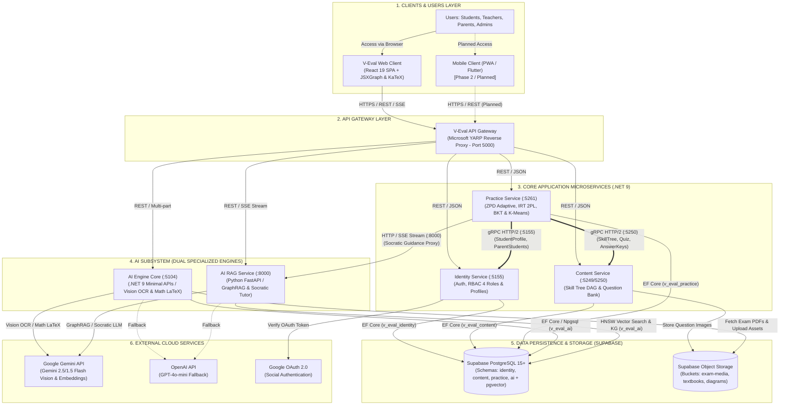
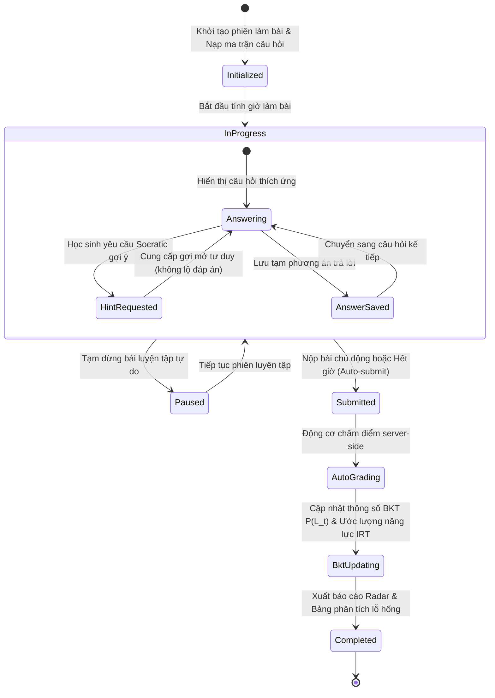

# TÀI LIỆU ĐẶC TẢ KIẾN TRÚC TỔNG THỂ HỆ THỐNG V-EVAL (ENTERPRISE SYSTEM ARCHITECTURE SPECIFICATION)

> [!IMPORTANT]
> **Tài liệu chuẩn kiến trúc chính thức phục vụ Review 2 (Report 4 - SDD & Design Brief) - Capstone 2026**
> - **Tên hệ thống**: Nền tảng Học tập Cá nhân hóa & Khảo thí Thích ứng ĐGNL ĐHQG-HCM (V-ACT)
> - **Kiến trúc chủ đạo**: Clean Architecture, Microservices phân tầng, API Gateway YARP, gRPC Server-to-Server, Phân hệ AI RAG (Google Gemini + pgvector), JSXGraph Native Engine & KaTeX Live Math
> - **Chuẩn hiển thị tài liệu**: Tương thích 100% với **MD Editor Plus** (không dùng ký tự `$` thô bao quanh công thức, liên kết tương đối `./`, sơ đồ Mermaid chuẩn 11.15.0+)

---

## 1. HỆ THỐNG TRONG MỘT ÁNH NHÌN (SYSTEM AT A GLANCE - 148 TỪ)

> V-Eval giải quyết bài toán ôn thi Đánh Giá Năng Lực (V-ACT) ĐHQG-HCM dàn trải và thiếu cá nhân hóa cho học sinh THPT, đồng thời hỗ trợ giáo viên quản lý lớp học phân hóa. Hệ thống áp dụng mô hình tâm trắc học IRT 2PL và Bayesian Knowledge Tracing để định lượng chính xác lỗ hổng kiến thức, tự động quy hoạch lộ trình học tập trên đồ thị DAG và phân cụm vi mô K-Means nhóm 3–5 học sinh có cùng điểm yếu. V-Eval tích hợp gia sư Socratic AI định hướng tư duy từng bước cùng thư viện JSXGraph dựng hình học 2D/3D tương tác. Nền tảng xây dựng theo kiến trúc Microservices phân tầng .NET 9 Clean Architecture, điều phối bởi API Gateway YARP, giao tiếp liên dịch vụ qua gRPC HTTP/2 và cô lập dữ liệu theo từng schema trên Supabase PostgreSQL.

---

## 2. BỘ 4 SƠ ĐỒ KIẾN TRÚC & DỮ LIỆU BẮT BUỘC (MÃ NGUỒN MERMAID)

### 2.1 Sơ Đồ 1: Kiến Trúc Tổng Quan Hệ Thống (System Overview Architecture)
*Mã nguồn độc lập*: [`./diagrams/architecture.mmd`](./diagrams/architecture.mmd)



---

### 2.2 Sơ Đồ 2: Sơ Đồ Thực Thể Logic (Logical ERD)
*Mã nguồn độc lập*: [`../docs/diagrams/erd.mmd`](../docs/diagrams/erd.mmd) | *Đặc tả chi tiết 74 quan hệ*: [`../docs/SQL/Tong_Quan_Chi_Tiet_Moi_Quan_He_Entities.md`](../docs/SQL/Tong_Quan_Chi_Tiet_Moi_Quan_He_Entities.md)

```mermaid
erDiagram
    %% =========================================================================
    %% V-EVAL UNIFIED MASTER DATABASE SCHEMA (SCHEMA V4.1)
    %% 49 Entities (47 Master Tables + 2 AI Engine Domain Entities)
    %% Full Attribute Definitions, Data Types & Cardinalities
    %% Reference: docs/SQL/SQL.sql & docs/SQL/Tong_Quan_Chi_Tiet_Moi_Quan_He_Entities.md
    %% =========================================================================

    Campuses {
        uuid campus_id PK "Primary Key"
        varchar code UK "Campus unique code"
        varchar name "Campus descriptive name"
        varchar address "Physical street location"
        varchar phone "Contact hotline"
        boolean is_active "Operational status"
        timestamptz created_at "Registration timestamp"
    }

    Roles {
        uuid role_id PK "Primary Key"
        varchar role_name UK "Role identifier string"
    }

    Users {
        uuid user_id PK "Primary Key"
        varchar email UK "Login email address"
        text password_hash "BCrypt hashed password"
        varchar full_name "Legal full name"
        varchar phone "Mobile contact number"
        text avatar_url "Profile avatar image URL"
        boolean is_active "Account active status"
        timestamptz created_at "Registration timestamp"
    }

    UserRoles {
        uuid user_id PK,FK "References Users"
        uuid role_id PK,FK "References Roles"
        timestamptz assigned_at "Role assignment timestamp"
    }

    Students {
        uuid student_id PK,FK "References Users"
        uuid campus_id FK "References Campuses"
        varchar enrollment_number UK "Student serial identifier"
        integer grade_level "Grade 10, 11, or 12"
        varchar target_school "Desired university or goal"
        numeric target_score "Desired national exam score"
        boolean is_active "Enrollment status"
    }

    Parents {
        uuid parent_id PK,FK "References Users"
        varchar occupation "Parent occupation"
        text contact_address "Mailing address"
    }

    Teachers {
        uuid teacher_id PK,FK "References Users"
        uuid campus_id FK "References Campuses"
        varchar specialization "Subject expertise"
        text bio "Academic biography"
    }

    AcademicManagers {
        uuid manager_id PK,FK "References Users"
        uuid campus_id FK "References Campuses"
        varchar office_room "Office room number"
    }

    AcademicDirectors {
        uuid director_id PK,FK "References Users"
        varchar decision_number "Appointment decision identifier"
    }

    Administrators {
        uuid admin_id PK,FK "References Users"
        integer access_level "System permission level"
    }

    ParentStudentRelations {
        uuid relation_id PK "Primary Key"
        uuid parent_id FK "References Parents"
        uuid student_id FK "References Students"
        varchar relationship_type "Father, Mother, Guardian"
        boolean is_primary_contact "Main contact for SMS/notifications"
    }

    RefreshTokens {
        uuid token_id PK "Primary Key"
        uuid user_id FK "References Users"
        text token_hash UK "Hashed refresh token"
        timestamptz expires_at "Token expiry timestamp"
        boolean is_revoked "Revocation status"
        timestamptz created_at "Issued timestamp"
    }

    OtpVerifications {
        uuid otp_id PK "Primary Key"
        varchar email "Verification target email"
        varchar otp_code "6-digit OTP code"
        varchar type "REGISTER, FORGOT_PASSWORD"
        timestamptz expires_at "Expiry timestamp"
        boolean is_used "Usage flag"
        timestamptz created_at "Generation timestamp"
    }

    CompetencyDomains {
        uuid domain_id PK "Primary Key"
        varchar code UK "Domain code, e.g. MATH_CALC"
        varchar name "Domain descriptive title"
        text description "Detailed scope definition"
        integer order_index "Display priority order"
    }

    Skills {
        uuid skill_id PK "Primary Key"
        uuid domain_id FK "References CompetencyDomains"
        uuid parent_id FK "Self-referencing parent skill"
        varchar code UK "Skill unique code"
        varchar name "Skill name"
        varchar bloom_level "REMEMBER, UNDERSTAND, APPLY, ANALYZE"
        numeric difficulty_weight "Base IRT difficulty weight"
        integer order_index "Sort order within domain"
    }

    SkillPrerequisites {
        uuid prerequisite_id PK "Primary Key"
        uuid skill_id FK "Target skill"
        uuid prerequisite_skill_id FK "Required prerequisite skill"
        varchar strictness_level "STRICT, RECOMMENDED"
    }

    Materials {
        uuid material_id PK "Primary Key"
        uuid skill_id FK "References Skills"
        varchar title "Material lesson title"
        text content_url "Supabase S3 storage URL"
        varchar material_type "VIDEO, PDF_SUMMARY, INFOGRAPHIC"
        integer duration_seconds "Playback or estimated reading duration"
        timestamptz created_at "Creation timestamp"
    }

    Passages {
        uuid passage_id PK "Primary Key"
        varchar title "Reading passage title"
        text content "Full contextual reading text or problem backdrop"
        varchar subject "Subject category"
        timestamptz created_at "Creation timestamp"
    }

    Questions {
        uuid question_id PK "Primary Key"
        uuid skill_id FK "References Skills"
        uuid passage_id FK "References Passages"
        text content "Problem statement in KaTeX LaTeX"
        varchar question_type "MULTIPLE_CHOICE, TRUE_FALSE, SHORT_ANSWER"
        jsonb options "Serialized array of choices A, B, C, D"
        text correct_answer "Key option or exact numeric value"
        text explanation "Pedagogical step-by-step solution"
        numeric difficulty_level "IRT 2PL parameter b (-3.0 to +3.0)"
        numeric discrimination_index "IRT 2PL parameter a (0.5 to 2.5)"
        numeric pseudo_guessing "IRT 3PL parameter c (guessing rate)"
        boolean is_active "Approval status"
        timestamptz created_at "Creation timestamp"
    }

    MockExams {
        uuid exam_id PK "Primary Key"
        varchar title "Exam title"
        text description "Exam guidelines and syllabus coverage"
        integer duration_minutes "Total exam duration"
        numeric total_marks "Maximum reachable points"
        numeric pass_marks "Minimum passing benchmark score"
        varchar exam_category "DIAGNOSTIC, NATIONAL_SIMULATION, CHAPTER_TEST"
        varchar subject_code "Subject code e.g. MATH, PHYS"
        varchar difficulty_level "EASY, STANDARD, ADVANCED"
        boolean is_active "Published status"
        timestamptz created_at "Creation timestamp"
    }

    ExamQuestions {
        uuid exam_question_id PK "Primary Key"
        uuid exam_id FK "References MockExams"
        uuid question_id FK "References Questions"
        integer question_order "Position order in exam (1 to N)"
        numeric point_weight "Allocated score weight"
    }

    Classes {
        uuid class_id PK "Primary Key"
        uuid campus_id FK "References Campuses"
        varchar name "Cohort class identifier"
        varchar academic_year "Academic term e.g. 2026-2027"
        integer grade_level "Grade 10, 11, or 12"
        integer max_capacity "Maximum cohort capacity (default 20)"
        varchar status "PLANNING, ACTIVE, ARCHIVED"
        timestamptz created_at "Class creation timestamp"
    }

    ClassEnrollments {
        uuid enrollment_id PK "Primary Key"
        uuid class_id FK "References Classes"
        uuid student_id FK "References Students"
        uuid placement_exam_submission_id FK "Diagnostic placement test reference"
        varchar status "ENROLLED, COMPLETED, TRANSFERRED"
        timestamptz enrolled_at "Enrollment date"
    }

    ClassGroups {
        uuid group_id PK "Primary Key"
        uuid class_id FK "References Classes"
        varchar name "Micro-group name e.g. Nhom 1"
        varchar cluster_code "K-Means cluster label e.g. CLUSTER_ZPD_1"
        timestamptz created_at "Clustering timestamp"
    }

    ClassGroupMembers {
        uuid member_id PK "Primary Key"
        uuid group_id FK "References ClassGroups"
        uuid student_id FK "References Students"
        timestamptz joined_at "Assignment timestamp"
    }

    ExamSubmissions {
        uuid submission_id PK "Primary Key"
        uuid exam_id FK "References MockExams"
        uuid student_id FK "References Students"
        uuid class_id FK "References Classes"
        timestamptz start_time "Exam commencement timestamp"
        timestamptz submit_time "Final submission timestamp"
        numeric total_score "Calculated total score"
        varchar status "IN_PROGRESS, SUBMITTED, GRADED"
        numeric anti_cheat_score "Integrity confidence rating (0 to 100)"
    }

    SubmissionAnswers {
        uuid submission_answer_id PK "Primary Key"
        uuid submission_id FK "References ExamSubmissions"
        uuid question_id FK "References Questions"
        text student_answer "Student chosen option or input"
        boolean is_correct "Grading outcome"
        numeric score_awarded "Points allocated"
        integer time_spent_seconds "Duration spent answering"
        timestamptz answered_at "Timestamp of answer commitment"
    }

    ProctoringSnapshots {
        uuid snapshot_id PK "Primary Key"
        uuid submission_id FK "References ExamSubmissions"
        varchar event_type "TAB_SWITCH, FACE_ABSENT, MULTI_FACE"
        text snapshot_url "Storage URL of webcam/screen capture"
        numeric confidence_score "AI anti-cheat suspicion confidence"
        timestamptz captured_at "Incident timestamp"
    }

    LearningRoadmaps {
        uuid roadmap_id PK "Primary Key"
        uuid student_id FK "References Students"
        uuid placement_exam_submission_id FK "Diagnostic test baseline reference"
        varchar status "ACTIVE, COMPLETED, RECALIBRATING"
        timestamptz created_at "Generation timestamp"
    }

    RoadmapNodes {
        uuid roadmap_node_id PK "Primary Key"
        uuid roadmap_id FK "References LearningRoadmaps"
        uuid skill_id FK "References Skills"
        integer step_order "Sequential milestone order"
        varchar stage_type "P_DIAGNOSTIC, L_LESSON, A_ADAPTIVE, R_REVIEW"
        uuid material_id FK "References Materials"
        varchar status "LOCKED, IN_PROGRESS, MASTERED"
        numeric target_mastery "Target mastery benchmark (e.g. 0.85)"
        numeric current_mastery "Current evaluated BKT mastery"
        timestamptz created_at "Node creation timestamp"
    }

    StageProgress {
        uuid stage_progress_id PK "Primary Key"
        uuid roadmap_node_id FK "References RoadmapNodes"
        varchar stage_type "L_THEORY, A_QUIZ"
        varchar status "NOT_STARTED, IN_PROGRESS, COMPLETED"
        integer time_spent_seconds "Cumulative active learning duration"
        timestamptz completed_at "Stage completion timestamp"
    }

    AdaptiveQuizAttempts {
        uuid attempt_id PK "Primary Key"
        uuid stage_progress_id FK "References StageProgress"
        uuid question_id FK "References Questions"
        text student_answer "Student submitted response"
        boolean is_correct "Response correctness"
        numeric theta_before "IRT theta student ability before attempt"
        numeric theta_after "IRT theta updated ability after attempt"
        numeric mastery_prob_before "BKT p(L) probability before attempt"
        numeric mastery_prob_after "BKT p(L) updated mastery probability"
        integer time_spent_seconds "Response latency in seconds"
        timestamptz answered_at "Submission timestamp"
    }

    MistakeNotebooks {
        uuid mistake_id PK "Primary Key"
        uuid student_id FK "References Students"
        uuid question_id FK "References Questions"
        integer error_count "Cumulative error occurrences"
        timestamptz last_error_at "Most recent wrong answer timestamp"
        integer interval_days "SM-2 current scheduled interval"
        integer repetition_count "SM-2 consecutive success streak"
        numeric ease_factor "SM-2 ease factor EF (min 1.3)"
        date next_review_date "SM-2 scheduled next recall date"
        boolean is_mastered "Mastery graduation status"
    }

    ScorePredictions {
        uuid prediction_id PK "Primary Key"
        uuid student_id FK "References Students"
        varchar subject_code "Subject code"
        numeric predicted_score "Estimated national exam score"
        numeric confidence_lower "Lower 95 percent confidence bound"
        numeric confidence_upper "Upper 95 percent confidence bound"
        varchar model_version "SEM prediction engine model version"
        timestamptz predicted_at "Calculation timestamp"
    }

    SystemAlerts {
        uuid alert_id PK "Primary Key"
        uuid student_id FK "References Students"
        varchar alert_type "FALLING_BEHIND, STREAK_BROKEN, MISTAKE_DUE"
        varchar title "Alert headline"
        text message "Pedagogical intervention message"
        varchar severity "LOW, MEDIUM, HIGH, CRITICAL"
        boolean is_read "Acknowledgement status"
        timestamptz created_at "Trigger timestamp"
    }

    ClassSkillHeatmaps {
        uuid heatmap_id PK "Primary Key"
        uuid class_id FK "References Classes"
        uuid student_id FK "References Students"
        uuid skill_id FK "References Skills"
        numeric mastery_level "Evaluated mastery rating (0.0 to 1.0)"
        timestamptz last_updated_at "Latest telemetry update"
    }

    ClassHeatmapSummaries {
        uuid summary_id PK "Primary Key"
        uuid class_id FK "References Classes"
        uuid skill_id FK "References Skills"
        numeric average_mastery "Cohort average mastery score"
        integer struggling_students_count "Count of students below benchmark"
        varchar alert_status "GREEN, YELLOW, RED"
        timestamptz updated_at "Summary calculation timestamp"
    }

    StudentDailyActivities {
        uuid activity_id PK "Primary Key"
        uuid student_id FK "References Students"
        date activity_date "Calendar tracking date"
        integer practice_minutes "Total engaged study minutes"
        integer questions_attempted "Total problem attempts"
        integer correct_count "Total correct answers"
    }

    StudentReadinessMetrics {
        uuid metric_id PK "Primary Key"
        uuid student_id FK "References Students"
        numeric overall_readiness_score "Overall exam readiness rating"
        numeric competency_index "Holistic competency metric"
        numeric consistency_index "Study habit regularity index"
        integer current_streak_days "Continuous active day streak"
        timestamptz calculated_at "Evaluation timestamp"
    }

    KnowledgeSources {
        uuid source_id PK "Primary Key"
        varchar domain_id "Associated domain ID"
        varchar skill_id "Associated skill ID"
        varchar title "Textbook or syllabus document title"
        varchar file_url "Supabase storage source file URL"
        varchar file_hash "SHA256 checksum for idempotency"
        varchar document_type "TEXTBOOK, CURRICULUM, GENERAL_KNOWLEDGE"
        integer total_pages "Total page count"
        integer total_chars "Total character count"
        integer total_chunks "Total parsed chunk count"
        varchar vector_status "PENDING, PROCESSING, COMPLETED, FAILED"
        timestamptz created_at "Ingestion start timestamp"
        timestamptz updated_at "Vectorization completion timestamp"
    }

    KnowledgeVectorChunks {
        uuid chunk_id PK "Primary Key"
        uuid source_id FK "References KnowledgeSources"
        varchar domain_id "Competency domain identifier"
        varchar skill_id "Competency skill identifier"
        integer chunk_index "Index position within source document"
        integer page_number "Origin page number"
        text content_snippet "Decomposed textbook textual content"
        vector embedding "768-dimensional semantic embedding vector"
        varchar document_type "Origin document classification"
        integer char_count "Snippet character length"
        jsonb metadata "Section headers and textbook layout metadata"
        timestamptz created_at "Chunk generation timestamp"
    }

    archetype_patterns {
        uuid id PK "Primary Key"
        uuid skill_id FK "References Skills"
        varchar pattern_code UK "Unique taxonomy level 4 pattern code"
        varchar pattern_name "Pattern canonical name"
        text description "Pedagogical problem archetype"
        text core_theorems "Foundational mathematical formulas and theorems"
        text fast_solving_heuristics "Fast-solving shortcuts and heuristics"
        vector embedding "3072-dimensional Gemini text embedding"
        boolean is_verified "Academic Director verification status"
        timestamptz created_at "Pattern registration timestamp"
        timestamptz updated_at "Latest modification timestamp"
    }

    pattern_exemplars {
        uuid id PK "Primary Key"
        uuid archetype_pattern_id FK "References archetype_patterns"
        text question_latex "Standard exemplar problem in LaTeX"
        text golden_solution "Gold-standard rigorous pedagogical proof"
        varchar correct_option "Canonical answer choice key"
        jsonb explanation_steps "Structured step-by-step reasoning tree"
        timestamptz created_at "Exemplar creation timestamp"
    }

    pattern_traps {
        uuid id PK "Primary Key"
        uuid archetype_pattern_id FK "References archetype_patterns"
        varchar trap_code "Cognitive trap code"
        varchar trap_name "Trap pedagogical name"
        varchar wrong_option "Distractor choice associated with trap"
        text misconception_explanation "Diagnostic root-cause misconception analysis"
        text socratic_hint "Scaffolded reflective question for Socratic AI"
        timestamptz created_at "Trap catalog timestamp"
    }

    novel_pattern_proposals {
        uuid id PK "Primary Key"
        varchar source_exam_name "Origin mock exam or provincial paper"
        text raw_question_latex "Extracted raw problem statement in LaTeX"
        jsonb image_urls "Extracted diagram image URLs"
        jsonb extracted_metadata "Extracted metadata"
        float max_similarity_score "Cosine similarity with closest archetype"
        uuid nearest_archetype_id FK "References closest archetype_patterns"
        varchar status "PENDING_REVIEW, APPROVED, MERGED, REJECTED"
        text academic_feedback "Auditor notes and review feedback"
        timestamptz created_at "Discovery timestamp"
    }

    ai_tutor_interaction_logs {
        uuid id PK "Primary Key"
        uuid student_id FK "References Students"
        uuid question_id FK "References Questions"
        uuid archetype_pattern_id FK "References archetype_patterns"
        varchar student_selected_option "Option selected by learner"
        varchar correct_option "Standard correct option"
        uuid matched_trap_id FK "References pattern_traps"
        jsonb ai_guidance_transcript "Multi-turn Socratic dialogue exchange"
        varchar validation_status "PASSED, OVERRIDDEN, REJECTED"
        boolean student_reported "Learner grievance flag"
        text mentor_resolution "Auditor override or remediation note"
        timestamptz created_at "Session timestamp"
    }

    TheoreticalDocuments {
        varchar document_id PK "Domain Entity Primary Key"
        varchar title "Theoretical lesson or paper title"
        text content "Comprehensive instructional theory body"
        varchar skill_id "References Skills domain"
        timestamptz created_at "Registration timestamp"
    }

    TutorSessions {
        varchar session_id PK "Domain Entity Primary Key"
        varchar student_id "References Students identity"
        varchar question_id "References Questions bank"
        boolean is_active "Live session active status"
        jsonb messages "Serialized dialogue messages with Socratic AI"
        timestamptz created_at "Session initialization timestamp"
    }

    %% RELATIONSHIPS: IDENTITY
    Users ||--|{ UserRoles : "assigned"
    Roles ||--o{ UserRoles : "defines"
    Users ||--o{ RefreshTokens : "owns"
    Users ||--o{ OtpVerifications : "verifies_via"
    Users ||--|| Students : "identifies"
    Users ||--|| Parents : "identifies"
    Users ||--|| Teachers : "identifies"
    Users ||--|| AcademicManagers : "identifies"
    Users ||--|| AcademicDirectors : "identifies"
    Users ||--|| Administrators : "identifies"
    Campuses ||--o{ Students : "located_at"
    Campuses ||--o{ Teachers : "assigned_to"
    Campuses ||--o{ AcademicManagers : "manages"
    Parents ||--|{ ParentStudentRelations : "supervises"
    Students ||--o{ ParentStudentRelations : "supervised_by"

    %% RELATIONSHIPS: CONTENT
    CompetencyDomains ||--o{ Skills : "contains"
    Skills ||--o{ Skills : "sub_skill_of"
    Skills ||--o{ SkillPrerequisites : "requires"
    Skills ||--o{ SkillPrerequisites : "is_prerequisite_for"
    Skills ||--o{ Materials : "has_materials"
    Skills ||--o{ Questions : "evaluates"
    Passages ||--o{ Questions : "contextualizes"
    MockExams ||--o{ ExamQuestions : "comprises"
    Questions ||--o{ ExamQuestions : "included_in"

    %% RELATIONSHIPS: PRACTICE
    Classes ||--o{ ExamSubmissions : "class_exams"
    ExamSubmissions ||--o{ SubmissionAnswers : "records"
    ExamSubmissions ||--o{ ProctoringSnapshots : "monitors"
    Classes ||--o{ ClassEnrollments : "enrolls"
    ExamSubmissions ||--o{ ClassEnrollments : "places"
    Classes ||--o{ ClassGroups : "clusters_into"
    ClassGroups ||--|{ ClassGroupMembers : "consists_of"
    ExamSubmissions ||--o{ LearningRoadmaps : "initializes"
    LearningRoadmaps ||--|{ RoadmapNodes : "composed_of"
    RoadmapNodes ||--o{ StageProgress : "tracks"
    StageProgress ||--o{ AdaptiveQuizAttempts : "executes"
    Classes ||--o{ ClassSkillHeatmaps : "measures"
    Classes ||--o{ ClassHeatmapSummaries : "summarizes"

    %% RELATIONSHIPS: AI ENGINE & DOMAIN ENTITIES
    KnowledgeSources ||--o{ KnowledgeVectorChunks : "chunked_into"
    archetype_patterns ||--o{ pattern_exemplars : "has_golden_solutions"
    archetype_patterns ||--o{ pattern_traps : "catalogs_misconceptions"
    archetype_patterns ||--o{ novel_pattern_proposals : "nearest_cluster"
    pattern_traps ||--o{ ai_tutor_interaction_logs : "matched_trap"
    archetype_patterns ||--o{ ai_tutor_interaction_logs : "diagnosed_pattern"
    Skills ||--o{ TheoreticalDocuments : "indexed_for"
    TheoreticalDocuments ||--o{ KnowledgeVectorChunks : "vectorized_into"
    Students ||--o{ TutorSessions : "participates_in"
    Questions ||--o{ TutorSessions : "discussed_in"
    TutorSessions ||--o{ ai_tutor_interaction_logs : "records_into"

    %% CROSS-SERVICE LOGICAL BOUNDARY RELATIONSHIPS (VIA GRPC HTTP/2)
    Campuses ||--o{ Classes : "operates_class"
    Students ||--o{ ClassEnrollments : "enrolled_student"
    Students ||--o{ ClassGroupMembers : "grouped_member"
    Students ||--o{ ExamSubmissions : "submits_exam"
    MockExams ||--o{ ExamSubmissions : "submitted_for"
    Questions ||--o{ SubmissionAnswers : "answered_question"
    Students ||--o{ LearningRoadmaps : "executes_roadmap"
    Skills ||--o{ RoadmapNodes : "develops_skill"
    Materials ||--o{ RoadmapNodes : "curates_lesson"
    Questions ||--o{ AdaptiveQuizAttempts : "attempted_question"
    Students ||--o{ MistakeNotebooks : "maintains_notebook"
    Questions ||--o{ MistakeNotebooks : "mistaken_question"
    Students ||--o{ ScorePredictions : "predicts_score"
    Students ||--o{ SystemAlerts : "receives_alert"
    Students ||--o{ ClassSkillHeatmaps : "student_heatmap"
    Skills ||--o{ ClassSkillHeatmaps : "skill_heatmap"
    Skills ||--o{ ClassHeatmapSummaries : "skill_summary"
    Students ||--o{ StudentDailyActivities : "tracks_daily_activity"
    Students ||--o{ StudentReadinessMetrics : "evaluates_readiness"
    Skills ||--o{ archetype_patterns : "classifies_pattern"
    Students ||--o{ ai_tutor_interaction_logs : "logs_student_tutor"
    Questions ||--o{ ai_tutor_interaction_logs : "logs_question_tutor"
```

---

### 2.3 Sơ Đồ 3: Máy Trạng Thái Phiên Thi & Luyện Tập Thích Ứng (State Machine Diagram)
*Mã nguồn độc lập*: [`./diagrams/03_state_machine.mmd`](./diagrams/03_state_machine.mmd)



---

### 2.4 Sơ Đồ 4: Sơ Đồ Hoạt Động Phân Làn (Activity Diagram with Swimlanes)
*Mã nguồn độc lập*: [`./diagrams/04_activity_swimlane.mmd`](./diagrams/04_activity_swimlane.mmd)  
*Quy trình*: Luyện tập thích ứng trong vùng ZPD kết hợp Gia sư Socratic AI (Core Flow 3 & Core Flow 4).

```mermaid
flowchart TD
    %% =========================================================================
    %% LÀN 1: HỌC SINH (STUDENT)
    %% =========================================================================
    subgraph StudentLane ["Làn 1: Học Sinh (Student)"]
        direction TB
        StartNode(("● Bắt đầu"))
        Act_QuickCheck["Làm 3 câu Quick Check nền tảng"]
        Act_WatchVideo["Xem video bài giảng cốt lõi"]
        Act_AnsQuestion["Chọn phương án trả lời & Gửi đáp án"]
        Act_AskTutor["Nhấn nút Trợ giúp từ Socratic AI Tutor"]
        Act_InteractMath["Xem gợi mở tư duy & Tương tác đồ thị 2D/3D (JSXGraph)"]
        Act_SolveIsomorphic["Giải câu hỏi tương đương (Isomorphic Question)"]
        Act_DoRemedial["Giải và nộp bài luyện tập cứu trợ (Remedial Package)"]
        Act_Reflect["Đánh giá độ tự tin (1-5 sao) & Gắn nhãn nguyên nhân sai sót"]
        EndNode(("◉ Hoàn tất"))
    end

    %% =========================================================================
    %% LÀN 2: HỆ THỐNG KHẢO THÍ & ĐỒ THỊ (PRACTICE & CONTENT SERVICE)
    %% =========================================================================
    subgraph SystemLane ["Làn 2: Hệ Thống Khảo Thí & Đồ Thị (Practice & Content Service)"]
        direction TB
        Act_InitLesson["Ghi nhận điểm sơ bộ & Mở khóa video bài giảng"]
        Dec_VideoWatch{"Thời lượng xem video đạt >= 80%?"}
        Act_FetchZPD["Bốc câu hỏi thích ứng theo vùng phát triển ZPD"]
        Dec_HelpNeeded{"Học sinh tự giải hay cần AI gợi ý?"}
        Dec_GuessCheck{"Thời gian suy nghĩ t < 5s & Trả lời đúng? (BR-08)"}
        Act_GuessPenalty["Tăng tham số đoán mò P(G) = 0.60"]
        Act_StandardBKT["Áp dụng tham số đoán mò mặc định P(G) = 0.25"]
        Act_UpdateBKT["Thuật toán BKT: Cập nhật xác suất thành thạo P(L_t)"]
        Dec_AnswerCorrect{"Câu trả lời ĐÚNG hay SAI?"}
        Act_SaveMistake["Lưu vào MistakeNotebook (Lập lịch ôn tập SM-2 sau 24h)"]
        Dec_ThreeFails{"Sai liên tiếp 3 câu cùng kỹ năng? (BR-03)"}
        Act_IssueRemedial["Phát gói cứu trợ (Tóm tắt công thức + 3 câu hỏi cơ bản)"]
        Dec_RemedialPass{"Điểm bài cứu trợ đạt 3/3 (100%)?"}
        Act_ResetErrorCounter["Reset bộ đếm câu sai & Khôi phục luyện tập thích ứng"]
        Dec_MasteryCriteria{"Đạt chuẩn BR-01? (P(L_t) >= 0.85 & Đúng 2 câu b >= 0.50)"}
        Act_CompleteNode["Chuyển RoadmapNode -> COMPLETED & Mở khóa chặng tiếp theo"]
    end

    %% =========================================================================
    %% LÀN 3: PHÂN HỆ AI & GIA SƯ SOCRATIC (AI ENGINE & RAG)
    %% =========================================================================
    subgraph AILane ["Làn 3: Phân Hệ AI & Gia Sư Socratic (AI Engine & Socratic RAG)"]
        direction TB
        Dec_RateLimit{"Tần suất yêu cầu <= 10 req/phút?"}
        Act_RateReject["Trả về lỗi 429 Too Many Requests (Yêu cầu chờ 1 phút)"]
        Act_BuildQuery["Đóng gói ngữ cảnh: Câu hỏi, phương án sai, mã kỹ năng"]
        Act_Hop1["Hop 1: Embed câu hỏi & Quét tri thức tương đồng trong pgvector"]
        Dec_Similarity{"Độ tương đồng Cosine >= 0.78?"}
        Act_StaticFallback["Ngắt LLM chống ảo giác: Trả về lời giải tĩnh từ đề thi"]
        Act_Hop23["Hop 2 & 3: Trích xuất mẫu chuẩn (Exemplar) & Bẫy nhận thức"]
        Act_LLMDraft["LLM sinh gợi ý tư duy Socratic từng bước (không lộ đáp án)"]
        Dec_Guardrails{"Vượt qua bộ lọc bảo vệ? (Regex & Leak Score <= 0.2)"}
        Act_FallbackHint["Chuyển hướng sang gợi ý chuẩn an toàn (Resilient Fallback)"]
        Act_StreamResponse["Stream gợi ý qua SSE & Sinh câu hỏi tương đương 4 lựa chọn"]
    end

    %% =========================================================================
    %% ĐIỀU PHỐI LUỒNG HOẠT ĐỘNG GIỮA CÁC LÀN (INTER-SWIMLANE FLOW)
    %% =========================================================================
    %% 1. Khởi động bài học & Video lý thuyết
    StartNode --> Act_QuickCheck
    Act_QuickCheck --> Act_InitLesson
    Act_InitLesson --> Act_WatchVideo
    Act_WatchVideo --> Dec_VideoWatch
    Dec_VideoWatch -->|"Chưa đủ (< 80%)"| Act_WatchVideo
    Dec_VideoWatch -->|"Đạt >= 80%"| Act_FetchZPD

    %% 2. Bốc câu hỏi thích ứng & Chọn hướng giải
    Act_FetchZPD --> Dec_HelpNeeded
    Dec_HelpNeeded -->|"Tự tin giải bài"| Act_AnsQuestion
    Dec_HelpNeeded -->|"Bế tắc cần gợi ý"| Act_AskTutor

    %% 3. Phân hệ Gia sư AI Socratic & Phòng vệ ảo giác
    Act_AskTutor --> Dec_RateLimit
    Dec_RateLimit -->|"Vượt ngưỡng (> 10 req/m)"| Act_RateReject
    Act_RateReject --> Act_AnsQuestion
    Dec_RateLimit -->|"Hợp lệ (<= 10 req/m)"| Act_BuildQuery
    Act_BuildQuery --> Act_Hop1
    Act_Hop1 --> Dec_Similarity
    Dec_Similarity -->|"Thấp (< 0.78)"| Act_StaticFallback
    Act_StaticFallback --> Act_InteractMath
    Dec_Similarity -->|"Chuẩn (>= 0.78)"| Act_Hop23
    Act_Hop23 --> Act_LLMDraft
    Act_LLMDraft --> Dec_Guardrails
    Dec_Guardrails -->|"Không đạt (Lộ đáp án)"| Act_FallbackHint
    Dec_Guardrails -->|"Hợp lệ"| Act_StreamResponse
    Act_FallbackHint --> Act_StreamResponse
    Act_StreamResponse --> Act_InteractMath
    Act_InteractMath --> Act_SolveIsomorphic
    Act_SolveIsomorphic --> Act_AnsQuestion

    %% 4. Nộp bài & Đánh giá tâm trắc học BKT
    Act_AnsQuestion --> Dec_GuessCheck
    Dec_GuessCheck -->|"Đoán mò (t < 5s & Đúng)"| Act_GuessPenalty
    Dec_GuessCheck -->|"Suy nghĩ bình thường"| Act_StandardBKT
    Act_GuessPenalty --> Act_UpdateBKT
    Act_StandardBKT --> Act_UpdateBKT
    Act_UpdateBKT --> Dec_AnswerCorrect

    %% 5. Phân nhánh kết quả: Cứu trợ (Remedial) hoặc Hoàn thành (Mastery)
    Dec_AnswerCorrect -->|"SAI"| Act_SaveMistake
    Act_SaveMistake --> Dec_ThreeFails
    Dec_ThreeFails -->|"Sai < 3 câu"| Act_FetchZPD
    Dec_ThreeFails -->|"Sai liên tiếp 3 câu (BR-03)"| Act_IssueRemedial
    Act_IssueRemedial --> Act_DoRemedial
    Act_DoRemedial --> Dec_RemedialPass
    Dec_RemedialPass -->|"Chưa đạt (< 3/3)"| Act_IssueRemedial
    Dec_RemedialPass -->|"Đạt 3/3 (100%)"| Act_ResetErrorCounter
    Act_ResetErrorCounter --> Act_FetchZPD

    Dec_AnswerCorrect -->|"ĐÚNG"| Dec_MasteryCriteria
    Dec_MasteryCriteria -->|"Chưa đạt chuẩn"| Act_FetchZPD
    Dec_MasteryCriteria -->|"Đạt chuẩn hoàn thành (BR-01)"| Act_Reflect
    Act_Reflect --> Act_CompleteNode
    Act_CompleteNode --> EndNode
```



---

## 3. BẢNG KHAI BÁO CÔNG NGHỆ CHUẨN REPORT 4 (5 NHÓM BẮT BUỘC)

### 3.1 Nhóm 1: Dịch Vụ Bên Thứ Ba & Dữ Liệu Gửi Đi (Third-Party Services)

| Dịch vụ bên ngoài | Nhà cung cấp & Model ID | Mục đích sử dụng | Dữ liệu gửi đi (Data Payload) | Cam kết bảo vệ dữ liệu (Data Privacy) |
| :--- | :--- | :--- | :--- | :--- |
| **Google Gemini Multimodal API** | Google AI (`gemini-3.6-flash`, `gemini-embedding-001`, `gemini-flash-lite-latest`) | Bóc tách OCR đề thi/SGK, Trợ lý gia sư Socratic gợi mở tư duy, trích xuất hình học 2D/3D (Primary LLM). | • Ảnh chụp trang sách giáo khoa / đề thi PDF.<br/>• Văn bản câu hỏi trắc nghiệm.<br/>• Lịch sử câu hỏi gợi mở của học sinh. | **Tuyệt đối KHÔNG gửi PII** (Họ tên, Email, SĐT, Điểm số cá nhân, User ID đều bị ẩn hoặc thay thế bằng UUID ẩn danh trước khi gọi API). |
| **OpenAI API (Fallback)** | OpenAI (`gpt-4o-mini`) | Mô hình LLM dự phòng khi Gemini API chạm rate-limit hoặc gặp sự cố mạng (Circuit Breaker Fallback). | Văn bản câu hỏi và ngữ cảnh gợi ý Socratic (Text prompt ẩn danh). | **Không gửi PII**, cấu hình cấm lưu trữ dữ liệu huấn luyện (Zero Data Retention API). |
| **Supabase PostgreSQL 15+** | Supabase (AWS Singapore Region) | CSDL quan hệ chính cho toàn hệ sinh thái (cô lập theo 4 schema độc lập). | SQL queries, bảng điểm, hồ sơ học tập, quan hệ cây tri thức DAG. | Kết nối SSL bắt buộc (`SSL Mode=Require`), lưu trữ tại trung tâm dữ liệu AWS Singapore chuẩn ISO/IEC 27001. |
| **Supabase Object Storage** | Supabase Storage (S3-compatible) | Lưu trữ file PDF sách giáo khoa, ảnh đồ thị toán trích xuất và tệp audio. | File binary tài liệu học tập, ảnh đề thi. | Thiết lập Bucket Policy phân quyền (chỉ đọc public CDN, ghi yêu cầu token xác thực). |

---

### 3.2 Nhóm 2: Ngăn Xếp Công Nghệ Kèm Phiên Bản Thực Tế (Technology Stack)

| Phân hệ / Tầng | Công nghệ / Thư viện | Phiên bản | Vai trò & Mục đích kỹ thuật |
| :--- | :--- | :---: | :--- |
| **API Gateway** | Microsoft YARP (.NET 9) | `v2.3.0` | Cổng tiếp nhận duy nhất, Reverse Proxy, Anti-Header Spoofing, Rate Limiting. |
| **Backend Core** | ASP.NET Core (.NET 9) | `net9.0` | Clean Architecture (Domain, Application, Infrastructure, API), MediatR CQRS, FluentValidation. |
| **Giao tiếp nội bộ** | gRPC .NET (HTTP/2 nhị phân) | `v2.67.0` | Kênh giao tiếp tốc độ cao giữa `Practice Service` và `Content Service` (`:5250`). |
| **ORM / Data Access** | Entity Framework Core & Npgsql | `v9.0.2` | Quản trị truy vấn dữ liệu theo từng Schema riêng biệt (`v_eval_*`). |
| **AI Subsystem (.NET)** | .NET 9 Core Vision OCR | `net9.0` | Trực tiếp gọi Gemini Multimodal Vision API OCR đề thi PDF và trích xuất hình học 2D/3D. |
| **AI Subsystem (Python)** | FastAPI, LangChain, psycopg | `v0.115+` | Triển khai Hybrid GraphRAG, Conversational Retrieval Chain và pgvector store. |
| **External LLM APIs** | Google Gemini & OpenAI | `gemini-3.6-flash`<br/>`gpt-4o-mini` | Động cơ ngôn ngữ đa phương thức chính và mô hình dự phòng chuyển tiếp. |
| **Vector Engine** | PostgreSQL Extension `vector` (pgvector) | `v0.3.0+` | Lưu trữ vector embeddings 3072 chiều trên schema `v_eval_ai`, tìm kiếm Cosine Similarity. |
| **Frontend Client** | React 19 + Vite 8 | `React 19.2.8` | Single Page Application responsive (Desktop & Mobile); Mobile App PWA/Flutter nằm trong lộ trình pha 2. |
| **Styling** | TailwindCSS v4 | `v4.3.3` | Utility-first CSS hiện đại, tối ưu kích thước bundle trình duyệt. |
| **Math Engines** | JSXGraph & KaTeX | `jsxgraph 1.14`<br/>`katex 0.19` | Dựng đồ thị vi tích phân 2D, mô hình hình học 3D xoay 360 độ và công thức toán học chuẩn Word. |

---

### 3.3 Nhóm 3: Môi Trường Triển Khai, CI/CD & Chiến Lược Rollback

| Môi trường | Hạ tầng & Cấu hình | Mục đích sử dụng | Cơ chế Triển khai & Giám sát |
| :--- | :--- | :--- | :--- |
| **Local Development** | Máy trạm lập trình Windows 11, .NET 9 SDK, Node 22, Python 3.11, Docker Desktop. | Lập trình tính năng, viết unit tests, chạy nhanh qua bộ script `Scripts/run_local/run_local.bat`. | Hot-reload Vite, `dotnet watch`, Swagger UI nội bộ. |
| **Staging Environment (Defense 1.1)** | Máy chủ VPS Ubuntu 24.04 LTS (4 vCPU, 8GB RAM), Docker Engine & Docker Compose v2. | Môi trường thử nghiệm liên thông tích hợp toàn diện phục vụ demo nghiệm thu đồ án. | Deploy tự động qua `docker-compose.yml`, kiểm tra qua `/healthz` Gateway. |
| **Production Environment** | Cụm máy chủ đám mây độc lập, Supabase Managed Database, CDN Cloudflare. | Vận hành thực tế cho người dùng cuối (Học sinh và Giảng viên luyện thi ĐGNL). | Containerized microservices, HTTPS/TLS tự động qua Reverse Proxy. |
| **Chiến lược Rollback** | **Zero-Downtime Container Tag Rollback (dưới 30 giây)**: Tất cả Docker Image đều được gắn thẻ phiên bản cố định (`veval-gateway:v1.0.0`, `veval-gateway:v1.0.1`). Khi container mới khởi động thất bại hoặc lỗi healthcheck `/healthz`, hệ thống tự động rollback về image phiên bản liền trước chỉ với 1 lệnh `docker compose up -d` trỏ lại image tag cũ. |

---

### 3.4 Nhóm 4: Quy Tắc Quản Trị Nhánh & Phiên Bản Git (Gitflow Strategy)

- **Nhánh `main`**: Nhánh mã nguồn ổn định nhất, chỉ nhận merge sau khi đã kiểm thử toàn diện trên Staging và có phê duyệt (Pull Request Review).
- **Nhánh `develop`**: Nhánh tích hợp mã nguồn chính của toàn đội ngũ cho các đợt Review.
- **Nhánh tính năng (`feature/<service>-<feature-name>`)**: Mỗi lập trình viên tạo nhánh riêng để phát triển từng use case.
- **Quy tắc gắn thẻ (Release Tags)**: Gắn tag cố định cho từng mốc bảo vệ: `review-1`, `review-2`, `defense-1.1`, `final-defense`.

---

### 3.5 Nhóm 5: Công Cụ AI Hỗ Trợ Phát Triển (AI Coding Assistants)

- **Antigravity IDE (Google DeepMind)**: Trợ lý lập trình AI hỗ trợ rà soát mã nguồn, kiểm thử tự động, chuẩn hóa sơ đồ kiến trúc Mermaid và quản lý tài liệu hệ thống.
- **GitHub Copilot / Gemini Code Assist**: Hỗ trợ tự động hoàn thiện mã nguồn C# .NET 9, React components và viết truy vấn LINQ/SQL.

---

## 4. BẢNG PHÂN BỔ THÀNH PHẦN HỆ THỐNG & ÁNH XẠ MÃ NGUỒN THỰC TẾ

| Nhóm Thành Phần | Tên Dịch Vụ / Module | Thư Mục Mã Nguồn Thực Tế | Cổng Local / Docker | Giao Thức Kết Nối | Trách Nhiệm Nghiệp Vụ Cốt Lõi |
| :--- | :--- | :--- | :---: | :--- | :--- |
| **Frontend Client** | `V-Eval-Web_Client` | `All Services/V-Eval-Web_Client` | `5173` / `80` | HTTPS / REST | SPA giao diện người dùng responsive, tích hợp JSXGraph (2D/3D) và KaTeX Live Math. |
| **Mobile Client** | `Mobile Client (PWA/Flutter)` | *Kế hoạch pha 2 (Roadmap)* | — | HTTPS / REST | Phiên bản ứng dụng di động cho học sinh và phụ huynh (kế hoạch mở rộng pha 2). |
| **API Gateway** | `V-Eval-Gateway` | `All Services/V-Eval-Gateway` | `5212` / `5212` | YARP Reverse Proxy | Cổng giao tiếp duy nhất, xác thực JWT, Rate Limiting, Anti-Header Spoofing. |
| **Core Microservice 1** | `V-Eval-Identity_Service` | `All Services/V-Eval-Identity_Service` | `5155` / `5001` | REST | Quản lý người dùng, phân quyền RBAC 4 vai trò, cấp phát JWT Token. |
| **Core Microservice 2** | `V-Eval-Content_Service` | `All Services/V-Eval-Content_Service` | `5249` / `5249` | REST + **gRPC `:5250`** | Cây tri thức DAG, Ngân hàng câu hỏi, Studio Soạn Thảo Sư Phạm cho Giảng viên. |
| **Core Microservice 3** | `V-Eval-Practice_Service` | `All Services/V-Eval-Practice_Service` | `5261` / `5002` | REST + gRPC Client | Khảo thí thích ứng ZPD, Chấm điểm, IRT 2PL, BKT, Phân cụm K-Means 3–5 bạn. |
| **AI Subsystem (.NET)** | `V-Eval-Ai_Engine` | `All Services/V-Eval-Ai_Engine` | `5104` / `5104` | REST | Bóc tách tài liệu SGK qua Gemini Vision, fallback OpenAI gpt-4o-mini, trích xuất 2D/3D. |
| **AI Subsystem (Python)** | `rag-service` | `.../V-Eval-Ai_Engine/rag-service` | `8000` / `8000` | REST + Streaming | Hybrid GraphRAG, Trợ lý Socratic gợi mở tư duy, tìm kiếm vector pgvector. |
| **Cơ Sở Dữ Liệu** | Supabase PostgreSQL 15+ | Cloud AWS Singapore | `5432` | Npgsql / EF Core | Cô lập dữ liệu theo 4 schema: `v_eval_identity`, `v_eval_content`, `v_eval_practice`, `v_eval_ai`. |

---

## 5. BỘ KỊCH BẢN PHẢN BIỆN KIẾN TRÚC REVIEW 2 (DEFENSE Q&A)

| Câu hỏi của Giảng viên / Hội đồng | Trọng tâm trên sơ đồ | Giải pháp kỹ thuật đã triển khai trong mã nguồn |
| :--- | :--- | :--- |
| **1. "Dịch vụ AI bên thứ ba (Gemini API) bị ngừng hoạt động hoặc bị nghẽn mạng thì hệ thống xử lý sao?"** | Nhánh kết nối `AI Engine --> Google Gemini API` | • Áp dụng mô hình **Circuit Breaker** (Polly .NET). Khi Gemini báo lỗi liên tục, tự động ngắt mạch bảo vệ hệ thống.<br/>• **Fallback sư phạm (Graceful Degradation)**: Chuyển hướng tức thì sang lấy lời giải chi tiết và gợi ý tĩnh (`Pre-computed Hints`) đã biên soạn sẵn trong `Content Service`. Học sinh làm bài bình thường không bị gián đoạn. |
| **2. "Vào đợt thi thử ĐGNL, lượng truy cập tăng vọt gấp 10 lần (10x Traffic Spike) thì kiến trúc mở rộng thế nào?"** | Tầng `API Gateway` và `Practice Service` | • Tất cả Microservices backend hoàn toàn **Stateless**, dễ dàng scale ngang số lượng Pods/Container trên Kubernetes/Docker Swarm.<br/>• Gateway phân phối tải cân bằng (Round Robin / Least Request).<br/>• Giao tiếp nội bộ chạy qua **gRPC HTTP/2 multiplexing**, tái sử dụng duy nhất 1 TCP connection, giảm 70% overhead mạng.<br/>• Tầng DB sử dụng Supabase Connection Pooling (Pgbouncer) giải phóng pool kết nối cực nhanh. |
| **3. "Tại sao không dùng chung 1 database mà lại phân chia nhiều Schema?"** | Tầng `Data Persistence` (`v_eval_*` schemas) | • Tuân thủ triệt để nguyên lý **Database-per-service** trong Microservices.<br/>• Tuyệt đối cấm viết câu lệnh SQL `JOIN` chéo schema. Mọi truy vấn trao đổi dữ liệu đều thông qua API Gateway hoặc gRPC Server-to-Server.<br/>• Dữ liệu phân quyền độc lập, sẵn sàng tách thành các Server Database vật lý riêng biệt khi cần mà không cần sửa code. |
| **4. "Tại sao chọn pgvector thay vì Qdrant độc lập?"** | Schema `v_eval_ai` trong Supabase PostgreSQL | • Giảm thiểu chi phí hạ tầng và độ phức tạp vận hành bằng cách tận dụng extension `vector` có sẵn trên chính CSDL PostgreSQL của Supabase.<br/>• Hỗ trợ truy vấn kết hợp (Hybrid Search) giữa dữ liệu quan hệ (Skill ID, Domain Code) và vector embedding 3072 chiều trong cùng một giao dịch ACID. |
