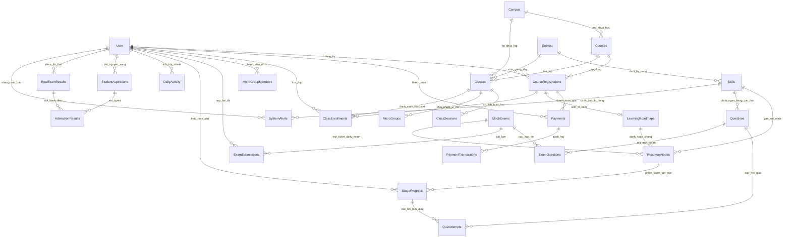
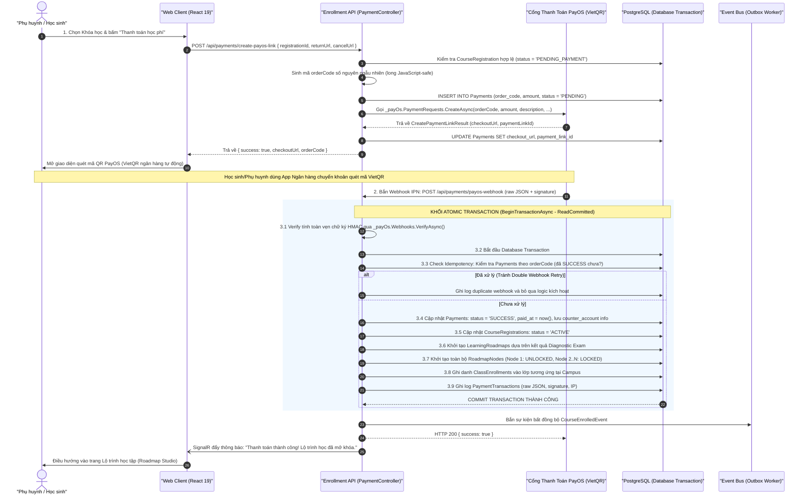

# BẢN KẾ HOẠCH KỸ THUẬT & ĐẶC TẢ TRIỂN KHAI MODULE THANH TOÁN (PAYOS) VÀ THỰC THỂ HÓA ERD CORE FLOW

> **Tên tài liệu**: Kế hoạch Kiến trúc Module Thanh toán PayOS (VietQR) & Kích hoạt Lộ trình Học tập P-L-A-R  
> **Phân hệ**: Enrollment Service & Practice Service (Core Flow: Thanh toán -> Khởi tạo Lộ trình)  
> **Dự án**: Nền tảng Đánh giá & Học tập Thích ứng V-Eval (V-ACT Platform)  
> **Ngày ban hành**: 03/11/2026 — Phiên bản 1.0 (Chuẩn hóa ERD Tinh gọn 21 thực thể & PayOS Transaction)  
> **Tương thích Markdown**: Chuẩn hóa 100% cho MD Editor Plus (Backtick LaTeX, Relative Links, Mermaid 11.15.0+)

---

## 1. TỔNG QUAN NGHIỆP VỤ & RANH GIỚI HỆ THỐNG

> [!IMPORTANT]
> **Vị trí của Module Thanh toán trong Hệ Sinh Thái V-Eval**:
> - Nằm ở mắt xích chuyển giao giữa **Core Flow 1 (Chẩn đoán & Xếp lớp)** và **Core Flow 2/3 (Lộ trình học tập & Luyện tập thích ứng P-L-A-R)**.
> - Sau khi học sinh hoàn thành khảo sát đầu vào và chọn Khóa học (`Course`), phụ huynh/học sinh thực hiện thanh toán học phí qua cổng PayOS (quét mã VietQR).
> - **Nguyên tắc vàng**: Giao dịch thanh toán phải được bao bọc trong một **Database Transaction (ACID)** nguyên khối: Tiền vào tài khoản thành công ➔ Kích hoạt ghi danh (`CourseRegistrations`) ➔ Tự động quy hoạch `LearningRoadmaps` ➔ Sinh danh sách các chặng học `RoadmapNodes` (mở khóa chặng 1 cho học sinh bắt đầu thực hiện chu trình PLAR ngày đầu tiên).

---

## 2. SƠ ĐỒ THỰC THỂ HÓA ERD TINH GỌN (SIMPLIFIED CORE ERD - 21 THỰC THỂ)

Mô hình ERD đã được tinh giản từ 50 bảng xuống còn **21 thực thể trọng tâm**, gom toàn bộ các Actor con (`Students`, `Parents`, `Teachers`...) về thực thể trung tâm `User`, phân định mạch lạc giữa chặng học (`RoadmapNode`), phiên luyện tập P-L-A-R (`StageProgress`) và bộ đếm chuyên cần streak (`DailyActivity`).



### Bảng Danh Mục 21 Thực Thể Cốt Lõi:

| STT | Tên Thực Thể | Bounded Context | Vai Trò & Nghiệp Vụ Cốt Lõi |
| :---: | :--- | :--- | :--- |
| **1** | **`User`** | Identity | Thực thể trung tâm quản lý tài khoản cho mọi vai trò (Học sinh, Phụ huynh, Mentor, Admin). |
| **2** | **`Campus`** | Identity | Cơ sở đào tạo offline tổ chức các lớp học và khóa học trực tiếp. |
| **3** | **`Subject`** | Content | Miền năng lực / Môn học của kỳ thi ĐGNL (Toán, Lý, Hóa, Sinh, Văn, Sử, Địa, Tiếng Anh). |
| **4** | **`Skill`** | Content | Cây kỹ năng vi mô kèm đồ thị tiên quyết (DAG) và trọng số đề thi. |
| **5** | **`Question`** | Content | Ngân hàng câu hỏi trắc nghiệm LaTeX 4 mức độ khó kèm giải thích chi tiết. |
| **6** | **`MockExam`** | Content | Đề thi chuẩn hóa: Đề chẩn đoán (Diagnostic), Thi thử (Full Mock 120c), Đề chốt chặng (Daily Exam). |
| **7** | **`ExamQuestion`**| Content | Bảng nối ma trận câu hỏi trong đề thi có thứ tự (`question_order`). |
| **8** | **`Course`** | Enrollment | Khóa học do cơ sở mở: thời lượng tuần, học phí, chính sách học lại, chuẩn đầu ra. |
| **9** | **`CourseRegistration`** | Enrollment | Đơn đăng ký khóa học của học sinh, hỗ trợ nhiều lần học lại (`attempt_no`). |
| **10** | **`Payment`** | Enrollment | Đơn thanh toán học phí tích hợp cổng PayOS VietQR (`order_code`, `checkout_url`). |
| **11** | **`PaymentTransaction`**| Enrollment | Nhật ký kiểm toán tài chính (Audit Log) lưu raw JSON webhook và chữ ký HMAC PayOS. |
| **12** | **`Class`** | Practice | Lớp học offline trực tiếp (sĩ số chuẩn 12–20 học sinh) tại cơ sở. |
| **13** | **`ClassSession`** | Practice | Lịch chi tiết từng buổi học (ngày, giờ bắt đầu/kết thúc, phòng học, kỹ năng dạy). |
| **14** | **`ClassEnrollment`** | Practice | Ghi danh học sinh vào lớp học dựa trên bài chẩn đoán đầu vào. |
| **15** | **`MicroGroup`** | Practice | Nhóm học tập vi mô 3–5 học sinh cùng lỗ hổng kiến thức để giáo viên kèm riêng. |
| **16** | **`LearningRoadmap`** | Practice | Lộ trình học cá nhân hóa: điểm mục tiêu, ngày thi, giờ học/ngày, cắt tỉa tiên quyết. |
| **17** | **`RoadmapNode`** | Practice | Chặng học kiến thức trong lộ trình: video lý thuyết, quiz và đề kiểm tra chặng (`daily_exam_id`). |
| **18** | **`StageProgress`** | Practice | Phiên luyện tập hằng ngày theo chu trình 4 bước P-L-A-R (`PREVIEW -> LEARN -> APPLY -> REFLECT`). |
| **19** | **`QuizAttempt`** | Practice | Nhật ký từng câu trả lời thích ứng BKT/IRT 2PL, cập nhật độ thành thạo `pMastery`. |
| **20** | **`DailyActivity`**| Practice | Nhật ký chuyên cần: đếm tổng phút học, số câu đã giải và duy trì chuỗi ngày học (**Streak**). |
| **21** | **`ExamSubmission`**| Practice | Bài nộp thi thử đầy đủ có giám sát liêm chính proctoring và thẩm định của Mentor. |

---

## 3. ĐẶC TẢ LUỒNG CORE FLOW: THANH TOÁN PAYOS & KÍCH HOẠT LỘ TRÌNH PLAR

### 3.1 Luồng Tương Tác Tuần Tự (Sequence Diagram)



---

## 4. CHI TIẾT THIẾT KẾ KỸ THUẬT (ENGINEERING IMPLEMENTATION)

### 4.1 Cấu Hình PayOS Trong `appsettings.json`
Kế thừa trực tiếp cấu trúc đã chứng minh vận hành ổn định tại `F:\EXE101\ShootMatch`:
```json
{
  "PayOS": {
    "ClientId": "YOUR_PAYOS_CLIENT_ID",
    "ApiKey": "YOUR_PAYOS_API_KEY",
    "ChecksumKey": "YOUR_PAYOS_CHECKSUM_KEY"
  }
}
```

### 4.2 Triển Khai Service `PayOsPaymentService.cs`
```csharp
using PayOS;
using PayOS.Models.V2.PaymentRequests;
using PayOS.Models.Webhooks;

namespace VEval.Enrollment.Infrastructure.Services;

public interface IPayOsPaymentService
{
    Task<string> CreatePaymentLinkAsync(long orderCode, decimal amount, string description, string returnUrl, string cancelUrl, CancellationToken cancellationToken);
    Task<WebhookData> VerifyWebhookAsync(Webhook webhookBody);
}

public sealed class PayOsPaymentService : IPayOsPaymentService
{
    private readonly PayOSClient _payOs;

    public PayOsPaymentService(IConfiguration configuration)
    {
        var clientId = configuration["PayOS:ClientId"] ?? throw new ArgumentNullException("PayOS:ClientId");
        var apiKey = configuration["PayOS:ApiKey"] ?? throw new ArgumentNullException("PayOS:ApiKey");
        var checksumKey = configuration["PayOS:ChecksumKey"] ?? throw new ArgumentNullException("PayOS:ChecksumKey");

        _payOs = new PayOSClient(new PayOSOptions
        {
            ClientId = clientId,
            ApiKey = apiKey,
            ChecksumKey = checksumKey,
            HttpClient = new HttpClient(new HttpClientHandler
            {
                ServerCertificateCustomValidationCallback = (_, _, _, _) => true
            })
        });
    }

    public async Task<string> CreatePaymentLinkAsync(long orderCode, decimal amount, string description, string returnUrl, string cancelUrl, CancellationToken cancellationToken)
    {
        // Khống chế mô tả tối đa 25 ký tự theo quy định khắt khe của PayOS
        var safeDescription = description.Length > 25 ? description.Substring(0, 25) : description;

        var request = new CreatePaymentLinkRequest
        {
            OrderCode = orderCode,
            Amount = (int)amount,
            Description = safeDescription,
            ReturnUrl = returnUrl,
            CancelUrl = cancelUrl
        };

        var response = await _payOs.PaymentRequests.CreateAsync(request);
        return response.CheckoutUrl;
    }

    public async Task<WebhookData> VerifyWebhookAsync(Webhook webhookBody)
    {
        return await _payOs.Webhooks.VerifyAsync(webhookBody);
    }
}
```

### 4.3 Thực Thi Xử Lý Webhook Với ACID Transaction Đảm Bảo Toàn Vẹn
```csharp
[HttpPost("payos-webhook")]
[AllowAnonymous]
public async Task<IActionResult> HandlePayOsWebhook(CancellationToken cancellationToken)
{
    try
    {
        using var reader = new StreamReader(Request.Body);
        var bodyText = await reader.ReadToEndAsync(cancellationToken);

        var options = new JsonSerializerOptions { PropertyNameCaseInsensitive = true };
        var webhook = JsonSerializer.Deserialize<Webhook>(bodyText, options);
        if (webhook is null) return Ok(new { success = false, message = "Invalid JSON" });

        // 1. Xác thực chữ ký HMAC-SHA512
        var verifiedData = await _payOsPaymentService.VerifyWebhookAsync(webhook);

        if (verifiedData.Code == "00") // 00 = Giao dịch thành công
        {
            var orderCode = verifiedData.OrderCode;

            // 2. Mở Database Transaction nguyên khối
            await using var tx = await _dbContext.Database.BeginTransactionAsync(IsolationLevel.ReadCommitted, cancellationToken);
            try
            {
                var payment = await _dbContext.Payments
                    .FirstOrDefaultAsync(p => p.OrderCode == orderCode, cancellationToken);

                if (payment != null && payment.Status == "PENDING")
                {
                    // 2.1 Cập nhật trạng thái thanh toán
                    payment.Status = "SUCCESS";
                    payment.PaidAt = DateTime.UtcNow;
                    payment.CounterAccountBankName = verifiedData.CounterAccountBankName ?? "VIETQR";
                    payment.CounterAccountName = verifiedData.CounterAccountName ?? "STUDENT";
                    payment.CounterAccountNumber = verifiedData.CounterAccountNumber ?? "N/A";

                    // 2.2 Kích hoạt đơn đăng ký
                    var registration = await _dbContext.CourseRegistrations
                        .FirstAsync(r => r.RegistrationId == payment.RegistrationId, cancellationToken);
                    registration.Status = "ACTIVE";

                    // 2.3 Khởi tạo Lộ trình học tập thích ứng cá nhân hóa
                    var roadmap = await _roadmapGenerator.GenerateInitialRoadmapAsync(registration.StudentId, registration.RegistrationId, cancellationToken);
                    _dbContext.LearningRoadmaps.Add(roadmap);

                    // 2.4 Ghi danh vào lớp học offline tại cơ sở Campus
                    await _classAllocator.AllocateStudentToClassAsync(registration.StudentId, registration.CourseId, cancellationToken);

                    // 2.5 Ghi nhật ký kiểm toán giao dịch (Audit Log)
                    _dbContext.PaymentTransactions.Add(new PaymentTransaction
                    {
                        PaymentId = payment.PaymentId,
                        EventType = "WEBHOOK_SUCCESS_PROCESSED",
                        RawPayload = bodyText,
                        Signature = webhook.Signature,
                        LoggedAt = DateTime.UtcNow
                    });

                    await _dbContext.SaveChangesAsync(cancellationToken);
                    await tx.CommitAsync(cancellationToken);
                }
            }
            catch (Exception ex)
            {
                await tx.RollbackAsync(cancellationToken);
                _logger.LogError(ex, "Transaction failed when processing PayOS Webhook for orderCode {OrderCode}", orderCode);
                return Ok(new { success = false, message = ex.Message });
            }
        }

        return Ok(new { success = true });
    }
    catch (Exception ex)
    {
        _logger.LogError(ex, "PayOS Webhook verification failed");
        // Luôn trả về 200 kèm success=false để trang quản trị PayOS xác nhận URL hoạt động
        return Ok(new { success = false, message = ex.Message });
    }
}
```

---

## 5. KẾ HOẠCH BẢO VỆ CHU TRÌNH P-L-A-R TẠI TẦNG PRACTICE SERVICE

Sau khi Transaction thanh toán hoàn tất và `RoadmapNodes` được sinh ra, chu trình P-L-A-R vận hành theo các ràng buộc bất biến (Invariants):

1. **Quy tắc Mở khóa Chặng (Rule BR-01)**:
   - Chỉ có chặng số 1 (`step_order = 1`) mang trạng thái `UNLOCKED`. Các chặng còn lại đều ở trạng thái `LOCKED`.
2. **Quy tắc Điều kiện Thoát Chặng (Rule BR-02 - PLAR Exit Ticket)**:
   - Học sinh bắt buộc phải trải qua 4 bước:
     - `[P] Preview`: Xem sơ đồ tri thức chặng.
     - `[L] Learn`: Xem video bài giảng lý thuyết `` `\ge 80\%` `` thời lượng.
     - `[A] Apply`: Giải bài tập thích ứng BKT hoặc vượt qua đề kiểm tra chặng `daily_exam_id` đạt điểm tối thiểu.
     - `[R] Reflect`: Đúc kết bài học và lưu câu sai vào `MistakeNotebook`.
   - Khi hoàn thành bước R, hệ thống cập nhật `RoadmapNodes[i].status = 'COMPLETED'` và tự động mở khóa `RoadmapNodes[i+1].status = 'UNLOCKED'`.
3. **Quy tắc Tích lũy Chuyên cần (Rule BR-04 - Streak Synchronization)**:
   - Mọi hoạt động xem video và giải quiz trong bước L và bước A được kích hoạt sự kiện cộng dồn vào bảng `DailyActivity` trong cùng ngày (`activity_date = CURRENT_DATE`), kích hoạt cờ `is_streak_counted = true` để giữ ngọn lửa học tập liên tục.

---

## 6. KẾ HOẠCH KIỂM THỬ (TESTING & VERIFICATION PLAN)

Triển khai các Unit Test với bộ thư viện chuẩn đã tích hợp (`xUnit 2.9.2`, `Moq 4.20.72`, `FluentAssertions 7.2.0`):

1. **`CreatePaymentLinkTests`**:
   - Kiểm tra sinh `orderCode` đảm bảo là số nguyên dương hợp lệ.
   - Kiểm tra cắt ngắn chuỗi `description` không vượt quá 25 ký tự.
   - Kiểm tra URL thanh toán trả về đúng định dạng PayOS Checkout.
2. **`ProcessPayOsWebhookTests`**:
   - **Test Case 1 (Happy Path)**: Nhận webhook hợp lệ ➔ Kiểm tra Transaction commit thành công, Registration chuyển sang `ACTIVE`, Roadmap và RoadmapNodes được sinh ra đầy đủ.
   - **Test Case 2 (Idempotency Guard)**: Nhận lại webhook trùng lặp của đơn hàng đã `SUCCESS` ➔ Đảm bảo không sinh lại Roadmap lần thứ 2, không quăng lỗi ngoại lệ.
   - **Test Case 3 (Rollback Safety)**: Giả lập lỗi khi sinh Roadmap ➔ Đảm bảo toàn bộ lệnh cập nhật Payment và Registration tự động rollback về `PENDING`.
   - **Test Case 4 (Tampered Signature)**: Giả lập chữ ký số HMAC không khớp ➔ Từ chối xử lý và ghi log cảnh báo an ninh.
