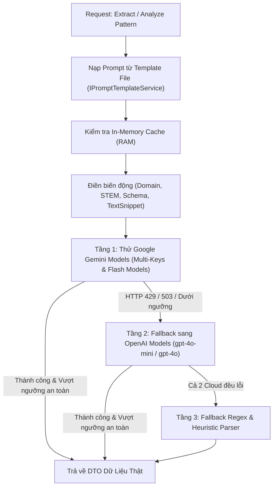

# BẢNG THEO DÕI HOTFIX KIẾN TRÚC - V-EVAL AI ENGINE

> [!IMPORTANT]
> **QUY ƯỚC QUẢN LÝ HOTFIX (CARD-BASED TRACKING)**
> - Bảng này tổng hợp các thẻ sự cố (Hotfix Cards) phát hiện trong quá trình nghiệm thu mã nguồn phân hệ AI Engine.
> - Mỗi thẻ chứa đầy đủ trạng thái, mức độ, người phát hiện, mốc thời gian, mô tả và phương án khắc phục chi tiết.
> - Xem Kế hoạch Tổng thể 4 Giai đoạn hoàn thiện 100% hệ thống tại: [`Master_Hotfix_Plan.md`](./Master_Hotfix_Plan.md).

---

## 📋 DANH SÁCH THẺ HOTFIX (HOTFIX ISSUE CARDS)

### 🎫 THẺ 01: [HF-AI-01] Thiếu Ngữ Pháp Thẻ Toán Học 3D & Cơ Chế Failover Trong Python RAG

| Thuộc tính | Chi tiết |
| :--- | :--- |
| **Mã Thẻ (Issue ID)** | `HF-AI-01` |
| **Trạng Thái (Status)** | `🟡 OPEN (Chờ triển khai)` |
| **Mức Độ (Severity)** | `CRITICAL (Ảnh hưởng hiển thị trực quan đề thi)` |
| **Người Phát Hiện** | **`ThinhTran2412`** |
| **Thời Gian Ghi Nhận** | `22/10/2026 - 15:42:00 (GMT+7)` |
| **Tệp Mã Nguồn** | [`All Services/V-Eval-Ai_Engine/rag-service/routers/diagnostic.py`](./../../All%20Services/V-Eval-Ai_Engine/rag-service/routers/diagnostic.py#L577) |

#### 📝 Mô Tả Chi Tiết & Bản Chất Lỗi:
- Trong hàm `_call_gemini_exam_generator`, chỉ thị `sys_prompt` chỉ thêm 1 câu bề nổi: *"BẮT BUỘC nhúng thẻ tương tác [MATH_GRAPH_3D] hoặc [MATH_GRAPH]"* nhưng **hoàn toàn không cung cấp quy chuẩn cú pháp (Schema Grammar)**.
- Gemini không biết các thuộc tính `shapeType`, `vertices`, `auxLines` nên sẽ tự "ảo giác" cú pháp ➔ Bộ Three.js/Canvas của Frontend không đọc được tọa độ, gây lỗi crash hoặc trắng màn hình.
- Kho câu hỏi dự phòng RAM (`QUESTION_TEMPLATES`) 100% là chữ thô.
- Python chỉ gọi duy nhất 1 model `gemini-flash-lite-latest`, không có cơ chế xoay vòng Failover (`gemini-3.6-flash`...) và dùng `json.loads` thô dễ sập khi gặp ngoặc kép tiếng Việt (`0xC4`/`N`).

#### 🛠️ Phương Án Giải Quyết:
1. Nhúng toàn bộ block đặc tả cú pháp chuẩn của thẻ `[MATH_GRAPH_3D]`, `[VARIATION_TABLE]`, `[MATH_GRAPH]` từ C# sang `sys_prompt` của Python.
2. Nâng cấp danh sách model dự phòng (Multi-Model Failover) và thêm bộ tiền xử lý khử dấu ngoặc kép tiếng Việt trước khi parse JSON.
3. Bổ sung các câu hỏi mẫu chứa thẻ 3D vào mảng `QUESTION_TEMPLATES` trong RAM.

---

### 🎫 THẺ 02: [HF-AI-02] Gán Cứng Ngầm Định Môn Toán Học Khi Thiếu Tham Số Input

| Thuộc tính | Chi tiết |
| :--- | :--- |
| **Mã Thẻ (Issue ID)** | `HF-AI-02` |
| **Trạng Thái (Status)** | `🟡 OPEN (Chờ triển khai)` |
| **Mức Độ (Severity)** | `HIGH (Nguy cơ phá vỡ ngữ nghĩa bóc tách tài liệu)` |
| **Người Phát Hiện** | **`ThinhTran2412`** |
| **Thời Gian Ghi Nhận** | `22/10/2026 - 15:56:00 (GMT+7)` |
| **Tệp Mã Nguồn** | [`All Services/V-Eval-Ai_Engine/V-Eval-Ai_Engine.API/Endpoints/CurriculumEndpoints.cs`](./../../All%20Services/V-Eval-Ai_Engine/V-Eval-Ai_Engine.API/Endpoints/CurriculumEndpoints.cs#L26-L30) |

#### 📝 Mô Tả Chi Tiết & Bản Chất Lỗi:
- Tại endpoint `/extract`, hệ thống khởi tạo mặc định:
  ```csharp
  string domainId = "dom_math_analysis";
  string domainName = "Toán học & Tư duy định lượng";
  ```
- Nếu client (Frontend hoặc bên thứ ba) upload file mà quên gửi hoặc gửi rỗng trường `domainId`/`domainName`:
- Hệ thống âm thầm gán file đó thành môn Toán. Dẫn đến tài liệu **Ngữ văn**, **Lịch sử**, **Địa lý** hoặc **Tiếng Anh** bị ép chạy theo Prompt của Toán học: bắt tìm công thức KaTeX, dựng hình 3D, vẽ bảng biến thiên, sinh phương pháp 4 bước và mẹo Casio, làm sai lệch hoàn toàn cây tri thức bài học.

#### 🛠️ Phương Án Giải Quyết:
1. Loại bỏ gán cứng mặc định `dom_math_analysis`.
2. Bổ sung **Strict Input Validation**: Kiểm tra nếu cả Form và Body JSON đều không có `domainId`/`domainName` thì trả về ngay `HTTP 400 Bad Request` kèm thông báo: *"Vui lòng chọn lĩnh vực môn học trước khi tải lên tài liệu."*
3. Tùy chọn nâng cao: Cho AI đọc lướt 1–2 trang đầu để tự nhận diện môn học nếu người dùng không chọn.

---

### 🎫 THẺ 03: [HF-AI-03] Hardcoded Prompt Dài Dằng Dặc Trong Mã Nguồn C# (Prompt-in-Code Smell)

| Thuộc tính | Chi tiết |
| :--- | :--- |
| **Mã Thẻ (Issue ID)** | `HF-AI-03` |
| **Trạng Thái (Status)** | `🟡 IN PROGRESS (Đã duyệt kế hoạch - Ưu tiên triển khai [09/11/2026])` |
| **Mức Độ (Severity)** | `MEDIUM (Bảo trì & Vận hành kiến trúc LLMOps)` |
| **Người Phát Hiện** | **`ThinhTran2412`** |
| **Thời Gian Ghi Nhận** | `22/10/2026 - 16:15:00 (GMT+7) - Cập nhật kế hoạch: 09/11/2026` |
| **Tệp Mã Nguồn** | [`V-Eval-Ai_Engine.Infrastructure/Services/CurriculumAiService.cs`](./../../All%20Services/V-Eval-Ai_Engine/V-Eval-Ai_Engine.Infrastructure/Services/CurriculumAiService.cs#L210-L406), [`CurriculumAiService.cs`](./../../All%20Services/V-Eval-Ai_Engine/V-Eval-Ai_Engine.Infrastructure/Services/CurriculumAiService.cs#L538-L560), [`CurriculumAiService.cs`](./../../All%20Services/V-Eval-Ai_Engine/V-Eval-Ai_Engine.Infrastructure/Services/CurriculumAiService.cs#L710-L750) |

#### 📝 Mô Tả Chi Tiết & Bản Chất Lỗi:
- Các chuỗi Prompt điều khiển AI dài hàng nghìn ký tự (đặc tả thẻ 3D, bảng biến thiên, quy chuẩn sư phạm, phân chia STEM vs Xã hội) đang bị gán cứng trực tiếp dưới dạng chuỗi string literal trong các file code C#.
- **Hạn chế trong thực tế vận hành (Production Bottleneck)**:
  - Mỗi khi giáo viên hoặc chuyên gia AI muốn tinh chỉnh prompt, thêm dạng hình 3D mới hay sửa tiêu chuẩn câu hỏi, bắt buộc phải: sửa code C# -> biên dịch lại giải pháp -> đóng gói lại Docker container -> deploy lại server.
  - Không thể thực hiện thử nghiệm so sánh A/B Testing giữa các phiên bản prompt khác nhau.
  - Vi phạm nguyên tắc phân tách mối quan tâm (Separation of Concerns): Trộn lẫn logic điều khiển mạng với nội dung tri thức sư phạm của AI.

#### 🛠️ Phương Án Giải Quyết:
1. **Phương án tức thời (File-based Templates)**:
   - Tách toàn bộ 3 chuỗi prompt chính trong `CurriculumAiService.cs` ra thành các file template độc lập trong thư mục `Templates/Prompts/`:
     + `CurriculumIngestion.prompt.txt`: Prompt bóc tách chuyên đề, bài học và dạng bài SGK GDPT 2018.
     + `PatternAnalysis.prompt.txt`: Prompt phân tích bản chất dạng bài (Bloom L1-L4, 4 khối nội dung, bẫy đề, Casio).
     + `PracticeQuestionGenerator.prompt.txt`: Prompt sinh câu hỏi rèn luyện L3/L4 có chống trùng lặp.
   - Xây dựng `IPromptTemplateService` / `PromptTemplateService` với cơ chế đọc file bất đồng bộ, bộ nhớ đệm In-Memory Caching (`ConcurrentDictionary`), và cơ chế dự phòng (Safe String Fallback) nếu file template bị xóa ngoài ý muốn.
2. **Phương án dài hạn (Prompt Catalog in DB / LLMOps)**:
   - Lưu trữ prompt vào bảng `v_eval_ai."PromptTemplates"` trên Supabase PostgreSQL kết hợp bộ nhớ đệm In-Memory Cache, cho phép quản lý và cập nhật prompt tức thì qua màn hình Admin Web UI (Zero-Downtime Tuning).

---

### 🎫 THẺ 04: [HF-AI-04] Thiếu Cơ Chế Failover Xoay Vòng Đa Đám Mây & Ngưỡng An Toàn (Gemini <-> OpenAI Fallback) Trong CurriculumAiService

| Thuộc tính | Chi tiết |
| :--- | :--- |
| **Mã Thẻ (Issue ID)** | `HF-AI-04` |
| **Trạng Thái (Status)** | `🟡 IN PROGRESS (Đã duyệt kế hoạch - Ưu tiên triển khai [09/11/2026])` |
| **Mức Độ (Severity)** | `HIGH (Tính sẵn sàng cao & Phòng chống cạn kiệt Quota)` |
| **Người Phát Hiện** | **`ThinhTran2412`** |
| **Thời Gian Ghi Nhận** | `09/11/2026 - 21:10:00 (GMT+7)` |
| **Tệp Mã Nguồn** | [`V-Eval-Ai_Engine.Infrastructure/Services/CurriculumAiService.cs`](./../../All%20Services/V-Eval-Ai_Engine/V-Eval-Ai_Engine.Infrastructure/Services/CurriculumAiService.cs#L408-L515) |

#### 📝 Mô Tả Chi Tiết & Bản Chất Lỗi:
- Trong `CurriculumAiService.cs`, tiến trình bóc tách hiện tại **chỉ gọi đơn tuyến Google Gemini** (`geminiModels` x `apiKeys`).
- **Rủi ro vận hành thực tế**:
  - Khi Google Cloud gặp sự cố mạng, chạm trần quota API (HTTP 429 Too Many Requests), hoặc lỗi quá tải tạm thời (HTTP 503 Service Unavailable), toàn bộ tiến trình bóc tách chuyên đề lập tức sập và ném ngoại lệ `InvalidOperationException`, khiến trải nghiệm người dùng bị đứt gãy.
  - Trong khi đó, `GeminiExamParserService.cs` và `PdfPigTextbookParserService.cs` đã được trang bị cơ chế Failover xoay vòng sang **OpenAI Vision (`gpt-4o`, `gpt-4o-mini`)**, tạo ra sự bất nhất quán về kiến trúc giữa các service trong cùng một phân hệ AI Engine.
  - Thiếu bộ kiểm soát **Ngưỡng an toàn (Safety Thresholds)**: Không có cơ chế kiểm tra tính đầy đủ tối thiểu của kết quả bóc tách (số chương `>= 1`, số dạng bài `>= 1`), dễ dẫn đến việc chấp nhận các kết quả trích xuất rỗng hoặc cụt lủn từ AI.

#### 🛠️ Phương Án Giải Quyết:
1. **Tích hợp bộ phân giải cấu hình OpenAI**:
   - Bổ sung `ResolveOpenAiKey()` và `ResolveOpenAiModels()` tương thích với `AiSettings:OpenAiApiKey` / biến môi trường `OPENAI_API_KEY`.
   - Danh sách mô hình GPT dự phòng ưu tiên: `gpt-4o-mini`, `gpt-4o`, `o3-mini`.
2. **Cơ chế Failover xoay vòng 2 tầng (Dual-Cloud Cascade Failover)**:
   - **Tầng 1 (Primary)**: Thử nghiệm danh sách mô hình Google Gemini (`gemini-3.6-flash`, `gemini-3.5-flash-lite`, `gemini-3.1-flash-lite`, `gemini-flash-lite-latest`) với các API Keys khả dụng.
   - **Tầng 2 (Fallback)**: Nếu toàn bộ mô hình Gemini đều bị từ chối (HTTP 429, 500, 503) hoặc kết quả bóc tách không vượt qua ngưỡng an toàn, hệ thống tự động chuyển tiếp sang gọi API OpenAI Chat Completions với định dạng `json_object`.
3. **Thiết lập & Kiểm tra Ngưỡng an toàn (Safety Thresholds)**:
   - `MinChaptersThreshold`: Tối thiểu phải trích xuất được `>= 1` chương và `>= 1` dạng bài hợp lệ. Nếu số lượng dưới ngưỡng, xem như mô hình trích xuất không đạt chuẩn và tự động kích hoạt model fallback kế tiếp.
   - Tối đa số lần thử `MaxAttempts = 5`.
   - Cơ chế đo thời gian và ghi log cảnh báo chuyển đổi model rõ ràng phục vụ giám sát.

---

## 🚀 KẾ HOẠCH TRIỂN KHAI CHI TIẾT (APPROVED EXECUTION PLAN - [09/11/2026])



### 1. Phân Kế Hoạch 4 Bước Cụ Thể:
- **Bước 1 (Templates & Service)**:
  - Tạo thư mục `Templates/Prompts/` trong `V-Eval-Ai_Engine.Infrastructure`.
  - Tạo 3 file template: `CurriculumIngestion.prompt.txt`, `PatternAnalysis.prompt.txt`, `PracticeQuestionGenerator.prompt.txt`.
  - Viết `IPromptTemplateService` và `PromptTemplateService` nạp và cache nội dung prompt.
- **Bước 2 (Refactor CurriculumAiService)**:
  - Inject `IPromptTemplateService` vào `CurriculumAiService`.
  - Thay thế 3 khối chuỗi prompt hardcoded bằng các hàm gọi nạp template chuyên biệt.
- **Bước 3 (Dual-Engine Fallback & Threshold Check)**:
  - Thêm phương thức `TryCallOpenAiCurriculumAsync(...)` hỗ trợ nạp payload JSON tương thích OpenAI.
  - Bổ sung cấu hình `MinChaptersThreshold = 1` và logic kiểm tra ngưỡng trước khi chấp thuận kết quả.
  - Tự động chuyển vùng sang OpenAI khi Gemini gặp lỗi mã trạng thái hoặc trả về dữ liệu rỗng.
- **Bước 4 (Testing & Verification)**:
  - Chạy `dotnet build` và kiểm thử tự động với `test.bat` trong `V-Eval-Ai_Engine`.
  - Cập nhật nhật ký `docs/daily.md`, `docs/process.md` và `UPDATE.md`.

---

## 📊 BẢNG TỔNG KẾT TRẠNG THÁI HOTFIX

| Mã Thẻ | Phân Hệ | Vấn Đề Trọng Tâm | Mức Độ | Người Đưa Ra | Trạng Thái |
| :--- | :--- | :--- | :--- | :--- | :--- |
| `HF-AI-01` | Python (`diagnostic.py`) | Thiếu grammar thẻ 3D & cơ chế Failover | `CRITICAL` | `ThinhTran2412` | `🟡 OPEN` |
| `HF-AI-02` | C# (`CurriculumEndpoints.cs`) | Gán cứng ngầm định môn Toán khi thiếu input | `HIGH` | `ThinhTran2412` | `🟡 OPEN` |
| `HF-AI-03` | C# (`CurriculumAiService.cs`) | Hardcoded Prompt dài trong code C# | `MEDIUM` | `ThinhTran2412` | `🟡 IN PROGRESS` |
| `HF-AI-04` | C# (`CurriculumAiService.cs`) | Thiếu Failover đa đám mây (Gemini <-> OpenAI) | `HIGH` | `ThinhTran2412` | `🟡 IN PROGRESS` |
