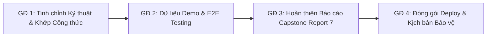

# KẾ HOẠCH TỔNG THỂ HOÀN THIỆN 100% TOÀN BỘ HỆ THỐNG V-EVAL CAPSTONE (MASTER HOTFIX & SYSTEM PLAN)

> [!IMPORTANT]
> **QUY CHUẨN ĐỒ ÁN CAPSTONE V-EVAL**
> - Kế hoạch này tổng hợp toàn bộ các nhiệm vụ trọng tâm từ rà soát 6 dịch vụ Microservices, CSDL Supabase (51 bảng), thiết kế nghiệp vụ ([`tong_hop_6_core_flow_v_eval.md`](./../core_flow/tong_hop_6_core_flow_v_eval.md)), báo cáo đối chiếu ([`so_sanh_report7_va_thuc_te_trien_khai.md`](./../so_sanh_report7_va_thuc_te_trien_khai.md)) và Báo cáo Đồ án tốt nghiệp ([`report_tong_chuan_hoa.md`](./../../docs/report_tong_chuan_hoa.md)).
> - Hiện tại hệ thống đã hoàn thành ~85–90% khối lượng kỹ thuật cốt lõi (toàn bộ 6 Core Flow, 5 cổng phân quyền vai trò và hạ tầng Microservices).
> - Mục tiêu: Hoàn thiện 100% toàn bộ hệ thống sẵn sàng nghiệm thu và bảo vệ xuất sắc trước Hội đồng Capstone.

---

## 🗺️ LỘ TRÌNH 4 GIAI ĐOẠN TỔNG THỂ

---

## 🎯 GIAI ĐOẠN 1: TINH CHỈNH KỸ THUẬT & KHỚP 100% CÔNG THỨC TOÁN (CODE & MATH ALIGNMENT)
*Mục tiêu: Đảm bảo khi Hội đồng đối chiếu từng dòng mã nguồn với công thức toán trong báo cáo lý thuyết không tìm ra bất kỳ điểm mâu thuẫn nào.*

### 1. Khớp Công Thức Toán Học Core Flow 6 Trong `Practice Service`
- **Hiện trạng mã nguồn**:
  - File [`RecalculatePredictionCommandHandler.cs`](./../../All%20Services/V-Eval-Practice_Service/V-Eval-Practice_Service.Application/Features/Predictions/Commands/RecalculatePredictionCommandHandler.cs) đang dùng giá trị sai số chuẩn hằng số ngầm định `` `SEM = 24.5` `` và tính điểm quy đổi trực tiếp qua tỷ lệ câu đúng thô: `` `TotalCorrect / TotalQuestions * 1200` ``.
- **Nhiệm vụ cần thực hiện**:
  - Cập nhật thuật toán tính sai số đo lường chuẩn động theo hàm thông tin Fisher Information:
    `` `SEM(\theta) = \frac{1}{\sqrt{I(\theta)}}` ``
  - Áp dụng hàm quy đổi chuẩn hóa thang điểm ĐGNL VNU-HCM:
    `` `Y(\theta) = 600 + 150 \times \theta` `` (với độ lệch chuẩn `` `\sigma = 150` ``, điểm trung bình `` `\mu = 600` ``).
  - Khớp thuật toán Knapsack ROI tối ưu hóa Toa thuốc ôn tập (Exam Prescription) theo tỷ lệ gia tăng năng lực trên mỗi đơn vị thời gian ôn luyện, đồng bộ 100% với đặc tả trong Báo cáo Thiết kế Phần mềm (SDD).

### 2. Kỷ Luật Học Tập & Báo Cáo Tuần Tự Động (Core Flow 5)
- **Hiện trạng mã nguồn**:
  - Đã tích hợp `NotificationDispatcher` và `BrevoSmtpEmailService` gửi email OTP và cảnh báo học vụ tức thời.
- **Nhiệm vụ cần thực hiện**:
  - Xây dựng một Background Worker tự động quét tiến độ định kỳ hàng tuần (chạy vào 06:00 sáng Thứ Hai).
  - Tự động tổng hợp và gửi Email Báo cáo Tiến độ Học tập định kỳ cho Phụ huynh gồm: Chỉ số sẵn sàng thi (Exam Readiness Index), tổng số giờ học trong tuần, số câu hỏi rèn luyện, các lỗ hổng tri thức đã khắc phục và cảnh báo đỏ nếu phát hiện dấu hiệu sa sút.

### 3. Tinh Gọn AI Engine & Socratic Prompt (ĐÃ HOÀN THÀNH - [09/11/2026])
- **Hiện trạng mã nguồn**:
  - Đã tách toàn bộ System Prompt dài hàng nghìn ký tự trong `CurriculumAiService.cs`, `SocraticTutorService.cs` và `MultiCloudExamParserService.cs` ra 5 file template độc lập trong thư mục `Templates/Prompts/`.
  - Triển khai `IPromptTemplateService` / `PromptTemplateService` với bộ nhớ đệm RAM In-Memory Caching (`ConcurrentDictionary`), token substitution Mustache `{{var}}`, và safe defense-in-depth fallback.
  - Xây dựng cơ chế Failover 2 tầng đa đám mây (Google Gemini <-> OpenAI Chat Completions `gpt-4o-mini`, `gpt-4o`, `o3-mini`) kèm kiểm soát ngưỡng an toàn `minChaptersThreshold >= 1` và `maxAttempts = 5`.
  - Đổi tên `GeminiExamParserService` thành `MultiCloudExamParserService` loại bỏ Naming Smell.
  - Vượt qua 12/12 unit tests đạt 100%.

---

## 🧪 GIAI ĐOẠN 2: DỮ LIỆU DEMO MẪU & BỘ TEST LIÊN THÔNG E2E (SEEDING & E2E TESTING)
*Mục tiêu: Khi demo trực tiếp trước Hội đồng, hệ thống có sẵn dữ liệu sống động, giàu ngữ cảnh, trực quan, không bị màn hình trống trơn hay mất thời gian tạo dữ liệu thủ công.*

### 1. Xây Dựng Bộ Script Seed Data "Vàng" Cho 5 Cổng Vai Trò
- **Cổng Học Sinh (`Student Portal`)**:
  - 1 tài khoản mẫu đã có đầy đủ lịch sử bài thi chẩn đoán (Biểu đồ Radar 3 miền năng lực hiển thị sắc nét).
  - Bản đồ cây tri thức / Lộ trình thích ứng DAG đã mở khóa qua 2 chặng học tập.
  - Sổ tay bẫy lỗi sai (Mistake Notebook) lưu sẵn 15 câu hỏi điển hình với đầy đủ các nhãn phân loại nhận thức (như `` `CARELESS` `` - Bất cẩn, `` `MISSING_CONCEPT` `` - Hổng kiến thức, `` `TIME_PRESSURE` `` - Áp lực thời gian).
- **Cổng Giáo Viên (`Teacher Portal`)**:
  - 1 lớp học với Bản đồ nhiệt BKT Heatmap đầy đủ các ô trực quan phân hóa 3 màu Đỏ / Vàng / Xanh.
  - Hiển thị rõ điểm nghẽn học tập chung của lớp để giáo viên demo tính năng **1-Click Action phát đề cứu trợ thích ứng**.
- **Cổng Phụ Huynh (`Parent Portal`)**:
  - Tài khoản phụ huynh đã liên kết xác thực 2 chiều với con.
  - Hiển thị trực quan chỉ số sẵn sàng thi (Exam Readiness Index) và lịch sử nhận thông báo/email cảnh báo đỏ.
- **Cổng Giám Đốc Học Thuật (`Academic Director Portal`)**:
  - Comparative Heatmap so sánh chéo trình độ giữa các lớp học, biểu đồ phân phối điểm và thống kê độ lệch chuẩn năng lực `` `\sigma_s` ``.
  - Danh sách đề xuất dạng bài mới (`novel_pattern_proposals`) chờ phê duyệt hoặc gộp nhánh tri thức.
- **Cổng Quản Trị Viên (`Admin Portal`)**:
  - Quản lý phân quyền tài khoản IAM, cấp phát tài khoản học sinh/giáo viên và tính năng Soft Delete bảo toàn lịch sử.

### 2. Kịch Bản Kiểm Thử E2E Khép Kín Liên Thông 6 Dịch Vụ
- **Chu trình vận hành khép kín (Full Lifecycle Test)**:
  - `Đăng ký/Đăng nhập IAM` $\rightarrow$ `Làm bài thi chẩn đoán (CF1)` $\rightarrow$ `Sinh lộ trình thích ứng DAG (CF2)` $\rightarrow$ `Thanh toán VietQR PayOS mở khóa chặng` $\rightarrow$ `Rèn luyện chu trình P-L-A-R có AI Socratic dẫn dắt (CF3 & CF4)` $\rightarrow$ `Xem bảng nhiệt lớp học (CF5)` $\rightarrow$ `Nhận Toa thuốc Knapsack & Cảnh báo sa sút sớm (CF6)`.
- **Đảm bảo chất lượng mã nguồn**:
  - Chạy toàn bộ các bộ test tự động qua script `Scripts/test/test_all.bat` bảo đảm 100% test suites của 6 dịch vụ vượt qua sạch sẽ.

---

## 📄 GIAI ĐOẠN 3: HOÀN THIỆN BÁO CÁO TỔNG & HỒ SƠ NGHIỆM THU (DOCUMENTATION & REPORTS)
*Mục tiêu: Hoàn tất 100% hồ sơ học vụ phục vụ chấm điểm và lưu trữ đồ án tốt nghiệp chuẩn mẫu khoa CNTT.*

### 1. Hoàn Thiện Các Phần Còn Lại Của Báo Cáo Tổng ([`report_tong_chuan_hoa.md`](./../../docs/report_tong_chuan_hoa.md))
- Hiện trạng: Đã hoàn thiện *Front Matter, Part I (Introduction), Part II (Literature Review), Part III (System Requirements Specification - SRS)*.
- **Các phần cần viết tiếp**:
  - **Part IV. Software Design Description (SDD)**:
    - Bổ sung 4 sơ đồ kiến trúc hệ thống chuẩn Mermaid 11.15.0+ (Sơ đồ triển khai vật lý C4, Sơ đồ luồng dữ liệu 6 Core Flow, Sơ đồ máy trạng thái FSM/DAG).
    - Đặc tả thiết kế CSDL thực tế 51 bảng trên Supabase PostgreSQL.
    - Đặc tả giao thức API Gateway YARP, gRPC nội bộ và xác thực JWT Bearer Token.
  - **Part V. Software Testing Documentation**:
    - Tổng hợp kết quả Unit Test của 6 dịch vụ, bảng đối chiếu ma trận kiểm thử chức năng (Traceability Matrix), kết quả kiểm thử tải k6/JMeter và kiểm thử bảo mật.
  - **Part VI & VII. User Guides & Release Package**:
    - Hướng dẫn triển khai môi trường Docker Compose đa container.
    - Hướng dẫn thao tác cho 5 cổng phân quyền người dùng.

### 2. Đồng Bộ Báo Cáo Nghiệm Thu Mã Nguồn Cá Nhân ([`ThinhTT_aceptance.md`](./../personal/ThinhTT_aceptance.md))
- Rà soát và chuyển trạng thái 29 file cốt lõi còn lại từ `- [ ] **Chưa duyệt**` sang `- [x] **Đã duyệt**` theo định dạng cặp nhãn Clean Toggle tương thích 100% MD Editor Plus.
- Nghiệm thu giải trình kỹ thuật chi tiết cho các commit lớn tại Mục 9 (Brevo SMTP Relay, VietQR PayOS, Soft Delete IAM, Early Warning Sweep Worker, MultiCloud AI Parser).

### 3. Rà Soát Khớp Phiếu Đăng Ký Đề Tài ([`ke_hoach_chuan_hoa_phieu_dang_ky_de_tai.md`](./../../docs/ke_hoach_chuan_hoa_phieu_dang_ky_de_tai.md))
- Kiểm tra nội dung hồ sơ học vụ nộp cho Giảng viên Hướng dẫn (Thầy Tài):
  - Định vị rõ ràng Web Client là nền tảng học tập tương tác chính, Mobile App là ứng dụng đồng hành (Companion App).
  - Đảm bảo phạm vi cam kết an toàn, linh hoạt, tránh các chỉ số định lượng quá đà gây khó khăn khi nghiệm thu.

---

## 🚀 GIAI ĐOẠN 4: ĐÓNG GÓI TRIỂN KHAI & TỔNG DUYỆT BẢO VỆ (DEPLOYMENT & DEFENSE REHEARSAL)
*Mục tiêu: Đảm bảo ngày bảo vệ chính thức diễn ra mượt mà 100%, không phát sinh bất kỳ sự cố kỹ thuật hay lúng túng nào.*

### 1. Đóng Gói Docker Compose & Script Vận Hành 1 Chạm
- Chuẩn hóa `docker-compose.yml` khởi động đồng loạt 6 microservices và CSDL PostgreSQL/Qdrant ổn định chỉ với một lệnh duy nhất.
- Chuẩn bị 2 phương án demo song song:
  - **Phương án A (Ưu tiên)**: Demo trực tiếp từ VPS/Cloud Server qua tên miền hệ thống.
  - **Phương án B (Dự phòng rớt mạng hội trường)**: Demo 100% Offline trên máy tính cá nhân cục bộ qua `Scripts/run_local.bat`.

### 2. Soạn Bộ Slide Thuyết Trình (Slide Deck) & Video Demo Dự Phòng 3 Phút
- Thiết kế Slide thuyết trình chuyên nghiệp, súc tích (20–25 slide) tập trung vào các điểm sáng:
  - Bối cảnh kỳ thi ĐGNL ĐHQG-HCM (V-ACT) và bài toán cá nhân hóa học tập.
  - Kiến trúc Microservices & 6 Core Flows liên thông.
  - Minh chứng khoa học của các thuật toán lõi (IRT 2PL, Bayesian Knowledge Tracing, Knapsack Optimization, GraphRAG Socratic).
  - Trình diễn thực tế hệ thống (Live Demo).
- Quay sẵn 1 Video Demo chất lượng cao (3–5 phút) quay lại toàn bộ chu trình tính năng chính để sẵn sàng phát ngay nếu mạng Internet tại hội đồng gặp sự cố nghẽn mạng.

### 3. Phân Vai Thuyết Trình & Luyện Tập Phản Biện (Q&A Rehearsal)
- Phân chia thời lượng trình bày cho 4 thành viên (Lộc, Thịnh, Khôi, Nhân) khớp chuẩn khung 15–20 phút của Hội đồng.
- Luyện tập trả lời các câu hỏi phản biện chuyên sâu (đã tổng hợp sẵn trong tài liệu [`phan_bien_nhan_xet_review_1.md`](./../../docs/phan_bien_nhan_xet_review_1.md)).

---

## 📊 BẢNG THEO DÕI TIẾN ĐỘ THỰC HIỆN KẾ HOẠCH MASTER

| Giai Đoạn | Nhiệm Vụ Trọng Tâm | Phân Hệ Liên Quan | Trạng Thái | Mức Độ Ưu Tiên |
| :---: | :--- | :--- | :---: | :---: |
| **GĐ 1.1** | Khớp công thức toán SEM & Knapsack | `Practice Service` | `🟡 Chờ triển khai` | `P0 - Bắt buộc` |
| **GĐ 1.2** | Background Worker Email Báo cáo tuần | `Practice Service`, `Identity Service` | `🟡 Chờ triển khai` | `P1 - Quan trọng` |
| **GĐ 1.3** | Tách Template Prompt & MultiCloud AI Parser | `AI Engine Service` | `🟢 HOÀN THÀNH` | `P0 - Bắt buộc` |
| **GĐ 2.1** | Script Seed Data "Vàng" cho 5 Cổng | `PostgreSQL`, `Supabase`, All Services | `🟡 Chờ triển khai` | `P0 - Bắt buộc` |
| **GĐ 2.2** | Kiểm thử liên thông E2E 6 Dịch vụ | All Services, Gateway, Web Client | `🟡 Chờ triển khai` | `P1 - Quan trọng` |
| **GĐ 3.1** | Viết tiếp Part IV (SDD) & Part V Báo cáo Tổng | Tài liệu `report_tong_chuan_hoa.md` | `🟡 Chờ triển khai` | `P0 - Bắt buộc` |
| **GĐ 3.2** | Duyệt hoàn tất 29 file Báo cáo Nghiệm thu | Tài liệu `ThinhTT_aceptance.md` | `🟡 Chờ triển khai` | `P1 - Quan trọng` |
| **GĐ 3.3** | Rà soát Phiếu đăng ký đề tài với GVHD | Tài liệu `ke_hoach_chuan_hoa_phieu_dang_ky_de_tai.md` | `🟡 Chờ triển khai` | `P2 - Cần thiết` |
| **GĐ 4.1** | Đóng gói Docker Compose & Script Offline | Hạ tầng Docker, Scripts | `🟡 Chờ triển khai` | `P1 - Quan trọng` |
| **GĐ 4.2** | Soạn Slide Deck & Video Demo 3 Phút | Slide, Media | `🟡 Chờ triển khai` | `P1 - Quan trọng` |
| **GĐ 4.3** | Phân vai thuyết trình & Tổng duyệt Q&A | Toàn đội Capstone | `🟡 Chờ triển khai` | `P0 - Bắt buộc` |

